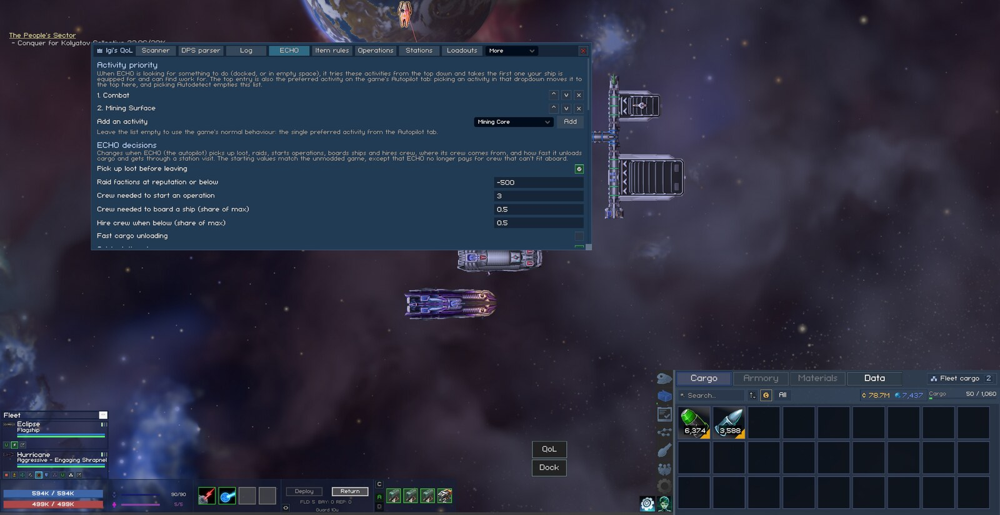

# Vanguard Galaxy mods

My modding workspace for Vanguard Galaxy (Steam app 3471800), played on Linux through Proton. The main thing in it is Igi's QoL Modpack, one BepInEx plugin with 40 quality-of-life features. Around it are the tools for keeping mods working across game updates and a template for starting new ones.

The modpack, the tools and the template were developed and tested on Linux only, with the game running under Proton. The game itself is a Windows build, so they should also work on Windows, but nobody has tried them there yet. Reports from Windows players are welcome.



## Documentation

| If you want to | Read |
|---|---|
| Install and use the modpack | [docs/modpack/README.md](docs/modpack/README.md) |
| See what each feature does | [Window and HUD](docs/modpack/features/interface.md), [ECHO](docs/modpack/features/echo.md), [Fleet and combat](docs/modpack/features/fleet-combat.md), [Loot and cargo](docs/modpack/features/loot-and-cargo.md), [Stations, loadouts and crafting](docs/modpack/features/stations.md), [Logs, reference and other mods](docs/modpack/features/logs-and-reference.md) |
| Look up a setting | [docs/modpack/settings.md](docs/modpack/settings.md) |
| Get BepInEx running on Windows or under Proton, find logs and saves | [docs/setup.md](docs/setup.md) |
| Build the mods, or update them after a game patch | [docs/building.md](docs/building.md) |
| Find which game method to patch for something | [docs/modding-reference.md](docs/modding-reference.md) |
| Work on the modpack's code | [docs/modpack/developing.md](docs/modpack/developing.md) |
| Run the in-game self-checks, dump game data, profile | [docs/modpack/dev-harness.md](docs/modpack/dev-harness.md) |
| Compare two game versions for broken patches | [tools/VersionDiff/README.md](tools/VersionDiff/README.md) |
| Start a new mod in its own repo | [docs/template.md](docs/template.md) |
| Understand the pipeline and releases | [docs/ci.md](docs/ci.md) |

## What's here

| Path | What it is |
|---|---|
| `src/IgiQoL/` | Igi's QoL Modpack |
| `src/HelloVanguard/` | The smallest working plugin; proof that BepInEx loads ([README](src/HelloVanguard/README.md)) |
| `tools/VersionDiff/` | Compares game versions: which patched methods changed, which game members a mod DLL uses that are gone, and what changed in the game's data |
| `templates/VgMod/` | `dotnet new` template for a mod in its own repo |
| `Directory.Build.props` | Shared build setup: game references, publicizer, deploy to the game, game-version snapshots |
| `.github/workflows/ci.yml` | Build, patch check and releases, on a runner on this PC |
| `docs/` | The documentation above; `docs/images/` holds the screenshots |
| `decompiled/`, `game-versions/` | The decompiled game and copies of its DLLs per version. Gitignored: they're the game's copyrighted code |

## Quick start

```fish
dotnet build -c Release
```

builds everything against the installed game and copies the plugins into `BepInEx/plugins/`. You need the .NET 8 SDK and BepInEx 5 in the game folder; [docs/setup.md](docs/setup.md) and [docs/building.md](docs/building.md) have the details.

Releases of the modpack are on the [GitHub releases page](https://github.com/williammabernathy/Igi-s-QoL-Modpack/releases).
