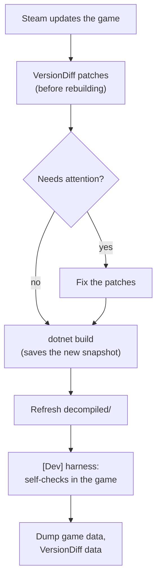

# Building mods

## Tools

- .NET 8 SDK in `~/.dotnet` (user-local; the system `/usr/bin/dotnet` has no SDK).
- `ilspycmd` 9.1 (decompiler) as a .NET global tool in `~/.dotnet/tools`.

Put them on your fish PATH once (prepends, so it wins over `/usr/bin/dotnet`):

```fish
set -Ux DOTNET_ROOT $HOME/.dotnet
fish_add_path $HOME/.dotnet $HOME/.dotnet/tools
```

In bash, for a single session: `export DOTNET_ROOT=$HOME/.dotnet PATH=$HOME/.dotnet:$PATH`.

## Build and deploy

```fish
dotnet build -c Release
```

That builds every project in `VanguardGalaxyMods.sln` and copies each plugin into the game. Restart the game to load a rebuilt DLL; BepInEx 5 has no hot reload.

`Directory.Build.props` holds the shared setup for every project under `src/`:

- References `BepInEx.dll`, `0Harmony.dll`, the game's `Assembly-CSharp.dll`, and the Unity DLLs straight from the game folder. Override the path with `-p:GameDir=...`.
- Publicizes `Assembly-CSharp` (`BepInEx.AssemblyPublicizer.MSBuild`), so you can use the game's private fields and methods directly instead of reflection.
- Targets `net472`, which matches the game's Mono profile.
- After each build, copies the DLL and PDB to `BepInEx/plugins/<AssemblyName>/`. Turn this off with `-p:DeployToGame=false`.
- Before compiling, snapshots the game DLLs (see [After a game update](#after-a-game-update)).

`tools/Directory.Build.props` and `templates/Directory.Build.props` are empty on purpose: they stop the root file from turning the tools and the template sources into game plugins.

Build options that only `src/IgiQoL` understands:

| Option | Effect |
|---|---|
| `-p:Version=0.1.1` | Overrides `<Version>` in `IgiQoL.csproj`; `PluginInfo.Version` (used by `[BepInPlugin]` and the startup log line) follows it |
| `-p:ReleaseZip=true` | Also writes `artifacts/IgiQoL-<version>.zip`, laid out as `BepInEx/plugins/IgiQoL/IgiQoL.dll` (+ `.pdb`) so it extracts into the game folder |

## A new mod

In this repo: copy `src/HelloVanguard` (see [its README](../src/HelloVanguard/README.md)), rename the folder, `.csproj`, `AssemblyName` and plugin GUID, then `dotnet sln add src/<Name>/<Name>.csproj`.

In its own repo: use the `dotnet new` template in `templates/VgMod`. [template.md](template.md) covers it.

## After a game update



Every build first copies the game DLLs it compiles against (`Assembly-CSharp`, `UnityEngine*`, `Unity.InputSystem`, `Unity.TextMeshPro`, about 17 MB) into `game-versions/<game version>-<hash>/`, so the version you last built against is still there after Steam replaces it. The copy happens before compiling, so a build that fails against the new game still saves the new version. `game-versions/` is gitignored; the DLLs are the game's copyrighted code.

`tools/VersionDiff` compares two of those versions:

```fish
dotnet run --project tools/VersionDiff -- patches --out patch-report.md
```

For every method the mod patches it reports `unchanged`, `body changed` (with a diff of the decompiled method), `signature changed`, `missing` or `ambiguous`. It also reports patch parameters whose names no longer match the target, members the compiled DLL uses that are gone, and `AccessTools`/`Traverse` string lookups that no longer resolve. It exits 1 when any of those need attention. [`tools/VersionDiff/README.md`](../tools/VersionDiff/README.md) has the full reference.

Then refresh the decompiled source, keeping the old one for wider diffs:

```fish
mv decompiled decompiled-<old version>
ilspycmd -p -o decompiled "/mnt/data/SteamLibrary/steamapps/common/Vanguard Galaxy/VanguardGalaxy_Data/Managed/Assembly-CSharp.dll"
```

The folder layout follows the namespaces. The game uses both `Behaviour.*` and `Behavior.*`, so search for both spellings.

Run the modpack's self-checks next ([dev-harness.md](modpack/dev-harness.md)). A method body that changed in a way the diff doesn't make obvious still needs a test in play.

To see what an update changed in the game's data, you need a data dump from each version. `[Dev] DumpGameData` writes one to `BepInEx/config/IgiQoL/dumps/<game version>/`; the 0.8.3.4 dump is already there. Dump before Steam updates the game, because afterwards the old version can't be dumped any more. Once the game has updated, dump again and compare:

```fish
set D "/mnt/data/SteamLibrary/steamapps/common/Vanguard Galaxy/BepInEx/config/IgiQoL/dumps"
dotnet run --project tools/VersionDiff -- data $D/0.8.3.4 $D/<new version> --out data-changes.md
```

That lists added and removed items, ships, recipes and so on, and every changed value as `path: old → new`.
