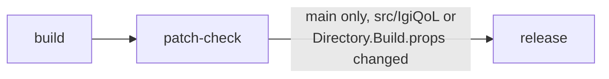

# CI and releases

`.github/workflows/ci.yml` runs on every push to `main` and `development`. Day-to-day work goes to `development`; a merge to `main` that touches the mod's sources publishes a release.



1. `build` compiles the solution against the installed game and packs `artifacts/IgiQoL-<version>.zip`, laid out as `BepInEx/plugins/IgiQoL/IgiQoL.dll` (+ `.pdb`) so it extracts straight into the game folder. The DLL and zip are the run's `build` artifact.
2. `patch-check` runs `VersionDiff patches` in manifest mode on the built DLL. It fails if a Harmony target, a game member the DLL uses, or an `AccessTools`/`Traverse` string lookup doesn't resolve in the installed game. The report is the run's `patch-report` artifact.
3. On `main` only, and only when `src/IgiQoL/` or `Directory.Build.props` changed in the push, `release` creates the tag `v<version>` and a GitHub release with the zip attached. The release notes list the commit subjects since the previous tag, without merge commits.

The in-game self-checks ([dev-harness.md](modpack/dev-harness.md)) need the game running, so CI doesn't run them. Run them yourself before merging to `main`.

## Versions

`<Version>` in `src/IgiQoL/IgiQoL.csproj` gives major and minor. The patch is one above the newest `vMAJOR.MINOR.*` tag, or `<Version>`'s own patch for the first release of that line. To start 0.2, set `<Version>0.2.0</Version>`. `[BepInPlugin]` and the startup log line read the version through the generated `PluginInfo.Version`, so local builds report `<Version>` as written.

## Running the pipeline locally

The same two jobs run on the host without the runner. From the repo root, in bash:

```bash
export DOTNET_ROOT=$HOME/.dotnet PATH=$HOME/.dotnet:$PATH
G="/mnt/data/SteamLibrary/steamapps/common/Vanguard Galaxy"

# build: the version the pipeline would give this commit
git fetch --tags --force --quiet origin
base=$(sed -n 's:.*<Version>\(.*\)</Version>.*:\1:p' src/IgiQoL/IgiQoL.csproj)
last=$(git tag -l "v${base%.*}.*" --sort=-v:refname | head -n 1)
if [ -n "$last" ]; then VERSION="${base%.*}.$(( ${last##*.} + 1 ))"; else VERSION="$base"; fi
dotnet build VanguardGalaxyMods.sln -c Release -warnaserror -p:GameDir="$G" -p:DeployToGame=false -p:Version="$VERSION" -p:ReleaseZip=true

# patch-check
dotnet run --project tools/VersionDiff -c Release -- patches --new "$G/VanguardGalaxy_Data/Managed" \
  --mod src/IgiQoL/bin/Release/IgiQoL.dll --out patch-report.md
```

`build` runs `dotnet build` with `-warnaserror`, so it passes only with no warnings at all; `patch-check` passes when VersionDiff exits 0. The zip lands in `artifacts/` (gitignored). The `release` job needs the workflow's GitHub token and only makes sense in CI.

## The runner

The game's DLLs are copyrighted and can't go to GitHub, so jobs run only on a self-hosted runner on this PC, labeled `vanguard-galaxy`. Runs wait as queued while it is off.

- Install: `~/.local/share/actions-runner` (the `actions/runner` release for linux-x64). `.runner` and `.credentials*` there hold its registration, keep them private.
- Service: `systemctl --user {status,restart} github-runner`, a user unit in `~/.config/systemd/user/`. It starts at login, not at boot.
- Jobs run directly on the host, in `_work/` under the install, not in a container. `.env` in the install sets `GAME_DIR` (the game folder), `DOTNET_ROOT` and a `PATH` that starts with `~/.dotnet`; the user unit loads it with `EnvironmentFile=`, so restart the service after editing it.
- The workflow only triggers on pushes, so pull requests from forks never run code on this PC. Keep it that way: don't add `pull_request` triggers while the repo is public.
- After moving the game, update `GAME_DIR` in `.env`. After losing the install, add a new runner under Settings > Actions > Runners > New self-hosted runner, then run its `config.sh` with `--labels vanguard-galaxy` and recreate `.env` and the user unit.
