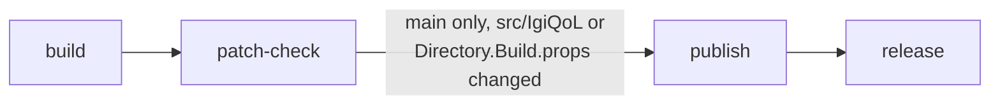

# CI and releases

`.gitlab-ci.yml` runs on every push to `main` and `development`. Day-to-day work goes to `development`; a merge to `main` that touches the mod's sources publishes a release.



1. `build` compiles the solution against the installed game and packs `artifacts/IgiQoL-<version>.zip`, laid out as `BepInEx/plugins/IgiQoL/IgiQoL.dll` (+ `.pdb`) so it extracts straight into the game folder.
2. `patch-check` runs `VersionDiff patches` in manifest mode on the built DLL. It fails if a Harmony target, a game member the DLL uses, or an `AccessTools`/`Traverse` string lookup doesn't resolve in the installed game. The report is a job artifact ("Patch report").
3. On `main` only, and only when `src/IgiQoL/` or `Directory.Build.props` changed in the push, `publish` uploads the zip to the project's generic package registry, and `release` creates the tag `v<version>` and a GitLab release linking the zip. The release notes list the commit subjects since the previous tag, without merge commits.

The in-game self-checks ([dev-harness.md](modpack/dev-harness.md)) need the game running, so CI doesn't run them. Run them yourself before merging to `main`.

## Versions

`<Version>` in `src/IgiQoL/IgiQoL.csproj` gives major and minor. The patch is one above the newest `vMAJOR.MINOR.*` tag, or `<Version>`'s own patch for the first release of that line. To start 0.2, set `<Version>0.2.0</Version>`. `[BepInPlugin]` and the startup log line read the version through the generated `PluginInfo.Version`, so local builds report `<Version>` as written.

## Running the pipeline locally

The same two jobs run on the host without the runner. From the repo root, in bash:

```bash
export DOTNET_ROOT=$HOME/.dotnet PATH=$HOME/.dotnet:$PATH
G="/mnt/data/SteamLibrary/steamapps/common/Vanguard Galaxy"

# build: the version the pipeline would give this commit
git fetch --tags --force --quiet origin
base=$(sed -n 's:.*<Version>\(.*\)</Version>.*:\1:p' src/IgiQoL/IgiQoL.csproj)
last=$(git tag -l "v${base%.*}.*" --sort=-v:refname | head -n 1)
if [ -n "$last" ]; then VERSION="${base%.*}.$(( ${last##*.} + 1 ))"; else VERSION="$base"; fi
dotnet build VanguardGalaxyMods.sln -c Release -p:GameDir="$G" -p:DeployToGame=false -p:Version="$VERSION" -p:ReleaseZip=true

# patch-check
dotnet run --project tools/VersionDiff -c Release -- patches --new "$G/VanguardGalaxy_Data/Managed" \
  --mod src/IgiQoL/bin/Release/IgiQoL.dll --out patch-report.md
```

`build` passes when the output ends in `Build succeeded` with no `warning CS` lines; `patch-check` passes when VersionDiff exits 0. The zip lands in `artifacts/` (gitignored). The `publish` and `release` jobs need GitLab's job token and only make sense in CI.

## The runner

The game's DLLs are copyrighted and can't go to GitLab, so jobs run only on a project runner on this PC, tagged `vanguard-galaxy`. Pipelines wait as pending while it is off.

- Binary: `~/.local/bin/gitlab-runner`, config `~/.gitlab-runner/config.toml` (holds the runner token, keep it private).
- Service: `systemctl --user {status,restart} gitlab-runner`, a user unit in `~/.config/systemd/user/`. It starts at login, not at boot.
- Executor: docker, through rootless podman's socket (`podman.socket` user unit, `/run/user/1000/podman/podman.sock`). Job containers get the game folder read-only at `/game` (`volumes` in the config).
- After moving the game, update the `volumes` path in the config. After losing the config, create a new runner under Settings > CI/CD > Runners with the tag `vanguard-galaxy` and "Run untagged jobs" off, then `gitlab-runner register` with the same executor, host and volume options.
