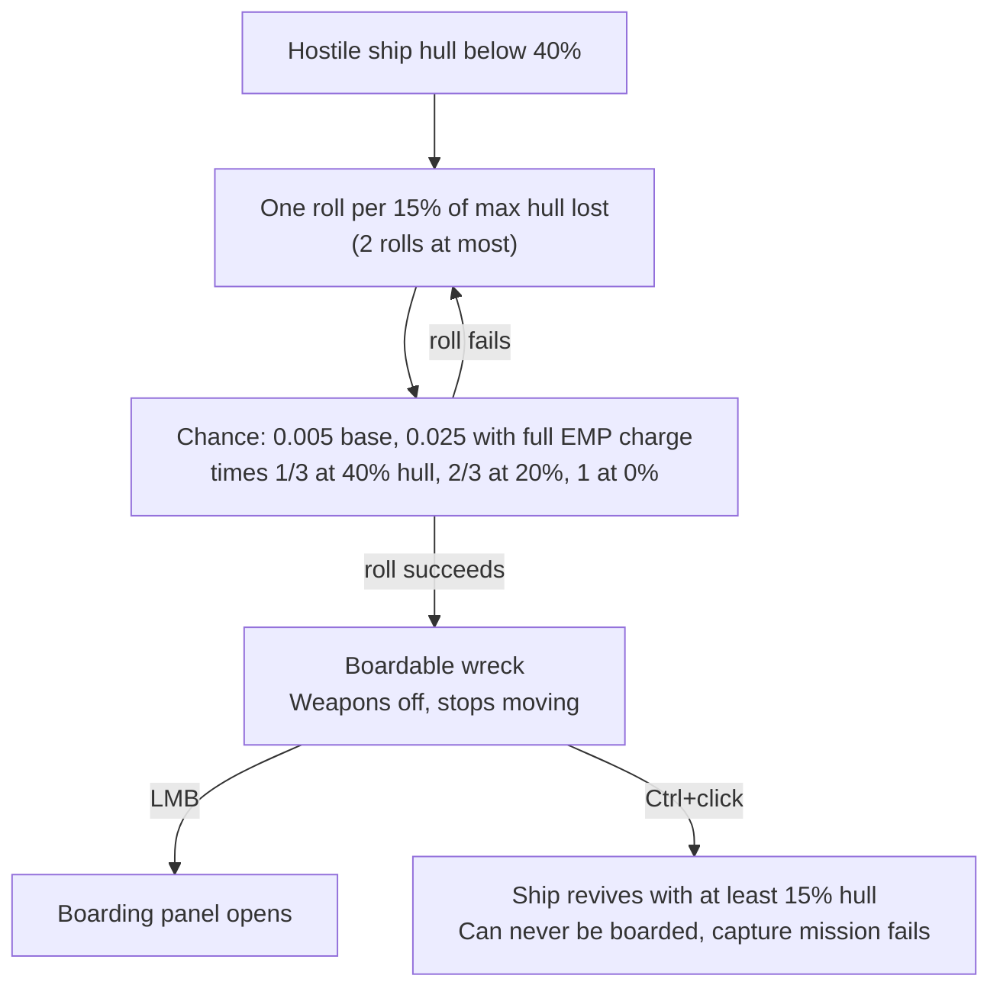
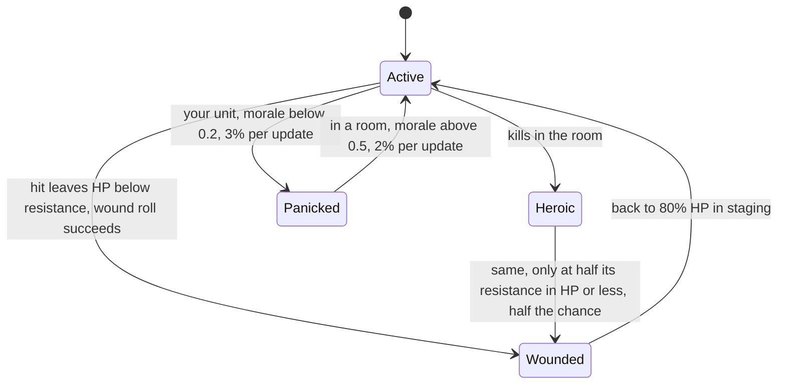
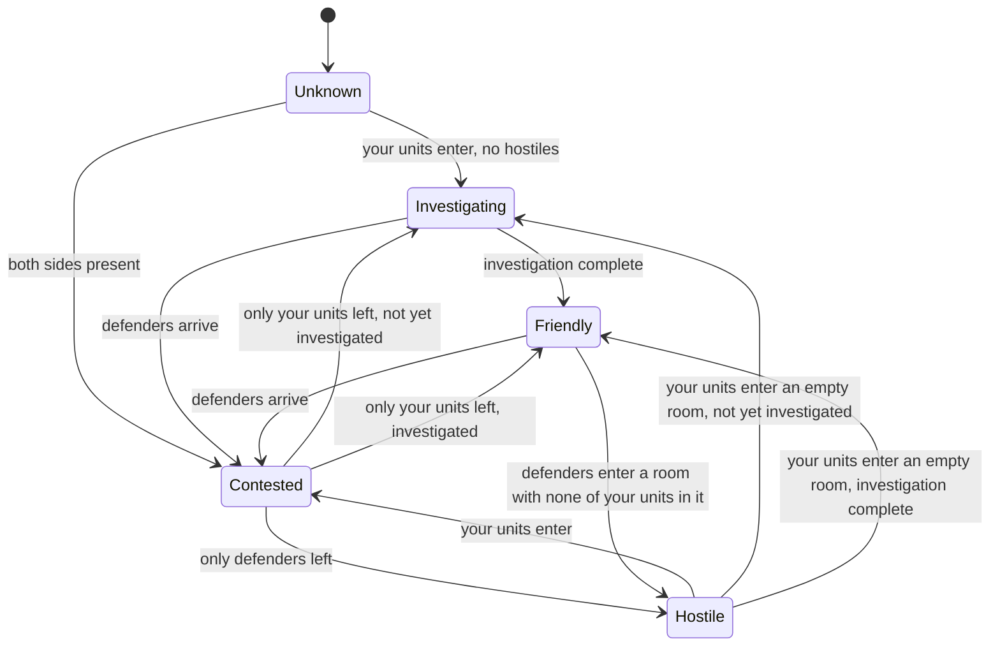
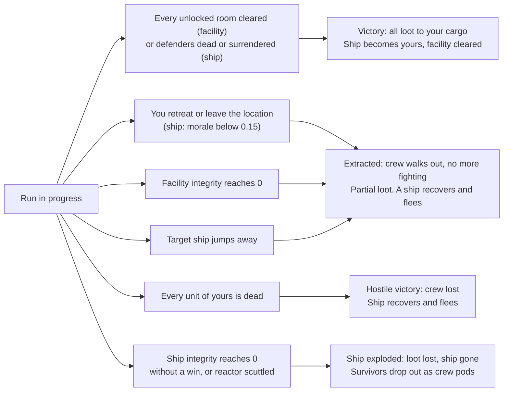

# Boarding and facility operations

This page covers the two crew-based operations in Vanguard Galaxy: boarding a disabled ship and entering a facility (a station-type location such as a Mining Outpost or Pirate Base; the game's tooltip title is "Facility", other game text says "installation"). Both run on the same compartment simulation. You pick crew, the game plays the fight out in real time, and you steer it with a handful of orders. All values here are read from the decompiled game code of version 0.8.3.4, not from in-game testing. Prefab-stored numbers (crew stats, facility definitions) were read from the game's asset files.

Terms and abbreviations are explained in the [glossary](glossary.md).

Words used on this page: HP means hit points. A compartment is one room of a ship or facility. A unit is one crew member, either yours (an attacker) or theirs (a defender). Staging is the area outside the ship or facility where crew wait before they enter through the Airlock. The simulation is stepped once per rendered frame, using the frame time. Facility type names such as Mining Outpost and Military Outpost are facility types only; they have nothing to do with the economic outposts that factions build and raid once the faction war opens (the [Conquest stage](../conquest/README.md)).

Damage to ships and stations in space combat is covered in [combat-damage.md](combat-damage.md). How ship and NPC (non-player character) levels scale is in [scaling.md](scaling.md). Station parts and their destruction are in [stations.md](stations.md).

The last part of the page, [In the game code](#in-the-game-code), has the method names, raw formulas and source references behind each section.

## What you can board or enter

### Ships

A ship is boardable (the game's tooltip calls it a "Boardable ship") when it has been shot down to a wreck state, not when it is merely weak. Once a hostile ship's hull is under 40%, every 15% of max hull in damage taken below that line gives one roll. EMP (electromagnetic pulse) weapons build up an EMP charge on the target, and that charge raises the chance.

The chance of each roll is a base value times a multiplier that grows as the hull drops:

| Hull fraction at the roll | Multiplier on the base chance |
|---|---|
| 40% | 1/3 |
| 20% | 2/3 |
| 0% | 1 |

With no EMP charge the base is 0.005. The multiplier uses the hull left after the hit, and the first roll only happens once 15% of max hull has been lost below the line (hull at 25% or lower), so the first roll succeeds with about 0.29% or better, the second (hull at 10% or lower) with about 0.42% or better, up to 0.5% at 0% hull. Flying manually doubles that, to about 0.58%-1%. Under autopilot the doubling is skipped and half of all rolls are skipped instead. A full EMP charge raises the base to 0.025, five times higher. A ship gets at most 2 rolls from damage taken below the 40% line (40% of its max hull is 2.67 rolls' worth at 15% each, and only whole rolls count), so unassisted boardings are rare and EMP weapons are what make them likely. Normal ships use the chance as is. The ships of pocket bosses get 0.05 of it.

A ship can only become boardable if it is not you, is not flagged as unboardable, is not a carrier fighter, is not a Drone-size ship, is not at an Industrial Outpost location, and has no loot list or an empty one. When the roll succeeds the ship becomes a boardable wreck. Its turrets and modules switch off, it stops moving, and your targeting ignores it.

A boardable ship can be clicked to open the boarding panel (the tooltip reads "LMB to board", where LMB is the left mouse button). Ctrl+click engages it as a normal target instead ("ctrl+click to engage and destroy"), but only before a boarding has started: the ship comes back to life with at least 15% hull, is marked so it cannot be boarded afterwards, a ship that was not already hostile to you becomes hostile, and any capture mission tied to it fails. Capture missions also spawn boardable ships directly: those cannot flee or scuttle, and their crew is only 40% of capacity (a crew fill rate of 0.4).



In the code: [ships](#code-ships).

### Facilities

Facilities are station-type locations on the map. There are 11 types: Mining Outpost, Salvage Yard, Research Station, Pirate Base, Relay Station, Industrial Facility, Black Market Hub, Military Outpost, Derelict Colony Ship, Ancient Ruin and Hostile Ship (the boardable ship above). They are generated with these rules:

| Type | Chance to be abandoned | Default hostility in the definition |
|---|---|---|
| Ancient Ruin, Derelict Colony Ship | 100% | Low, None |
| Mining Outpost | 50% | None |
| Research Station | 50% | Low |
| Relay Station | 45% | None |
| Salvage Yard | 40% | None |
| Industrial Facility | 20% | Low |
| Everything else | 10% | see the type table below |

An abandoned facility has no faction and hostility None (the tooltip's Hostiles row), so it has no defenders. A staffed one gets hostility High if its owning faction is your enemy (at war with you, or reputation below -500), otherwise Low, but only if the definition's own hostility is above None. Mining and Industrial facilities spawned by the 25% mining-location roll (levels 5 and up) skip that last check and take the faction-based rating directly. Mission Pirate Bases take their rating from mission difficulty (Easy Low, Hard/Skull/Insane High, otherwise Medium).

Entry conditions:

| Condition | Effect |
|---|---|
| Integrity at or below 10% | Cannot enter ("Facility too damaged to enter. Structural integrity must exceed 10%.") |
| No docking pad or tunnel left standing | The facility is marked as undockable for good and the attempt is abandoned |
| Location level 10 or more above your effective level | Cannot start. Applies to facilities only, not to ship boarding |
| Ship is travelling | Cannot start |
| Host station destroyed during approach | Abandons. During the run it sets integrity to zero |

In the code: [facilities](#code-facilities).

### Reputation cost of entering

Entering a facility or boarding a ship whose faction has a reputation with you above -500 (Neutral or better) costs reputation at the moment you press start, before the approach finishes:

```
penalty = ceil(base experience * 0.5) * 40
```

| Target | Base experience | Penalty |
|---|---|---|
| Any facility | 25 | 520 |
| Ship | the ship's base experience points (XP) | 40 per half-point of base experience, rounded up |

Some ships are flagged to skip both the penalty and the "faction goes hostile" step. An active Decoy Transponder (an item that prevents reputation loss from combat until you next dock at a station) also skips the penalty, but the faction still goes hostile when your crew lands (and the warning text still shows the penalty). Once the crew actually lands, a friendly faction is marked hostile to you in that location: every unit of that faction there turns hostile, and nothing else changes. Cancelling the approach does not refund the reputation.

In the code: [reputation cost of entering](#code-reputation-cost-of-entering).

### Hard-boarding factions

Meridia's Chosen, Canisec, The Radiant and one late-game faction are hard-boarding factions. Their ships are simulated at a level of at least your effective level + 10, unless the boarding comes from a capture mission. That alone puts the defenders at least 10 levels above you, which sets their HP multiplier to at least about 2.8, and up to 4 at a gap of 15 or more (see [level scaling](#level-scaling-of-defenders)).

In the code: [hard-boarding factions](#code-hard-boarding-factions).

## What each tooltip number means

### Ship tooltip (boarding in progress)

Hovering a ship under attack shows:

| Line | Meaning |
|---|---|
| Status + percentage | The live estimate (see below) |
| N attackers vs. M defenders | Count of living units on each side, including your crew still waiting in staging |
| Ship Integrity | Current structural integrity of the target over its maximum |
| Attacker Morale | Average morale of your living units |
| Defender Morale | Average morale of living defenders |

In the code: [ship tooltip (boarding in progress)](#code-ship-tooltip-boarding-in-progress).

### Facility tooltip

| Row | Meaning |
|---|---|
| Type | Facility type |
| Status | Abandoned if the facility is abandoned (no row otherwise before entry); In Progress while the simulation runs |
| Hostiles | Before entry only: the location's hostility rating: None "No hostiles expected", Low "Unlikely to be dangerous", Medium "Expect some resistance", High "Expect heavy resistance" |
| Specialist | The crew types that count as specialists for this facility (hidden for Ancient Ruin, which uses the diversity bonus) |
| Estimate | Outcome label with win chance, only shown once defenders exist |
| Crews | Your living units vs their living units, only shown once defenders exist |
| Progress | Compartments that are Friendly divided by total compartments |
| Integrity | Current structural integrity over its maximum; before entry it shows the integrity stored for the facility (hidden if none is stored yet) |
| Attacker morale / Defender morale | Averages as above; the defender row only appears if defenders exist |
| Outcome | After a run ends, shown instead of the live rows: Extracted, Retreated or Crew Lost |

In the code: [facility tooltip](#code-facility-tooltip).

### The Estimate formula

Once a simulation exists, the estimate compares the total power of both sides:

```
ratio     = your total power / their total power (counted as at least 1)
winChance = ratio / (ratio + 1)
```

Both totals are summed over every living unit, so troops still in staging count. Units in transit between rooms count as zero for that instant, and so do bought-out units.

| Win chance | Label |
|---|---|
| above 75% | Favourable |
| above 50% | Contested |
| above 25% | Difficult |
| 25% or below | Very Difficult |

This is a power ratio, not a simulation. It ignores HP, positions, specialists, events and everything defenders do besides fight. Crew states change it live: Wounded units count half, Panicked 60%, Heroic 140%, Dazed two thirds. Your side also includes the stealth setting (Silent 0.8, Aggressive 1.2), your Assault Doctrine skill and equipment boarding power; the ammo setting is not included. Defender power uses the faction defense multiplier and armory efficiency but not Boarding Suppression, the drone bonus or the level HP multiplier.

The pre-start estimate is cruder. It does not run the simulation at all. The crew-selection panel shows it for ships only; for facilities the same kind of figure is computed but only the Autopilot uses it (to judge how dangerous a facility is):

- Your power is the sum of each selected crew type's boarding power times its count, times a stealth factor (Silent 0.8, Balanced 1.0, Aggressive 1.2) and an ammo factor (Hollow 0.9, Standard 1.0, Armor Piercing (AP) 1.1).
- For a ship, the defender count is the ship's crew capacity times its crew fill rate (0.7 by default, or the faction's value or a per-ship override), rounded. Each defender counts as 3 power, times the faction defense multiplier, times 1 plus the drone bonus if the faction has drones, times the square root of the level difficulty modifier for the ship's level (raised to your effective level + 10 for hard-boarding factions, unless it is a capture mission) against your effective level.
- For a facility, the compartment count is the average of the definition's minimum and maximum, rounded. The defender count is that number times a fraction (Low 0.3, Medium 0.5, High 0.8), rounded again, and at least 2. Each defender counts as the weighted average boarding power of the facility's defender mix, times the same square-root level factor. A facility with hostility None is always Favourable, 100%, with no defenders.

The pre-start estimate leaves out your Assault Doctrine skill and equipment boarding power, so you are usually a little stronger than it says. It assumes every defender has 3 power; an actual ship's crew is a mix of the faction's crew types. The pre-start figure is also computed from the location's current level, so it moves with your own level.

In the code: [the estimate formula](#code-the-estimate-formula).

## Crew types

Crew stats are fixed per crew type. In the simulation a unit has 5 + resistance HP (before modifiers) and its boarding power as power.

| Crew type | Boarding power | Resistance | HP | Cost (credits) |
|---|---|---|---|---|
| Deckhand | 1 | 1 | 6 | 3,500 |
| Gunner | 2 | 3 | 8 | 7,000 |
| Marine | 4 | 8 | 13 | 16,000 |
| Pilot | 2 | 2 | 7 | 22,500 |
| Miner | 1 | 2 | 7 | 7,000 |
| Salvager | 1 | 2 | 7 | 7,000 |

Marines carry four times a Deckhand's power and over twice the HP for under five times the price. They also use one slot in a compartment where four Deckhands would use four. Compartment capacity limits headcount, not power, so a room that holds six units holds 24 power of Marines and 6 of Deckhands.

Your own units get two multipliers from skills (see [Skills and gear](#skills-and-gear)): HP is multiplied by 1 + the crew resistance bonus, and power by 1 + Assault Doctrine + the equipment boarding power. Defenders get neither.

In the code: [crew types](#code-crew-types).

## How the fight is resolved

### Unit states and power

A living unit that is not in transit fights with this power:

| Factor | Value |
|---|---|
| Base | the crew type's boarding power |
| State | Active 1, Heroic 1.4, Wounded 0.5, Panicked 0.6 |
| Dazed | 2/3 while the daze timer is running |
| Side modifier | see below |
| Armory efficiency | defenders only, 1.0 for you |
| Skills and gear | your units only: 1 + Assault Doctrine + equipment boarding power |

The side modifier for your units is the stealth power modifier: Silent 0.8, Balanced 1.0, Aggressive 1.2. For defenders it is the faction defense multiplier (see [faction defender profiles](#faction-defender-profiles)).

Defender power in a compartment is then multiplied by 1 + the drone defense bonus if the faction has drones, by 1 - Boarding Suppression, and by a level power modifier that is fixed at 1 in the current code.

Defenders in a compartment do not fight unless that compartment's alert state is Alert (ships and armed facilities work this way). A contested compartment is forced to Alert on the next simulation step.



In the code: [unit states and power](#code-unit-states-and-power).

### Damage per simulation step

Only compartments in state Contested (both sides present) fight. For each of them, take your power A and their power D in the room. The number of hits per second is:

| Hits on | Per second |
|---|---|
| You | 10 * D/(A+D) * 0.5, times the modifiers below |
| A defender | 10 * A/(A+D) * 0.5, times the ammo modifier |

The modifiers on hits you take: Silent 0.75 (otherwise 1.0), 0.65 if the compartment's barricade is complete, and 0.9 if you have Body Armor in cargo or have found one during this run. The ammo modifier is the average over the defenders present (see the ammo table).

The fractional part of the hit count is rolled each simulation step. Each hit removes 1 HP from a random living, non-transit unit on that side in that compartment. At 0 HP the unit is killed.

Two consequences follow:

1. The total damage rate is capped near 5 hits per second across both sides, split by power share. More power on one side shifts the split but does not speed up the fight. Absolute numbers matter only through HP pools: more bodies and more HP in the room mean the fight lasts longer.
2. A side with 80% of the power takes 1 hit per second on average and deals 4.

Hits that do not kill can wound. After the hit, a unit below its resistance in HP rolls 1 - HP/resistance; a success makes it Wounded (half power, flees to staging). For your units the resistance in that roll includes the crew resistance bonus. Heroic units are protected while their HP is above half their resistance, and below that they wound at half the usual chance. Wounded units retreat to staging and recover max HP/75 HP per second there; at 80% HP they return to Active. Defenders can be wounded the same way (half power), but they neither retreat nor recover, and a defender with more HP than its resistance cannot be wounded, which matters for level-scaled defenders.

In the code: [damage per simulation step](#code-damage-per-simulation-step).

### Ammo and stealth

| Option | Effect |
|---|---|
| Hollow ammo | 0.8x damage dealt to Marines and Gunners; 1.0x to everyone else. Structural damage per kill 1.5. Adds 0.2 to alert noise |
| Standard ammo | 1.0x. Structural damage per kill 2 |
| Armor Piercing (AP) | 1.2x to Marines and Gunners; 1.0x to the rest. Structural damage per kill 2.5 |
| Silent | Your power x0.8, casualty rate x0.75, alert noise 0.1 |
| Balanced | Alert noise 0.5 |
| Aggressive | Your power x1.2, alert noise 1.0 |

Silent's net effect on a single fight is close to neutral: you deal less (your power share drops) and take 25% fewer hits. What it buys is time before the defenders' nearby rooms go on alert.

In the code: [ammo and stealth](#code-ammo-and-stealth).

### Morale

Morale is 0-1 per unit. It moves in these ways:

| Event | Effect |
|---|---|
| Your unit is killed | Hostile units in that compartment +0.04 each. Your remaining units in that compartment -0.02 each |
| A defender is killed | Your units in that compartment +0.04 each, plus +0.02 more |
| In a contested room, your units | Lose (hostiles / friendlies) * 0.02 per second |
| In a contested room, defenders | Lose (your units / their units) * 0.03 per second, times a health factor from 0.2 (full HP) up to 1.5 (near death) |
| Assault momentum (your units, any room, while any fight is active) | +0.02 per second, fading to zero over the first 30 s |
| Bridge taken | +0.02 per second to all your units |
| Unit's room is cut off from the airlock by enemy-held rooms (rooms you neither hold nor contest) | -0.05 per second |
| More than 60% of deployed crew wounded while defenders are stronger | -0.015 per second |
| Loss trauma | -(dead friendlies / total friendlies) * 0.015 per second, to all your living units |
| Not in a contested room (or in staging) | +1/150 (0.0067) per second recovery |
| Defender becomes Heroic | +0.15 for that defender |

The assault bonus, Bridge bonus, cut-off and wounded penalties only apply on ships and armed facilities, only to units standing in a room, and only while some room is contested. The same is true of the contested-room losses, panic, defender surrender checks and the morale-collapse retreat. Unarmed facilities skip all of those; kill-based changes, loss trauma and the idle recovery still run there.

Below 0.2 morale an Active attacker has a 3% chance each update to become Panicked; a Panicked unit above 0.5 morale has a 2% chance to recover. These chances are per update, not scaled by time. Panicked and Wounded units retreat toward the airlock after a 2-5 second delay when morale is 0.35 or below (Wounded units always retreat).

Defender morale works the same way with the faction's morale threshold (default 0.25). Below it, each defender in a contested room has a surrender chance per second (the faction's surrender rate times elapsed seconds). Every update, each living defender anywhere whose morale is below the threshold has a chance equal to the surrender rate * 0.1 * min(1, your total power / their total power) to surrender. If it does not, an Active defender has a 2% chance to panic. Panicked defenders in a room you hold or contest, once their morale is 0.35 or lower and after a 2-5 second delay, retreat to an adjacent defender-held room with spare capacity. If none exists, they may surrender (the surrender rate * 3 per second) or, for factions with a kamikaze chance and while one of your units is in the room, blow themselves up (the kamikaze chance * 2 per second) for 1 damage to one of your units there.

If the average morale of your living units falls under 0.15 on a ship boarding, the crew breaks off and retreats (reason "Morale Collapse"). Facilities only retreat on morale collapse through the autopilot director (see [Autopilot](#autopilot)). During a manual facility run there is no automatic morale retreat.

In the code: [morale](#code-morale).

### Surrender, capture, defection, heroics

| Mechanic | Rule |
|---|---|
| Surrender in combat | Defender morale under the faction threshold, and the faction's surrender rate per second per defender. Surrendered units are prisoners |
| Mass surrender | Needs you to hold the Bridge (Friendly or Investigating), your total power at least equal to theirs, a faction that allows mass surrender, a surrender rate above zero, and rooms that you neither hold nor contest at or under 20% of the ship's rooms. Then the surrender rate * 5 per update. All living defenders surrender and you win |
| Outnumbered capture | One defender alone against two or more of your units: 0.04 * min(your units - 1, 4) per second to capture that defender (x0.25 if the faction never surrenders) |
| Defection | Defender under 0.1 morale while outnumbered 2:1 or more: 0.02 per second to join you |
| Heroics (yours) | Per defender killed, captured or surrendering in a compartment, each Active unit of yours there has 0.025 (0.045 if a Heroic is already present) to become Heroic |
| Heroics (theirs) | Per unit of yours killed, each Active defender has 0.04 + 0.04 * existing Heroics (cap 0.2) to become Heroic |

Prisoners go to your brig up to your ship's brig capacity (see [Pods](#pods-and-crew-return)). Surrendered and captured units no longer count as living.

In the code: [surrender, capture, defection, heroics](#code-surrender-capture-defection-heroics).

## Level scaling of defenders

Defenders get an HP multiplier from the level gap: how far the location's level is above your level (0 if it is not above).

| Gap | HP multiplier |
|---|---|
| 0 | 1.00 |
| 1 | 1.12 |
| 3 | 1.40 |
| 5 | 1.73 |
| 7 | 2.12 |
| 10 | 2.83 |
| 15 and above | 4.00 |

The multiplier applies to defender HP at spawn, to the number of units in a combat ambush, and to the HP damage of hazards on your crew. It does not multiply their power. Ships use your effective level; facilities use your player level.

Gaps above zero also shift the defender mix toward Marines. The Marine share moves from its base value toward 80% of the total as the gap goes from 0 to 15, taking from Deckhand and Gunner shares. At a gap of 15, up to 80% of the defenders are Marines if there are enough Deckhands and Gunners to convert. Hazard event chances rise with the gap too, doubling every 10 levels, without the cap at 15 that the HP multiplier has.

In the code: [level scaling of defenders](#code-level-scaling-of-defenders).

## Faction defender profiles

Ship defenders (and facility defenders from a faction) follow a faction profile. Factions not listed use the default (all modifiers 1, surrender 5%, morale threshold 25%). One late-game faction has its own profile that is not listed here; it is covered with the late game.

| Faction | Defense x | Surrender | Other |
|---|---|---|---|
| Default | 1.0 | 5% | morale threshold 0.25 |
| Corsair Syndicate | 1.0 | 3% | scuttle 20%, counterattack +0.35, alert speed x1.3, brig crew useful |
| Meridia's Chosen | 1.0 | 0% | scuttle 100%, can vent airlocks, kamikaze 5%, alert x1.5, brig crew useful |
| Stellar Industries | 1.1 | 10% | side-switch 5%, morale threshold 0.35 |
| Kolyatov Collective | 1.1 | 0% | counterattack +0.1 |
| Luminate Combine | 1.1 | 8% | drones (+15% defender power), kamikaze 3% |
| Canisec (Police Guild) | 1.3 | 5% | no mass surrender, brig crew useful |
| Omnitac Agency (Mercenary Guild) | 1.1 | 5% | can be bought out |
| Darkspace Compact | 1.4 | 0% | counterattack +0.5, alert x1.3 |
| Void Drifters (Smugglers) | 1.2 | 8% | can be bought out |
| The Radiant (Holy Radicals) | 1.0 | 0% | kamikaze 8%, can vent airlocks |
| Mindus Holdings, Steel Vultures, Forge Industries (Mining, Salvage, Industrial Guilds) | 0.8 | 15% | none |
| Stranded | 1.2 | 5% | counterattack +0.15 |

In the code: [faction defender profiles](#code-faction-defender-profiles).

## Compartments

### States

| State | Meaning |
|---|---|
| Unknown | Never entered (shown as unexplored) |
| Investigating | Your units are present, no hostiles, investigation not yet complete. Counts as friendly-controlled. The game labels it "Investigating", or "Securing" for a corridor |
| Contested | Both sides present. This is where fighting happens |
| Friendly | Cleared and investigation complete. The game labels it "Cleared" |
| Hostile | Defenders only |
| Destroyed | Gone (scuttle armory) |

A compartment's state is recomputed from who is standing in it. Units in transit do not count for either side. When both sides are present it is Contested. When only you are there it is Investigating or Friendly. When only defenders remain it is Hostile, but a room that was Unknown or Investigating stays that way if the simulation uses investigation. A Hostile room with no defenders left in it turns Investigating or Friendly.



In the code: [states](#code-states).

### Capacity

Base capacity per type, multiplied by the ship size multiplier. Facilities always use multiplier 1.

| Compartment | Base capacity |
|---|---|
| Airlock, Reactor Room, Brig, Control Room, Workshop, Laboratory, Generator Room, Server Room, Security Office, Medical Bay | 4 |
| Corridor, Armory, Officers Lounge, Ore Processing, Excavation | 5 |
| Cargo Hold, Living Quarters, Mess Hall, Storage Bay, Debris Field | 6 |
| Bridge | 3 |

Ship size tiers 0-8 multiply by 1, 1, 1.2, 1.5, 1.8, 2.2, 2.8, 3.5, 5 (rounded down). Capacity applies to each side separately.

In the code: [capacity](#code-capacity).

### Ship layouts

Every ship has an Airlock, Bridge and Cargo Hold. Larger sizes add rooms:

| Size tier | Rooms added |
|---|---|
| 2 | Corridor |
| 3 | Living Quarters, Reactor Room |
| 4 | Brig, Corridor |
| 5 | Mess Hall, Armory |
| 6 | Officers Lounge, Corridor, a second Airlock, Living Quarters, Cargo Hold, Mess Hall, Reactor Room |
| 7 | Living Quarters |
| 8 | A third Airlock, Cargo Hold, Living Quarters, 12 more Corridors |

Only the first Airlock is where your crew lands. Before overflow corridors are added, size 1 ships have 3 compartments, size 3 has 6, size 5 has 10, size 6 has 17 and size 8 has 33.

Ship integrity is 1,000 per compartment at maximum. It starts at the maximum times (the target's hull fraction when you start + 20%, capped at 100%). A ship you shot down to 20% hull starts at 40% integrity.

Defenders per ship come from the ship's crew (filled at the crew fill rate if it has none). Each crew type has a home room it prefers (Marine Armory 60%, Gunner Armory 45%, Deckhand Living Quarters 50%, Miner Cargo Hold 50%, Salvager Reactor Room 40%), then they fall back to a random room within capacity. The first 1 to 3 defenders (1 + size tier/3, capped at 3) are moved to guard the Airlock.

In the code: [ship layouts](#code-ship-layouts).

### Facility layouts and sizes

The compartment count is a random whole number from the definition's minimum + half of n (rounded down) to its maximum + n, where n is the location's level divided by 12 (rounded down) and at most 8. Every facility has one Airlock, one to four Corridors and the rest from the type's weighted pool.

| Type | Compartments (min-max) | Layout | Speed bonus | Hostility |
|---|---|---|---|---|
| Mining Outpost | 6-12 | Tunnel, docking pad | 0.4 | None |
| Salvage Yard | 6-16 | Radial | 0.4 | None |
| Research Station | 8-14 | Grid | 0.4 | Low |
| Pirate Base | 10-18 | Radial | 0.25 | Medium |
| Relay Station | 5-10 | Tunnel | 0.4 | None |
| Industrial Facility | 10-16 | Grid | 0.4 | Low |
| Black Market Hub | 6-12 | Tunnel | 0.3 | Low |
| Military Outpost | 10-18 | Grid | 0.2 | High |
| Derelict Colony Ship | 14-20 | Radial | 0.4 | None |
| Ancient Ruin | 6-16 | Radial | diversity | Low |
| Hostile Ship | n/a (ships use the ship layouts above) | Ship | n/a | High |

The speed bonus is the extra investigation speed a specialist gives in the type's profession rooms (see [specialists](#specialists-and-the-diversity-bonus)).

Maximum facility integrity is 3,000 per compartment. Starting integrity is a random fraction:

| Facility | Starting integrity |
|---|---|
| Ancient Ruin, Derelict Colony Ship | 45-75% |
| Other abandoned | 55-80% |
| Staffed | 80-100% |

The fraction is stored on the location and carries over between visits. Compartments of type Control Room, Storage Bay, Workshop, Laboratory, Server Room or Security Office are locked 35% of the time.

In the code: [facility layouts and sizes](#code-facility-layouts-and-sizes).

## Alert, investigation and movement

### Alert

On ships and armed facilities each compartment has an alert state: Dazed, Relaxed, Concerned, Worried, Alert. Every compartment starts Dazed, unless the Enemy Alerted start event sets each room to Concerned, Worried or Alert. A compartment not yet in Alert advances only while it touches a compartment that is Contested or friendly-controlled. It builds up progress each second from the noise level, the faction's alert speed and a random factor between 0.3 and 1.7, and leaves each state at these thresholds:

| From | Threshold |
|---|---|
| Dazed | 14 |
| Relaxed | 9 |
| Concerned | 7 |
| Worried | 5 |

That is 35 units from Dazed to Alert. At Balanced noise (0.5) a room next to your crew goes Alert after about 70 seconds on average. At Silent (0.1) it takes about 350 s and at Aggressive (1.0) about 35 s. Hollow ammo adds 0.2 to the noise (Balanced about 50 s) and Comms Down halves it. The faction alert speed is 1.3-1.5 for some factions.

An Alert room that still holds more than half its original occupants (half rounded up) has a 0.3 per second chance, about once every three seconds, of sending one defender into each adjacent Contested room that is under capacity. Counterattacks also need Alert. So noise decides how many defenders end up joining a fight you started elsewhere.

In the code: [alert](#code-alert).

### Investigation

Units in a Friendly-controlled but not finished room investigate it. Progress per second is:

```
1 / base duration of the room
  * (1 + 0.15 * (units present - 1))
  * specialist modifier
```

The specialist modifier is 1 + 0.2 * (number of distinct crew types - 1) at an Ancient Ruin (diversity). It is 1 + the facility's speed bonus when a specialist is present and the room is one of the type's profession rooms. Otherwise it is 1.

A room becomes Friendly when progress reaches 1 and all its events have fired. Base durations:

| Room | Seconds |
|---|---|
| Airlock | 0 (done in 1 s) |
| Corridor | 5 |
| Medical Bay | 50 |
| Brig | 50 |
| Living Quarters | 45 |
| Storage Bay, Generator Room, Cargo Hold | 60 |
| Debris Field, Security Office | 70 |
| Workshop | 75 |
| Ore Processing, Armory, Server Room | 80 |
| Control Room, Laboratory | 90 |
| Excavation | 100 |
| Other / unlisted | 60 |

On ships only the first Cargo Hold (20 s) and the Armory (25 s) take investigation time unless the ship has hidden caches, in which case every non-airlock, non-corridor room takes 25 s. Other ship rooms, including extra Cargo Holds, resolve at 1 progress per second.

Adding crew to a room has strongly diminishing returns on investigation speed: 6 units give 1 + 0.15 * 5 = 1.75x.

In the code: [investigation](#code-investigation).

### Movement and orders

If the game's "Automatic movement" setting is on, your units spread automatically: they push from friendly rooms into adjacent enemy rooms (strongest units first), fill under-staffed rooms that are investigating, flow toward contested front lines and explore unknown rooms. With it off, only directives and explicit orders move units.

Directives are the internal orders that pull units to a room. When two compete, the higher priority wins (lowest to highest):

| Priority | Created by |
|---|---|
| Revisit for missed loot | A profession discovery fired with no specialist present; sends a specialist back |
| Profession call-in | A room with an unfired profession event has no specialist; sends one |
| Combat reinforcement | A room just became Contested (combat ambush) |
| Your movement order | Your orders |

Your orders: select a compartment, then 1 sends Combat crew (highest boarding power first), 2 sends Specialists, 3 sends any. Hold the number and scroll to set the count. E (or Ctrl+click) sets the room as Priority: new crew are routed there first. R retreats units out of a compartment and clears orders there. G throws a grenade, B toggles a barricade. Orders can only draw from units that are idle, then investigating, then (if the target is contested) units in other contested rooms.

Moving from room to room takes 0.7 s in transit. Automatic movement will not pull a unit out of a room until it has been there for 2 s; your own orders and combat reinforcements ignore this. When the whole force is retreating from the operation, units start walking out after 1 s. Units in transit do not fight.

In the code: [movement and orders](#code-movement-and-orders).

### Locks and lockdowns

A locked room needs a specialist standing in an adjacent room: a specialist starts a 10-second unlock timer. At Ancient Ruin, where the diversity bonus replaces specialists, locks only open with 3 or more distinct crew types alive. With Automatic movement on, the game starts the timer by itself from an idle specialist in an adjacent room and routes a specialist toward a locked room when one exists. With it off, you must order units to the locked room.

Locked rooms are not counted for the "all compartments explored" win condition. They carry bonus loot when opened, and special-loot chances in locked rooms are multiplied by 6.

A Lockdown event (Military Outpost control rooms) seals adjacent corridors: 15 seconds, or 10.5 s with a specialist in the room. Only specialists can move into a sealed room, and doing so cancels the lockdown.

In the code: [locks and lockdowns](#code-locks-and-lockdowns).

### Barricades and grenades

Only on ships and armed facilities.

| Action | Rule |
|---|---|
| Barricade | Needs a Friendly-state room. Build rate 0.05 * (1 + 0.15 * (crew - 1)) per second, so 20 s with one unit. Pauses while the room is contested; cleared if defenders retake it. Complete: damage to your units there x0.65. Units in a barricaded room stay put instead of pushing forward |
| Grenade | Charges: 3 + size tier/2 (ship, integer division) or 3 + compartments/4 (armed facility). Cooldown 10 s. Target room must have a living defender and be yours, contested or adjacent to yours. Sets the room to Alert; every unit in it, both sides, takes 3 damage and is dazed 15 s (power x2/3); the structure takes 5% of its maximum |

A Deckhand (6 HP) survives one grenade and a Gunner (8 HP) two. Marines (13 HP) survive four, before the HP skill bonus for your units or the level multiplier for defenders. Everyone in the room also loses a third of their power for 15 seconds, and this hits your own crew in the room as much as theirs.

In the code: [barricades and grenades](#code-barricades-and-grenades).

## Specialists and the diversity bonus

Each facility definition lists one or more crew types as its specialists. A specialist does four things:

1. Unlocks locked rooms (10 s timer).
2. Collects profession discoveries. Loot that needs a specialist is lost for now if none is in the room when the event fires at its progress threshold. The room then asks for a specialist to come back (revisit).
3. Raises investigation speed in rooms where the definition has a profession event.
4. Protects against bad events (see below). This applies in any room, as long as the specialist is standing in it.

Profession discoveries check for the first crew type in the definition's list specifically, not any specialist. The list comes from the asset data:

| Facility | Specialists (first one collects profession loot) | Profession loot rooms |
|---|---|---|
| Mining Outpost | Miner | Ore Processing (crystal vein), Excavation (geological data) |
| Salvage Yard | Salvager | Debris Field, Workshop |
| Research Station | Salvager | Laboratory, Workshop |
| Pirate Base | Marine, Gunner | none |
| Relay Station | Marine | Server Room |
| Industrial Facility | Salvager, Miner | Workshop, Ore Processing |
| Black Market Hub | Deckhand | Cargo Hold |
| Military Outpost | Marine | Armory |
| Derelict Colony Ship | Salvager, Deckhand | Living Quarters, Debris Field, Workshop |
| Ancient Ruin | Diversity bonus (no specialists) | none |

The speed bonus applies only in the "profession loot rooms" column. A Miner at an Industrial Facility opens locks and shields against events, but does not collect the Salvager's discoveries.

An Ancient Ruin uses the diversity bonus instead. Every unit counts as a specialist for event protection, investigation speed is 1 + 0.2 * (distinct crew types - 1) everywhere, and locks require three or more distinct types.

Protection against negative events (Hazard, Combat ambush, Lockdown), when the event fires:

```
specialists needed = 1 + floor(level gap / 3)
if specialists in the room >= needed:  33% chance the event is fully prevented
```

If it fires anyway:

| Event | Specialist effect |
|---|---|
| Hazard crew damage | max(1, round(2 * HP multiplier * (1 - 0.125 * min(specialists, 4)))) damage per victim. Non-specialists take double and have a 20% instant kill chance |
| Hazard facility damage | Multiplied by 1 - 0.125 * min(specialists, 4) |
| Combat ambush | Number of spawned defenders x0.7 (minimum 1) |
| Lockdown | Timer 10.5 s instead of 15 s |

The facility definitions list a profession discovery bonus of 0.25, but nothing in the game reads it.

In the code: [specialists and the diversity bonus](#code-specialists-and-the-diversity-bonus).

## Events inside a facility

Events trigger when a room's investigation progress crosses their threshold (0 means as soon as progress is above zero, so on entry).

### Per-room template events

Each non-airlock room rolls 0-3 events from its definition's weighted templates. These are discoveries (loot), hazards, combat ambushes, lockdowns or interactions. Templates marked active-only never appear in abandoned facilities.

Combat ambush size: a random whole number from 2 up to 2 + compartments/5 (rounded down), times the defender HP multiplier, rounded (at least 1); x0.7 with a specialist (rounded again, at least 1). Units come from the type's mix, with the Marine shift for level gaps (see [level scaling](#level-scaling-of-defenders)):

| Facility | Mix (weights at no level gap) |
|---|---|
| Pirate Base | Marine 50, Gunner 30, Deckhand 20 |
| Military Outpost | Marine 70, Gunner 20, Salvager 10 |
| Mining Outpost | Miner 40, Marine 30, Salvager 30 |
| Industrial Facility | Salvager 40, Miner 20, Marine 30, Deckhand 10 |
| Relay Station | Marine 40, Salvager 30, Deckhand 30 |
| Research Station | Salvager 40, Marine 30, Deckhand 30 |
| Black Market Hub | Deckhand 50, Gunner 30, Marine 20 |
| Salvage Yard | Salvager 50, Marine 30, Deckhand 20 |
| Other | Marine 30, Gunner 25, Salvager 25, Deckhand 20 |

The templates also carry hostile-count and hostile-power fields, but nothing in the game reads them.

In the code: [per-room template events](#code-per-room-template-events).

### Facility hazard events

On top of the templates, the game adds hazards that damage the facility. Each non-airlock, non-corridor room rolls each eligible one with chance base weight * 2^(gap/10) * 0.5 (the first four hazards in the table, Fire, Pressure lost, Structural collapse and Power grid failure, are x1.5 in abandoned facilities). They trigger at 20-79% room progress.

| Hazard | Damage to integrity | Base weight | Rooms / facility types |
|---|---|---|---|
| Fire | 4,500 | 0.25 | any |
| Pressure lost | 5,400 | 0.20 | any |
| Structural collapse | 4,500 | 0.20 | any |
| Power grid failure | 3,000 | 0.35 | Generator, Control, Server rooms |
| Booby trap | 4,500 | 0.4 | Pirate Base, Military Outpost, Black Market Hub |
| Explosive charge | 6,000 | 0.5 | Armory / Cargo Hold in Pirate Base, Military Outpost |
| Drilling accident | 4,500 | 0.5 | Excavation / Ore Processing in Mining Outpost |
| Pressure explosion | 6,000 | 0.45 | Workshop / Ore Processing in Industrial Facility, Mining Outpost |
| Chemical leak | 3,600 | 0.45 | Laboratory / Workshop in Industrial Facility, Research Station |
| Containment breach | 6,000 | 0.6 | Laboratory in a staffed Research Station |
| Energy pulse | 3,600 | 0.3 | Ancient Ruin |
| Deck collapse | 5,400 | 0.35 | Derelict Colony Ship |

At 3,000 integrity per compartment, a fire in a 12-compartment facility costs 4,500/36,000 = 12.5%.

In the code: [facility hazard events](#code-facility-hazard-events).

### Hazard effects on your crew

When a hazard fires (and is not prevented), half the units in that room (at least 1) are hit at random. Each non-specialist has a 20% chance to die outright; otherwise it takes the damage above. Every victim that survives loses 0.15 morale, and can become wounded.

In the code: [hazard effects on your crew](#code-hazard-effects-on-your-crew).

### Armed facilities

Facilities with hostility above None place defenders at start and use the same combat rules as ships:

```
defenders = at least 2: round(compartments * fraction) + a random -1, 0 or +1
fraction: Low 0.3, Medium 0.5, High 0.8
Low hostility: only 30% of runs have any defenders at all
```

Defenders go to random non-airlock rooms with spare capacity (corridors only if no other room has space). The structure takes 2.4 damage per second for every contested room, on top of hazards. Compared to the 3,000-per-room maximum this is small, but a long multi-room battle adds up.

In the code: [armed facilities](#code-armed-facilities).

## Start events (ships)

When a ship boarding begins, each of these is rolled independently:

| Event | Chance | Effect |
|---|---|---|
| Comms Down | 15% | Alert noise x0.5 for the whole fight |
| Reactor Down | 8% | Removes the faction's reactor scuttle (see below) |
| Enemy Dazed | 12% | Sets every room to Dazed alert. Rooms already start Dazed, so this changes no number I could find; it still blocks Enemy Alerted |
| Enemy Alerted | 12% (only if Dazed did not roll) | Every room is set to a random alert state of Concerned, Worried or Alert. 20% to add an Enemy Reinforcements entry to the event list |
| Enemy Reinforcements | 10% | Schedules a defender reinforcement at 40% of estimated duration |
| Armory Damaged | 15% | Armory efficiency of 70-90% (random), multiplying every defender's power for the whole fight |
| Volatile Cargo | 12% | A hazard in the Cargo Hold fires once your units are in it and no defenders are left there. It hurts your crew but does no damage to the hull |

There may be a quirk in the Enemy Alerted roll that adds Enemy Reinforcements: as far as I can read it, the added entry shows up in the event list but does not actually schedule reinforcements, so only the straight 10% roll does (not verified in play).

The Volatile Cargo hazard is a normal hazard (see above), so a specialist can prevent or soften it. On a ship there are no listed specialists unless the ship carries an investigation crew type, so it hurts a standard crew in full. Ships flagged as never scuttling behave as if Reactor Down was rolled.

The estimated fight duration, used to time reinforcements, is:

```
estimated duration = 10 + 3 * compartments + (their power / your power) * 20, kept between 10 and 60 seconds
```

Ship hazards that damage the hull on top of start events are added per non-airlock, non-corridor room with chance base weight * 2^(gap/10) * 0.5:

| Hazard | Damage | Base weight | Factions |
|---|---|---|---|
| Hull breach charges | 800 | 0.25 | Corsair Syndicate, Meridia's Chosen, The Radiant |
| Fire | 1,000 | 0.2 | any |
| Pressure lost | 800 | 0.15 | any |

In the code: [start events (ships)](#code-start-events-ships).

## What defenders do on ships

These run once per simulation step and only on ships and armed facilities.

| Behaviour | Conditions and numbers |
|---|---|
| Counterattack | Every 5-10 s. A room held only by defenders (not contested) with 2 or more of them, in Alert, next to one of your rooms where your power there does not exceed theirs: chance 0.5 + the faction's counterattack bonus to send all but one defender (up to the target's spare capacity) into your room. Factions without a counterattack bonus only do this while no room is contested. With a bonus, moved defenders gain +0.2 morale |
| Scuttle | Ships only, while the fight is not won. Needs the reactor room or the armory still held by defenders, and you hold at least 55% of the ship. Warns once. Then 0.08 * the faction's scuttle chance per second (0.016 per second for the Corsair Syndicate, 0.08 for Meridia's Chosen and one late-game faction). Outcome: if the armory is theirs and the reactor is yours, always an ammo explosion; if both are theirs, 40% ammo explosion and 60% reactor blast; if only the reactor is theirs, the reactor blast. Ammo explosion: 35% structure damage and the armory is destroyed. Reactor blast: the ship explodes in 5 s |
| Airlock vent | Factions that can vent. Needs the Airlock not held by you and a 30 s cooldown; 0.003 per second. Kills each of your units in the airlock with 100% chance, then in rooms one, two and three steps further in with 60%, 20% and 10%. Defenders in the same rooms die at half those chances (50%, 30%, 10% and 5%) |
| Jump drive | Ships level 40 and up that can flee. After you hold 50% of the ship while defenders hold the Bridge: 0.05 per second to start a 120 s spool. Take the Bridge before it finishes or the ship jumps away (outcome Extracted, reason Target Ship Escaped). The spool starts only once; retaking the Bridge cancels it for good |
| Buy-out | Mercenary Guild and Smugglers. 0.008 per second, offers one unit for 1.25 * crew cost (15 s cooldown after each offer, and no new offer while one is pending). Accepting spends credits and removes the unit from the defenders. It takes no further part in the fight, but it is carried home with your crew if there is room. "Auto accept buy-outs" accepts automatically |
| Side-switch | Stellar Industries defenders: 0.05 per second once the rooms you hold or are fighting in make up at least 60% of the ship. 1-3 defenders join you, 20 s cooldown |
| Kamikaze | Factions with a kamikaze chance: units under the morale threshold die at that chance per second and deal 1 damage to a random unit of yours in the room |
| Brig rescue | First time you take the Brig (ships of size 4 and up have one): 65% for factions with useful brig crew, otherwise 30%, to free between 1 and max(2, compartments/2) units of the ship's own crew types, who join you |

The 65% factions are the Corsair Syndicate, Meridia's Chosen and Canisec. Rescued units are newcomers: they are returned to your ship only if there is space in your crew quarters after your own crew.

In the code: [what defenders do on ships](#code-what-defenders-do-on-ships).

## Integrity and collapse

### Structure damage

| Source | Amount |
|---|---|
| Kills with AP / Standard / Hollow ammo | 2.5 / 2 / 1.5 per kill |
| Grenade | 5% of maximum |
| Armed-facility combat | 2.4 per second per contested room |
| Facility hazards | 3,000-6,000 each (see table) |
| Ship hazards | 800-1,000 each |
| Armory explosion | 35% of maximum |

### Ship collapse

At 0 integrity, without a won fight and unless your crew is already retreating, the ship starts to collapse: your crew begins retreating, and decompression starts right away in 2-4 randomly chosen rooms (never the Airlock) and spreads from each of them up to three rooms outward. No more than compartments/4 rooms (at least 1) are ever decompressed in total, spread included, so on most ships that limit is reached almost at once. Every second there is also a 6% chance of one more starting room while the limit has not been reached. At 15 seconds the ship explodes, whether or not your crew reached the Airlock. Vent kills hit your units and the defenders alike: 50% per unit in the room itself, less 40 points per room of distance (never below 10%), spreading three rooms out. After victory, integrity reaching 0 does nothing.

A scuttle explosion is faster: 5 seconds, each living crew member outside the Airlock and staging has a 0.14 per second chance of death.

### Facility collapse

At 0 integrity a facility triggers a retreat with reason Structural Collapse. There is no explosion. Your crew walks to the Airlock and leaves with partial loot, and any mission to clear that facility (the game's "Clear Pirate Base" mission, type "Dungeon Assault") fails with "Mission failed - the base collapsed." The stored integrity stays near zero, so the facility stays closed (needs more than 10%).

Mission-protected locations cannot drop below 15%.

In the code: [integrity and collapse](#code-integrity-and-collapse).

## How a run ends

The game shows these outcomes in its own words, and they do not match the table below one to one. For facilities (operation panel, facility tooltip and the Operation Log) a victory is shown as Extracted, a retreat (the Extracted rows below) as Retreated and a hostile victory as Crew Lost. The Operation Log's ship lines only say Captured for a victory and Failed for everything else. The Outcome column below uses the code's names, so its Extracted is what the game calls Retreated.

| Outcome | Reason | When |
|---|---|---|
| Victory | none | Facility: every room not locked is Friendly (none Unknown, Investigating or Contested). Ship: all defenders dead or surrendered, or mass surrender |
| Extracted | Voluntary Retreat | You abandon the operation (retreat or cancel button), set a course away from the location, or the dock you are using is destroyed while the operation runs |
| Extracted | Morale Collapse | Ship boarding, average attacker morale under 0.15 (or autopilot) |
| Extracted | Structural Collapse | Facility integrity reached 0 |
| Extracted | Target Ship Escaped | Jump drive completed |
| Hostile victory | All Crew Killed | No living units on your side |
| Ship exploded | Structural Collapse / Reactor Scuttled | Ship collapse timer or scuttle |

A victory does not close the run immediately. The simulation then stays open until you request extraction. Crew walk back to the Airlock and into staging and then it completes. On ships the investigation speed rises tenfold after victory so remaining rooms are explored quickly. If you retreat instead, crew walk out without further fighting: while retreating, the simulation skips combat entirely, so retreating is the safe way to preserve survivors.



Consequences by outcome:

| Outcome | Ship | Facility |
|---|---|---|
| Victory | You capture the ship: it becomes yours, its crew and commander are removed, ammo capped to one minute. If it has more than two equipped modules, a random selection of them is destroyed: at least two are always lost, and the more hull the ship has left when you win, the more survive. The number of nodes on every hull upgrade path is halved (rounded down). All loot goes to your cargo (2% chance of a booster). Leadership mastery XP gained | All loot to cargo (2% chance of a booster, as on ships), the clear-the-base mission trigger fires (the game's "Base cleared"), and one already completed clear-the-base mission with no turn-in step is claimed automatically |
| Extracted | The ship recovers (at least 15% hull), becomes unboardable and flees. Each non-data loot item has a 50% chance to reach your cargo. Boarding missions fail | Same partial loot rule; data items always kept. Integrity stays reduced |
| Hostile victory | Crew lost, ship recovers and flees, boarding missions fail, a quarter of the usual XP | Crew lost |
| Ship exploded | Loot lost. Surviving attackers drop out as crew pods (see below), and the ship is gone | n/a |

In the code: [how a run ends](#code-how-a-run-ends).

## Pods and crew return

Ships are boarded with pods. Facilities are entered by walking.

### Boarding pods

A pod is docked on your ship, launches, attaches to the target, then returns with the survivors.

| Step | Rule |
|---|---|
| Creation | When you press Start, each crew selection is removed from your ship and split into pods of up to 10 units, as one docked pod per 10 |
| Approach | The ship flies to a standoff point. Within 5 units of the hull the docked pods launch together. Pods spawned later directly from a ship (reinforcements from close range, enemy pods) launch 0.35 s apart |
| Flight | Speed 6 units per second. Each pod attaches when it overlaps the target's hull or reaches the last known position (0.5 radius). If the target disappears, the pod turns around |
| Landing | Crew arrive in staging (outside the ship). The simulation starts once all launched pods have landed. Crew enter through the Airlock, up to its capacity at a time |
| Extraction | After the simulation ends, each pod is sent home carrying the survivors. The operation closes when all pods have arrived, or after 120 s regardless |
| Cancel | The X button on the target while approaching recalls pods; docked pods return their crew instantly, launching ones turn around |

In the code: [boarding pods](#code-boarding-pods).

### Returning crew and overflow

Survivors of the pods are returned to your ship's crew quarters, but only up to your ship's crew capacity minus the crew already aboard. Your original crew come first. Rescued, bought-out and defected units ("newcomers") are added only for the free space left. The rest is jettisoned as crew pods that float near your ship. Overflow prisoners go out as hostile pods.

Prisoners are added to your brig up to the ship's brig capacity. Brig capacity is the ship's base crew capacity times 0.65 for combat-role ships (0.5 for others), times 1 plus the Extended Brig skill (+10% per point, 3 points, so up to +30%, for your own ships only), rounded.

In the code: [returning crew and overflow](#code-returning-crew-and-overflow).

### Walking into facilities

The ship docks at a facility pad or tunnel. If it docked at a pad, crew walk from your ship to the pad, then the simulation starts. At the end, survivors walk back, with the same newcomer and overflow rule. If the walkers get stuck 15 s, they are forced aboard.

In the code: [walking into facilities](#code-walking-into-facilities).

## Reinforcements

### Enemy reinforcements

If the Enemy Reinforcements start event was rolled, the request turns on once the fight is 40% of the way through its estimated duration. With the estimated duration limits of 10-60 s, that is 4 to 24 seconds into the fight. Only ship boardings act on it. Then:

1. The game looks for an eligible ship within 200 units of the target. Eligible: same faction as the target, hostile to you, not the target and not your ship, not boardable, not leaving, and it has crew with boarding power above zero.
2. It takes crew from that ship: boarding-capable types only, up to the smaller of the target's spare defender capacity (total room capacity minus living defenders) and a wave cap of 3 to 8 units (the ship's size, kept within 3 and 8).
3. That ship flies to the target and fires pods. The pods attach and the units appear in the Airlock as defenders.

The request is used up whether or not a ship is found. A ship that was destroyed or driven off before then means no reinforcements.

### Your reinforcements

In the boarding panel, once a simulation is running, the button reads Add Attackers (ships) or Call Reinforcements (facilities). It opens the crew sliders. Pressing Send takes the selected crew out of your flagship's crew right away.

| Case | What happens |
|---|---|
| Ship boarding, ship within 5 units of the hull | Pods launch at once from your ship |
| Ship boarding, farther away | Docked pods are created and your ship flies to the standoff point, then launches them |
| Facility | The crew are added straight to the simulation, placed in the Airlock up to its capacity and staging otherwise |

New units arrive Active in staging with full HP and morale. Crew sent with reinforcements that survive are returned like the original crew.

In the code: [reinforcements](#code-reinforcements).

## Skills and gear

| Source | Effect |
|---|---|
| Assault Doctrine (Leadership skill) | +10% boarding power per point, 3 points maximum, so +30%. Applies to your units only |
| Crew Conditioning | +10% crew resistance per point, 3 points maximum: raises your units' HP and lowers their wound chance |
| Combat Hardening | +15% crew resistance, 1 point. Needs 11 points spent in the Leadership tree and the game's second skill tier unlocked (a mission, available from level 15) |
| Equipment stat Boarding Power | Adds directly to the same multiplier as Assault Doctrine: 1 + Assault Doctrine + Boarding Power. Read live from your flagship |
| Equipment stat Boarding Suppression | Defender power x (1 - value) in every contested room. The officer-only skill "Shock Assault" (a top-tier Combat officer skill) gives 0.05 (5%) |
| Body Armor | One item in cargo, or found anywhere during the run, reduces your casualty hit rate by 10% |

I found no item in the asset files that carries Boarding Power. The only thing that carries Boarding Suppression is the officer skill Shock Assault, whose description reads "While boarding, enemy defenders have their Boarding Power reduced by 5%." Suppression reads from your current flagship, not the operation's ship.

The Crew screen and the ship's General tab show crew boarding power * (1 + Assault Doctrine). They do not include the equipment stat.

In the code: [skills and gear](#code-skills-and-gear).

## Autopilot

Autonomous operations run an automatic director (the game counts facility runs under "Installation Operations" and ship boardings under "Boarding Operations" in its autopilot stats). It forces a retreat when every unit is dead or the average morale falls under 0.15. Once 3 seconds have passed since landing, if every unexplored room is cut off behind locks (nothing is being explored, fought or unlocked, and no specialist can reach a lock) for 3 seconds in a row, it logs "All paths to unexplored areas are blocked by locked compartments. Withdrawing crew." and withdraws. Autopilot also turns on automatic movement. After a victory it asks for extraction once no room is left unresolved, or once only locked rooms remain that nobody can reach or open. For facilities, every autopilot run that ends in a victory or a retreat, and every run where the crew is lost, takes that facility out of autopilot's choices (the flag is not saved, so a reload clears it).

In the code: [autopilot](#code-autopilot).

## Practical advice

### Picking crew for a facility

- Count specialists first. The list is on the Specialist row. With a specialist in the room, ambushes are 30% smaller and hazard damage drops by up to 50%. Even one specialist gives a 33% chance to prevent each negative event outright at a level gap under 3. Specialists matter in every room, not just profession rooms.
- Bring the first-listed specialist for the loot. The profession loot is checked against that one type (Miner at Mining Outpost, Salvager at Salvage Yard, Research Station, Industrial Facility and Derelict, Marine at Relay and Military, Deckhand at Black Market). The second listed type opens locks and shields from events but misses profession loot.
- Locked rooms need a specialist adjacent. At 35% per lockable room (Control Room, Storage Bay, Workshop, Laboratory, Server Room, Security Office), a facility with several of those rooms often has a few locked ones, and locked rooms carry bonus loot. Winning does not require them.
- At Ancient Ruins, bring 3 or more distinct crew types. All the bonuses depend on it.
- Armed facilities use the combat rules. Bring Marines. A Marine has 4x a Deckhand's power and over twice the HP, and defenders on Military Outposts are 70% Marines.
- Do not overstack one room. Investigation speed is 1 + 0.15 * (n - 1) for n units and capacity is 3-6 per room. A group of six covers a room in 57% of the time of one unit, not 17%.
- Facility integrity is the clock. A facility has 3,000 per room and each hazard takes 3,000-6,000, so a few hazards can close it. Faster investigation (specialists, more units up to a point) means fewer events fire before you finish.

### Picking crew for a ship

- Compare the live Estimate with the pre-start one. The latter uses a flat 3 power per defender. Marine-heavy factions and high level gaps (more Marines, more HP) are stronger than it says.
- A level gap raises defender HP up to 4x at a gap of 15 and also shifts their mix to Marines. Hard-boarding factions are at least 10 levels above you, except in capture missions.
- Marines first. They have the best HP per slot, and compartment capacity caps how many units fight at once.
- Stealth choice: Silent stretches the time before rooms next to yours go Alert to about 350 s on average (Balanced about 70 s, Aggressive about 35 s; these assume Standard or AP ammo, since Hollow adds 0.2 to the noise) and cuts hits taken by 25%, in exchange for 20% less power. Use it on large ships where defenders are spread out and you clear room by room. Use Aggressive only when you are strong enough that speed matters more.
- Armor Piercing (AP) is the better ammo against Marine-heavy factions (1.2x) and does the most structural damage. Hollow reduces structure damage and wastes 20% against Marines and Gunners.
- Pods carry 10 units each. Sending 21 units launches three pods, the last with 1 unit. The simulation waits for all pods to land.

### When to call reinforcements

- New crew enter through the Airlock, up to its capacity, and wait in staging otherwise. Reinforcements only help if the Airlock and the rooms beside it have free capacity.
- The enemy's reinforcement wave lands in the Airlock, which is also your entry point. Defenders appear there even if you hold it, so a strong first wave in the Airlock room matters more than depth in the ship.
- Wounded units leave the fight on their own and recover in staging at about 1.3% of max HP per second until they are back to 80% HP, when they return to active duty, so a long fight lets staging heal your first wave.
- Crew you send are taken off your ship immediately and come back only if they survive and your ship has free crew space.

### What lowers your losses

- Put the Bridge on priority early on ships. While any room is in combat, holding it gives each of your units in a room +0.02 morale per second. It also cancels a jump drive and is required for mass surrender.
- Keep your rooms connected to the Airlock. While any room is in combat, a unit standing in a room cut off from the Airlock by enemy-held rooms loses 0.05 morale per second.
- Barricade secured rooms next to a front: -35% damage taken there.
- Carry a Body Armor (-10% casualty rate).
- Take Assault Doctrine and Crew Conditioning if you board often.
- Throw grenades into rooms that hold defenders and none of your crew. Each grenade does 3 damage to everyone in the room, dazes them for 15 s (power x2/3) and sets the room to Alert, so a second wave arrives sooner. It also costs 5% of the structure.
- Do not let integrity reach zero on a ship. At zero the ship blows in 15 seconds and nothing stops it unless you already won. Avoid grenade spam (5% each) and expect 800-1,000 per hull hazard.
- For facilities, retreat while integrity is still above 10% if hazards keep firing. A retreat keeps your crew and, on average, half the loot (each loot item except data items is kept with a 50% chance, so a rare find can be lost whole), and the facility remains enterable.
- If a fight is lost, retreat rather than let morale break: retreating crew take no combat damage.

### What looks useful but is not

- Estimate percentages are not win probabilities. They are the power ratio mapped through ratio/(ratio + 1), so even 50% means equal power, not equal outcomes.
- The Enemy Dazed event changes no number in the code: every compartment already starts Dazed.
- The profession discovery bonus is dead data. Only the profession speed bonus is read.
- Each room has an efficiency modifier that is reduced when it is cut off from the Airlock. It is computed but nothing reads it.
- Cancelling an approach does not refund the reputation penalty.

In the code: [what looks useful but is not](#code-what-looks-useful-but-is-not).

## Not verified

- Whether the two escape-pod steps on a ship explosion double up. Both run, one after the other: one gives every living unit of yours a crew pod, the other gives each living unit standing in a ship room (not the Airlock, not staging) a further 40% chance of a pod. Nothing removes units between the two, so the second group can come out twice. This is an inference from the code, not observed in game.
- Whether any generated equipment carries the Boarding Power stat; none of the prefab data does.
- The per-update chances in the morale code (panic 2-3%, mass surrender, the surrender-rate * 0.1 roll) are not scaled by elapsed time. The simulation is ticked once per rendered frame with the frame time as dt, so these chances fire once per frame and happen more often at a higher frame rate.
- How an officer's Shock Assault skill reaches the flagship's Boarding Suppression stat (I did not trace that step).
- Skill names and values come from the localization strings and prefab data. I did not check how the skill points are earned.

In the code: [not verified](#code-not-verified).

## In the game code

This part is the decompiled code of version 0.8.3.4 behind the sections above: method and field names, the raw formulas with their code variable names, flags, prefab data notes and the source references. To check a claim, find the named method in the decompiled assembly. The code calls facility operations "dungeon" operations (`DungeonOperation`, `DungeonManager`, `DungeonSimulation`), and the simulation is ticked once per rendered frame with the frame time as `dt` (`DungeonManager.Update` calls `DungeonOperation.Tick(Time.deltaTime)`). Numbers repeated here sit next to the code that sets them.

### Code: What you can board or enter

#### Code: Ships

In `SpaceShip.HandleBoardingCheck`, once a hostile ship's hull is under 40%, every 15% of max hull in damage taken below that line gives one roll. `empCharge` is the ship's EMP (electromagnetic pulse) charge, which EMP weapons build up:

```
chance = (0.005 + empFraction * 0.02) * (1 + (1 - hullFraction / 0.4) * 2) / 3 * boardingChanceMult
chance is doubled when autopilot is not running; when autopilot is running, the doubling is skipped and each roll is skipped outright with 50% probability
empFraction = empCharge / maxHull
```

`boardingChanceMult` is 1 for normal ships. Pocket boss definitions set it to 0.05. The hull fraction in the formula is the hull after the hit, and only damage taken below the 40% line counts toward rolls, so at most `floor(0.4 / 0.15)` = 2 rolls fire per ship unless it is repaired above the line and shot down again.

A ship can only become boardable if `CanBecomeBoardable` passes: it is not the player, not flagged `noBoardable`, not a carrier fighter, not a Drone-size ship, not at an Industrial Outpost location, and has no loot list or an empty one. When the roll succeeds the ship is replaced by a `HostileShip` location. Its turrets and modules switch off, it stops moving, and your targeting ignores it (`CombatModule` skips `isBoardable` units).

`BoardableUnit.EngageAsHostile` reactivates the ship with at least 15% hull, marks it `noBoardable` so it cannot be boarded afterwards, sets `playerHostile` if its faction is not already your enemy, and fails any capture mission tied to it. Ctrl+click only does this when no simulation exists and no operation is running (`CanEngageAsHostile`); otherwise it opens the boarding panel. Capture missions also spawn boardable ships directly (`CaptureShip`): those cannot flee or scuttle, and have a crew fill rate of 0.4.

Source: `SpaceShip.HandleBoardingCheck`, `SpaceShip.CanBecomeBoardable`, `SpaceShip.TransitionToBoardable`, `BoardableUnit.EngageAsHostile`.

#### Code: Facilities

Facilities are station-type locations on the map (`DungeonLocationData`). The 11 `DungeonType` values are Mining Outpost, Salvage Yard, Research Station, Pirate Base, Relay Station, Industrial Facility, Black Market Hub, Military Outpost, Derelict Colony Ship, Ancient Ruin and Hostile Ship (the boardable ship above).

Entry conditions with their code names:

| Condition | Code |
|---|---|
| Integrity at or below 10% | `DungeonData.isEnterable` |
| No docking pad or tunnel left standing | Marks `dockingDestroyed` permanently and abandons the attempt |
| Location level 10 or more above your effective level | `DungeonManager.ExceedsLevelGap` |

Source: `DungeonData.isEnterable`, `DungeonManager.StartOperation`, `DungeonOperation.HandleDockingUnavailable`, `DungeonOperation.NotifyHostStationDestroyed`, `MapPointOfInterest.RollIsAbandoned`, `MapPointOfInterest.HostilityFromFaction`, `MapPointOfInterest.BuildDungeonLocationData`.

#### Code: Reputation cost of entering

```
penalty = ceil(baseExp * 0.5) * 40
```

| Target | baseExp | Penalty |
|---|---|---|
| Any facility | 25 | 520 |
| Ship | the ship's `baseExperienceReward` (its base experience points, XP) | 40 per half-point of base experience, rounded up |

Ships flagged `noReputationLoss` skip both the penalty and the "faction goes hostile" step. `ApplyFriendlyFactionPenalty` also skips the penalty while the player's decoy-transponder flag is set, but `TriggerFriendlyFactionAggro` does not check it. Once the crew actually lands, a friendly faction is marked hostile to you in that location (`MarkFactionPlayerHostile`, which sets `playerHostile` on every unit of that faction at the location and does nothing else).

Source: `DungeonManager.FriendlyEntryRepPenalty`, `DungeonManager.ApplyFriendlyFactionPenalty`, `DungeonManager.TriggerFriendlyFactionAggro`.

#### Code: Hard-boarding factions

Meridia's Chosen (`fanatics`), Canisec (`policeGuild`), The Radiant (`holyRadicals`) and one late-game faction are flagged `isHardBoardingFaction`. Their ships are simulated at level `max(shipLevel, yourEffectiveLevel + 10)` unless the boarding comes from a capture mission.

Source: `Faction.isHardBoardingFaction`, `DungeonSimulation.ComputeCombatLevel`.

### Code: What each tooltip number means

#### Code: Ship tooltip (boarding in progress)

| Line | Code |
|---|---|
| Ship Integrity | `structureIntegrity / maxStructureIntegrity` of the target |
| Attacker Morale | Average `morale` of your living units |
| Defender Morale | Average `morale` of living defenders |

Source: `BoardableUnit.BuildActiveTooltipContent`, `BoardableUnit.AddSimStatBars`, `DungeonSimulation.EstimateOutcome`.

#### Code: Facility tooltip

| Row | Code |
|---|---|
| Hostiles | The location's `DungeonHostilityRating` (idle tooltip only, `AddIdleDungeonContent`) |
| Crews | `your living units vs their living units` (only with defenders, `AddEstimateRows`) |
| Integrity | `structureIntegrity / maxStructureIntegrity`; before entry it shows the stored `facilityIntegrity` |

Source: `CombatStationPart.AddActiveDungeonContent`, `CombatStationPart.AddIdleDungeonContent`, `CombatStationPart.AddEstimateRows`, `CombatStationPart.ComputeExplorationProgress`.

#### Code: The Estimate formula

Once a simulation exists:

```
ratio     = totalAttackerPower / max(1, totalDefenderPower)
winChance = ratio / (ratio + 1)
```

The pre-start estimate does not use the simulation at all. The crew-selection panel shows it for ships only (`DungeonPanel.BuildBoardingInfoText`); for facilities only `IdleManager`, the Autopilot, calls it:

```
attackerPower = sum(boardingPower * count) * stealthMod * ammoEstimate
   stealthMod:   Silent 0.8, Balanced 1.0, Aggressive 1.2
   ammoEstimate: Hollow 0.9, Standard 1.0, Armor Piercing (AP) 1.1

Ships:
  defenders     = round(maxGrunts * crewFillRate)       (crewFillRate defaults to 0.7; faction value or per-ship override)
  defenderPower = defenders * 3 * defenseModifier * (1 + droneBonus if the faction has drones)
                  * sqrt(levelDifficultyMod(combatLevel, yourEffectiveLevel))

Facilities:
  compartments  = round(average of the definition's min and max compartments)
  defenders     = max(2, round(compartments * fraction)),  fraction: Low 0.3, Medium 0.5, High 0.8
  defenderPower = defenders * (weighted average boardingPower of the facility's defender mix)
                  * sqrt(levelDifficultyMod(level, yourEffectiveLevel))
  hostility None: Favourable, 100%, no defenders
```

Source: `DungeonSimulation.EstimateOutcome`, `DungeonSimulation.EstimateFromData`, `DungeonSimulation.EstimateBoardingFromData`, `DungeonSimulation.EstimateInstallationFromData`, `DungeonSimulation.BuildEstimate`, `DungeonSimulation.ClassifyWinChance`, `DungeonOptions.GetAmmoAttackerPowerEstimate`.

### Code: Crew types

Crew stats come from the `CrewType` prefabs. In the simulation a unit has `5 + resistance` HP (before modifiers) and `boardingPower` power.

| Crew type (in-game name) | Code name |
|---|---|
| Miner | `Prospector` |
| Salvager | `Scrapper` |

Your own units get two multipliers from skills: HP is multiplied by `1 + CrewResistanceBonus`, and power by `1 + AssaultDoctrine + equipment BoardingPower`.

Source: `CrewType` prefabs, `SimCrewUnit.InitHp`, `SimCrewUnit.EffectivePower`.

### Code: How the fight is resolved

#### Code: Unit states and power

`EffectivePower` for a living, non-transit unit:

```
power = boardingPower
      * stateMod (Active 1, Heroic 1.4, Wounded 0.5, Panicked 0.6)
      * dazed (2/3 while daze timer is running)
      * sideMod
      * armoryEfficiency  (defenders only, 1.0 for you)
      * (1 + AssaultDoctrine + equipment BoardingPower)   (your units only)
```

`sideMod` for your units is the stealth power modifier: Silent 0.8, Balanced 1.0, Aggressive 1.2. For defenders it is the faction `defenseModifier` (table below).

Defender power in a compartment is then multiplied by `(1 + droneDefenseBonus)` if the faction has drones, by `(1 - BoardingSuppression)`, and by a level power modifier that is fixed at 1 in the current code.

Ships and armed facilities set `requiresAlertForDefenderCombat`, which is why defenders only fight in an Alert compartment.

Source: `SimCrewUnit.EffectivePower`, `DungeonSimulation.ComputeHostilePowerIn`, `DungeonSimulation.ComputeFriendlyPowerIn`, `DungeonSimulation.ApplyAttackerModifiers`.

#### Code: Damage per simulation step

Only compartments in state Contested (both sides present) fight. For each:

```
A = friendly power in the compartment,  D = hostile power in the compartment

hitsOnYou      = 10 * (D/(A+D)) * 0.5 * dt * casualtyMod * barricadeMod * armorMod
hitsOnDefender = 10 * (A/(A+D)) * 0.5 * dt * ammoMod

casualtyMod: Silent 0.75, else 1.0
barricadeMod: 0.65 if the compartment's barricade is complete, else 1.0
armorMod: 0.9 if you have Body Armor in cargo or have found one during this run, else 1.0
ammoMod: average over defenders present; see the ammo table
```

The fractional part of the hit count is rolled each simulation step. Each hit removes 1 HP from a random living, non-transit unit on that side in that compartment. At 0 HP the unit is killed.

Hits that do not kill can wound. After the hit, a unit below its resistance in HP rolls `1 - hp/resistance` (your units use `round(resistance * (1 + CrewResistanceBonus))`; defenders use the plain resistance); a success makes it Wounded. A Heroic unit is immune while `hp/resistance > 0.5` and otherwise rolls half of that chance (`SimCrewUnit.TryWound`). Wounded units recover `maxHp/75` HP per second in staging; at 80% HP they return to Active. Wounded defenders never retreat or recover (`ShouldFleeToStaging` and `TickWoundedRecovery` only handle your units).

Source: `DungeonSimulation.TickCompartmentCombat`, `DungeonSimulation.ApplyCombatDamage`, `DungeonSimulation.RollDamage`, `DungeonSimulation.ApplyDamageToUnit`, `SimCrewUnit.TryWound`, `DungeonSimulation.TickWoundedRecovery`, `DungeonSimulation.GetBarricadeDamageMultiplier`, `DungeonSimulation.GetArmorDamageMultiplier`.

#### Code: Ammo and stealth

The ammo and stealth options map to `DungeonOptions` getters (structural damage per kill, alert noise, attacker power, casualty rate).

Source: `DungeonOptions.GetAmmoTargetMod`, `DungeonOptions.GetShipIntegrityDamagePerKill`, `DungeonOptions.GetNoiseLevel`, `DungeonOptions.GetStealthAttackerPowerMod`, `DungeonOptions.GetStealthCasualtyMod`.

#### Code: Morale

| Event | Effect |
|---|---|
| Your unit is killed | Hostile units in that compartment +0.04 each. Your remaining units in that compartment -0.02 each |
| A defender is killed | Your units in that compartment +0.04 each plus +0.02 more (from `ApplyCasualties`) |
| In a contested room, your units | `-(hostiles/friendlies) * 0.02` per second |
| In a contested room, defenders | `-(your units/their units) * 0.03` per second, times a health factor from 0.2 (full HP) up to 1.5 (near death) |
| Assault momentum (your units, any room, while any fight is active) | `+0.02` per second, fading to zero over the first 30 s |
| Bridge taken | `+0.02` per second to all your units |
| Unit's room is cut off from the airlock by enemy-held rooms (rooms you neither hold nor contest) | `-0.05` per second |
| More than 60% of deployed crew wounded while defenders are stronger | `-0.015` per second |
| Loss trauma | `-(deadFriendlies / totalFriendlies) * 0.015` per second, to all your living units |
| Not in a contested room (or in staging) | `+1/150` (0.0067) per second recovery |
| Defender becomes Heroic | `+0.15` for that defender |

The assault bonus, Bridge bonus, cut-off and wounded penalties (in `TickAttackerMorale`, applied to units in rooms only and zeroed unless some compartment is Contested), the contested-room drains (`TickCompartmentCombatMorale`), panic, defender surrender checks (`TickGlobalDefenderMorale`) and the morale-collapse check only run when `tracksAttackerMorale` is set (ships and armed facilities). The kill-based changes in `ApplyCombatDamage`, `TickLossTraumaDrain` and `TickIdleMoraleRecovery` run on every simulation.

Defender morale works the same way with the faction `moraleThreshold` (default 0.25). Below it, each defender in a contested room has a `surrenderChance * dt` per second chance to surrender, and every update each living defender anywhere with morale under the threshold has a `surrenderChance * 0.1 * min(1, totalAttackerPower/max(1, totalDefenderPower))` chance to surrender, otherwise an Active one has a 2% chance to panic. Panicked defenders in a room you hold or contest retreat to an adjacent defender-held room with spare capacity; the retreat needs morale <= 0.35 and a 2-5 s `fleeDelayTimer`. If none exists, they may surrender (`surrenderChance * 3 * dt` per second) or, for factions with `kamikazeChance` while one of your units is in the room, die for 1 damage to one of your units in the room (`kamikazeChance * 2 * dt` per second).

If the average morale of your living units falls under 0.15 on a ship boarding, the crew breaks off and retreats (`DungeonOutcomeReason.MoraleCollapse`). The autopilot director does the same for facilities (see [Autopilot](#autopilot)).

Source: `DungeonSimulation.ApplyCombatDamage`, `DungeonSimulation.TickCompartmentCombatMorale`, `DungeonSimulation.TickHostileMoraleInCompartment`, `DungeonSimulation.TickAttackerMorale`, `DungeonSimulation.ComputeWoundedMoralePenalty`, `DungeonSimulation.TickLossTraumaDrain`, `DungeonSimulation.TickIdleMoraleRecovery`, `DungeonSimulation.UpdateAttackerState`, `DungeonSimulation.TickGlobalDefenderMorale`, `DungeonSimulation.CheckAttackerMoraleCollapse`, `DungeonSimulation.TickPanickedUnit`.

#### Code: Surrender, capture, defection, heroics

| Mechanic | Rule |
|---|---|
| Surrender in combat | Defender morale under the faction threshold and `surrenderChance * dt` per second per defender. Surrendered units are prisoners |
| Mass surrender | Needs the Bridge to be friendly-controlled (Friendly or Investigating), your total power at least equal to theirs, no `noMassSurrender` flag, `surrenderChance` above zero, and non-destroyed rooms that are neither friendly-controlled nor contested at or under 20% of non-destroyed rooms. Then `surrenderChance * 5` per update. All living defenders surrender and you win |
| Outnumbered capture | One defender alone against two or more of your units: `0.04 * min(yourUnits - 1, 4) * dt` per second to capture that defender (x0.25 if the faction never surrenders) |
| Defection | Defender under 0.1 morale while outnumbered 2:1 or more: `0.02 * dt` per second to join you |
| Heroics (yours) | Per defender killed, captured or surrendering in a compartment, each Active unit of yours there has `0.025` (`0.045` if a Heroic is already present) to become Heroic |
| Heroics (theirs) | Per unit of yours killed, each Active defender has `0.04 + 0.04 * existingHeroics` (cap 0.2) to become Heroic |

Source: `DungeonSimulation.TrySurrenderInCombat`, `DungeonSimulation.CheckMassSurrender`, `DungeonSimulation.TryCaptureOutnumbered`, `DungeonSimulation.TryDefectInCombat`, `DungeonSimulation.TryGrantHeroicInCompartment`, `DungeonSimulation.TryGrantHeroicToDefenderInCompartment`.

### Code: Level scaling of defenders

The level gap is `g = max(0, locationLevel - yourLevel)` (`dungeonLevel` in code):

```
f      = 2^(1 + min(g, 15)/5) * lerp(0.5, 1, min(g/10, 1))
hpMod  = sqrt(f)
```

`hpMod` multiplies defender HP at spawn, the number of units in a combat ambush, and the HP damage of hazards on your crew. Ships use your effective level; facilities use `GamePlayer.level`.

The Marine weight moves from its base share toward 80% of total weight as `g / 15` rises, taking from Deckhand and Gunner weight (`ApplyMarineGapShift`). Hazard event chances rise by `2^(g/10)`, uncapped (unlike `hpMod`, `g` is not clamped at 15 there).

Source: `DungeonSimulation.ApplyLevelScaling`, `DungeonSimulation.ComputeLevelDifficultyMod`, `DungeonSimulation.ApplyMarineGapShift`, `DungeonFacilityEvents.ComputeEventWeightDifficultyMod`.

### Code: Faction defender profiles

Ship defenders (and facility defenders from a faction) use `FactionBoardingProfile`; the profiles are built by `FactionBoardingProfile.Build`. Unlisted factions use the default (all modifiers 1, surrender 5%, morale threshold 25%). `Build` also has a profile for one late-game faction that is not listed here; see the late-game pages.

| Faction | Code name |
|---|---|
| Corsair Syndicate | `marauders` |
| Meridia's Chosen | `fanatics` |
| Stellar Industries | `blue` |
| Kolyatov Collective | `red` |
| Luminate Combine | `gold` |
| Darkspace Compact | `darkspacers` |

Source: `FactionBoardingProfile.Build`.

### Code: Compartments

#### Code: States

A compartment's state is recomputed from who is standing in it ("if the simulation uses investigation" refers to the simulation's investigation flag). Units in transit are not counted. A Hostile room with no defenders in it is turned friendly-controlled by `ApplyFriendlyControlled` (Investigating, or Friendly if complete).

Source: `DungeonSimulation.SyncCompartmentState`, `DungeonSimulation.GetFriendlyClearedState`.

#### Code: Capacity

Source: `SimCompartmentData.BaseCapacity`, `SimCompartmentData.EffectiveCapacity`.

#### Code: Ship layouts

Ship integrity is `compartments * 1000`, and starts at `max * min(1, hullFraction + 0.2)` where `hullFraction` is the target's hull when you start.

Defenders per ship: the ship's `crewData` (loaded at the fill rate if empty). The first `clamp(1 + sizeTier/3, 1, 3)` defenders are moved to guard the Airlock.

Source: `ShipCompartmentLayout.Build`, `ShipCompartmentLayout.CrewHomePreferences`, `DungeonSimulation.CreateForShipBoarding`, `DungeonSimulation.AssignAirlockGuards`.

#### Code: Facility layouts and sizes

The compartment count is a random whole number from `min + floor(n/2)` to `max + n`, where `n = min(floor(level/12), 8)`.

Source: `DungeonDefinition` assets, `DungeonOperation.ApplyDefinitionToSim`, `DungeonOperation.InitialiseFacilityIntegrity`, `DungeonCompartmentLayout.Build`, `DungeonCompartmentLayout.LockableTypes`.

### Code: Alert, investigation and movement

#### Code: Alert

A compartment not yet in Alert accumulates `dt * noise * factionAlertSpeed * random(0.3, 1.7)`. `factionAlertSpeed` is 1.3-1.5 for some factions; Hollow ammo adds 0.2 to the noise (`GetNoiseLevel`). Alert propagation only runs where `usesAlertPropagation` is set (`ApplyCombatMode`: ships and armed facilities). An Alert room holding more than `(originalOccupants + 1) / 2` defenders sends one defender (`RandomBool(0.3 * dt)`, so 0.3 per second per adjacent Contested room) into an adjacent Contested room that is under capacity.

Source: `DungeonSimulation.TickCompartmentAlert`, `DungeonSimulation.AlertThreshold`, `DungeonSimulation.GetAlertNoiseLevel`, `DungeonSimulation.TickDefenderMovement`.

#### Code: Investigation

```
progress/s = (1 / investigationDuration) * (1 + 0.15 * (unitsPresent - 1)) * professionMod
professionMod = 1 + 0.2 * (distinctCrewTypes - 1)            (Ancient Ruin, diversity)
              = 1 + professionSpeedBonus                       (a specialist is present, and the room type is one the definition marks)
              = 1                                              (otherwise)
```

Adding crew to a room has strongly diminishing returns: 6 units give `1 + 0.15 * 5 = 1.75x`.

Source: `DungeonSimulation.TickCompartmentInvestigation`, `DungeonSimulation.CalculateInvestigationRate`, `DungeonSimulation.GetInvestigationProfessionMod`, `DungeonCompartmentLayout.BaseInvestigationTime`, `DungeonCompartmentLoot.InjectShipCargoHold`, `DungeonCompartmentLoot.InjectShipArmory`.

#### Code: Movement and orders

The game's "Automatic movement" setting is `autoMove`. Directives are ranked by `DirectivePriority` (lowest to highest):

| Priority | Created by |
|---|---|
| `MissedLootRevisit` | A profession discovery fired with no specialist present; sends a specialist back |
| `ProfessionCallIn` | A room with an unfired profession event has no specialist; sends one |
| `CombatReinforcement` | A room just became Contested (combat ambush) |
| `PlayerMovementOrder` | Your orders |

Source: `DungeonSimulation.TickAttackerFlow`, `DungeonSimulation.TickDirectives`, `DungeonSimulation.IssueMovementOrder`, `DungeonSimulation.RetreatFromCompartment`, `DirectivePriority`, `DungeonSimulation.StartTransit`, `DungeonSimulation.TickTransitPool`.

#### Code: Locks and lockdowns

A unit that `IsAdvantagedCrew` starts the 10-second unlock timer. `TickUnlockAttempts` (automatic start and specialist routing) is called only from `TickAttackerFlow`, so only with `autoMove`; with it off only `TickLockedRoomApproach` (a pending player order for the locked room) starts it.

Source: `DungeonSimulation.TryUnlockCompartment`, `DungeonSimulation.TickUnlockAttempts`, `DungeonSimulation.FireLockdownEvent`, `DungeonSimulation.MoveCrewTo`, `DungeonCompartmentLoot.InjectDungeonLoot`.

#### Code: Barricades and grenades

Barricades and grenades exist only where `hasDefenderPlacement` is set (ships and armed facilities). Barricade build rate is `0.05 * (1 + 0.15 * (crew - 1))` per second. Grenade charges are `3 + sizeTier/2` (ship, integer division) or `3 + compartments/4` (armed facility).

Source: `DungeonSimulation.ToggleBarricade`, `DungeonSimulation.CalculateBarricadeRate`, `DungeonSimulation.ThrowGrenade`, `DungeonSimulation.CanThrowGrenade`, `DungeonSimulation.CreateForShipBoarding`, `DungeonOperation.InitialiseWalkSimulation`.

### Code: Specialists and the diversity bonus

The speed bonus is `professionSpeedBonus`. At an Ancient Ruin, `usesDiversityBonus` is set, and investigation speed is `1 + 0.2 * (distinctCrewTypes - 1)` everywhere.

```
needed = 1 + floor(levelGap / 3)
if specialistsInRoom >= needed:  33% chance the event is fully prevented
```

| Event | Specialist effect |
|---|---|
| Hazard crew damage | `max(1, round(2 * hpMod * (1 - 0.125 * min(specialists, 4))))` damage per victim. Non-specialists take double and have a 20% instant kill chance |
| Hazard facility damage | Multiplied by `1 - 0.125 * min(specialists, 4)` |

`professionDiscoveryBonus` (0.25) exists in each definition but nothing in the code reads it.

Source: `DungeonDefinition` assets, `DungeonSimulation.ApplyDefinition`, `DungeonSimulation.IsAdvantagedCrew`, `DungeonSimulation.TryPreventNegativeEvent`, `DungeonSimulation.GetSpecialistsNeededToPrevent`, `DungeonSimulation.GetHazardDamageMultiplier`, `DungeonSimulation.FireDiscoveryEvent`, `DungeonOperation.BuildEvent`, `DungeonDefinition.GetAdvantagedCompartmentTypes`.

### Code: Events inside a facility

#### Code: Per-room template events

Each non-airlock room rolls 0-3 events from its definition's weighted templates (`weight` per template).

Combat ambush size: `randomRange(2, 3 + floor(compartments/5))` (upper bound excluded, so 2 to 2 + floor(compartments/5)), times `hpMod`, rounded, at least 1; x0.7 with a specialist (rounded again, at least 1). The mix is `ApplyMarineGapShift` of the base weights.

The templates' `hostileCount` and `hostilePowerPerUnit` fields are in the asset data but not read by the code.

Source: `DungeonOperation.GenerateEvents`, `DungeonOperation.GetTemplatesFor`, `DungeonSimulation.GetDungeonCombatComposition`, `DungeonSimulation.ComputeDungeonCombatUnitCount`, `DungeonSimulation.SpawnDungeonCombatUnits`, `DungeonFacilityEvents.InjectEvents`.

#### Code: Facility hazard events

`DungeonFacilityEvents` adds hazards that damage the facility. Each non-airlock, non-corridor room rolls each eligible one with chance `baseWeight * 2^(gap/10) * 0.5` (the four `UniversalEvents`, including Power grid failure, are x1.5 in abandoned facilities). They trigger at 20-79% room progress. Maximum facility integrity is `compartments * 3000`.

Source: `DungeonFacilityEvents.InjectEvents`, `DungeonOperation.GetTemplatesFor`.

#### Code: Hazard effects on your crew

When a hazard fires (and is not prevented), `max(1, units / 2)` random units in that room are hit. A victim killed outright by the 20% roll skips the morale loss and wound roll (`ApplyHazardDamageToUnit`).

Source: `DungeonSimulation.FireHazardEvent`, `DungeonSimulation.ApplyHazardCrewDamage`, `DungeonSimulation.ApplyHazardDamageToUnit`.

#### Code: Armed facilities

```
defenders = max(2, round(compartments * fraction) + randomRange(-1, 2))   (upper bound excluded: -1, 0 or +1; fraction Low 0.3, Medium 0.5, High 0.8; round halves go to even)
Low hostility: only 30% of runs have any defenders at all
```

The structure takes `2.4 * dt` damage for every contested room each second.

Source: `DungeonSimulation.PlaceDefendersForDungeon`, `DungeonSimulation.ComputeDungeonDefenderCount`, `DungeonSimulation.DungeonDefenderFraction`, `DungeonOperation.ApplyDefinitionToSim`.

### Code: Start events (ships)

Enemy Dazed and Enemy Alerted: the Enemy Alerted state is a random alert state of Concerned, Worried or Alert (2-4). Armory Damaged sets `armoryDamageEfficiency` to 70-90% (random).

Also read from the code: the Enemy Alerted roll that adds Enemy Reinforcements happens inside the loop that applies start events over a copy of the list. As far as I can read it, the added entry shows up in the event list but does not set `_reinforcementsScheduled`, so only the straight 10% roll schedules reinforcements (not verified in play).

`ship.shipNoScuttle` ships behave as if Reactor Down was rolled.

```
estimatedDuration = clamp(10 + 3 * compartments + defenderPower/attackerPower * 20, 10, 60)   seconds
```

Source: `DungeonSimulation.RollStartEvents`, `DungeonSimulation.ApplyStartEvents`, `DungeonSimulation.ApplyEnemyAlerted`, `DungeonSimulation.ApplyArmoryDamaged`, `DungeonSimulation.InjectVolatileCargoEvent`, `DungeonSimulation.FinalizeEstimatedDuration`, `DungeonFacilityEvents.InjectBoardingEvents`.

### Code: What defenders do on ships

Counterattack: chance `0.5 + factionBonus`. Scuttle uses `0.08 * canScuttleReactor` per second (0.016 per second for the Corsair Syndicate, 0.08 for Meridia's Chosen and one late-game faction). Airlock vent: `0.003` per second. Attackers die with `max(0.1, 1 - 0.4 * depth)` (100% in the airlock, then 60%, 20%, 10% at depth 1 to 3); defenders with half of that. Every room reached within 3 steps of the airlock is affected. Jump drive: `0.05` per second to start the 120 s spool once you hold 50% of the ship and defenders hold the Bridge. Buy-out: `0.008` per second, offering one unit for `1.25 * crewCost`; units get state Bought (not active in combat). Side-switch is for Blue (Stellar Industries) defenders: `0.05 * dt` per second once friendly-controlled plus contested rooms are at least 60% of all rooms. Kamikaze uses `kamikazeChance * dt` per second. Brig rescue frees between 1 and `max(2, compartments/2)` units.

Source: `DungeonSimulation.TryCounterattack`, `DungeonSimulation.TryScuttle`, `DungeonSimulation.FireScuttleOutcome`, `DungeonSimulation.TryAirlockVent`, `DungeonSimulation.ApplyVentDamage`, `DungeonSimulation.TryJumpDrive`, `DungeonSimulation.CanShipJumpAway`, `DungeonSimulation.TryBuyOut`, `DungeonSimulation.TrySideSwitch`, `DungeonSimulation.TryKamikaze`, `DungeonSimulation.OnBrigRescue`.

### Code: Integrity and collapse

At 0 integrity, without a won fight and not already retreating, the ship starts `structuralCollapse`: `TriggerStructuralCollapse` makes `RandomRange(2, 5)` (2-4) attempts of `TriggerRandomVentDamage`; each attempt picks a random non-Airlock, non-destroyed, not-yet-vented room and runs `ApplyStructuralVentDamage` on it, which also recurses into adjacent rooms to depth 3. Every room that gets vented, start or spread, goes into `structuralVentTargets`, and both stop once its count reaches `max(1, compartments/4)`. Vent kills in decompressed rooms (`KillVentedAttackers` and `KillVentedDefenders`): `max(0.1, 0.5 - 0.4 * depth)` per unit, spreading three rooms out. A scuttle explosion uses a `0.14 * dt` per second chance of death.

A facility at 0 integrity triggers a retreat with reason Structural Collapse; the run then ends as FriendlyExtracted (shown in game as "Retreated"). Mission-protected locations (`stationIsInvincible`, `shipIsInvincible`) cannot drop below 15%.

Source: `DungeonSimulation.DamageFacility`, `DungeonSimulation.TriggerStructuralCollapse`, `DungeonSimulation.TickStructuralCollapse`, `DungeonSimulation.TriggerExplosion`, `DungeonSimulation.TickExplosion`, `DungeonSimulation.ApplyStructuralVentDamage`, `DungeonOperation.FailDungeonMissionsForCollapse`.

### Code: How a run ends

`MissionOutcome` values. Labels: FriendlyVictory is shown as `@DungeonOutcomeExtracted` ("Extracted") in `DungeonPanel.PopulateOutcomeInInfoLabel`, `CombatStationPart`'s tooltip and `OperationLogRow`'s facility line; FriendlyExtracted as `@DungeonOutcomeRetreated`; HostileVictory as `@DungeonOutcomeCrewLost`; the panel and tooltip fall back to Extracted for any other value, the Operation Log facility line to Crew Lost. `OperationLogRow`'s boarding line uses `@DungeonOutcomeCaptured` for FriendlyVictory and `@DungeonOutcomeFailed` for everything else. On a ship capture, `AbstractUnitData.DamageModulesFromCapture(fractionHullHP)` removes modules: with N equipment slots filled (N > 2), survivors = clamp(round(2 + hullFraction * (N - 4) + random(-1, 1)), min(2, N - 2), N - 2); the rest are removed at random. `DamageHullUpgrades` sets each path's node count to floor(count * 0.5).

| Outcome | Reason code | When |
|---|---|---|
| FriendlyVictory | none | Facility: every room not locked is Friendly. Ship: all defenders dead or surrendered, or mass surrender |
| FriendlyExtracted | Voluntary Retreat | You abandon the operation (`DungeonOperation.Abandon`: retreat or cancel button, a course set away from the location, or the dock destroyed while the operation runs) |
| FriendlyExtracted | Morale Collapse | Ship boarding, average attacker morale under 0.15 (or autopilot) |
| FriendlyExtracted | Structural Collapse | Facility integrity reached 0 |
| FriendlyExtracted | Target Ship Escaped | Jump drive completed |
| HostileVictory | All Crew Killed | No living units on your side |
| ShipExploded | Structural Collapse / Reactor Scuttled | Ship collapse timer or scuttle |

The internal `Dungeon Cleared` trigger fires on a facility victory.

Source: `DungeonSimulation.CheckWinLoss`, `DungeonSimulation.CheckHostilesWinConditions`, `DungeonSimulation.CheckExplorationWinCondition`, `DungeonSimulation.TickRetreating`, `DungeonSimulation.TickSimulationBody`, `DungeonSimulation.GetInvestigationSpeedMultiplier`, `DungeonOperation.HandlePodSimulationComplete`, `DungeonOperation.HandleWalkSimulationComplete`, `DungeonOperation.ApplyWalkOutcomeEffects`, `DungeonOperation.TransferPartialLootToCargo`, `BoardableUnit.FinalizeCapture`, `BoardableUnit.ConvertToPlayerShip`, `BoardableUnit.RecoverAndFlee`.

### Code: Pods and crew return

#### Code: Boarding pods

`BoardingPod` states are Docked, Launching, Attached, Returning, Arrived. Creation splits crew with `BatchCrewIntoPods`. Each pod attaches when it overlaps the target's hull collider. `TriggerPodReturn` sends each pod home.

Source: `DungeonManager.BatchCrewIntoPods`, `DungeonOperation.CreateDockedPods`, `DungeonOperation.TickPodApproach`, `BoardingPod.UpdateLaunching`, `BoardingPod.Attach`, `DungeonOperation.HandlePodCrewLanded`, `DungeonOperation.StartPodSimulation`, `DungeonOperation.TriggerPodReturn`, `DungeonOperation.SelectReturningUnits`, `DungeonOperation.JettisonOverflowCrew`, `DungeonOperation.TickAwaitingPodReturn`, `SpaceShipData.AddCrew`, `SpaceShipData.AddPrisoners`, `LootManager.CreateCrewPodsBatched`.

#### Code: Returning crew and overflow

Survivors of the pods are returned to your ship's crew quarters (`AddCrew`), but only up to `getMaxGrunts - totalCrew`.

Prisoners are added to your brig up to the ship's `brigCapacity` (`SpaceShip.GetBrigCapacity`: `round(BaseMaxGrunts * (combat role ? 0.65 : 0.5) * (isPlayer ? 1 + SkilltreeNode.BrigCapacityBonus : 1))`; `BrigCapacityBonus` is the Leadership node `ShipBrigCapacityIncrease`, 10% per point, 3 points, tier 2, needs 5 points in the tree).

Source: `DungeonOperation.SelectReturningUnits`, `DungeonOperation.JettisonOverflowCrew`, `SpaceShipData.AddCrew`, `SpaceShipData.AddPrisoners`.

#### Code: Walking into facilities

If the ship docked at a pad, the logistics walkers carry the crew to the pad.

Source: `DungeonOperation.InitialiseWalkSimulation`, `DungeonOperation.HandleWalkSimulationComplete`.

### Code: Reinforcements

`reinforcementRequested` turns on once `elapsed >= 0.4 * estimatedDuration`. The wave cap is `clamp(shipSize, 3, 8)` units.

Source: `DungeonSimulation.TickReinforcementSchedule`, `DungeonOperation.CheckReinforcementRequest`, `DungeonOperation.FindEligibleReinforcer`, `DungeonOperation.IsEligibleReinforcer`, `DungeonOperation.CollectCombatCrew`, `DungeonOperation.GetSpareDefenderCapacity`, `DungeonOperation.GetReinforcementWaveCap`, `DungeonOperation.DispatchReinforcer`, `DungeonOperation.AddReinforcements`, `DungeonOperation.TickPendingReinforcements`, `DungeonSimulation.AddDefenders`, `DungeonPanel.AddReinforcements`.

### Code: Skills and gear

Skill formulas: `1 + AssaultDoctrine + BoardingPower`. Boarding Suppression multiplies defender power by `(1 - value)` in every contested room. "Shock Assault" (0.05) is the `UniqueCombatBoardingSuppression` prefab: a `SkilltreeNode` (tier 6, `availableForCrew` = Combat, `skillNodeLevel` MajorOfficer, max 1 point) carrying a `BoostStat` with stat 78 (BoardingSuppression), `statBoost` 0.05. `CrewResistanceIncrease2` (Combat Hardening) is tier 4 with `requiredPointsInTree` 11, and `SkilltreeNode.CanInvestSkillPoints` also rejects tier > 3 until `skilltreeTier2Unlocked`.

I found no item in the asset files that carries Boarding Power (no `BoostStat` with stat 79 anywhere). Suppression reads from your current flagship, not the operation's ship.

The Crew screen (`CrewView`) and the ship's General tab show `crew boarding power * (1 + Assault Doctrine)`. They do not include the equipment stat.

Source: `SkilltreeNode.BoardingPowerBonus`, `SkilltreeNode.CrewResistanceBonus`, `SkilltreeNode.BoardingEquipmentBonus`, `AbstractUnit.RecalculateStats`, `DungeonOperation.TickActive`, `DungeonSimulation.GetArmorDamageMultiplier`, `UniqueCombatBoardingSuppression` prefab, `CrewView`.

### Code: Autopilot

The director is `AutoDungeonDirector`. The blockage check runs only once `elapsedSinceAttached >= 3`, and `blockedStreak` must reach 3 s (it resets when not blocked) before `MarkBlockedByLockedRooms`, the log line and `TriggerRetreat(None)`. The autopilot lockout: `ApplyWalkOutcomeEffects` sets `autonomousLockedOut` for any autonomous FriendlyVictory or FriendlyExtracted and `autonomousCrewLost` on HostileVictory; `IdleManager.IsDungeonOperationallyReady` excludes the location, and `DataToJson` saves neither flag. `RecordAutopilotOperationStat` counts HostileShip under BoardingOperations, everything else under InstallationOperations.

Source: `AutoDungeonDirector.Tick`, `DungeonOperation.TickAutonomousVictoryExtractionDelay`.

### Code: What looks useful but is not

- The estimate is `r/(r+1)` of the power ratio.
- Profession discovery bonus is dead data. Only `professionSpeedBonus` is read.
- Room `efficiencyModifier` (reduced for rooms cut off from the Airlock) is computed but nothing reads it.
- Investigation speed is `1 + 0.15 * (n - 1)`.

### Code: Not verified

- Both `DungeonOperation.SpawnEscapeeCrewPods` (each living unit with `compartmentIndex` not the Airlock and not -1 gets `RandomBool(0.4)`) and `BoardableUnit.SpawnExplosionEscapePods` (every living attacker unit, via `OnExploded`) run on ShipExploded. Neither removes units from `friendlyUnits`, so units in rooms can be turned into pods twice (inference).
- Whether any generated equipment carries the Boarding Power stat; none of the prefab data does.
- The per-update chances in the morale code (panic 2-3%, mass surrender, `surrenderChance * 0.1`) are not scaled by elapsed time; the simulation is ticked once per rendered frame (`DungeonManager.Update`), so they fire once per frame.
- How the officer skill `UniqueCombatBoardingSuppression` reaches the flagship's Boarding Suppression stat (not traced).
- Skill names and values come from the localization strings and prefab data. The `availableForCrew` flag lists the officer professions that can roll a skill (Mining 1, Engineering 4, Salvaging 16, Combat 32, Industrial 64); it is not a requirement for your own skill tree. I did not check how the skill points are earned.
