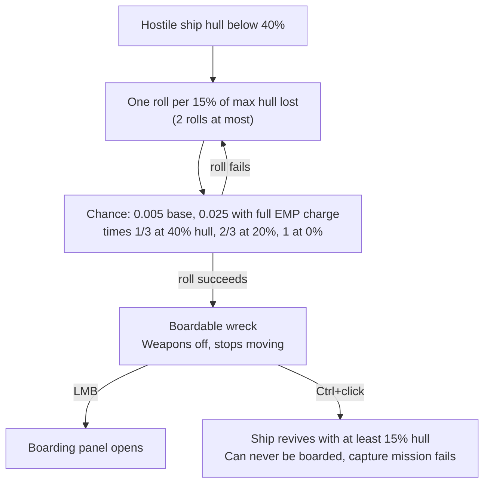
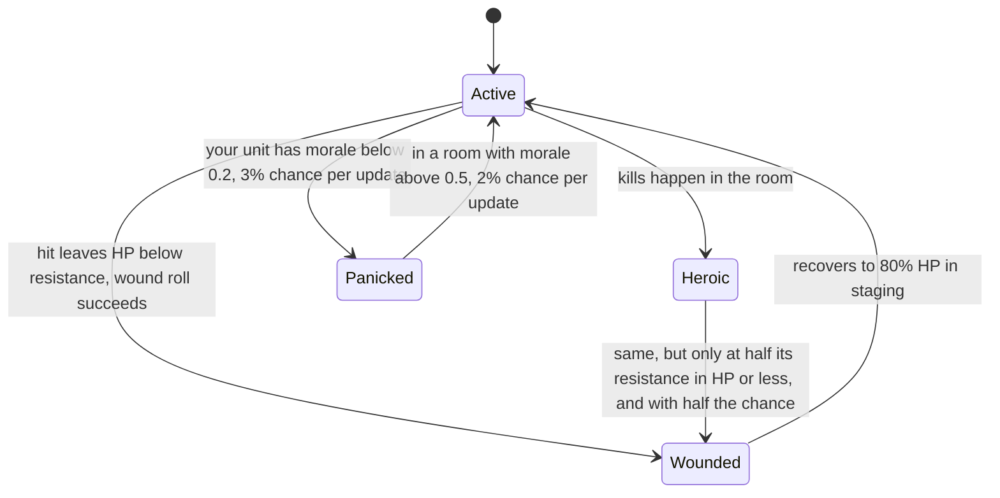
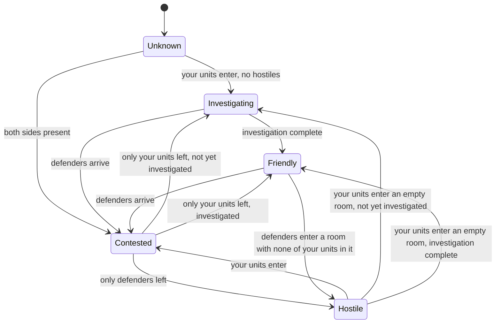
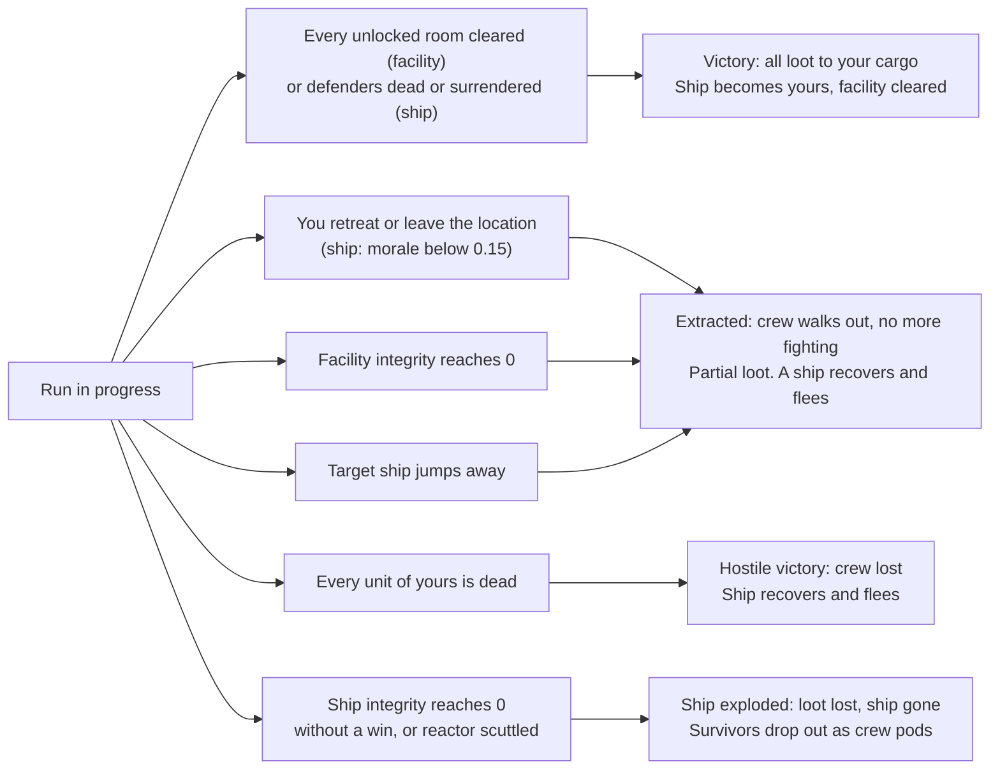

# Boarding and Facility Operations

This page covers the two crew-based operations in Vanguard Galaxy: boarding a disabled ship and entering a facility. A facility is a station-type location such as a Mining Outpost or Pirate Base. The game's tooltip title for it is "Facility", and other game text says "installation". Both operations run on the same compartment simulation. You pick crew, the game plays the fight out in real time, and you steer it with a handful of orders. All values here come from the decompiled game code, not from in-game testing. The code was read from game version 0.8.3.4 and re-checked against 0.8.3.5: the dungeon operation, simulation, compartment and crew-type code is identical in both versions. A few neighbouring files changed (the Autopilot's idle delay, some crew screens and the mastery level cap), and none of them affects a claim on this page. Numbers stored in the game's asset files (crew stats, facility definitions and skill nodes) were re-read from the 0.8.3.5 data dumps. Text strings, such as skill descriptions and event messages, were not re-read for 0.8.3.5.

Terms and abbreviations are explained in the [glossary](glossary.md).

Words used on this page:

- HP means hit points.
- A compartment is one room of a ship or facility.
- A unit is one crew member, either yours (an attacker) or theirs (a defender).
- Staging is the area outside the ship or facility where crew wait before they enter through the Airlock.
- The game advances the simulation once per rendered frame, using the frame time.
- Facility type names such as Mining Outpost and Military Outpost refer to facility types only. They have nothing to do with the economic outposts that factions build and raid once the faction war opens (the [Conquest stage](../conquest/README.md)).

Damage to ships and stations in space combat is covered in [combat-damage.md](combat-damage.md). The scaling of ship and NPC (non-player character) levels is covered in [scaling.md](scaling.md). Station parts and their destruction are covered in [stations.md](stations.md).

The last part of the page, [In the Game Code](#in-the-game-code), has the method names, raw formulas and source references behind each section.

## What You Can Board or Enter

### Ships

A ship is boardable (the game's tooltip calls it a "Boardable ship") only when it has been shot down to a wreck, not when it is merely weak. Once a hostile ship's hull is under 40%, every 15% of max hull in damage taken below that line gives one roll for the ship to become boardable. EMP (electromagnetic pulse) weapons build up an EMP charge on the target, and that charge raises the chance.

The chance of each roll is a base value times a multiplier that grows as the hull drops:

| Hull fraction at the roll | Multiplier on the base chance |
|---|---|
| 40% | 1/3 |
| 20% | 2/3 |
| 0% | 1 |

With no EMP charge the base is 0.005. The multiplier uses the hull left after the hit. The first roll only happens once 15% of max hull has been lost below the line (hull at 25% or lower), so the first roll succeeds with about 0.29% or better. The second roll (hull at 10% or lower) succeeds with about 0.42% or better, up to 0.5% at 0% hull. Flying manually doubles that, to about 0.58%-1%. Under autopilot the doubling is skipped and half of all rolls are skipped instead.

A full EMP charge raises the base to 0.025, which is five times higher. A ship gets at most 2 rolls from damage taken below the 40% line. The 40% band is 2.67 rolls' worth at 15% each, and only whole rolls count. So unassisted boardings are rare, and EMP weapons are what make them likely. Normal ships use the chance as is. The boss ships that appear at a Signal Trap (the code calls them pocket bosses) get 0.05 of it.

A ship can only become boardable if it meets all of these conditions: it is not your own ship, it is not flagged as unboardable, it is not a carrier fighter, it is not a Drone-size ship, it is not at an Industrial Outpost location, and it has no loot list or an empty one. When the roll succeeds, the ship becomes a boardable wreck. Its turrets and modules switch off, it stops moving, and your targeting ignores it.

A boardable ship can be clicked to open the boarding panel (the tooltip reads "LMB to board", where LMB is the left mouse button). Ctrl+click engages it as a normal target instead ("ctrl+click to engage and destroy"), but only before a boarding has started. Engaging it has these effects: the ship comes back to life with at least 15% hull, it is marked so it cannot be boarded afterwards, a ship that was not already hostile to you becomes hostile, and any capture mission tied to it fails.

Capture missions also spawn boardable ships directly. Those ships cannot flee or scuttle, and their crew is only 40% of capacity (a crew fill rate of 0.4).



In the code: [Ships](#code-ships).

### Facilities

Facilities are station-type locations on the map. There are 11 types: Mining Outpost, Salvage Yard, Research Station, Pirate Base, Relay Station, Industrial Facility, Black Market Hub, Military Outpost, Derelict Colony Ship, Ancient Ruin and Hostile Ship (the boardable ship described above). Each is generated with these rules:

| Type | Chance to be abandoned | Default hostility in the definition |
|---|---|---|
| Ancient Ruin, Derelict Colony Ship | 100% | Low (Ancient Ruin), None (Derelict Colony Ship) |
| Mining Outpost | 50% | None |
| Research Station | 50% | Low |
| Relay Station | 45% | None |
| Salvage Yard | 40% | None |
| Industrial Facility | 20% | Low |
| Everything else | 10% | See the type table below |

An abandoned facility has no faction and hostility None (the tooltip's Hostiles row), so it has no defenders. A staffed facility gets hostility High if its owning faction is your enemy (at war with you, or with reputation below -500). Otherwise it gets Low. This only applies if the definition's own hostility is above None. Mining and Industrial facilities spawned by the 25% mining-location roll (levels 5 and up) skip that last check and take the faction-based rating directly. Pirate Bases created for a mission take their rating from the mission difficulty: Easy gives Low, Hard, Skull and Insane give High, and anything else gives Medium.

The conditions for entering a facility are:

| Condition | Effect |
|---|---|
| Integrity at or below 10% | You cannot enter ("Facility too damaged to enter. Structural integrity must exceed 10%.") |
| No docking pad or tunnel left standing | The facility is marked as undockable for good and the attempt is abandoned |
| Location level 10 or more above your effective level | You cannot start. This applies to facilities only, not to ship boarding |
| Ship is travelling | You cannot start |
| Host station destroyed during approach | The operation is abandoned. If it happens during the run, integrity drops to zero |

In the code: [Facilities](#code-facilities).

### Reputation Cost of Entering

Entering a facility or boarding a ship costs reputation if the target's faction has a reputation with you above -500 (Neutral or better). The cost is charged at the moment you press Start, before the approach finishes:

```
penalty = ceil(base experience * 0.5) * 40
```

| Target | Base experience | Penalty |
|---|---|---|
| Any facility | 25 | 520 |
| Ship | The ship's base experience points (XP) | 40 for each half-point of base experience, rounded up |

Some ships are flagged to skip both the penalty and the step that turns the faction hostile. An active Decoy Transponder (an item that prevents reputation loss from combat until you next dock at a station) also skips the penalty. With a Decoy Transponder, the faction still goes hostile when your crew lands, and the warning text still shows the penalty.

Once the crew actually lands, a friendly faction is marked hostile to you in that location. Every unit of that faction there turns hostile, and nothing else changes. Cancelling the approach does not refund the reputation.

In the code: [Reputation Cost of Entering](#code-reputation-cost-of-entering).

### Factions That Are Harder to Board

Meridia's Chosen, Canisec, The Radiant and one late-game faction are harder to board than the others. The game warns about it in the ship's tooltip ("will resist capture at all costs. Expect heavy casualties."). Their ships are simulated at a level of at least your effective level + 10, unless the boarding comes from a capture mission. That alone puts the defenders at least 10 levels above you. Their HP multiplier is then at least about 2.8, and up to 4 at a gap of 15 or more (see [level scaling](#level-scaling-of-defenders)).

In the code: [Factions That Are Harder to Board](#code-factions-that-are-harder-to-board).

### The Crew Sliders and Starting

The pre-start panel has one slider per crew type aboard the ship you are flying. Each slider is capped at the number of that type aboard. Crew on your other fleet ships, in the crew reserve, in the brig or out on another operation are not counted.

The game remembers where you left each slider, as one value per crew type shared by every ship, and puts the slider back there next time. If the ship now has fewer of that type than the remembered value, the slider sits at its far end, but the number printed beside it is still the remembered one. It can then read higher than the figure in brackets (for example, a Marine slider showing 40 beside "Marine (38)"). The crew actually sent is what the slider shows, 38 in this example, and nothing refuses the start because the printed number is too high. Touching the slider rewrites the number. A crew type you have never set starts with all of them aboard, except Pilots, which start at 0.

The Start button is hidden in these cases: the ship has no crew aboard, the facility's integrity is too low to enter, the facility is 10 or more levels above you, or your ship is travelling. The panel's info line then reads "Facility too damaged to enter. Structural integrity must exceed 10%.", "Too dangerous - this location is more than 10 levels above you." or "Ship is travelling - cannot start an operation until it arrives." instead of the usual estimate. Pressing Start with every slider at 0 does nothing.

In the code: [The Crew Sliders and Starting](#code-the-crew-sliders-and-starting).

## What Each Tooltip Number Means

### Ship Tooltip (Boarding in Progress)

Hovering over a ship that is under attack shows these lines:

| Line | Meaning |
|---|---|
| Status and percentage | The live estimate (see below) |
| N attackers vs. M defenders | The number of living units on each side, including your crew still waiting in staging |
| Ship Integrity | The target's current structural integrity over its maximum |
| Attacker Morale | The average morale of your living units |
| Defender Morale | The average morale of the living defenders |

In the code: [Ship Tooltip (Boarding in Progress)](#code-ship-tooltip-boarding-in-progress).

### Facility Tooltip

| Row | Meaning |
|---|---|
| Type | The facility type |
| Status | Shows Abandoned if the facility is abandoned. Before entry, the row does not appear otherwise. It shows In Progress while the simulation runs |
| Hostiles | Shown before entry only. It gives the location's hostility rating. None reads "No hostiles expected", Low reads "Unlikely to be dangerous", Medium reads "Expect some resistance" and High reads "Expect heavy resistance" |
| Specialist | The crew types that count as specialists for this facility. The row is hidden for an Ancient Ruin, which uses the diversity bonus |
| Estimate | The outcome label with the win chance. It is only shown once defenders exist |
| Crews | Your living units against their living units. It is only shown once defenders exist |
| Progress | The number of Friendly compartments divided by the total number of compartments |
| Integrity | The current structural integrity over its maximum. Before entry, it shows the integrity stored for the facility, and the row is hidden if none is stored yet |
| Attacker morale / Defender morale | The averages work as described for the ship tooltip. The defender row only appears if defenders exist |
| Outcome | After a run ends, this row is shown instead of the live rows. It reads Extracted, Retreated or Crew Lost |

In the code: [Facility Tooltip](#code-facility-tooltip).

### The Estimate Formula

Once a simulation exists, the estimate compares the total power of both sides:

```
ratio     = your total power / their total power (counted as at least 1)
winChance = ratio / (ratio + 1)
```

Both totals are summed over every living unit, so troops still in staging count. Units in transit between rooms count as zero for that instant, and so do bought-out units.

| Win chance | Label |
|---|---|
| above 75% | Favourable |
| above 50% | Contested |
| above 25% | Difficult |
| 25% or below | Very Difficult |

This is a power ratio, not a simulation. It ignores HP, positions, specialists, events and everything defenders do besides fight. Crew states change it live: Wounded units count half, Panicked units 60%, Heroic units 140% and Dazed units two thirds. Your side also includes the stealth setting (Silent 0.8, Aggressive 1.2), your Assault Doctrine skill and your equipment's boarding power. It does not include the ammo setting. Defender power uses the faction's defender power multiplier (see [faction defender profiles](#faction-defender-profiles)) and armory efficiency. It does not use Boarding Suppression, the drone bonus or the level HP multiplier.

The pre-start estimate is cruder, because it does not run the simulation at all. The crew-selection panel shows it for ships only. For facilities, the same kind of figure is computed, but only the Autopilot uses it, to judge how dangerous a facility is. It is worked out like this:

- Your power is the sum of each selected crew type's boarding power times its count, times a stealth factor (Silent 0.8, Balanced 1.0, Aggressive 1.2) and an ammo factor (Hollow 0.9, Standard 1.0, Armor Piercing (AP) 1.1).
- For a ship, the defender count is the ship's crew capacity times its crew fill rate (0.7 by default, or the faction's value or a per-ship override), rounded. Each defender counts as 3 power, multiplied by the faction's defender power multiplier, by 1 plus the drone bonus if the faction has drones, and by the square root of the level difficulty modifier for the ship's level against your effective level. For factions that are harder to board, the ship's level is raised to your effective level + 10, unless it is a capture mission.
- For a facility, the compartment count is the average of the definition's minimum and maximum, rounded. The defender count is that number times a fraction (Low 0.3, Medium 0.5, High 0.8), rounded again, and at least 2. Each defender counts as the weighted average boarding power of the facility's defender mix, times the same square-root level factor. A facility with hostility None is always rated Favourable at 100%, with no defenders.

The pre-start estimate leaves out your Assault Doctrine skill and equipment boarding power, so you are usually a little stronger than it says. It assumes every defender has 3 power, but an actual ship's crew is a mix of the faction's crew types. The pre-start figure is also computed from the location's current level, so it moves with your own level.

In the code: [The Estimate Formula](#code-the-estimate-formula).

## Crew Types

Crew stats are fixed for each crew type. In the simulation, a unit has 5 + resistance HP (before modifiers), and its power is its boarding power.

| Crew type | Boarding power | Resistance | HP | Cost (credits) |
|---|---|---|---|---|
| Deckhand | 1 | 1 | 6 | 3,500 |
| Gunner | 2 | 3 | 8 | 7,000 |
| Marine | 4 | 8 | 13 | 16,000 |
| Pilot | 2 | 2 | 7 | 22,500 |
| Miner | 1 | 2 | 7 | 7,000 |
| Salvager | 1 | 2 | 7 | 7,000 |

Marines have four times a Deckhand's power and over twice the HP, for under five times the price. A Marine also uses one slot in a compartment, where four Deckhands would use four. Compartment capacity limits headcount, not power, so a room that holds six units holds 24 power of Marines but only 6 power of Deckhands.

Your own units get two multipliers from skills (see [Skills and Gear](#skills-and-gear)). HP is multiplied by 1 + the crew resistance bonus, and power is multiplied by 1 + Assault Doctrine + the equipment boarding power. Defenders get neither.

In the code: [Crew Types](#code-crew-types).

## How the Fight Is Resolved

### Unit States and Power

A living unit that is not in transit fights with a power that is the product of these factors:

| Factor | Value |
|---|---|
| Base | The crew type's boarding power |
| State | Active 1, Heroic 1.4, Wounded 0.5, Panicked 0.6 |
| Dazed | 2/3 while the daze timer is running |
| Side modifier | See below |
| Armory efficiency | Defenders only. It is 1.0 for you |
| Skills and gear | Your units only: 1 + Assault Doctrine + equipment boarding power |

The side modifier for your units is the stealth power modifier: Silent 0.8, Balanced 1.0, Aggressive 1.2. For defenders it is the faction's defender power multiplier (see [faction defender profiles](#faction-defender-profiles)).

Defender power in a compartment is then multiplied by 1 + the drone defense bonus if the faction has drones, by 1 - Boarding Suppression, and by a level power modifier that is fixed at 1 in the current code.

Defenders in a compartment do not fight unless that compartment's alert state is Alert (ships and armed facilities work this way). A contested compartment is forced to Alert on the next simulation step.



In the code: [Unit States and Power](#code-unit-states-and-power).

### Damage per Simulation Step

Only compartments in the Contested state (both sides present) fight. In each of them, call your power in the room A and their power in the room D. The number of hits per second is:

| Hits on | Per second |
|---|---|
| You | 10 * D/(A+D) * 0.5, times the modifiers below |
| A defender | 10 * A/(A+D) * 0.5, times the ammo modifier |

The modifiers on the hits you take are 0.75 for Silent stealth (otherwise 1.0), 0.65 if the compartment's barricade is complete, and 0.9 if you have Body Armor in cargo or have found one during this run. The ammo modifier is the average over the defenders present (see the table under Ammo and Stealth).

The fractional part of the hit count is rolled each simulation step. Each hit removes 1 HP from a random living, non-transit unit on that side in that compartment. At 0 HP the unit is killed.

Two consequences follow:

1. The total damage rate is capped near 5 hits per second across both sides, split by power share. More power on one side shifts the split but does not speed up the fight. Absolute numbers matter only through HP pools: more bodies and more HP in the room mean the fight lasts longer.
2. A side with 80% of the power takes 1 hit per second on average and deals 4 hits per second.

Hits that do not kill can wound. After the hit, a unit with HP below its resistance rolls a chance of 1 - HP/resistance. A success makes it Wounded (half power, flees to staging). For your units, the resistance in that roll includes the crew resistance bonus. Heroic units are protected while their HP is above half their resistance, and below that they wound at half the usual chance.

Wounded units retreat to staging and recover max HP/75 HP per second there. At 80% HP they return to Active. Defenders can be wounded the same way (half power), but they neither retreat nor recover. A defender with more HP than its resistance cannot be wounded, which matters for level-scaled defenders.

In the code: [Damage per Simulation Step](#code-damage-per-simulation-step).

### Ammo and Stealth

| Option | Effect |
|---|---|
| Hollow ammo | Deals 0.8 times the damage to Marines and Gunners and 1.0 times to everyone else. Structural damage per kill is 1.5. It adds 0.2 to alert noise |
| Standard ammo | Deals 1.0 times the damage. Structural damage per kill is 2 |
| Armor Piercing (AP) | Deals 1.2 times the damage to Marines and Gunners and 1.0 times to the rest. Structural damage per kill is 2.5 |
| Silent | Your power is multiplied by 0.8 and the casualty rate by 0.75. The alert noise is 0.1 |
| Balanced | The alert noise is 0.5 |
| Aggressive | Your power is multiplied by 1.2. The alert noise is 1.0 |

The net effect of Silent on a single fight is close to neutral. You deal less damage (your power share drops) and take 25% fewer hits. What it buys you is time before the defenders' nearby rooms go on alert.

In the code: [Ammo and Stealth](#code-ammo-and-stealth).

### Morale

Each unit has a morale between 0 and 1. It changes in these ways:

| Event | Effect |
|---|---|
| Your unit is killed | Hostile units in that compartment gain 0.04 morale each. Your remaining units in that compartment lose 0.02 each |
| A defender is killed | Your units in that compartment gain 0.04 each, plus 0.02 more |
| In a contested room, your units | Each of your units loses (hostiles / friendlies) * 0.02 per second |
| In a contested room, defenders | Each defender loses (your units / their units) * 0.03 per second, times a health factor from 0.2 (full HP) up to 1.5 (near death) |
| Assault momentum (your units, any room, while any fight is active) | Your units gain 0.02 per second, fading to zero over the first 30 seconds |
| Bridge taken | All your units gain 0.02 per second |
| A unit's room is cut off from the airlock by enemy-held rooms (rooms you neither hold nor contest) | The unit loses 0.05 per second |
| More than 60% of deployed crew wounded while defenders are stronger | Your units lose 0.015 per second |
| Loss trauma | All your living units lose (dead friendlies / total friendlies) * 0.015 per second |
| Not in a contested room (or in staging) | The unit recovers 1/150 (0.0067) per second |
| Defender becomes Heroic | That defender gains 0.15 |

The assault bonus, Bridge bonus, cut-off penalty and wounded penalty only apply on ships and armed facilities, only to units standing in a room, and only while some room is contested. The same is true of the contested-room losses, panic, the defender surrender checks and the morale-collapse retreat. Unarmed facilities skip all of those. The kill-based changes, loss trauma and idle recovery still run there.

Below 0.2 morale, an Active attacker has a 3% chance each update to become Panicked. A Panicked unit above 0.5 morale has a 2% chance each update to recover. These chances are per update, not scaled by time. Panicked and Wounded units retreat toward the airlock after a 2-5 second delay when their morale is 0.35 or below. Wounded units always retreat.

Defender morale works the same way with the faction's morale threshold (default 0.25). Below it, each defender in a contested room has a surrender chance each second (the faction's surrender rate times the elapsed seconds). Every update, each living defender anywhere whose morale is below the threshold also has a chance to surrender. That chance is the surrender rate * 0.1 * min(1, your total power / their total power). If the defender does not surrender, an Active defender has a 2% chance to panic.

An update is one rendered frame. The panic and recovery chances above, the surrender check on defenders anywhere in the ship and the mass surrender check fire once per frame, so they happen more often at a higher frame rate. The in-room surrender chance and defection are multiplied by the frame time and do not depend on frame rate.

Panicked defenders in a room you hold or contest retreat to an adjacent defender-held room with spare capacity, once their morale is 0.35 or lower and after a 2-5 second delay. If no such room exists, they may surrender (the surrender rate * 3 per second). Defenders of factions with a kamikaze chance may instead blow themselves up while one of your units is in the room (the kamikaze chance * 2 per second), for 1 damage to one of your units there.

If the average morale of your living units falls under 0.15 on a ship boarding, the crew breaks off and retreats (reason "Morale Collapse"). In facilities, a morale collapse only triggers a retreat through the autopilot director (see [Autopilot](#autopilot)). During a manual facility run, there is no automatic morale retreat.

In the code: [Morale](#code-morale).

### Surrender, Capture, Defection, Heroics

| Mechanic | Rule |
|---|---|
| Surrender in combat | A defender with morale under the faction threshold surrenders at the faction's surrender rate per second. Surrendered units become prisoners |
| Mass surrender | This needs you to hold the Bridge (Friendly or Investigating), your total power to be at least equal to theirs, a faction that allows mass surrender, a surrender rate above zero, and at most 20% of the ship's rooms to be rooms that you neither hold nor contest. Then the chance is the surrender rate * 5 per update. If it succeeds, all living defenders surrender and you win |
| Outnumbered capture | When one defender stands alone against two or more of your units, the chance per second to capture that defender is 0.04 * min(your units - 1, 4). It is multiplied by 0.25 if the faction never surrenders |
| Defection | A defender under 0.1 morale who is outnumbered 2:1 or more has a 0.02 per second chance to join you |
| Heroics (yours) | For each defender killed, captured or surrendering in a compartment, each Active unit of yours there has a 0.025 chance to become Heroic (0.045 if a Heroic is already present) |
| Heroics (theirs) | For each unit of yours killed, each Active defender has a chance of 0.04 + 0.04 * existing Heroics (capped at 0.2) to become Heroic |

Prisoners go to your brig up to your ship's brig capacity (see [Pods and Crew Return](#pods-and-crew-return)). Surrendered and captured units no longer count as living.

In the code: [Surrender, Capture, Defection, Heroics](#code-surrender-capture-defection-heroics).

## Level Scaling of Defenders

Defenders get an HP multiplier from the level gap. The gap is how far the location's level is above your level, or 0 if it is not above.

| Gap | HP multiplier |
|---|---|
| 0 | 1.00 |
| 1 | 1.12 |
| 3 | 1.40 |
| 5 | 1.73 |
| 7 | 2.12 |
| 10 | 2.83 |
| 15 and above | 4.00 |

The multiplier applies to defender HP at spawn, to the number of units in a combat ambush, and to the HP damage of hazards on your crew. It does not multiply their power. Ships use your effective level. Facilities use your captain level.

Gaps above zero also shift the defender mix toward Marines. The Marine share moves from its base value toward 80% of the total as the gap goes from 0 to 15, taking from Deckhand and Gunner shares. At a gap of 15, up to 80% of the defenders are Marines if there are enough Deckhands and Gunners to convert. Hazard event chances rise with the gap too, doubling every 10 levels, without the cap at 15 that the HP multiplier has.

In the code: [Level Scaling of Defenders](#code-level-scaling-of-defenders).

## Faction Defender Profiles

Ship defenders (and facility defenders from a faction) follow a faction profile. Factions not listed use the default profile (all modifiers 1, surrender chance 5%, morale threshold 25%). One late-game faction has its own profile, which is not listed here. It is covered with the late game.

Two columns need a short explanation.

- Defender power multiplier: every defender's boarding power is multiplied by this number, both in the running simulation and in the pre-start estimate. At 1.4, each defender fights with 1.4 times the power of one with the default 1.0. It does not change defender HP, which comes from the level gap.
- Counterattack chance: the chance that a room of defenders counterattacks each time the game checks (see the Counterattack row under [What Defenders Do on Ships](#what-defenders-do-on-ships)). The base chance is 50%, and the faction's bonus is added to it. A faction with a bonus also counterattacks while one of your rooms is contested, which factions without a bonus never do, and the defenders it sends gain 0.2 morale.

| Faction | Defender power multiplier | Surrender chance | Other effects |
|---|---|---|---|
| Default | 1.0 | 5% | Morale threshold 0.25 |
| Corsair Syndicate | 1.0 | 3% | Scuttle chance 20%, counterattack chance 85%, alert speed x1.3, useful brig crew |
| Meridia's Chosen | 1.0 | 0% | Scuttle chance 100%, can vent airlocks, kamikaze chance 5%, alert speed x1.5, useful brig crew |
| Stellar Industries | 1.1 | 10% | Side-switch chance 5%, morale threshold 0.35 |
| Kolyatov Collective | 1.1 | 0% | Counterattack chance 60% |
| Luminate Combine | 1.1 | 8% | Has drones (+15% defender power), kamikaze chance 3% |
| Canisec | 1.3 | 5% | No mass surrender, useful brig crew |
| Omnitac Agency | 1.1 | 5% | Can be bought out |
| Darkspace Compact | 1.4 | 0% | Counterattack chance 100%, alert speed x1.3 |
| Void Drifters | 1.2 | 8% | Can be bought out |
| The Radiant | 1.0 | 0% | Kamikaze chance 8%, can vent airlocks |
| Mindus Holdings, Steel Vultures, Forge Industries | 0.8 | 15% | No other effects |
| Stranded | 1.2 | 5% | Counterattack chance 65% |

In the code: [Faction Defender Profiles](#code-faction-defender-profiles).

## Compartments

### States

| State | Meaning |
|---|---|
| Unknown | Your units have never entered it. The game shows it as unexplored |
| Investigating | Your units are present, no hostiles are, and the investigation is not yet complete. It counts as friendly-controlled. The game labels it "Investigating", or "Securing" for a corridor |
| Contested | Both sides are present. This is where fighting happens |
| Friendly | The room is cleared and the investigation is complete. The game labels it "Cleared" |
| Hostile | Only defenders are present |
| Destroyed | The room is gone (an ammo explosion at the armory does this) |

A compartment's state is recomputed from who is standing in it. Units in transit do not count for either side. When both sides are present it is Contested. When only you are there it is Investigating or Friendly. When only defenders remain it is Hostile, but a room that was Unknown or Investigating stays that way if investigation is switched on for this fight. On a ship it is switched on when the ship has a Cargo Hold or an Armory, or hidden caches (see [Investigation](#investigation)). A Hostile room with no defenders left in it turns Investigating or Friendly.



In the code: [States](#code-states).

### Capacity

Each room type has a base capacity, which is multiplied by the ship size multiplier. Facilities always use a multiplier of 1.

| Compartment | Base capacity |
|---|---|
| Airlock, Reactor Room, Brig, Control Room, Workshop, Laboratory, Generator Room, Server Room, Security Office, Medical Bay | 4 |
| Corridor, Armory, Officers Lounge, Ore Processing, Excavation | 5 |
| Cargo Hold, Living Quarters, Mess Hall, Storage Bay, Debris Field | 6 |
| Bridge | 3 |

Ship size tiers 0 to 8 multiply the base capacity by 1, 1, 1.2, 1.5, 1.8, 2.2, 2.8, 3.5 and 5, rounded down. Capacity applies to each side separately.

In the code: [Capacity](#code-capacity).

### Ship Layouts

Every ship has an Airlock, Bridge and Cargo Hold. Larger sizes add rooms:

| Size tier | Rooms added |
|---|---|
| 2 | Corridor |
| 3 | Living Quarters, Reactor Room |
| 4 | Brig, Corridor |
| 5 | Mess Hall, Armory |
| 6 | Officers Lounge, Corridor, a second Airlock, Living Quarters, Cargo Hold, Mess Hall, Reactor Room |
| 7 | Living Quarters |
| 8 | A third Airlock, Cargo Hold, Living Quarters, 12 more Corridors |

Your crew lands only at the first Airlock. The counts below are before the game adds extra corridors: when a room would have more than 6 connections, the layout splits its links by adding a new corridor, so the final compartment count can be higher. Size 1 ships have 3 compartments, size 3 ships have 6, size 5 ships have 10, size 6 ships have 17 and size 8 ships have 33.

A ship's maximum integrity is 1,000 per compartment. It starts at the maximum multiplied by the target's hull fraction when you start plus 20%, capped at 100%. For example, a ship you shot down to 20% hull starts at 40% integrity.

Defenders come from the ship's own crew, which is filled at the crew fill rate if the ship has none. Each crew type prefers a home room. The chances are Marine in the Armory 60%, Gunner in the Armory 45%, Deckhand in the Living Quarters 50%, Miner in the Cargo Hold 50% and Salvager in the Reactor Room 40%. Otherwise they go to a random room within capacity. The first 1 to 3 defenders (1 + size tier/3, capped at 3) are moved to guard the Airlock.

In the code: [Ship Layouts](#code-ship-layouts).

### Facility Layouts and Sizes

The number of compartments is a random whole number between two limits. The lower limit is the definition's minimum plus half of n (rounded down), and the upper limit is its maximum plus n. Here n is the location's level divided by 12 (rounded down), and at most 8. Every facility has one Airlock and one to four Corridors. The rest of the rooms come from the type's weighted pool.

| Type | Compartments (min-max) | Layout | Speed bonus | Hostility |
|---|---|---|---|---|
| Mining Outpost | 6-12 | Tunnel, docking pad | 0.4 | None |
| Salvage Yard | 6-16 | Radial | 0.4 | None |
| Research Station | 8-14 | Grid | 0.4 | Low |
| Pirate Base | 10-18 | Radial | 0.25 | Medium |
| Relay Station | 5-10 | Tunnel | 0.4 | None |
| Industrial Facility | 10-16 | Grid | 0.4 | Low |
| Black Market Hub | 6-12 | Tunnel | 0.3 | Low |
| Military Outpost | 10-18 | Grid | 0.2 | High |
| Derelict Colony Ship | 14-20 | Radial | 0.4 | None |
| Ancient Ruin | 6-16 | Radial | Diversity bonus | Low |
| Hostile Ship | Not applicable (ships use the ship layouts above) | Ship | Not applicable | High |

The speed bonus is the extra investigation speed a specialist gives in the type's profession rooms (see [specialists](#specialists-and-the-diversity-bonus)).

Maximum facility integrity is 3,000 per compartment. Starting integrity is a random fraction:

| Facility | Starting integrity |
|---|---|
| Ancient Ruin, Derelict Colony Ship | 45-75% |
| Other abandoned | 55-80% |
| Staffed | 80-100% |

The fraction is stored on the location and carries over between visits. Rooms of type Control Room, Storage Bay, Workshop, Laboratory, Server Room or Security Office are each locked 35% of the time.

In the code: [Facility Layouts and Sizes](#code-facility-layouts-and-sizes).

## Alert, Investigation and Movement

### Alert

On ships and armed facilities, each compartment has an alert state: Dazed, Relaxed, Concerned, Worried or Alert. Every compartment starts Dazed, unless the Enemy Alerted start event sets each room to Concerned, Worried or Alert. A compartment not yet in Alert advances only while it touches a compartment that is Contested or friendly-controlled. Each second it builds up progress from the noise level, the faction's alert speed and a random factor between 0.3 and 1.7. It leaves each state at these thresholds:

| From | Threshold |
|---|---|
| Dazed | 14 |
| Relaxed | 9 |
| Concerned | 7 |
| Worried | 5 |

That is 35 units from Dazed to Alert. At Balanced noise (0.5), a room next to your crew goes Alert after about 70 seconds on average. At Silent noise (0.1) it takes about 350 seconds, and at Aggressive noise (1.0) about 35 seconds. Hollow ammo adds 0.2 to the noise (Balanced then takes about 50 seconds), and the Comms Down event halves it. The faction alert speed is 1.3 to 1.5 for some factions.

An Alert room that still holds more than half its original occupants (half rounded up) has a 0.3 per second chance, about once every three seconds, of sending one defender into each adjacent Contested room that is under capacity. Counterattacks also need a room in Alert. So noise decides how many defenders end up joining a fight you started elsewhere.

In the code: [Alert](#code-alert).

### Investigation

Units in a friendly-controlled room that is not yet finished investigate it. The progress per second is:

```
1 / base duration of the room
  * (1 + 0.15 * (units present - 1))
  * specialist modifier
```

The specialist modifier is 1 + 0.2 * (number of distinct crew types - 1) at an Ancient Ruin (diversity). It is 1 + the facility's speed bonus when a specialist is present and the room is one of the type's profession rooms. Otherwise it is 1.

A room becomes Friendly when progress reaches 1 and all its events have fired. The base durations are:

| Room | Seconds |
|---|---|
| Airlock | 0 (done in 1 s) |
| Corridor | 5 |
| Medical Bay | 50 |
| Brig | 50 |
| Living Quarters | 45 |
| Storage Bay, Generator Room, Cargo Hold | 60 |
| Debris Field, Security Office | 70 |
| Workshop | 75 |
| Ore Processing, Armory, Server Room | 80 |
| Control Room, Laboratory | 90 |
| Excavation | 100 |
| Any other room | 60 |

On ships only the first Cargo Hold (20 s) and the Armory (25 s) take investigation time unless the ship has hidden caches, in which case every non-airlock, non-corridor room takes 25 s. Other ship rooms, including extra Cargo Holds, resolve at 1 progress per second.

Adding crew to a room has strongly diminishing returns on investigation speed. For example, 6 units give 1 + 0.15 * 5 = 1.75 times the speed of one unit.

In the code: [Investigation](#code-investigation).

### Movement and Orders

If the game's "Automatic movement" setting is on, your units spread automatically: they push from friendly rooms into adjacent enemy rooms (strongest units first), fill under-staffed rooms that are investigating, flow toward contested front lines and explore unknown rooms. With it off, only directives and explicit orders move units.

Directives are the game's internal orders that pull units to a room. When two directives compete, the one with the higher priority wins. From lowest to highest priority, they are:

| Priority | Created by |
|---|---|
| Revisit for missed loot | A profession discovery fired while no specialist was present. It sends a specialist back |
| Profession call-in | A room has an unfired profession event and no specialist. It sends one |
| Combat reinforcement | A room just became Contested (combat ambush) |
| Your movement order | Your own orders |

Your orders work like this. Select a compartment, then press:

- 1 to send Combat crew (highest boarding power first).
- 2 to send Specialists.
- 3 to send any crew.
- E (or Ctrl+click) to set the room as the priority target. New crew are routed there first.
- R to retreat units out of the compartment and clear orders there.
- G to throw a grenade.
- B to toggle a barricade.

Hold a number key and scroll to set how many units to send. Orders can only draw from units that are idle, then investigating, then (if the target is contested) units in other contested rooms.

Moving from room to room takes 0.7 seconds in transit. Automatic movement will not pull a unit out of a room until the unit has been there for 2 seconds. Your own orders and combat reinforcements ignore this delay. When the whole force is retreating from the operation, units start walking out after 1 second. Units in transit do not fight.

In the code: [Movement and Orders](#code-movement-and-orders).

### Locks and Lockdowns

A locked room needs a specialist standing in an adjacent room, which starts a 10-second unlock timer. At an Ancient Ruin, where the diversity bonus replaces specialists, locks only open with 3 or more distinct crew types alive. With Automatic movement on, the game starts the timer by itself from an idle specialist in an adjacent room, and it routes a specialist toward a locked room when one exists. With Automatic movement off, you must order units to the locked room.

Locked rooms are not counted for the "all compartments explored" win condition. They carry bonus loot when opened, and special-loot chances in locked rooms are multiplied by 6.

A Lockdown event (in Military Outpost control rooms) seals adjacent corridors for 15 seconds, or 10.5 seconds with a specialist in the room. Only specialists can move into a sealed room, and doing so cancels the lockdown.

In the code: [Locks and Lockdowns](#code-locks-and-lockdowns).

### Barricades and Grenades

Barricades and grenades are only available on ships and armed facilities.

| Action | Rule |
|---|---|
| Barricade | It needs a room in the Friendly state. The build rate is 0.05 * (1 + 0.15 * (crew - 1)) per second, so it takes 20 seconds with one unit. Building pauses while the room is contested, and the barricade is cleared if defenders retake the room. A complete barricade multiplies the damage to your units there by 0.65. Units in a barricaded room stay put instead of pushing forward |
| Grenade | You get 3 + size tier/2 charges on a ship (integer division) or 3 + compartments/4 on an armed facility. The cooldown is 10 seconds. The target room must have a living defender and be either yours, contested or adjacent to yours. The grenade sets the room to Alert. Every unit in the room, on both sides, takes 3 damage and is dazed for 15 seconds (power multiplied by 2/3). The structure takes 5% of its maximum |

A Deckhand (6 HP) survives one grenade, a Gunner (8 HP) survives two, and a Marine (13 HP) survives four. These counts are before the HP skill bonus for your units and the level multiplier for defenders. Everyone in the room also loses a third of their power for 15 seconds, and this hits your own crew in the room as much as theirs.

In the code: [Barricades and Grenades](#code-barricades-and-grenades).

## Specialists and the Diversity Bonus

Each facility definition lists one or more crew types as its specialists. A specialist does four things:

1. Unlocks locked rooms (10 s timer).
2. Collects profession discoveries. Loot that needs a specialist is lost for now if none is in the room when the event fires at its progress threshold. The room then asks for a specialist to come back (revisit).
3. Raises investigation speed in rooms where the definition has a profession event.
4. Protects against bad events (see below). This applies in any room, as long as the specialist is standing in it.

Profession discoveries check specifically for the first crew type in the definition's list, not for any specialist. The list comes from the game's asset data:

| Facility | Specialists (first one collects profession loot) | Profession loot rooms |
|---|---|---|
| Mining Outpost | Miner | Ore Processing (crystal vein), Excavation (geological data) |
| Salvage Yard | Salvager | Debris Field, Workshop |
| Research Station | Salvager | Laboratory, Workshop |
| Pirate Base | Marine, Gunner | None |
| Relay Station | Marine | Server Room |
| Industrial Facility | Salvager, Miner | Workshop, Ore Processing |
| Black Market Hub | Deckhand | Cargo Hold |
| Military Outpost | Marine | Armory |
| Derelict Colony Ship | Salvager, Deckhand | Living Quarters, Debris Field, Workshop |
| Ancient Ruin | Diversity bonus (no specialists) | None |

The speed bonus applies only in the rooms listed in the "Profession loot rooms" column. A Miner at an Industrial Facility opens locks and protects against events, but does not collect the Salvager's discoveries.

An Ancient Ruin uses the diversity bonus instead. Every unit counts as a specialist for event protection, investigation speed is 1 + 0.2 * (distinct crew types - 1) everywhere, and locks require three or more distinct types.

Specialists protect against negative events (Hazard, Combat ambush and Lockdown). When such an event fires, this check happens:

```
specialists needed = 1 + floor(level gap / 3)
if specialists in the room >= needed:  33% chance the event is fully prevented
```

If the event fires anyway, the specialists reduce its effect as follows:

| Event | Specialist effect |
|---|---|
| Hazard crew damage | Each victim takes max(1, round(2 * HP multiplier * (1 - 0.125 * min(specialists, 4)))) damage. Non-specialists take double damage and have a 20% chance of instant death |
| Hazard facility damage | The damage is multiplied by 1 - 0.125 * min(specialists, 4) |
| Combat ambush | The number of spawned defenders is multiplied by 0.7 (minimum 1) |
| Lockdown | The timer is 10.5 seconds instead of 15 |

The facility definitions list a profession discovery bonus of 0.25, but nothing in the game reads it.

In the code: [Specialists and the Diversity Bonus](#code-specialists-and-the-diversity-bonus).

## Events Inside a Facility

Events trigger when a room's investigation progress crosses their threshold (0 means as soon as progress is above zero, so on entry).

### Per-Room Template Events

Each non-airlock room rolls 0-3 events from its definition's weighted templates. These are discoveries (loot), hazards, combat ambushes, lockdowns or interactions. Templates marked active-only never appear in abandoned facilities.

The size of a combat ambush is a random whole number from 2 up to 2 + compartments/5 (rounded down), multiplied by the defender HP multiplier and rounded (at least 1). With a specialist in the room it is multiplied by 0.7 and rounded again (at least 1). Units come from the facility type's mix, with the Marine shift for level gaps (see [level scaling](#level-scaling-of-defenders)). The mixes are:

| Facility | Mix (weights at no level gap) |
|---|---|
| Pirate Base | Marine 50, Gunner 30, Deckhand 20 |
| Military Outpost | Marine 70, Gunner 20, Salvager 10 |
| Mining Outpost | Miner 40, Marine 30, Salvager 30 |
| Industrial Facility | Salvager 40, Miner 20, Marine 30, Deckhand 10 |
| Relay Station | Marine 40, Salvager 30, Deckhand 30 |
| Research Station | Salvager 40, Marine 30, Deckhand 30 |
| Black Market Hub | Deckhand 50, Gunner 30, Marine 20 |
| Salvage Yard | Salvager 50, Marine 30, Deckhand 20 |
| Other | Marine 30, Gunner 25, Salvager 25, Deckhand 20 |

The templates also carry hostile-count and hostile-power fields, but nothing in the game reads them.

In the code: [Per-Room Template Events](#code-per-room-template-events).

### Facility Hazard Events

On top of the templates, the game adds hazards that damage the facility. Each room that is neither an airlock nor a corridor rolls for each eligible hazard with chance base weight * 2^(gap/10) * 0.5. In abandoned facilities, the first four hazards in the table (Fire, Pressure lost, Structural collapse and Power grid failure) are multiplied by 1.5. Hazards trigger at 20-79% room progress.

| Hazard | Damage to integrity | Base weight | Rooms / facility types |
|---|---|---|---|
| Fire | 4,500 | 0.25 | any |
| Pressure lost | 5,400 | 0.20 | any |
| Structural collapse | 4,500 | 0.20 | any |
| Power grid failure | 3,000 | 0.35 | Generator, Control, Server rooms |
| Booby trap | 4,500 | 0.4 | Pirate Base, Military Outpost, Black Market Hub |
| Explosive charge | 6,000 | 0.5 | Armory / Cargo Hold in Pirate Base, Military Outpost |
| Drilling accident | 4,500 | 0.5 | Excavation / Ore Processing in Mining Outpost |
| Pressure explosion | 6,000 | 0.45 | Workshop / Ore Processing in Industrial Facility, Mining Outpost |
| Chemical leak | 3,600 | 0.45 | Laboratory / Workshop in Industrial Facility, Research Station |
| Containment breach | 6,000 | 0.6 | Laboratory in a staffed Research Station |
| Energy pulse | 3,600 | 0.3 | Ancient Ruin |
| Deck collapse | 5,400 | 0.35 | Derelict Colony Ship |

For example, a fire in a 12-compartment facility, which has 3,000 integrity per compartment (36,000 in total), costs 4,500/36,000 = 12.5%.

In the code: [Facility Hazard Events](#code-facility-hazard-events).

### Hazard Effects on Your Crew

When a hazard fires and is not prevented, half the units in that room (at least 1) are hit at random. Each non-specialist has a 20% chance to die outright. Otherwise it takes the damage listed above. Every victim that survives loses 0.15 morale and can become wounded.

In the code: [Hazard Effects on Your Crew](#code-hazard-effects-on-your-crew).

### Armed Facilities

Facilities with hostility above None place defenders at start and use the same combat rules as ships:

```
defenders = at least 2: round(compartments * fraction) + a random -1, 0 or +1
fraction: Low 0.3, Medium 0.5, High 0.8
Low hostility: only 30% of runs have any defenders at all
```

Defenders go to random non-airlock rooms with spare capacity (corridors only if no other room has space). The structure takes 2.4 damage per second for every contested room, on top of hazards. Compared to the 3,000-per-room maximum this is small, but a long multi-room battle adds up.

In the code: [Armed Facilities](#code-armed-facilities).

## Start Events (Ships)

When a ship boarding begins, each of these is rolled independently:

| Event | Chance | Effect |
|---|---|---|
| Comms Down | 15% | Alert noise is multiplied by 0.5 for the whole fight |
| Reactor Down | 8% | Removes the faction's ability to scuttle the reactor (see below) |
| Enemy Dazed | 12% | Shows the message "Enemy crew are dazed - limited initial resistance" and sets every room to Dazed. Every room already starts Dazed, so the event changes no value in the simulation. Its only effect is that Enemy Alerted cannot roll in the same fight |
| Enemy Alerted | 12% (only if Dazed did not roll) | Every room is set to a random alert state of Concerned, Worried or Alert. There is a 20% chance that this adds an Enemy Reinforcements entry to the event list, which has no effect (see below) |
| Enemy Reinforcements | 10% | Schedules a defender reinforcement at 40% of the estimated duration |
| Armory Damaged | 15% | Sets the armory efficiency to a random value of 70-90%, which multiplies every defender's power for the whole fight |
| Volatile Cargo | 12% | A hazard in the Cargo Hold fires once your units are in it and no defenders are left there. It hurts your crew but does no damage to the hull |

The Enemy Alerted roll that adds Enemy Reinforcements has no effect. The game applies the start events by walking a copy of the list made before any event runs, so an entry added by Enemy Alerted is never applied. It schedules no reinforcements and logs no reinforcement message. Only the straight 10% roll schedules them.

The Volatile Cargo hazard is a normal hazard (see above), so a specialist can prevent or soften it. On a ship, the only specialist is the crew type named in the ship's own investigation crew type field, which also makes that crew type the one that collects hidden caches. In 0.8.3.5 (and in 0.8.3.4) only the developer console sets that field, so ships generated in normal play have no specialist and the hazard hurts a standard crew in full. Ships flagged as never scuttling behave as if Reactor Down was rolled.

The estimated fight duration, used to time reinforcements, is:

```
estimated duration = 10 + 3 * compartments + (their power / your power) * 20, kept between 10 and 60 seconds
```

On top of the start events, the game adds hazards that damage the hull. Each room that is neither an airlock nor a corridor rolls for each eligible hazard with chance base weight * 2^(gap/10) * 0.5:

| Hazard | Damage | Base weight | Factions |
|---|---|---|---|
| Hull breach charges | 800 | 0.25 | Corsair Syndicate, Meridia's Chosen, The Radiant |
| Fire | 1,000 | 0.2 | any |
| Pressure lost | 800 | 0.15 | any |

In the code: [Start Events (Ships)](#code-start-events-ships).

## What Defenders Do on Ships

The game checks these behaviours once per simulation step, and only on ships and armed facilities.

| Behaviour | Conditions and numbers |
|---|---|
| Counterattack | Every 5-10 seconds the game checks each room that is held only by defenders (not contested), has 2 or more of them, is in Alert, and is next to one of your rooms where your power does not exceed theirs. The chance is 0.5 plus the faction's counterattack bonus, and a success sends all but one defender (up to the target's spare capacity) into your room. Factions without a counterattack bonus only do this while no room is contested. With a bonus, the moved defenders gain +0.2 morale |
| Scuttle | Ships only, while the fight is not won. It needs the reactor room or the armory to be still held by defenders, and you must hold at least 55% of the ship. The game warns once. After that, each second there is a chance of 0.08 times the faction's scuttle chance (0.016 per second for the Corsair Syndicate, and 0.08 for Meridia's Chosen and one late-game faction). If the armory is theirs and the reactor is yours, the outcome is always an ammo explosion. If both are theirs, it is a 40% ammo explosion and a 60% reactor blast. If only the reactor is theirs, it is the reactor blast. An ammo explosion does 35% structure damage and destroys the armory. In a reactor blast, the ship explodes in 5 seconds |
| Airlock vent | Only factions that can vent do this. It needs the Airlock to be not held by you and a 30 s cooldown, and it has a chance of 0.003 per second. It kills each of your units in the airlock with 100% chance, then in the rooms one, two and three steps further in with 60%, 20% and 10%. Defenders in the same rooms die at half those chances (50%, 30%, 10% and 5%) |
| Jump drive | Only ships of level 40 and up that can flee do this. After you hold 50% of the ship while defenders hold the Bridge, there is a 0.05 per second chance that the ship starts a 120 s spool. Take the Bridge before it finishes, or the ship jumps away (the code's outcome is Extracted, with reason Target Ship Escaped). The spool starts only once, and retaking the Bridge cancels it for good |
| Buyout | Only Omnitac Agency and Void Drifters do this. Each second there is a 0.008 chance that they offer one unit for 1.25 times its crew cost. After each offer there is a 15 s cooldown, and no new offer is made while one is pending. Accepting spends credits and removes the unit from the defenders. The unit takes no further part in the fight, but it is carried home with your crew if there is room. The Auto Accept Buyouts setting accepts offers automatically |
| Side-switch | Stellar Industries defenders only. Once the rooms you hold or are fighting in make up at least 60% of the ship, there is a 0.05 per second chance that 1-3 defenders join you. The cooldown is 20 s |
| Kamikaze | Applies to factions with a kamikaze chance. Each second, units under the morale threshold die at that chance and deal 1 damage to a random unit of yours in the room |
| Brig rescue | This happens the first time you take the Brig (ships of size 4 and up have one). The chance is 65% for factions with useful brig crew and 30% otherwise. A success frees between 1 and max(2, compartments/2) units of the ship's own crew types, and they join you |

The factions with a 65% chance are the Corsair Syndicate, Meridia's Chosen and Canisec. Rescued units count as newcomers (see [Returning Crew and Overflow](#returning-crew-and-overflow)). They are returned to your ship only if there is space in your crew quarters after your own crew has been placed.

In the code: [What Defenders Do on Ships](#code-what-defenders-do-on-ships).

## Integrity and Collapse

### Structure Damage

| Source | Amount |
|---|---|
| Kills with Armor Piercing, Standard or Hollow ammo | 2.5, 2 or 1.5 per kill |
| Grenade | 5% of the maximum integrity |
| Armed-facility combat | 2.4 per second for each contested room |
| Facility hazards | 3,000 to 6,000 per hazard (see the hazard table) |
| Ship hazards | 800 to 1,000 per hazard |
| Armory explosion | 35% of the maximum integrity |

### Ship Collapse

If a ship's integrity reaches 0 before you have won, and your crew is not already retreating, the ship starts to collapse. Your crew begins retreating. Decompression starts right away in 2-4 randomly chosen rooms (never the Airlock) and spreads from each of them up to three rooms outward. No more than compartments/4 rooms (at least 1) are ever decompressed in total, spread included, so on most ships that limit is reached almost at once. Every second there is also a 6% chance of one more starting room while the limit has not been reached. At 15 seconds the ship explodes, whether or not your crew reached the Airlock.

Vent kills hit your units and the defenders alike. Each unit in the room itself has a 50% chance to die, less 40 points per room of distance (never below 10%), spreading three rooms out. After a victory, integrity reaching 0 does nothing.

A scuttle explosion is faster. It takes 5 seconds, and each living crew member outside the Airlock and staging has a 0.14 per second chance of death.

### Facility Collapse

At 0 integrity a facility triggers a retreat with reason Structural Collapse. There is no explosion. Your crew walks to the Airlock and leaves with partial loot. Any mission to clear that facility (the game's "Clear Pirate Base" mission, type "Dungeon Assault") fails with "Mission failed - the base collapsed." The stored integrity stays near zero, so the facility stays closed, because entering needs more than 10%.

A location protected by a mission cannot drop below 15% integrity.

In the code: [Integrity and Collapse](#code-integrity-and-collapse).

## How a Run Ends

The game shows run outcomes in its own words, and they do not match the table below one to one. For facilities (the operation panel, the facility tooltip and the Operation Log), a victory is shown as Extracted, a retreat is shown as Retreated, and a hostile victory is shown as Crew Lost. For ships, the Operation Log only says Captured for a victory and Failed for everything else. The Outcome column below uses the code's names, so its Extracted rows are what the game calls Retreated.

| Outcome | Reason | When |
|---|---|---|
| Victory | None | Facility: every room that is not locked is Friendly (none is Unknown, Investigating or Contested). Ship: all defenders are dead or surrendered, or a mass surrender happens |
| Extracted | Voluntary Retreat | You abandon the operation (retreat or cancel button), set a course away from the location, or the dock you are using is destroyed while the operation runs |
| Extracted | Morale Collapse | On a ship boarding, the average attacker morale falls under 0.15, or the autopilot retreats |
| Extracted | Structural Collapse | The facility's integrity reaches 0 |
| Extracted | Target Ship Escaped | The target ship's jump drive finishes |
| Hostile victory | All Crew Killed | None of your units is alive |
| Ship exploded | Structural Collapse / Reactor Scuttled | The ship's collapse timer runs out, or the defenders scuttle the ship |

A victory does not close the run immediately. The simulation stays open until you request extraction. Then your crew walk back to the Airlock and into staging, and the run completes. On ships, investigation speed rises tenfold after a victory, so the remaining rooms are explored quickly. If you retreat instead, your crew walk out without further fighting. While retreating, the simulation skips combat entirely, so retreating is the safe way to preserve survivors.



Consequences by outcome:

| Outcome | Ship | Facility |
|---|---|---|
| Victory | You capture the ship, and it becomes yours. Its crew and commander are removed. The ammo in its cargo is cut down for each turret and torpedo bay to the amount that weapon fires in 60 seconds, and anything above that is removed. If it has more than two equipped modules, a random selection of them is destroyed. At least two are always lost, and the more hull the ship has left when you win, the more survive. The number of nodes on every hull upgrade path is halved (rounded down). All loot goes to your cargo, with a 2% chance of a booster. You gain Leadership mastery XP | All loot goes to your cargo, with a 2% chance of a booster, as on ships. The clear-the-base mission trigger fires (the game's "Base cleared"), and one already completed clear-the-base mission with no turn-in step is claimed automatically |
| Extracted | The ship recovers (at least 15% hull), becomes unboardable and flees. Each loot item that is not data has a 50% chance to reach your cargo. Boarding missions fail | The same partial loot rule applies, but data items are always kept. Integrity stays reduced |
| Hostile victory | Your crew is lost. The ship recovers and flees, boarding missions fail, and you get a quarter of the usual XP | Your crew is lost |
| Ship exploded | Loot is lost. Surviving attackers drop out as crew pods (see [Escape pods when a ship explodes](#escape-pods-when-a-ship-explodes)), and the ship is gone | Not applicable |

In the code: [How a Run Ends](#code-how-a-run-ends).

## Pods and Crew Return

Ships are boarded with pods. Facilities are entered by walking.

### Boarding Pods

A pod is docked on your ship, launches, attaches to the target, then returns with the survivors.

| Step | Rule |
|---|---|
| Creation | When you press Start, each crew selection is removed from your ship and split into docked pods of up to 10 units each |
| Approach | The ship flies to a standoff point. Once it is within 5 units of the hull, the docked pods launch together. Pods created later directly from a ship (reinforcements from close range, and enemy pods) launch 0.35 s apart |
| Flight | Pods fly at 6 units per second. Each pod attaches when it overlaps the target's hull or reaches the target's last known position (radius 0.5). If the target disappears, the pod turns around |
| Landing | Crew arrive in staging (outside the ship). The simulation starts once all launched pods have landed. Crew then enter through the Airlock, up to its capacity at a time |
| Extraction | After the simulation ends, each pod is sent home carrying the survivors. The operation closes when all pods have arrived, or after 120 s regardless |
| Cancel | While the pods are approaching, the X button on the target recalls them. Docked pods return their crew instantly, and launching ones turn around |

In the code: [Boarding Pods](#code-boarding-pods).

### Returning Crew and Overflow

Survivors of the pods are returned to your ship's crew quarters, but only up to your ship's crew capacity minus the crew already aboard. Your original crew come first. Rescued, bought-out and defected units (called "newcomers" on this page) are added only for the free space left. Any survivors that do not fit are jettisoned as crew pods that float near your ship. Prisoners that do not fit in the brig go out as hostile pods.

Prisoners are added to your brig up to the ship's brig capacity. Brig capacity is the ship's base crew capacity, multiplied by 0.65 for combat-role ships (0.5 for others), multiplied by 1 plus the Extended Brig skill bonus, and rounded. The Extended Brig skill gives +10% per point, 3 points, so up to +30%, and only for your own ships.

In the code: [Returning Crew and Overflow](#code-returning-crew-and-overflow).

### Escape Pods When a Ship Explodes

When a ship boarding ends in Ship exploded, two separate steps turn your living units into crew pods. The first gives each living unit of yours that stands in a ship room (not the Airlock and not staging) a 40% chance of a pod. The second gives every living unit of yours a pod, wherever it stands. Nothing removes units between the two steps, so a unit in a room always gets a pod from the second step and has a 40% chance of a second pod from the first. The same unit can be counted twice. The first step's pods roll on pickup whether their crew is hostile, using the crew type's hostile chance. The second step's pods are always friendly.

In the code: [Escape Pods When a Ship Explodes](#code-escape-pods-when-a-ship-explodes).

### Walking Into Facilities

The ship docks at a facility pad or tunnel. If it docked at a pad, your crew walk from your ship to the pad, and then the simulation starts. At the end, survivors walk back, and the same rules for newcomers and overflow apply. If the walkers are stuck for 15 seconds, they are forced aboard.

In the code: [Walking Into Facilities](#code-walking-into-facilities).

## Reinforcements

### Enemy Reinforcements

If the Enemy Reinforcements start event was rolled, the request turns on once the fight is 40% of the way through its estimated duration. Because the estimated duration is limited to 10-60 seconds, that is 4 to 24 seconds into the fight. Only ship boardings act on this request. Then the following happens:

1. The game looks for an eligible ship within 200 units of the target. A ship is eligible if it belongs to the same faction as the target, is hostile to you, is neither the target nor your ship, is not boardable, is not leaving, and has crew with boarding power above zero.
2. It takes crew from that ship. Only boarding-capable crew types are taken, up to the smaller of the target's spare defender capacity (total room capacity minus living defenders) and a wave cap of 3 to 8 units (the ship's size, kept within 3 and 8).
3. That ship flies to the target and fires pods. The pods attach and the units appear in the Airlock as defenders.

The request is used up whether or not a ship is found. If the eligible ship was destroyed or driven off before then, no reinforcements arrive.

### Your Reinforcements

In the boarding panel, once a simulation is running, the button reads Add Attackers (ships) or Call Reinforcements (facilities). It opens the crew sliders. Pressing Send takes the selected crew out of your flagship's crew right away.

The sliders here start at 0 for every crew type and are not remembered. The remembered values belong to the pre-start panel.

| Case | What happens |
|---|---|
| Ship boarding, ship within 5 units of the hull | Pods launch at once from your ship |
| Ship boarding, farther away | Docked pods are created and your ship flies to the standoff point, then launches them |
| Facility | The crew are added straight to the simulation, placed in the Airlock up to its capacity and staging otherwise |

New units arrive Active in staging with full HP and morale. Crew sent with reinforcements that survive are returned like the original crew.

In the code: [Reinforcements](#code-reinforcements).

## Skills and Gear

| Source | Effect |
|---|---|
| Assault Doctrine (Leadership skill) | Each point adds 10% boarding power, up to 3 points, so +30%. It applies to your units only |
| Crew Conditioning | Each point adds 10% crew resistance, up to 3 points. It raises your units' HP and lowers their wound chance |
| Combat Hardening | Adds 15% crew resistance for 1 point. It needs 11 points spent in the Leadership tree and the game's second skill tier unlocked (a mission, available from level 15) |
| Equipment stat Boarding Power | Adds directly to the same multiplier as Assault Doctrine, so the multiplier is 1 + Assault Doctrine + Boarding Power. The game reads it live from your flagship |
| Equipment stat Boarding Suppression | Defender power is multiplied by (1 - value) in every contested room. The officer-only skill "Shock Assault" (a top-tier Combat officer skill) gives 0.05 (5%) |
| Body Armor | One item in cargo, or found anywhere during the run, reduces your casualty hit rate by 10% |

Nothing in the 0.8.3.5 game data provides Boarding Power. No item, equipment builder, aspect, booster, module or skill carries that stat, so the equipment part of the multiplier is 0 in an unmodified game. Boarding Suppression comes only from the officer skill Shock Assault, whose description reads "While boarding, enemy defenders have their Boarding Power reduced by 5%." A Combat officer can roll it as the sixth skill, which only Exotic and Legendary officers have, and that skill unlocks at officer level 60. While such an officer is aboard your flagship, the flagship gains 5% Boarding Suppression, and each further officer with Shock Assault adds another 5%. The game reads Boarding Suppression from your current flagship, not from the operation's ship.

Skill names and descriptions come from the game's English text table, and the numbers come from each skill's prefab. Your own skill points come from your captain level (one for every level above 1) and from bonus points: missions that reward a skill point, a bonus skill point item (found in rare facility caches and loot boxes and sold in the Conquest and Darkspace shops), and one bonus point if you skip the prologue when starting a new game. Bonus points stop at a cap that rises with the story: 11 in the prologue, 31 after you leave it, 61 once the level 28 story mission "Continue your galactic journey" has added the Conquest story, and 101 once you accept "Beyond the Front". The bonus skill point item found in caches and loot boxes has its own cap on how many you can find: 5 in the prologue and after it, 10 from the level 28 mission, and 30 after "Beyond the Front". Officers have no skill points. Each officer's skills are fixed when the officer is created and unlock as the officer levels up.

The Crew screen and the ship's General tab show crew boarding power * (1 + Assault Doctrine). They do not include the equipment stat.

In the code: [Skills and Gear](#code-skills-and-gear).

## Autopilot

Autonomous operations run an automatic director. The game counts facility runs under "Installation Operations" and ship boardings under "Boarding Operations" in its autopilot stats.

The director forces a retreat when every unit is dead or the average morale falls under 0.15. It also withdraws the crew when every unexplored room is cut off behind locks. It checks this only once 3 seconds have passed since landing. Rooms count as cut off when nothing is being explored, fought or unlocked, and no specialist can reach a lock. When that holds for 3 seconds in a row, the director logs "All paths to unexplored areas are blocked by locked compartments. Withdrawing crew." and withdraws.

Autopilot also turns on automatic movement. After a victory, it asks for extraction once no room is left unresolved, or once only locked rooms remain that nobody can reach or open.

For facilities, every autopilot run that ends in a victory or a retreat, and every run where the crew is lost, takes that facility out of autopilot's choices. The flag is not saved, so reloading the game clears it.

Whether autopilot starts an operation at all depends on the Extra Activities setting on the Autopilot tab (None, Installations, Boarding or Both) and on the Max danger level setting. At a Mining, Salvage, Combat or Jump Gate location, or whenever it is deciding what to do, it takes the first operation at its current location that passes all of these checks:

- The kind matches the setting (a ship boarding needs Boarding or Both, a facility needs Installations or Both).
- The location is not fully depleted, is enterable, has no operation running on it, and was not taken out of autopilot's choices earlier (as described above for facilities). For a facility it must also be under the 10-level gap.
- The faction's reputation with you is -500 or lower, or you have an active Decoy Transponder. Anyone above -500 would cost the entry penalty, so autopilot never raids them.
- The crew it would send gives a danger rating within Max danger level. The rating comes from the pre-start estimate for that crew. No defenders gives None, a win chance over 75% gives Low, over 50% gives Medium, and anything else gives High. If no crew can be picked, the rating is High.

Autopilot sends everything aboard the flagship except Pilots, and needs at least 3 such crew. For a ship boarding, it also needs at least half of the ship's crew capacity aboard, and it lists Marines and Gunners first. For a facility, it lists the crew types the facility favours first, or one of each type first when the facility uses the diversity bonus. Either way it needs at least 2 selected crew.

Nothing starts while a turret has an active target. A mission is dropped from autopilot's list when it has failed. It is also dropped when autopilot took it itself and its operation can never fit the settings above, because Extra Activities is set to None or the wrong kind, or because the mission is too dangerous for the crew aboard now. A mission you accepted yourself is never dropped this way.

When autopilot goes looking for a fight, it flies to any Combat location holding an enemy that is not a boardable ship. Once there, it will not shoot drones, disabled units, boardable ships, or the parts of an installation that can be raided. A location holding only those (for example a raidable pirate base) is therefore chosen as a destination, visited and left again. It goes unworked if the operation checks above refuse it.

In the code: [Autopilot](#code-autopilot).

## Practical Advice

### Picking Crew for a Facility

- Count specialists first. The facility tooltip lists them on its Specialist row. With a specialist in the room, ambushes are 30% smaller and hazard damage drops by up to 50%. Even one specialist gives a 33% chance to prevent each negative event outright at a level gap under 3. Specialists matter in every room, not just profession rooms.
- Bring the first-listed specialist for the loot. The profession loot is checked against that one type. It is the Miner at a Mining Outpost, the Salvager at a Salvage Yard, Research Station, Industrial Facility and Derelict Colony Ship, the Marine at a Relay Station and Military Outpost, and the Deckhand at a Black Market Hub. The second listed type opens locks and protects against events, but it does not collect profession loot.
- Locked rooms need a specialist standing in an adjacent room. Each lockable room (Control Room, Storage Bay, Workshop, Laboratory, Server Room, Security Office) is locked 35% of the time, so a facility with several of those rooms often has a few locked ones. Locked rooms carry bonus loot, but winning does not require opening them.
- At an Ancient Ruin, bring 3 or more distinct crew types. All the bonuses depend on it.
- Armed facilities use the combat rules, so bring Marines. A Marine has 4 times a Deckhand's power and over twice the HP, and 70% of the defenders at a Military Outpost are Marines.
- Do not overstack one room. Investigation speed is 1 + 0.15 * (n - 1) for n units, and room capacity is 3 to 6 units. A group of six covers a room in 57% of the time of one unit, not 17%.
- Facility integrity is your time limit. A facility has 3,000 integrity per room and each hazard takes 3,000 to 6,000, so a few hazards can close it. Faster investigation (specialists, or more units up to a point) means fewer events fire before you finish.

### Picking Crew for a Ship

- Compare the live Estimate with the pre-start one. The pre-start estimate uses a flat 3 power per defender, so factions with many Marines and fights with high level gaps (more Marines, more HP) are stronger than it says.
- A level gap raises defender HP by up to 4 times at a gap of 15, and it also shifts their mix toward Marines. Ships of the factions that are harder to board are simulated at least 10 levels above you, except in capture missions.
- Send Marines first. They have the best HP per slot, and compartment capacity limits how many units fight at once.
- Choose stealth to fit the ship. Silent stretches the time before rooms next to yours go Alert to about 350 seconds on average, against about 70 seconds for Balanced and about 35 seconds for Aggressive. These times assume Standard or Armor Piercing ammo, since Hollow ammo adds 0.2 to the noise. Silent also cuts the hits you take by 25%, in exchange for 20% less power. Use it on large ships where defenders are spread out and you clear room by room. Use Aggressive only when you are strong enough that speed matters more.
- Armor Piercing (AP) is the better ammo against factions with many Marines (1.2 times damage), and it does the most structural damage. Hollow ammo does less structural damage and deals 20% less damage to Marines and Gunners.
- Pods carry 10 units each. Sending 21 units launches three pods, the last with 1 unit. The simulation waits for all pods to land.

### When to Call Reinforcements

- New crew enter through the Airlock, up to its capacity, and wait in staging otherwise. Reinforcements only help if the Airlock and the rooms beside it have free capacity.
- The enemy's reinforcement wave lands in the Airlock, which is also your entry point. Defenders appear there even if you hold it, so a strong first wave in the Airlock room matters more than depth in the ship.
- Wounded units leave the fight on their own and recover in staging at about 1.3% of max HP per second. They return to active duty at 80% HP, so a long fight lets staging heal your first wave.
- Crew you send are taken off your ship immediately. They come back only if they survive and your ship has free crew space.

### What Lowers Your Losses

- Put the Bridge on priority early on ships. While any room is in combat, holding the Bridge gives each of your units that stands in a room +0.02 morale per second. It also cancels a jump drive and is required for a mass surrender.
- Keep your rooms connected to the Airlock. While any room is in combat, a unit standing in a room that is cut off from the Airlock by enemy-held rooms loses 0.05 morale per second.
- Barricade secured rooms next to the front line. A completed barricade cuts the damage your units take there by 35%.
- Carry a Body Armor item, which lowers your casualty rate by 10%.
- Take Assault Doctrine and Crew Conditioning if you board often.
- Throw grenades into rooms that hold defenders and none of your crew. Each grenade does 3 damage to everyone in the room, dazes them for 15 seconds (their power is multiplied by 2/3) and sets the room to Alert, so a second wave arrives sooner. It also costs 5% of the structure.
- Do not let integrity reach zero on a ship. At zero the ship blows up in 15 seconds, and nothing stops that unless you have already won. Avoid throwing grenades too often (5% of the structure each) and expect 800 to 1,000 damage from each hull hazard.
- For facilities, retreat while integrity is still above 10% if hazards keep firing. A retreat keeps your crew and, on average, half the loot. Each loot item except data items is kept with a 50% chance, so a rare find can be lost whole. The facility remains enterable.
- If a fight is lost, retreat rather than let morale break, because retreating crew take no combat damage.

### What Looks Useful but Is Not

- Estimate percentages are not win probabilities. They are the power ratio mapped through ratio/(ratio + 1), so a 50% estimate means equal power, not equal outcomes.
- The Enemy Dazed event changes no number in the code, because every compartment already starts Dazed.
- The profession discovery bonus is unused data. Only the profession speed bonus is read.
- Each room has an efficiency modifier that is reduced when the room is cut off from the Airlock. It is computed, but nothing reads it.
- Cancelling an approach does not refund the reputation penalty.

In the code: [What Looks Useful but Is Not](#code-what-looks-useful-but-is-not).

## In the Game Code

This part is the decompiled code behind the sections above. It was read from game version 0.8.3.4 and re-checked against 0.8.3.5, where the dungeon operation, simulation, compartment and crew-type code is identical. The few differing neighbours (the Autopilot's idle delay, some crew screens and the mastery level cap) do not touch any claim here. Asset values (crew stats, facility definitions, skill nodes) were re-read from the 0.8.3.5 data dumps, and text strings were not re-read for 0.8.3.5. It lists method and field names, the raw formulas with their code variable names, flags, prefab data notes and the source references. To check a claim, find the named method in the decompiled assembly. The code calls facility operations "dungeon" operations (`DungeonOperation`, `DungeonManager`, `DungeonSimulation`), and the simulation is ticked once per rendered frame with the frame time as `dt` (`DungeonManager.Update` calls `DungeonOperation.Tick(Time.deltaTime)`). Numbers repeated here sit next to the code that sets them.

### Code: What You Can Board or Enter

#### Code: Ships

In `SpaceShip.HandleBoardingCheck`, once a hostile ship's hull is under 40%, every 15% of max hull in damage taken below that line gives one roll. `empCharge` is the ship's EMP (electromagnetic pulse) charge, which EMP weapons build up:

```
chance = (0.005 + empFraction * 0.02) * (1 + (1 - hullFraction / 0.4) * 2) / 3 * boardingChanceMult
chance is doubled when autopilot is not running; when autopilot is running, the doubling is skipped and each roll is skipped outright with 50% probability
empFraction = empCharge / maxHull
```

`boardingChanceMult` is 1 for normal ships. Pocket boss definitions set it to 0.05. The hull fraction in the formula is the hull after the hit, and only damage taken below the 40% line counts toward rolls, so at most `floor(0.4 / 0.15)` = 2 rolls fire per ship unless it is repaired above the line and shot down again.

A ship can only become boardable if `CanBecomeBoardable` passes: it is not the player, not flagged `noBoardable`, not a carrier fighter, not a Drone-size ship, not at an Industrial Outpost location, and has no loot list or an empty one. When the roll succeeds the ship is replaced by a `HostileShip` location. Its turrets and modules switch off, it stops moving, and your targeting ignores it (`CombatModule` skips `isBoardable` units).

`BoardableUnit.EngageAsHostile` reactivates the ship with at least 15% hull, marks it `noBoardable` so it cannot be boarded afterwards, sets `playerHostile` if its faction is not already your enemy, and fails any capture mission tied to it. Ctrl+click only does this when no simulation exists and no operation is running (`CanEngageAsHostile`). Otherwise it opens the boarding panel. Capture missions also spawn boardable ships directly (`CaptureShip`). Those ships cannot flee or scuttle, and they have a crew fill rate of 0.4.

Source: `SpaceShip.HandleBoardingCheck`, `SpaceShip.CanBecomeBoardable`, `SpaceShip.TransitionToBoardable`, `BoardableUnit.EngageAsHostile`.

#### Code: Facilities

Facilities are station-type locations on the map (`DungeonLocationData`). The 11 `DungeonType` values are Mining Outpost, Salvage Yard, Research Station, Pirate Base, Relay Station, Industrial Facility, Black Market Hub, Military Outpost, Derelict Colony Ship, Ancient Ruin and Hostile Ship (the boardable ship above).

Entry conditions with their code names:

| Condition | Code |
|---|---|
| Integrity at or below 10% | `DungeonData.isEnterable` |
| No docking pad or tunnel left standing | Marks `dockingDestroyed` permanently and abandons the attempt |
| Location level 10 or more above your effective level | `DungeonManager.ExceedsLevelGap` |

Source: `DungeonData.isEnterable`, `DungeonManager.StartOperation`, `DungeonOperation.HandleDockingUnavailable`, `DungeonOperation.NotifyHostStationDestroyed`, `MapPointOfInterest.RollIsAbandoned`, `MapPointOfInterest.HostilityFromFaction`, `MapPointOfInterest.BuildDungeonLocationData`.

#### Code: Reputation Cost of Entering

```
penalty = ceil(baseExp * 0.5) * 40
```

| Target | baseExp | Penalty |
|---|---|---|
| Any facility | 25 | 520 |
| Ship | the ship's `baseExperienceReward` (its base experience points, XP) | 40 per half-point of base experience, rounded up |

Ships flagged `noReputationLoss` skip both the penalty and the "faction goes hostile" step. `ApplyFriendlyFactionPenalty` also skips the penalty while the player's decoy-transponder flag is set, but `TriggerFriendlyFactionAggro` does not check it. Once the crew actually lands, a friendly faction is marked hostile to you in that location (`MarkFactionPlayerHostile`, which sets `playerHostile` on every unit of that faction at the location and does nothing else).

Source: `DungeonManager.FriendlyEntryRepPenalty`, `DungeonManager.ApplyFriendlyFactionPenalty`, `DungeonManager.TriggerFriendlyFactionAggro`.

#### Code: Factions That Are Harder to Board

Meridia's Chosen (`fanatics`), Canisec (`policeGuild`), The Radiant (`holyRadicals`) and one late-game faction are flagged `isHardBoardingFaction`. Their ships are simulated at level `max(shipLevel, yourEffectiveLevel + 10)` unless the boarding comes from a capture mission.

Source: `Faction.isHardBoardingFaction`, `DungeonSimulation.ComputeCombatLevel`.

#### Code: The Crew Sliders and Starting

`DungeonPanel.BuildEntriesIn` loops `currentSpaceShip.crewData.crew` and skips types at 0. The default is `GameplayerPrefs.GetDungeonCrewSliderValue(typeId, available)`, which is `PlayerPrefs.GetInt(DungeonCrewSliderPrefix + typeId, available)`. The default is 0 for the ids in `DefaultZeroDungeonCrewSliderIds`, which holds Pilot. The change callback calls `SetDungeonCrewSliderValue(typeId, entry.assigned)` on every change.

`CrewSliderEntry.Init` writes the label `"{displayName} ({available})"`, sets `slider.maxValue = available`, calls `slider.SetValueWithoutNotify(defaultValue)` and then writes `valueLabel.text = defaultValue.ToString()`, so the label is the raw saved number. `assigned` is `Mathf.RoundToInt(slider.value)`, and `OnSliderChanged` rewrites the label from it. That `SetValueWithoutNotify` clamps to the slider's range is Unity behaviour [INFERENCE: not in the decompiled game code].

`BuildOptions` copies each entry with `assigned > 0` into `assignedCrew`. `OnStartClicked` returns when `assignedCrew.Count == 0`. Otherwise it calls `DungeonManager.StartOperation`, which returns null when `IsTravelBlocked()`, when `!location.isEnterable`, or when `ExceedsLevelGap(level)` (`locationLevel - effectiveLevel >= 10`).

`RefreshPreStartAvailability` hides the start button unless `_crewEntries.Count > 0`, the location is enterable, it is not a facility over the gap, and travel is not active. It picks the info label `@DungeonIntegrityTooLow`, `@DungeonLevelTooHigh` or `@DungeonShipTravelling` in that order. Nothing compares the saved or printed value with the crew aboard.

While a simulation is running (`_sim != null`) the same panel is used for reinforcements. The defaults then come from an empty dictionary (0 each), and the change callback does not save to PlayerPrefs.

Source: `DungeonPanel.BuildCrewEntries`, `DungeonPanel.BuildEntriesIn`, `DungeonPanel.BuildOptions`, `DungeonPanel.OnStartClicked`, `DungeonPanel.RefreshPreStartAvailability`, `CrewSliderEntry.Init`, `CrewSliderEntry.OnSliderChanged`, `GameplayerPrefs.GetDungeonCrewSliderValue`, `DungeonManager.StartOperation`, `DungeonManager.ExceedsLevelGap`.

### Code: What Each Tooltip Number Means

#### Code: Ship Tooltip (Boarding in Progress)

| Line | Code |
|---|---|
| Ship Integrity | `structureIntegrity / maxStructureIntegrity` of the target |
| Attacker Morale | Average `morale` of your living units |
| Defender Morale | Average `morale` of living defenders |

Source: `BoardableUnit.BuildActiveTooltipContent`, `BoardableUnit.AddSimStatBars`, `DungeonSimulation.EstimateOutcome`.

#### Code: Facility Tooltip

| Row | Code |
|---|---|
| Hostiles | The location's `DungeonHostilityRating` (idle tooltip only, `AddIdleDungeonContent`) |
| Crews | `your living units vs their living units` (only with defenders, `AddEstimateRows`) |
| Integrity | `structureIntegrity / maxStructureIntegrity`; before entry it shows the stored `facilityIntegrity` |

Source: `CombatStationPart.AddActiveDungeonContent`, `CombatStationPart.AddIdleDungeonContent`, `CombatStationPart.AddEstimateRows`, `CombatStationPart.ComputeExplorationProgress`.

#### Code: The Estimate Formula

Once a simulation exists:

```
ratio     = totalAttackerPower / max(1, totalDefenderPower)
winChance = ratio / (ratio + 1)
```

The pre-start estimate does not use the simulation at all. The crew-selection panel shows it for ships only (`DungeonPanel.BuildBoardingInfoText`); for facilities only `IdleManager`, the Autopilot, calls it:

```
attackerPower = sum(boardingPower * count) * stealthMod * ammoEstimate
   stealthMod:   Silent 0.8, Balanced 1.0, Aggressive 1.2
   ammoEstimate: Hollow 0.9, Standard 1.0, Armor Piercing (AP) 1.1

Ships:
  defenders     = round(maxGrunts * crewFillRate)       (crewFillRate defaults to 0.7; faction value or per-ship override)
  defenderPower = defenders * 3 * defenseModifier * (1 + droneBonus if the faction has drones)
                  * sqrt(levelDifficultyMod(combatLevel, yourEffectiveLevel))

Facilities:
  compartments  = round(average of the definition's min and max compartments)
  defenders     = max(2, round(compartments * fraction)),  fraction: Low 0.3, Medium 0.5, High 0.8
  defenderPower = defenders * (weighted average boardingPower of the facility's defender mix)
                  * sqrt(levelDifficultyMod(level, yourEffectiveLevel))
  hostility None: Favourable, 100%, no defenders
```

Source: `DungeonSimulation.EstimateOutcome`, `DungeonSimulation.EstimateFromData`, `DungeonSimulation.EstimateBoardingFromData`, `DungeonSimulation.EstimateInstallationFromData`, `DungeonSimulation.BuildEstimate`, `DungeonSimulation.ClassifyWinChance`, `DungeonOptions.GetAmmoAttackerPowerEstimate`.

### Code: Crew Types

Crew stats come from the `CrewType` prefabs. In the simulation a unit has `5 + resistance` HP (before modifiers) and `boardingPower` power.

| Crew type (in-game name) | Code name |
|---|---|
| Miner | `Prospector` |
| Salvager | `Scrapper` |

Your own units get two multipliers from skills: HP is multiplied by `1 + CrewResistanceBonus`, and power by `1 + AssaultDoctrine + equipment BoardingPower`.

Source: `CrewType` prefabs, `SimCrewUnit.InitHp`, `SimCrewUnit.EffectivePower`.

### Code: How the Fight Is Resolved

#### Code: Unit States and Power

`EffectivePower` for a living, non-transit unit:

```
power = boardingPower
      * stateMod (Active 1, Heroic 1.4, Wounded 0.5, Panicked 0.6)
      * dazed (2/3 while daze timer is running)
      * sideMod
      * armoryEfficiency  (defenders only, 1.0 for you)
      * (1 + AssaultDoctrine + equipment BoardingPower)   (your units only)
```

`sideMod` for your units is the stealth power modifier: Silent 0.8, Balanced 1.0, Aggressive 1.2. For defenders it is the faction `defenseModifier` (table below).

Defender power in a compartment is then multiplied by `(1 + droneDefenseBonus)` if the faction has drones, by `(1 - BoardingSuppression)`, and by a level power modifier that is fixed at 1 in the current code.

Ships and armed facilities set `requiresAlertForDefenderCombat`, which is why defenders only fight in an Alert compartment.

Source: `SimCrewUnit.EffectivePower`, `DungeonSimulation.ComputeHostilePowerIn`, `DungeonSimulation.ComputeFriendlyPowerIn`, `DungeonSimulation.ApplyAttackerModifiers`.

#### Code: Damage per Simulation Step

Only compartments in state Contested (both sides present) fight. For each:

```
A = friendly power in the compartment,  D = hostile power in the compartment

hitsOnYou      = 10 * (D/(A+D)) * 0.5 * dt * casualtyMod * barricadeMod * armorMod
hitsOnDefender = 10 * (A/(A+D)) * 0.5 * dt * ammoMod

casualtyMod: Silent 0.75, else 1.0
barricadeMod: 0.65 if the compartment's barricade is complete, else 1.0
armorMod: 0.9 if you have Body Armor in cargo or have found one during this run, else 1.0
ammoMod: average over defenders present; see the ammo table
```

The fractional part of the hit count is rolled each simulation step. Each hit removes 1 HP from a random living, non-transit unit on that side in that compartment. At 0 HP the unit is killed.

Hits that do not kill can wound. After the hit, a unit below its resistance in HP rolls `1 - hp/resistance` (your units use `round(resistance * (1 + CrewResistanceBonus))`; defenders use the plain resistance); a success makes it Wounded. A Heroic unit is immune while `hp/resistance > 0.5` and otherwise rolls half of that chance (`SimCrewUnit.TryWound`). Wounded units recover `maxHp/75` HP per second in staging; at 80% HP they return to Active. Wounded defenders never retreat or recover (`ShouldFleeToStaging` and `TickWoundedRecovery` only handle your units).

Source: `DungeonSimulation.TickCompartmentCombat`, `DungeonSimulation.ApplyCombatDamage`, `DungeonSimulation.RollDamage`, `DungeonSimulation.ApplyDamageToUnit`, `SimCrewUnit.TryWound`, `DungeonSimulation.TickWoundedRecovery`, `DungeonSimulation.GetBarricadeDamageMultiplier`, `DungeonSimulation.GetArmorDamageMultiplier`.

#### Code: Ammo and Stealth

The ammo and stealth options map to `DungeonOptions` getters (structural damage per kill, alert noise, attacker power, casualty rate).

Source: `DungeonOptions.GetAmmoTargetMod`, `DungeonOptions.GetShipIntegrityDamagePerKill`, `DungeonOptions.GetNoiseLevel`, `DungeonOptions.GetStealthAttackerPowerMod`, `DungeonOptions.GetStealthCasualtyMod`.

#### Code: Morale

| Event | Effect |
|---|---|
| Your unit is killed | Hostile units in that compartment +0.04 each. Your remaining units in that compartment -0.02 each |
| A defender is killed | Your units in that compartment +0.04 each plus +0.02 more (from `ApplyCasualties`) |
| In a contested room, your units | `-(hostiles/friendlies) * 0.02` per second |
| In a contested room, defenders | `-(your units/their units) * 0.03` per second, times a health factor from 0.2 (full HP) up to 1.5 (near death) |
| Assault momentum (your units, any room, while any fight is active) | `+0.02` per second, fading to zero over the first 30 s |
| Bridge taken | `+0.02` per second to all your units |
| Unit's room is cut off from the airlock by enemy-held rooms (rooms you neither hold nor contest) | `-0.05` per second |
| More than 60% of deployed crew wounded while defenders are stronger | `-0.015` per second |
| Loss trauma | `-(deadFriendlies / totalFriendlies) * 0.015` per second, to all your living units |
| Not in a contested room (or in staging) | `+1/150` (0.0067) per second recovery |
| Defender becomes Heroic | `+0.15` for that defender |

Several effects only run when `tracksAttackerMorale` is set, which is the case on ships and armed facilities. These are the assault bonus, the Bridge bonus, the cut-off penalty and the wounded penalty (in `TickAttackerMorale`, applied to units in rooms only and zeroed unless some compartment is Contested). They also include the contested-room drains (`TickCompartmentCombatMorale`), panic, the defender surrender checks (`TickGlobalDefenderMorale`) and the morale-collapse check. The kill-based changes in `ApplyCombatDamage`, `TickLossTraumaDrain` and `TickIdleMoraleRecovery` run on every simulation.

Defender morale works the same way with the faction `moraleThreshold` (default 0.25). Below the threshold, each defender in a contested room has a `surrenderChance * dt` per second chance to surrender. Every update, each living defender anywhere with morale under the threshold also has a `surrenderChance * 0.1 * min(1, totalAttackerPower/max(1, totalDefenderPower))` chance to surrender. Otherwise an Active one has a 2% chance to panic.

The per-update chances are not scaled by time. `DungeonManager.Update` calls `DungeonOperation.Tick(Time.deltaTime)` once per rendered frame, which reaches `DungeonSimulation.TickSimulationBody` with that frame time as `delta`. These rolls do not use `delta`, so they fire once per frame: the attacker panic roll (0.03) and recovery roll (0.02) in `UpdateAttackerState`, the defender panic roll (0.02) and the global surrender roll (`surrenderChance * 0.1 * ratio`) in `TickGlobalDefenderMorale`, and the `surrenderChance * 5` roll in `CheckMassSurrender` (called from `CheckHostilesWinConditions`). `TrySurrenderInCombat` (`surrenderChance * delta`) and `TryDefectInCombat` (`0.02 * delta`) do use `delta`. The first group therefore happens more often at a higher frame rate.

Panicked defenders in a room you hold or contest retreat to an adjacent defender-held room with spare capacity. The retreat needs morale <= 0.35 and a 2-5 s `fleeDelayTimer`. If no such room exists, they may surrender (`surrenderChance * 3 * dt` per second). For factions with `kamikazeChance`, while one of your units is in the room, they may instead die for 1 damage to one of your units in the room (`kamikazeChance * 2 * dt` per second).

If the average morale of your living units falls under 0.15 on a ship boarding, the crew breaks off and retreats (`DungeonOutcomeReason.MoraleCollapse`). The autopilot director does the same for facilities (see [Autopilot](#autopilot)).

Source: `DungeonSimulation.ApplyCombatDamage`, `DungeonSimulation.TickCompartmentCombatMorale`, `DungeonSimulation.TickHostileMoraleInCompartment`, `DungeonSimulation.TrySurrenderInCombat`, `DungeonSimulation.TryDefectInCombat`, `DungeonSimulation.TickAttackerMorale`, `DungeonSimulation.ComputeWoundedMoralePenalty`, `DungeonSimulation.TickLossTraumaDrain`, `DungeonSimulation.TickIdleMoraleRecovery`, `DungeonSimulation.UpdateAttackerState`, `DungeonSimulation.TickGlobalDefenderMorale`, `DungeonSimulation.CheckMassSurrender`, `DungeonSimulation.CheckAttackerMoraleCollapse`, `DungeonSimulation.TickPanickedUnit`, `DungeonSimulation.TickSimulationBody`, `DungeonOperation.Tick`, `DungeonManager.Update`.

#### Code: Surrender, Capture, Defection, Heroics

| Mechanic | Rule |
|---|---|
| Surrender in combat | Defender morale under the faction threshold and `surrenderChance * dt` per second per defender. Surrendered units are prisoners |
| Mass surrender | Needs the Bridge to be friendly-controlled (Friendly or Investigating), your total power at least equal to theirs, no `noMassSurrender` flag, `surrenderChance` above zero, and non-destroyed rooms that are neither friendly-controlled nor contested at or under 20% of non-destroyed rooms. Then `surrenderChance * 5` per update. All living defenders surrender and you win |
| Outnumbered capture | One defender alone against two or more of your units: `0.04 * min(yourUnits - 1, 4) * dt` per second to capture that defender (x0.25 if the faction never surrenders) |
| Defection | Defender under 0.1 morale while outnumbered 2:1 or more: `0.02 * dt` per second to join you |
| Heroics (yours) | Per defender killed, captured or surrendering in a compartment, each Active unit of yours there has `0.025` (`0.045` if a Heroic is already present) to become Heroic |
| Heroics (theirs) | Per unit of yours killed, each Active defender has `0.04 + 0.04 * existingHeroics` (cap 0.2) to become Heroic |

Source: `DungeonSimulation.TrySurrenderInCombat`, `DungeonSimulation.CheckMassSurrender`, `DungeonSimulation.TryCaptureOutnumbered`, `DungeonSimulation.TryDefectInCombat`, `DungeonSimulation.TryGrantHeroicInCompartment`, `DungeonSimulation.TryGrantHeroicToDefenderInCompartment`.

### Code: Level Scaling of Defenders

The level gap is `g = max(0, locationLevel - yourLevel)` (`dungeonLevel` in code):

```
f      = 2^(1 + min(g, 15)/5) * lerp(0.5, 1, min(g/10, 1))
hpMod  = sqrt(f)
```

`hpMod` multiplies defender HP at spawn, the number of units in a combat ambush, and the HP damage of hazards on your crew. Ships use your effective level; facilities use `GamePlayer.level`.

The Marine weight moves from its base share toward 80% of total weight as `g / 15` rises, taking from Deckhand and Gunner weight (`ApplyMarineGapShift`). Hazard event chances rise by `2^(g/10)`, uncapped (unlike `hpMod`, `g` is not clamped at 15 there).

Source: `DungeonSimulation.ApplyLevelScaling`, `DungeonSimulation.ComputeLevelDifficultyMod`, `DungeonSimulation.ApplyMarineGapShift`, `DungeonFacilityEvents.ComputeEventWeightDifficultyMod`.

### Code: Faction Defender Profiles

Ship defenders (and facility defenders from a faction) use `FactionBoardingProfile`; the profiles are built by `FactionBoardingProfile.Build`. Unlisted factions use the default (all modifiers 1, surrender 5%, morale threshold 25%). `Build` also has a profile for one late-game faction that is not listed here; see the late-game pages.

The "defender power multiplier" is `defenseModifier`. It is the `factionMod` argument of `SimCrewUnit.EffectivePower` (`boardingPower * stateMod * dazeMod * factionMod * armoryEfficiency * playerBonus`), so it scales each defender's power and never their HP. The pre-start estimate uses it as `crewCount * 3 * defenseModifier` in `DungeonSimulation` (the ship estimate). The "counterattack chance" is `config.counterattackBaseChance` (0.5 in both setup paths) plus `counterattackBonus`, read in `TryCounterattackFromCompartment`. `TryCounterattack` skips the whole check while any room is contested if `counterattackBonus <= 0`, and `LaunchCounterattack` adds 0.2 morale to each moved unit only when the bonus is above 0.

| Faction | Code name |
|---|---|
| Corsair Syndicate | `marauders` |
| Meridia's Chosen | `fanatics` |
| Stellar Industries | `blue` |
| Kolyatov Collective | `red` |
| Luminate Combine | `gold` |
| Darkspace Compact | `darkspacers` |

Source: `FactionBoardingProfile.Build`.

### Code: Compartments

#### Code: States

A compartment's state is recomputed from who is standing in it. "Uses investigation" is the simulation flag `config.usesInvestigation`. On a ship boarding it is set by `DungeonCompartmentLoot.InjectShipCargoHold` and `InjectShipArmory` (when the layout has that room) and by `EnableBoardingInvestigation` (when `shipLootChance` is above 0). Units in transit are not counted. A Hostile room with no defenders in it is turned friendly-controlled by `ApplyFriendlyControlled` (Investigating, or Friendly if complete).

Source: `DungeonSimulation.SyncCompartmentState`, `DungeonSimulation.GetFriendlyClearedState`.

#### Code: Capacity

Source: `SimCompartmentData.BaseCapacity`, `SimCompartmentData.EffectiveCapacity`.

#### Code: Ship Layouts

Ship integrity is `compartments * 1000`, and starts at `max * min(1, hullFraction + 0.2)` where `hullFraction` is the target's hull when you start.

Defenders per ship come from the ship's `crewData` (loaded at the fill rate if empty). The first `clamp(1 + sizeTier/3, 1, 3)` defenders are moved to guard the Airlock.

Source: `ShipCompartmentLayout.Build`, `ShipCompartmentLayout.CrewHomePreferences`, `DungeonSimulation.CreateForShipBoarding`, `DungeonSimulation.AssignAirlockGuards`.

#### Code: Facility Layouts and Sizes

The compartment count is a random whole number from `min + floor(n/2)` to `max + n`, where `n = min(floor(level/12), 8)`.

Source: `DungeonDefinition` assets, `DungeonOperation.ApplyDefinitionToSim`, `DungeonOperation.InitialiseFacilityIntegrity`, `DungeonCompartmentLayout.Build`, `DungeonCompartmentLayout.LockableTypes`.

### Code: Alert, Investigation and Movement

#### Code: Alert

A compartment not yet in Alert accumulates `dt * noise * alertSpeedModifier * random(0.3, 1.7)` (`TickAlertPropagation` passes `GetAlertNoiseLevel() * GetFactionProfile().alertSpeedModifier` to `TickCompartmentAlert`). `FactionBoardingProfile.alertSpeedModifier` is 1.3-1.5 for some factions, and Hollow ammo adds 0.2 to the noise (`DungeonOptions.GetNoiseLevel`). `GetAlertNoiseLevel` halves the noise while Comms Down is active (`IsCommsDown`). Alert propagation only runs where `usesAlertPropagation` is set (`ApplyCombatMode`: ships and armed facilities). An Alert room holding more than `(originalOccupants + 1) / 2` defenders sends one defender into an adjacent Contested room that is under capacity (`RandomBool(0.3 * dt)`, so 0.3 per second per adjacent Contested room).

Source: `DungeonSimulation.TickCompartmentAlert`, `DungeonSimulation.AlertThreshold`, `DungeonSimulation.GetAlertNoiseLevel`, `DungeonSimulation.TickDefenderMovement`.

#### Code: Investigation

```
progress/s = (1 / investigationDuration) * (1 + 0.15 * (unitsPresent - 1)) * professionMod
professionMod = 1 + 0.2 * (distinctCrewTypes - 1)            (Ancient Ruin, diversity)
              = 1 + professionSpeedBonus                       (a specialist is present, and the room type is one the definition marks)
              = 1                                              (otherwise)
```

Adding crew to a room has strongly diminishing returns: 6 units give `1 + 0.15 * 5 = 1.75x`.

Source: `DungeonSimulation.TickCompartmentInvestigation`, `DungeonSimulation.CalculateInvestigationRate`, `DungeonSimulation.GetInvestigationProfessionMod`, `DungeonCompartmentLayout.BaseInvestigationTime`, `DungeonCompartmentLoot.InjectShipCargoHold`, `DungeonCompartmentLoot.InjectShipArmory`.

#### Code: Movement and Orders

The game's "Automatic movement" setting is `autoMove`. Directives are ranked by `DirectivePriority` (lowest to highest):

| Priority | Created by |
|---|---|
| `MissedLootRevisit` | A profession discovery fired with no specialist present; sends a specialist back |
| `ProfessionCallIn` | A room with an unfired profession event has no specialist; sends one |
| `CombatReinforcement` | A room just became Contested (combat ambush) |
| `PlayerMovementOrder` | Your orders |

Source: `DungeonSimulation.TickAttackerFlow`, `DungeonSimulation.TickDirectives`, `DungeonSimulation.IssueMovementOrder`, `DungeonSimulation.RetreatFromCompartment`, `DirectivePriority`, `DungeonSimulation.StartTransit`, `DungeonSimulation.TickTransitPool`.

#### Code: Locks and Lockdowns

A unit that `IsAdvantagedCrew` starts the 10-second unlock timer. `TickUnlockAttempts` (automatic start and specialist routing) is called only from `TickAttackerFlow`, so only with `autoMove`; with it off only `TickLockedRoomApproach` (a pending player order for the locked room) starts it.

Source: `DungeonSimulation.TryUnlockCompartment`, `DungeonSimulation.TickUnlockAttempts`, `DungeonSimulation.FireLockdownEvent`, `DungeonSimulation.MoveCrewTo`, `DungeonCompartmentLoot.InjectDungeonLoot`.

#### Code: Barricades and Grenades

Barricades and grenades exist only where `hasDefenderPlacement` is set (ships and armed facilities). Barricade build rate is `0.05 * (1 + 0.15 * (crew - 1))` per second. Grenade charges are `3 + sizeTier/2` (ship, integer division) or `3 + compartments/4` (armed facility).

Source: `DungeonSimulation.ToggleBarricade`, `DungeonSimulation.CalculateBarricadeRate`, `DungeonSimulation.ThrowGrenade`, `DungeonSimulation.CanThrowGrenade`, `DungeonSimulation.CreateForShipBoarding`, `DungeonOperation.InitialiseWalkSimulation`.

### Code: Specialists and the Diversity Bonus

The speed bonus is `professionSpeedBonus`. At an Ancient Ruin, `usesDiversityBonus` is set, and investigation speed is `1 + 0.2 * (distinctCrewTypes - 1)` everywhere.

```
needed = 1 + floor(levelGap / 3)
if specialistsInRoom >= needed:  33% chance the event is fully prevented
```

| Event | Specialist effect |
|---|---|
| Hazard crew damage | `max(1, round(2 * hpMod * (1 - 0.125 * min(specialists, 4))))` damage per victim. Non-specialists take double and have a 20% instant kill chance |
| Hazard facility damage | Multiplied by `1 - 0.125 * min(specialists, 4)` |

`professionDiscoveryBonus` (0.25) exists in each definition but nothing in the code reads it.

Source: `DungeonDefinition` assets, `DungeonSimulation.ApplyDefinition`, `DungeonSimulation.IsAdvantagedCrew`, `DungeonSimulation.TryPreventNegativeEvent`, `DungeonSimulation.GetSpecialistsNeededToPrevent`, `DungeonSimulation.GetHazardDamageMultiplier`, `DungeonSimulation.FireDiscoveryEvent`, `DungeonOperation.BuildEvent`, `DungeonDefinition.GetAdvantagedCompartmentTypes`.

### Code: Events Inside a Facility

#### Code: Per-Room Template Events

Each non-airlock room rolls 0-3 events from its definition's weighted templates (`weight` per template).

The combat ambush size is `randomRange(2, 3 + floor(compartments/5))`. The upper bound is excluded, so the result runs from 2 to 2 + floor(compartments/5). It is multiplied by `hpMod`, rounded, and at least 1. With a specialist it is multiplied by 0.7, rounded again, and at least 1. The mix is `ApplyMarineGapShift` of the base weights.

The templates' `hostileCount` and `hostilePowerPerUnit` fields are in the asset data but not read by the code.

Source: `DungeonOperation.GenerateEvents`, `DungeonOperation.GetTemplatesFor`, `DungeonSimulation.GetDungeonCombatComposition`, `DungeonSimulation.ComputeDungeonCombatUnitCount`, `DungeonSimulation.SpawnDungeonCombatUnits`, `DungeonFacilityEvents.InjectEvents`.

#### Code: Facility Hazard Events

`DungeonFacilityEvents` adds hazards that damage the facility. Each non-airlock, non-corridor room rolls each eligible one with chance `baseWeight * 2^(gap/10) * 0.5` (the four `UniversalEvents`, including Power grid failure, are x1.5 in abandoned facilities). They trigger at 20-79% room progress. Maximum facility integrity is `compartments * 3000`.

Source: `DungeonFacilityEvents.InjectEvents`, `DungeonOperation.GetTemplatesFor`.

#### Code: Hazard Effects on Your Crew

When a hazard fires (and is not prevented), `max(1, units / 2)` random units in that room are hit. A victim killed outright by the 20% roll skips the morale loss and wound roll (`ApplyHazardDamageToUnit`).

Source: `DungeonSimulation.FireHazardEvent`, `DungeonSimulation.ApplyHazardCrewDamage`, `DungeonSimulation.ApplyHazardDamageToUnit`.

#### Code: Armed Facilities

```
defenders = max(2, round(compartments * fraction) + randomRange(-1, 2))   (upper bound excluded: -1, 0 or +1; fraction Low 0.3, Medium 0.5, High 0.8; round halves go to even)
Low hostility: only 30% of runs have any defenders at all
```

The structure takes `2.4 * dt` damage for every contested room each second.

Source: `DungeonSimulation.PlaceDefendersForDungeon`, `DungeonSimulation.ComputeDungeonDefenderCount`, `DungeonSimulation.DungeonDefenderFraction`, `DungeonOperation.ApplyDefinitionToSim`.

### Code: Start Events (Ships)

The Enemy Alerted start event sets each room to a random alert state of Concerned, Worried or Alert (2-4). Armory Damaged sets `armoryDamageEfficiency` to 70-90% (random).

The Enemy Alerted roll that adds Enemy Reinforcements has no effect. `ApplyStartEvents` loops over `new List<StartEventType>(activeStartEvents)`, a copy taken before the loop, so the `StartEventType.EnemyReinforcements` that `ApplyEnemyAlerted` adds to `activeStartEvents` is never visited. `_reinforcementsScheduled` is set only by the `EnemyReinforcements` case of that loop, and `ApplyStartEvents` is called only from `RollAndApplyStartEvents`. Nothing else reads the entry: `CompartmentView` reads only ReactorDown, ArmoryDamaged and VolatileCargo, and `ReapplyFactionProfile` reads only ReactorDown. Only the straight 10% roll in `RollStartEvents` schedules reinforcements.

Ships with `ship.shipNoScuttle` behave as if Reactor Down was rolled.

```
estimatedDuration = clamp(10 + 3 * compartments + defenderPower/attackerPower * 20, 10, 60)   seconds
```

Source: `DungeonSimulation.RollStartEvents`, `DungeonSimulation.ApplyStartEvents`, `DungeonSimulation.ApplyEnemyAlerted`, `DungeonSimulation.ApplyArmoryDamaged`, `DungeonSimulation.InjectVolatileCargoEvent`, `DungeonSimulation.FinalizeEstimatedDuration`, `DungeonFacilityEvents.InjectBoardingEvents`.

### Code: What Defenders Do on Ships

These are the numbers behind the defender behaviours in the player section:

- Counterattack: the chance is `0.5 + factionBonus`.
- Scuttle: the chance per second is `0.08 * canScuttleReactor`. That is 0.016 per second for the Corsair Syndicate, and 0.08 for Meridia's Chosen and one late-game faction.
- Airlock vent: the chance per second is `0.003`. Your units die with chance `max(0.1, 1 - 0.4 * depth)`, which is 100% in the airlock, then 60%, 20% and 10% at depth 1 to 3. Defenders die with half of that chance. Every room reached within 3 steps of the airlock is affected.
- Jump drive: the chance per second to start the 120 s spool is `0.05`, once you hold 50% of the ship and defenders hold the Bridge.
- Buyout: the chance per second is `0.008`, and it offers one unit for `1.25 * crewCost`. Bought units get the state Bought, which means they take no further part in combat.
- Side-switch: this applies only to Blue (Stellar Industries) defenders. The chance is `0.05 * dt` per second once friendly-controlled plus contested rooms are at least 60% of all rooms.
- Kamikaze: the chance per second is `kamikazeChance * dt`.
- Brig rescue: frees between 1 and `max(2, compartments/2)` units.

Source: `DungeonSimulation.TryCounterattack`, `DungeonSimulation.TryScuttle`, `DungeonSimulation.FireScuttleOutcome`, `DungeonSimulation.TryAirlockVent`, `DungeonSimulation.ApplyVentDamage`, `DungeonSimulation.TryJumpDrive`, `DungeonSimulation.CanShipJumpAway`, `DungeonSimulation.TryBuyOut`, `DungeonSimulation.TrySideSwitch`, `DungeonSimulation.TryKamikaze`, `DungeonSimulation.OnBrigRescue`.

### Code: Integrity and Collapse

At 0 integrity, without a won fight and not already retreating, the ship starts `structuralCollapse`. `TriggerStructuralCollapse` makes `RandomRange(2, 5)` (2-4) attempts of `TriggerRandomVentDamage`. Each attempt picks a random room that is not the Airlock, not destroyed and not yet vented, and runs `ApplyStructuralVentDamage` on it. That call also recurses into adjacent rooms to depth 3. Every room that gets vented, whether a starting room or a spread one, goes into `structuralVentTargets`, and both stop once its count reaches `max(1, compartments/4)`. Vent kills in decompressed rooms (`KillVentedAttackers` and `KillVentedDefenders`) have chance `max(0.1, 0.5 - 0.4 * depth)` per unit, spreading three rooms out. A scuttle explosion uses a `0.14 * dt` per second chance of death.

A facility at 0 integrity triggers a retreat with reason Structural Collapse; the run then ends as FriendlyExtracted (shown in game as "Retreated"). Mission-protected locations (`stationIsInvincible`, `shipIsInvincible`) cannot drop below 15%.

Source: `DungeonSimulation.DamageFacility`, `DungeonSimulation.TriggerStructuralCollapse`, `DungeonSimulation.TickStructuralCollapse`, `DungeonSimulation.TriggerExplosion`, `DungeonSimulation.TickExplosion`, `DungeonSimulation.ApplyStructuralVentDamage`, `DungeonOperation.FailDungeonMissionsForCollapse`.

### Code: How a Run Ends

`MissionOutcome` values map to labels as follows. FriendlyVictory is shown as `@DungeonOutcomeExtracted` ("Extracted") in `DungeonPanel.PopulateOutcomeInInfoLabel`, in the `CombatStationPart` tooltip and in the `OperationLogRow` facility line. FriendlyExtracted is shown as `@DungeonOutcomeRetreated`. HostileVictory is shown as `@DungeonOutcomeCrewLost`. For any other value, the panel and tooltip fall back to Extracted, and the Operation Log facility line falls back to Crew Lost. The `OperationLogRow` boarding line uses `@DungeonOutcomeCaptured` for FriendlyVictory and `@DungeonOutcomeFailed` for everything else.

On a ship capture, `AbstractUnitData.DamageModulesFromCapture(fractionHullHP)` removes modules. With N equipment slots filled (N > 2), the number of survivors is clamp(round(2 + hullFraction * (N - 4) + random(-1, 1)), min(2, N - 2), N - 2), and the rest are removed at random. `DamageHullUpgrades` sets each path's node count to floor(count * 0.5).

| Outcome | Reason code | When |
|---|---|---|
| FriendlyVictory | none | Facility: every room not locked is Friendly. Ship: all defenders dead or surrendered, or mass surrender |
| FriendlyExtracted | Voluntary Retreat | You abandon the operation (`DungeonOperation.Abandon`: retreat or cancel button, a course set away from the location, or the dock destroyed while the operation runs) |
| FriendlyExtracted | Morale Collapse | Ship boarding, average attacker morale under 0.15 (or autopilot) |
| FriendlyExtracted | Structural Collapse | Facility integrity reached 0 |
| FriendlyExtracted | Target Ship Escaped | Jump drive completed |
| HostileVictory | All Crew Killed | No living units on your side |
| ShipExploded | Structural Collapse / Reactor Scuttled | Ship collapse timer or scuttle |

The internal `Dungeon Cleared` trigger fires on a facility victory.

Source: `DungeonSimulation.CheckWinLoss`, `DungeonSimulation.CheckHostilesWinConditions`, `DungeonSimulation.CheckExplorationWinCondition`, `DungeonSimulation.TickRetreating`, `DungeonSimulation.TickSimulationBody`, `DungeonSimulation.GetInvestigationSpeedMultiplier`, `DungeonOperation.HandlePodSimulationComplete`, `DungeonOperation.HandleWalkSimulationComplete`, `DungeonOperation.ApplyWalkOutcomeEffects`, `DungeonOperation.TransferPartialLootToCargo`, `BoardableUnit.FinalizeCapture`, `BoardableUnit.ConvertToPlayerShip`, `BoardableUnit.RecoverAndFlee`.

### Code: Pods and Crew Return

#### Code: Boarding Pods

`BoardingPod` states are Docked, Launching, Attached, Returning, Arrived. Creation splits crew with `BatchCrewIntoPods`. Each pod attaches when it overlaps the target's hull collider. `TriggerPodReturn` sends each pod home.

Source: `DungeonManager.BatchCrewIntoPods`, `DungeonOperation.CreateDockedPods`, `DungeonOperation.TickPodApproach`, `BoardingPod.UpdateLaunching`, `BoardingPod.Attach`, `DungeonOperation.HandlePodCrewLanded`, `DungeonOperation.StartPodSimulation`, `DungeonOperation.TriggerPodReturn`, `DungeonOperation.SelectReturningUnits`, `DungeonOperation.JettisonOverflowCrew`, `DungeonOperation.TickAwaitingPodReturn`, `SpaceShipData.AddCrew`, `SpaceShipData.AddPrisoners`, `LootManager.CreateCrewPodsBatched`.

#### Code: Returning Crew and Overflow

Survivors of the pods are returned to your ship's crew quarters (`AddCrew`), but only up to `getMaxGrunts - totalCrew`.

Prisoners are added to your brig up to the ship's `brigCapacity`. `SpaceShip.GetBrigCapacity` computes it as `round(BaseMaxGrunts * (combat role ? 0.65 : 0.5) * (isPlayer ? 1 + SkilltreeNode.BrigCapacityBonus : 1))`. `BrigCapacityBonus` is the Leadership node `ShipBrigCapacityIncrease`: 10% per point, 3 points, tier 2, needing 5 points in the tree.

Source: `DungeonOperation.SelectReturningUnits`, `DungeonOperation.JettisonOverflowCrew`, `SpaceShipData.AddCrew`, `SpaceShipData.AddPrisoners`.

#### Code: Escape Pods When a Ship Explodes

`DungeonOperation.HandlePodSimulationComplete` handles `MissionOutcome.ShipExploded` by calling `SpawnEscapeeCrewPods(sim)`, then `DestroyAllPods()`, then `boardableTarget.OnExploded(sim, ship)`. `SpawnEscapeeCrewPods` counts, per crew type, each `SimCrewUnit` in `sim.friendlyUnits` that `IsAlive()`, has a `compartmentIndex` other than the Airlock index and -1, and passes `SeededRandom.Global.RandomBool(0.4f)`. It then calls `LootManager.CreateCrewPodsBatched` with default flags, so `ConfigurePodHostility` sets `rollOnPickup` on each pod, and `CrewPodState.RollHostilityIfPending` rolls `isHostile` against the crew type's `hostileChance` when the pod is picked up. `OnExploded` calls `BoardableUnit.SpawnExplosionEscapePods`, which counts every living unit in `sim.attackerUnits` (the same list as `friendlyUnits`) with no room test, and creates its pods with `forceFriendly: true`. `DestroyAllPods` only handles pods already in `_activePods`, and nothing in `OnExploded` removes units before `ClearSimulation` runs, which is after `SpawnExplosionEscapePods`. The two counts therefore overlap: a living unit in a room is in the second count for certain and in the first with probability 0.4. Each pod holds up to the `CrewPod` item builder's `maxCrewPerPod` units of one crew type.

Source: `DungeonOperation.HandlePodSimulationComplete`, `DungeonOperation.SpawnEscapeeCrewPods`, `DungeonOperation.DestroyAllPods`, `BoardableUnit.OnExploded`, `BoardableUnit.SpawnExplosionEscapePods`, `LootManager.CreateCrewPodsBatched`, `CrewPodState.RollHostilityIfPending`, `DungeonSimulation.attackerUnits`.

#### Code: Walking Into Facilities

If the ship docked at a pad, the logistics walkers carry the crew to the pad.

Source: `DungeonOperation.InitialiseWalkSimulation`, `DungeonOperation.HandleWalkSimulationComplete`.

### Code: Reinforcements

`reinforcementRequested` turns on once `elapsed >= 0.4 * estimatedDuration`. The wave cap is `clamp(shipSize, 3, 8)` units.

Source: `DungeonSimulation.TickReinforcementSchedule`, `DungeonOperation.CheckReinforcementRequest`, `DungeonOperation.FindEligibleReinforcer`, `DungeonOperation.IsEligibleReinforcer`, `DungeonOperation.CollectCombatCrew`, `DungeonOperation.GetSpareDefenderCapacity`, `DungeonOperation.GetReinforcementWaveCap`, `DungeonOperation.DispatchReinforcer`, `DungeonOperation.AddReinforcements`, `DungeonOperation.TickPendingReinforcements`, `DungeonSimulation.AddDefenders`, `DungeonPanel.AddReinforcements`.

### Code: Skills and Gear

The power multiplier on your units is `1 + AssaultDoctrine + BoardingPower`. Boarding Suppression multiplies defender power by `(1 - value)` in every contested room. "Shock Assault" (0.05) is the `UniqueCombatBoardingSuppression` prefab: a `SkilltreeNode` (tier 6, `availableForCrew` = Combat, `skillNodeLevel` MajorOfficer, max 1 point) carrying a `BoostStat` with stat 78 (BoardingSuppression), `statBoost` 0.05. `CrewResistanceIncrease2` (Combat Hardening) is tier 4 with `requiredPointsInTree` 11, and `SkilltreeNode.CanInvestSkillPoints` also rejects tier > 3 until `skilltreeTier2Unlocked`.

No equipment carries Boarding Power. No `BoostStat`, `EquipmentBuilderStat`, `ResonantUnlockStat` or other serialized `stat` field with value 79 exists in `resources.assets`, any `sharedassets*.assets` file or any `level*` scene. The same search finds stat 78 once, on `UniqueCombatBoardingSuppression`, and finds stats 80 and 81 where expected. The 0.8.3.5 dumps for `EquipmentBuilder`, `ItemBuilder`, `EquipAspect`, `AbstractModule` and `InventoryItemType` contain no Boarding Power stat. In code, `EquipStat.BoardingPower` appears only in the enum and in `EquipStatExtensions.IsPercentageStat`, and `AbstractUnit.RecalculateStats` copies `calcedStats[79]` into `SkilltreeNode.BoardingEquipmentBonus` for the player's ship. The officer passive bonus pools (`OfficerData.GetBonusPool`) and `ShipUpgradeCalculator` do not produce it. The value is 0 unless a mod or save edit adds a stat line.

Shock Assault reaches the stat like this. `OfficerData.SetSkillNodes` fills each slot with `PickNodeForSlot`. Slot 5 (the sixth) calls `PickUniqueNode(profession, random, 4, 6)`, which picks a `MajorOfficer` node of tier 4 to 6 from `SkilltreeNode.GetAllMajorNodes`. These nodes load from `Resources/Crew/CrewSkills` and have no `parent` skill tree. `SlotCountForRarity` gives 2, 3, 5, 6 and 8 slots for Standard to Legendary, so slot 5 exists only for Exotic and Legendary officers. `SlotUnlockLevels[5]` is 60, and `OfficerData.IsUnlockedAt` compares it with the officer's level. `SpaceShipData.AddSubclassDerivedStatBoosts` calls `AddOfficerUniqueStatBoosts`. For each unlocked node with a null `parent`, that calls `AddSkillNodeStatBoosts`, which stores a derived `StatBoostEntry` with source id `crew-skill:<officer guid>:<node identifier>:<index>`. `RebuildDerivedStatBoosts` runs when an officer is added to or removed from a ship and when a ship loads. `AbstractUnitData.AggregateStatLines` adds each entry into `calcedStats[78]`, so every officer with the skill adds 0.05. `DungeonOperation.TickActive` copies `GameplayManager.Instance.spaceShip.GetStat(EquipStat.BoardingSuppression)` into `DungeonSimulation.boardingSuppressionStat` every tick, and `ComputeHostilePowerIn` multiplies a room's defender power by `1 - boardingSuppressionStat`. `TotalDefenderPower`, which feeds the morale and mass surrender checks, does not include it.

Skill names come from `SkilltreeNode.displayName`, which is `"@" + identifier + "Name"`. The English text table holds `<identifier>Name` and `<identifier>Description` (for example `UniqueCombatBoardingSuppressionName` is "Shock Assault"). The values (`statBoost`, `customIncrease`, `maxSkillPoints`) are prefab fields. The `availableForCrew` flag lists the officer professions that can roll a skill (`Profession`: Mining 1, Engineering 4, Salvaging 16, Combat 32, Industrial 64). It is not a requirement for your own skill tree. `CaptainData.GetSkillPoints` is `bonusSkillPoints + (level - 1)`, and `GetRemainingSkillPoints` subtracts the points invested in all trees. `bonusSkillPoints` rises through `CaptainData.TryGiveBonusSkillPoints`, which refuses to pass `GameMath.MaxBonusSkillPoints` unless forced. Its callers are the `Skillpoint` mission reward (a refused amount becomes a `BonusSkillPointTemplate` cargo item), using a `BonusSkillPoint` item, and the debug console. `NewGame` adds 1 only on the path that skips the prologue (the `else` branch that adds `Sandbox`). The item drops from a 0.5% discovery roll in `DungeonCompartmentLoot` and a 1% roll in `LootManager.OpenLootBox`, both only while the `LootboxSkillPointsGained` counter is below `GameMath.MaxLootBoxSkillPoints`. The Conquest and Umbral shops in `SpaceStation` sell it while `bonusSkillPoints` is below the cap. Both caps come from the storytellers, and `GameMath` takes the largest value among the storytellers in `GamePlayer.storytellers`. The `Storyteller` defaults are `maxBonusSkillpoints` 0 and `maxLootBoxSkillPoints` 5. Only `Tutorial` (11), `Sandbox` (31) and `Conquest` override the bonus cap, and only `Conquest` overrides the loot cap. `Conquest` returns `maxPlayerLevel + 1` and 10 while `expansionUnlocked` is false, and 101 and 30 once it is true (`maxPlayerLevel` is 60, then 100). The stages follow the storyteller switches. `NewGame` adds `Tutorial` for a prologue start, or `Sandbox` (with `Puppeteers` and `Economy`) when the prologue is skipped. `GamePlayer.LeavePrologueForFrontier` calls `RemoveStoryteller<Tutorial>()` and then `AddSandboxStorytellers()`. The story mission `StoryMissionSkipToConquest` ("Continue your galactic journey", available at player level 28) adds `new Conquest(ply)` if none exists. `ExpansionMissions.CreateGoToExpansionMission` calls `Conquest.UnlockExpansion()` when "Beyond the Front" is accepted. Nothing removes `Sandbox` afterwards, so the largest value always applies. The only other `new Conquest` call is the debug console. Officers have no points: `OfficerData.IsUnlockedAt` unlocks slot `i` once the officer's level reaches `skillUnlockLevels[i]`.

The Crew screen (`CrewView`) and the ship's General tab show `crew boarding power * (1 + Assault Doctrine)`. They do not include the equipment stat.

Source: `SkilltreeNode.BoardingPowerBonus`, `SkilltreeNode.CrewResistanceBonus`, `SkilltreeNode.BoardingEquipmentBonus`, `AbstractUnit.RecalculateStats`, `DungeonOperation.TickActive`, `DungeonSimulation.ComputeHostilePowerIn`, `DungeonSimulation.GetArmorDamageMultiplier`, `UniqueCombatBoardingSuppression` prefab, `OfficerData.SetSkillNodes`, `OfficerData.IsUnlockedAt`, `SpaceShipData.AddOfficerUniqueStatBoosts`, `AbstractUnitData.AggregateStatLines`, `CaptainData.GetSkillPoints`, `CaptainData.TryGiveBonusSkillPoints`, `Skillpoint.OnComplete`, `CrewView`.

### Code: Autopilot

The director is `AutoDungeonDirector`. The blockage check runs only once `elapsedSinceAttached >= 3`. `blockedStreak` must reach 3 s (it resets when not blocked) before `MarkBlockedByLockedRooms`, the log line and `TriggerRetreat(None)` run. For the autopilot lockout, `ApplyWalkOutcomeEffects` sets `autonomousLockedOut` for any autonomous FriendlyVictory or FriendlyExtracted, and `autonomousCrewLost` on HostileVictory. `IdleManager.IsDungeonOperationallyReady` excludes the location, and `DataToJson` saves neither flag. `RecordAutopilotOperationStat` counts HostileShip under BoardingOperations and everything else under InstallationOperations.

Source: `AutoDungeonDirector.Tick`, `DungeonOperation.TickAutonomousVictoryExtractionDelay`.

Which operation autopilot starts is decided in `IdleManager.FindDungeonActivity` (`IdleManager.cs:1541`). It returns false when `autonomousDungeonMode == None`, when there is no `DungeonManager`, or when there is no current location or `ship.HasActiveTurretTarget()` is true. Otherwise it takes the first persistable of the location for which `FindEligibleDungeonIn` is true. That check needs the mode to match `isShipBased`, `IsDungeonOperationallyReady` to pass, and `GetEffectiveDungeonHostility <= maxAutonomousDungeonHostility`.

`IsDungeonOperationallyReady` fails on `WouldIncurFactionPenalty(faction)` (faction not null, no `hasUmbralTransponder`, reputation above -500), `isFullyDepleted`, `!isEnterable`, a facility with `ExceedsLevelGap`, `autonomousCrewLost`, `autonomousLockedOut`, or an active operation.

`GetEffectiveDungeonHostility` runs `DungeonSimulation.EstimateFromData` with the crew from `SelectAutonomousDungeonCrew` and maps the result. No crew selected is High, `estimatedDefCount == 0` is None, a win chance over 0.75 is Low, over 0.5 is Medium, and anything else is High.

`SelectAutonomousDungeonCrew` copies the flagship's crew without `ExcludedFromAutonomousDungeonCrewIds` (Pilot). It returns null under 3 crew in total, and for a ship location it also returns null when `total * 2 < GetMaxGrunts()`. It then calls `SelectAdvantagedCrew` (Marine and Gunner for ships, the definition's `advantagedCrewTypes` for facilities) or, when the definition has `usesDiversityBonus`, `SelectDiverseCrew`. Both return null under 2 selected.

For a ship, `FindBoardableTarget` also needs a `BoardableUnit` for the location and returns null on `WouldIncurFactionPenalty`. The mission variant `TryStartMissionDungeon` uses `IsDungeonOperationallyReady`. `ShouldAutoAbandon` drops a mission that has `failed`, or that is `idle` (set only on missions autopilot took itself) and fails `MissionDungeonPermanentlyExceedsRisk` (mode None, wrong kind for the mode, or effective hostility above the maximum).

The crew-low check that sends autopilot to a station is `IdleManager.IsCrewBelowThreshold`: total crew under `0.5 * GetMaxGrunts()` and some type under its minimum ratio that can be filled from the reserve or bought.

The combat search is `FindCombatActivity`: any unhidden Combat location with a unit that is `IsPlayerEnemy()` and not a `SpaceShipData` with `isBoardable`. The in-location handler `HandleCombatActivity` uses `FindClosestEnemyUnit`, which also needs `enabled` and rejects `Drone`, `isBoardable` and `CombatStationPart` with a non-null `dungeonLocationData`. When it finds nothing, `IdleActivityInPoi` logs "No valid targets for modules" and calls `IdleTravelToSpaceStation`.

Source: `IdleManager.FindDungeonActivity`, `IdleManager.FindEligibleDungeonIn`, `IdleManager.IsDungeonOperationallyReady`, `IdleManager.GetEffectiveDungeonHostility`, `IdleManager.SelectAutonomousDungeonCrew`, `IdleManager.WouldIncurFactionPenalty`, `IdleManager.ShouldAutoAbandon`, `IdleManager.IsCrewBelowThreshold`, `IdleManager.FindCombatActivity`, `IdleManager.FindClosestEnemyUnit`.

### Code: What Looks Useful but Is Not

- The estimate is `r/(r+1)` of the power ratio.
- The profession discovery bonus is unused data. Only `professionSpeedBonus` is read.
- The room `efficiencyModifier` (reduced for rooms cut off from the Airlock) is computed, but nothing reads it.
- Investigation speed per room is `1 + 0.15 * (n - 1)`.
