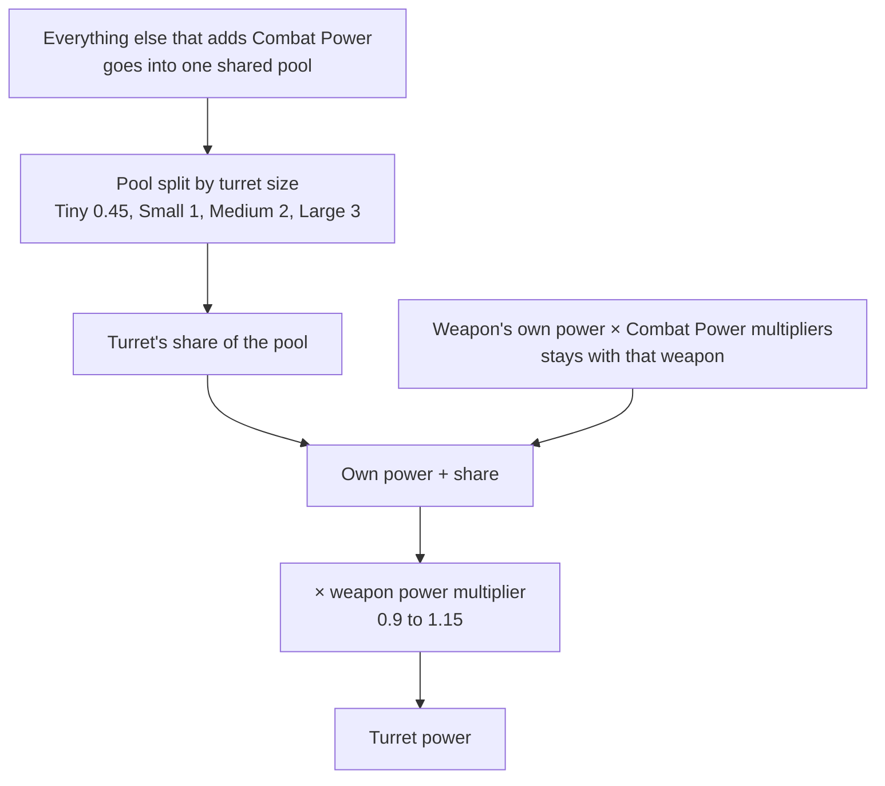
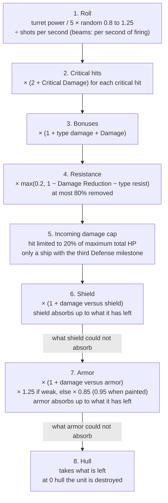
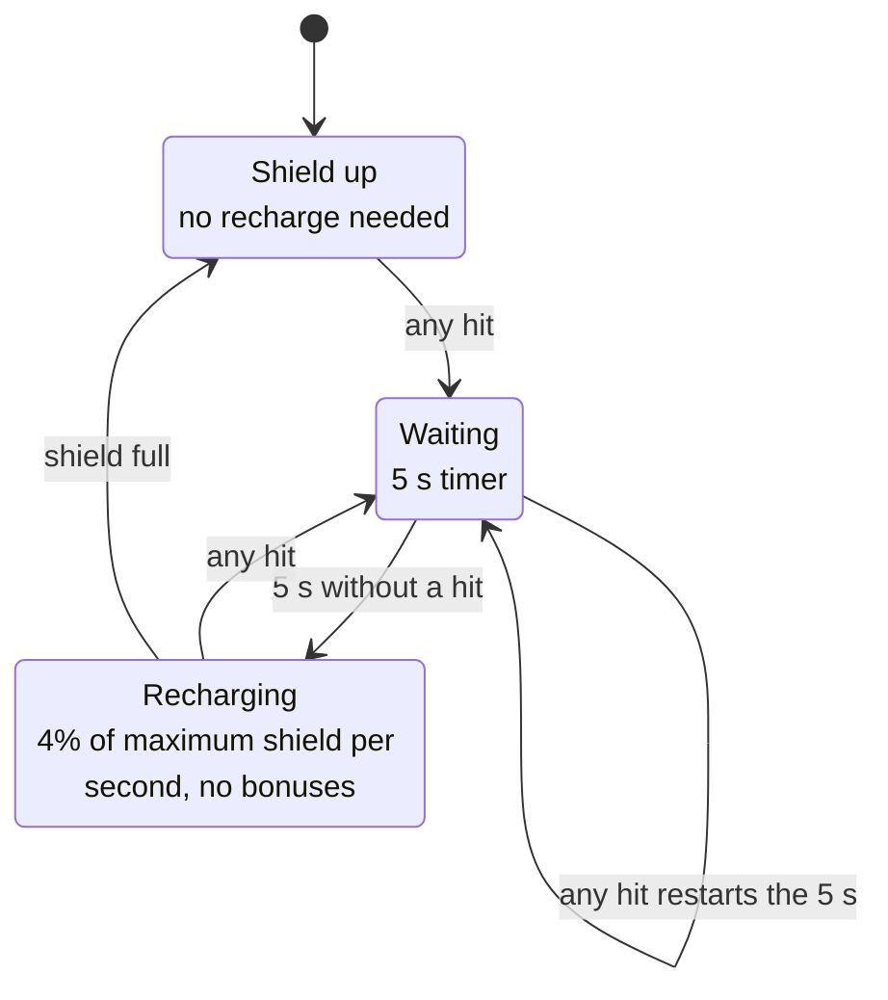

# Combat Damage

This page explains how a shot becomes hull damage. It covers where a weapon's damage comes from, what each stat does, the order in which a target's shields, armor and resistances take their share, and what you can stack against each layer. Everything here is read from the game's code and data, not from testing in the game. The code was read from game version 0.8.3.4 and then re-checked against 0.8.3.5. Where 0.8.3.5 changed it (how ships and turrets choose targets, how hits reach a shield, how Gatling-class weapons fire, and fleet ship collision), the page describes the 0.8.3.5 code. The damage formulas themselves were not rewritten in that update. Prefab data is the stored settings for each ship, weapon and effect. The weapon, armor, shield generator, torpedo bay, aspect and skill tree values on this page were read from 0.8.3.4 and then compared with the 0.8.3.5 data dumps, where they are the same. Projectile and status effect prefabs, hull badges and the game's translation strings are not in those dumps, so they were not re-read for 0.8.3.5. Where a number lives in prefab data rather than in code, the section says so. The last part of the page, [In the Game Code](#in-the-game-code), lists the methods and fields behind each claim.

Terms and abbreviations are explained in the [glossary](glossary.md).

Three words on this page have more than one meaning in the game.

- "Combat Power" always means the ship stat. The Faction overview also has a "Combat Power" tile, which shows a faction's total fleet points (see the [glossary row](../conquest/glossary.md#fleets-and-battles)).
- "Defense" means the ship-side group of stats, skills, mastery and hull upgrade path. It never means a station type or a number shown on a map card. Those belong to the war (see [War Stations](../conquest/war-stations.md)).
- "Rank" for an enemy means ship rank: Rookie, Regular, Veteran, Elite, Champion, Commander or Legendary.

The abbreviation HP means hit points. Shield, armor and hull each have their own HP pool.

How non-player character (NPC) level, ship rank and escalation scale is covered in [Scaling](scaling.md). Station parts are covered in [Combat Stations](stations.md). The extra HP and firepower multipliers that stations get during the Conquest war, which opens with the level 28 Conquest missions, are covered in [War Stations](../conquest/war-stations.md). A ship at zero hull can become boardable instead of dying. That is covered in [Boarding and Facility Operations](boarding.md).

## How a Stat Is Calculated

Every ship, drone, torpedo and station part keeps two running totals for each stat: a sum of flat amounts and a product of multipliers. What the game shows as a stat is:

```
stat = (base + sum of flat amounts) x product of multipliers
```

Every source of bonus gives a flat amount, a multiplier, or both. Flat amounts add. Multipliers multiply each other, so a x1.10 multiplier and a x1.20 multiplier give x1.32, not x1.30. A rolled item stat is either a flat amount or a multiplier. A "+4% Weapon Range" roll is a flat 0.04 added to the sum, and the multiplier on that stat stays 1 unless something else sets it. Percentage stats (critical chance, resistance, range and so on) are stored as fractions, such as 0.15 for 15%.

Only a few stats start from a base value. Hull HP, Armor HP and Shield HP take theirs from the unit's definition. The shield generator supplies the base for its recharge rate, recharge delay and regeneration. Cargo Capacity also has a base. Critical Chance starts at 3% plus the bonus from Precision (see [Critical Hits](#critical-hits)).

Where the bonuses come from:

| Source | Notes |
|---|---|
| Every equipped item | An item registers all its stat lines with the ship, not just with itself. A "Weapon Range" roll on a reactor or a hull piece applies to every turret. |
| Hull upgrade path | The stats from the hull upgrade path. See [Hull Upgrades](#hull-upgrades) |
| Aspects, badge, skills, mastery and officers | Aspects on items, the ship's hull bonus badge, the range bonus, commander skill nodes, mastery, officer skill nodes and unique officer boosts. The game rebuilds these when your gear or skills change |
| Temporary boosts | Ability buffs, debuffs and the Painter Drone's armor resist strip, each with a duration. Each stack multiplies the amount. A multiplier m with a number of stacks works out as 1 + (m - 1) x stacks |
| Crew (player ship) | Each crew type adds a Combat Power multiplier of 1 + its combat bonus and a flat amount. The crew effectiveness skill scales these amounts |
| Officers (player ship) | Officers count only if you have the officer passive skill. A combat officer picks one of Combat Power, Critical Chance or Attack Speed |

Two exceptions:

- A turret's own power line only counts while the turret is not manually disabled. A turret converted to drone power adds its amount to Drone Power instead.
- A bonus meant for one turret only (the per-weapon aspects) is kept separately and is added on top of the ship value for that turret alone. The formula is (ship stat + amount) x multiplier.

After all of that, the game applies these steps in order:

1. The reactor energy modifier (player-owned ships only).
2. NPC ship rank modifiers.
3. The NPC ship HP curve.
4. Escalation modifiers: NPC damage and HP, and the resistance debuff on the player.
5. A level-based HP balance multiplier on hull, armor and shield.
6. Class-specific modifiers, such as the station HP multiplier.

The HP balance multiplier for level L:

| Level | Effect |
|---|---|
| Up to 10 | x1 |
| 10 to 40 | Rises smoothly from x1 at level 10 to x1.28 at level 40 |
| Above 40 | A second factor multiplies the result: 1 + 0.6 x ((L - 40) / 60)^1.5 |

The exact formula is in the code section.

In the code: [How a Stat Is Calculated](#code-how-a-stat-is-calculated).

## Every Stat

The names in the first column are the game's own. Four stats have no name in the game's text, so the game shows a raw internal key instead. Those rows say "no name in the game's text" and describe the stat in words. Power is a special case: any amount or multiplier on Power is also applied to Combat Power, Mining Power and Salvage Power.

| In-game name | What it does |
|---|---|
| Hull HP | The last layer of protection. The base value is the unit's hull scale x 150, for ships and station parts alike |
| Armor HP | The capacity of the armor layer. The base value is the unit's armor scale x 300 if it has an armor module (unless the module overrides it), and 0 if it has none |
| Shield HP | The capacity of the shield layer. The same rule applies with the shield generator module (scale x 300) |
| Hull Regeneration | Flat HP restored per second, only while the ship is out of combat and below its maximum |
| Armor Regeneration | Flat armor restored per second |
| Shield Regeneration | Flat shield restored per second. It is always on, even during the recharge delay. The base is 0.1% of maximum shield per second, set when the ship spawns |
| Hull regeneration percentage (no name in the game's text) | The fraction of maximum hull restored per second, added to Hull Regeneration |
| Armor regeneration percentage (no name in the game's text) | The fraction of maximum armor restored per second, added to Armor Regeneration |
| Power | Feeds Combat Power, Mining Power and Salvage Power |
| Combat Power | Weapon damage. See [Where a Turret's Damage Comes From](#where-a-turrets-damage-comes-from) |
| Mining Power | Used by mining turrets, which this page does not cover |
| Salvage Power | Used by salvage turrets, which this page does not cover |
| Precision | Raises Critical Chance. See [Critical Hits](#critical-hits) |
| Drone Power | Divided among the drones in the drone bay and added to each drone's weapon power |
| Torpedo Power | Torpedo damage, plus the ship's normalized Combat Power (see [Drones, Torpedoes, Fighters](#drones-torpedoes-fighters)) |
| Repair Power | Used by repair turrets |
| Shield Recharge Delay | Shown on the ship panel, but the shield timer ignores it and always uses the generator's base delay (5 s on every shield generator) |
| Shield Gate Time | The game describes it as immunity after the shield is depleted. Nothing in the game reads it |
| Damage Reduction | A flat fraction removed from every hit. It shares the 80% cap with the resistances |
| Shield Recharge Rate | Scales the shield's recharge ticks |
| Kinetic, Energy, Radiation, Heat, Cold, Corrosion, Explosive Resistance | The fraction removed from hits of that damage type |
| Critical Chance | The chance that a hit is a critical hit |
| Critical Damage | Added to the x2 critical hit multiplier |
| Damage | An additive bonus to all weapon damage |
| Weapon Range | Range = base x (1 + stat) |
| Attack Speed | Fire delay = base / (1 + stat) |
| Reload Speed | Reload time = base / (1 + stat) |
| Magazine Size | Magazine = round(base x (1 + stat)) |
| Turret Rotation Speed | Rotation = base x (1 + stat) |
| Projectile Speed | Speed = base x (1 + stat) |
| Kinetic, Energy, Radiation, Heat, Cold, Corrosion, Explosive Damage | An additive damage bonus for that type only |
| Damage versus shield (no name in the game's text) | Multiplies damage while the target still has shield |
| Damage versus armor (no name in the game's text) | Multiplies damage while the target still has armor |
| Thrust, Side Thrust, Rotational Thrust | Ship movement |
| Cargo Capacity | The size of the hold |
| Resource Yield | How much mining and salvage produce |
| Energy | The reactor's capacity. See [Energy and the Reactor](#energy-and-the-reactor) |
| Ore Upgrade Chance | Applies to mining |
| Boarding Suppression, Boarding Power | See [Boarding and Facility Operations](boarding.md) |
| Officer Bonus | Multiplies the officers' chosen bonus by 1 + stat |
| Hangar Build Speed | How fast fighters are repaired and rebuilt in the hangar bay |

In the code: [Every Stat](#code-every-stat).

## What the Damage Stat Is

Damage and the seven type damage stats (Kinetic, Energy, Radiation, Heat, Cold, Corrosion, Explosive) add together and then multiply the shot once:

```
damage multiplier = 1 + (type damage stat) + Damage
```

None of these stats rolls on items in 0.8.3.5. None of the equipment builders (the game's item generators) lists Damage or any type damage stat. They do not list the damage-versus-shield and damage-versus-armor bonuses, Critical Chance or Damage Reduction either. The rest of the game data adds nothing to Damage or the type damage stats.

The only lines on Damage are the boss aspects Overcharge (x1.25) and Siege Mode (x1.2). Both are multipliers, and a multiplier on a stat whose flat sum is 0 stays 0. So in 0.8.3.5 the damage multiplier above is 1, and those two aspects add no damage despite their text. This is read from the formulas and the game data, not observed in play.

Some of the other stats do have sources: damage versus shield, damage versus armor, Critical Chance and Damage Reduction. They are listed in [Where Bonuses Come From](#where-bonuses-come-from).

In the code: [What the Damage Stat Is](#code-what-the-damage-stat-is).

## Where a Turret's Damage Comes From

A weapon item carries a main power line (Combat Power for guns, Torpedo Power for torpedo bays). The ship pools all the Combat Power it has and hands each active combat turret a share:

```
turret power = (weapon's own power x M  +  max(0, ship power - own power of all active combat turrets x M) / N x turret rating) x weapon power multiplier

ship power = the ship's Combat Power stat, with its multiplier M already applied
M          = the product of the Combat Power multipliers
N          = sum of ratings of active combat turrets (at least 0.45)
rating     = Tiny 0.45, Small 1, Medium 2, Large 3
```

So the weapon's own power is multiplied by M and stays with that weapon. Everything else that adds Combat Power goes into one pool, which is split in proportion to turret size. That includes optional rolls on any item, flat skill amounts, crew and hull upgrades. A Large turret gets three times the pooled share of a Small one. A disabled turret (disabled manually, or converted to drones) leaves the pool. Multipliers on Combat Power (skills, hull badge, hull upgrades, reactor bonus and crew) multiply the whole pool and every main line.



The per-turret power multiplier is a weapon value (0.9 to 1.15, listed in the [Typical Weapon Numbers](#typical-weapon-numbers) table).

Average damage per second (DPS) from one turret is turret power / 5 x 1.025, before critical hits and bonuses. The 1.025 is the mean of the 0.8 to 1.25 roll. The game's own expected-DPS display uses these exact constants. That figure holds for weapons that fire shots.

A beam weapon (Plasma Beam or Cryo Lance) deals power / 5 per second only while its beam is on. The beam stays on for 2 s at a time, and then the turret reloads for its full reload time. With the 2 s reload in the weapon table, a beam averages about half of that figure.

In the code: [Where a Turret's Damage Comes From](#code-where-a-turrets-damage-comes-from).

## The Path of a Hit

The numbered steps run in this order for every damage event, whether it comes from a bullet, a beam tick, a missile or an explosion.



In the code: [The Path of a Hit](#code-the-path-of-a-hit).

### 1. The Shot Is Rolled

```
base = turret power / 5  x  random(0.8, 1.25)  /  shots per second
```

The "shots per second" figure here comes from the weapon's own unmodified fire delay, reload, magazine and burst. It is the "Shots/s" column in the [Typical Weapon Numbers](#typical-weapon-numbers) table. Because it ignores your Attack Speed, Reload Speed and Magazine Size bonuses, those stats raise the number of shots without shrinking each shot. Each stat speeds up a different part of the firing cycle, so its gain depends on how much of the cycle that part takes. Attack Speed shortens the time between shots, Reload Speed shortens the reload, and Magazine Size cuts the number of reloads.

Beams skip the division: each 0.2 s tick carries power x tick length instead, so a beam deals power / 5 per second of firing. A beam stays on for 2 s, then the turret reloads for its full reload time before the beam can come on again.

In the code: [1. The Shot Is Rolled](#code-1-the-shot-is-rolled).

### 2. Critical Hits

Critical hits are covered in [Critical Hits](#critical-hits). Each critical hit multiplies the roll by 2 + Critical Damage.

### 3. Damage Bonuses

```
shot = base x crit multiplier x (1 + type damage stat + Damage)
```

The stats are read from the firing turret (ship value plus that turret's own boosts). A drone or torpedo with no turret reads them from itself.

In the code: [3. Damage Bonuses](#code-3-damage-bonuses).

### 4. Target Resistance

```
shot = shot x max(0.2, 1 - Damage Reduction - resistance to the shot's type)
```

This happens before any layer. The floor of 0.2 is the resistance cap: Damage Reduction and the type resistance together can remove at most 80% of a hit. Past that total, extra resistance does nothing. Both stats can also go negative, through the Painter Drone (described below) and the escalation debuff on player ships. A negative total raises the multiplier above 1 with no upper limit.

While a warp or jumpgate transit is active, damage taken by any ship (yours included) is multiplied by 0.1 after this step.

In the code: [4. Target Resistance](#code-4-target-resistance).

### 5. Incoming Damage Cap

A ship with the third milestone of the Defense hull upgrade path caps every single hit at 20% of its maximum total HP (hull + armor + shield), after step 4. A ship earns the milestone by absorbing damage over its lifetime. That is how your own ship gets it. It was not verified for NPC ships.

```
shot = min(shot, 0.2 x max total HP)
```

### 6. Shield

If the target has a shield generator, its recharge delay timer resets on every hit, even after the shield is down. If any shield is left:

```
shot = shot x (1 + damage-versus-shield bonus)     (read from the firing turret, only if above 0)
absorbed = min(shot, current shield)
shield -= absorbed;  shot -= absorbed
```

Shields treat all seven damage types the same: there is no shield resistance and no weakness. Whatever the shield could not absorb carries on to armor, and it is already multiplied by the damage-versus-shield bonus.

### 7. Armor

If damage is left and the target has armor:

```
shot = shot x (1 + damage-versus-armor bonus)       (from the firing turret, only if above 0)
if the damage type is in the armor's weak types:  shot = shot x (1 + weak amount)
else:                                              shot = shot x (1 - max(0, resist amount - armor resist strip))
absorbed = min(shot, current armor);  armor -= absorbed;  shot -= absorbed
```

The only armor type in 0.8.3.5 is Armor Plating, and every armor has the same values. It has 15% resistance and is weak to Corrosion, which does +25% damage. Armor resistance and weakness are exclusive: a weak type gets the +25% and not the -15%. Because resistance is applied before absorption, 100 armor HP lasts for about 118 points of ordinary shot damage (100 / 0.85) and 80 points of Corrosion damage (100 / 1.25).

The Painter Drone is the only painter in the game data. The "Painted" effect it applies carries an armor resist strip (the game's own label for it) of 0.10 for 6 seconds, which takes Armor Plating from 15% to 5% resistance. It also adds a damage reduction strip of -0.05 Damage Reduction to the target for the same 6 seconds.

In the code: [7. Armor](#code-7-armor).

### 8. Hull

```
hull = clamp(hull - shot, 0, max hull)
```

There is no hull resistance beyond step 4. At zero hull the unit is destroyed, with these exceptions:

- A boardable ship becomes boardable instead (see [Boarding and Facility Operations](boarding.md)).
- A player-owned ship is left at 0.1 HP and is not destroyed. Fighters and arena battles are excepted.
- An emergency jump can intervene.

### Shorthand

```
to shields:  base x crit x (1 + bonuses) x resistFactor x (1 + VsShield)
to armor:    base x crit x (1 + bonuses) x resistFactor x (1 + VsShield, if it passed through shield) x (1 + VsArmor) x armorFactor
to hull:     base x crit x (1 + bonuses) x resistFactor   (minus what shield and armor soaked up first)
```

In these formulas, resistFactor is max(0.2, 1 - Damage Reduction - resistance). VsShield and VsArmor are the damage-versus-shield and damage-versus-armor bonuses. armorFactor is 1.25 for a weak type and 0.85 otherwise (0.95 when painted).

### A Worked Example

These inputs are illustrative and computed from the formulas above. A level 30 Standard Medium Autocannon rolls a main Combat Power of 400 to 420 (the Medium roll of 2.0 to 2.1 times a power level of 200; see [Weapon Power by Level](#weapon-power-by-level)). Say it rolls 410. The firing ship has +10% Kinetic Damage and +5% Damage, and no critical hits. Nothing in 0.8.3.5 grants those two bonuses (see [What the Damage Stat Is](#what-the-damage-stat-is)), so they stand in for any bonus of that kind. The shots hit a target with Damage Reduction 10%, Kinetic Resistance 20%, a shield of 1000 and 500 Armor Plating:

| Step | Value |
|---|---|
| Average base per shot | 410 / 5 / 2.331 = 35.2 (rolls 28 to 44) |
| After bonuses | 35.2 x 1.15 = 40.5 |
| After resistance (1 - 0.10 - 0.20 = 0.70) | 28.3 |
| Shield (1000) | About 35 shots break it |
| Armor (500), 28.3 x 0.85 = 24.1 per shot | About 21 shots break it |
| Hull | Each shot does 28.3 |

At 2.33 shots per second, the shield alone lasts about 15 s.

## Critical Hits

The chance that a hit is a critical hit is:

```
crit chance = (3% + crit chance from Precision + flat Critical Chance) x Critical Chance multiplier
```

Precision turns into critical chance relative to a "power level" that depends on the level. Item stat rolls scale with the same number:

```
raw = 5% x Precision / power level
crit chance from Precision = raw                                  if raw is 5% or less
                           = 5% + (raw - 5% + 1)^0.75 - 1        if raw is above 5%   (computed with raw as a fraction, so 5% is 0.05)
```

The power level is 50 at level 10, 100 at level 20, 200 at level 30, 400 at level 40, 800 at level 50 and 25 600 at level 100. Precision equal to one power level gives +5% critical chance. Past +5%, the gain is damped: a raw value of 10% becomes 8.7%, 20% becomes 16.1% and 50% becomes 37.1%.

Critical hits can chain, as follows:

```
roll the crit chance c;  on success: crits += 1,  c = c / 2,  roll again
stop after the roll that fails, or when crits is above your Critical Recursion ranks
crit multiplier = (2 + Critical Damage) ^ crits
```

Without ranks in Critical Recursion, a hit can crit at most once. With r ranks (the skill has 3 ranks), a hit can crit up to r + 1 times. Each extra chance is halved, and each critical hit multiplies the damage. The rank count comes from your skill tree plus any copies your officers have unlocked. The game reads it on every critical roll, so enemy shots chain too once you have ranks. The critical multiplier is applied to the shot before type bonuses.

The game rolls critical hits per hit and per beam tick, so a continuous beam rolls five times a second. Burst and tick weapons therefore have less variation in their damage.

In the code: [Critical Hits](#code-critical-hits).

## Damage Types

There are seven damage types: Kinetic, Energy, Radiation, Heat, Cold, Corrosion and Explosive. The type picks which damage bonus adds to the shot and which resistance the target uses. Beyond that, only armor knows about types, and only one armor type exists.

| Type | Weapons in 0.8.3.5 | Special |
|---|---|---|
| Kinetic | Autocannon, Twin and Triple Autocannon, Gatling, Double Gatling, DT Chaingun ("DT" is part of the weapon's name), Railgun, Burst Railgun | Rail shots pierce and can hit up to 6 targets |
| Energy | Lasers, Laser Repeater, Laser Shotgun, Plasma Cannon, Plasma Repeater, Plasma Battery, Plasma Beam, Microcell Swarm Launcher | |
| Radiation | Rad Cannon | Applies an Irradiated effect on hit for 3 s. The effect's data says it halves the target's Precision, but no code that applies that was found, so this is not verified |
| Heat | None directly | Torpedoes, Cannon splash and extra-damage aspects such as Firestarter deal Heat damage |
| Cold | Cryo Lance | |
| Corrosion | Corropult | Armor Plating is weak to Corrosion. A Corropult shot leaves a damaging cloud |
| Explosive | Missile Launchers, Hailfire, Cannon | |

In the code: [Damage Types](#code-damage-types).

## Hitting: Range, Tracking and Projectiles

Range is a plain distance check. The game measures from the firing point to the nearest point of the target's hull outline, and the distance must be at most your range, where range = base x (1 + Weapon Range). If the target has no active hull outline, the game measures to the point the turret aims at instead. Direct hits have no damage falloff with distance.

A turret fires when it has a target in range, is aimed within its firing angle of the target and is off cooldown. Turrets that cannot rotate fire whenever the target is in range. Rotation speed is in degrees per second (base x (1 + Turret Rotation Speed)).

Most guns use a firing window of 1 degree. Lasers use 0.25 degrees and the plasma cannons use 0.01 degrees, so a slow turret on a fast target can fail to fire at all. Missile launchers and the Hailfire use 360 degrees. Beams ignore the firing window.

How each weapon family then hits:

| Family | How the hit is resolved |
|---|---|
| Combat Laser | The beam plays for its effect time, and then the damage lands on the target. It cannot miss while the target is alive |
| Laser Repeater, Gatling, Chaingun, Shotgun (tracer) | The game decides the hit when the weapon fires. It casts a line toward a lead point with random scatter of the weapon's accuracy angle x distance x 0.015 units either way, and only the current target can be hit. A visible tracer round then flies along the line, and the damage lands when the tracer arrives. A target that has died by then takes nothing. A tracer crosses the weapon's base range in 0.42 s on all seven of these weapons (the three Laser Repeaters, Gatling, Double Gatling, DT Chaingun and Laser Shotgun) |
| Railgun | An instant ray. It damages every enemy on the line, up to 6 hits. The first hit does the full power. Each later hit does half of the hit before it: the second hit does 0.5 of the power, the third 0.25, the fourth 0.125, and so on |
| Plasma Beam, Cryo Lance (beams) | The beam hits instantly while the target is in range. Damage ticks every 0.2 s for up to 2 s, and then the turret reloads |
| Autocannon, Plasma, Corropult, Rad Cannon, Cannon | A projectile flies at its projectile speed with a random heading spread of plus or minus the accuracy angle in degrees (4 to 5.5 degrees for autocannons). It lasts 5 s (7 s for the Cannon shell). It hits the first enemy it overlaps, which is not necessarily the target |
| Missiles, Hailfire, Microcell | The missile homes in. On every physics update it steers to wherever its launcher is aiming at that moment (see [What a Missile Follows](#what-a-missile-follows)), with limited thrust and turn rate. It expires after its lifetime: 16 s for missiles and Microcell, 8 s for Hailfire |

The aim point leads a moving target. The game aims at the target's position plus the target's velocity times (1 + cos) x distance / projectile speed, where cos is the dot product of the target's heading with the line to it. Slow projectiles at long range against fast, turning ships miss more. Raising Projectile Speed shortens the lead. Tracer weapons lead differently: they solve for where the target will be when the tracer round arrives, and the turret itself rotates toward that point.

While a ship's shield holds at least 5% of its maximum, shots meet a thin band outside the hull instead of the hull itself. Projectiles, torpedoes, rail shots and tracer rounds all count as hitting once they reach the band. Its width scales with the ship's size and is at most 0.64 units with the code's default style (the style asset may change that: not verified). Range is still measured to the hull outline.

Reload takes the full reload time. The Instant Reload skill gives your ship's turrets a chance on each reload to skip it (2% per rank, up to 3 ranks). A weapon with an ammo type spends ammo from your cargo on each shot. Gatling-class weapons spend one ammo per four shots. With no ammo in the hold, the magazine refills to zero and the weapon cannot fire.

In the code: [Hitting: Range, Tracking and Projectiles](#code-hitting-range-tracking-and-projectiles).

### How Far a Ship Parks From Its Target

A ship that is chasing a target does not fly out to the edge of its weapon range. Every 0.5 seconds the ship works out an approach distance. For each turret that can hit the target and still has ammo, the reach is max(range - the turret's distance from the ship's center - 0.5, 1). The approach distance is 5/6 of the smallest reach, kept between 6 and 30 units. A turret with an approach distance of its own (the structural grinder is one) uses that instead.

On every physics update, the ship compares the approach distance with its distance to the point its turrets aim at. That point is the target's center or lead point, not its hull. The ship flies in only when it is farther away than 1.2 times the approach distance. It backs off when it is closer than 0.6 times the approach distance. Between the two it holds position, and it swings around the target while it is taking damage. Since 5/6 x 1.2 = 1, a ship starts to move in when its shortest-reaching turret is about to run out of reach, measured to the target's center. Range is measured to the hull, so a big target is already in range before that point. The limits of 6 and 30 units break this equality.

All of this applies only while the ship is chasing. Whenever a fleet ship is not chasing, the game flies it to its formation slot or its order's point, and a ship with such a destination has no approach distance. Aggressive ships chase whenever they have a target, and an Attack order always chases. The following ships do not chase:

- Escort and Hold Fire ships never chase, whatever their target.
- Ships with a Hold or Move order never chase.
- Defensive ships do not chase on their own. They chase only while the fleet pick (see [Which Target a Ship Picks](#which-target-a-ship-picks)) gives them an enemy that has dealt damage to their faction at this location. Without one they shoot the flagship's target if they have no target of their own, and stay at their slot. A Defensive ship also turns back once it is more than 1.5 times its longest combat range from its slot (8 at least).

The 0.8.3.4 game switched collision off for a chasing fleet ship so that it could pass through the flagship and the other fleet ships. The 0.8.3.5 code has no such switch for fleet ships (hangar fighters still have one), so a chasing ship is solid. A fleet ship that is not in formation plans routes around the other player-side ships, but a ship with a target flies direct (see above). A fleet ship now counts as in formation within one of its own radii of its slot or Hold point (it was three).

The HUD's Hold Position switch ("When enabled the ship will not chase targets and only respond to move commands") holds only the ship you fly. The game copies the switch onto that ship every frame. No fleet ship or drone reads it. Flying by hand turns the switch on, and starting Autopilot turns it off. The fleet order Hold holds one fleet ship at its spot. A warp or travel resets that ship to guarding the flagship.

In the code: [How Far a Ship Parks From Its Target](#code-how-far-a-ship-parks-from-its-target).

### What a Missile Follows

A missile has no target of its own. It is launched with a marker, which is the launcher's tracking point on its target. Once its ignition delay has passed, and for as long as that marker exists, the missile steers on every physics update to the launcher's current target. The aim point is that target's position plus its velocity times (the missile's distance to it / the missile's top speed). The missile reads the launcher's target on every update, so picking another target redirects every missile already in flight. Microcell missiles also add a spread offset that fades to zero.

The game destroys and recreates the marker whenever the launcher's target changes, and the marker goes with the target when the target dies. Once a missile has lost its marker, it gets a new one only if two things are true. Its launcher must fire seeking missiles (in 0.8.3.5 every missile launcher does, except the Small Microcell Swarm Launcher), and the launcher must have a marker at that moment. Otherwise the missile never steers again and flies straight until its lifetime ends. If the launcher has no target for a moment while the marker still exists, the missile keeps flying to the last point it worked out.

In the code: [What a Missile Follows](#code-what-a-missile-follows).

### Which Target a Ship Picks

A target you pick yourself is a manual target. You pick one by clicking, or by giving a fleet ship an Attack order. Nothing below replaces a manual target. Without a manual target, these rules apply:

- Scanners pick the auto target, but not for every ship. The ship you fly, and fleet ships that are not Aggressive, auto-target only while Autopilot is on, and even then they skip five scans in six. Drones and Aggressive fleet ships are exempt. Ships that take a fleet pick (below) have no scanner target list at all while an enemy is present at the location.
- A ship that is hit and survives switches to the attacker when two things are true. The attacker is a valid enemy target, and the ship has no auto target or its auto target is farther away than its longest combat range (8 at least). The same hit launches the ship's docked drones and hangar fighters unless you recalled them. It also gives the attacker to every drone without a manual target and to a torpedo bay with no target.
- The game keeps one threat table per faction at each location (a fleet). Whenever a unit takes damage from another unit, the damage is added to the attacker's entry in the table of the faction that was hit. There is no 80 unit range, no 40% share and no once-a-second limit any more, and every ship of that faction at the location shares the table. Each entry fades by 15% every second. Damage from a drone also counts 60% for the ship that owns it. A Taunt Pylon puts itself at 1.1 times the top entry, for 1 s, in the table of every enemy faction that has a ship within 50 units of it, and renews that every 0.5 s.
- Enemy combat ships, station turrets, security patrols and your Aggressive and Defensive fleet ships choose targets from that table about once a second each (the timers are staggered, and a ship picks again at once when its pick dies). So does the flagship while Autopilot runs. The candidates are the enemies in the table that the ship may attack. If there are none, and the ship is not restricted to the table, every enemy at the location is a candidate. A ship that cannot move only considers enemies in its weapon range. Each candidate scores its share of the top threat, times 1 inside weapon range or (range / distance) outside it, divided by 1 + (ships of the faction already picking it) / (its hull size relative to the faction's median hull, at least 1). A taunting candidate skips that division. A new target must score 1.25 times the current one to replace it. Defensive fleet ships and intercept formations use only the table; Aggressive ships fall back to every enemy.
- The ship you fly does not take a target from this, with one exception. About once a second, if it has no manual target, the game sets its auto target to the table's pick (table only). While Autopilot runs, the flagship picks like an NPC ship.
- A ship on Escort copies the target of the ship it follows. Hold Fire clears the ship's targets. The game describes it as never firing unless you order an attack. An Attack order sets a manual target and overrides the pick.
- A turret works on the ship's target when it can. When that target is out of the turret's range or not a valid target, the turret picks the closest enemy at the location within its range by itself, checking every 0.5 s, and goes back to the ship's target when that works again. With no ship target at all, this happens only for ships of yours, and the tutorial can switch it off. Ship steering still follows the turrets that work the ship's own target.

In the code: [Which Target a Ship Picks](#code-which-target-a-ship-picks).

## Energy and the Reactor

Every piece of equipment has an energy draw (listed per weapon in the [Typical Weapon Numbers](#typical-weapon-numbers) table). The game multiplies it by the ship's energy draw multiplier. The reactor's capacity is the Energy stat. This is a static budget: nothing is drained over time, and nothing switches off when the budget is exceeded. What changes is a damage multiplier.

```
usage = sum of connected equipment energy draw / reactor Energy capacity
```

| Usage | Multiplier on Power, Combat Power, Mining Power and Salvage Power |
|---|---|
| Up to 50% | x1.20 |
| Up to 75% | x1.10 |
| Up to 100% | x1.00 |
| Up to 125% | x0.75 |
| Up to 150% | x0.50 |
| Above 150% | x0.25 |

The multiplier applies to the ship's overall Combat Power, so it scales every turret and the pooled flat power together. It does not touch Drone Power or Torpedo Power themselves, but torpedoes and drones add a share of Combat Power, so they feel it through that share.

The rule applies to player-owned ships only. NPC ships and drones ignore the reactor. The skill "Divert Power" adds 5% per rank (2 ranks) to the Combat Power multiplier of the bracket at 50% usage or less. The only energy draw modifier in the game is the Efficient Drilling buff, which the mining officer skill "Reactor Rest" applies for 30 seconds after you hit an asteroid (60 second cooldown). The skill text says "-50% reactor energy usage", but the code multiplies the energy draw of every item connected to the reactor by 0.25, which is -75%. The code and the text disagree, and which one holds in play was not tested.

Reactor capacity comes from the reactor item's main roll. It is a flat amount of (the size roll) x power level x the square root of the rarity multiplier. The size roll is 1.35 to 1.4 for Base, 1.5 to 1.6 for Small, 3.4 to 3.5 for Medium and 4.5 to 4.8 for Large. Weapon draws are fixed numbers, so a higher-level reactor can carry more weapons.

In the code: [Energy and the Reactor](#code-energy-and-the-reactor).

## Shields

```
recharge delay = 5 s on every shield generator, reset by every hit
every 0.25 s after the delay:  shield += max shield x 0.005 x recharge rate
recharge rate  = generator rate x (1 + Shield Recharge Rate stat)
```



The stat read here is the full ship stat, which already includes the generator's base rate of 1.0. With no bonuses the recharge rate is 1 x (1 + 1) = 2. A recharge tick then restores 1% of maximum shield, so the shield refills at 4% of maximum per second. That takes 25 s from empty, after the 5 s delay. A bonus of +0.10 on Shield Recharge Rate makes the rate 2.1, which is 5% faster recharge, not 10%. This comes from reading the code. It was not observed in the game.

Flat Shield Regeneration runs in addition to this. It runs continuously, with no delay. Shield Recharge Delay and Shield Gate Time have no effect on the timer in this version (see [Every Stat](#every-stat)).

In the code: [Shields](#code-shields).

## Armor Regeneration

Armor Plating regenerates Armor Regeneration + (armor regeneration percentage x maximum armor) per second, with no delay. For NPC ships, the percentage part is capped at 0.1% per second, and the whole rate is halved while in combat. Hull regeneration runs only out of combat.

In the code: [Armor Regeneration](#code-armor-regeneration).

## Damage Over Time and Area Effects

Every effect below goes through steps 4 to 8 of [The Path of a Hit](#the-path-of-a-hit) again on every tick or hit, one target at a time.

| Effect | Rule |
|---|---|
| Damage over time (DoT) | The effect's damage is a fixed total, divided into equal ticks at a fixed interval. Each tick is a fresh hit of that size, with no new critical roll. A second application merges with the first: both remaining totals add, and the ticks reset to the full count. The tick count and delay are stored in weapon data, which was not extracted |
| Per-weapon aspects | After a hit by that weapon, the aspect adds a second hit worth a percentage of the first hit's total damage, in another damage type. The second hit is either instant or a DoT. Examples from the game text are Punch Through (+10% Kinetic), Firestarter (+15% Heat over 6 s) and Frozen Core (+10% Cold). The trigger event was not traced, and neither was whether the total is taken before or after the target's resistance |
| Corropult cloud | The shot first hits on impact and then leaves a cloud of radius 2 that ticks 3 times, 1 s apart. Each tick hits every enemy inside the cloud for the impact shot's damage (before the target's defenses) x 0.5 / 3 |
| Cannon explosion | The Large Cannon shell explodes in a radius of 6. Each ship hostile to the player in range, the target included, takes damage as Heat. The damage is 20% of what the shot had left after the target's defenses, reduced by distance falloff |
| Area falloff | Explosions scale each hit by max(1 - distance / radius, 0.1) |
| Radiation Cannon | Applies an Irradiated effect on hit for 3 s. The effect's data says it halves the target's Precision, but no code that applies that was found, so this is not verified |
| Cryo / cold slow, Cold Snap and similar | These are weapon effects, which were not read |

The area effect copies the damage left over after the first target's defenses, so splash damage is whatever the direct hit did not use up. Against a shielded ship that soaked the whole direct hit, the splash does nothing.

In the code: [Damage Over Time and Area Effects](#code-damage-over-time-and-area-effects).

### Temporary Effects

Buffs and debuffs are stat boosts with a duration. Two effects with the same name merge into one. Their stacks add, up to the effect's own stack limit if it has one, and the duration refreshes to the longer of the two. The stat sees a boost's amount times its stack count.

The Defense skill "Threat Reducer" (a ship skill, not a station) has a 20% chance, whenever you take damage, to give +2% resistance per stack to the damage type of that hit. The effect lasts 10 s, and the skill has a cooldown of 20 s.

In the code: [Temporary Effects](#code-temporary-effects).

## Drones, Torpedoes, Fighters

| Unit | Damage |
|---|---|
| Drones | Drones follow the same turret rules. A drone weapon's power is its own main power x your Combat Power multiplier + your normalized Combat Power x its rating + your Drone Power / base drone count. A drone also reads your percentage stats directly: Damage, type bonuses, Critical Damage, range, Attack Speed and resistances. It does not read your Critical Chance. It works that out from its own Precision, which is the drone's own Precision plus your Precision divided across your drones. The skill Composite Drone Armor and the second Drones hull milestone add Damage Reduction to drones |
| Torpedoes | Torpedoes always deal Heat damage. Torpedo power = Torpedo Power + normalized Combat Power, rolled as power / 5 x random(0.8, 1.25) with no division by shots per second. Critical hits, Damage and Heat Damage are read from the launching ship. A torpedo explodes in a radius of 6 on impact. It hits every enemy in range, the target included, with falloff (minimum 10%), using the damage left after the direct hit. Bay timing: a Small bay waits 8 s between launches and has a 4 s reload, and a Medium bay waits 1 s and has a 3 s reload |
| Fighters | Hangar bay fighters are ships with their own turrets, and they use the ship rules. This was not traced further. Hangar Build Speed sets how fast they are repaired and rebuilt |

"Normalized Combat Power" is the ship's Combat Power divided by the number of equivalent turrets. It is the same share a Small turret gets.

Drones are not ships, and they follow their own rules between targets:

- Each bay has two modes on the drone button: Follow Ship (the default) and Free Roam. In Follow Ship, a drone with no target flies to its ship when it is more than 10 units away. In Free Roam nothing calls the drone back. A drone with a target strafes around it for 5 to 10 seconds, and then moves to a random point near it.
- A drone with nothing to do keeps drifting. Drones always rotate toward their destination, and they get a small forward thrust whenever they are not returning. An idle drone with no destination therefore nudges forward, turns back and drifts around the spot. This is the normal state of a Follow Ship drone within 10 units of its ship.
- A repair drone treats a unit as a target only if the unit is not hostile to it and is missing HP the drone can restore. With nothing damaged, repair drones idle.
- The game pauses every scanner of yours (carrier fighters excepted), drone scanners included, while a route is set. Drones therefore pick no targets during travel or Autopilot.
- A drone takes its ship's manual target whenever that target is valid for it, except for repair drones. It also takes the attacker when its ship is hit (see [Which Target a Ship Picks](#which-target-a-ship-picks)). Only the target becoming invalid removes a manual target from a drone, so a drone keeps the target after you drop the ship's own.
- The HUD's Hold Position switch does not affect drones.

In the code: [Drones, Torpedoes, Fighters](#code-drones-torpedoes-fighters).

## Where Bonuses Come From

Of the stats in [What the Damage Stat Is](#what-the-damage-stat-is), only damage versus shield, damage versus armor, Critical Chance and Damage Reduction have a source in 0.8.3.5, and none of them rolls on gear. The table lists what grants them, along with the other combat bonuses.

| Source | Combat-relevant bonuses |
|---|---|
| Combat hull badge (ships with the Combat role) | Combat Power x1.3, Critical Chance +3% |
| Range bonus (by hull size, 1 to 8) | Weapon Range increases by 0.0, 0.2, 0.4, 0.7, 1.0, 1.2, 1.8 and 2.0 for Combat ships of size 1 to 8, and by 0, 0.1, 0.2, 0.3, 0.4, 0.5, 0.7 and 0.8 for Industrial ships. The amount is added to the Weapon Range sum, so a size 8 Combat hull has x3 range before other bonuses |
| Hull upgrades | See [Hull Upgrades](#hull-upgrades) |
| Commander skill nodes | Each rank gives a stat boost. Examples: +1% Critical Chance (Precise Targeting), +5% Weapon Range, +5% Critical Damage, +3% Attack Speed, +12% Attack Speed (Tier 3), +2% Critical Chance and +5% Critical Damage (Targeting Specialist), and +4 to 5% Turret Rotation. The Combat Power node "Veteran's Might" gives both a x1.01 multiplier and a +3 flat amount per rank. How the node text "minimum of +3 Combat Power" maps to them was not traced. Other nodes add abilities, such as Critical Recursion, Instant Reload, Divert Power, Lone Gun, Redline and Target Weak Spots |
| Mastery | Combat Mastery (the Combat skill tree's mastery) gives Combat Power x(1 + 0.005 x mastery level). Defense Mastery gives +0.1% Damage Reduction per mastery level. A mastery level is capped at 100 in 0.8.3.5, so the most is x1.5 Combat Power and +10% Damage Reduction. Defense Mastery experience points (XP) come from shield and armor damage taken |
| Officers | Each officer chooses one stat from Combat Power, Critical Chance and Attack Speed. Engineering officers choose Drone Power or Shield HP instead. Combat Power, Drone Power and Shield HP apply as multipliers. Critical Chance and Attack Speed apply as flat amounts at 0.8 of the officer's bonus |
| Item aspects | Aspects fill the common and rare slots on weapons and modules. Reload Subroutine gives +25% reload. Critical Attenuation gives +25% critical damage. Weakpoint Scan gives +5% critical chance. Rangefinder gives +25% weapon range. Hardened Exterior gives +5% Damage Reduction. Hardened Plating, Extremophile and Gamma Ward give +2 to 5% resistance. Operational Reserves gives x1.02 Power |
| Boss aspects | Overcharge: no critical hits, and its text says +25% damage (see [What the Damage Stat Is](#what-the-damage-stat-is)). Shield Slapper: +10% damage to shields. Armor Breaker: +10% damage to armor and +5% critical damage. Quick Quick Quick: +40% reload and +10% fire rate. Siege Mode: only fires below a speed threshold, and its text says +20% damage, with the same caveat as Overcharge. Opening Blow: +40% damage to targets above 90% HP. Volatile Plasma and others work as described in their in-game text. Shield Slapper is the only source of damage versus shield, and Armor Breaker is the only source of damage versus armor. Those two stats are read only in steps 6 and 7 above |

In the code: [Where Bonuses Come From](#code-where-bonuses-come-from).

### Hull Upgrades

Each hull upgrade path grows by one node per hull upgrade kit spent. Each node gives +2% Combat Power on the Combat path, +2% Torpedo Power on the Torpedo path, +2% Drone Power on the Drones path, and +1% hull, armor and shield on the Defense path.

Milestones sit at nodes 10, 20 and 30, and they also need a lifetime count. For the first milestone of the Combat and Torpedo paths, the count is combat missions completed. For the other two milestones it is kills. The Defense path counts damage absorbed, and the Drones path counts drone activity. Each threshold is multiplied by a ship-size factor of 0.2 plus 0.2 per size above 1 (x1.0 at size 5, x1.6 at size 8). The table lists the base counts:

| Path | Milestone 1 | Milestone 2 | Milestone 3 |
|---|---|---|---|
| Combat (100 combat missions, 1000 kills, 5000 kills) | +5% Weapon Range, +15% Critical Damage | Combat Power x1.1 | Combat Power x1.2 |
| Torpedo (same counts) | Torpedo Power x1.05 | Torpedo Power x1.10 | Torpedo Power x1.20 |
| Defense (1 million, 50 million and 1 billion damage absorbed) | +2% Damage Reduction | Shield HP, Armor HP and Hull HP x1.1 | Shield HP, Armor HP and Hull HP x1.2, and the 20% single-hit cap |
| Drones (5 million, 250 million and 5 billion drone activity) | +1 drone | +15% drone Damage Reduction | +2 drones |

In the code: [Hull Upgrades](#code-hull-upgrades).

## Typical Weapon Numbers

Weapon stats are fixed per weapon and are not rolled. "Shots/s" is the weapon's shots per second including reload. "Power multiplier" is the weapon's own power multiplier. "Energy" is the energy draw before the ship's multiplier. Ranges are in game units. In the Projectile column, "instant" means no travel time, and "hitscan" means a line cast. The Tiny items are drone weapons.

| Weapon | Size | Type | Range | Shots/s | Magazine / reload | Projectile | Power multiplier | Energy |
|---|---|---|---|---|---|---|---|---|
| Cryo Lance | Small | Cold | 10 | 0.45 | 1/2s | instant | 0.9 | 0 |
| Cryo Lance | Medium | Cold | 14 | 0.45 | 1/2s | instant | 0.9 | 0 |
| Corropult | Small | Corrosion | 10 | 0.67 | 2/2s | 8 | 1.0 | 5 |
| Corropult | Medium | Corrosion | 14 | 1.0 | 4/2s | 10 | 1.0 | 10 |
| Laser | Tiny | Energy | 10 | 0.5 | 1/1s | instant | 0.95 | 7.5 |
| Laser | Small | Energy | 10 | 0.5 | 1/1s | instant | 0.95 | 7.5 |
| Laser | Medium | Energy | 14 | 0.5 | 1/1s | instant | 0.95 | 15 |
| Laser | Large | Energy | 14 | 0.36 | 1/1.75s | instant | 0.95 | 25 |
| Laser Repeater | Small | Energy | 12 | 3.0 | 30/4s | hitscan | 0.9 | 7 |
| Laser Repeater | Medium | Energy | 16 | 3.56 | 45/5s | hitscan | 0.9 | 11 |
| Laser Repeater | Large | Energy | 18 | 4.17 | 60/6s | hitscan | 0.9 | 16 |
| Laser Shotgun | Small | Energy | 10 | 2.42 | 24/3s | hitscan | 1.1 | 5 |
| Microcell Swarm Launcher | Small | Energy | 12 | 2.27 | 50/3s | 8 | 1.0 | 0 |
| Microcell Swarm Launcher | Medium | Energy | 16 | 3.34 | 100/3s | 8 | 1.0 | 0 |
| Plasma Battery | Large | Energy | 16 | 2.13 | 80/6s | 18 | 1.1 | 20 |
| Plasma Beam | Small | Energy | 12 | 2.5 | 10/2s | instant | 0.95 | 0 |
| Plasma Beam | Medium | Energy | 16 | 2.5 | 10/2s | instant | 0.95 | 0 |
| Plasma Cannon | Medium | Energy | 12 | 0.53 | 8/3s | 14 | 1.0 | 10 |
| Plasma Cannon | Large | Energy | 12 | 0.38 | 6/4s | 15 | 1.0 | 20 |
| Plasma Repeater | Small | Energy | 11 | 1.61 | 33/4s | 18 | 1.1 | 5 |
| Plasma Repeater | Medium | Energy | 16 | 2.07 | 60/4s | 18 | 1.15 | 10 |
| Cannon | Large | Explosive | 20 | 0.25 | 1/3s | 15 | 1.0 | 20 |
| Hailfire M-Launcher | Small | Explosive | 100 | 2.0 | 15/6s | 15 | 0.9 | 5 |
| Missile Launcher | Tiny | Explosive | 100 | 1.0 | 5/4s | 8 | 1.0 | 0 |
| Missile Launcher | Small | Explosive | 100 | 1.0 | 5/4s | 8 | 1.0 | 5 |
| Missile Launcher | Medium | Explosive | 100 | 1.0 | 5/4s | 6 | 1.0 | 10 |
| Missile Launcher | Large | Explosive | 100 | 0.97 | 6/5s | 6 | 1.0 | 20 |
| Autocannon | Small | Kinetic | 13 | 2.04 | 22/2s | 12 | 1.0 | 5 |
| Autocannon | Medium | Kinetic | 18 | 2.33 | 38/3s | 15 | 1.0 | 10 |
| Twin Autocannon | Medium | Kinetic | 16 | 4.46 | 54/4s | 15 | 1.0 | 10 |
| Triple Autocannon | Large | Kinetic | 16 | 6.94 | 102/4.5s | 18 | 1.0 | 20 |
| Gatling | Small | Kinetic | 10 | 15.38 | 200/3s | hitscan | 1.0 | 5 |
| Double Gatling | Small | Kinetic | 10 | 16.13 | 250/3s | hitscan | 1.1 | 5 |
| DT Chaingun | Large | Kinetic | 10 | 7.14 | 100/5s | hitscan | 1.0 | 20 |
| Railgun | Small | Kinetic | 75 | 0.33 | 1/2s | instant | 1.0 | 5 |
| Railgun | Medium | Kinetic | 75 | 0.25 | 1/3s | instant | 1.1 | 10 |
| Railgun | Large | Kinetic | 75 | 0.4 | 2/3s | instant | 1.1 | 20 |
| Burst Railgun | Medium | Kinetic | 75 | 0.75 | 3/3s | instant | 1.0 | 10 |
| Burst Railgun | Large | Kinetic | 75 | 0.81 | 6/3s | instant | 1.0 | 20 |
| Rad Cannon | Medium | Radiation | 14 | 0.17 | 1/3s | 10 | 1.0 | 22 |
| Rad Cannon | Large | Radiation | 18 | 0.17 | 1/3s | 10 | 1.0 | 22 |

Shots per second tells you how finely the damage is divided, not how much damage there is. Damage per second is turret power / 5 for every weapon that fires shots. Beams reach that figure only while the beam is on (see above). The reload downtime is already inside "Shots/s". Apart from the power multiplier, two weapons differ in range, projectile behaviour, damage type and size. Size sets the main power roll and the pool share. Their listed rate of fire does not separate them.

In the code: [Typical Weapon Numbers](#code-typical-weapon-numbers).

### Weapon Power by Level

An item's rolled stats scale with its level. For a weapon main power line:

```
power level = round(25 x 2^(level / 10))               up to level 100
            = round(25 x 2^(10 + (level - 100) / 25))  above 100
main power  = random(min, max) x power level x rarity multiplier
```

The rarity multiplier is 1.0 for Standard, 1.1 for Enhanced, 1.2 for High Grade, 1.35 for Exotic and 1.5 for Legendary. Item level is the target level plus or minus 1, unless the level is exact.

| Weapon size | Main power roll (x power level x rarity) |
|---|---|
| Tiny | 0.5 to 0.6 |
| Small | 1.0 to 1.05 |
| Medium | 2.0 to 2.1 |
| Large | 3.0 to 3.15 |

Torpedo bays use the same numbers for Torpedo Power (Small 1.0 to 1.05, Medium 2.0 to 2.1).

Weapons also roll optional stats. The number of optional rolls depends on rarity: Standard 0, Enhanced 1, High Grade 2, Exotic 3 and Legendary 3. These are the ranges for guns, before level and rarity scaling:

- Combat Power: 0.20 to 0.25
- Precision: 0.20 to 0.25
- Power: 0.12 to 0.18
- Drone Power: 0.20 to 0.25
- Critical Damage: 0.02 to 0.025
- Weapon Range: 0.04 to 0.045 (rarer)
- Attack Speed: 0.01 to 0.012
- Reload Speed: 0.01 to 0.012
- Magazine Size: 0.01 to 0.012
- Turret Rotation Speed: 0.04 to 0.045 (rarer)
- Projectile Speed: 0.04 to 0.05 (missiles)

The first four are scaled by power level. The flat power-type rolls also get x1.5 on a Medium weapon and x2.25 on a Large weapon. These rolls include Armor, Shield, Hull, Mining Power, Salvage Power and Torpedo Power at 0.20 to 0.25.

A rolled Precision of 0.2 to 0.25 power levels on a Small weapon is worth about +1% to +1.25% critical chance. Armor, shield and hull items roll their main HP stat as a multiplier: 1 + (0.013 to 0.014, or 0.010 to 0.014 for hull) x power level x rarity x the same size factor (Medium x1.5, Large x2.25). HP therefore grows with item level (see [Scaling](scaling.md)).

In the code: [Weapon Power by Level](#code-weapon-power-by-level).

## NPC and Station Modifiers

NPC ships and station parts use the same hit rules as yours. What differs is the stat set they carry:

- Faction NPCs get their ship rank's flat addition to Reload Speed and Attack Speed. They also get the ship rank's HP multiplier on hull, armor and shield, followed by an HP curve that depends on level and ship size.
- Escalation multiplies NPC hull, armor and shield by an HP multiplier, and NPC Combat Power, Drone Power and Torpedo Power by a damage multiplier. Both multipliers are scaled by a base multiplier of the NPC's level. Escalation also subtracts a flat amount from all seven of the player's resistances.
- Station parts in the Conquest war get an HP multiplier and a firepower multiplier (see [War Stations](../conquest/war-stations.md)).

The numbers for NPC ships and escalation are in [Scaling](scaling.md). Station parts are covered in [Combat Stations](stations.md).

In the code: [NPC and Station Modifiers](#code-npc-and-station-modifiers).

## What to Do About It

### Against Shields

Raw damage wins against shields. Shields ignore damage type and have no resistance of their own, but your hit still passes through the target's Damage Reduction and type resistance first. Pick the type the target resists least, and use the damage-versus-shield bonus if you have it. That bonus also multiplies the damage that overflows into armor. A shield refills only after 5 s without being hit, so weapons that never stop firing keep it down for good. A burst of damage that breaks the shield helps less than a steady stream.

### Against Armor

Armor takes the leftover damage after shields. Armor Plating resists 15% of everything except Corrosion, which it takes at +25%. Armor takes 1.25 times the damage from Corrosion and 0.85 times the damage from any other type, so Corrosion does about 47% more damage to armor. Armor and shield do not share a resistance stat, so a ship with a shield that is strong against your damage type can still be weak at the armor stage.

A Painter Drone removes 10 points of armor resistance (15% to 5%) and 5 points of Damage Reduction from a target for 6 seconds. The effect benefits your whole fleet, and the drone is worth bringing against heavily armored targets. The damage-versus-armor bonus multiplies on top of all of that.

### Against Hull

Once shields and armor are gone, only the target's Damage Reduction and type resistance remain, and both were already applied in step 4. There is no hull type weakness. Pick the type the target resists least, and keep the Painter Drone's damage reduction strip active.

### The Resistance Cap and Stacking

Damage Reduction and the type resistance share a combined cap of 80%. A ship with 40% Damage Reduction and 50% Kinetic resistance takes the same damage from Kinetic fire as a ship with 20% and 60%, and neither ship gains anything from a further point of either stat.

Below the cap, each point of either stat removes one point of the hit. Damage Reduction works against all seven types, and a resistance works only against its own type. Damage Reduction is therefore the better point when attackers mix types, and a resistance is the better point when one type does most of the damage. Once the sum for a type reaches 80%, stop adding to it.

Resistances are flat additions in a sum, not multipliers, and the escalation debuff on player ships subtracts from them directly.

### Critical Chance, Critical Damage or Plain Damage

Let c be the critical chance, d be Critical Damage (so a critical hit multiplies the damage by 2 + d) and D be the damage bonus. This assumes one critical roll per shot and no Critical Recursion:

```
expected damage  proportional to  (1 + c x (1 + d)) x (1 + D)
```

The relative gain per percentage point is:

| Stat | Gain per +1 point |
|---|---|
| Critical Chance | (1 + d) / (1 + c x (1 + d)) points of damage |
| Critical Damage | c / (1 + c x (1 + d)) points of damage |
| Damage or a type bonus | 1 / (1 + D) points of damage |
| Combat Power multiplier | The same as its percentage, always |

Critical Damage helps only in proportion to the chance. At the base 3% critical chance, a point of Critical Damage is worth about 0.03 points of damage, while a point of Critical Chance is worth about 1. Critical Chance gives a larger gain per point than Critical Damage whenever the chance is below 1 + d, which in practice is always. So raise the chance first, and add Critical Damage once the chance is high. The game's own skill pairs (Target Weak Spots and Targeting Specialist) combine both. Critical Recursion adds extra rolls at half the chance each, which makes chance worth even more.

Plain Damage and type bonuses lose value as they stack, because they add into one 1 + D term. In 0.8.3.5 nothing grants them, so D is 0 in practice. Combat Power multipliers do not lose value as they stack. Attack Speed, Reload Speed and Magazine Size also raise your damage, as shown in [1. The Shot Is Rolled](#1-the-shot-is-rolled).

### Energy

Keep reactor usage at or under 50% for x1.20 Combat Power, and at or under 100% to avoid the penalty. Above 100% usage, the ship loses 25% of its Combat Power. Above 125% it loses half, and above 150% it loses three quarters.

### What Looks Useful and Is Not

- Shield Recharge Delay and Shield Gate Time. The game shows them but never reads them in this version.
- Resistance beyond the 80% combined cap. It does nothing.
- The range bonus on stations. Station parts carry a range bonus that nothing registers (see [Combat Stations](stations.md)).
- A weapon's shots per second as a measure of its damage. Damage per second follows power, not shots.
- Heat damage as a loadout. No turret deals it directly. It appears only on torpedoes, Cannon splash and Heat-type extra damage aspects.

In the code: [What to Do About It](#code-what-to-do-about-it).

## In the Game Code

This part lists the decompiled code of version 0.8.3.4, re-checked against 0.8.3.5 (the methods that changed were re-read and the page follows the 0.8.3.5 code), behind everything above. It also lists the Unity prefab data. The weapon, armor, shield generator, torpedo bay, aspect and skill tree values were compared with the 0.8.3.5 data dumps and are the same as in 0.8.3.4. Projectile and status effect prefabs, hull badges and translation strings are not in the dumps and were not re-read for 0.8.3.5. Names are written as `Class.Method`, the way they appear in the decompile. To check a claim, find the method named under its section in a decompiler. Where a value is prefab data, the section says so, and you have to read it from the prefab files or the dumps.

### Code: How a Stat Is Calculated

Every ship, drone, torpedo and station part keeps two arrays indexed by `EquipStat`: a sum of flat amounts and a product of multipliers. What the game calls a stat is:

```
stat = (base + sum of flat amounts) x product of multipliers
```

Each source contributes `EquipStatLine`s with an `amount` and a `multiplier`. Flat amounts add. Multipliers multiply each other, so a x1.10 multiplier and a x1.20 multiplier give x1.32, not x1.30. A rolled item stat is either a flat amount or a multiplier. A "+4% Weapon Range" roll is a flat 0.04 added to the sum, and the multiplier on that stat stays 1 unless something else sets it. Percentage stats (critical chance, resistance, range and so on) are stored as fractions, such as 0.15 for 15%.

Only a few stats have a base term. `HullHP`, `ArmorHP` and `ShieldHP` take theirs from the unit definition. `ShieldRechargeRate`, `ShieldRechargeDelay` and `ShieldRegen` take theirs from the shield generator. `CargoCapacity` also has a base. `CriticalChance` starts at 3% plus the bonus from `Precision` (see [Code: Critical Hits](#code-critical-hits)).

The stat sources, all folded in by `AggregateStatLines`:

| Source | Code |
|---|---|
| Every equipped item | An item registers all its stat lines with the ship, not just with itself |
| Hull upgrade path | `ShipUpgradeStatSource`. See [Code: Hull Upgrades](#code-hull-upgrades) |
| Derived boosts | `RebuildDerivedStatBoosts` rebuilds them when gear or skills change |
| Temporary boosts | `StatBoostEntry` with a duration. The stack count multiplies the amount, and a multiplier stacks as `1 + (m - 1) x stacks` |
| Crew (player ship) | Each crew type adds a Combat Power multiplier of `1 + combatBonus` and a flat amount. The crew effectiveness skill scales these amounts |
| Officers (player ship) | Officers count only with the officer passive skill |

Two exceptions in the aggregation:

- A turret's own power line only counts while the turret is not manually disabled. A turret converted to drone power adds its amount to `DronePower` instead.
- A bonus the game wants limited to one turret (the per-weapon aspects) lives in a separate `TurretBoostStat` list. `AbstractEquipment.GetStat` adds those on top of the ship value for that turret only, as `(shipStat + amount) x multiplier`.

After the aggregation, `RecalculateStats` applies these steps in order: the reactor energy modifier (player-owned ships only), NPC ship rank modifiers, the NPC ship HP curve, escalation modifiers (NPC damage and HP, and the player resistance debuff), and `HpBalanceMultiplier(level)` on hull, armor and shield. Class-specific modifiers, such as the station HP multiplier, come last.

```
HpBalanceMultiplier(L) = (1 + 0.28 x clamp01((L - 10) / 30)) x (1 + 0.6 x max(0, (L - 40) / 60)^1.5)
```

Source: `AbstractUnit.RecalculateStats`, `AbstractUnit.GetStatRaw`, `AbstractUnitData.AggregateStatLines`, `AbstractUnitData.ApplyStatSourceLines`, `StatBoostEntry.GetStats`, `AbstractEquipment.GetStat`, `EquipStatLineMerging.MergeLinesFor`, `GameMath.HpBalanceMultiplier`, `SpaceShipData.ComputeCrewBonuses`.

### Code: Every Stat

Four stats have no translation string in `resources.assets`, so the game shows the raw key instead. They are marked "no string" in the table. `Power` is special: any amount or multiplier on `Power` is also applied to `CombatPower`, `MiningPower` and `SalvagePower`.

| Id | `EquipStat` | In-game name | What it does in code |
|---|---|---|---|
| 1 | `HullHP` | Hull HP | The last layer of protection. The base comes from the unit definition (`baseHullHP` = `hullHPScale x 150`, for ships and station parts alike) |
| 2 | `ArmorHP` | Armor HP | The capacity of the armor layer. The base is the unit's base armor (`armorHPScale x 300`) if it has an armor module (unless the module overrides it), and 0 if it has none |
| 3 | `ShieldHP` | Shield HP | The capacity of the shield layer. The same rule applies with the shield generator module (`shieldHPScale x 300`) |
| 10 | `HullRegen` | Hull Regeneration | Flat HP restored per second, only while the ship is out of combat and below its maximum |
| 11 | `ArmorRegen` | Armor Regeneration | Flat armor restored per second |
| 12 | `ShieldRegen` | Shield Regeneration | Flat shield restored per second. It is always on, even during the recharge delay. The base is 0.1% of maximum shield per second, set when the ship spawns |
| 13 | `HullRegenPercentage` | no string | The fraction of maximum hull restored per second, added to `HullRegen` |
| 14 | `ArmorRegenPercentage` | no string | The fraction of maximum armor restored per second, added to `ArmorRegen` |
| 20 | `Power` | Power | Feeds Combat Power, Mining Power and Salvage Power |
| 21 | `CombatPower` | Combat Power | Weapon damage. See [Code: Where a Turret's Damage Comes From](#code-where-a-turrets-damage-comes-from) |
| 22 | `MiningPower` | Mining Power | Used by mining turrets, which this page does not cover |
| 23 | `SalvagePower` | Salvage Power | Used by salvage turrets, which this page does not cover |
| 24 | `Precision` | Precision | Raises critical chance. See [Code: Critical Hits](#code-critical-hits) |
| 25 | `DronePower` | Drone Power | Divided among the drones in the drone bay and added to each drone's weapon power |
| 26 | `TorpedoPower` | Torpedo Power | Torpedo damage, plus the ship's normalized Combat Power |
| 27 | `RepairPower` | Repair Power | Used by repair turrets |
| 30 | `ShieldRechargeDelay` | Shield Recharge Delay | Shown on the ship panel. The code that would use it (`modifiedRechargeDelay`) is never read, so the shield timer always uses the generator's base delay (5 s on every prefab) |
| 31 | `ShieldGateTime` | Shield Gate Time | The game describes it as immunity after the shield is depleted. Nothing in the code reads it |
| 32 | `DamageReduction` | Damage Reduction | A flat fraction removed from every hit. It shares the 80% cap with the resistances |
| 33 | `ShieldRechargeRate` | Shield Recharge Rate | Scales the shield's recharge ticks |
| 40-46 | `KineticResist` to `ExplosiveResist` | Kinetic, Energy, Radiation, Heat, Cold, Corrosion, Explosive Resistance | The fraction removed from hits of that damage type |
| 50 | `CriticalChance` | Critical Chance | The chance that a hit is a critical hit |
| 51 | `CriticalDamage` | Critical Damage | Added to the x2 critical hit multiplier |
| 52 | `Damage` | Damage | An additive bonus to all weapon damage |
| 53 | `WeaponRange` | Weapon Range | Range = base x (1 + stat) |
| 54 | `AttackSpeed` | Attack Speed | Fire delay = base / (1 + stat) |
| 55 | `ReloadSpeed` | Reload Speed | Reload time = base / (1 + stat) |
| 56 | `MagazineSize` | Magazine Size | Magazine = round(base x (1 + stat)) |
| 57 | `TurretRotationSpeed` | Turret Rotation Speed | Rotation = base x (1 + stat) |
| 58 | `ProjectileSpeed` | Projectile Speed | Speed = base x (1 + stat) |
| 60-66 | `KineticDamage` to `ExplosiveDamage` | Kinetic, Energy, Radiation, Heat, Cold, Corrosion, Explosive Damage | An additive damage bonus for that type only |
| 67 | `DamageVsShield` | no string | Multiplies damage while the target still has shield |
| 68 | `DamageVsArmor` | no string | Multiplies damage while the target still has armor |
| 70-72 | `Thrust`, `SideThrust`, `RotationalThrust` | Thrust, Side Thrust, Rotational Thrust | Ship movement |
| 74 | `CargoCapacity` | Cargo Capacity | The size of the hold |
| 75 | `Yield` | Resource Yield | How much mining and salvage produce |
| 76 | `EnergyCapacity` | Energy | The reactor's capacity. See [Code: Energy and the Reactor](#code-energy-and-the-reactor) |
| 77 | `OreUpgradeChance` | Ore Upgrade Chance | Applies to mining |
| 78, 79 | `BoardingSuppression`, `BoardingPower` | Boarding Suppression, Boarding Power | See [Boarding and Facility Operations](boarding.md) |
| 80 | `OfficerPassiveBonus` | Officer Bonus | Multiplies the officers' chosen bonus by `1 + stat` |
| 81 | `HangarBayRepairRate` | Hangar Build Speed | How fast fighters are repaired and rebuilt in the hangar bay |

Source: `EquipStat`, `EquipStatExtensions.IsPercentageStat`, `EquipStatExtension.GetDisplayName`, `AbstractUnit.GetStatRaw`, `AbstractUnit.ApplyPassiveHullRegen`, `ShieldGeneratorModule.Start`, `ShieldGeneratorModule.Update`, `ShieldGeneratorModule.modifiedRechargeDelay`, `AbstractTurret.range`, `AbstractTurret.fireDelay`, `AbstractTurret.reloadDelay`, `AbstractTurret.maxMagSize`, `AbstractTurret.rotationSpeed`, `AbstractTurret.projectileSpeed`, `ApplyStatSourceLines`, `SpaceShipData.ApplyOfficerBonuses`.

### Code: What the Damage Stat Is

`Damage` (52) and the seven type stats (60-66) are additive with each other and then multiply the shot once:

```
damage multiplier = 1 + (type damage stat) + Damage
```

`Damage` never rolls on items in 0.8.3.5: none of the equipment builders in the data dump lists it, or any type damage stat, `DamageVsShield`, `DamageVsArmor`, `CriticalChance` or `DamageReduction`, as a roll (the dump has 107 distinct builder names; the 0.8.3.4 asset read counted 131 builders). The only `Damage` lines in the 0.8.3.5 dumps are the boss aspects `BossOvercharge` (multiplier 1.25) and `BossSiegeMode` (multiplier 1.2), in `EquipAspect.allAspects`, in the boss aspect lists of the builders and in `DepMissileTurret`. No `BoostStat` in the skill tree, crew node, aspect, item or ship dumps adds a flat amount to `Damage` or to a type damage stat. In the decompiled code, `EquipStat.Damage`, the type damage stats, `DamageVsShield` and `DamageVsArmor` appear only where the damage formula reads them (`AbstractTurret.cs:903`, `DamageData.cs:173-177`, `AbstractUnit.ApplyVsLayerBonus`). `AbstractUnit.GetStatRaw` computes `(base + flat) x multiplier`, so with a flat sum of 0 those multipliers give 0. `DamageVsShield` comes only from `BossShieldDamage` (+0.1) and `DamageVsArmor` only from `BossArmorbreaker` (+0.1).

### Code: Where a Turret's Damage Comes From

A weapon item carries a main power line (`CombatPower` for guns, `TorpedoPower` for torpedo bays). The ship pools all `CombatPower` it has and hands each active combat turret a share:

```
turret power = (main x M  +  max(0, Ship - Mains x M) / N x rating) x power multiplier

Ship  = stat CombatPower, with its multiplier M already applied
Mains = sum of the main power lines of all active combat turrets
M     = the CombatPower multiplier product
N     = max(0.45, sum of ratings of active combat turrets)
rating = Tiny 0.45, Small 1, Medium 2, Large 3
```

The per-turret power multiplier is a prefab value (0.9 to 1.15, listed in the [Typical Weapon Numbers](#typical-weapon-numbers) table).

Average damage per second (DPS) from one turret is `power / 5 x 1.025`, before critical hits and bonuses. The 1.025 is the mean of the 0.8 to 1.25 roll. The game's own expected-DPS function uses these exact constants. For beams, `AbstractCombatBeamTurret.TickBeam` stops the beam after `maxBeamDuration` (2 s on every beam prefab) and forces a reload of the full `reloadDelay`.

Source: `AbstractTurret.CalculateAttackPower`, `AbstractTurret.CalculatePooledPower`, `AbstractTurret.turretEquivalentRating`, `AbstractTurret.GetExpectedDps`, `AbstractUnit.UpdateEquivalentTurretCounts`, `AbstractUnit.GetEquivalentTurretsCount`, `DamageData.PowerPerDamage`.

### Code: The Path of a Hit

Each numbered step in [The Path of a Hit](#the-path-of-a-hit) is one call in the damage chain. `DamageData.CalculateDamage` rolls the shot (steps 1 to 3, with critical chances from `AbstractUnit.GetBaseCritChance`). `AbstractUnit.TakeDamage` on the target then runs steps 4 to 8 in order.

Source: `DamageData.CalculateDamage`, `AbstractTurret.CreateDamageData`, `AbstractUnit.TakeDamage`, `AbstractUnit.DamageResistMultiplier`, `AbstractUnit.ApplyIncomingDamageCap`, `AbstractUnit.DamagePrevention`, `AbstractUnit.ApplyVsLayerBonus`, `ShieldGeneratorModule.TakeDamage`, `ShieldGeneratorModule.ResetDelayTimer`, `ArmorModule.TakeDamage`, `ArmorModule.ApplyArmorResistance`, `ArmorModule.AbsorbArmorDamage`, `ArmorModule.ApplyArmorPaintStrip`, `LaserPainterTurret.TickBeam`, `AbstractCombatBeamTurret.ApplyDamageTick`, `ShipUpgradeCalculator.GetDefenseStatLines`, `TravelManager.TravelActive`.

#### Code: 1. The Shot Is Rolled

`DamageData.CalculateDamage`:

```
base   = power / 5  x  random(0.8, 1.25)  /  attacks per second (default)
```

`power` is the turret power above. "Attacks per second (default)" is computed from the prefab's own, unmodified fire delay, reload, magazine and burst:

```
cycle = (burst - 1) x burstDelay + fireDelay
aps0  = magazine / ( ceil(magazine / burst) x cycle + reloadDelay )
```

Because `aps0` ignores your Attack Speed, Reload Speed and Magazine Size bonuses, those stats raise the number of shots without shrinking each shot.

Beams skip the `/ aps0` part: each 0.2 s tick carries `power x dt` instead (`ApplyDamageTick` multiplies by `defaultAttacksPerSecond`, which `CalculateDamage` then divides out), so a beam deals `power / 5` per second of firing.

#### Code: 3. Damage Bonuses

The stats are read from the firing turret (ship value plus that turret's own boosts). A drone or torpedo with no turret reads them from itself. The critical multiplier is `2 + CriticalDamage` per critical hit (see [Code: Critical Hits](#code-critical-hits)), and the damage multiplier is `1 + type damage stat + Damage`.

#### Code: 4. Target Resistance

`AbstractUnit.TakeDamage`:

```
shot = shot x max(0.2, 1 - DamageReduction - Resist(type))
```

The floor of 0.2 is the resistance cap. While a travel is active (`TravelManager.TravelActive`: a warp or a jumpgate transit), damage taken by any unit is multiplied by 0.1 after this step.

#### Code: 7. Armor

```
shot = shot x (1 + DamageVsArmor)           (from the firing turret, only if above 0)
if the damage type is in the armor's weak types:  shot = shot x (1 + weakAmount)
else:                                              shot = shot x (1 - max(0, resistAmount - paintStrip))
absorbed = min(shot, current armor);  armor -= absorbed;  shot -= absorbed
```

Armor Plating is the only armor type, and every armor prefab has the same values. `ArmorModule.weakTypes` is prefab data: Corrosion only, with `resistAmount` 0.15 and `weakAmount` 0.25 (`SmallArmor`, `MediumArmor` and `LargeArmor` in the 0.8.3.5 data dump). `LaserPainterTurret` exists only on the Painter Drone prefab (internal name Utility Drone Painter). It sets `paintStrip` to 0.10 for 6 seconds, and it also adds -0.05 `DamageReduction` to the target for the same 6 seconds (`DroneUtilityPainterTurret` in the 0.8.3.5 dump: `armorResistStrip` 0.1, `damageReductionStrip` 0.05, `paintDuration` 6). The target's "Marked" effect (`PainterEffect`, 3 s) lists -0.15 `DamageReduction`. However, `TemporaryEffect.ApplyStatBoosts` is not called on that path (no caller found), so only the -0.05 line applies. The `Marked` effect prefab is not in the dumps, so its values are from the 0.8.3.4 asset read.

Steps 2, 5, 6 and 8 carry no code-only detail beyond the method list above. Step 2 is the critical roll in `DamageData.CalculateDamage`. Step 5 is `AbstractUnit.ApplyIncomingDamageCap`. Step 6 is `ShieldGeneratorModule.TakeDamage` with the bonus from `AbstractUnit.ApplyVsLayerBonus`. Step 8 is the last write in `AbstractUnit.TakeDamage`.

The worked example's numbers come from the Medium Autocannon's `2.0 to 2.1 x powerLevel 200` main roll and its 2.331 shots per second (`aps0`). The `Shots/s` column of the weapon table is the same `aps0`.

The [Shorthand](#shorthand) section uses `resistFactor = max(0.2, 1 - DamageReduction - Resist)`. `armorFactor` is `1.25` for a weak type and `0.85` otherwise (`0.95` when painted).

### Code: Critical Hits

```
crit chance = (0.03 + precision crit + flat CriticalChance) x CriticalChance multiplier
precision raw = 0.05 x Precision / round(25 x DamageMultiplier(level))
precision crit = raw                                    if raw <= 0.05
               = 0.05 + (raw - 0.05 + 1)^0.75 - 1       if raw > 0.05
```

`round(25 x DamageMultiplier(level))` is the same "power level" that item stat rolls scale with.

```
roll the chance c;  on success: crits += 1,  c = c / 2,  roll again
stop after the roll that fails, or when crits > Critical Recursion ranks
crit multiplier = (2 + CriticalDamage) ^ crits
```

The critical multiplier is applied to the shot before type bonuses. The rank count comes from `SkilltreeNode.combatMegaCrit.currentPoints` (3 ranks: your points plus the officers' unlocked copies). The game reads it for every `DamageData`, enemy shots included. With `r` ranks a hit can crit up to `r + 1` times.

Source: `AbstractUnit.GetBaseCritChance`, `AbstractUnit.GetPrecisionCrit`, `AbstractUnit.GetStatRaw`, `DamageData.CalculateDamage`, `GameMath.DamageMultiplier`, `SkilltreeNode.combatMegaCrit`.

### Code: Damage Types

The type picks which `...Damage` stat adds to the shot and which `...Resist` stat the target uses. Beyond that, only armor knows about types, and only one armor type exists. Radiation's Irradiated effect is prefab data, which was not read.

Source: `DamageType`, `DamageTypeExtensions.GetDamageBoostStat`, `DamageTypeExtensions.GetResistStat`, `ArmorModule.weakTypes` (prefab), `AbstractTurret.damageType` (prefab).

### Code: Hitting: Range, Tracking and Projectiles

Range is a plain distance check from the firing point to the nearest point of the target's hull outline. The distance must be `<= range`, where `range = base x (1 + WeaponRange)`.

A turret fires when it has a target in range, is aimed within `maxFiringAngle` of the target and is off cooldown. Rotation speed is in degrees per second (`rotation = base x (1 + TurretRotationSpeed)`).

Tracer scatter (Gatling-class weapons) is `accuracyAngle x distance x 0.015` units either way, measured to the lead point. Projectile weapons spread their heading by `+-accuracyAngle` degrees. In `RailCannonTurret.FireRailgunHits`, `num` counts the hits already applied to valid targets on the line (0 for the first). `TryApplyRailgunHit` multiplies the power by `penetrationMultiplier ^ num` (prefab default 0.5) when `num` is above 0 and `penetrationDropoff` is on. The loop stops once `num` passes 5, so there are at most 6 hits. Hits on targets that are not enemies or are protected from weapon fire do not count.

`GatlingTurret.FireInternal` no longer casts an instant ray with damage applied at once. `FirePellet` builds a `TracerRound` (speed `TracerRoundMath.SpeedForRange(GetBaseRange(), tracerCrossTime)`, `tracerCrossTime` 0.42 in the class default and in the 0.8.3.5 data dump for all seven `GatlingTurret` builders: `SmallLaserRepeater`, `MediumLaserRepeater`, `LargeLaserRepeater`, `JunkGattlingTurret`, `SmallGatlingTurret`, `LargeDoubleChaingun` and `SmallShotgun`), lines up a `Linecast` from `firePos - lead` to `aimPos - lead` (or `ShieldShell.TryCast` while the target has a shield band), and records `round.hit`. `TracerBatch.AdvanceRounds` moves each round, and when `TracerRoundMath.HasArrived` it calls `Land`, which skips a round with no hit or a dead target and otherwise calls `GatlingTurret.LandTracerHit`, which calls `TakeDamage`. `LeadDisplacement` uses `TracerRoundMath.InterceptTime` (smallest positive root of the intercept quadratic, or distance / speed when there is none), and `GatlingTurret.AimPosition` makes the turret rotate to the led point.

Projectile hit detection: `AbstractProjectile.FindTarget` overlaps a circle of `hitboxSize + ShieldShell.MaxReach` and accepts a target when `ShieldShell.Reaches` says the circle comes within `shieldReach` of its collider. `AbstractUnit.shieldReach` is `ShipHitOverlay.ShieldBandWorld(spriteRenderer) x 0.8` while `ShieldGeneratorModule.shieldShows` (`currentShieldCapacity >= maxShieldCapacity x shieldVisibleShare`, 0.05 in `HitLayerStyle`), else 0. `Torpedo.HitUnitsInReach` and `RailCannonTurret.MoveHitsToShields` use the same shell. `ShieldBandWorld` clamps `min(sprite size) x outlineShare` between `outlineMin` and `outlineMax` (0.8 in the class default), so `MaxReach` is 0.64 at defaults. Projectiles are pooled (`ProjectilePool.Spawn`, `AbstractProjectile.Launch`/`Release`); a projectile or missile is released after `lifetime` seconds instead of being destroyed, which does not change the lifetimes above.

The lead is `target position + target velocity x lead factor`. The lead factor is `(1 + cos) x distance / projectile speed`, where `cos` is the dot product of the target's heading with the line to it. `ProjectileSpeed` shortens the lead.

Reload takes the full `reloadDelay`. The magazine refills at 80% of it, but the turret cannot fire until the whole delay has run. `AbstractTurret.Reload` skips the delay with probability `SkilltreeNode.combatInstantReload.currentIncrease` (0.02 per rank, 3 ranks) when the turret is the player's.

Source: `AbstractTurret.Update`, `AbstractTurret.HandleFire`, `AbstractTurret.RefreshTargetInRange`, `AbstractTurret.ApplyProjectileLead`, `AbstractTurret.RotateTurret`, `AbstractTurret.Reload`, `AbstractTurret.ReloadCoroutine`, `AbstractTurret.RecordShotFired`, `AbstractProjectile.Update`, `AbstractProjectile.FindTarget`, `AbstractProjectile.ProcessHit`, `AutoCannonTurret.FireInternal`, `GatlingTurret.FireInternal`, `GatlingTurret.GetScatteredAimPoint`, `GatlingTurret.LeadDisplacement`, `GatlingTurret.LandTracerHit`, `TracerRoundMath.InterceptTime`, `TracerBatch.AdvanceRounds`, `ShieldShell.Reaches`, `AbstractUnit.shieldReach`, `ShieldGeneratorModule.shieldShows`, `RailCannonTurret.TryApplyRailgunHit`, `RailCannonTurret.MoveHitsToShields`, `Torpedo.HitUnitsInReach`, `LaserTurret.FireForEffect`, `AbstractCombatBeamTurret.TickBeam`, `Missile.FixedUpdate`, `SkilltreeNode.combatInstantReload`.

#### Code: How Far a Ship Parks From Its Target

`AbstractTargetingModule.UpdateApproachDistance` runs from `Update` every 0.5 s. It starts from `GetMaxDistanceToTarget()` (40 on `CombatModule`) and `GetMinDistanceToTarget()` (6). `EvaluateTurretApproach` then lowers the maximum with `ApplyTurretApproachDistance` for each turret that `CanTarget` the priority target and has ammo (`HasAmmo`: no `ammoType`, or ammo in the hold). The value for each turret is `max(turret.range - Distance(turret, ship) - 0.5, 1) x 5/6`, or `customApproachDistance` when that is above 0. The result is `Mathf.Clamp(max, min, 30)`. With no turret that can target it, `autoTarget` is cleared, except that a module with a drone bay uses 10.

`AbstractUnit.UpdateTarget` runs every `FixedUpdate` and picks the target module every 0.25 s. With no `overrideTarget` and no `holdPosition`, it reads `targetProvider.approachDistance`. Otherwise `approachDistance` is 0. The point it moves toward is the turret's `trackingTargetPos` when there is one, and otherwise the predicted position of the target's rigidbody.

`UpdateMovementForTarget` calls `MoveTo` when the distance is above `approachDistance x 1.2`. It also calls `MoveTo` when the distance is below `approachDistance x 0.6`, if the module's `runFromTarget` is true (it is, except for `TractorModule`). Otherwise, with `takingDamage` and an approach distance above 0, `EvadeAroundTarget` swings 45 degrees either way every 3.5 s. `ResolveNavigationMode` returns `Direct` (no route avoidance) for a ship with `holdPosition` or one with a target and an approach distance above 0.

`WingmanActions.RunCurrentOrder` runs each tick. An Attack order calls `RunAttack`, which ends in `Chase`. Otherwise `UpdateStanceTargeting` decides:

- `UpdateHoldFireTargeting` and `UpdateEscortTargeting` always return false.
- `UpdateDefensiveTargeting` takes a fleet pick with `threatOnly` true, and returns true only while `LiveFleetPick()` finds a live pick. Without one it assists the flagship's target when it has no target of its own, and returns false.
- `UpdateAggressiveTargeting` takes a fleet pick with `threatOnly` false and returns whether the module has a priority target.

`CanChase` is true only for no order or a Guard order. `IsPastDefensiveLeash` turns a Defensive ship back beyond `GetMaxCombatRange() x 1.5` from `GetAnchorPosition` (`GetMaxCombatRange` is the longest `AbstractCombatTurret.range`, 8 at least). When any condition fails, `FlyToAnchor` sets an override destination and sets `inFormationPosition` (`IsAtAnchor`: within `radius x 1` of the anchor, `radius x 3` in 0.8.3.4). `Chase` clears the override and sets `inFormationPosition` to false. `SpaceShip.SyncWingmanFleetCollision`, which switched collision with the flagship and the other fleet ships off while `inFormationPosition` was false, no longer exists. The only collision switch left in `SpaceShip` is `SyncFighterFleetCollision` for hangar fighters. `ShipNavigator.IsObstacle` makes a fleet ship (or carrier fighter) treat other player-side ships as obstacles only while its own `inFormationPosition` is false.

`AbstractTargetingModule.UpdateApproachDistance` sets `trackingTargetPos` only from turrets that track the ship's own target: `IsTrackingPriorityTarget` requires `trackingTarget` to belong to `priorityTarget` and the turret to have no fallback target.

`GamePlayer.holdPosition` is set by `HoldPositionToggle`, by `AbstractUnit.ApplyManualMovement` (true) and by `SideTabAutopilot` (false). `SpaceShip.Update` copies it to `AbstractUnit.holdPosition` only when `IsPlayer(spaceShipOnly: true)`, which is true for `GameplayManager.Instance.spaceShip` alone. `AbstractUnit.SetHoldPosition` writes `GamePlayer.holdPosition` only for that ship. `Drone` has its own `holdPosition` that only `SalvageStructuralGrinder` sets. The Hold order is `FleetCommands.IssueHold`, a `FleetOrder.Hold`. `WingmanActions.Update` calls `ResetToGuardFlagship` during travel.

Source: `AbstractTargetingModule.UpdateApproachDistance`, `AbstractTargetingModule.EvaluateTurretApproach`, `AbstractTargetingModule.IsTrackingPriorityTarget`, `AbstractTargetingModule.ApplyTurretApproachDistance`, `CombatModule.GetMaxDistanceToTarget`, `CombatModule.GetMinDistanceToTarget`, `AbstractUnit.UpdateTarget`, `AbstractUnit.UpdateMovementForTarget`, `AbstractUnit.EvadeAroundTarget`, `AbstractUnit.ResolveNavigationMode`, `AbstractUnit.GetMaxCombatRange`, `WingmanActions.RunCurrentOrder`, `WingmanActions.UpdateStanceTargeting`, `WingmanActions.CanChase`, `WingmanActions.IsPastDefensiveLeash`, `WingmanActions.FlyToAnchor`, `WingmanActions.IsAtAnchor`, `SpaceShip.SyncFighterFleetCollision`, `ShipNavigator.IsObstacle`, `SpaceShip.Update`, `AbstractUnit.SetHoldPosition`, `HoldPositionToggle`.

#### Code: What a Missile Follows

`MissileTurret.FireMissile` (and the Microcell launcher) calls `Missile.Initialize` with `trackingTarget.transform`, the launcher's "TrackingTarget" child object, as the missile's `target`, with the launcher's `seekingMissiles` flag and `projectileSpeed` as `maxSpeed`. `AbstractTurret.EnsureTrackingTargetPoint` destroys and recreates that child whenever its parent is not the current target's transform, so it changes with the launcher's target and goes with a destroyed target.

`Missile.FixedUpdate` (after the ignition delay) steers only while `target != null`. `Missile.UpdateTrackingTarget` does not read the missile's own `target`. With `parentTurret.currentTarget` set, it computes `targetPosition = currentTarget.position + currentTarget.targetableVelocity x (Distance(missile, currentTarget) / maxSpeed) + GetSwarmOffset()`. With no current target, it leaves `targetPosition` as it was. `SwarmMissile.GetSwarmOffset` lerps an initial offset to zero over its settle time. When `target == null` and `seeking` is true, `SeekNewTarget` takes `parentTurret.trackingTarget` if it exists. With `seeking` false, nothing steers the missile again.

Source: `MissileTurret.FireMissile`, `Missile.Initialize`, `Missile.FixedUpdate`, `Missile.UpdateTrackingTarget`, `Missile.SeekNewTarget`, `SwarmMissile.GetSwarmOffset`, `AbstractTurret.EnsureTrackingTargetPoint`, `AbstractTurret.currentTarget`.

`AbstractTurret.currentTarget` is the turret's `fallbackTarget` when it has one, and the ship's `priorityTarget` (`shipTarget`) otherwise, so a missile follows whichever the launcher is working on. A pooled missile clears `target` and `parentTurret` in `OnReleased`.

#### Code: Which Target a Ship Picks

`AbstractTargetingModule.ShouldAutoTarget` is checked by `UpdateAutoTarget` after every scan. For a unit with `IsPlayer()` and `shouldAutoFire` false, it returns false unless `GamePlayer.autoPlay` is on. (`SpaceShip` returns false for `shouldAutoFire` and `AbstractUnit` returns true, so drones pass.) Even with `autoPlay` on, it returns false on 5 of 6 calls (`RandomBool(5/6)`). `IsExemptFromManualPlayThrottle` lets through carrier fighters, automated work cameos and a `WingmanActions` ship whose `fleetStance` is Aggressive.

`SpaceShip.TakeDamage` runs `FightBackAgainstAttacker` and `ScrambleBaysAgainstAttacker` for a ship that survives.

`FightBackAgainstAttacker` calls `CombatModule.SetAutoTarget(source)` when all of these are true: there is no `manualTarget`, `IsValidCounterAttackTarget` holds (an enemy the module's `IsValidTarget` accepts), and there is either no `autoTarget` or `IsAutoTargetOutOfWeaponRange` (farther than `GetMaxCombatRange`). `SetAutoTarget` does nothing while `blocked` or `holdFire`.

`ScrambleBaysAgainst` calls three things. The first is `DroneBayModule.AddManualTarget(enemy, overrideTarget: false)`. It deploys drones first when they are not out, and then `AssignIdleDroneTarget` gives the target to every drone without a manual target. `OverrideOneDroneTarget` finds no drone left to change when `overrideTarget` is false. The second is `HangarBayModule.DeployFighters`. Both of those are skipped when `playerRecalled`. The third is `TorpedoBayModule.AddManualTarget(enemy, false)`, which sets the bay's target only when it has none.

`AbstractUnit.TakeDamage` ends in `HandleDamageTakenReactions`, which runs `autoActions.OnDamageTaken` and then `FeedFleetThreat`. With damage above 0 and a source unit, `FeedFleetThreat` calls `FleetThreat.Add(source, totalDamageAmount)` on `PoiFleets.For(unit).FleetOf(unit)`, the `FactionFleet` of the damaged unit. `PoiFleets` is `BasePoiManager.fleets`: one `FactionFleet` per faction at the location, filled by `PoiFleets.Register` (called from `AbstractUnit` when it joins a location). Each `FactionFleet` owns one `FleetThreat`. A stored value is read as `value x 0.85 ^ seconds` (`DecayPerSecond`). `Add` on a `Drone` also adds `0.6 x amount` to its `droneCommander` (`DroneCommanderShare`). `Taunt(taunter, seconds)` sets the entry to at least `1.1 x max(top, 1)` (`TauntOverTop`) and marks it taunting until the time runs out. `TauntPylonAggro.DoTaunt` runs every 0.5 s: for each enemy of the pylon's part within 50 units it takes that enemy's `FactionFleet` (once each) and calls `threat.Taunt(turretPart, 1f)`. `AbstractUnit.BroadcastThreatToAllies`, `AssistPlayerAgainstAttacker`, `ThreatTable`, `CombatActions.threat`, `CombatActions.TauntedBy` and `TargetableUnit.GetHighestDamageDealer` no longer exist. `TargetableUnit.AddTargetedBy` is still called by the damaged unit for its own attacker (and by the scanner for a new auto target), and nothing reads its damage totals.

`FactionFleet.Pick(FleetPickRequest)` is reached through `AutoActions.PickFleetTarget` and `FactionFleet.PickFor`, gated by `FleetPickDue`. `FleetPickTimer` has a 1 s interval, a start offset of `(instanceId & 0x3FF) / 1024` s so ships don't pick together, and fires early when the current pick is no longer live. `CollectThreatCandidates` takes the live threat entries that pass `isValid` (and, for a ship that can't move, `Distance <= weaponRange`), and divides each by the largest of them (1 for all when that is 0). With no candidates, and `threatOnly` false, `CollectCandidates` adds every live enemy from `PoiFleets.GetEnemiesOf` with threat share 1. `weaponRange` is `GetMaxCombatRange()` and "moves" is whether the unit has an `engine`. `FleetTargetPolicy.Score` is:

```
score = threatShare x rangeFactor / (1 + engaged / max(capacity, 1))
rangeFactor = 1 if distance <= weaponRange, else weaponRange / distance
engaged     = fleet members currently picking that candidate (not counting this member)
capacity    = candidate maxHullHP / median maxHullHP of the fleet's live members
taunting candidate: the divisor is 1
```

`BestCandidate` keeps the current pick unless the best score reaches `1.25 x` the current pick's score (`Hysteresis`).

Users of the pick: `CombatActions.ChooseCombatTarget` (NPC combat ships, station parts and defensive turrets, the flagship under the temporary `CombatActions` from `IdleManager.SetIdleCombatMode`) and `SecurityPatrolActions.EngageFleetPick` use `threatOnly` false and `SetManualTarget`. `InterceptFormationActions` uses `threatOnly` true. `WingmanActions.TakeFleetPick` uses false for Aggressive and true for Defensive, and applies the pick through `TakeAssistTarget`. `UpdateEscortTargeting`, `UpdateHoldFireTargeting` and an Attack order's `ApplyOrderTarget` call `GiveBackFleetPick`, which clears the member's pick. These classes override `AutoActions.targetsFromFleetPick`. `CombatModule.TakesFleetPick()` is true when that holds and `PoiFleets.HasEnemiesOf(parent)`; `ScannerModule.UpdateCombatFromFleet` then calls `CombatModule.UpdateFromFleet` in place of the overlap list (it revalidates targets and empties `filteredTargets`).

The ship you fly has no `autoActions` outside Autopilot (`SpaceShip.CreateAutoActions` returns null for it). `AbstractUnit.FixedUpdate` calls `NudgeFlownShipTowardsFleetPick` for that ship while its `autoActions` is not `CombatActions`. On its own `FleetPickTimer`, it clears its pick if the module has a `manualTarget`, and otherwise calls `FactionFleet.PickFor(..., threatOnly: true)` and `SetAutoTarget` when the result differs from `autoTarget`.

Fallback targets: `AbstractTurret.UpdateFallbackTarget` runs every `Update` and calls `ChooseFallbackTarget` every `FallbackCheckInterval` (0.5 s, offset by instance id) and at once when the ship's target changes or the fallback is destroyed. `ChooseFallbackTarget` returns null when the turret is inactive or the module has `holdFire`, and null while the ship's target passes `CanWork` (`IsValidCurrentTarget` and `RangeDistanceTo <= range`). With no ship target it returns null unless `AbstractTargetingModule.TakesTargetsOfOpportunity` (not `blocked`, not `holdFire`, `parent.IsPlayer()`, and `GamePlayer.HoldsTurretTargetsOfOpportunity()` false; the tutorial storyteller sets that one). It keeps the old fallback while it still works. Otherwise it takes the closest `CombatModule.GetFallbackCandidates()` entry within `range`, which are the location's enemies whose edge is within `LongestTurretRange() + radius`, refreshed every 0.5 s.

`WingmanActions.UpdateEscortTargeting` (and the fleet picks of Aggressive and Defensive) set a manual target through `TakeAssistTarget`, which also calls `ScrambleBaysAgainst(enemy, retargetTorpedoes: true)`. `UpdateHoldFireTargeting` calls `ResetCurrentTargets`, and `ApplyHoldFireFlag` sets `targetProvider.holdFire` for the Hold Fire stance.

Source: `AbstractTargetingModule.ShouldAutoTarget`, `AbstractTargetingModule.IsExemptFromManualPlayThrottle`, `AbstractTargetingModule.SetAutoTarget`, `AbstractTargetingModule.TakesTargetsOfOpportunity`, `GamePlayer.HoldsTurretTargetsOfOpportunity`, `SpaceShip.TakeDamage`, `SpaceShip.FightBackAgainstAttacker`, `SpaceShip.ScrambleBaysAgainst`, `DroneBayModule.AddManualTarget`, `TorpedoBayModule.AddManualTarget`, `AbstractUnit.HandleDamageTakenReactions`, `AbstractUnit.FeedFleetThreat`, `AbstractUnit.NudgeFlownShipTowardsFleetPick`, `PoiFleets.For`, `PoiFleets.Register`, `PoiFleets.GetEnemiesOf`, `FactionFleet.Pick`, `FactionFleet.PickFor`, `FleetThreat.Add`, `FleetThreat.Taunt`, `FleetTargetPolicy.Score`, `FleetPickTimer.Due`, `AutoActions.PickFleetTarget`, `AutoActions.FleetPickDue`, `AutoActions.GiveBackFleetPick`, `AutoActions.targetsFromFleetPick`, `CombatActions.ChooseCombatTarget`, `SecurityPatrolActions.EngageFleetPick`, `InterceptFormationActions`, `WingmanActions.TakeFleetPick`, `WingmanActions.TakeAssistTarget`, `TauntPylonAggro.DoTaunt`, `CombatModule.TakesFleetPick`, `CombatModule.UpdateFromFleet`, `CombatModule.GetFallbackCandidates`, `ScannerModule.UpdateCombatFromFleet`, `AbstractTurret.UpdateFallbackTarget`, `AbstractTurret.ChooseFallbackTarget`, `TargetableUnit.AddTargetedBy`.

### Code: Energy and the Reactor

Every piece of equipment has an energy draw (`capacityCost`, listed per weapon in the [Typical Weapon Numbers](#typical-weapon-numbers) table) multiplied by the ship's `energyDrawMultiplier`. The reactor's capacity is the `EnergyCapacity` stat.

```
usage = sum of connected equipment energy draw / EnergyCapacity
```

The multiplier table in [Energy and the Reactor](#energy-and-the-reactor) applies to `Power`, `CombatPower`, `MiningPower` and `SalvagePower`, and it is applied to the ship's overall `CombatPower`. It does not touch `DronePower` or `TorpedoPower` themselves. The only draw modifier in the code is `EfficientDrillingEffect : IEnergyDrawModifier`, whose `EnergyDrawModifier` returns 0.25. `AbstractUnit.UpdateEnergyDrawMultiplier` multiplies all such modifiers into `energyDrawMultiplier`, and `AbstractEquipment.energyDraw` is `capacityCost * energyDrawMultiplier`, which `ReactorModule.GetAvailableCapacity` sums over every connected item. The temporary effect "Efficient Drilling" lasts 30 s (`UniqueMiningEfficientDrilling`, trigger `OnAsteroidHit`, cooldown 60 s). Its localization text, "Reactor Rest", says "-50% reactor energy usage", which differs from the 0.25 in code. The Divert Power skill is `SkilltreeNode.combatReactorOutputCP` (display name "Divert Power", 0.05 per rank, 2 ranks), which `ApplyReactorModifier` adds to the 1.2 of the 50% bracket.

Reactor capacity comes from the reactor item's main roll. It is a flat amount of (the size roll) x `powerLevel` x `rarityMultiplier^0.5`. The size roll is 1.35 to 1.4 for Base, 1.5 to 1.6 for Small, 3.4 to 3.5 for Medium and 4.5 to 4.8 for Large. The Small, Medium and Large rolls are in the 0.8.3.5 data dump (`SmallReactor`, `MediumReactor`, `LargeReactor`, `EnergyCapacity`, rarity scaling 0.5). The Base reactor is not in the dump, so its roll is from the 0.8.3.4 asset read.

Source: `AbstractUnit.ApplyReactorModifier`, `AbstractUnit.UpdateEnergyDrawMultiplier`, `AbstractUnit.reactorAffectedStats`, `ReactorModule.energyThresholdModifiers`, `ReactorModule.GetEnergyUsage`, `AbstractEquipment.energyDraw`, `EfficientDrillingEffect`, `SkilltreeNode.combatReactorOutputCP`, `EquipmentBuilder.ApplyStatScaling`.

### Code: Shields

```
recharge delay    = 5 s on every shield prefab, reset by every hit
every 0.25 s after the delay:  shield += max shield x 0.005 x modifiedRechargeRate
modifiedRechargeRate = generator rate x (1 + ShieldRechargeRate stat)
```

The stat read here is the full ship stat, which already includes the generator's base rate of 1.0. The prefab `rechargeRate` holds that rate, and the prefab `rechargeDelay` holds the delay. Flat `ShieldRegen` runs in addition, continuously, with no delay. `ShieldRechargeDelay` and `ShieldGateTime` have no effect on the timer in this version (see [Code: Every Stat](#code-every-stat)).

Source: `ShieldGeneratorModule.TickRechargeTimers`, `ShieldGeneratorModule.TickShieldRecharge`, `ShieldGeneratorModule.modifiedRechargeRate`, `ShieldGeneratorModule.ResetDelayTimer`, `ShieldGeneratorModule.Update`, `AbstractEquipment.GetStat`, prefab `rechargeRate` and `rechargeDelay`.

### Code: Armor Regeneration

Armor Plating regenerates `ArmorRegen + ArmorRegenPercentage x max armor` per second, with no delay.

Source: `ArmorModule.GetArmorRegenPerSecond`, `ArmorModule.ComputeArmorRegen`, `AbstractUnit.ApplyPassiveHullRegen`.

### Code: Damage Over Time and Area Effects

Every effect in the table in [Damage Over Time and Area Effects](#damage-over-time-and-area-effects) goes through steps 4 to 8 again on every tick or hit, one target at a time.

| Effect | Code rule |
|---|---|
| Damage over time, DoT (`DamageOverTime`) | The template's damage is a fixed total, divided into `tickCount` equal ticks every `tickDelay`. Each tick is a fresh hit of that size, with no new critical roll. A second application merges with the first: both remaining totals add, and the ticks reset to the full count. The tick count and delay are prefab values, which were not extracted |
| Per-weapon aspects (`PayloadTurretExtraDamage`) | After a hit by that weapon, the aspect adds a second hit of `percentage x the hit's total damage` in another type. The second hit is either instant or a DoT. The trigger event was not traced, and neither was whether the total is taken before or after the target's resistance |
| Corropult cloud | The shot hits on impact and then leaves a cloud (`CorrosiveCloudAOE`). The prefab values are radius 2, 3 ticks 1 s apart and 0.5. The code defaults are 6, 5, 1 s and 0.5. Each tick hits every enemy inside for `impact totalDamageAmount x 0.5 / tickCount` |
| Cannon explosion | The Large Cannon shell is a `CannonProjectile` (prefab lifetime 7 s, radius 6, `damagePercentage` 0.2). `Explode` damages every `AbstractUnit` with `IsPlayerEnemy()` in the radius, as Heat, for `damageAmount x 0.2` of what was left after the direct hit. The Large Cannon prefab uses this projectile |
| Area falloff | Explosions scale the hit by `max(1 - distance / radius, 0.1)` |
| Radiation Cannon | `RadiationCannonProjectile` attaches the Irradiated effect (prefab: 3 s, `Precision` multiplier 0.5). However, `ApplyStatBoosts` is not called on that path, so this is not verified |
| Cryo / cold slow, Cold Snap and similar | These are prefab effects, which were not read |

The area helper copies the damage left over after the first target's defenses, so splash damage is whatever the direct hit did not use up.

Source: `DamageOverTime.Tick`, `DamageOverTime.Add`, `DamageOverTime.CalculateDamagePerTick`, `PayloadTurretExtraDamage.PayloadTriggered`, `CorrosiveCloudAOE`, `CannonProjectile.OnHit`, `AreaDamageHelper.CalculateDropoff`, `AreaDamageHelper.CreateNewDamageData`, `TemporaryEffect`.

#### Code: Temporary Effects

`TemporaryEffect` buffs and debuffs are stat boosts with a duration. Two effects with the same object name merge into one. Their stacks add (up to `maxStackSize` when set), and the duration refreshes to the longer of the two. The stat sees a stat boost's amount times its stack count. Threat Reducer is `AddTemporaryResist` (0.02 per stack). The 20% chance, the 10 s duration and the 20 s cooldown come from the skill text.

Source: `TemporaryEffect.CheckStackability`, `TemporaryEffect.AddStack`, `StatBoostEntry.AddStack`, `AddTemporaryResist`.

### Code: Drones, Torpedoes, Fighters

| Unit | Code rule |
|---|---|
| Drones | A drone weapon's power is `main x commander's Combat Power multiplier + commander's normalized Combat Power x rating + commander's Drone Power / base drone count`. The drone reads the commander's percentage stats directly. It does not read the commander's Critical Chance, and works it out from its own Precision instead (`Drone.IsDroneStat`: Precision is a flat stat, so the result is the drone's own Precision plus the commander's, divided by the drone count) |
| Torpedoes | `power = TorpedoPower + normalized Combat Power`, rolled as `power / 5 x random(0.8, 1.25)` with no division by shots per second. Bay timing is prefab data: a Small bay waits 8 s between launches and has a 4 s reload, and a Medium bay waits 1 s and has a 3 s reload |
| Fighters | Hangar bay fighters are ships with their own turrets, and they use the ship pipeline. This was not traced further. Their repair and rebuild speed is `HangarBayRepairRate` |

Drone behaviour between targets works as follows:

- `DroneBayModule.behaviorMode` is `DroneBehaviorMode.FollowShip` by default, or `FreeRoam`. The button label is `@UIDroneBehavior` plus the mode name (`DroneControls`): "Follow Ship" and "Free Roam" in the game's English text. When you switch deployed drones to Free Roam, `SetBehaviorMode` calls `Drone.SetAutonomousBehavior`, which clears the override.
- `Drone.ApplyBehaviorMode` acts only in `FollowShip` with no priority target. It sets the commander's position as the destination when the drone is more than 10 units away. Otherwise it calls `ClearOverrideDestination`, which leaves `currentDestination` where it was.
- `Drone.keepMoving` is true by default, so `MinimumForwardThrustSign` is positive unless the drone is returning. `AbstractUnit.ApplyThrust` applies minimum thrust instead of `StopAllThrust` when the destination is within 0.5 units. `Drone.FreeRotation` is always true, so `RotateShip` runs every frame.
- `UpdateKeepMovingDestination` alternates strafing (`orbitPhaseTimer` 5 to 10 s) and relocating to a random point within the orbit radius of the target.
- `RepairModule.IsValidTarget` requires a non-enemy unit for which `AbstractRepairTurret.HasMissingRepairHP` is true.
- `ScannerModule.Update` returns early when all three of these are true: `parent.IsPlayer()`, the unit is not a carrier fighter or automated work cameo, and `GamePlayer.current.waypoints.Count > 0`. Drone targets are picked only in `DispatchToModules`.
- `Drone.PropagateCommanderManualTarget` runs every `Update` and only ever sets a target (repair loadouts excluded). `CombatModule.RevalidateExistingTargets` is what clears an invalid one.

Source: `Drone.GetStat`, `Drone.ApplyCommanderPowerBonuses`, `Drone.ApplyPlayerCommanderBonuses`, `DroneBayModule.GetSlotPowerValue`, `DroneBayModule.SetBehaviorMode`, `DroneBayModule.AddManualTarget`, `Drone.ApplyBehaviorMode`, `Drone.MinimumForwardThrustSign`, `Drone.UpdateKeepMovingDestination`, `Drone.PropagateCommanderManualTarget`, `RepairModule.IsValidTarget`, `ScannerModule.Update`, `TorpedoBayModule.CreateDamageData`, `TorpedoBayModule.GetAttackPower`, `Torpedo.ProcessHit`, `Torpedo.Explode`, `TorpedoBayModule.FinishFiring`, `AbstractUnit.GetNormalizedPower`.

### Code: Where Bonuses Come From

Skill node bonus values, hull badge values, aspect values and the strings quoted in the [Where Bonuses Come From](#where-bonuses-come-from) table are prefab data. Examples noted from prefabs are commander skill node boosts. Combat Power nodes have both a x1.01 multiplier and a +3 flat line per rank. `DamageVsShield` comes only from `BossShieldDamage` and `DamageVsArmor` only from `BossArmorbreaker`. Those two stats are read only in steps 6 and 7 above. Mastery experience comes from shield and armor damage taken (Defense).

For officer bonuses, `OfficerData.GetBonusForStat` returns 0.8 of the bonus for `CriticalChance` and `AttackSpeed`. `SpaceShipData.ApplyOfficerBonuses` applies `IsPowerStat` stats (Combat Power and Drone Power) and `ShieldHP` as multipliers, and the rest as flat amounts.

Source: `SpaceShipData.AddHullAndRangeStatBoosts`, `SpaceShipRoleType.GetShipRangeBonus`, `SpaceShipData.AddCommanderTreeStatBoosts`, `SpaceShipData.AddMasteryStatBoosts`, `SpaceShipData.ApplyOfficerBonuses`, `OfficerData.GetBonusPool`, `OfficerData.GetBonusForStat`, `SpaceShipData.ComputeCrewBonuses`, `ShipUpgradeCalculator.GetPathStatLines`, `ShipUpgradeCalculator.GetMilestoneThreshold`, `ShipUpgradeCalculator.IsMilestoneUnlocked`, `SpaceShipData.AddSkillNodeStatBoosts`, `SkillTreeData.maxMasteryLevel` (`Math.Min(GameMath.maxLevel, 100)`, enforced in `SkillTreeData.AddMasteryXp` and `ClampMasteryToCap`); hull badge, aspect and skill values are prefab data.

#### Code: Hull Upgrades

The upgrade path stat lines come from `ShipUpgradeCalculator.GetPathStatLines`. Milestone thresholds come from `GetMilestoneThreshold` and `IsMilestoneUnlocked`. `GetMilestoneProgress` counts `combatMissionsCompleted` for milestone 1 of Combat and Torpedo, and `combatKills` for milestones 2 and 3. The thresholds are multiplied by `XpMilestoneSizeMultiplier` = `clamp(0.2 + (size - 1) x 0.2, 0.05, 3)`. The Defense incoming-damage cap comes from `ApplyIncomingDamageCap` (see [step 5](#code-the-path-of-a-hit)). Drones milestones 1 and 3 add +1 and +2 drones (`DroneBayModule`).

### Code: Typical Weapon Numbers

Weapon bodies live in the item prefabs (`AbstractTurret` fields), not in code. "Shots/s" in the table is the `aps0` above, which includes reload. "Power multiplier" is the prefab `powerMultiplier`, and "Energy" is the `capacityCost` before the ship's multiplier. Sizes follow `ModuleSize`. Damage per second is `power / 5` whatever the weapon family. Every row of the table was recomputed from the `baseItem` fields of the matching builder in the 0.8.3.5 data dump (`_range`, `_fireDelay`, `_maxMagSize`, `_reloadDelay`, `baseBurstAmount`, `baseBurstDelay`, `_projectileSpeed`, `basePowerMultiplier`, `baseCapacityCost`, `damageType`), and all match.

#### Code: Weapon Power by Level

An item's rolled stats come from its builder prefab. For a weapon main power line:

```
power level = round(25 x 2^(level / 10))               up to level 100
            = round(25 x 2^(10 + (level - 100) / 25))  above 100
main power  = random(min, max) x power level x rarity multiplier
```

The rarity multiplier is `GetPowerMultiplier`. Torpedo bays use the same numbers for `TorpedoPower`. Armor, shield and hull items roll their main HP stat as a multiplier: `1 + (0.013 to 0.014, or 0.010 to 0.014 for hull) x power level x rarity x size factor`. `EquipmentBuilder.AutoScaleBySize` multiplies every non-percentage stat except Energy, thrust and the main Combat, Mining and Salvage Power by 1.5 (Medium) or 2.25 (Large).

Source: `EquipmentBuilder.SetupItem`, `EquipmentBuilder.BuildInitialStats`, `EquipmentBuilder.ApplyStatScaling`, `GameMath.DamageMultiplier`, `RarityExtensions.GetPowerMultiplier`, `RarityExtensions.GetStatCount`; builder stat ranges and weapon bodies are prefab data (`EquipmentBuilderStat`, `AbstractTurret` serialized fields).

### Code: NPC and Station Modifiers

Station parts go through the same hit pipeline. Their `RangeBonus` prefab value is something nothing registers (see [Combat Stations](stations.md)).

Source: `AbstractUnit.ApplyNpcRankModifiers`, `AbstractUnit.ApplyNpcShipHpCurve`, `AbstractUnit.ApplyEscalationNpcModifiers`, `AbstractUnit.ApplyEscalationPlayerResistDebuff`.

### Code: What to Do About It

The advice rests on `AbstractUnit.DamageResistMultiplier` (the 80% cap), `DamageData.CalculateDamage` (critical and damage terms), `AbstractTurret.GetExpectedDps`, `ArmorModule.ApplyArmorResistance` (armor factors 1.25 and 0.85), `AbstractUnit.DamagePrevention`, `ReactorModule.GetEnergyBonusOrPenalty` (energy brackets) and `LaserPainterTurret`. The station range bonus is a `RangeBonus` prefab that nothing registers.

For the critical comparison, let `c` be critical chance, `d` be critical damage (a critical hit multiplies by `2 + d`) and `D` be the damage bonus. With no Critical Recursion, expected damage is proportional to `(1 + c x (1 + d)) x (1 + D)`. The gain per +1 point is `(1 + d) / (1 + c x (1 + d))` for Critical Chance, `c / (1 + c x (1 + d))` for Critical Damage and `1 / (1 + D)` for Damage or a type bonus. Here `1 + D` is the single term that Damage and type bonuses add into. Critical Chance beats Critical Damage whenever the chance is below `1 + d`.

Source: `AbstractUnit.DamageResistMultiplier`, `DamageData.CalculateDamage`, `AbstractTurret.GetExpectedDps`, `ArmorModule.ApplyArmorResistance`, `AbstractUnit.DamagePrevention`, `ReactorModule.GetEnergyBonusOrPenalty`, `LaserPainterTurret`.
