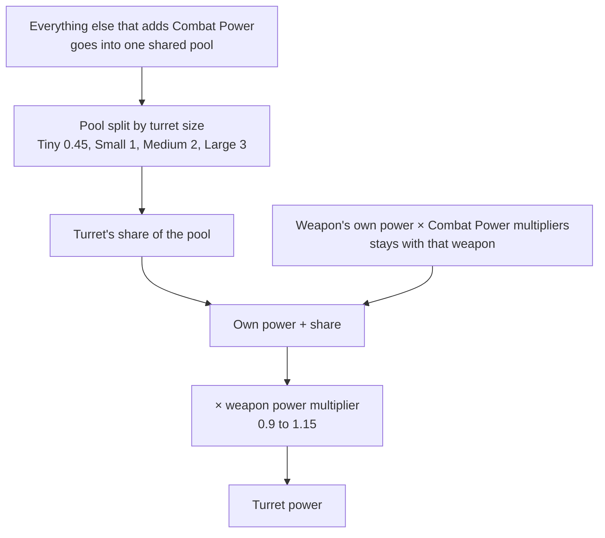
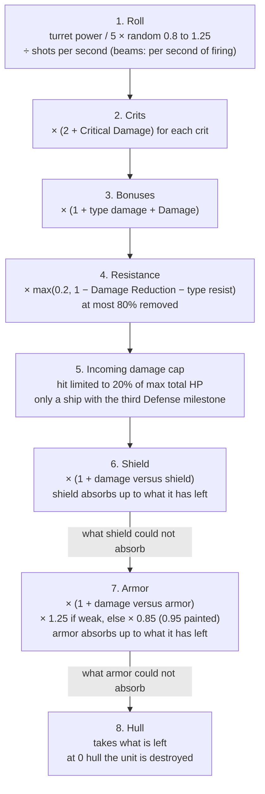
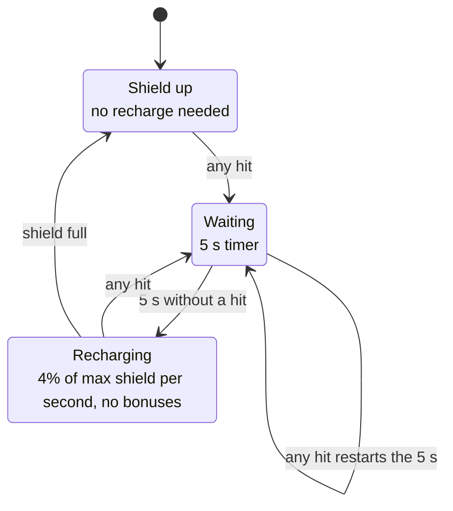

# Combat damage

How a shot becomes hull damage: where a weapon's damage comes from, what each stat does, the order in which a target's shields, armor and resistances take their share, and what you can stack against each layer. Everything here is read from the game's code and prefab data for version 0.8.3.4, not from in-game testing. Where a number lives in prefab data rather than in code, the section says so. The last part of the page, [In the game code](#in-the-game-code), lists the methods and fields behind each claim.

Terms and abbreviations are explained in the [glossary](glossary.md).

Three words on this page have more than one meaning in the game. "Combat Power" always means the ship stat (the Faction overview also has a "Combat Power" tile, which is a faction's total fleet points; see the [glossary row](../conquest/glossary.md#fleets-and-battles)). "Defense" means the ship-side group of stats, skills, mastery and hull upgrade path, never a station type or a number shown on a map card (those belong to the war, see [War stations](../conquest/war-stations.md)). "Rank" for an enemy means ship rank (Rookie, Regular, Veteran, Elite, Champion, Commander, Legendary). The abbreviation HP means hit points; shield, armor and hull each have their own HP pool.

Non-player character (NPC) level, ship rank and escalation scaling is in [scaling](scaling.md). Station parts are in [stations](stations.md). The extra HP and firepower multipliers that stations get during the Conquest war, which opens with the level 28 Conquest missions, are in [War stations](../conquest/war-stations.md). A ship at zero hull can become boardable instead of dying; that is in [boarding](boarding.md).

## How a stat is calculated

Every ship, drone, torpedo and station part keeps two running totals for each stat: a sum of flat amounts and a product of multipliers. What the game shows as a stat is:

```
stat = (base + sum of flat amounts) x product of multipliers
```

Every source of bonus gives a flat amount, a multiplier, or both. Flat amounts add. Multipliers multiply each other, so a x1.10 and a x1.20 give x1.32, not x1.30. A rolled item stat is either one or the other: a "+4% Weapon Range" roll is a flat 0.04 added to the sum, and the multiplier on that stat stays 1 unless something else sets it. Percentage stats (crit, resist, range and so on) are stored as fractions, 0.15 for 15%.

Only a few stats have a base term: hull, armor and shield HP (from the unit's definition), the shield generator's recharge rate, recharge delay and regeneration, cargo capacity, and Critical Chance (3% plus Precision, below).

Where the bonuses come from:

| Source | Notes |
|---|---|
| Every equipped item | An item registers all its stat lines with the ship, not just with itself. A "Weapon Range" roll on a reactor or a hull piece applies to every turret. |
| Hull upgrade path | See [hull upgrades](#hull-upgrades) |
| Derived boosts | Aspects on items, the ship's hull bonus badge, range bonus, commander skill nodes, mastery, officer skill nodes and unique officer boosts. They are rebuilt when your gear or skills change |
| Temporary boosts | Ability buffs, debuffs and the painter strip, each with a duration. A stack multiplies the amount, and a multiplier stacks as 1 + (m - 1) x stacks |
| Crew (player ship) | Crew types add a Combat Power multiplier of 1 + their combat bonus and a flat amount, scaled by the crew effectiveness skill |
| Officers (player ship) | Needs the officer passive skill. Combat officers pick Combat Power, Critical Chance or Attack Speed |

Two exceptions:

- A turret's own power line only counts while the turret is not manually disabled. A turret converted to drone power adds its amount to Drone Power instead.
- A bonus meant for one turret only (the per-weapon aspects) is kept separately and is added on top of the ship value for that turret alone: (ship stat + amount) x multiplier.

After all of that, the game applies these steps in order: the reactor energy modifier (player-owned ships only), NPC ship rank modifiers, the NPC ship HP curve, escalation modifiers (NPC damage and HP, player resistance debuff), a level-based HP balance multiplier on hull, armor and shield, then class-specific modifiers such as the station HP multiplier.

The HP balance multiplier for level L:

| Level | Effect |
|---|---|
| Up to 10 | x1 |
| 10 to 40 | Rises smoothly to x1.28 at level 40 |
| Above 40 | A second factor grows on top: 1 + 0.6 x ((L - 40) / 60) to the power 1.5 |

The exact formula is in the code section.

In the code: [how a stat is calculated](#code-how-a-stat-is-calculated).

## Every stat

In-game names come from the game's text. Four stats have no name in the text and the game shows a raw key instead (marked "no string"). Power is special: any amount or multiplier on Power is also applied to Combat Power, Mining Power and Salvage Power.

| In-game name | What it does |
|---|---|
| Hull HP | Last layer. Base is the unit's hull scale x 150 (ships and station parts alike) |
| Armor HP | Armor layer capacity. Base is the unit's armor scale x 300 if it has an armor module (unless the module overrides it), and 0 without one |
| Shield HP | Shield layer capacity, same rule with the shield generator module (scale x 300) |
| Hull Regeneration | Flat HP per second. Only while out of combat and below max |
| Armor Regeneration | Flat armor per second |
| Shield Regeneration | Flat shield per second, always on, even during the recharge delay. Base is 0.1% of max shield per second (set when the ship spawns) |
| no string (hull regeneration percentage) | Fraction of max hull per second, added to Hull Regeneration |
| no string (armor regeneration percentage) | Fraction of max armor per second, added to Armor Regeneration |
| Power | Feeds Combat, Mining and Salvage Power |
| Combat Power | Weapon damage. See [turret power](#where-a-turrets-damage-comes-from) |
| Mining Power | Mining turrets (not covered here) |
| Salvage Power | Salvage turrets (not covered here) |
| Precision | Raises critical chance. See [critical hits](#critical-hits) |
| Drone Power | Divided across the drone bay's drones and added to each drone's weapon power |
| Torpedo Power | Torpedo damage, plus the ship's normalized Combat Power |
| Repair Power | Repair turrets |
| Shield Recharge Delay | Shown on the ship panel, but the shield timer ignores it and always uses the generator's base delay (5 s on every shield generator) |
| Shield Gate Time | Described in-game as immunity after the shield is depleted. Nothing in the game reads it |
| Damage Reduction | Flat fraction removed from every hit, shares the 80% cap with resists |
| Shield Recharge Rate | Scales the shield's recharge ticks |
| Kinetic, Energy, Radiation, Heat, Cold, Corrosion, Explosive Resistance | Fraction removed from hits of that damage type |
| Critical Chance | Chance per hit to crit |
| Critical Damage | Added to the x2 crit multiplier |
| Damage | Additive bonus to all weapon damage |
| Weapon Range | Range = base x (1 + stat) |
| Attack Speed | Fire delay = base / (1 + stat) |
| Reload Speed | Reload time = base / (1 + stat) |
| Magazine Size | Magazine = round(base x (1 + stat)) |
| Turret Rotation Speed | Rotation = base x (1 + stat) |
| Projectile Speed | Speed = base x (1 + stat) |
| Kinetic, Energy, Radiation, Heat, Cold, Corrosion, Explosive Damage | Additive damage bonus for that type only |
| no string (damage versus shield) | Multiplies damage while the target still has shield |
| no string (damage versus armor) | Multiplies damage while the target still has armor |
| Thrust, Side Thrust, Rotational Thrust | Movement |
| Cargo Capacity | Hold size |
| Resource Yield | Mining and salvage output |
| Energy | Reactor capacity. See [energy](#energy-and-the-reactor) |
| Ore Upgrade Chance | Mining |
| Boarding Suppression, Boarding Power | See [boarding](boarding.md) |
| Officer Bonus | Multiplies the officers' chosen bonus by 1 + stat |
| Hangar Build Speed | Fighter repair and rebuild speed in the hangar bay |

In the code: [every stat](#code-every-stat).

## What the Damage stat is

Damage and the seven type damage stats (Kinetic, Energy, Radiation, Heat, Cold, Corrosion, Explosive) add together and then multiply the shot once:

```
damage multiplier = 1 + (type damage stat) + Damage
```

Neither Damage nor any type damage stat rolls on items in 0.8.3.4: none of the 131 equipment builders lists them, nor the damage-versus-shield and damage-versus-armor bonuses, Critical Chance or Damage Reduction. The rest of the game data adds nothing to them either. The only lines on Damage are the boss aspects Overcharge (x1.25) and Siege Mode (x1.2), which are multipliers, and a multiplier on a stat whose flat sum is 0 stays 0. So in 0.8.3.4 the damage multiplier above is 1, and those two aspects add no damage despite their text. This is read from the formulas and the game data, not observed in play. The stats that do have sources (damage versus shield and armor, Critical Chance, Damage Reduction) are listed in [where bonuses come from](#where-bonuses-come-from).

In the code: [what the Damage stat is](#code-what-the-damage-stat-is).

## Where a turret's damage comes from

A weapon item carries a main power line (Combat Power for guns, Torpedo Power for torpedo bays). The ship pools all the Combat Power it has and hands each active combat turret a share:

```
turret power = (weapon's own power x M  +  max(0, ship power - own power of all active combat turrets x M) / N x turret rating) x weapon power multiplier

ship power = the ship's Combat Power stat, with its multiplier M already applied
M          = the product of the Combat Power multipliers
N          = sum of ratings of active combat turrets (at least 0.45)
rating     = Tiny 0.45, Small 1, Medium 2, Large 3
```

So the weapon's own number is multiplied by M and stays with that weapon. Everything else that adds Combat Power (optional rolls on any item, flat skill amounts, crew, hull upgrades) goes into one pool split in proportion to turret size. A Large turret gets three times the pooled share of a Small one. A disabled turret (manually, or converted to drones) leaves the pool. Multipliers on Combat Power (skills, hull badge, hull upgrades, reactor bonus, crew) multiply the whole pool and every main line.



The per-turret power multiplier is a weapon value (0.9 to 1.15, listed in the [weapon table](#typical-weapon-numbers)).

Average damage per second (DPS) from one turret is turret power / 5 x 1.025, before crits and bonuses. The 1.025 is the mean of the 0.8 to 1.25 roll. The game's own expected-DPS display uses these exact constants. That figure holds for weapons that fire shots. A beam (Plasma Beam, Cryo Lance) deals power / 5 only while its beam is on, which is 2 s at a time, and then reloads for its full reload time, so with the 2 s reload in the weapon table a beam averages about half of that.

In the code: [where a turret's damage comes from](#code-where-a-turrets-damage-comes-from).

## The path of a hit

The numbered steps run in this order for every damage event, whether it comes from a bullet, a beam tick, a missile or an explosion.



In the code: [the path of a hit](#code-the-path-of-a-hit).

### 1. The shot is rolled

```
base = turret power / 5  x  random(0.8, 1.25)  /  shots per second
```

"Shots per second" here is worked out from the weapon's own unmodified fire delay, reload, magazine and burst, which is the "Shots/s" column in the [weapon table](#typical-weapon-numbers). Because it ignores your Attack Speed, Reload Speed and Magazine Size bonuses, those stats raise the number of shots without shrinking each shot. Each one speeds up part of the firing cycle, so its gain depends on how much of the cycle that part takes: Attack Speed shortens the time between shots, Reload Speed the reload, Magazine Size cuts the number of reloads.

Beams skip the division: each 0.2 s tick carries power x tick length instead, so a beam deals power / 5 per second of firing. A beam stays on for 2 s, then the turret reloads for its full reload time before the beam can come on again.

In the code: [1. the shot is rolled](#code-1-the-shot-is-rolled).

### 2. Critical hits

See [critical hits](#critical-hits). Each crit multiplies the roll by 2 + Critical Damage.

### 3. Damage bonuses

```
shot = base x crit multiplier x (1 + type damage stat + Damage)
```

The stats are read from the firing turret (ship value plus that turret's own boosts). A drone or torpedo with no turret reads them from itself.

In the code: [3. damage bonuses](#code-3-damage-bonuses).

### 4. Target resistance

```
shot = shot x max(0.2, 1 - Damage Reduction - resistance to the shot's type)
```

This happens before any layer. The floor of 0.2 is the resist cap: Damage Reduction and the type resistance together can remove at most 80% of a hit. Past that total, extra resistance does nothing. Both stats can also go negative (the painter below, the escalation debuff on player ships), which raises the multiplier above 1 with no upper limit.

While a warp or jumpgate transit is active, damage taken by any ship (yours included) is multiplied by 0.1 after this step.

In the code: [4. target resistance](#code-4-target-resistance).

### 5. Incoming damage cap

A ship with the third milestone of the Defense hull upgrade path caps every single hit at 20% of its maximum total HP (hull + armor + shield), after step 4. The milestone is earned by absorbing damage over a ship's lifetime, which is how your own ship gets it (not verified for NPC ships):

```
shot = min(shot, 0.2 x max total HP)
```

### 6. Shield

If the target has a shield generator, its recharge delay timer resets on every hit, even once the shield is down. If the shield has capacity:

```
shot = shot x (1 + damage-versus-shield bonus)     (read from the firing turret, only if above 0)
absorbed = min(shot, current shield)
shield -= absorbed;  shot -= absorbed
```

Shields treat all seven damage types the same: there is no shield resistance and no weakness. Whatever the shield could not absorb carries on to armor already multiplied by the shield bonus.

### 7. Armor

If damage is left and the target has armor:

```
shot = shot x (1 + damage-versus-armor bonus)       (from the firing turret, only if above 0)
if the damage type is in the armor's weak types:  shot = shot x (1 + weak amount)
else:                                              shot = shot x (1 - max(0, resist amount - paint strip))
absorbed = min(shot, current armor);  armor -= absorbed;  shot -= absorbed
```

The only armor type in 0.8.3.4 is Armor Plating (every armor has the same values): 15% resistance, weak to Corrosion with +25% damage taken. Armor resistance and weakness are exclusive: a weak type gets the +25% and not the -15%. Because resistance is applied before absorption, 100 armor HP lasts for 100 / 0.85, about 118, points of ordinary shot damage, and 100 / 1.25 = 80 points of Corrosion.

The painter (the Painter Drone, the only painter in the game data) sets the paint strip, the number of armor resistance points it strips, to 0.10 for 6 seconds, which takes Armor Plating from 15% to 5% resistance. It also adds -0.05 Damage Reduction to the target for the same 6 seconds.

In the code: [7. armor](#code-7-armor).

### 8. Hull

```
hull = clamp(hull - shot, 0, max hull)
```

There is no hull resistance beyond step 4. At zero hull the unit is destroyed, with these exceptions: a boardable ship becomes boardable (see [boarding](boarding.md)); a player-owned ship is left at 0.1 HP and not destroyed (fighters and arena battles excepted); an emergency jump can intervene.

### Shorthand

```
to shields:  base x crit x (1 + bonuses) x resistFactor x (1 + VsShield)
to armor:    base x crit x (1 + bonuses) x resistFactor x (1 + VsShield, if it passed through shield) x (1 + VsArmor) x armorFactor
to hull:     base x crit x (1 + bonuses) x resistFactor   (minus what shield and armor soaked up first)
```

resistFactor = max(0.2, 1 - Damage Reduction - resistance), VsShield and VsArmor are the damage-versus-shield and damage-versus-armor bonuses, and armorFactor is 1.25 for a weak type or 0.85 (0.95 painted) otherwise.

### A worked example

Illustrative inputs, computed from the formulas above: a level 30 Standard Medium Autocannon rolls a main Combat Power of 400 to 420 (the Medium roll of 2.0 to 2.1 times a power level of 200, see [weapon power](#weapon-power-by-level)). Say 410. The firing ship has +10% Kinetic Damage and +5% Damage, and no crits. (Nothing in 0.8.3.4 grants those two bonuses, see [what the Damage stat is](#what-the-damage-stat-is); they stand in for any bonus of that kind.) Its shots against a target with Damage Reduction 10%, Kinetic Resistance 20%, a shield of 1000 and 500 Armor Plating:

| Step | Value |
|---|---|
| Average base per shot | 410 / 5 / 2.331 = 35.2 (rolls 28 to 44) |
| After bonuses | 35.2 x 1.15 = 40.5 |
| After resistance (1 - 0.10 - 0.20 = 0.70) | 28.3 |
| Shield (1000) | about 35 shots to break |
| Armor (500), 28.3 x 0.85 = 24.1 per shot | about 21 shots to break |
| Hull | 28.3 per shot |

At 2.33 shots per second the shield alone lasts about 15 s.

## Critical hits

Your chance for a hit to crit is:

```
crit chance = (3% + crit chance from Precision + flat Critical Chance) x Critical Chance multiplier
```

Precision turns into crit chance relative to a "power level" that depends on level (the same number that item stat rolls scale with):

```
raw = 5% x Precision / power level
crit chance from Precision = raw                                  if raw is 5% or less
                           = 5% + (raw - 5% + 1)^0.75 - 1        if raw is above 5%   (computed with raw as a fraction, so 5% is 0.05)
```

The power level is 50 at level 10, 100 at 20, 200 at 30, 400 at 40, 800 at 50, 25 600 at 100. Precision equal to one power level gives +5% crit chance. Past +5% the gain is damped: raw 10% becomes 8.7%, raw 20% becomes 16.1%, raw 50% becomes 37.1%.

Crits chain like this:

```
roll the crit chance c;  on success: crits += 1,  c = c / 2,  roll again
stop after the roll that fails, or when crits is above your Critical Recursion ranks
crit multiplier = (2 + Critical Damage) ^ crits
```

Without ranks in Critical Recursion at most one crit happens per hit. With r ranks (the skill has 3) a hit can crit up to r + 1 times, each extra chance halved, and each crit multiplies. The rank count comes from your skill tree plus any copies your officers have unlocked, and the game reads it on every crit roll, so enemy shots chain too once you have ranks. The crit multiplier is applied to the shot before type bonuses.

Crits are rolled per hit and per beam tick, so a continuous beam rolls five times a second. Burst and tick weapons smooth out the variance.

In the code: [critical hits](#code-critical-hits).

## Damage types

Seven types: Kinetic, Energy, Radiation, Heat, Cold, Corrosion, Explosive. The type picks which damage bonus adds to the shot and which resistance the target uses. Beyond that only armor knows about types, and only one armor type exists.

| Type | Weapons in 0.8.3.4 | Special |
|---|---|---|
| Kinetic | Autocannon, Twin and Triple Autocannon, Gatling, Double Gatling, DT Chaingun ("DT" is part of the weapon's name), Railgun, Burst Railgun | Rail shots pierce, up to 6 targets |
| Energy | Lasers, Laser Repeater, Laser Shotgun, Plasma Cannon, Plasma Repeater, Plasma Battery, Plasma Beam, Microcell Swarm Launcher | |
| Radiation | Rad Cannon | Applies an Irradiated effect on hit (3 s). Its data line halves the target's Precision, but no code that applies that line was found (not verified) |
| Heat | none directly | Torpedoes, Cannon splash, and Firestarter-type extra damage |
| Cold | Cryo Lance | |
| Corrosion | Corropult | Armor Plating is weak to it. Leaves a damaging cloud |
| Explosive | Missile Launchers, Hailfire, Cannon | |

In the code: [damage types](#code-damage-types).

## Hitting: range, tracking and projectiles

Range is a plain distance check from the firing point to the nearest point of the target's hull outline, at most your range, with range = base x (1 + Weapon Range). There is no damage falloff with distance for direct hits.

A turret fires when it has a target in range, is aimed within its firing angle of the target and is off cooldown. Turrets that cannot rotate fire whenever the target is in range. Rotation speed is degrees per second (base x (1 + Turret Rotation Speed)). Most guns use a 1 degree firing window; lasers use 0.25, and the plasma cannons 0.01, so a slow turret on a fast target can fail to fire at all. Missile launchers and the Hailfire use 360. Beams ignore the firing window.

How each weapon family then hits:

| Family | How the hit is resolved |
|---|---|
| Combat Laser | Beam plays for its effect time, then damage lands on the target. No miss while the target lives |
| Laser Repeater, Gatling, Chaingun, Shotgun (hitscan) | A line cast with random scatter of the weapon's accuracy angle x distance x 0.015 units either way. Hits only the current target |
| Railgun | Instant ray. Damages every enemy on the line, each hit after the first at 0.5^n of the power, up to 6 hits |
| Plasma Beam, Cryo Lance (beams) | Instant while in range. Damage ticks every 0.2 s for up to 2 s, then a reload |
| Autocannon, Plasma, Corropult, Rad Cannon, Cannon | A projectile flies at its speed with a random heading spread of +-accuracy angle degrees (4 to 5.5 for autocannons) and a lifetime of 5 s (7 s for the Cannon shell). It hits the first enemy it overlaps, not necessarily the target |
| Missiles, Hailfire, Microcell | Homing. A missile steers to a predicted intercept point with limited thrust and turn rate; it expires with its lifetime (16 s for missiles and Microcell, 8 s for Hailfire) |

The aim point leads a moving target: target position plus target velocity times (1 + cos) x distance / projectile speed, where cos is the dot product of the target's heading with the line to it. Slow projectiles at long range against fast, turning ships miss more. Raising Projectile Speed shortens the lead.

Reload takes the full reload time. The Instant Reload skill gives your ship's turrets a chance on each reload to skip it (2% per rank, up to 3 ranks). A weapon with an ammo type spends cargo ammo per shot (Gatling-class weapons spend one ammo per four shots); with an empty hold the magazine refills to zero and the weapon cannot fire.

In the code: [hitting: range, tracking and projectiles](#code-hitting-range-tracking-and-projectiles).

## Energy and the reactor

Every piece of equipment has an energy draw (listed per weapon in the [table](#typical-weapon-numbers)) multiplied by the ship's energy draw multiplier. The reactor's capacity is the Energy stat. This is a static budget: nothing is drained over time and nothing switches off when the budget is exceeded. What changes is a damage multiplier.

```
usage = sum of connected equipment energy draw / reactor Energy capacity
```

| Usage | Multiplier on Power, Combat, Mining, Salvage Power |
|---|---|
| up to 50% | x1.20 |
| up to 75% | x1.10 |
| up to 100% | x1.00 |
| up to 125% | x0.75 |
| up to 150% | x0.50 |
| above 150% | x0.25 |

The multiplier applies to the ship's overall Combat Power, so it scales every turret and the pooled flat power together. It does not touch Drone Power or Torpedo Power themselves, but torpedoes and drones add a share of Combat Power, so they feel it through that share. The rule runs for player-owned ships only; NPC ships and drones ignore the reactor. The skill "Divert Power" adds 5% per rank (2 ranks) to the Combat Power multiplier of the 50%-or-less bracket. The only draw modifier in the game is the efficient-drilling effect (x0.25, mining).

Reactor capacity comes from the reactor item's main roll, a flat amount of (1.35 to 1.4 for Base; 1.5 to 1.6 Small; 3.4 to 3.5 Medium; 4.5 to 4.8 Large) x power level x the square root of the rarity multiplier. Weapon draws are fixed numbers, so a higher-level reactor carries more weapons.

In the code: [energy and the reactor](#code-energy-and-the-reactor).

## Shields

```
recharge delay = 5 s on every shield generator, reset by every hit
every 0.25 s after the delay:  shield += max shield x 0.005 x recharge rate
recharge rate  = generator rate x (1 + Shield Recharge Rate stat)
```



The stat read here is the full ship stat, which already includes the generator's base rate of 1.0. With no bonuses the recharge rate is 1 x (1 + 1) = 2, so a recharge tick restores 1% of max shield and the shield refills at 4% of max per second, 25 s from empty after the 5 s delay. A bonus of +0.10 on Shield Recharge Rate makes the rate 2.1, which is 5% faster recharge, not 10%. This is a direct reading of the code; the value was not observed in game.

Flat Shield Regeneration runs in addition, continuously, with no delay. Shield Recharge Delay and Shield Gate Time have no effect on the timer in this version (see the [stat table](#every-stat)).

In the code: [shields](#code-shields).

## Armor regeneration

Armor Plating regenerates Armor Regeneration + Armor Regeneration percentage x max armor per second, with no delay. NPC ships have the percentage part capped at 0.1% per second and the whole rate halved while in combat. Hull regeneration only runs out of combat.

In the code: [armor regeneration](#code-armor-regeneration).

## Damage over time and area effects

Everything below goes back through the full pipeline (steps 4 to 8) on every tick or hit, one target at a time.

| Effect | Rule |
|---|---|
| Damage over time (DoT) | A fixed total (the effect's damage) divided into equal ticks at a fixed interval. Each tick is a fresh hit of that size, with no new crit roll. A second application merges: both remaining totals add and the ticks reset to the full count. Tick count and delay are weapon data (not extracted) |
| Per-weapon aspects | After a hit by that weapon, a second hit of a percentage of the hit's total damage in another type, either instant or as a DoT. Examples from the game text: Punch Through +10% Kinetic, Firestarter +15% Heat over 6 s, Frozen Core +10% Cold. The trigger event, and whether the total is taken before or after the target's resistance, were not traced |
| Corropult cloud | Impact hit, then a cloud of radius 2 for 3 ticks 1 s apart. Each tick hits every enemy inside for the impact shot's damage (before the target's defenses) x 0.5 / 3 |
| Cannon explosion | The Large Cannon shell explodes in radius 6. Each ship hostile to the player in range, the target included, takes 20% of what the shot had left after the target's defenses, as Heat, with distance falloff |
| Area falloff | Explosions scale the hit by max(1 - distance / radius, 0.1) |
| Radiation Cannon | Applies an Irradiated effect on hit (3 s); its data line halves the target's Precision, but no code that applies that line was found (not verified) |
| Cryo / cold slow, Cold Snap and similar | Weapon effects (not read) |

The area effect copies the damage left over after the first target's defenses, so splash damage is whatever the direct hit did not use up. Against a shielded ship that soaked the whole direct hit, the splash does nothing.

In the code: [damage over time and area effects](#code-damage-over-time-and-area-effects).

### Temporary effects

Buffs and debuffs are stat boosts with a duration. Two effects with the same name merge into one: stacks add (up to the effect's own stack limit, if it has one) and the duration refreshes to the longer of the two. A stat boost's amount times its stack count is what the stat sees. The Defense skill "Threat Reducer" (a ship skill, not a station) has a 20% chance, when you take damage, to give +2% resistance per stack to the damage type of that hit for 10 s (cooldown 20 s).

In the code: [temporary effects](#code-temporary-effects).

## Drones, torpedoes, fighters

| Unit | Damage |
|---|---|
| Drones | Same turret rules. A drone weapon's power is its own main power x your Combat Power multiplier + your normalized Combat Power x its rating + your Drone Power / base drone count. A drone also reads your percentage stats directly (Damage, type bonuses, Critical Damage, range, attack speed, resists) but not Critical Chance, which it works out from its own Precision (the drone's own Precision plus your Precision divided across your drones). The skill Composite Drone Armor and the second Drones hull milestone add Damage Reduction to drones |
| Torpedoes | Always Heat. Power = Torpedo Power + normalized Combat Power, rolled as power / 5 x random(0.8, 1.25) with **no** division by shots per second. Crits, Damage and Heat Damage read from the launching ship. Explodes in radius 6 on impact with falloff (minimum 10%) on every enemy in range, the target included, using the damage left after the direct hit. Bay timing: Small bay 8 s between launches and 4 s reload, Medium bay 1 s and 3 s |
| Fighters | Hangar-bay fighters are ships with their own turrets and use the ship rules (not traced further). Their repair and rebuild speed is Hangar Build Speed |

"Normalized Combat Power" means ship Combat Power divided by the number of equivalent turrets, the same share a Small turret gets.

In the code: [drones, torpedoes, fighters](#code-drones-torpedoes-fighters).

## Where bonuses come from

Of the stats in the [Damage stat section](#what-the-damage-stat-is), only damage versus shield, damage versus armor, Critical Chance and Damage Reduction have a source in 0.8.3.4, and none of them rolls on gear. This is what grants them.

| Source | Combat-relevant bonuses |
|---|---|
| Combat hull badge (ships with the Combat role) | Combat Power x1.3, Critical Chance +3% |
| Range bonus (by hull size, 1 to 8) | Weapon Range + 0.0, 0.2, 0.4, 0.7, 1.0, 1.2, 1.8, 2.0 for Combat ships; 0, 0.1, 0.2, 0.3, 0.4, 0.5, 0.7, 0.8 for Industrial. Added to the Weapon Range sum, so a size 8 Combat hull has x3 range before other bonuses |
| Hull upgrades | See below |
| Commander skill nodes | Per-rank stat boosts. Examples: +1% Critical Chance, +5% Weapon Range, +5% Critical Damage, +3% Attack Speed, +12% Attack Speed (Tier 3), +2% Critical Chance and +5% Critical Damage, +4 to 5% Turret Rotation. Combat Power nodes have both a x1.01 and a +3 flat line per rank (how the "minimum of +3" wording maps to them was not traced). Other nodes add abilities: Critical Recursion, Instant Reload, Divert Power, Lone Gun, Redline and others |
| Mastery | Offense mastery: Combat Power x(1 + 0.005 x mastery level). Defense mastery: +0.1% Damage Reduction per mastery level. Mastery experience points (XP) come from shield and armor damage taken (Defense) |
| Officers | One chosen stat from Combat Power, Critical Chance, Attack Speed (Engineering officers: Drone Power or Shield HP). Combat Power, Drone Power and Shield HP apply as multipliers, Critical Chance and Attack Speed as flat amounts at 0.8 of the officer's bonus |
| Item aspects | Common and rare slots on weapons and modules: Reload Subroutine +25% reload, Critical Attenuation +25% critical damage, Weakpoint Scan +5% crit chance, Rangefinder +25% weapon range, Hardened Exterior +5% Damage Reduction, Hardened Plating, Extremophile and Gamma Ward +2 to 5% resists, Operational Reserves x1.02 Power |
| Boss aspects | Overcharge (no crits; its text says +25% damage, but see [what the Damage stat is](#what-the-damage-stat-is)), Shield Slapper (+10% to shields), Armor Breaker (+10% to armor, +5% critical damage), Quick Quick Quick (+40% reload, +10% fire rate), Siege Mode (only fires below a speed threshold; its text says +20% damage, same caveat), Opening Blow (+40% to targets above 90% HP), Volatile Plasma and others, as described in their in-game text. Shield Slapper is the only source of damage versus shield and Armor Breaker the only source of damage versus armor; those two stats are only read in steps 6 and 7 above |

In the code: [where bonuses come from](#code-where-bonuses-come-from).

### Hull upgrades

Paths grow per node (kits spent): Combat +2% Combat Power each, Torpedo +2% Torpedo Power each, Drones +2% Drone Power each, Defense +1% hull, armor and shield each. Milestones sit at node 10, 20 and 30 and also need a lifetime count. The first Combat and Torpedo milestone counts combat missions completed, the other two count kills; Defense counts damage absorbed and Drones counts drone activity. Each threshold is multiplied by a ship-size factor of 0.2 plus 0.2 per size above 1 (x1.0 at size 5, x1.6 at size 8). The table lists the base counts:

| Path | Milestone 1 | Milestone 2 | Milestone 3 |
|---|---|---|---|
| Combat (100 combat missions, 1000 kills, 5000 kills) | +5% Weapon Range, +15% Critical Damage | Combat Power x1.1 | Combat Power x1.2 |
| Torpedo (same counts) | Torpedo Power x1.05 | x1.10 | x1.20 |
| Defense (1 M, 50 M, 1 B damage absorbed) | +2% Damage Reduction | Shield, Armor, Hull HP x1.1 | HP x1.2 and the 20% single-hit cap |
| Drones (5 M, 250 M, 5 B drone activity) | +1 drone | +15% drone Damage Reduction | +2 drones |

In the code: [hull upgrades](#code-hull-upgrades).

## Typical weapon numbers

Weapon stats are fixed per weapon, not rolled. "Shots/s" is the weapon's shots per second including reload. "Power mult" is the weapon's own power multiplier. "Energy" is the draw before the ship's multiplier. Ranges are game units. Projectile "instant" means no travel time; "hitscan" is a line cast. The Tiny items are drone weapons.

| Weapon | Size | Type | Range | Shots/s | Mag / reload | Projectile | Power mult | Energy |
|---|---|---|---|---|---|---|---|---|
| Cryo Lance | Small | Cold | 10 | 0.45 | 1/2s | instant | 0.9 | 0 |
| Cryo Lance | Medium | Cold | 14 | 0.45 | 1/2s | instant | 0.9 | 0 |
| Corropult | Small | Corrosion | 10 | 0.67 | 2/2s | 8 | 1.0 | 5 |
| Corropult | Medium | Corrosion | 14 | 1.0 | 4/2s | 10 | 1.0 | 10 |
| Laser | Tiny | Energy | 10 | 0.5 | 1/1s | instant | 0.95 | 7.5 |
| Laser | Small | Energy | 10 | 0.5 | 1/1s | instant | 0.95 | 7.5 |
| Laser | Medium | Energy | 14 | 0.5 | 1/1s | instant | 0.95 | 15 |
| Laser | Large | Energy | 14 | 0.36 | 1/1.75s | instant | 0.95 | 25 |
| Laser Repeater | Small | Energy | 12 | 3.0 | 30/4s | hitscan | 0.9 | 7 |
| Laser Repeater | Medium | Energy | 16 | 3.56 | 45/5s | hitscan | 0.9 | 11 |
| Laser Repeater | Large | Energy | 18 | 4.17 | 60/6s | hitscan | 0.9 | 16 |
| Laser Shotgun | Small | Energy | 10 | 2.42 | 24/3s | hitscan | 1.1 | 5 |
| Microcell Swarm Launcher | Small | Energy | 12 | 2.27 | 50/3s | 8 | 1.0 | 0 |
| Microcell Swarm Launcher | Medium | Energy | 16 | 3.34 | 100/3s | 8 | 1.0 | 0 |
| Plasma Battery | Large | Energy | 16 | 2.13 | 80/6s | 18 | 1.1 | 20 |
| Plasma Beam | Small | Energy | 12 | 2.5 | 10/2s | instant | 0.95 | 0 |
| Plasma Beam | Medium | Energy | 16 | 2.5 | 10/2s | instant | 0.95 | 0 |
| Plasma Cannon | Medium | Energy | 12 | 0.53 | 8/3s | 14 | 1.0 | 10 |
| Plasma Cannon | Large | Energy | 12 | 0.38 | 6/4s | 15 | 1.0 | 20 |
| Plasma Repeater | Small | Energy | 11 | 1.61 | 33/4s | 18 | 1.1 | 5 |
| Plasma Repeater | Medium | Energy | 16 | 2.07 | 60/4s | 18 | 1.15 | 10 |
| Cannon | Large | Explosive | 20 | 0.25 | 1/3s | 15 | 1.0 | 20 |
| Hailfire M-Launcher | Small | Explosive | 100 | 2.0 | 15/6s | 15 | 0.9 | 5 |
| Missile Launcher | Tiny | Explosive | 100 | 1.0 | 5/4s | 8 | 1.0 | 0 |
| Missile Launcher | Small | Explosive | 100 | 1.0 | 5/4s | 8 | 1.0 | 5 |
| Missile Launcher | Medium | Explosive | 100 | 1.0 | 5/4s | 6 | 1.0 | 10 |
| Missile Launcher | Large | Explosive | 100 | 0.97 | 6/5s | 6 | 1.0 | 20 |
| Autocannon | Small | Kinetic | 13 | 2.04 | 22/2s | 12 | 1.0 | 5 |
| Autocannon | Medium | Kinetic | 18 | 2.33 | 38/3s | 15 | 1.0 | 10 |
| Twin Autocannon | Medium | Kinetic | 16 | 4.46 | 54/4s | 15 | 1.0 | 10 |
| Triple Autocannon | Large | Kinetic | 16 | 6.94 | 102/4.5s | 18 | 1.0 | 20 |
| Gatling | Small | Kinetic | 10 | 15.38 | 200/3s | hitscan | 1.0 | 5 |
| Double Gatling | Small | Kinetic | 10 | 16.13 | 250/3s | hitscan | 1.1 | 5 |
| DT Chaingun | Large | Kinetic | 10 | 7.14 | 100/5s | hitscan | 1.0 | 20 |
| Railgun | Small | Kinetic | 75 | 0.33 | 1/2s | instant | 1.0 | 5 |
| Railgun | Medium | Kinetic | 75 | 0.25 | 1/3s | instant | 1.1 | 10 |
| Railgun | Large | Kinetic | 75 | 0.4 | 2/3s | instant | 1.1 | 20 |
| Burst Railgun | Medium | Kinetic | 75 | 0.75 | 3/3s | instant | 1.0 | 10 |
| Burst Railgun | Large | Kinetic | 75 | 0.81 | 6/3s | instant | 1.0 | 20 |
| Rad Cannon | Medium | Radiation | 14 | 0.17 | 1/3s | 10 | 1.0 | 22 |
| Rad Cannon | Large | Radiation | 18 | 0.17 | 1/3s | 10 | 1.0 | 22 |

Shots per second tells you how fine-grained the damage is, not how much there is. Damage per second is turret power / 5 for every weapon that fires shots (beams only while the beam is on, see above); the reload downtime is already inside "Shots/s". Apart from the power multiplier, what separates two weapons is range, projectile behaviour, damage type and size (which sets the main power roll and the pool share), not their listed rate of fire.

In the code: [typical weapon numbers](#code-typical-weapon-numbers).

### Weapon power by level

An item's rolled stats scale with its level. For a weapon main power line:

```
power level = round(25 x 2^(level / 10))               up to level 100
            = round(25 x 2^(10 + (level - 100) / 25))  above 100
main power  = random(min, max) x power level x rarity multiplier
```

Rarity multiplier: Standard 1.0, Enhanced 1.1, High Grade 1.2, Exotic 1.35, Legendary 1.5. Item level is the target level plus or minus 1 unless the level is exact.

| Weapon size | Main power roll (x power level x rarity) |
|---|---|
| Tiny | 0.5 to 0.6 |
| Small | 1.0 to 1.05 |
| Medium | 2.0 to 2.1 |
| Large | 3.0 to 3.15 |

Torpedo bays use the same numbers for Torpedo Power (Small 1.0 to 1.05, Medium 2.0 to 2.1). Weapons also roll optional stats, count by rarity (Standard 0, Enhanced 1, High Grade 2, Exotic 3, Legendary 3), with these ranges for guns (before level and rarity scaling; the first four are scaled by power level, and the flat power-type rolls, including Armor, Shield, Hull, Mining Power, Salvage Power and Torpedo Power at 0.20 to 0.25, also get x1.5 on a Medium and x2.25 on a Large weapon): Combat Power 0.20 to 0.25, Precision 0.20 to 0.25, Power 0.12 to 0.18, Drone Power 0.20 to 0.25, Critical Damage 0.02 to 0.025, Weapon Range 0.04 to 0.045 (rarer), Attack Speed 0.01 to 0.012, Reload Speed 0.01 to 0.012, Magazine Size 0.01 to 0.012, Turret Rotation 0.04 to 0.045 (rarer), Projectile Speed 0.04 to 0.05 (missiles). A rolled Precision of 0.2 to 0.25 power levels on a Small weapon is worth about +1% to +1.25% crit chance. Armor, shield and hull items roll their main HP stat as a multiplier, 1 + (0.013 to 0.014, hull 0.010 to 0.014) x power level x rarity x the same size factor (Medium x1.5, Large x2.25), so HP grows with item level (see [scaling](scaling.md)).

In the code: [weapon power by level](#code-weapon-power-by-level).

## NPC and station modifiers

NPC ships and station parts use the same hit rules as yours. What differs is the stat set they carry:

- Faction NPCs apply their ship rank's flat addition to Reload Speed and Attack Speed, and the ship rank's HP multiplier to hull, armor and shield, then an HP curve by level and ship size.
- Escalation multiplies NPC hull, armor and shield by an HP multiplier, and NPC Combat, Drone and Torpedo Power by a damage multiplier, both scaled by a base multiplier of the NPC's level. It also subtracts a flat amount from all seven of the player's resistances.
- Station parts in the Conquest war get an HP multiplier and a firepower multiplier ([War stations](../conquest/war-stations.md)).

Numbers for NPC ships and escalation are in [scaling](scaling.md). Station parts are in [stations](stations.md).

In the code: [NPC and station modifiers](#code-npc-and-station-modifiers).

## What to do about it

### Against shields

Raw damage wins. Shields ignore damage type and have no resistance of their own, but your hit still passes through the target's Damage Reduction and type resistance first. Pick the type the target resists least, and use the damage-versus-shield bonus if you have it (it multiplies the damage that overflows into armor too). Since a shield refills only after 5 s without being hit, weapons that never stop firing keep it down for good. A burst of damage that breaks the shield helps less than a steady stream.

### Against armor

Armor takes the leftover damage after shields. Plating resists 15% of everything except Corrosion, which it takes at +25%. Corrosion hits armor for 1.25 against 0.85 for any other type, about 47% more damage per point of damage. Armor and shield do not share a resist stat, so a ship with a shield strong against your type can still be weak at the armor stage. A painter drone removes 10 points of armor resistance (15% to 5%) and 5 points of Damage Reduction from a target for 6 seconds; it is a fleet-wide benefit and worth bringing against heavily armored targets. The damage-versus-armor bonus multiplies on top of all of that.

### Against hull

Once shields and armor are gone, only the target's Damage Reduction and type resistance remain, both already taken in step 4. There is no hull type weakness. Pick the type the target resists least and keep the Painter's Damage Reduction strip up.

### The resistance cap and stacking

Damage Reduction and the type resistance share a combined cap of 80%. A ship with 40% Damage Reduction and 50% Kinetic resistance takes the same damage from Kinetic fire as one with 20% and 60%, and gains nothing from a further point of either. Each point of either removes one point of the hit, below the cap. Damage Reduction does it for all seven types and a resistance only for its own, so Damage Reduction is the better point when attackers mix types, and a resistance is the better point when one type does most of the damage. Once the sum for a type reaches 80%, stop adding to it.

Resistances are flat additions in a sum, not multipliers, and the escalation debuff on player ships subtracts from them directly.

### Crit chance, crit damage or plain damage

With crit chance c, crit damage d (so a crit multiplies by 2 + d) and damage bonus D, one crit roll per shot and no Critical Recursion:

```
expected damage  proportional to  (1 + c x (1 + d)) x (1 + D)
```

Per percentage point, in relative gain:

| Stat | Gain per +1 point |
|---|---|
| Critical Chance | (1 + d) / (1 + c x (1 + d)) points of damage |
| Critical Damage | c / (1 + c x (1 + d)) points of damage |
| Damage or a type bonus | 1 / (1 + D) points of damage |
| Combat Power multiplier | the same as its percentage, always |

Critical Damage only helps in proportion to the chance. At the base 3% crit chance a point of Critical Damage is worth about 0.03 points of damage, while a point of Critical Chance is worth about 1. Critical Chance gives a larger gain per point than Critical Damage whenever the chance is below 1 + d, which in practice is always. So raise chance first, and add Critical Damage once the chance is high. The game's own skill pairs (Target Weak Spots, Targeting Specialist) combine both. Critical Recursion adds extra rolls at half the chance each, which makes chance worth more still.

Plain Damage and type bonuses have diminishing value as they stack, since they add into one 1 + D term; in 0.8.3.4 nothing grants them, so D is 0 in practice. Combat Power multipliers do not diminish. Attack Speed, Reload Speed and Magazine Size are real damage as shown above.

### Energy

Keep reactor usage at or under 50% for x1.20 Combat Power, and at or under 100% to avoid the penalty. Above 100% the ship loses 25% of its Combat Power, above 125% half, above 150% three quarters.

### What looks useful and is not

- Shield Recharge Delay and Shield Gate Time: shown, but the game never reads them in this version.
- Resistances past the 80% combined cap.
- Range bonus on stations: station parts carry a range bonus that nothing registers (see [stations](stations.md)).
- A weapon's shots per second as a measure of its damage: damage per second follows power, not shots.
- Heat damage as a loadout: no turret deals it directly; it only appears on torpedoes, Cannon splash and Heat-type extra damage aspects.

In the code: [what to do about it](#code-what-to-do-about-it).

## In the game code

This part is the decompiled code of version 0.8.3.4 behind everything above, plus the Unity prefab data on disk. Names are `Class.Method` as they appear in the decompile. To check a claim, find the method named under its section in a decompiler; where a value is prefab data, the section says so and it has to be read from the prefab files.

### Code: How a stat is calculated

Every ship, drone, torpedo and station part keeps two arrays indexed by `EquipStat`: a sum of flat amounts and a product of multipliers. What the game calls a stat is:

```
stat = (base + sum of flat amounts) x product of multipliers
```

Each source contributes `EquipStatLine`s with an `amount` and a `multiplier`. Flat amounts add. Multipliers multiply each other, so a x1.10 and a x1.20 give x1.32, not x1.30. A rolled item stat is either one or the other: a "+4% Weapon Range" roll is a flat 0.04 added to the sum, and the multiplier on that stat stays 1 unless something else sets it. Percentage stats (crit, resist, range and so on) are stored as fractions, 0.15 for 15%.

The base term only exists for a few stats: `HullHP`, `ArmorHP` and `ShieldHP` (from the unit definition), `ShieldRechargeRate`, `ShieldRechargeDelay` and `ShieldRegen` (from the shield generator), `CargoCapacity`, and `CriticalChance` (3% plus Precision, below).

The stat sources, all folded in by `AggregateStatLines`:

| Source | Code |
|---|---|
| Every equipped item | An item registers all its stat lines with the ship, not just with itself |
| Hull upgrade path | `ShipUpgradeStatSource`: see [hull upgrades](#code-hull-upgrades) |
| Derived boosts | Rebuilt by `RebuildDerivedStatBoosts` when gear or skills change |
| Temporary boosts | `StatBoostEntry` with a duration. Stack count multiplies the amount, and a multiplier stacks as `1 + (m - 1) x stacks` |
| Crew (player ship) | Crew types add a Combat Power multiplier of `1 + combatBonus` and a flat amount, scaled by the crew effectiveness skill |
| Officers (player ship) | Needs the officer passive skill |

Two exceptions in the aggregation:

- A turret's own power line only counts while the turret is not manually disabled. A turret converted to drone power adds its amount to `DronePower` instead.
- A bonus the game wants limited to one turret (the per-weapon aspects) lives in a separate `TurretBoostStat` list. `AbstractEquipment.GetStat` adds those on top of the ship value for that turret only: `(shipStat + amount) x multiplier`.

After the aggregation `RecalculateStats` applies, in this order: the reactor energy modifier (player-owned ships only), NPC ship rank modifiers, the NPC ship HP curve, escalation modifiers (NPC damage and HP, player resist debuff), `HpBalanceMultiplier(level)` on hull, armor and shield, then class-specific modifiers such as the station HP multiplier.

```
HpBalanceMultiplier(L) = (1 + 0.28 x clamp01((L - 10) / 30)) x (1 + 0.6 x max(0, (L - 40) / 60)^1.5)
```

Source: `AbstractUnit.RecalculateStats`, `AbstractUnit.GetStatRaw`, `AbstractUnitData.AggregateStatLines`, `AbstractUnitData.ApplyStatSourceLines`, `StatBoostEntry.GetStats`, `AbstractEquipment.GetStat`, `EquipStatLineMerging.MergeLinesFor`, `GameMath.HpBalanceMultiplier`, `SpaceShipData.ComputeCrewBonuses`.

### Code: Every stat

Four stats have no translation string in `resources.assets` (marked "no string"); the game then shows the raw key. `Power` is special: any amount or multiplier on `Power` is also applied to `CombatPower`, `MiningPower` and `SalvagePower`.

| Id | `EquipStat` | In-game name | What it does in code |
|---|---|---|---|
| 1 | `HullHP` | Hull HP | Last layer. Base from the unit definition (`baseHullHP` = `hullHPScale x 150`, for ships and station parts alike) |
| 2 | `ArmorHP` | Armor HP | Armor layer capacity. Base is the unit's base armor (`armorHPScale x 300`) if it has an armor module (unless the module overrides it), and 0 without one |
| 3 | `ShieldHP` | Shield HP | Shield layer capacity, same rule with the shield generator module (`shieldHPScale x 300`) |
| 10 | `HullRegen` | Hull Regeneration | Flat HP per second. Only while out of combat and below max |
| 11 | `ArmorRegen` | Armor Regeneration | Flat armor per second |
| 12 | `ShieldRegen` | Shield Regeneration | Flat shield per second, always on, even during the recharge delay. Base is 0.1% of max shield per second (set when the ship spawns) |
| 13 | `HullRegenPercentage` | no string | Fraction of max hull per second, added to `HullRegen` |
| 14 | `ArmorRegenPercentage` | no string | Fraction of max armor per second, added to `ArmorRegen` |
| 20 | `Power` | Power | Feeds Combat, Mining and Salvage Power |
| 21 | `CombatPower` | Combat Power | Weapon damage. See [turret power](#code-where-a-turrets-damage-comes-from) |
| 22 | `MiningPower` | Mining Power | Mining turrets (not covered here) |
| 23 | `SalvagePower` | Salvage Power | Salvage turrets (not covered here) |
| 24 | `Precision` | Precision | Raises critical chance. See [critical hits](#code-critical-hits) |
| 25 | `DronePower` | Drone Power | Divided across the drone bay's drones and added to each drone's weapon power |
| 26 | `TorpedoPower` | Torpedo Power | Torpedo damage, plus the ship's normalized Combat Power |
| 27 | `RepairPower` | Repair Power | Repair turrets |
| 30 | `ShieldRechargeDelay` | Shield Recharge Delay | Shown on the ship panel. The code that would use it (`modifiedRechargeDelay`) is never read, so the shield timer always uses the generator's base delay (5 s on every prefab) |
| 31 | `ShieldGateTime` | Shield Gate Time | Described in-game as immunity after the shield is depleted. Nothing in the code reads it |
| 32 | `DamageReduction` | Damage Reduction | Flat fraction removed from every hit, shares the 80% cap with resists |
| 33 | `ShieldRechargeRate` | Shield Recharge Rate | Scales the shield's recharge ticks |
| 40-46 | `KineticResist` to `ExplosiveResist` | Kinetic, Energy, Radiation, Heat, Cold, Corrosion, Explosive Resistance | Fraction removed from hits of that damage type |
| 50 | `CriticalChance` | Critical Chance | Chance per hit to crit |
| 51 | `CriticalDamage` | Critical Damage | Added to the x2 crit multiplier |
| 52 | `Damage` | Damage | Additive bonus to all weapon damage |
| 53 | `WeaponRange` | Weapon Range | Range = base x (1 + stat) |
| 54 | `AttackSpeed` | Attack Speed | Fire delay = base / (1 + stat) |
| 55 | `ReloadSpeed` | Reload Speed | Reload time = base / (1 + stat) |
| 56 | `MagazineSize` | Magazine Size | Magazine = round(base x (1 + stat)) |
| 57 | `TurretRotationSpeed` | Turret Rotation Speed | Rotation = base x (1 + stat) |
| 58 | `ProjectileSpeed` | Projectile Speed | Speed = base x (1 + stat) |
| 60-66 | `KineticDamage` to `ExplosiveDamage` | Kinetic, Energy, Radiation, Heat, Cold, Corrosion, Explosive Damage | Additive damage bonus for that type only |
| 67 | `DamageVsShield` | no string | Multiplies damage while the target still has shield |
| 68 | `DamageVsArmor` | no string | Multiplies damage while the target still has armor |
| 70-72 | `Thrust`, `SideThrust`, `RotationalThrust` | Thrust, Side Thrust, Rotational Thrust | Movement |
| 74 | `CargoCapacity` | Cargo Capacity | Hold size |
| 75 | `Yield` | Resource Yield | Mining and salvage output |
| 76 | `EnergyCapacity` | Energy | Reactor capacity. See [energy](#code-energy-and-the-reactor) |
| 77 | `OreUpgradeChance` | Ore Upgrade Chance | Mining |
| 78, 79 | `BoardingSuppression`, `BoardingPower` | Boarding Suppression, Boarding Power | See [boarding](boarding.md) |
| 80 | `OfficerPassiveBonus` | Officer Bonus | Multiplies the officers' chosen bonus by `1 + stat` |
| 81 | `HangarBayRepairRate` | Hangar Build Speed | Fighter repair and rebuild speed in the hangar bay |

Source: `EquipStat`, `EquipStatExtensions.IsPercentageStat`, `EquipStatExtension.GetDisplayName`, `AbstractUnit.GetStatRaw`, `AbstractUnit.ApplyPassiveHullRegen`, `ShieldGeneratorModule.Start`, `ShieldGeneratorModule.Update`, `ShieldGeneratorModule.modifiedRechargeDelay`, `AbstractTurret.range`, `AbstractTurret.fireDelay`, `AbstractTurret.reloadDelay`, `AbstractTurret.maxMagSize`, `AbstractTurret.rotationSpeed`, `AbstractTurret.projectileSpeed`, `ApplyStatSourceLines`, `SpaceShipData.ApplyOfficerBonuses`.

### Code: What the Damage stat is

`Damage` (52) and the seven type stats (60-66) are additive with each other and then multiply the shot once:

```
damage multiplier = 1 + (type damage stat) + Damage
```

`Damage` never rolls on items in 0.8.3.4: none of the 131 equipment builders lists it, or any type damage stat, `DamageVsShield`, `DamageVsArmor`, `CriticalChance` or `DamageReduction`, as a roll. No `BoostStat` in the prefab data (skills, aspects, hull badges, mastery, milestones) adds a flat amount to `Damage` or to a type damage stat; the only `Damage` lines are `BossOvercharge` (multiplier 1.25) and `BossSiegeMode` (multiplier 1.2). `AbstractUnit.GetStatRaw` computes `(base + flat) x multiplier`, so with a flat sum of 0 those multipliers give 0. `DamageVsShield` comes only from `BossShieldDamage` (+0.1) and `DamageVsArmor` only from `BossArmorbreaker` (+0.1).

### Code: Where a turret's damage comes from

A weapon item carries a main power line (`CombatPower` for guns, `TorpedoPower` for torpedo bays). The ship pools all `CombatPower` it has and hands each active combat turret a share:

```
turret power = (main x M  +  max(0, Ship - Mains x M) / N x rating) x power multiplier

Ship  = stat CombatPower, with its multiplier M already applied
Mains = sum of the main power lines of all active combat turrets
M     = the CombatPower multiplier product
N     = max(0.45, sum of ratings of active combat turrets)
rating = Tiny 0.45, Small 1, Medium 2, Large 3
```

The per-turret power multiplier is a prefab value (0.9 to 1.15, listed in the [weapon table](#typical-weapon-numbers)).

Average damage per second (DPS) from one turret is `power / 5 x 1.025`, before crits and bonuses. The 1.025 is the mean of the 0.8 to 1.25 roll. The game's own expected-DPS function uses these exact constants. For beams, `AbstractCombatBeamTurret.TickBeam` stops the beam after `maxBeamDuration` (2 s on every beam prefab) with a forced reload of the full `reloadDelay`.

Source: `AbstractTurret.CalculateAttackPower`, `AbstractTurret.CalculatePooledPower`, `AbstractTurret.turretEquivalentRating`, `AbstractTurret.GetExpectedDps`, `AbstractUnit.UpdateEquivalentTurretCounts`, `AbstractUnit.GetEquivalentTurretsCount`, `DamageData.PowerPerDamage`.

### Code: The path of a hit

Each numbered step of part 1 is one call in the damage chain. `DamageData.CalculateDamage` rolls the shot (steps 1 to 3, with crits from `AbstractUnit.GetBaseCritChance`) and `AbstractUnit.TakeDamage` on the target runs steps 4 to 8 in order.

Source: `DamageData.CalculateDamage`, `AbstractTurret.CreateDamageData`, `AbstractUnit.TakeDamage`, `AbstractUnit.DamageResistMultiplier`, `AbstractUnit.ApplyIncomingDamageCap`, `AbstractUnit.DamagePrevention`, `AbstractUnit.ApplyVsLayerBonus`, `ShieldGeneratorModule.TakeDamage`, `ShieldGeneratorModule.ResetDelayTimer`, `ArmorModule.TakeDamage`, `ArmorModule.ApplyArmorResistance`, `ArmorModule.AbsorbArmorDamage`, `ArmorModule.ApplyArmorPaintStrip`, `LaserPainterTurret.TickBeam`, `AbstractCombatBeamTurret.ApplyDamageTick`, `ShipUpgradeCalculator.GetDefenseStatLines`, `TravelManager.TravelActive`.

#### Code: 1. The shot is rolled

`DamageData.CalculateDamage`:

```
base   = power / 5  x  random(0.8, 1.25)  /  attacks per second (default)
```

`power` is the turret power above. "Attacks per second (default)" is computed from the prefab's own, unmodified fire delay, reload, magazine and burst:

```
cycle = (burst - 1) x burstDelay + fireDelay
aps0  = magazine / ( ceil(magazine / burst) x cycle + reloadDelay )
```

Because `aps0` ignores your Attack Speed, Reload Speed and Magazine Size bonuses, those stats raise the number of shots without shrinking each shot.

Beams skip the `/ aps0` part: each 0.2 s tick carries `power x dt` instead (`ApplyDamageTick` multiplies by `defaultAttacksPerSecond`, which `CalculateDamage` then divides out), so a beam deals `power / 5` per second of firing.

#### Code: 3. Damage bonuses

The stats are read from the firing turret (ship value plus that turret's own boosts). A drone or torpedo with no turret reads them from itself. The crit multiplier is `2 + CriticalDamage` per crit (see [critical hits](#code-critical-hits)), and the damage multiplier is `1 + type damage stat + Damage`.

#### Code: 4. Target resistance

`AbstractUnit.TakeDamage`:

```
shot = shot x max(0.2, 1 - DamageReduction - Resist(type))
```

The floor of 0.2 is the resist cap. While a travel is active (`TravelManager.TravelActive`: a warp or a jumpgate transit), damage taken by any unit is multiplied by 0.1 after this step.

#### Code: 7. Armor

```
shot = shot x (1 + DamageVsArmor)           (from the firing turret, only if above 0)
if the damage type is in the armor's weak types:  shot = shot x (1 + weakAmount)
else:                                              shot = shot x (1 - max(0, resistAmount - paintStrip))
absorbed = min(shot, current armor);  armor -= absorbed;  shot -= absorbed
```

Armor Plating is the only armor type; every armor prefab has the same values (`ArmorModule.weakTypes` is prefab data: Corrosion only, `resistAmount` 0.15, `weakAmount` 0.25). `LaserPainterTurret` exists only on the Painter Drone prefab (internal name Utility Drone Painter); it sets `paintStrip` to 0.10 for 6 seconds. It also adds -0.05 `DamageReduction` to the target for the same 6 seconds. The target's "Marked" effect (`PainterEffect`, 3 s) lists -0.15 `DamageReduction`, but `TemporaryEffect.ApplyStatBoosts` is not called on that path (no caller found), so only the -0.05 line applies.

Steps 2, 5, 6 and 8 carry no code-only detail beyond the method list above: 2 is the crit roll in `DamageData.CalculateDamage`, 5 is `AbstractUnit.ApplyIncomingDamageCap`, 6 is `ShieldGeneratorModule.TakeDamage` with the bonus from `AbstractUnit.ApplyVsLayerBonus`, 8 is the last write in `AbstractUnit.TakeDamage`.

The worked example's numbers come from the Medium Autocannon's `2.0 to 2.1 x powerLevel 200` main roll and its 2.331 shots per second (`aps0`); the `Shots/s` column of the weapon table is the same `aps0`.

The shorthand in part 1 uses `resistFactor = max(0.2, 1 - DamageReduction - Resist)`, and `armorFactor` is `1.25` for a weak type or `0.85` (`0.95` painted) otherwise.

### Code: Critical hits

```
crit chance = (0.03 + precision crit + flat CriticalChance) x CriticalChance multiplier
precision raw = 0.05 x Precision / round(25 x DamageMultiplier(level))
precision crit = raw                                    if raw <= 0.05
               = 0.05 + (raw - 0.05 + 1)^0.75 - 1       if raw > 0.05
```

`round(25 x DamageMultiplier(level))` is the same "power level" that item stat rolls scale with.

```
roll the chance c;  on success: crits += 1,  c = c / 2,  roll again
stop after the roll that fails, or when crits > Critical Recursion ranks
crit multiplier = (2 + CriticalDamage) ^ crits
```

The crit multiplier is applied to the shot before type bonuses. The rank count comes from `SkilltreeNode.combatMegaCrit.currentPoints` (3 ranks; your points plus officers' unlocked copies) and is read for every `DamageData`, enemy shots included. With `r` ranks a hit can crit up to `r + 1` times.

Source: `AbstractUnit.GetBaseCritChance`, `AbstractUnit.GetPrecisionCrit`, `AbstractUnit.GetStatRaw`, `DamageData.CalculateDamage`, `GameMath.DamageMultiplier`, `SkilltreeNode.combatMegaCrit`.

### Code: Damage types

The type picks which `...Damage` stat adds to the shot and which `...Resist` stat the target uses. Beyond that only armor knows about types, and only one armor type exists. Radiation's irradiated effect is prefab data, not read.

Source: `DamageType`, `DamageTypeExtensions.GetDamageBoostStat`, `DamageTypeExtensions.GetResistStat`, `ArmorModule.weakTypes` (prefab), `AbstractTurret.damageType` (prefab).

### Code: Hitting: range, tracking and projectiles

Range is a plain distance check from the firing point to the nearest point of the target's hull outline, `<= range`, with `range = base x (1 + WeaponRange)`.

A turret fires when it has a target in range, is aimed within `maxFiringAngle` of the target and is off cooldown. Rotation speed is degrees per second (`rotation = base x (1 + TurretRotationSpeed)`).

Hitscan scatter is `accuracyAngle x distance x 0.015` units either way. Projectile weapons spread their heading by `+-accuracyAngle` degrees. Railgun hits after the first deal `0.5^n` of the power. The lead is `target position + target velocity x (1 + cos) x distance / projectile speed`, where the lead factor is `(1 + cos) x distance / projectile speed`, `cos` is the dot product of the target's heading with the line to it, and `ProjectileSpeed` shortens it.

Reload takes the full `reloadDelay` (the magazine refills at 80% of it, but the turret cannot fire until the whole delay has run). `AbstractTurret.Reload` skips it with probability `SkilltreeNode.combatInstantReload.currentIncrease` (0.02 per rank, 3 ranks) when the turret is the player's.

Source: `AbstractTurret.Update`, `AbstractTurret.HandleFire`, `AbstractTurret.RefreshTargetInRange`, `AbstractTurret.ApplyProjectileLead`, `AbstractTurret.RotateTurret`, `AbstractTurret.Reload`, `AbstractTurret.ReloadCoroutine`, `AbstractTurret.RecordShotFired`, `AbstractProjectile.Update`, `AbstractProjectile.ProcessHit`, `AutoCannonTurret.FireInternal`, `GatlingTurret.GetScatteredAimPoint`, `RailCannonTurret.TryApplyRailgunHit`, `LaserTurret.FireForEffect`, `AbstractCombatBeamTurret.TickBeam`, `Missile.FixedUpdate`, `SkilltreeNode.combatInstantReload`.

### Code: Energy and the reactor

Every piece of equipment has an energy draw (`capacityCost`, listed per weapon in the [table](#typical-weapon-numbers)) multiplied by the ship's `energyDrawMultiplier`. The reactor's capacity is the `EnergyCapacity` stat.

```
usage = sum of connected equipment energy draw / EnergyCapacity
```

The multiplier table in part 1 applies to `Power`, `CombatPower`, `MiningPower` and `SalvagePower` and is applied to the ship's overall `CombatPower`. It does not touch `DronePower` or `TorpedoPower` themselves. The only draw modifier in the code is the efficient-drilling effect (x0.25, mining). The Divert Power skill is `SkilltreeNode.combatReactorOutputCP` (0.05 per rank, 2 ranks), added to the 1.2 of the 50% bracket in `ApplyReactorModifier`.

Reactor capacity comes from the reactor item's main roll, a flat amount of `(1.35 to 1.4, Base; 1.5 to 1.6 Small; 3.4 to 3.5 Medium; 4.5 to 4.8 Large) x powerLevel x rarityMultiplier^0.5`.

Source: `AbstractUnit.ApplyReactorModifier`, `AbstractUnit.UpdateEnergyDrawMultiplier`, `AbstractUnit.reactorAffectedStats`, `ReactorModule.energyThresholdModifiers`, `ReactorModule.GetEnergyUsage`, `AbstractEquipment.energyDraw`, `EfficientDrillingEffect`, `SkilltreeNode.combatReactorOutputCP`, `EquipmentBuilder.ApplyStatScaling`.

### Code: Shields

```
recharge delay    = 5 s on every shield prefab, reset by every hit
every 0.25 s after the delay:  shield += max shield x 0.005 x modifiedRechargeRate
modifiedRechargeRate = generator rate x (1 + ShieldRechargeRate stat)
```

The stat read here is the full ship stat, which already includes the generator's base rate of 1.0 (prefab `rechargeRate`; the delay is prefab `rechargeDelay`). Flat `ShieldRegen` runs in addition, continuously, with no delay. `ShieldRechargeDelay` and `ShieldGateTime` have no effect on the timer in this version (see the [stat table](#code-every-stat)).

Source: `ShieldGeneratorModule.TickRechargeTimers`, `ShieldGeneratorModule.TickShieldRecharge`, `ShieldGeneratorModule.modifiedRechargeRate`, `ShieldGeneratorModule.ResetDelayTimer`, `ShieldGeneratorModule.Update`, `AbstractEquipment.GetStat`, prefab `rechargeRate` and `rechargeDelay`.

### Code: Armor regeneration

Armor Plating regenerates `ArmorRegen + ArmorRegenPercentage x max armor` per second, with no delay.

Source: `ArmorModule.GetArmorRegenPerSecond`, `ArmorModule.ComputeArmorRegen`, `AbstractUnit.ApplyPassiveHullRegen`.

### Code: Damage over time and area effects

Everything in the part 1 table goes back through the full pipeline (steps 4 to 8) on every tick or hit, one target at a time.

| Effect | Code rule |
|---|---|
| Damage over time, DoT (`DamageOverTime`) | A fixed total (the template's damage) divided into `tickCount` equal ticks every `tickDelay`. Each tick is a fresh hit of that size, with no new crit roll. A second application merges: both remaining totals add and the ticks reset to the full count. Tick count and delay are prefab values (not extracted) |
| Per-weapon aspects (`PayloadTurretExtraDamage`) | After a hit by that weapon, a second hit of `percentage x the hit's total damage` in another type, either instant or as a DoT. The trigger event, and whether the total is taken before or after the target's resistance, were not traced |
| Corropult cloud | Impact hit, then a cloud (`CorrosiveCloudAOE`; prefab values radius 2, 3 ticks 1 s apart, 0.5; code defaults 6, 5, 1 s, 0.5). Each tick hits every enemy inside for `impact totalDamageAmount x 0.5 / tickCount` |
| Cannon explosion | Large Cannon shell (`CannonProjectile`: prefab lifetime 7 s, radius 6, `damagePercentage` 0.2). `Explode` damages every `AbstractUnit` with `IsPlayerEnemy()` in the radius, as Heat, with `damageAmount x 0.2` of what was left after the direct hit. The Large Cannon prefab uses this projectile |
| Area falloff | Explosions scale the hit by `max(1 - distance / radius, 0.1)` |
| Radiation Cannon | `RadiationCannonProjectile` attaches the Irradiated effect (prefab: 3 s, `Precision` multiplier 0.5), but `ApplyStatBoosts` is not called on that path (not verified) |
| Cryo / cold slow, Cold Snap and similar | Prefab effects (not read) |

The area helper copies the damage left over after the first target's defenses, so splash damage is whatever the direct hit did not use up.

Source: `DamageOverTime.Tick`, `DamageOverTime.Add`, `DamageOverTime.CalculateDamagePerTick`, `PayloadTurretExtraDamage.PayloadTriggered`, `CorrosiveCloudAOE`, `CannonProjectile.OnHit`, `AreaDamageHelper.CalculateDropoff`, `AreaDamageHelper.CreateNewDamageData`, `TemporaryEffect`.

#### Code: Temporary effects

`TemporaryEffect` buffs and debuffs are stat boosts with a duration. Two effects with the same object name merge into one: stacks add (up to `maxStackSize` when set) and the duration refreshes to the longer of the two. A stat boost's amount times its stack count is what the stat sees. Threat Reducer is `AddTemporaryResist` (0.02 per stack; the 20% chance, 10 s and 20 s cooldown are from the skill text).

Source: `TemporaryEffect.CheckStackability`, `TemporaryEffect.AddStack`, `StatBoostEntry.AddStack`, `AddTemporaryResist`.

### Code: Drones, torpedoes, fighters

| Unit | Code rule |
|---|---|
| Drones | A drone weapon's power is `main x commander's Combat Power multiplier + commander's normalized Combat Power x rating + commander's Drone Power / base drone count`. The drone reads the commander's percentage stats directly, but not Critical Chance, which it works out from its own Precision (`Drone.IsDroneStat`: Precision is a flat stat, so the drone's own Precision plus the commander's divided by the drone count) |
| Torpedoes | `power = TorpedoPower + normalized Combat Power`, rolled as `power / 5 x random(0.8, 1.25)` with **no** division by shots per second. Bay timing is prefab data: Small bay 8 s between launches and 4 s reload, Medium bay 1 s and 3 s |
| Fighters | Hangar-bay fighters are ships with their own turrets and use the ship pipeline (not traced further). Their repair and rebuild speed is `HangarBayRepairRate` |

Source: `Drone.GetStat`, `Drone.ApplyCommanderPowerBonuses`, `Drone.ApplyPlayerCommanderBonuses`, `DroneBayModule.GetSlotPowerValue`, `TorpedoBayModule.CreateDamageData`, `TorpedoBayModule.GetAttackPower`, `Torpedo.ProcessHit`, `Torpedo.Explode`, `TorpedoBayModule.FinishFiring`, `AbstractUnit.GetNormalizedPower`.

### Code: Where bonuses come from

Skill node bonus values, hull badge values, aspect values and the strings quoted in the part 1 table are prefab data. Examples noted from prefabs: commander skill node boosts; Combat Power nodes have both a x1.01 and a +3 flat line per rank. `DamageVsShield` comes only from `BossShieldDamage` and `DamageVsArmor` only from `BossArmorbreaker`; those two stats are only read in step 6 and 7 above. Mastery experience comes from shield and armor damage taken (Defense). Officer bonuses: `OfficerData.GetBonusForStat` returns 0.8 of the bonus for `CriticalChance` and `AttackSpeed`; `SpaceShipData.ApplyOfficerBonuses` applies `IsPowerStat` stats (Combat, Drone Power) and `ShieldHP` as multipliers and the rest as flat amounts.

Source: `SpaceShipData.AddHullAndRangeStatBoosts`, `SpaceShipRoleType.GetShipRangeBonus`, `SpaceShipData.AddCommanderTreeStatBoosts`, `SpaceShipData.AddMasteryStatBoosts`, `SpaceShipData.ApplyOfficerBonuses`, `OfficerData.GetBonusPool`, `OfficerData.GetBonusForStat`, `SpaceShipData.ComputeCrewBonuses`, `ShipUpgradeCalculator.GetPathStatLines`, `ShipUpgradeCalculator.GetMilestoneThreshold`, `ShipUpgradeCalculator.IsMilestoneUnlocked`, `AbstractUnit.AddSkillNodeStatBoosts`; hull badge, aspect and skill values are prefab data.

#### Code: Hull upgrades

The upgrade path stat lines come from `ShipUpgradeCalculator.GetPathStatLines`; milestone thresholds from `GetMilestoneThreshold` and `IsMilestoneUnlocked`. `GetMilestoneProgress` counts `combatMissionsCompleted` for milestone 1 of Combat and Torpedo and `combatKills` for milestones 2 and 3; thresholds are multiplied by `XpMilestoneSizeMultiplier` = `clamp(0.2 + (size - 1) x 0.2, 0.05, 3)`. The Defense incoming-damage cap comes from `ApplyIncomingDamageCap` (see [step 5](#code-the-path-of-a-hit)). Drones milestones 1 and 3 add +1 and +2 drones (`DroneBayModule`).

### Code: Typical weapon numbers

Weapon bodies live in the item prefabs (`AbstractTurret` fields), not in code. "Shots/s" in the table is the `aps0` above (it includes reload). "Power mult" is the prefab `powerMultiplier`, and "Energy" is the `capacityCost` before the ship's multiplier. Sizes follow `ModuleSize`. Damage per second is `power / 5` whatever the weapon family.

#### Code: Weapon power by level

An item's rolled stats come from its builder prefab. For a weapon main power line:

```
power level = round(25 x 2^(level / 10))               up to level 100
            = round(25 x 2^(10 + (level - 100) / 25))  above 100
main power  = random(min, max) x power level x rarity multiplier
```

The rarity multiplier is `GetPowerMultiplier`. Torpedo bays use the same numbers for `TorpedoPower`. Armor, shield and hull items roll their main HP stat as a multiplier, `1 + (0.013 to 0.014; hull 0.010 to 0.014) x power level x rarity x size factor`. `EquipmentBuilder.AutoScaleBySize` multiplies every non-percentage stat except Energy, thrust and the main Combat, Mining and Salvage Power by 1.5 (Medium) or 2.25 (Large).

Source: `EquipmentBuilder.SetupItem`, `EquipmentBuilder.BuildInitialStats`, `EquipmentBuilder.ApplyStatScaling`, `GameMath.DamageMultiplier`, `RarityExtensions.GetPowerMultiplier`, `RarityExtensions.GetStatCount`; builder stat ranges and weapon bodies are prefab data (`EquipmentBuilderStat`, `AbstractTurret` serialized fields).

### Code: NPC and station modifiers

Station parts are the same hit pipeline. The station parts' `RangeBonus` prefab is something nothing registers (see [stations](stations.md)).

Source: `AbstractUnit.ApplyNpcRankModifiers`, `AbstractUnit.ApplyNpcShipHpCurve`, `AbstractUnit.ApplyEscalationNpcModifiers`, `AbstractUnit.ApplyEscalationPlayerResistDebuff`.

### Code: What to do about it

The advice rests on `AbstractUnit.DamageResistMultiplier` (the 80% cap), `DamageData.CalculateDamage` (crit and damage terms), `AbstractTurret.GetExpectedDps`, `ArmorModule.ApplyArmorResistance` (armor factors 1.25 and 0.85), `AbstractUnit.DamagePrevention`, `ReactorModule.GetEnergyBonusOrPenalty` (energy brackets) and `LaserPainterTurret`. The station range bonus is a `RangeBonus` prefab that nothing registers.

For the crit comparison, with crit chance `c`, crit damage `d` (a crit multiplies by `2 + d`) and damage bonus `D`, and no Critical Recursion, expected damage is proportional to `(1 + c x (1 + d)) x (1 + D)`. The gain per +1 point is `(1 + d) / (1 + c x (1 + d))` for Critical Chance, `c / (1 + c x (1 + d))` for Critical Damage and `1 / (1 + D)` for Damage or a type bonus, where `1 + D` is the single term that Damage and type bonuses add into. Critical Chance beats Critical Damage whenever the chance is below `1 + d`.

Source: `AbstractUnit.DamageResistMultiplier`, `DamageData.CalculateDamage`, `AbstractTurret.GetExpectedDps`, `ArmorModule.ApplyArmorResistance`, `AbstractUnit.DamagePrevention`, `ReactorModule.GetEnergyBonusOrPenalty`, `LaserPainterTurret`.
