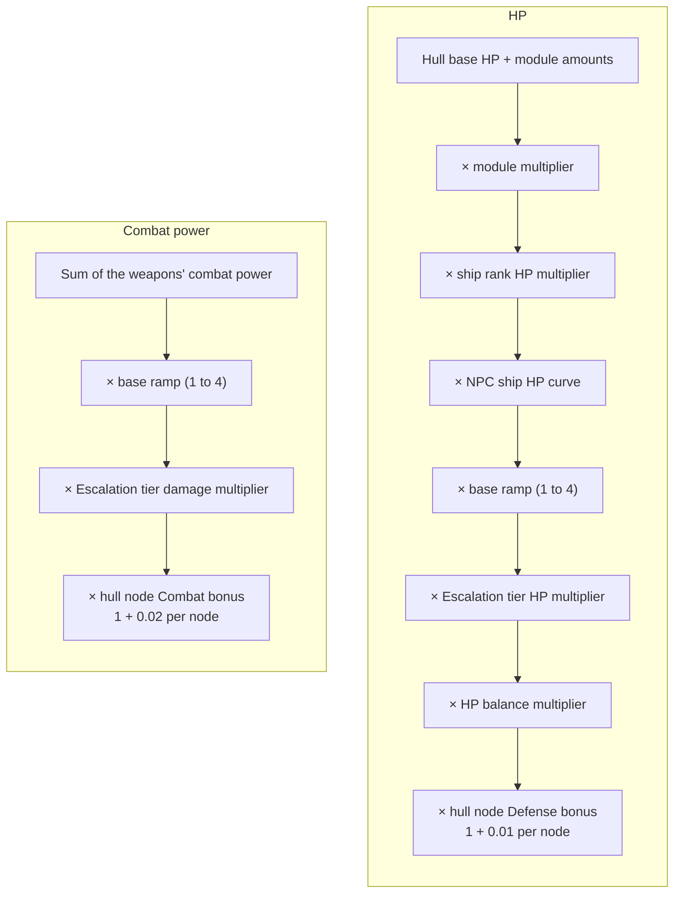

# Scaling

How enemy and item strength grows with level, ship rank, rarity and escalation: which levels the game uses, how NPC (non-player character) ships get their ship rank, every multiplier applied to an NPC's HP (hit points) and damage, how gear rarity and item level turn into stats, and what loot to expect. Values are read from the game code of version 0.8.3.4 (the decompiled source, not in-game testing). Item stat ranges come from the equipment builder prefabs in the game's asset files, read from disk. For how the resulting stats are used in a hit, see [combat-damage](combat-damage.md).

Terms and abbreviations are explained in the [glossary](glossary.md).

Three different things are called a rank or a tier of quality, and this page keeps them apart:

- Ship rank is the strength tier of an enemy ship: Rookie, Regular, Veteran, Elite, Champion, Commander, Legendary. It is rolled when an NPC ship is generated and shown as a badge on the ship's tooltip.
- Rarity is the quality tier of an item or ship hull: Standard, Enhanced, High Grade, Exotic, Legendary. It is shown by item color. "Standard" and "Legendary" appear in both lists, so this page writes "Regular" for the ship rank and uses "Standard" only for rarity.
- Conquest rank is your own title with one faction, set by Your Contribution. It is not covered here (see the [conquest stage](../conquest/README.md)). The Patrol Officer rank is a separate counter in the patrol missions and is not covered here either.

"Points" are the value a ship adds to a fleet or a site's enemy budget. Fleet cards in the game call the same number "strength".

## Which level is used for what

The game has several "levels". They are not interchangeable.

| Name | Where it comes from | What it drives |
|---|---|---|
| Player level | commander level | Escalation tier unlocks, fleet budget steps |
| Effective level | commander level + Vanguard level | Item level cap, kill XP (experience points). The conquest levels use it too, see [war](../conquest/war.md). |
| System level / location level | the level of the system, copied to every location in it | Level of everything generated there: enemy gear, loot, mission rewards |
| Item level | location level, plus a roll of -1, 0 or +1 per item | Power of one piece of equipment |
| Unit level | computed from the unit's equipment | HP curves, HP balance bonus, escalation base ramp, credit drops |

Your empire's own level ("Empire Level {n}") is separate from every level above. It unlocks with Beyond the Front ([Your empire](../expansion/your-empire.md)).

A ship does not store its unit level. It is worked out from the gear: take the mean of all equipped item levels (rounded to a whole number), add the highest item level, and halve that, dropping any fraction. An enemy generated at location level 40 therefore has unit level 39-41, and every level-based modifier below uses that number.

In the code: [which level is used for what](#code-which-level-is-used-for-what).

### How many enemies a hostile site gets

A hostile combat site spawns a points budget that depends on the site level and on the Escalation tier. The "Enemy forces" column of the Escalation table below is this budget's multiplier.

```
points = the larger of (the site's own points value) and (tier share * personal points for the level)
```

"Personal points" is the same table that sets your personal fleet budget (counted in points). It is 0 below level 10 and rises by one row every 5 levels, ending at level 100.

| Level | 10 | 15 | 20 | 25 | 30 | 35 | 40 | 45 | 50 | 55 | 60 | 65 | 70 | 75 | 80 | 85 | 90 | 95 | 100+ |
|---|---|---|---|---|---|---|---|---|---|---|---|---|---|---|---|---|---|---|---|
| Points | 40 | 80 | 130 | 190 | 260 | 335 | 410 | 490 | 570 | 655 | 740 | 830 | 920 | 1015 | 1110 | 1205 | 1300 | 1400 | 1500 |
| Ships | 2 | 2 | 2 | 3 | 4 | 4 | 5 | 5 | 6 | 7 | 8 | 9 | 10 | 11 | 13 | 14 | 16 | 18 | 20 |

Each ship is charged its own points times its ship rank's point multiplier, so higher ship ranks use up the budget faster and produce fewer ships (see the rank table). The ship count cap for combat payloads also grows with the site level. Only payloads of a faction hostile to you use the tier-scaled budget, and small escort groups whose per-ship cap is under a fifth of the site's largest unit keep the site's own points value. A site remembers the tier it was generated at for its budget and ship ranks while it stays recent; the HP and damage multipliers always use your current tier.

In the code: [how many enemies a hostile site gets](#code-how-many-enemies-a-hostile-site-gets).

## Ship ranks

Every NPC ship has a ship rank. It is rolled when the ship is generated, from weights that depend on the level.

### Rank table

| Ship rank | Max HP, armor, shield | Fire rate and reload (added) | Point cost / kill XP multiplier | Hull nodes base |
|---|---|---|---|---|
| Rookie | x0.7 | -30% | x1.0 | 20 |
| Regular | x1.0 | -10% | x1.2 | 27 |
| Veteran | x1.3 | +10% | x1.3 | 40 |
| Elite | x1.5 | +15% | x1.5 | 50 |
| Champion | x1.9 | +20% | x1.6 | 56 |
| Commander | x2.4 | +30% | x2.0 | 60 |
| Legendary | x3.0 | +30% | x2.4 | 60 |

What each column does:

- HP column: multiplies hull HP, armor HP and shield HP, the three pools of hit points a ship has.
- Fire rate column: added to the ship's attack speed and reload speed. A turret's delay is its base delay divided by (1 + that stat), so Rookie fires at 0.7x the base rate and Commander at 1.3x. It does not change damage per shot, and the ship rank does not touch combat power.
- Point column: charged against a site's unit budget, and it multiplies the XP you get for the kill.
- Hull nodes: see [Ship rarity and hull nodes](#ship-rarity-and-hull-nodes).

Player-faction ships skip ship rank modifiers entirely.

In the code: [rank table](#code-rank-table).

### Ship rank chances for normal enemies

Each ship rank has a weight that depends on the site level, written "level" below:

```
Rookie    = 60 * e^(-0.02 * level)
Regular   = 0 if level < 6,  else 35 * e^(-0.012 * (level - 6))
Veteran   = 0 if level < 12, else 5 + 0.45 * level
Elite     = Veteran * Elite share for the tier
Champion  = Veteran * Champion share for the tier
```

The chance of each ship rank is its weight divided by the sum of all the weights. The Elite and Champion shares are 0 below Escalation tier 4 and 6 respectively (table in [Escalation](#escalation)). At tier 0 the best ship rank a normal enemy can have is Veteran, from level 12 up. Commander and Legendary never come from this roll.

Chance in percent at tier 0:

| Level | Rookie | Regular | Veteran |
|---|---|---|---|
| 1-5 | 100 | 0 | 0 |
| 6-11 | 60 | 40 | 0 |
| 12 | 52 | 36 | 12 |
| 20 | 48 | 35 | 17 |
| 30 | 42 | 34 | 24 |
| 45 | 34 | 31 | 35 |
| 60 | 26 | 27 | 47 |
| 80 | 18 | 21 | 61 |
| 100 | 12 | 16 | 72 |

At higher tiers (level 60 as the example):

| Tier | Rookie | Regular | Veteran | Elite | Champion |
|---|---|---|---|---|---|
| 0 Frontier | 26.4 | 26.8 | 46.8 | 0 | 0 |
| 4 Havoc | 24.7 | 25.0 | 43.7 | 6.6 | 0 |
| 6 Maelstrom | 21.8 | 22.1 | 38.7 | 13.5 | 3.9 |
| 8 Extinction | 18.6 | 18.8 | 32.9 | 19.8 | 9.9 |

Only generated hostile sites use the Escalation tier for this roll.

In the code: [ship rank chances for normal enemies](#code-ship-rank-chances-for-normal-enemies).

### Boss ranks

Boss ranks are the ship ranks used for bounty targets. A bounty boss is one ship worth 40 to 80 points (or more, if the site's largest unit is worth more than 80); at high mission levels the lower end rises toward the upper end, because the minimum is also at least the site's budget times 2.5 divided by 16. The weights depend on the mission level, written `L` below:

```
Elite     = the larger of (40 - 0.3 * (L - 1)) and 5
Champion  = 0 if L < 40, else the smaller of 30 and (5 + 0.25 * (L - 40))
Commander = 0 if L < 70, else the smaller of 15 and (5 + 0.3 * (L - 70))
Legendary = 0 if L < 90, else the smaller of 15 and 0.2 * (L - 90)
```

| Level | Elite | Champion | Commander | Legendary |
|---|---|---|---|---|
| 1-39 | 100% | 0 | 0 | 0 |
| 40 | 85% | 15% | 0 | 0 |
| 50 | 77% | 23% | 0 | 0 |
| 70 | 52% | 34% | 14% | 0 |
| 90 | 32% | 42% | 26% | 0 |
| 100 | 22% | 43% | 30% | 4% |

So a bounty boss is never below Elite. The first Commander can appear at level 70, the first Legendary at level 91. Escalation does not change boss ship ranks.

In the code: [boss ranks](#code-boss-ranks).

## How an NPC's stats are built

A ship's final value for each stat is:

```
stat = (base value of the hull + sum of the equipment amounts) * product of all multipliers
```

Equipment adds amounts and multiplies. After the equipment is added up, these steps run in this order:

| Step | Who it affects | Effect |
|---|---|---|
| Reactor modifier | Player-owned ships only | Multiplies power, combat power, mining power and salvage power by 1 + a bonus that depends on energy usage |
| Ship rank modifiers | Non-player factions | Ship rank fire rate and HP (see rank table) |
| NPC ship HP curve | Every ship that is not player-owned | HP x the curve value for its level and size |
| Escalation NPC modifiers | Non-player factions | HP x tier x base ramp; combat power, drone power and torpedo power x tier x base ramp |
| Escalation resist debuff | Player faction | All seven resists lowered by the tier amount |
| HP balance bonus | Every ship and station, whoever owns it | HP x the HP balance multiplier for its level |

Notes on who is covered:

- NPCs never pay the energy penalty. The reactor modifier only runs for player-owned ships, so an NPC with a heavy loadout fires at full power.
- The NPC ship HP curve is for ships that are not yours. Your own ship does not get it.
- The HP balance bonus also applies to your own ships and to stations.

In the code: [how an NPC's stats are built](#code-how-an-npcs-stats-are-built).

### Reactor modifier (your ships)

Energy usage is used capacity divided by capacity. The modifier added to 1:

| Usage | Up to 50% | Up to 75% | Up to 100% | Up to 125% | Up to 150% | Above 150% |
|---|---|---|---|---|---|---|
| Bonus | +20% | +10% | 0 | -25% | -50% | -75% |

At or below 50% usage the Combat Reactor skill's output bonus is added to the combat power multiplier too.

In the code: [reactor modifier](#code-reactor-modifier-your-ships).

### HP balance bonus

```
multiplier(L) = (1 + 0.28 * clamp01((L - 10) / 30)) * (1 + 0.6 * max(0, (L - 40) / 60) ^ 1.5)
```

Here `L` is the unit level and clamp01 keeps a number between 0 and 1.

| Level | 10 | 20 | 30 | 40 | 50 | 60 | 70 | 80 | 90 | 100 |
|---|---|---|---|---|---|---|---|---|---|---|
| x | 1.00 | 1.09 | 1.19 | 1.28 | 1.33 | 1.43 | 1.55 | 1.70 | 1.86 | 2.05 |

In the code: [HP balance bonus](#code-hp-balance-bonus).

### NPC ship HP curve

The NPC ship HP curve multiplies the HP of NPC ships by a table of ratios that is interpolated on a log scale. Below level 20 the ratio is 1. From 20 to 30 it blends from 1 to the first table value; from 30 on it blends between table values every 10 levels (the table ends at level 200, and the last segment keeps extending past that). The result is never below 1.

The ship size (1 to 8; sizes 7 and 8 use the size 6 row; a ship with no class counts as size 5) selects the row. The target share per size 1 to 6 is 0.95, 0.75, 0.85, 0.95, 0.95, 0.95, and the result is the larger of 1 and (target share * ratio).

| Level | Size 1 | Size 2 | Size 3 | Size 4 | Size 5 | Size 6 |
|---|---|---|---|---|---|---|
| 30 or less | 1.00 | 1.00 | 1.00 | 1.00 | 1.00 | 1.00 |
| 40 | 1.04 | 1.00 | 1.01 | 1.05 | 1.04 | 1.00 |
| 50 | 1.12 | 1.16 | 1.19 | 1.15 | 1.16 | 1.05 |
| 60 | 1.31 | 1.66 | 1.68 | 1.38 | 1.36 | 1.19 |
| 70 | 1.68 | 2.90 | 2.57 | 1.85 | 1.74 | 1.45 |
| 80 | 2.71 | 5.29 | 4.72 | 3.14 | 2.94 | 2.02 |
| 90 | 4.84 | 10.5 | 8.50 | 5.54 | 5.36 | 3.65 |
| 100 | 9.36 | 22.0 | 16.6 | 10.8 | 10.9 | 6.32 |
| 150 | 42.7 | 109 | 77.6 | 52.3 | 46.8 | 28.7 |

The curve is flat to level 40 and steep after 70. Smaller ships (sizes 2 and 3) get the steepest curve.

In the code: [NPC ship HP curve](#code-npc-ship-hp-curve).

### Base ramp for NPCs

Independent of the Escalation tier, every non-player ship gets a level-based ramp on both HP and the three power stats (combat, drone and torpedo):

```
base ramp(L) = 4 ^ clamp01((L - 30) / 70)
```

| Level | 30 or less | 40 | 50 | 60 | 70 | 80 | 90 | 100+ |
|---|---|---|---|---|---|---|---|---|
| x | 1.00 | 1.22 | 1.49 | 1.81 | 2.21 | 2.69 | 3.28 | 4.00 |

The peak of 4 is fixed in a normal game. The Escalation popup's override takes a value for it but never stores it, and I found no other way to change it.

In the code: [base ramp for NPCs](#code-base-ramp-for-npcs).

### Putting the multipliers together

For an NPC ship at unit level `L`:

```
HP  = (base HP of the hull + module amounts)
      * module multiplier (Hull / Armor / Shield module main stat, see below)
      * ship rank HP multiplier
      * NPC ship HP curve(L, size)
      * base ramp(L) * Escalation tier HP multiplier
      * HP balance multiplier(L)
      * hull node Defense bonus (1 + 0.01 * defense nodes)

Combat power = sum of the weapons' combat power (each about weapon base * power level(L) * rarity multiplier)
      * base ramp(L) * Escalation tier damage multiplier
      * hull node Combat bonus (1 + 0.02 * combat nodes)
```



NPC modules do not roll bonus HP stats, so apart from hull nodes the module multiplier is the only way gear raises NPC HP. The module multiplier is `1 + main stat * size factor * power level(L) * rarity multiplier`. The power level is 25 * the damage multiplier for level L (it doubles every 10 levels up to 100). The main stat is 0.01-0.014 for the Hull module and 0.013-0.014 for Armor and Shield. The size factor is 1, 1.5 or 2.25 for a small, medium or large module (see [Equipment](#equipment)).

Worked example: a size 5 ship at unit level 60, Veteran, Frontier tier, Large Standard hull module (main stat 0.012):

```
module   = 1 + 0.012 * 2.25 * 1600 = 44.2
HP mult  = 44.2 * 1.3 * 1.36 * 1.81 * 1.43 = about 202 times the base HP
```

Damage per weapon at the same level is 3.0-3.15 * 1600, about 4900 "combat power", for a Large weapon at Standard rarity, times 1.81 for the base ramp. How combat power turns into damage per shot is in [combat-damage](combat-damage.md); the damage ratios in the tables below assume it is linear in combat power (not verified here).

In the code: [putting the multipliers together](#code-putting-the-multipliers-together).

### Growth with level

| Level | Power level (25 * 2^(L/10)) | Credit multiplier (2^(L/14)) | HP balance | Base ramp |
|---|---|---|---|---|
| 1 | 27 | 1.05 | 1.00 | 1.00 |
| 10 | 50 | 1.64 | 1.00 | 1.00 |
| 20 | 100 | 2.69 | 1.09 | 1.00 |
| 30 | 200 | 4.42 | 1.19 | 1.00 |
| 40 | 400 | 7.25 | 1.28 | 1.22 |
| 50 | 800 | 11.9 | 1.33 | 1.49 |
| 60 | 1,600 | 19.5 | 1.43 | 1.81 |
| 70 | 3,200 | 32.0 | 1.55 | 2.21 |
| 80 | 6,400 | 52.5 | 1.70 | 2.69 |
| 90 | 12,800 | 86.1 | 1.86 | 3.28 |
| 100 | 25,600 | 141 | 2.05 | 4.00 |
| 120 | 44,572 | 246 | 2.46 | 4.00 |

Damage doubles every 10 levels up to level 100, and every 25 levels past it. Credits double every 14 levels up to 100 and every 25 after.

In the code: [growth with level](#code-growth-with-level).

## Escalation

Escalation is a difficulty setting you choose. The slider runs from tier 0 to tier 8. Nothing I read raises or lowers it by itself: only the Escalation popup's confirm button changes it. You can move it up or down at any time (the popup pauses the game). A tier is locked until your player level reaches its unlock level.

| Tier | Name | Unlock (player level) | Enemy HP | Enemy damage | Enemy forces | Mission credits | Mission XP | Elite share | Champion share | Your resists | Combat Upgrade Kit drop on kill |
|---|---|---|---|---|---|---|---|---|---|---|---|
| 0 | Frontier | 0 | x1.00 | x1.00 | x1.0 | +0% | +0% | 0 | 0 | 0 | 0 |
| 1 | Static | 0 | x1.15 | x1.08 | x1.1 | +10% | +4% | 0 | 0 | 0 | 0 |
| 2 | Fracture | 0 | x1.35 | x1.18 | x1.2 | +20% | +8% | 0 | 0 | 0 | 0 |
| 3 | Breach | 10 | x1.60 | x1.30 | x1.3 | +30% | +12% | 0 | 0 | 0 | 0 |
| 4 | Havoc | 25 | x2.80 | x1.50 | x1.5 | +50% | +20% | 0.15 | 0 | -20% | 0.2% |
| 5 | Onslaught | 50 | x3.80 | x2.00 | x1.7 | +75% | +30% | 0.25 | 0 | -40% | 0.4% |
| 6 | Maelstrom | 75 | x5.00 | x4.00 | x1.9 | +100% | +40% | 0.35 | 0.10 | -60% | 0.6% |
| 7 | Cataclysm | 100 | x6.20 | x6.00 | x2.1 | +125% | +50% | 0.45 | 0.20 | -75% | 0.8% |
| 8 | Extinction | 100 | x8.00 | x10.00 | x2.3 | +150% | +60% | 0.60 | 0.30 | -85% | 1.0% |

Column meanings:

- Enemy HP and damage multiply the NPC's HP stats and combat, drone and torpedo power, on top of the base ramp. They apply to every non-player ship.
- Enemy forces is the tier's share of the points budget divided by the tier 0 share. It multiplies the points budget of generated hostile sites (see [How many enemies a hostile site gets](#how-many-enemies-a-hostile-site-gets)). Levels below 10 have no budget table, so forces only grow where the personal points are above the site's own points value.
- Mission credits and mission XP (experience points): the tier is stored on a mission when it is generated. Changing tier recomputes rewards on existing missions from their base amounts; XP gets 0.4 times the credit bonus.
- Elite and champion share: the Elite weight is the Veteran weight times the share, as in the ship rank formula.
- Your resists: subtracted from each of your seven resist stats (percentage points) on every player-faction ship.
- Combat Upgrade Kit: the chance per kill that a destroyed enemy drops one. The Escalation popup calls this line "Combat Upgrade Kit drops"; the item itself is named Hull Upgrade Kit elsewhere in the game.

The popup also has an override with two sliders (toughness and damage) in 0.1 steps from x1.0 to x4.0. The override factor multiplies the tier value, so Extinction with both sliders at x4.0 gives x32 HP and x40 damage. The override is stored in the save.

Tier choice also feeds the ship rank rolls of generated hostile sites only (see above), not non-hostile payloads.

In the code: [Escalation](#code-escalation).

## Ship rarity and hull nodes

Ship rarity (Standard to Legendary) does not multiply any stat. For an NPC it sets a cap on how many hull nodes the ship can have, and it sets the letter in the ship's hull rating on the tooltip. Rarity here is the ship's own quality tier, not its ship rank.

| Rarity | Node budget | Hull rating letter |
|---|---|---|
| Standard | 25 | A |
| Enhanced | 50 | B |
| High Grade | 75 | C |
| Exotic | 100 | X |
| Legendary | no cap | S |

The fleet hull rating on the map reads "Type-" followed by the letter and the node count, for example "Type-C62"; the letter is the lowest rarity whose node budget holds the count, and the average is held between 0 and 100. The ship tooltip chip reads "Type-" plus the ship's own rarity letter and node count. Conquest fleet and garrison ships roll their starting node count with the same formula, capped at 85.

In the code: [Ship rarity and hull nodes](#code-ship-rarity-and-hull-nodes).

### What nodes do

NPC ships spend their nodes on upgrade paths at random. Weights are 5 for the ship's own role path (Combat for combat ships, Mining, Salvage), 3 each for the Defense path (a ship upgrade path, not a Defense station), Torpedo (if the ship has a torpedo bay) and Drones (if it has a drone bay), and 2 for any other path in the list. Every ship can use Combat and Defense.

| Path | Per node |
|---|---|
| Combat | +2% combat power |
| Torpedo | +2% torpedo power |
| Drones | +2% drone power |
| Defense | +1% shield HP, armor HP and hull HP each |
| Mining, Salvage | +2% mining power / salvage power |

The node bonuses are additive in the node count (a ship with 30 combat nodes has 1 + 0.02 * 30 = x1.6). Milestone bonuses at 10, 20 and 30 nodes in a path also exist, but they need accumulated activity (kills or yield) on the ship, and a freshly generated NPC has none, so I did not count them. Whether long-lived conquest ships accrue progress was not verified.

For a plain combat ship (only the Combat and Defense paths) about 71% of nodes go to Combat and 29% to Defense (5 of 7 slots against 2 of 7, because the pick range stops one short of the total weight, so the last path in the list loses one slot). With a drone or torpedo bay those shares drop.

In the code: [what nodes do](#code-what-nodes-do).

### How many nodes an NPC gets

```
nodes = floor( (level / 60) ^ 0.7 * hull nodes base * random(0.7 to 1.0) )     (level held between 1 and 100)
nodes = the smaller of nodes and the rarity's node budget
```

The hull nodes base is the last column of the ship rank table. The average roll factor is 0.85. Mean nodes before the rarity cap (columns are ship ranks):

| Level | Rookie | Regular | Veteran | Elite | Champion | Legendary |
|---|---|---|---|---|---|---|
| 10 | 5 | 7 | 10 | 12 | 14 | 15 |
| 30 | 10 | 14 | 21 | 26 | 29 | 31 |
| 60 | 17 | 23 | 34 | 42 | 48 | 51 |
| 100 | 24 | 33 | 49 | 61 | 68 | 73 |

A Veteran at level 60 with 34 nodes on a plain combat ship has about 24 combat nodes (x1.49 combat power) and 10 defense nodes (x1.10 HP).

In the code: [how many nodes an NPC gets](#code-how-many-nodes-an-npc-gets).

### Which rarity an NPC ship gets

When an NPC ship is fitted out, its ship rarity is rolled from this table by ship rank:

| Ship rank | Standard | Enhanced | High Grade | Exotic |
|---|---|---|---|---|
| Rookie | 80% | 20% | | |
| Regular | 60% | 40% | | |
| Veteran | 35% | 55% | 10% | |
| Elite | 15% | 60% | 25% | |
| Champion | | 50% | 45% | 5% |
| Commander | | 30% | 55% | 15% |
| Legendary | | 15% | 50% | 35% |

The code has a second, more generous table (for example Commander: 10% Standard, 30% Enhanced, 45% High Grade, 14% Exotic, 1% Legendary). Generated sites roll it first, but the fitting step runs afterward and overwrites it with the table above in every path I read. I could not find a path where the first roll survives. A generated NPC also cannot reach Legendary through nodes: the node roll tops out at 85 (rank base 60 times a level factor of at most 1.43, at level 100), under the 100 an Exotic ship holds.

In the code: [which rarity an NPC ship gets](#code-which-rarity-an-npc-ship-gets).

## Equipment

### Item level

An item's level is the larger of 1 and (location level + a roll), with the roll -1, 0 or +1 at equal chance. Enemy gear is not limited by your level. Items built for your faction go through the item level cap:

```
if item level > your effective level:
    capped level = effective level + ceil((item level - effective level) ^ 0.7)
```

An item 10 levels above you becomes 6 above you; 30 above becomes 11 above. Loot boxes are not capped.

In the code: [item level](#code-item-level).

### Rarity

| Rarity | Power multiplier | Bonus stat lines | Aspect slots | Credit value multiplier |
|---|---|---|---|---|
| Standard | 1.00 | 0 | none | 1.0 |
| Enhanced | 1.10 | 1 | 25%: one common | 1.6 |
| High Grade | 1.20 | 2 | one common, or (25%) one rare | 2.2 |
| Exotic | 1.35 | 3 | one rare, plus 25% one common | 3.4 |
| Legendary | 1.50 | 3 | 75%: one common + one rare; 25%: two rare | 4.5 |

A "bonus stat line" is a random optional stat on top of the item's main stat (main stats are always present). Builders can disable a rarity; the lowest rarity that builder allows is used instead.

Rarity multiplies almost every stat by the power multiplier above. Reactor energy capacity is the exception: it takes only the square root of the multiplier (so Legendary gives x1.22). Engine thrust stats grow much more slowly with level than weapons and modules (a level exponent of 0.1).

An energy cost scales with level but not with rarity. Rarity is therefore free power: a Legendary weapon draws the same energy as a Standard one of the same level and size, with 50% more main stat. A level increase raises power and energy draw together.

How much a rarity is worth in levels, for a main stat that scales with 2^(L/10):

| Rarity | Main stat gain | Same as this many levels |
|---|---|---|
| Enhanced | +10% | 1.4 |
| High Grade | +20% | 2.6 |
| Exotic | +35% | 4.3 |
| Legendary | +50% | 5.9 |

The extra bonus stat lines and aspect slots come on top.

In the code: [rarity](#code-rarity).

### Main stat and bonus rolls

```
power level = round(25 * damage multiplier(item level))    // 2^(L/10) up to 100, then 2^(L/25) pace
value       = random(min, max)
            * size factor   (only if the stat is not a percentage stat, not a main Combat/Mining/Salvage Power, not energy capacity or thrust)
            * power level ^ level exponent
            * rarity multiplier ^ rarity exponent
```

The size factor is 1 for Small, 1.5 for Medium, 2.25 for Large. An "amount" stat adds the value; a "multiplier" stat multiplies by 1 + the value.

Main stats read from the equipment builder prefabs (min-max, before level and rarity scaling):

| Slot | Stat | Small | Medium | Large |
|---|---|---|---|---|
| Hull module | Hull HP multiplier | 0.010-0.014 x1 | 0.010-0.014 x1.5 | 0.010-0.014 x2.25 |
| Armor module | Armor HP multiplier | 0.013-0.014 x1 | x1.5 | x2.25 |
| Shield module | Shield HP multiplier | 0.013-0.014 x1 | x1.5 | x2.25 |
| Weapon (most types) | Combat power amount | 1.0-1.05 | 2.0-2.1 | 3.0-3.15 |
| Reactor | Energy capacity amount | 1.5-1.6 | 3.4-3.5 | 4.5-4.8 |

Small weapons of the "Tiny" type use 0.5-0.6, and drone weapons use 0.5-0.6. Mining and Salvage turrets follow the same 1/2/3 pattern for mining power and salvage power. All stat ranges, spawn weights and the reactor and thrust exponents on this page come from the equipment builder asset files, not from the C# code (not verified in code).

Typical bonus stat lines. Unless noted, each stat is as likely as any other to be picked, and it can appear at any item level:

| Stat | Range | Grows with level | Notes |
|---|---|---|---|
| Combat power, mining power, salvage power, drone power, precision, armor HP, shield HP, hull HP (flat) | 0.2-0.25 | yes | size factor applies; HP lines are never rolled on NPC gear |
| Power | 0.12-0.18 | yes | size factor applies |
| Torpedo power | 0.2-0.25 | yes | only items of level 45+ |
| Seven resists | 0.04-0.07 | no | picked at a quarter of the usual chance (0.15 of it on reactors); rarity scales them |
| Attack speed, reload speed | 0.010-0.012 | no | weapons |
| Weapon range | 0.04-0.045 | no | picked at 0.6 of the usual chance |
| Critical damage | 0.02-0.025 | no | weapons |
| Magazine size | 0.010-0.012 | no | weapons |

Weapon range (a base value on the weapon itself) is also fixed per weapon: 13-14 for the Large Combat Laser, 17-18 for the Large Plasma Cannon and 31-33 for the Large Rail Cannon, which is not affected by level or rarity.

Bonus stats are drawn by giving each candidate a random number, divided by its pick weight, and taking the lowest scores first. The number drawn is the rarity's bonus stat line count plus the main stats. A lower pick weight makes a stat less likely to be chosen.

In the code: [main stat and bonus rolls](#code-main-stat-and-bonus-rolls).

### Roll rules for NPC and station gear

Some owners have stats removed from the bonus pool, and a cap on size scaling:

| Owner | Rule |
|---|---|
| NPC ships | No bonus hull HP, armor HP or shield HP lines |
| Station parts | Same, and HP size factor capped at Medium (x1.5) |

Station part modules always roll High Grade, unlike ships. See [stations](stations.md).

In the code: [roll rules for NPC and station gear](#code-roll-rules-for-npc-and-station-gear).

### Which rarity NPC gear has

Each module slot and each hardpoint on an NPC ship gets its own rarity roll:

```
difficulty = 0.4 + L / 100        (L = the level of the gear being fitted)
x = random(0, difficulty)
x < 0.20  -> Standard
x < 0.50  -> Enhanced
x < 0.80  -> High Grade
x < 0.95  -> Exotic
else      -> Legendary
```

| Level | Standard | Enhanced | High Grade | Exotic | Legendary |
|---|---|---|---|---|---|
| 1 | 48.8% | 51.2% | 0 | 0 | 0 |
| 10 | 40.0% | 60.0% | 0 | 0 | 0 |
| 20 | 33.3% | 50.0% | 16.7% | 0 | 0 |
| 30 | 28.6% | 42.9% | 28.6% | 0 | 0 |
| 40 | 25.0% | 37.5% | 37.5% | 0 | 0 |
| 55 | 21.1% | 31.6% | 31.6% | 15.8% | 0 |
| 60 | 20.0% | 30.0% | 30.0% | 15.0% | 5.0% |
| 80 | 16.7% | 25.0% | 25.0% | 12.5% | 20.8% |
| 100 | 14.3% | 21.4% | 21.4% | 10.7% | 32.1% |

NPC gear is therefore much richer at high level than loot boxes (next section). A level 100 NPC has a one in three chance of Legendary per slot.

Some ships are fitted differently. Starter ships built for you always get Standard. Mercenaries get a fixed rarity. Drones copy their drone bay's rarity for weapons and use Standard for everything else.

In the code: [which rarity NPC gear has](#code-which-rarity-npc-gear-has).

### Standard-issue gear

Fighters launched from hangar bays use "standard-issue" fitting, which differs from the usual NPC fitting in three ways:

- The gear is picked from every equipment design in the game, not only those you have unlocked.
- Items are built without the item level cap.
- Rarity uses the same roll as the table above.

Empire Fleet ships, which unlock with Beyond the Front, use it too ([Empire Fleets](../expansion/empire-fleets.md)).

In the code: [standard-issue gear](#code-standard-issue-gear).

## Loot

### Rarity of loot-box and dungeon gear

Loot gear rarity is a weighted roll, and the chances depend on the item level:

| Level | Standard | Enhanced | High Grade | Exotic | Legendary |
|---|---|---|---|---|---|
| 1-10 | 57.1% | 42.9% | | | |
| 11-24 | 44% | 33% | 23-24% | | |
| 25 | 38.6% | 28.9% | 21.7% | 10.8% | |
| 40 | 37.7% | 28.3% | 22.6% | 11.3% | |
| 60 | 36.7% | 27.5% | 23.9% | 11.9% | 0 |
| 80 | 35.4% | 26.5% | 24.8% | 12.4% | 0.9% |
| 100 | 34.2% | 25.6% | 25.6% | 12.8% | 1.7% |

High Grade starts at level 11, Exotic at level 25 and Legendary at level 60. Before the weights are scaled to add up to 100%, they are: Standard 0.40, Enhanced 0.30, High Grade 0.2 + level/1000 (kept between 0.2 and 0.3), Exotic 0.1 + level/2000 (kept between 0.1 and 0.15), Legendary (level - 60)/2000.

This roll is used by loot boxes (gear and blueprints), dungeon compartments and research files, and skirmish station loot (which is at least High Grade). Boosters are Enhanced by default; from level 20 there is a 35% chance of High Grade; where Exotic is allowed (loot boxes, dungeon rewards, not NPC fitted boosters) a level 45+ booster is Exotic 15% of the time first.

In the code: [rarity of loot-box and dungeon gear](#code-rarity-of-loot-box-and-dungeon-gear).

### What a destroyed NPC ship drops

Each of these is rolled independently:

| Drop | Chance | Notes |
|---|---|---|
| One of its fitted modules | 12% | 95% of the time the pool is only the lowest-rarity fitted items |
| One of its fitted weapons | 12% | same 95% lowest-rarity rule |
| One cargo item (not ammo) | 30% | up to a whole number from 3 to 9, times 100 * the credit multiplier for its level, in credits of value |
| Ammo | 10% | up to 1 or 2 times 100 * the credit multiplier for its level, in value |
| Credits | 30% | random(2.5, 3.25) * 100 * the credit multiplier for its level |
| Blueprint | 4% | Ship rank Elite or above requests at least High Grade; lower ship ranks use the default roll (not verified) |
| Ship blueprint piece | 5% | only for ship classes you have not unlocked, at or above the class unlock level |
| Officer upgrade (High Grade) | 1% | level 30+ |
| Commendation tag (officers only) | Quadrant 2: 20% roll, then a 10% roll at system level 10+ if it fails; elsewhere 10% at system level 10+ | Quadrant 2 first roll: tag 3 at Champion+ (25%), tag 2 at Veteran+ (33%), else tag 1. Second roll and elsewhere: tag 1 |

The items it drops are the ones it carries, so their rarity follows the NPC gear table above. Because 95% of module and weapon drops filter to the lowest rarity on the ship, you almost always get its worst fitted item. A station defense platform has its own table: a 40% chance of one weapon, with the filter at 55% instead of 95%.

Credit drops follow this formula:

```
credits = round(base * 100 * credit multiplier(L))
```

| Level | 10 | 30 | 50 | 60 | 80 | 100 |
|---|---|---|---|---|---|---|
| Average credit drop when it triggers (30% chance) | 472 | 1,270 | 3,418 | 5,607 | 15,094 | 40,630 |
| Bounty credit reward (base 25, before Escalation bonus) | 4,102 | 11,041 | 29,720 | 48,761 | 131,254 | 353,309 |

In the code: [what a destroyed NPC ship drops](#code-what-a-destroyed-npc-ship-drops).

## XP rewards

```
XP per kill = ceil( 5 * base XP reward * level factor * 2^(your level / 9) ) * ship rank point multiplier
```

The base XP reward is 10 unless a ship overrides it (not verified per ship). Your level is your effective level. The level factor depends on the target's unit level compared with yours:

| Target vs you | Level factor |
|---|---|
| Up to 3 levels above | 1 + 0.1 per level (up to 1.3) |
| Same level | 1.0 |
| 1 / 2 / 3 below | 0.8 / 0.6 / 0.4 |
| 4 or more below | 0.00001 (effectively nothing) |

XP needed to finish a level is 1000 * 2^(level / 5). Kill XP grows by 2^(1/9) per level while the need grows by 2^(1/5), so each level takes more kills than the last. For a Rookie ship (point multiplier x1.0) at equal level:

| Level | XP per kill | XP to finish the level | Kills per level |
|---|---|---|---|
| 10 | 109 | 4,000 | 37 |
| 20 | 234 | 16,000 | 68 |
| 30 | 504 | 64,000 | 127 |
| 50 | 2,352 | 1,024,000 | 435 |
| 70 | 10,973 | 16,384,000 | 1,493 |
| 100 | 110,599 | 1,048,576,000 | 9,481 |

Vanguard (past max level) XP uses a 0.25 scale on the same curve and is not covered further here.

Killing an enemy of higher ship rank is worth more: Regular x1.2, Veteran x1.3, Elite x1.5, Champion x1.6, Commander x2.0, Legendary x2.4 of a Rookie's base. Killing targets 4 or more levels below you yields almost nothing, so XP farming needs enemies close to your level.

In the code: [XP rewards](#code-xp-rewards).

## Player-side progression that scales combat

| What | Effect |
|---|---|
| Effective level | Sets the item level cap and kill XP. Conquest levels also follow it, see [war](../conquest/war.md). |
| Player level | Unlocks Escalation tiers and sets your personal fleet budget step (one step per 5 levels from 10). The budget is counted in points. |
| Unit level of your ship | The HP balance multiplier applies to your own ship HP, and the power level scales your precision into crit chance (0.03 + 0.05 * precision / power level; the precision part has a soft cap once it passes 5%). |
| Escalation tier | Lowers your resists by 0 to 85 points at tiers 4 to 8. |

Empire Level, which unlocks with Beyond the Front, adds a fleet mix bonus; see [Your empire](../expansion/your-empire.md).

In the code: [player-side progression that scales combat](#code-player-side-progression-that-scales-combat).

## Practical reading

### How much tougher is an enemy five or ten levels higher

Assumptions for this table: size 5 hull, Large Standard hull module, Frontier tier, same ship rank and rarity. Ratios are for HP including the module multiplier, ship HP curve, base ramp and HP balance, and for NPC damage (power level and base ramp). Hull nodes are not included.

| Starting level | HP, +5 levels | HP, +10 levels | Damage, +5 | Damage, +10 |
|---|---|---|---|---|
| 10 | x1.30 | x1.72 | x1.42 | x2.00 |
| 20 | x1.35 | x1.88 | x1.41 | x2.00 |
| 30 | x1.57 | x2.53 | x1.56 | x2.44 |
| 40 | x1.63 | x2.70 | x1.56 | x2.44 |
| 50 | x1.72 | x2.99 | x1.56 | x2.44 |
| 60 | x1.83 | x3.35 | x1.56 | x2.44 |
| 70 | x2.12 | x4.49 | x1.56 | x2.44 |
| 80 | x2.20 | x4.86 | x1.56 | x2.44 |

Below level 30 an enemy 5 levels up is about 1.3-1.4x tougher and hits 1.4x harder; 10 levels up is about double on both. From level 30 the base ramp adds to damage, and from level 40 the HP curve adds to HP. Past 70 a 10-level gap multiplies HP by 4.5-5. Matching an enemy that is +10 levels needs about 2.4x more damage in that range, and you must survive 2.4x more damage taken.

### How much a ship rank is worth in levels

HP-only comparison (the ship rank also raises fire rate by up to 30% and costs the site more of its budget):

| Your level | Veteran | Elite | Champion | Commander | Legendary |
|---|---|---|---|---|---|
| 20 | +4.3 | +6.6 | +10.2 | +12.9 | +15.3 |
| 40 | +2.8 | +4.2 | +6.6 | +8.9 | +11.0 |
| 60 | +2.2 | +3.4 | +5.4 | +7.3 | +9.1 |
| 80 | +1.7 | +2.6 | +4.1 | +5.6 | +7.0 |

Each cell is the extra level an unranked-equivalent enemy would need to match that ship rank's HP (relative to a Regular-rank enemy, x1.0). A Champion at level 60 has as much HP as a Regular-rank enemy about 5 levels higher. Ship ranks matter more at low levels because each level adds less HP there (1.3x per 5 levels below 30 against 2x per 5 above 70). Ship rank does not touch damage per shot, so a Legendary is a damage sponge that fires up to 30% faster, not a harder hitter.

Which ship ranks you can meet:

- Level 1-5: Rookie only.
- Level 6-11: Rookie and Regular.
- Level 12 and up at tier 0: up to Veteran.
- Elite from tier 4 (Havoc), Champion from tier 6 (Maelstrom), in generated sites.
- Bounty bosses: Elite or better; Commander from level 70, Legendary from level 91.

### What escalation is worth in levels

HP and damage multipliers converted to levels at the 2^(L/10) pace:

| Tier | HP equals | Damage equals |
|---|---|---|
| 1 Static | +2 levels | +1 |
| 2 Fracture | +4 | +2 |
| 3 Breach | +7 | +4 |
| 4 Havoc | +15 | +6 |
| 5 Onslaught | +19 | +10 |
| 6 Maelstrom | +23 | +20 |
| 7 Cataclysm | +26 | +26 |
| 8 Extinction | +30 | +33 |

Tiers 6 to 8 also lower your resists by 60, 75 and 85 points, so the effective gap is larger than these numbers.

### What gear rarity is worth

- Rarity is free power: +10% to +50% on main stats at no extra energy draw, plus extra stat lines and aspect slots. A Legendary item is worth about 6 levels of item level and also pays no energy for it.
- Item level is power plus energy cost together. A level 60 Standard weapon is 1,600 power level; a level 54 Legendary weapon is about the same power with lower energy draw.
- At level 60 an NPC rolls Legendary on a given slot 5% of the time, 20.8% at level 80 and 32.1% at level 100, so late-game enemies carry much better gear than loot boxes (which stay below 2% Legendary at level 100).
- To farm better rarity, shoot enemies at levels above 60 (NPC gear table), open boxes at level 25 or higher for Exotic, and aim for ship rank Elite or above so the blueprint drop is at least High Grade. Ships drop their worst fitted item 95% of the time, so a ship with one Legendary and one Standard module almost always drops the Standard.

These tables are worked out from the formulas on this page, not measured in play.

## In the game code

This part backs the sections above with the names and formulas from the decompiled code of version 0.8.3.4. Search for the class and method names in a decompiler to check a claim. The `Source:` lines list where each rule lives. The prefab values come from the equipment builder components in the game's resources, read from disk.

### Code: Which level is used for what

| Term | Code name |
|---|---|
| Player level | `GamePlayer.level` |
| Effective level | `GamePlayer.effectiveLevel` |
| System level / location level | `SystemMapData.level`, copied to every location (`MapPointOfInterest`, "POI" in code) in the system |
| Unit level | `AbstractUnitData.level` |
| Fleet budget steps | `FleetLevelSteps` |

Unit level is not stored on the ship. `RecalculateLevel` takes the mean of all equipped item levels (rounded), adds the highest item level, and halves that with integer division (the fraction is dropped). An enemy generated at location level 40 therefore has unit level 39-41, and every level-based modifier below uses that number.

Source: `GamePlayer.level`, `GamePlayer.effectiveLevel`, `EquipmentBuilder.BuildNewItem`, `AbstractUnitData.RecalculateLevel`

#### Code: How many enemies a hostile site gets

```
points = max(site.pointsValue, round(threatShare(tier) * PersonalPoints(level)))
```

`PersonalPoints` is the same table that sets your personal fleet budget (counted in points). It is 0 below level 10 and rises by one row every 5 levels, ending at level 100.

Each unit is charged `ship points * ship rank point multiplier`. The ship count cap for combat payloads also grows by `floor(level * pointsScale / 20)`. The tier-scaled budget applies when `IsThreatPayload` is true (combat payload of a faction hostile to the player) and the payload is not a filler (`IsFillerCap`: `maxPointsPerUnit < maxUnitPoints / 5`). `payloadTier` is the `generationTier` stored on the guard descriptors (`UnitGenerationDescriptor.rolledTier`, cleared when the site is no longer in the Recent retention bucket), falling back to `EscalationHelper.CurrentTier`.

Source: `MapPointOfInterest.GetPayloadPoints`, `MapPointOfInterest.CreateUnitPayload`, `MapPointOfInterest.ResolveMaxUnits`, `FleetLevelSteps.PersonalPoints`

### Code: Ship ranks

Every NPC ship has a ship rank (`UnitRank`). The ship rank is rolled when the ship is generated. The "Regular" rank is `UnitRank.Standard` in the code. Rarity's lowest tier is also called `Standard`, which is why the page writes "Regular" for the ship rank.

#### Code: Rank table

- HP column: multiplies `HullHP`, `ArmorHP` and `ShieldHP` (`npcHealthAffectedStats`).
- Fire rate column: added to the unit's `AttackSpeed` and `ReloadSpeed` stats. A turret's delay is `baseDelay / (1 + stat)`. It does not change damage per shot, and nothing in the rank touches `CombatPower`.
- Point column: the ship rank's `GetAdjustedPoints` multiplier.

The code also defines a "stat multiplier" per ship rank (0.7, 0.9, 1.1, 1.3, 1.6, 2.0, 2.4) and a helper `ApplyRankMultiplier` that uses it. Both stats the rank modifies are percentage stats, so only the additive column above runs; the stat multiplier values and `ApplyRankMultiplier` have no callers outside `UnitRankHelper`.

Player-faction units skip rank modifiers entirely.

Source: `UnitRankHelper` (rank tables), `AbstractUnit.ApplyNpcRankModifiers`, `AbstractTurret.fireDelay`, `AbstractTurret.reloadDelay`, `LootManager.AddKillExperience`, `MapPointOfInterest.AddUnitFromShip`

#### Code: Ship rank chances for normal enemies

Weights, with `L` the site level:

```
Rookie    = 60 * exp(-0.02 * L)
Regular   = 0 if L < 6,  else 35 * exp(-0.012 * (L - 6))
Veteran   = 0 if L < 12, else 5 + 0.45 * L
Elite     = Veteran * eliteShare(tier)
Champion  = Veteran * championShare(tier)
```

`eliteShare` and `championShare` are 0 below Escalation tier 4 and 6 respectively. Only generated hostile sites (the threat payload in `CreateUnitPayload`) pass the current tier.

Source: `UnitRankHelper.GetRandomUnitRankForLevel`, `UnitRankHelper.GetNormalRankWeights`, `EscalationHelper.GetEliteRankShare`, `EscalationHelper.GetChampionRankShare`

#### Code: Boss ranks

Boss ranks are ship ranks used for bounty targets (`BountyBoard.SpawnBountyBoss`, one ship of 40 to max(80, site max unit points) points; `ResolvePointsPerUnitRange` also raises the minimum to `round(budget * 2.5 / 16)`, capped at the maximum). Weights, with `L` the mission level:

```
Elite     = max(40 - 0.3 * (L - 1), 5)
Champion  = 0 if L < 40, else min(30, 5 + 0.25 * (L - 40))
Commander = 0 if L < 70, else min(15, 5 + 0.3 * (L - 70))
Legendary = 0 if L < 90, else min(15, 0.2 * (L - 90))
```

Source: `UnitRankHelper.GetBossRankWeights`, `BountyBoard.SpawnBountyBoss`, `BountyBoard.GetBossPointWindow`

### Code: How an NPC's stats are built

Every unit recalculates its stats through `AbstractUnit.RecalculateStats`. The final value of a stat is:

```
stat = (prefab base + sum of equipment amounts) * product of all multipliers
```

The prefab base is `hullHPScale * 150`, `armorHPScale * 300` or `shieldHPScale * 300`. Equipment lines add amounts and multiply. After the equipment is aggregated, these steps run in this order:

| Step | Who it affects | Effect |
|---|---|---|
| `ApplyReactorModifier` | Player-owned ships only | Multiplies `Power`, `CombatPower`, `MiningPower`, `SalvagePower` by `1 + bonus(energy usage)` |
| `ApplyNpcRankModifiers` | Non-player faction | Ship rank fire rate and HP (see rank table) |
| `ApplyNpcShipHpCurve` | Every ship whose data has `isPlayer == false` | HP x `NpcShipHpCurve.Multiplier(level, size)` |
| `ApplyEscalationNpcModifiers` | Non-player faction | HP x tier x base ramp; `CombatPower`, `DronePower`, `TorpedoPower` x tier x base ramp |
| `ApplyEscalationPlayerResistDebuff` | Player faction | All seven resists lowered by the tier amount |
| `ApplyHpBalanceBonus` | Every unit, no faction check | HP x `HpBalanceMultiplier(level)` |

- The reactor modifier only runs for player-owned ships.
- `ApplyNpcShipHpCurve` checks the `isPlayer` flag on the data, not the faction. Your own ship does not get the curve.
- `ApplyHpBalanceBonus` also applies to your own ships and to stations.

#### Code: Reactor modifier (your ships)

Energy usage is `used capacity / capacity`. The thresholds are `ReactorModule.energyThresholdModifiers`.

Source: `AbstractUnit.RecalculateStats`, `AbstractUnit.ApplyReactorModifier`, `ReactorModule.energyThresholdModifiers`

#### Code: HP balance bonus

```
HpBalanceMultiplier(L) = (1 + 0.28 * clamp01((L - 10) / 30)) * (1 + 0.6 * max(0, (L - 40) / 60) ^ 1.5)
```

Source: `GameMath.HpBalanceMultiplier`, `AbstractUnit.ApplyHpBalanceBonus`

#### Code: NPC ship HP curve

`NpcShipHpCurve` multiplies HP of NPC ships by a table of ratios that is interpolated on a log scale. Below level 20 the ratio is 1. From 20 to 30 it blends from 1 to the first table value; from 30 on it blends between table values every 10 levels (the table ends at level 200, and the last segment keeps extending past that). The result is `max(1, targetShare * ratio)`.

The ship size (1 to 8; sizes 7 and 8 use the size 6 row; a ship with no class counts as size 5) selects the row. Target share per size 1 to 6 is 0.95, 0.75, 0.85, 0.95, 0.95, 0.95.

Source: `NpcShipHpCurve.Multiplier`, `NpcShipHpCurve.MedianRatio`, `ShipUpgradeCalculator.GetShipSize`

#### Code: Base ramp for NPCs

```
baseRamp(L) = BasePeak ^ clamp01((L - 30) / 70)        BasePeak = 4
```

`BasePeak` is 4 unless `basePeakOverride` is set. The override popup takes a base-peak argument but never stores it, and I found no other writer, so it stays 4.

Source: `EscalationHelper.GetNpcBaseMultiplier`, `EscalationHelper.BasePeak`, `AbstractUnit.ApplyEscalationNpcModifiers`, `EscalationPopup.ApplyOverride`

#### Code: Putting the multipliers together

```
HP  = (prefab base + module amounts)
      * moduleMultiplier(L, rarity)       // the Hull / Armor / Shield module's main stat, see below
      * rankHp
      * NpcShipHpCurve(L, size)
      * baseRamp(L) * tierHp
      * HpBalanceMultiplier(L)
      * hull-node Defense-path bonus (1 + 0.01 * defenseNodes)

CombatPower = sum of weapon CombatPower (each ~ weapon base * powerLevel(L) * rarityMult)
      * baseRamp(L) * tierDamage
      * hull-node Combat bonus (1 + 0.02 * combatNodes)
```

NPC modules do not roll HP bonus stats (`NpcShipGearRollRules` excludes them), so apart from hull nodes the module multiplier is the only way gear raises NPC HP. The module multiplier is `1 + mainStat * sizeFactor * powerLevel(L) * rarityPower`, where `powerLevel(L) = round(25 * DamageMultiplier(L))`, the main stat is 0.01-0.014 for the Hull module and 0.013-0.014 for Armor and Shield, and `sizeFactor` is 1, 1.5 or 2.25 for a small, medium or large module.

In the worked example, `mainStat` is 0.012. Damage per weapon at the same level is `3.0-3.15 * 1600 = ~4900` "combat power" for a Large weapon at Standard rarity, before the base ramp.

#### Code: Growth with level

`powerLevel` is 25 * `2^(L/10)` and the credit multiplier is 2^(L/14). Damage doubles every 10 levels up to level 100 (`DamageMultiplier`), and every 25 levels past it. Credits double every 14 levels up to 100 and every 25 after.

Source: `GameMath.DamageMultiplier`, `GameMath.CostMultiplier`, `GameMath.PiecewiseDoublings`, `EquipmentBuilder.SetupItem`

### Code: Escalation

The only caller of `EscalationHelper.SetTier` is the Escalation popup's confirm button.

Column meanings:

- Enemy HP and damage multiply the NPC's HP stats and `CombatPower`, `DronePower`, `TorpedoPower`, on top of the base ramp. They apply to every non-player unit that recalculates its stats.
- Enemy forces is `threatShare(tier) / threatShare(0)`, the multiplier on the points budget of generated hostile sites. Raw shares are 0.50, 0.55, 0.60, 0.65, 0.75, 0.85, 0.95, 1.05, 1.15. Levels below 10 have no budget table, so forces only grow where `PersonalPoints` is above `pointsValue`.
- Mission credits and mission XP: the tier is stored on a mission when it is generated. Changing tier recomputes rewards on existing missions from their base amounts; XP gets 0.4 times the credit bonus.
- Elite and champion share: the Elite weight is `Veteran weight * share`.
- Your resists: subtracted from each of your seven resist stats (percentage points) on every player-faction unit.
- Combat Upgrade Kit: chance per kill, from `LootChance.GetHullUpgradeKitKillChance`.

The popup's override factor multiplies the tier value. The override is stored in the save.

Source: `EscalationHelper` (tables, `SetTier`, `RecomputeMissionRewards`, `GetNpcHpMultiplier`, `GetNpcDamageMultiplier`), `EscalationPopup`, `LootChance.GetHullUpgradeKitKillChance`, `MapPointOfInterest.GetPayloadPoints`

### Code: Ship rarity and hull nodes

`HullRating.ToRating` clamps the fleet average to 0-100. The map text is `Type-<letter><nodes>`, for example `Type-C62`, built by `HullRating.FormatRating` (letter from `SmallestRarityHolding`). The tooltip chip uses `ShipTooltipCardBuilder.GetRefitCode` (`shipRarity` letter + `TotalPointsSpent`) inside `@ShipTooltipRefitCode` (`Type-{0}`). `HullRating.RollStartingPoints` (conquest fleets and garrisons) caps the roll at 85.

#### Code: What nodes do

The path weights are built by `ShipUpgradeCalculator.BuildWeightedNpcPaths`. Per-node amounts:

| Path | Per node |
|---|---|
| Combat | +2% `CombatPower` |
| Torpedo | +2% `TorpedoPower` |
| Drones | +2% `DronePower` |
| Defense | +1% `ShieldHP`, `ArmorHP`, `HullHP` each |
| Mining, Salvage | +2% `MiningPower` / `SalvagePower` |

The node bonuses are additive in the node count (a ship with 30 combat nodes has `1 + 0.02 * 30 = x1.6`). Milestone bonuses at 10, 20 and 30 nodes in a path also exist (`IsMilestoneUnlocked`), but they need accumulated activity (kills or yield) on the ship, and a freshly generated NPC has none, so I did not count them. Whether long-lived conquest ships accrue progress was not verified. `PickWeightedPath` calls `RandomRange(0, totalWeight - 1)` and `SeededRandom.RandomRange(int, int)` excludes the upper bound, so the last path in the list (`GetNpcApplicablePaths` order: Combat, Defense, Mining or Salvage, Drones, Torpedo) is one slot short.

Source: `ShipUpgradeCalculator.BuildWeightedNpcPaths`, `ShipUpgradeCalculator.GetPathAmountPerNode`, `ShipUpgradeCalculator.GetDefenseStatLines`, `ShipUpgradeCalculator.PointBudget`, `ShipUpgradeCalculator.IsMilestoneUnlocked`, `HullRating.ToRating`, `HullRating.FormatRating`

#### Code: How many nodes an NPC gets

```
nodes = floor( (clamp(L, 1, 100) / 60) ^ 0.7 * rankBase * U(0.7, 1.0) )
nodes = min(nodes, PointBudget(rarity))
```

`rankBase` is the last column of the ship rank table.

#### Code: Which rarity an NPC ship gets

`LoadDefaultEquipment` on an NPC ship calls `AssignNpcUpgrades`, which rolls ship rarity from the table above by ship rank.

`ShipUpgradeCalculator.GetRandomShipRarity` is a second, more generous table (for example Commander: 10% Standard, 30% Enhanced, 45% High Grade, 14% Exotic, 1% Legendary). Generated sites set the rarity with it first, but `LoadDefaultEquipment` runs afterward and overwrites it with the table above in every path I read (`MapPointOfInterest`, `ConquestCombat.BuildShip`, `LureSite`, `HangarBayModule`). I could not find a path where the first roll survives.

Source: `ShipUpgradeCalculator.AssignNpcUpgrades`, `ShipUpgradeCalculator.RollNpcShipRarity`, `ShipUpgradeCalculator.CalculateNpcHullNodes`, `ShipUpgradeCalculator.GetRandomShipRarity`, `SpaceShipData.LoadDefaultEquipment`

### Code: Equipment

#### Code: Item level

An item's level is `max(1, poiLevel + roll)` (`poiLevel` is the location level) with the roll -1, 0 or +1 with equal chance. NPC gear is built with `ignoreLevelCap` on, so enemy items are not limited by your level. Items built for your faction go through the item level cap:

```
if itemLevel > effectiveLevel:
    cappedLevel = effectiveLevel + ceil((itemLevel - effectiveLevel) ^ 0.7)
```

Loot boxes pass `ignoreLevelCap` and are not capped.

Source: `EquipmentBuilder.BuildNewItem`, `GameMath.ApplyItemLevelCap`, `LootManager` (loot box item creation)

#### Code: Rarity

Rarity multiplies a stat by `powerMultiplier ^ rarityScaling`. Almost every stat has `rarityScaling` 1, so the table above applies directly. Reactor energy capacity has 0.5 (so Legendary gives x1.22). Engine thrust stats have `levelScaling` 0.1.

An energy cost field (`capacityCost`) scales with level (`levelScaling` 1) but not with rarity (`rarityScaling` 0).

Source: `RarityExtensions.GetPowerMultiplier`, `RarityExtensions.GetCostMultiplier`, `RarityExtensions.GetStatCount`, `EquipmentBuilder.GetAspectSlotAmount`, `EquipmentBuilder.IsRarityAvailable`, `EquipmentBuilder.ApplyDynamicFields`

#### Code: Main stat and bonus rolls

```
powerLevel     = round(25 * DamageMultiplier(itemLevel))    // 2^(L/10) up to 100, then 2^(L/25) pace
value          = random(min, max)
               * sizeFactor        (only if the stat is not a percentage stat, not a main Combat/Mining/Salvage Power, not energy capacity or thrust)
               * powerLevel ^ levelScaling
               * rarityPower ^ rarityScaling
```

`sizeFactor` is 1 for Small, 1.5 for Medium, 2.25 for Large. An "amount" stat adds `value`; a "multiplier" stat multiplies by `1 + value`.

Main stats by slot: Hull module `HullHP` multiplier, Armor module `ArmorHP` multiplier, Shield module `ShieldHP` multiplier, Weapon (most types) `CombatPower` amount, Reactor `EnergyCapacity` amount.

Typical bonus stat lines (all have `spawnWeight` 1 unless noted; `minSpawnLevel` 0 unless noted):

| Stat | Range | Level scaling | Notes |
|---|---|---|---|
| `CombatPower`, `MiningPower`, `SalvagePower`, `DronePower`, `Precision`, `ArmorHP`, `ShieldHP`, `HullHP` (flat) | 0.2-0.25 | yes | size factor applies; HP lines are never rolled on NPC gear |
| `Power` | 0.12-0.18 | yes | size factor applies |
| `TorpedoPower` | 0.2-0.25 | yes | only items of level 45+ |
| Seven resists | 0.04-0.07 | no | `spawnWeight` 0.25 (0.15 on reactors); rarity scales them |
| Attack speed, reload speed | 0.010-0.012 | no | weapons |
| Weapon range | 0.04-0.045 | no | `spawnWeight` 0.6 |
| Critical damage | 0.02-0.025 | no | weapons |
| Magazine size | 0.010-0.012 | no | weapons |

Bonus stats are chosen by sorting the candidates by `random / spawnWeight` and taking the first N, where N is the rarity's stat line count plus the main stats.

Source: `EquipmentBuilder.SetupItem`, `EquipmentBuilder.BuildInitialStats`, `EquipmentBuilder.ApplyStatScaling`, `EquipmentBuilder.AutoScaleBySize`, `GameMath.DamageMultiplier`; builder prefab data (`EquipmentBuilderStat`, `EquipmentBuilderField` components in the game's resources)

#### Code: Roll rules for NPC and station gear

`EquipmentRollRules` removes stats from the bonus pool and caps size scaling. NPC ships use `SpaceShipData.NpcShipGearRollRules`, station parts use `CombatStationPartData.StationGearRollRules`. Station part modules always roll High Grade (`fixedModuleRarity`).

Source: `EquipmentRollRules`, `SpaceShipData.NpcShipGearRollRules`, `CombatStationPartData.StationGearRollRules`

#### Code: Which rarity NPC gear has

`LoadDefaultEquipment` picks gear per slot. Each module slot and hardpoint gets its own roll:

```
difficultyModifier = 0.4 + L / 100        (L = the equipment level passed in)
x = random(0, difficultyModifier)
x < 0.20  -> Standard
x < 0.50  -> Enhanced
x < 0.80  -> High Grade
x < 0.95  -> Exotic
else      -> Legendary
```

Other callers pass a different modifier. Starter ships built for you (`GameplayManager`) pass 0, which always gives Standard. Mercenaries pass 1 and a fixed rarity. Drones copy their drone bay's rarity for weapons and use Standard for everything else.

Source: `AbstractUnitData.LoadDefaultEquipment`, `AbstractUnitData.GetDefaultEquipmentRarity`, `AbstractUnitData.GetDefaultModuleRarity`, `DroneBayModule`, `GameplayManager`

#### Code: Standard-issue gear

`LoadStandardIssueEquipment(level, loadout, seed)` is `LoadDefaultEquipment` with the faction temporarily cleared. That has three effects:

- Equipment builders are picked from the full list, not only those you have unlocked.
- Items are built with the level cap off.
- Rarity uses the same `0.4 + L/100` roll.

It is used for fighters launched from hangar bays (`HangarBayModule`).

Source: `AbstractUnitData.LoadStandardIssueEquipment`, `HangarBayModule`

### Code: Loot

#### Code: Rarity of loot-box and dungeon gear

`LootRarity.RollRarity(level)` is a weighted roll:

| Rarity | Weight | From level |
|---|---|---|
| Standard | 0.40 | 1 |
| Enhanced | 0.30 | 1 |
| High Grade | clamp(0.2 + L/1000, 0.2, 0.3) | 11 |
| Exotic | clamp(0.1 + L/2000, 0.1, 0.15) | 25 |
| Legendary | (L - 60) / 2000 | 60 |

The weights are normalized by their sum.

Loot boxes use `lootBox.itemLevel`. Boosters come from `GetBoosterRarity`.

Source: `LootRarity.GetRarityChances`, `LootRarity.RollRarity`, `LootRarity.GetBoosterRarity`, `LootManager`, `DungeonCompartmentLoot`, `CombatStationFactory.ResolveSkirmishLootRarity`

#### Code: What a destroyed NPC ship drops

`SpaceShipData.CreateLootTable` rolls each of the drops independently. The cargo item is worth up to `RandomRange(3, 10) * 100 * costMultiplier(level)` (integer range, so 3 to 9), ammo up to `RandomRange(1, 3) * 100 * costMultiplier(level)` (1 or 2), and the credit drop is `random(2.5, 3.25) * 100 * costMultiplier(level)`. The commendation tag block is an `if / else if`: in quadrant 2 a failed 20% roll falls through to the 10% system-level-10 roll. Station defense platforms use `CombatStationPartData.CreateLootTable` (40% weapon drop, `RandomBool(0.55f)` for the lowest-rarity filter).

Credit drops, using `GetCreditsValue`:

```
GetCreditsValue(base, L) = round(base * 100 * CostMultiplier(L))
```

The bounty credit reward is `GetCreditsValue(25, L)`, before the Escalation bonus.

Source: `SpaceShipData.CreateLootTable`, `SpaceShipData.GetEquipedModulesForLootTable`, `LootRarity.SelectDroppableEquipment`, `SpaceShipData.RollShipBlueprintPieceLoot`, `GameMath.GetCreditsValue`, `GameMath.CostMultiplier`, `BountyBoard.AddBountyRewards`

### Code: XP rewards

```
XP per kill = ceil( 5 * baseExperienceReward * levelFactor * 2^(ownLevel / 9) ) * rankPointMultiplier
```

`baseExperienceReward` is 10 unless a prefab overrides it (not verified per ship). `ownLevel` is your effective level. `levelFactor` depends on the target's unit level compared with yours.

XP needed to finish a level is `1000 * 2^(level / 5)`. Kill XP grows by `2^(1/9)` per level while the need grows by `2^(1/5)`. The XP-per-level curve and the kill XP formula are read from `GameMath` and `AbstractPersonnelData.GiveExperience`; vanguard (past max level) XP uses a 0.25 scale on the same curve (`CaptainData.maxVanguardExperience`).

Source: `GameMath.GetExperienceRewardValue`, `GameMath.ExperienceRewardScale`, `GameMath.GetMaxExperienceForLevel`, `LootManager.AddKillExperience`, `AbstractPersonnelData.GiveExperience`, `UnitRankHelper.GetAdjustedPoints`

### Code: Player-side progression that scales combat

| What | Code |
|---|---|
| Player level step | `FleetLevelSteps`, one step per 5 levels from 10 |
| Unit level of your ship | `HpBalanceMultiplier(level)` applies to your own ship HP, and `powerLevel(level)` scales your `Precision` into crit chance (`0.03 + GetPrecisionCrit()`, where the precision part is `0.05 * Precision / powerLevel` and anything above 0.05 is compressed by `0.05 + (1 + excess)^0.75 - 1`) |

Source: `GameMath.ApplyItemLevelCap`, `FleetLevelSteps`, `AbstractUnit.ApplyHpBalanceBonus`, `AbstractUnit.GetPrecisionCrit`
