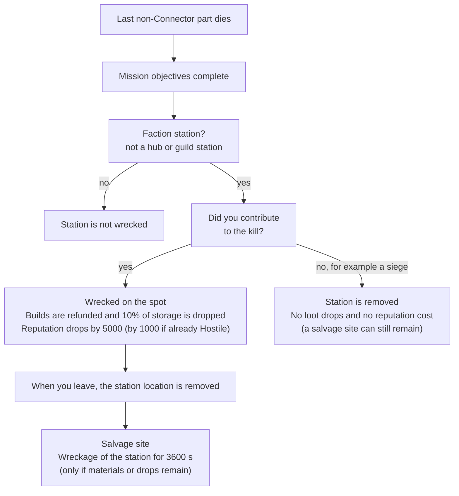
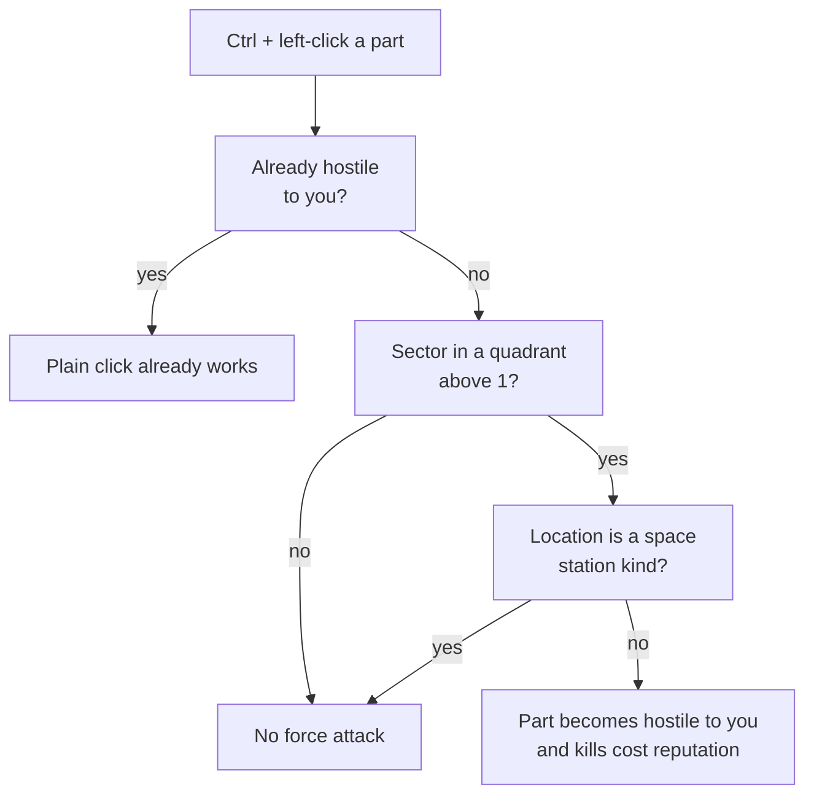

# Combat Stations

This page covers the physical stations you can shoot at from a new game: the parts they are built from, how tough each part is, what drops when it dies, what happens to the station and its owner when the last part goes, and the layouts of mission, pirate, skirmish, escort and boardable stations. Code was read from game version 0.8.3.4 (the decompiled source, not in-game testing) and re-checked against 0.8.3.5: the methods the code sections cite were re-read, and the 0.8.3.5 additions are marked. The base HP, module slots, weapon slots, tonnage and experience reward of each part come from the game's stored part templates (called prefabs). The decompiled source does not contain them, so they were re-read from the 0.8.3.5 data dumps and match what is listed here. Translation strings were not re-read for 0.8.3.5.

Terms and abbreviations are explained in the [glossary](glossary.md).

Other pages cover these station topics:

- What happens to a shot between the turret and the hull: [combat-damage.md](combat-damage.md).
- The general level and rarity curves: [scaling.md](scaling.md).
- Boarding a station's facility: [boarding.md](boarding.md).
- The stations of the faction war (hubs, Defense stations, the x20 and x30 hit point multipliers, the large conquest layouts and the off-screen siege numbers). These belong to the Conquest stage, which opens at level 28: [war-stations.md](../conquest/war-stations.md).

## Which Station Is Which

The game uses "station" and "outpost" for several different things, and the rules below differ by kind. This page uses these names:

| Name | What it is |
|---|---|
| economic outpost | A faction station that produces something: Mining, Salvage, Refinery, Forge, Production, Trading, Recruitment or Construction Yard. It is not a Defense station. |
| Industrial Outpost | A separate neutral map location type, shown by the industry board. It has nothing to do with economic outposts. See [Industrial Outpost stations](#industrial-outpost-stations). |

The war stations (hub, headquarters, Defense station) are named in [war-stations.md](../conquest/war-stations.md). NPC (non-player character) factions are the factions the game controls. A "location" below is anything you can fly to inside a system: a station, gate or asteroid field.

In the code: [Which Station Is Which](#code-which-station-is-which).

## Every Station Part

A station is a set of parts joined by physics joints. The tooltip title is the part type name, followed by the level ("Lv. N"), the owner, and a single "Hull" row. Each part also has a more specific name in the game's name list, such as "Small Turret Mk II (3-Way)", "Small Landing Pad" or "Energy Field Generator". A part without an entry in that list is named "{type} ({N}-Way)", where N is the number of connectors the part has. The longer name is not shown in a station's tooltip or anywhere else in normal play. It appears only on the part buttons of the Station Builder, a developer tool that opens from the debug console.

"Base HP" (hit points; the game shows "Hull HP", "Armor HP" and "Shield HP") below is the unscaled starting value for each part. Shield and armor base HP only count when the part has a Shield Generator or Armor module equipped (every module slot is filled when the part spawns). A part's stored shield and armor values therefore do not always apply (see the notes under the table). Equipped modules then multiply these values (see the formula in the next section).

| In-game name | Variant | Base HP | Module slots | Weapon slots |
|---|---|---|---|---|
| Station Core | | hull 900 | Hull, Scanner (Small) | none |
| Energy Field | | hull 1350 | Hull, Scanner (Small) | none |
| Refinery | ordinary | hull 1350 | Hull, Scanner (Small) | none |
| Refinery | escort mission | hull 1500 | Hull, Scanner (Small) | none |
| Cargo Dock | | hull 900 | Hull, Scanner (Small) | none |
| Docking Pad | Small and Medium pads | hull 900 | Hull, Scanner (Small) | none |
| Docking Tunnel | | hull 900 | Hull, Scanner (Small) | none |
| Connector | smaller | hull 315 | Hull, Scanner (Small) | none |
| Connector | larger | hull 735 | Hull, Scanner (Small) | none |
| Defense Platform | 1 Small turret | hull 450, shield 150 | Reactor, Hull, Scanner, Shield Generator (Small) | 1 Small |
| Defense Platform | 2 Small turrets, compact | hull 600, shield 300 | same slots, Small size | 2 Small |
| Defense Platform | 2 Small turrets, wider | hull 750, shield 420 | same slots, Small size | 2 Small |
| Defense Platform | 2 Medium turrets | hull 900, shield 900 | same slots, Medium size | 2 Medium |
| Defense Platform | 1 Large turret | hull 900, shield 900 | same slots, Large size | 1 Large |
| Defense Platform | drone bay | hull 600, armor 600 | Reactor, Hull, Scanner, Armor, Drone Bay (Small) | none (drones) |

Notes on the table:

- The Core has an armor value in its prefab, but it has no Armor slot, and base armor is only added when an armor module is equipped. The Core therefore has no armor of its own.
- The drone bay platform is classified as a Defense Platform by the game, so it shows that name even though it has no turret slots. Its armor is the only armor base HP on any part.
- Some parts (Core, Energy Field, the smaller Connector) have mounting points in the model, but no turret is ever equipped there.
- Each faction's stations use one of four art styles. Stellar Industries, Luminate Combine and Corsair Syndicate have their own style, and the Kolyatov Collective and every faction without its own use the generic one. In the 0.8.3.5 data dumps each style has the same 23 parts. The part type, hull, shield and armor values, module slots, weapon slot sizes, tonnage, experience reward and in-game name are identical across all four. Only the images and the connector links differ (read earlier from the prefabs, because the dumps do not list them). The art style changes how a station looks and nothing else.

In the code: [Every Station Part](#code-every-station-part).

### What Each Part Does in a Live Fight

Only Defense Platforms attack. A part gets turret behaviour (choosing targets and firing) only when its prefab lists weapon slots, and only the platforms with turrets have them. The drone bay platform has no weapon slots and fights through its drones (see the table). The Core, Energy Field, Refinery, Cargo Dock, Docking Pads, Docking Tunnels and Connectors are targets and nothing else. Every other part is only hull for you to destroy.

| Part | In a fight |
|---|---|
| Station Core | Always drops credits. Counts as a required part for station destruction, like any part that is not a Connector. In Station Defense missions it is the part the mission asks you to protect. |
| Energy Field | Has hull and drops loot only (see [The Energy Field](#the-energy-field)). |
| Refinery | Has hull and drops loot (ore and blueprints). |
| Cargo Dock | Has hull and drops loot (credits and refined parts). |
| Docking Pad, Docking Tunnel | Have hull and drop loot. They hold the docking points ships use, which matters only for boardable facilities. |
| Connector | Has hull and drops a little loot. It is never required for station destruction. |
| Defense Platform (turret) | Shoots, has the only shields on any part, and can drop one of its turrets. |
| Defense Platform (drone bay) | Carries a Drone Bay module and has no turret slots. It drops nothing from the platform loot table. It does launch drones: the bay holds 3 (4 if its module rolled the extra-drone aspect, about a 7.5% chance), and they leave it when the part's scanner finds an enemy in range. Each drone is a Combat Laser Drone or a Combat Missile Drone, and with a 15% chance one of the drones is a Painter drone instead. A drone's gun has about half the Combat Power of a Small turret (see [Module Gear and Weapons](#module-gear-and-weapons)). |

In the code: [What Each Part Does in a Live Fight](#code-what-each-part-does-in-a-live-fight).

### The Energy Field

The Energy Field does nothing special. It is a 1350 base hull part with no weapons, no aura and no effect on the other parts. It drops warp fuel and, rarely, Energy Crystals. Its prefab carries a leftover child object called RangeBonus that is set to a +0.75 weapon range bonus, but nothing in the game reads it for a station part, so it has no effect. The Energy Field is not special in this: 19 of the 23 part prefabs in the generic art style carry the same object (all except the Cargo Dock, the two Conquest docking pads and the Docking Tunnel). The Energy Field does not extend turret range for any part.

In the code: [The Energy Field](#code-the-energy-field).

## How Tough a Part Is

### The Stat Formula

Each of hull, armor and shield HP is built the same way:

```
HP = base HP * module multiplier * M
module multiplier = (1 + main stat of the matching module) * aspect multipliers
M  = rank * HP balance curve * NPC base curve * Escalation * context
```

- Base HP: the numbers in the table above.
- Module multiplier: the equipped Hull, Shield Generator or Armor module multiplies the matching HP. Its main stat is a multiplier, not an HP amount that gets added (the numbers are below the formula section). Flat HP bonus stats cannot roll on station gear, so modules never add flat HP.
- Rank: 0.7, because station parts always count as the lowest ship rank (Rookie), whose HP multiplier is 0.7.
- HP balance curve, for part level L: (1 + 0.28 * a) * (1 + 0.6 * b^1.5), where a = (L - 10) / 30 limited to the range 0 to 1, and b = (L - 40) / 60 limited to 0 or above. The game never shows this curve or gives it a name on screen. It is the extra HP every NPC unit gets as its level rises.
- NPC base curve: 4 raised to c, where c = (L - 30) / 70 limited to the range 0 to 1 (so the result is 1 at level 30 or below and 4 at level 100 or above). The game does not show this curve on screen either. It also multiplies the part's combat power. Since 0.8.3.7 a station part has no war multiplier on top of that: war footing multiplies the ships fielded in a live conquest battle, not the station parts (see "War Footing in Live Battles" on [war-stations.md](../conquest/war-stations.md)).
- Escalation: the Escalation tier multiplier, which is 1 / 1.15 / 1.35 / 1.6 / 2.8 / 3.8 / 5 / 6.2 / 8 for tiers 0 to 8, times the per-save override (1 to 4). Damage uses its own table: 1 / 1.08 / 1.18 / 1.3 / 1.5 / 2 / 4 / 6 / 10.
- Context: x1, x10, x20 or x30 (see [Context Multiplier](#context-multiplier)).

The separate HP curve for NPC ships is only applied to ships, not to station parts. The general level curves are on [scaling.md](scaling.md).

L is the part's own level. When the part spawns, its equipment is built at the location's level (items roll within one level of it). The part level is then (rounded average item level + highest item level) / 2, rounded down, taken over the equipped modules and turrets. It therefore sits at or very near the location's level.

The combined multiplier at Escalation tier 0 (rank * HP balance curve * NPC base curve), before the context multiplier, is:

| Level | HP balance curve | NPC base curve | Combined |
|---|---|---|---|
| 10 | 1.00 | 1.00 | 0.70 |
| 30 | 1.19 | 1.00 | 0.83 |
| 45 | 1.30 | 1.35 | 1.22 |
| 60 | 1.43 | 1.81 | 1.81 |
| 80 | 1.70 | 2.69 | 3.20 |
| 100 | 2.05 | 4.00 | 5.73 |

The x20 and x30 columns and a worked example are on [war-stations.md](../conquest/war-stations.md).

Equipped modules multiply the base HP. The Hull, Shield Generator and Armor modules each carry one main stat, a multiplier of 1 + u * s * P * 1.2:

- u is a roll between 0.010 and 0.014 for a Hull module and between 0.013 and 0.014 for a Shield Generator or Armor module.
- s is the size factor: 1 for a Small module and 1.5 for Medium and Large (station gear caps the HP size scaling at Medium).
- P is the power level of the module's level: 25 * 2^(L/10), rounded, up to level 100. Past level 100 it doubles every 25 levels instead.
- 1.2 is the High Grade rarity multiplier.

For a Small module:

| Level | P | Hull module multiplier | Shield or Armor module multiplier |
|---|---|---|---|
| 10 | 50 | x1.6 to x1.8 | x1.8 |
| 30 | 200 | x3.4 to x4.4 | x4.1 to x4.4 |
| 45 | 566 | x7.8 to x10.5 | x9.8 to x10.5 |
| 60 | 1600 | x20.2 to x27.9 | x26.0 to x27.9 |
| 80 | 6400 | x77.8 to x108.5 | x100.8 to x108.5 |
| 100 | 25600 | x308 to x431 | x400 to x431 |

For a Medium or Large module, the part of the multiplier above 1 is 1.5 times larger. At level 60 that is x29.8 to x41.3 for a Hull module and x38.4 to x41.3 for a Shield Generator or Armor module.

Worked example: a Defense Platform with one Small turret at level 60 has a base hull of 450 and a base shield of 150. A mid-range Hull module (u = 0.012) gives x24.0 and a mid-range Shield Generator (u = 0.0135) gives x26.9. With the combined x1.81 for level 60, the hull is about 450 * 24.0 * 1.81 = 19,600 and the shield about 150 * 26.9 * 1.81 = 7,300, before the context multiplier.

Every High Grade module also carries one aspect (a random bonus): a rare one with 25% chance, otherwise a common one. One of the common aspects on the Hull, Shield Generator and Armor modules is x1.05 hull HP. No rare aspect on these modules changes HP. The tooltip number is the final value.

In the code: [The Stat Formula](#code-the-stat-formula).

### Context Multiplier

The context multiplier is chosen from where you are, not from who owns the part. It is looked up from the location you are at (or flying to) when stats are calculated.

| Where the part is | Multiplier |
|---|---|
| A hub or a faction Defense station in a war-zone system | x20, or x30 for a hub in a headquarters system (see [war-stations.md](../conquest/war-stations.md)) |
| A boardable facility (dungeon station) | x10 |
| Everything else: other faction stations (economic outposts such as Construction Yards and Refineries), neutral guild stations, skirmish and pirate stations, mission stations, Industrial Outpost stations | x1 |

In the code: [Context Multiplier](#code-context-multiplier).

### Module Gear and Weapons

Modules on a part are built at the location's level (the part's level is worked out from them afterwards), with the rarity fixed at High Grade. This overrides the normal rarity roll, so every station part has High Grade modules whatever the level. Two rules apply to everything the part equips (modules and turrets):

- Optional bonus stats can never roll Hull, Armor or Shield HP on that gear.
- The size scaling for HP stats is capped at Medium. A Large module's HP stat scales like a Medium one (x1.5) instead of x2.25. Other stats on the same Large module still use the full size scale.

For NPC parts, each module is chosen at random, with equal chance, among all modules of that slot and size. The module's level is not restricted.

Turrets are chosen by the weapon slot size:

- Each slot gets a combat turret of that slot's size, chosen at random with equal chance from turrets of any level.
- A part with two or more weapon slots has a 25% chance that one random slot is a Laser Painter (a support turret) instead of a gun, when a Laser Painter exists for that size.
- Turret rarity is set by a random number u between 0 and 0.4 + L/100, where L is the location's level. Below 0.2 is Standard, below 0.5 is Enhanced, below 0.8 is High Grade, below 0.95 is Exotic, and anything higher is Legendary.

| Location level | Standard | Enhanced | High Grade | Exotic | Legendary |
|---|---|---|---|---|---|
| 10 | 40% | 60% | 0% | 0% | 0% |
| 30 | 29% | 43% | 29% | 0% | 0% |
| 45 | 24% | 35% | 35% | 6% | 0% |
| 60 | 20% | 30% | 30% | 15% | 5% |
| 80 | 17% | 25% | 25% | 12% | 21% |
| 100 | 14% | 21% | 21% | 11% | 32% |

Each turret's Combat Power is c * P * R. c is a roll inside the turret model's range: 1.00 to 1.05 for a Small turret, 2.00 to 2.10 for Medium and 3.00 to 3.15 for Large (the size is already inside c, so there is no extra size factor; the Junk Gatling is the one exception, at 0.6 to 0.8). P is the power level from [How Tough a Part Is](#how-tough-a-part-is) for the turret's level, and R is the rarity multiplier: 1.0 Standard, 1.1 Enhanced, 1.2 High Grade, 1.35 Exotic, 1.5 Legendary. At level 60 a Large Standard turret has about 3.07 * 1600 = 4,900 Combat Power, and a Legendary one about 7,400. The war-zone and Escalation multipliers come on top of that (see [war-stations.md](../conquest/war-stations.md)). A slot draws from 14 Small, 14 Medium or 11 Large combat turret models. Their damage type, fire delay, range and magazine are listed in the code section, and damage-dealt and fire-rate scaling is on [combat-damage.md](combat-damage.md).

The seed fixes each part's module choices, rarities and stat rolls. It does not fix which turret model fills a slot, because that draw uses the game's global random generator. Once a part has spawned, its gear is saved with it. A station that is rebuilt from its seed (see [How Long Damage Lasts](#how-long-damage-lasts)) rolls its turret models again.

In the code: [Module Gear and Weapons](#code-module-gear-and-weapons).

## What Drops When a Part Dies

Loot is rolled when the part is destroyed and differs on every kill. Level L is the part's level. In the amounts below, random(a, b) is a random whole number from a up to but not including b (if a equals b the result is a). A credit factor is a number the game turns into credits using the part's level L; a higher factor pays more. While Autopilot is on (the ECHO system, the "Toggle Autopilot" key), each non-fixed item has a 50% chance to be skipped.

| Part | Drop |
|---|---|
| Connector | 70% chance of 1 refined part (Titanium Plate, Bulkhead, Hull Beam or Structural Component). Above level 25, there is a 50% chance of a second one. Each amount is 1 + random(round(L/12), round(L/8)), halved (minimum 1) for Connectors. |
| Docking Pad, Docking Tunnel | The same refined-part roll as Connectors, without the halving. |
| Cargo Dock | The refined-part roll, plus a 70% chance of credits at a credit factor of 4.5 to 5.25. |
| Energy Field | 50% chance of High Grade warp fuel, in an amount of 1 + random(round(L/20), round(L/16)). Above level 25, a 4% chance of Energy Crystals, in an amount of 1 + random(round(L/45), round(L/20)). |
| Refinery | 50% chance of ore of this system: a surface ore in an amount of 1 + random(round(L/6), round(L/4)) and a core ore at half that amount (minimum 1). Within that 50%, there is another 50% chance of two more stacks of the same core ore, at 4 times and 2 times a fresh roll of that amount. |
| Refinery and Core | Both also have a 30% chance of a blueprint of level L. 98.5% of the time, Exotic and higher blueprints are excluded. |
| Station Core | Always credits at a credit factor of 13.5 to 15.25. |
| Defense Platform with turrets | 40% chance of one of its equipped turrets (only turret types that players can use), rebuilt at its exact level and rarity. 55% of the time, the choice is limited to the lowest-rarity turrets it carries. Separately, a 20% chance of a stack of one of its ammo types worth about a credit factor of 1 or 2, capped at the amount it holds. |
| Defense Platform with a drone bay | Nothing from this table. Fixed loot can still be placed on it. |
| Fixed loot on the part | Always dropped, and never skipped while Autopilot is on. Station missions and some skirmish and pirate stations add a pair of gear drops and a skill-point item here (see [Station Layouts](#station-layouts)). |

Games using the sandbox storyteller add these drops to the Core: an 80% chance of 1 to 2 Locked Container Keys and, in a conquest system, also a Locked Container of the part's level.

Both extra Refinery stacks are core ore, not canisters. The game looks up the matching canister items but never drops them.

Killing a part also pays kill experience: 50 * level-gap factor * 2^(effective level / 9), rounded up. The 50 is 5 x the part's reward of 10, and the level-gap factor is the usual penalty or bonus for the level gap (see [scaling.md](scaling.md)). The Rookie rank (the lowest ship rank) adds no extra multiplier. Industrial Outpost stations give no loot or experience and cause no reputation change.

In the code: [What Drops When a Part Dies](#code-what-drops-when-a-part-dies).

## What Counts as Destroyed

- A part is destroyed when its hull HP reaches 0. Shields and armor only soak damage first; they do not remove the part (the exact order is on [combat-damage.md](combat-damage.md)).
- A destroyed part is removed from the station's saved data until the station is rebuilt (see [How Long Damage Lasts](#how-long-damage-lasts)). Partial damage is saved and carries over to your next visit.
- There is no cascade. Killing a part does not kill, detach or weaken any neighbour. A destroyed part's joints go with it, so what hung off it is released and can drift. That is a physics effect, not a destruction rule.
- When a part is destroyed by damage (not removed some other way), it releases a shockwave. Every unit within 8 units (ships, drones and other station parts) is pushed. The force is (8 - distance) * 0.6 * 1500, with the distance limited to between 1 and 8, so it is 6300 at 1 unit or closer and 0 at 8 units. The push arrives 0.62 seconds later and does not damage those units. Mines and loot containers in range are different: anyone can damage them, and each takes 10 points of damage from the shockwave. Since 0.8.3.5 the part also plays a shockwave explosion effect, which is visual only.
- The station counts as destroyed when every part that is not a Connector is gone. Connectors can survive, and the station still counts as destroyed.
- If you hit a part at any point before it dies, the station counts as having your contribution once that part dies. See the next section for what that changes.

In the code: [What Counts as Destroyed](#code-what-counts-as-destroyed).

### When the Last Part Dies

All of this runs once for the whole station:

1. Mission objectives such as "Destroy the enemy station" complete.
2. If the station is a faction station that is not already wrecked and you contributed, it is wrecked on the spot (next section).
3. In a pocket system, the achievement for a pirate or warzone pocket is awarded.

The extra steps that run when the station is the hub of a war-zone system, or a Defense station under a live siege, are on [war-stations.md](../conquest/war-stations.md).



In the code: [When the Last Part Dies](#code-when-the-last-part-dies).

### Wrecking a Faction Station

Wrecking applies to faction stations (Defense stations and economic outposts such as Construction Yards, refineries and production stations), not to hubs or guild stations.

- If you contributed, the wrecking steps run when the last part dies. Player builds queued at that station are refunded. 10% of each item stack in the station's faction storage (rounded down per stack) is dropped as loot at the destroyed part's position, and the storage is emptied. The garrison is cleared and the station is marked wrecked. Your reputation with the owner drops by 5000, or by 1000 if you are already Hostile or worse with the owner (reputation -5000 or lower). The event log reads "Station destroyed! -N {faction name} reputation."
- Wrecked stations stop running jobs. When you leave, the station location is removed. If any recoverable materials (10%) or dropped items remain, a "Wreckage of {station}" salvage site is created that lasts 3600 seconds (1 hour).
- Without your contribution (for example when a conquest siege destroys it), the same removal happens another way. Builds are refunded, an Empire Log entry is posted, and the station is removed or marked wrecked depending on whether you are there. Nothing is dropped at the part's position and there is no reputation cost. The storage is not emptied, so when the station is removed it can still leave the same 3600 second salvage site holding 10% of what it stored.
- Destroying a Construction Yard does not cancel the ships its faction has already queued. That is covered on [faction-economy.md](../conquest/faction-economy.md) (Conquest stage).

In the code: [Wrecking a Faction Station](#code-wrecking-a-faction-station).

## Reputation and Force Attacks

### Killing Parts

Every part you kill hits the owner's reputation, unless the part is exempt (several mission stations are). This applies to every kind of station: hubs, Defense stations and economic outposts alike. Reputation bands (Wary, Neutral and so on) are listed in the [glossary](glossary.md#reputation).

- Each part has a base reward of 10, so the base penalty is ceil(10 * 0.5) = 5 (10 * 0.5, rounded up).
- The penalty depends on your reputation with the owner:
  - Above -500 (Neutral or better), the penalty is multiplied by 20. Each part then costs 100 reputation, and the event log reads "Betrayal! -100 {faction name} reputation." (for example "Betrayal! -100 Luminate Combine reputation.").
  - At -500 or below (Wary or worse), each part costs 5.
  - Below -500 (Wary, except exactly -500, and everything worse), the faction also counts as your enemy, as it does when you are at war with it. Its parts can then be targeted with a plain click.
- Reputation also moves with a second faction. If the faction that owns the system you are in is an enemy of the part's owner, and your reputation with that system's faction is Neutral (above -500 and below 1500), your reputation with that system's faction rises by 1 for each part you kill. The 1 is the base penalty of 5 times 0.2, rounded up. It stays 1 even when the part's owner costs you 100, because the game works it out before the x20.
- A part counts as your kill if you hit it at any point before it died, even if something else landed the finishing hit.
- One late-game item cancels this loss and the wreck loss below while it is active (until you next dock at a space station). It is covered in the [late-game pages](../late-game/README.md).

In the code: [Killing Parts](#code-killing-parts).

### Ctrl-Click on a Friendly Station

Left-clicking a hostile part sets it as your manual target. Ctrl + left-click on a part whose faction is not hostile to you (the tooltip hint "force attack") works only when all of these are true:

- The part is not already hostile to you.
- You are in a subsector of the Conquest quadrant or of a quadrant beyond it. The Frontier quadrant and the prologue never allow it. The galaxy map button names the neighbouring quadrant, for example "< Frontier" and "Conquest >". The game also numbers a test arena as quadrant 3. It is a developer mode with no map button, and a normal game never contains it.
- The location you are in is not one of the space station kinds.

Faction stations (Defense stations and economic outposts), hubs, embassy stations, player stations, Industrial Outposts and every guild or neutral station are space station kinds, so you cannot force attack any of them. The rule lets you force attack non-hostile parts at combat-type locations (mission, skirmish and pirate stations, and boardable facilities). Embassy station parts are also always friendly, so normal targeting does not reach them either.



When you do attack a non-hostile part, it becomes hostile to you. Any damage you deal to a unit whose faction is not your enemy also marks every ship and standalone turret of that faction at that location hostile to you. This does not reach the station's other parts. They are not in the location's list of units, so only the part you clicked is flagged hostile, and each other part stays non-hostile until you force attack it too. The reputation cost is the kill penalty above. A part that is already hostile to you (a faction at war with you, or a flagged unit) can be targeted with a plain click.

Since 0.8.3.5 a plain left-click on a part docks you at the station hub when the part's faction owns the station you are at, docking is possible right now and the station has a hub to dock at (the tooltip then shows a "dock" hint). Boardable facility parts open the facility panel instead.

In the code: [Ctrl-Click on a Friendly Station](#code-ctrl-click-on-a-friendly-station).

## Station Layouts

Which layout a station gets depends on how it was created. This page lists the layouts of the stations you meet outside the war. The Small, Medium and Large conquest layouts (hubs and faction Defense stations) and the rule that picks them are on [war-stations.md](../conquest/war-stations.md).

| Layout | Used for | Parts |
|---|---|---|
| Medium station | Solo medium stations, faction skirmish locations, Normal Station Offense and Defense missions | 14 parts |
| Large station | Pirate hideouts, the pirate station in the conquest world, Hard to Insane Station Offense and Defense missions | 18 parts |
| Easy 1 | Easy Station Offense and Defense missions | 9 parts |
| Easy 2 | Easy Station Offense and Defense missions | 10 parts |
| Escort location | Escort locations | 6 parts |
| Gun platform | Decorative platforms placed at locations ("window dressing" in the code), Industrial Outpost stations | 3 or 4 parts |

The faction picks the artwork: Luminate Combine, Stellar Industries and Corsair Syndicate each have their own, and every other faction uses the generic one.

In the code: [Station Layouts](#code-station-layouts).

### Part Lists

Connector counts are in the last column. "Platforms" counts Defense Platforms, drone bay platforms included.

| Layout | Core | Energy | Refinery | Cargo Dock | Docking Pad (Small) | Tunnel | Platforms | Connectors |
|---|---|---|---|---|---|---|---|---|
| Medium station | 1 | 1 | 0 | 0 | 1 | 0 | 3 | 8 |
| Large station | 1 | 1 | 0 | 0 | 2 | 0 | 6 | 8 |
| Easy 1 | 1 | 1 | 0 | 0 | 0 | 0 | 2 | 5 |
| Easy 2 | 1 | 1 | 0 | 0 | 1 | 0 | 2 (one is a drone bay) | 5 |
| Escort location | 0 | 0 | 1 (Escort Refinery) | 0 | 0 | 0 | 2 (one is a drone bay) | 3 |
| Gun platform, variant 1 | none | none | none | none | none | none | 1 | 2 |
| Gun platform, variant 2 | none | none | none | none | none | none | 3 (one is a drone bay) | 0 |
| Gun platform, variant 3 | none | none | none | none | none | none | 2 | 2 |

The gun platform variant is chosen at random: a roll above 0.666 gives variant 1, a roll between 0.333 and 0.666 gives variant 2, and a roll below 0.333 gives variant 3. The turrets in these layouts are fixed platforms and never change with level.

In the code: [Part Lists](#code-part-lists).

### Extra Loot on Mission and Skirmish Stations

- Faction skirmish locations (medium station): one random piece of equipment that is not a weapon or booster, and one random turret. Both are at the location's level, with rarity rolled from the level and never lower than High Grade. The two items go on random parts other than Connectors. The Core also gets a bonus skill point item.
- Pirate hideouts, the pirate station in the conquest world, and Hard to Insane Station Offense and Defense missions (large station): the same two items plus the skill point item, but the rarity is High Grade. Above level 20 there is a 5% chance of Exotic. Above level 30, a further 10% of the remaining chance becomes Exotic, for a total of 14.5% at level 31 or higher.
- Station Offense and Defense missions pick the layout from the difficulty: Easy gets Easy 1 or 2, Normal the Medium station, Hard and above the Large station. In a Defense mission the station is player-friendly and its Core is the protected subject.

In the code: [Extra Loot on Mission and Skirmish Stations](#code-extra-loot-on-mission-and-skirmish-stations).

## How Long Damage Lasts

Damage and kills are saved, but stations are rebuilt from their seed in some situations, which restores every part at full HP. The one that applies everywhere:

- When more than 3600 seconds (1 hour) of game time have passed since you last visited a given space station (a faction station, hub, embassy, player station, Industrial Outpost or guild station), that station is rebuilt the next time the game saves. Combat locations such as mission, skirmish and pirate stations do not use this rule; part damage on them is not reset by it.

Two more rebuild triggers apply to war-zone stations only and are on [war-stations.md](../conquest/war-stations.md). Guard ships at combat locations are regenerated after 7200 seconds away, which does not rebuild the station parts.

In the code: [How Long Damage Lasts](#code-how-long-damage-lasts).

## Industrial Outpost Stations

An Industrial Outpost (the map location type shown by the industry board) is a separate, neutral location. It is not an economic outpost: economic outposts are the faction production stations. The Industrial Outpost is built as the Easy 1 layout plus a variant 1 gun platform. Its parts get no context HP multiplier and give no loot, kill experience or reputation change. The physics engine treats them as fixed in place (kinematic), so they cannot be pushed. The mission fails when the Core is destroyed.

The part tooltip adds an "Industrial Outpost" section:

| Row | Meaning |
|---|---|
| Repair packs | The repair pool as a percentage of one pack. It starts at 100%, and each Repair Pack from storage adds 100%. One pack is 6000 HP of repair, scaled by the damage multiplier of the outpost's starting level. It is shown in red below 10%. |
| Ammo stockpile | The ammo reserve. It starts at 100%, and each Ammo Pack adds 100%. Every enemy wave drains 10 points plus 5 points per filled turret slot. At 0% all turrets stop firing. It is shown in red below 25%. |
| Turret slots | The number of filled turret slots, out of 4. |

Every 0.2 seconds (one tick), the Industrial Outpost repairs the armor, then the hull, of each part by up to 10% of that part's maximum, paid from the repair pool. Each empty turret slot (at the offsets (20,-5), (20,5), (14,-10) and (14,10) from the location) pulls one Defensive Turret Pack from storage and spawns a gun platform, one per tick. A new wave of marauders (or fanatics) spawns when no enemies are left or 120 seconds have passed. Wave strength is 0.7 + 0.1 * the wave number. The first wave is delayed by 45 seconds and later waves by 15 seconds.

In the code: [Industrial Outpost Stations](#code-industrial-outpost-stations).

## Boardable Facilities

A facility station (called a dungeon in the code) is built from Cores, Refineries, Energy Fields, Cargo Docks, Docking Pads, a Docking Tunnel and Connectors, with no weapons. Its parts have the x10 HP multiplier, but projectiles, rail cannons, torpedoes and manual drone targeting all ignore them, and your combat modules do not pick them as targets. I did not find a weapon path that damages them. Their numbers are on [boarding.md](boarding.md). The rules that concern the parts are:

- Facility integrity is the share of live non-connector parts (live parts / total parts), not a share of HP.
- You can enter a facility only if no docking part has been destroyed for good and its integrity is above 10%.
- When the last Docking Pad or Docking Tunnel dies, the facility can no longer be entered. Losing the docking point of an active operation aborts the operation.
- When a saved facility with integrity below 100% loads, each part other than the first has a chance of 1 - integrity of being removed. The same facility always loses the same parts, and the remaining parts show the same damage each time.
- Damage from the boarding fight is visual only. It breaks the part's sprite and does not change HP.

In the code: [Boardable Facilities](#code-boardable-facilities).

## What to Do With This

Connectors, Docking Pads, Docking Tunnels, Cargo Docks, Energy Fields, Refineries and the Core are pure HP: they never shoot. Their only reasons to die are loot and the final destruction check.

If you have to win the fight, kill the parts in this order:

1. Defense Platforms, because they are the only source of damage on the station. Platforms with Small turrets have the thinnest shields and go down fastest. Platforms with Medium or Large turrets carry 900 base shield, three times the 300 of a compact two-Small-turret platform. That shield regenerates, so burst these platforms down instead of sniping at them.
2. Among the platforms, kill the ones with the strongest gear first when you can tell. From level 80, a third or more of the turrets are Exotic or Legendary.
3. Everything else, in whichever order is convenient. You never have to kill Connectors.

If the goal is loot, shoot these parts:

| Goal | What to shoot |
|---|---|
| Credits | The Core (always), then Cargo Docks (70% chance). |
| Turrets | Defense Platforms (40% chance of one of their turrets). |
| Blueprints | Cores and Refineries (30% chance each). |
| Ore | Refineries. |
| Warp fuel | Energy Fields. |
| Crafting parts (refined parts) | Connectors, Docking Pads, Docking Tunnels and Cargo Docks (70% chance each). |

If the goal is to keep your reputation, do not kill the last part that is not a Connector on a faction station once any part you hit has died on it.

The 5000 point loss and the wreck happen when the last part dies and at least one part you hit has been destroyed on that station. Leaving one part alive avoids the 5000 point loss. The per-part penalty applies to every part you kill either way. It is 100 points a part while you are Neutral or better with the owner. If you are already Hostile or worse with the owner, the final penalty is 1000 and each part costs 5.

Two things do not work the way they look:

- Killing Connectors does not count toward destroying the station. It can release the parts hanging off that Connector to drift, which is a physics effect and not damage.
- The Energy Field is not an energy source for the station's weapons or a range booster. It is only a part with 1350 base hull.

## In the Game Code

Code was read from the decompiled source of version 0.8.3.4 and re-checked against 0.8.3.5 (the cited methods that changed were re-read and the page was corrected). The part values come from the prefab data, which the 0.8.3.5 data dumps list. Translation strings were not re-read for 0.8.3.5. The sections below give the class and method names, the raw expressions and the prefab names behind each claim, in the same order as the page. To check a claim, find the method in a decompiler (the `Source:` lines name where to look) and read it.

### Code: Which Station Is Which

| Name | Code name |
|---|---|
| economic outpost | `FactionStation` that is not a Defense station |
| Industrial Outpost | `IndustryStation` |

A "location" is the code's point of interest, POI.

### Code: Every Station Part

A station is a set of `CombatStationPart` objects joined by physics joints. The tooltip title is the part type name (`@StationPart<type>`), followed by the level (`Lv. N`), the owner, and a single `Hull` row. `CombatStationPart.GetDisplayName` looks up `@StationPartName_<prefab key>` and falls back to `{type} ({N}-Way)` (`@StationPartNameFallback`), where N is the number of connectors the part has; every prefab on this page has an entry in the translation table. `CombatStationPart.displayName` hides the base `AbstractUnit.displayName` (`new`, not `override`), so only code that holds a `CombatStationPart` reference gets the longer name. The only call to it in the compiled assembly is `StationBuilderPopup.AddPaletteButton`, which labels the part buttons of the Station Builder. `ConsoleScreen.OpenStationBuilder` (console command `OpenStationBuilder`, short form `osb`) opens that popup, and the console is only available when a file named `console.enabled` exists (`ConsoleScreen.ConsoleAvailable`). The tooltip title comes from `CombatStationPart.BuildTooltipCard`, not from the long name.

`Base HP` is the unscaled starting term: hull is `hullHPScale * 150`, shield is `shieldHPScale * 300`, armor is `armorHPScale * 300` (`AbstractUnit.baseHullHP` and the related properties). The scale values themselves are prefab data, read from the 0.8.3.5 data dump (`CombatStationPart.allParts`): hull scale 6 for the Core, Cargo Dock, Docking Pads and Docking Tunnel, 9 for the Energy Field and Refinery, 10 for the escort Refinery, 2.1 and 4.9 for the Connectors, 3 to 6 for the Defense Platforms with turrets, and 4 for the drone bay platform. Shield scale is 0.5, 1, 1.4 and 3, and the only armor scales are 3 (Core) and 2 (drone bay platform). Shield and armor base HP only count when a Shield Generator or Armor module is equipped (`AbstractUnit.GetStatRaw`), so a prefab's shield and armor scale is not always live (see the notes below). Prefab names, without the faction prefix:

| Part | Prefab | Variant on this page |
|---|---|---|
| Station Core | `Core_4C` | |
| Energy Field | `Energy1_4C` | |
| Refinery | `Refinery1_2C` | ordinary |
| Refinery | `EscortPartRefinery1_2C` | escort mission |
| Cargo Dock | `Conq_CargoDock_4C` | |
| Docking Pad | `DockingSmall_2C`, `Conq_DockingSmall_2C`, `Conq_DockingMedium_2C` | Small and Medium pads |
| Docking Tunnel | `DockingTunnel_1C` | |
| Connector | `Connector_1C`, `Connector_1CSmall` | smaller |
| Connector | `Connector_2C`, `_2CSmall`, `_3C`, `_4C` | larger |
| Defense Platform | `DefenseTurretS1_1C` | 1 Small turret |
| Defense Platform | `DefenseTurretS2_1C` | 2 Small turrets, compact |
| Defense Platform | `DefenseTurretS2_2C`, `_2CSlim`, `_3C` | 2 Small turrets, wider |
| Defense Platform | `DefenseTurretM2_1C` | 2 Medium turrets |
| Defense Platform | `DefenseTurretL1_1C` | 1 Large turret |
| Defense Platform | `DefenseDronebaySmall_2C` | drone bay |

Notes on the table:

- The Core prefab has `armorHPScale` 3, but it has no Armor slot, and the base armor term is only added when an armor module is equipped. The Core therefore has no armor of its own.
- The `DefenseDronebaySmall_2C` prefab is typed as a Defense Platform in game, so it shows that name even though it has no turret slots. Its armor is the only armor base HP on any part.
- Some prefabs (Core, Energy Field, `Connector_1C`) have child objects named "Hardpoint" in the prefab. They are not listed in the part's `hardpointSlots`, so no turret is ever equipped there.
- The number before the `C` in a prefab name is not reliable as a connector count. The serialized connector list is rebuilt from the child objects at load, and for example `Energy1_4C` has four.
- In 0.8.3.5 the dedicated prefixes are `Generic_` (Kolyatov Collective and every faction without its own prefix), `Stellar_` (Stellar Industries), `Luminate_` (Luminate Combine) and `Corsair_` (Corsair Syndicate). Each has the same 23 prefabs in the `CombatStationPart.allParts` dump. The part type, hull, shield and armor scale, module slots, weapon slot sizes, tonnage, experience reward and display name are identical across all four prefixes. The sprites and connector references were found to differ when the prefabs were read earlier; the dump does not list them. The prefix changes how a station looks and nothing else.

Source: `CombatStationFactory.GetFactionPrefix`, `AbstractUnit.baseHullHP`, `AbstractUnit.baseShieldHP`, `AbstractUnit.baseArmorHP`, `AbstractUnit.GetStatRaw`, `CombatStationPart.BuildTooltipCard`, `CombatStationPart.GetDisplayName`, `CombatStationPart.displayName`, `StationBuilderPopup.AddPaletteButton`, `StationBuilderPopup.BuildPalette`, `ConsoleScreen.OpenStationBuilder`, `ConsoleScreen.ConsoleAvailable`, prefab data for `*_Core_4C` and the other `StationParts`, and the `@StationPartName_*` text entries.

#### Code: What Each Part Does in a Live Fight

A part gets turret behaviour (`CombatActions`) only when its prefab lists weapon slots: `CombatStationPart.CreateAutoActions` returns the part's named `autoActions` if set, `CombatActions` when `hardpointSlots` is not empty, and nothing otherwise. In Station Defense missions the Core is set up as the "defense subject" the mission protects.

The drone bay platform (`DefenseDronebaySmall_2C`) has an empty `hardpointSlots` and a null `autoActions` in the 0.8.3.5 `CombatStationPart.allParts` dump, so it gets no `CombatActions`. It still launches drones. Its module slots include `DroneBay`, and the `Small DroneBay` builder sets the dynamic field `_droneAmount` to 3. `DroneBayModule.droneAmount` adds `droneBonusAmount` (1 from the `DroneAmountAspect` that is `commonAspects[0]` of that builder, so a 75% * 1/10 chance on a High Grade bay). The skill additions are skipped because `CanApplyDroneAmountSkill` is false for a non-player unit outside the shipyard, and the ship-upgrade additions need a `SpaceShipData`. `AbstractUnitData.LoadDefaultEquipment` runs `LoadDefaultDrones` for a part with a `DroneBay` module, using the part's `gameplayType` (Combat). `FillDroneSlots` fills each slot with `GetDefaultDrone`, a random entry of `Drone.GetAll()` whose default turret is a non-support combat turret (`Combat Laser Drone` or `Combat Missile Drone`). With 15% chance, when the bay holds at least 2 drones, one random slot takes `GetSupportDrone` instead (a drone with a `LaserPainterTurret`). `AbstractUnit.InitModules` creates a `CombatModule` for a unit whose drone bay has a combat loadout and links the bay to it (`SetDroneBay`). The part's Scanner module reaches that module through `ScannerModule.DispatchToModules`, and `AbstractTargetingModule.UpdateAutoTarget` calls `DroneBayModule.DeployDrones` when it finds a target. The drones copy the part's hostility flags (`DroneBayModule.CopyFactionSettings`). Each drone's gun comes from the `DroneCombatLaser` or `DroneCombatMissileLauncher` builder, whose main stat is Combat Power 0.5 to 0.6 times the power level, built at the bay item's level with the bay item's rarity (High Grade) for the hardpoint (`DroneBayModule` builds the drone with `LoadDefaultEquipment` and a rarity function).

Source: `CombatStationPart.CreateAutoActions`, `AbstractUnitData.LoadDefaultDrones`, `AbstractUnitData.FillDroneSlots`, `AbstractUnitData.GetDefaultDrone`, `AbstractUnitData.GetSupportDrone`, `AbstractUnit.InitModules`, `ScannerModule.DispatchToModules`, `AbstractTargetingModule.UpdateAutoTarget`, `DroneBayModule.DeployDrones`, `DroneBayModule.droneAmount`, prefab `Generic_DefenseDronebaySmall_2C`, builders `Small DroneBay`, `DroneCombatLaser` and `DroneCombatMissileLauncher`. See also [the Energy Field](#code-the-energy-field).

#### Code: The Energy Field

Its code-side role is the loot table (warp fuel, rarely Energy Crystals). The prefab `Generic_Energy1_4C` has an active child object `RangeBonus` with a `BoostStat` component (`stat` 53 = `EquipStat.WeaponRange`, `statBoost` 0.75, `statMultiplier` 1). 19 of the 23 `Generic_` part prefabs carry an identical `RangeBonus` child; the four without it are `Conq_CargoDock_4C`, `Conq_DockingMedium_2C`, `Conq_DockingSmall_2C` and `DockingTunnel_1C`. It is the same object as the ship range badge (`Bonus/RangeBonus/RangeBonus`), not an Energy Field feature. A `BoostStat` does nothing on its own. It implements `IEquipStatSource`, but an `AbstractUnit` only sums the sources in its `statSources` list, and `AbstractUnit.RegisterStatSource` is called from `AbstractEquipment` and `ShipUpgradeStatSource` only. `BoostStat` and `StackableEffect` have no `Awake` or `OnEnable`, and `CombatStationPart.OnEnable` only clones the sprite. The other readers of `BoostStat` components are aspects (`AbstractUnitData.AddAspectStatBoosts`), skill nodes and mastery, abilities and temporary effects, the ship bonus badges (`SpaceShipData.AddRangeBonusStatBoosts`, which reads the badge instance it creates) and pocket boss buffs (`SpaceShip.ApplyBossBuffs`). None of them look at the children of a station part. `AbstractUnit.AddRangeBonus` only adds a range badge to `SpaceShip` units. So the object has no effect, and the Energy Field does not extend turret range for any part.

Source: `CombatStationPart.CreateAutoActions`, `CombatStationPart.OnEnable`, `CombatStationPartData.CreateLootTable`, `AbstractUnit.RegisterStatSource`, `AbstractEquipment` (a registrant), `ShipUpgradeStatSource` (the other registrant), `BoostStat`, `AbstractUnit.AddRangeBonus`, `SpaceShipData.AddRangeBonusStatBoosts`, `SpaceShip.ApplyBossBuffs`, prefab data for `*_Energy1_4C/RangeBonus`.

### Code: How Tough a Part Is

#### Code: The Stat Formula

```
HP = base term * module multiplier * M
module multiplier = (1 + main stat of the matching module) * aspect multipliers
M  = rankHP * HpBalance(level) * NpcBase(level) * escalationHP * stationContext
```

- `base term`: the numbers in the table above.
- `module multiplier`: `AbstractUnit.GetStatRaw` computes `(base + calcedStats[stat]) * statMultipliers[stat]`. `calcedStats` is the sum of the flat `amount` of every stat line and `statMultipliers` the product of every line's `multiplier` (`AbstractUnitData.ApplyStatSourceLines`, `EquipStatLineMerging.MergeLinesFor`). The Hull, Shield Generator and Armor main stats are multiplier lines (`EquipmentBuilder.BuildInitialStats` with `isMultiplier` true adds `EquipStatLine(stat, 0, 1 + value)`), and the flat HP optional stats are in `excludedBonusStats`, so `calcedStats` for `HullHP`, `ShieldHP` and `ArmorHP` stays 0 and the modules only multiply. Every `M` term below is a further factor in `statMultipliers`, applied in `AbstractUnit.RecalculateStats`.
- `rankHP`: 0.7. Station parts are never given a rank in code, so they keep the default rank (Rookie), whose HP multiplier is 0.7.
- `HpBalance(level)`: `GameMath.HpBalanceMultiplier`, `(1 + 0.28 * clamp01((L-10)/30)) * (1 + 0.6 * max(0,(L-40)/60)^1.5)`. It is the "HP balance curve" of the player text. No localization key names it.
- `NpcBase(level)`: `EscalationHelper.GetNpcBaseMultiplier`, `4 ^ clamp01((L-30)/70)`. The peak of 4 is fixed: `EscalationHelper.basePeakOverride` is never set. It also multiplies the part's combat power. It is the "NPC base curve" of the player text. No localization key names it.
- `escalationHP`: the Escalation tier multiplier, 1 / 1.15 / 1.35 / 1.6 / 2.8 / 3.8 / 5 / 6.2 / 8 for tiers 0 to 8, times the per-save override (1 to 4). Damage uses its own table, 1 / 1.08 / 1.18 / 1.3 / 1.5 / 2 / 4 / 6 / 10.
- `stationContext`: x1, x10, x20 or x30.

The NPC ship HP curve (`NpcShipHpCurve`) is only applied to ships, not to station parts.

`L` is the part's own level. At spawn the part's equipment is built at the location's level (`BasePoiManager.AddToWorld`, items roll `level + random(-1, 2)`), and the part level is then `(round(average item level) + highest item level) / 2` with whole-number division, via `AbstractUnitData.RecalculateLevel`. Rank, NPC scaling and escalation are skipped for player-faction units; station parts carry their location's faction.

Since 0.8.3.5, when a system changes owner, `SystemMapData.UpdateStationPartFactions` also moves the saved station parts (`CombatStationPartData`) of the old owner to the new owner.

The "Combined" column of the level table is `rankHP * HpBalance * NpcBase` at escalation tier 0, before the context multiplier.

Source: see [context multiplier](#code-context-multiplier).

#### Code: Context Multiplier

`CombatStationPart.GetStationHpMultiplier` returns the multiplier and `CombatStationPart.AddStatModifiers` applies it to the NPC health stats. `CombatStationPart.GetConquestDefenseSystem` finds the war-zone system for the x20 and x30 cases, and a boardable facility (`dungeonLocationData` set) gets x10. The location it checks is `MapPointOfInterest.currentOrNext`.

Source: `CombatStationPart.GetStationHpMultiplier`, `CombatStationPart.GetConquestDefenseSystem`, `CombatStationPart.AddStatModifiers`, `AbstractUnit.RecalculateStats`, `AbstractUnit.ApplyNpcRankModifiers`, `AbstractUnit.ApplyHpBalanceBonus`, `AbstractUnit.ApplyEscalationNpcModifiers`, `GameMath.HpBalanceMultiplier`, `EscalationHelper.GetNpcBaseMultiplier`, `UnitRankHelper.GetHpMultiplier`, `AbstractUnitData.RecalculateLevel`, `BasePoiManager.AddToWorld`.

#### Code: Module Gear and Weapons

Station module rarity is `CombatStationPartData.fixedModuleRarity` (HighGrade), built at the location's level with `exactLevel` false. Two rules in `StationGearRollRules` apply to everything the part equips (modules and turrets): `excludedBonusStats` is the hull, armor and shield HP set, and `hpStatSizeCap` is Medium (`EquipmentBuilder.GetStatSize`, size multipliers 1.5 for Medium and 2.25 for Large).

For NPC parts the module is a uniform random pick among every builder of that slot and size, with no level gate (`EquipmentBuilder.GetRandom` only filters by level for player-owned units). Each turret slot gets a uniform random combat turret builder of that slot's size that is not a support turret. The Laser Painter swap comes from `DetermineSupportSlotIndex`: 25% for a part with at least two hardpoints, then a random slot.

Turret rarity is rolled from `u = random(0, 0.4 + level/100)`, where `level` is the location's level passed to `LoadDefaultEquipment`: below 0.2 Standard, below 0.5 Enhanced, below 0.8 HighGrade, below 0.95 Exotic, else Legendary.

The equipment seed is the location id, the station seed and the part's position in the build order (`CombatStationData.GetEquipmentSeed`). It seeds the module builder pick, the rarity rolls and every stat roll. It does not seed the turret model: `AbstractUnitData.GetRegularHardpointBuilder` calls `EquipmentBuilder.GetRandom` without a generator, so the pick uses `SeededRandom.Global`. `AbstractUnitData.LoadDefaultEquipment` only fills empty slots, and `AbstractUnitData.ToJson` saves `equipment` and `hardpoints`, so a spawned part keeps its gear until the station is rebuilt from its seed. The part's `gameplayType` is Combat (`CombatStationPartData` constructor), so the turret filter is `AbstractCombatTurret` of the slot's size, not a support turret, with no level check (`EquipmentBuilder.GetRandom` only applies `AvailableForLevel` for player-owned units).

HP modules: `EquipmentBuilder.SetupItem` computes `powerLevel = round(25 * GameMath.DamageMultiplier(itemLevel))` and `BuildInitialStats` rolls each stat as `ApplyStatScaling(random.RandomRange(minValue, maxValue), ...)`, which is `value * sizeFactor * powerLevel^levelScaling * rarity.GetPowerMultiplier()^rarityScaling`. `levelScaling` and `rarityScaling` are 1 on these main stats. `GameMath.DamageMultiplier` is `2^PiecewiseDoublings(level, 100, 10, 25)`, which is 2^(L/10) up to level 100 and `2^(10 + (L-100)/25)` after. `Rarity.GetPowerMultiplier` is 1 / 1.1 / 1.2 / 1.35 / 1.5 for Standard to Legendary. `sizeFactor` comes from `GetStatSize` (`AutoScaleBySize` is true for these stats): Small 1, Medium 1.5, and Large 1.5 because the HP stats are capped at Medium by `hpStatSizeCap` (the stats in `AbstractUnit.npcHealthAffectedStats`). The main stat ranges are in the 0.8.3.5 `EquipmentBuilder.allBuilders` dump: `SmallHull`, `MediumHull` and `LargeHull` roll 0.010 to 0.014 on `HullHP`; `SmallShield`, `MediumShield` and `LargeShield` roll 0.013 to 0.014 on `ShieldHP`; `SmallArmor`, `MediumArmor` and `LargeArmor` roll 0.013 to 0.014 on `ArmorHP`. `SetupItem` inserts the main stats at the head of the stat list, so they are always rolled.

Aspects: `GetHighGradeAspectSlots` gives a High Grade item one aspect slot, rare with 25% and common otherwise (`FillAspectSlots` picks uniformly from the builder's list). Aspect `BoostStat` lines reach the unit as derived stat boosts (`AbstractUnitData.RebuildDerivedStatBoosts`, `AddAspectStatBoosts`). `commonAspects[0]` of every Hull, Shield Generator and Armor builder is a `BoostStat` on `HullHP` with `statMultiplier` 1.05. The builders' rare aspects are a `TriggeredAbility` and `ArmorRegenPercentage` on the Hull module, and none change HP.

Turret statistics: a combat turret's main stat is `CombatPower`, rolled between 1.00 and 1.05 (Small), 2.00 and 2.10 (Medium) or 3.00 and 3.15 (Large), with `levelScaling` and `rarityScaling` 1. `AutoScaleBySize` is false for a main `CombatPower` stat, so the size is only in the range (`JunkGattlingTurret` is 0.6 to 0.8). So `CombatPower = roll * powerLevel(itemLevel) * rarity multiplier`. The pool is every builder whose prefab is an `AbstractCombatTurret` (`AutoCannonTurret`, `CorropultTurret`, `GatlingTurret`, `LaserTurret`, `MicrocellMissileLauncherTurret`, `MissileTurret`, `RadiationCannonTurret`, `RailCannonTurret`, `CryoLanceTurret`, `PlasmaLanceTurret`) with the slot's size: 14 Small, 14 Medium and 11 Large. The damage type, fire delay and magazine are the prefab values from the dump, and the range is the builder's `range` field, rolled between the two values shown:

| Size | Builder | Damage type | Fire delay (s) | Range | Magazine |
|---|---|---|---|---|---|
| Small | `JunkGattlingTurret` | Kinetic | 0.05 | 6-8 | 200 |
| Small | `SmallAutocannon` | Kinetic | 0.4 | 9-11 | 22 |
| Small | `SmallCorropult` | Corrosion | 0.5 | 9-11 | 2 |
| Small | `SmallCryoLance` | Cold | 0.2 | 9-11 | 1 |
| Small | `SmallGatlingTurret` | Kinetic | 0.05 | 7-9 | 250 |
| Small | `SmallHailfireLauncher` | Explosive | 0.1 | 18-19 | 15 |
| Small | `SmallLaser` | Energy | 1 | 7-9 | 1 |
| Small | `SmallLaserRepeater` | Energy | 0.2 | 5-7 | 30 |
| Small | `SmallMicrocellMissileTurretBuilder` | Energy | 2 | 9-11 | 50 |
| Small | `SmallMissileTurret` | Explosive | 0.2 | 21-25 | 5 |
| Small | `SmallPlasmaAutocannon` | Energy | 1.2 | 9-11 | 33 |
| Small | `SmallPlasmaLanceBuilder` | Energy | 0.2 | 9-11 | 10 |
| Small | `SmallRailCannon` | Kinetic | 1 | 19-21 | 1 |
| Small | `SmallShotgun` | Energy | 1.6 | 6-7 | 24 |
| Medium | `MediumAutocannon` | Kinetic | 0.35 | 10-12 | 38 |
| Medium | `MediumBurstRailCannon` | Kinetic | 0.5 | 25-29 | 3 |
| Medium | `MediumCorropult` | Corrosion | 0.5 | 9-11 | 4 |
| Medium | `MediumCryoLance` | Cold | 0.2 | 9-11 | 1 |
| Medium | `MediumLaser` | Energy | 1 | 9-11 | 1 |
| Medium | `MediumLaserRepeater` | Energy | 0.17 | 10-12 | 45 |
| Medium | `MediumMicrocellMissileTurretBuilder` | Energy | 5 | 9-11 | 100 |
| Medium | `MediumMissileTurret` | Explosive | 0.2 | 26-30 | 5 |
| Medium | `MediumPlasmaAutocannon` | Energy | 1.4 | 10-11 | 60 |
| Medium | `MediumPlasmaCannon` | Energy | 1.5 | 9-11 | 8 |
| Medium | `MediumPlasmaLanceBuilder` | Energy | 0.2 | 9-11 | 10 |
| Medium | `MediumRadiationCannon` | Radiation | 3 | 14-16 | 1 |
| Medium | `MediumRailCannon` | Kinetic | 1 | 25-29 | 1 |
| Medium | `MediumTwinAutocannon` | Kinetic | 0.15 | 10-12 | 54 |
| Large | `LargeBurstRailCannon` | Kinetic | 1 | 31-35 | 6 |
| Large | `LargeCombatLaser` | Energy | 1 | 13-14 | 1 |
| Large | `LargeDoubleChaingun` | Kinetic | 0.09 | 17-19 | 100 |
| Large | `LargeLaserRepeater` | Energy | 0.14 | 14-16 | 60 |
| Large | `LargeMissileTurret` | Explosive | 0.2 | 32-36 | 6 |
| Large | `LargePlasmaBattery` | Energy | 1.4 | 14-15 | 80 |
| Large | `LargePlasmaCannon` | Energy | 2 | 17-18 | 6 |
| Large | `LargeRadiationCannon` | Radiation | 3 | 20-22 | 1 |
| Large | `LargeRailCannon` | Kinetic | 1 | 31-33 | 2 |
| Large | `LargeTripleAutocannon` | Kinetic | 0.1 | 13-14 | 102 |
| Large | `LargeTripleCannon` | Explosive | 1 | 18-20 | 1 |

Source: `CombatStationPartData.fixedModuleRarity`, `CombatStationPartData.StationGearRollRules`, `AbstractUnitData.LoadDefaultEquipment`, `AbstractUnitData.EquipDefaultModuleSlots`, `AbstractUnitData.EquipDefaultHardpoints`, `AbstractUnitData.GetRegularHardpointBuilder`, `AbstractUnitData.GetHardpointDefaultEquipmentFilter`, `AbstractUnitData.GetSupportTurretFilter`, `AbstractUnitData.DetermineSupportSlotIndex`, `AbstractUnitData.GetDefaultEquipmentRarity`, `AbstractUnitData.ApplyStatSourceLines`, `AbstractUnitData.RebuildDerivedStatBoosts`, `AbstractUnit.GetStatRaw`, `EquipmentBuilder.GetRandom`, `EquipmentBuilder.SetupItem`, `EquipmentBuilder.BuildInitialStats`, `EquipmentBuilder.ApplyStatScaling`, `EquipmentBuilder.GetStatSize`, `EquipmentBuilder.AutoScaleBySize`, `EquipmentBuilder.GetAspectSlotAmount`, `GameMath.DamageMultiplier`, `RarityExtensions.GetPowerMultiplier`, `CombatStationData.GetEquipmentSeed`, builders `SmallHull` to `LargeArmor`, and the turret builders in the table.

### Code: What Drops When a Part Dies

Loot is rolled when the part is destroyed, using the global random generator (`SeededRandom.Global` inside `CreateLootTable`), so it differs on every kill. Integer random ranges are upper-bound exclusive and return the lower bound when both ends are equal (`SeededRandom.RandomRange(int, int)`). The Autopilot skip roll (`GamePlayer.autoPlay`) in `LootManager.DropRegularLoot` uses a different generator, seeded from the location and the part (`GetKillLootSeed`), so for a given part and item position its outcome repeats. Raw expressions (L is the part's level):

| Part | Expression |
|---|---|
| Connector, Docking Pad, Docking Tunnel (refined part amount) | `1 + random(round(L/12), round(L/8))`, halved (minimum 1) for Connectors |
| Cargo Dock (credits) | `GetCreditsValue(random(4.5, 5.25), L)` |
| Energy Field (warp fuel) | `1 + random(round(L/20), round(L/16))` |
| Energy Field (Energy Crystals) | `1 + random(round(L/45), round(L/20))` |
| Refinery (surface ore) | `1 + random(round(L/6), round(L/4))` |
| Station Core (credits) | `GetCreditsValue(random(13.5, 15.25), L)` |
| Defense Platform (ammo stack) | `GetCreditsValue(1 or 2, L)` |

Kill experience is `ceil(50 * gapFactor * 2^(effectiveLevel/9))`, where the base is 5 x the part's reward of 10 (`AbstractUnit.baseExperienceReward`, default 10), the gap factor is the usual level-gap penalty or bonus, and `UnitRankHelper.GetAdjustedPoints` is 1 for the default Rookie rank. Only turrets whose builder passes `EquipmentBuilder.AvailableForPlayer` can be picked as the dropped turret. Loot and kill rewards (experience, reputation) are skipped at an Industrial Outpost (`LootManager.DropLoot`) and the reward part only runs when `hitByPlayer` is set.

Both extra Refinery stacks are the system's core ore, not canisters. In the IL of `CombatStationPartData.CreateLootTable`, the `InventoryItemType.Get("Canister" + product)` result is discarded (a `pop`) in both blocks, and each `yield` returns `coreOre.item`: first with 4 times a fresh `1 + random(round(L/6), round(L/4))`, then with 2 times a fresh roll. The decompiler's output matches the IL. The `Canister<Material>` items exist in the 0.8.3.5 item dump (`CanisterTitanium` and the others), so the lookups succeed and the items are never used.

Source: `CombatStationPartData.CreateLootTable`, `AbstractUnitData.CreateLootTable`, `AbstractUnitData.FilterLoot`, `LootRarity.SelectDroppableEquipment`, `LootManager.DropLoot`, `LootManager.DropRegularLoot`, `LootManager.AddKillExperience`, `GameMath.GetExperienceRewardValue`.

### Code: What Counts as Destroyed

Parts are joined by joints that sit on the parent part; a destroyed part's joints go with it, so what hung off it is released and can drift. That is a physics effect read from the joint wiring, not a destruction rule. The shockwave force is `(8 - clamp(distance, 1, 8)) * 0.6 * 1500` on every `AbstractUnit` within `explosionImpactRange` 8. Other `TargetableUnit` objects with `damageableByAll` take a flat `damageAmount` of 10 (`PhysicsInteraction.ApplyShockwaveToNearbyShips`). Only `Mine` and `LootContainer` override `damageableByAll` to true, so those are the objects meant by "anyone can damage". It runs only when hull HP is at or below 0 and `damageTaken` is above 0. `RecordPlayerContribution` sets the station's `playerContributedToDestruction` flag when a part with `hitByPlayer` dies at a `FactionStation`.

Since 0.8.3.5, `CombatStationPart.OnDestroy` also calls `PlayDestroyedShockwave`, which plays `EffectManager.PlayShockwaveExplosionEffect` with size `max(0.6, GetBoundsX() / 8)`. This is a visual effect only. The push still passes the scale 0.6 to `ApplyShockwaveToNearbyShips` (the new constant `DestroyedPushScale` is declared with the same value), and `PhysicsInteraction` is unchanged.

Source: `CombatStationPart.OnDestroy`, `CombatStationPart.CheckCombatStationFullyDestroyed`, `CombatStationPart.RecordPlayerContribution`, `CombatStationData.CleanupParts`, `CombatStationData.ConnectPartPhysics`, `PhysicsInteraction.ApplyShockwaveToNearbyShips`.

#### Code: When the Last Part Dies

1. The mission trigger `CombatStationDestroyed` fires, which completes "Destroy the enemy station" objectives.
2. If the station is a faction station that is not already wrecked and you contributed, it is wrecked on the spot.
3. In a pocket system, the achievement for a pirate or warzone pocket is awarded.

#### Code: Wrecking a Faction Station

Wrecking applies to `FactionStation`, not to hubs or guild stations. If you contributed, `FactionStationDestruction.OnDestroyedByPlayer` runs when the last part dies. Without player contribution (for example a conquest siege kills it), the same removal happens through `FactionStationDestruction.Destroy`.

Source: `CombatStationPart.OnFactionStationDestroyed`, `CombatStationPart.WreckFactionStation`, `FactionStationDestruction.Destroy`, `FactionStationDestruction.OnDestroyedByPlayer`, `FactionStationDestruction.GetDestroyReputationLoss`, `FactionStationDestruction.SwapForWreck`, `StationDestruction.GetRecoverableMaterials`.

### Code: Reputation and Force Attacks

#### Code: Killing Parts

The exemption is the `noReputationLoss` flag on the part. The base penalty is `num = ceil(baseExperienceReward * 0.5) = 5`. If the owner's reputation is above -500, `num` is multiplied by 20 and the event log (type `rep`) gets `@DestroyedFriendlyTarget`, "Betrayal! -{0} {1} reputation.", with `{0}` the multiplied amount and `{1}` the owner's faction name. The penalty is then `ChangePlayerReputation(-num)`. The enemy test is `FactionData.IsEnemy` (at war, or reputation below -500). The rival-faction gain is `ceil(num * 0.2)` taken before the x20, so `ceil(5 * 0.2) = 1`. It goes to `SystemMapData.current.faction`, the faction owning the system you are in, through `ChangePlayerReputation`, only when that faction `IsEnemy` of the part's owner and your reputation with it is above -500 and below 1500. A late-game player flag cancels the kill penalty in `LootManager.HandleKillReputation` and the wreck penalty in `FactionStationDestruction.ApplyDestroyReputation`. `FactionStationDestruction.GetDestroyReputationLoss` returns 1000 when the reputation level is below Wary (Hostile, reputation -5000, or worse) and 5000 otherwise.

#### Code: Ctrl-Click on a Friendly Station

The third condition is that the location you are in is not a `SpaceStation`. The second condition is `SystemMapData.current.sector.quadrant > 1` in `AbstractUnit.CanBeForceFired`. The `SectorMapData` constants are `quadrantPrologue` 0, `quadrantFrontier` 1, `quadrantConquest` 2, `quadrantTestArena` 3 and `quadrantExpansion` 4 (Meridia) to 7 (north 5, south 6, middle 7). Quadrant 3 is the developer test arena: `TestArenaWorld.SetupWorld` creates its only sector, named `@MapPOITestArenaSector`, for the test-arena game that `MainMenuUI.StartTestArena` starts. The main-menu test arena button is only shown when `ConsoleScreen.ConsoleAvailable()` is true (a file named `console.enabled`). It has no map button: `GalaxyMapManager`, `GalaxyLayout`, `GalaxyRegionField`, `GalaxyRegionFieldBuilder` and `MapSearchContext` all filter out `quadrantTestArena`, and `GalaxyMapData` does not register a quadrant entry for it (`HasDefaultQuadrantName` has no case for it). The tooltips call a `SectorMapData` a "Subsector" (`@MapStaticSector`) and the map button for a neighbouring quadrant reads "< Frontier" (`@MapFrontier`), "Conquest >" (`@MapConquest`) or the quadrant name with a ">" (`@MapQuadrantNext`, `MapWidget.GetQuadrantName`). `FactionStation` (Defense stations and economic outposts), `ConquestStation` (hubs), `EmbassyStation`, `PlayerStation`, `IndustryStation` (Industrial Outposts) and every guild or neutral station are `SpaceStation`s. When you attack a non-hostile part, the part's `playerHostile` flag is set.

Damage to a part whose faction is not your enemy calls `BasePoiManager.MarkFactionPlayerHostile` (from `AbstractUnit.TakeDamage`). It loops over `poi.GetUnits(includeInactive: true)`, which yields only `MapPointOfInterest.units` (guard ships, patrols, battle ships and standalone defensive turrets added with `AddUnit`) and the units of triggered payloads. Station parts are `CombatStationPartData` objects held in `CombatStationData.parts`, a persistable that `CombatStationData.SpawnParts` spawns through `BasePoiManager.AddToWorld(AbstractUnitData, ...)`, never through `MapPointOfInterest.AddUnit`. They are therefore not in that list. The only writers of `playerHostile` on a part are `CombatStationPart.OnMouseUpAsButton` (the clicked part) and the `CombatStationData.playerHostile` setter, which only `SalvageDeadDrop` calls.

In 0.8.3.5, `CombatStationPart.OnMouseUpAsButton` gained a last branch: when the part is not a facility part, `MapPointOfInterest.current` is a `SpaceStation` with the same faction as the part, and `HudManager.CanDockAtStationHub` is true (`IsDockableHubPart`), the click calls `HudManager.DockAtStationHub`. `CombatStationPart.BuildTooltipCard` adds the `@TipHintDock` hint in the same case.

Source: `LootManager.HandleKillReputation`, `LootManager.DropLoot`, `AbstractUnit.CanBeForceFired`, `AbstractUnit.TakeDamage`, `CombatStationPart.OnMouseUpAsButton`, `BasePoiManager.MarkFactionPlayerHostile`, `BasePoiManager.AddToWorld`, `MapPointOfInterest.GetUnits`, `MapPointOfInterest.AddUnit`, `CombatStationData.SpawnParts`, `CombatStationData.playerHostile`, `AbstractUnitData.IsEnemy`, `MapPointOfInterest.FinishSeedBuiltStation`, `TestArenaWorld.SetupWorld`, `MainMenuUI.StartTestArena`, `GalaxyMapData.DefaultQuadrantName`, `GalaxyMapData.HasDefaultQuadrantName`, `GalaxyMapManager`, `MapSearchContext`.

### Code: Station Layouts

| Seed | Builder | Result |
|---|---|---|
| `SoloMediumStation`, `MediumSkirmish` | `CreateMediumStation` | 14 parts |
| `PirateLarge` | `CreateLargeStation` | 18 parts |
| `EasyStation1` | `CreateEasyStation1` | 9 parts |
| `EasyStation2` | `CreateEasyStation2` | 10 parts |
| `EscortLocation` | `CreateEscortLocation` | 6 parts |
| (window dressing, Industrial Outpost stations) | `CreateGunPlatform` | 3 or 4 parts |

The faction prefix picks the artwork: Luminate Combine uses `Luminate_`, Stellar Industries `Stellar_`, Corsair Syndicate `Corsair_`, and every other faction `Generic_`.

#### Code: Part Lists

Connector counts are in the last column.

| Builder | Core | Energy | Refinery | Cargo Dock | Docking Pad (Small) | Tunnel | Platforms | Connectors |
|---|---|---|---|---|---|---|---|---|
| Medium station | 1 | 1 | 0 | 0 | 1 | 0 | S1_1C, S2_1C, S2_3C | 8 |
| Large station | 1 | 1 | 0 | 0 | 2 | 0 | S1_1C, 2 S2_2C, 2 S2_2CSlim, S2_1C | 8 |
| Easy 1 | 1 | 1 | 0 | 0 | 0 | 0 | 2 S1_1C | 5 |
| Easy 2 | 1 | 1 | 0 | 0 | 1 | 0 | S1_1C + drone bay | 5 |
| Escort location | 0 | 0 | 1 (Escort Refinery) | 0 | 0 | 0 | S2_3C + drone bay | 3 |
| Gun platform variant 1 | none | none | none | none | none | none | S2_2C | 2 |
| Gun platform variant 2 | none | none | none | none | none | none | 2 S1_1C + drone bay | 0 |
| Gun platform variant 3 | none | none | none | none | none | none | S2_3C + S1_1C | 2 |

The gun platform variant is chosen at random (a roll above 0.666, between 0.333 and 0.666, and below 0.333 give variants 1, 2 and 3) unless the caller forces one. "Docking Pad" counts `DockingSmall_2C` in these builders. The turrets in these builders are fixed S1, S2_1C, S2_2C and S2_3C platforms and never change with level.

#### Code: Extra Loot on Mission and Skirmish Stations

- `MediumSkirmish` (faction skirmish locations): one random non-weapon, non-booster piece of equipment and one random turret. The Core also gets a bonus skill point template.
- `PirateLarge` (pirate hideouts, the pirate station in the conquest world, Hard to Insane Station Offense and Defense missions): same two items plus the skill point template.
- Station Offense and Defense missions pick the builder from the difficulty: Easy gets Easy 1 or 2, Normal the Medium station, Hard and above the Large station.

`CombatStationFactory.CreateFromLayout` builds a station from a layout file (`CombatStationLayoutStorage.BuildStation`, which loads `Resources/StationLayouts/<name>`) and adds it to a location. Nothing calls it. The decompiled source of 0.8.3.4 and 0.8.3.5 has no other reference to the name. In the compiled `Assembly-CSharp.dll` it appears only as the method definition (no `call` or `callvirt` in any method, and no second occurrence of the name, which rules out reflection by string). No scene or asset file in the game's data folder contains the name, so no serialized event refers to it. The Station Builder loads layouts through `CombatStationLayoutStorage.BuildStation` directly. So none of the layouts in the table above come from a layout file.

Source: `CombatStationFactory.CreateStationVariant`, `CombatStationFactory.DispatchStationVariant`, `CombatStationFactory.ResolveSizeVariant`, `CreateMediumStation`, `CreateLargeStation`, `CreateEasyStation1`, `CreateEasyStation2`, `CreateEscortLocation`, `CreateGunPlatform`, `CreateMediumSkirmishStation`, `CreatePirateHideoutStation`, `MapPointOfInterest.BuildStationFromSeed`, `StationBattle.GenerateMission`, `PoiWindowDressingHelper.AddGunPlatform`.

### Code: How Long Damage Lasts

`GamePlayer.CleanupStaleSpaceStation` runs for each `SpaceStation` that is not an abandoned conquest hub (`Conquest.IsAbandonedHulk`: a `ConquestStation` with no faction). When the time since the last visit is above 3600 s it calls `MapPointOfInterest.ClearStationBuilding`, which makes the station rebuild from its seed. `CleanupStaleCombatPoi` handles `Combat` locations (which include `CombatStation`) after 7200 s and only resets guard units and payloads, not the `CombatStationData`.

Source: `GamePlayer.CleanupStaleSpaceStation`, `GamePlayer.ToJson`, `MapPointOfInterest.ClearStationBuilding`.

### Code: Industrial Outpost Stations

The map location type is `IndustryStation`. It is built from `CreateEasyStation1` plus a variant 1 gun platform. A repair pack is `6000 * DamageMultiplier(startLevel)` HP of repair. Wave strength is `0.7 + 0.1 * wave`.

Source: `CombatStationPart.BuildIndustrySection`, `IndustrialOutpost.UpdateActive`, `IndustrialOutpost.repairMax`, `IndustryBoard.GenerateIndustryMissions`, `LootManager.DropLoot`.

### Code: Boardable Facilities

A facility (dungeon) station is built by `DungeonStationFactory`. Projectiles, rail cannons, torpedoes and manual drone targeting all ignore its parts (`IsProtectedFromWeaponFire`). Facility integrity is `live parts / total parts`. When a saved facility with integrity below 100% loads, each part other than the first is removed with probability `1 - integrity`. When the last Docking Pad or Docking Tunnel dies, the facility's `dockingDestroyed` flag is set.

Source: `CombatStationPart.HandleDockingPartDestroyed`, `CombatStationPart.UpdateFacilityIntegrityFromCombat`, `CombatStationPart.CheckDungeonStationFullyDestroyed`, `DungeonData.isEnterable`, `DungeonLocationData.CollectOrDamagePart`, `DungeonStationFactory.Generate`, `TargetableUnit.IsProtectedFromWeaponFire`, `AbstractUnit.ApplyFacilityDamage`.
