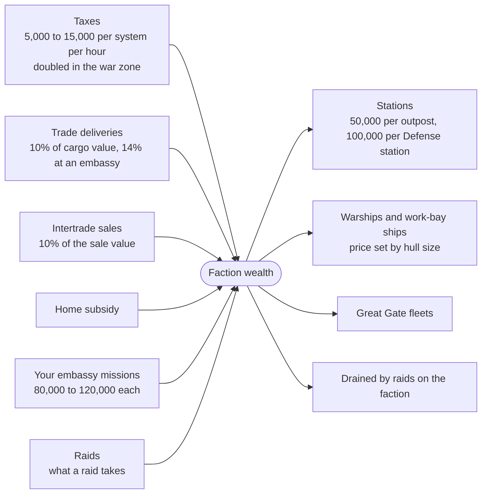
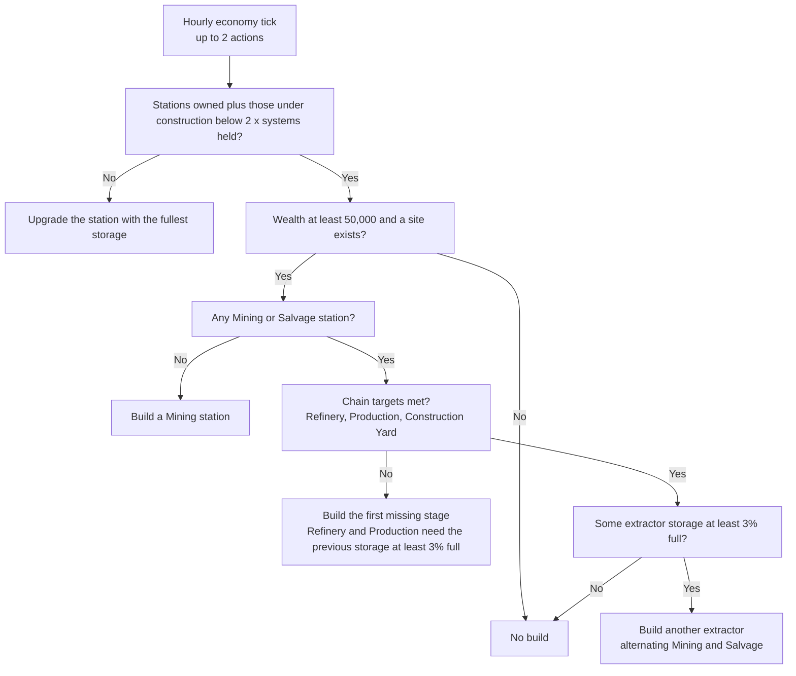
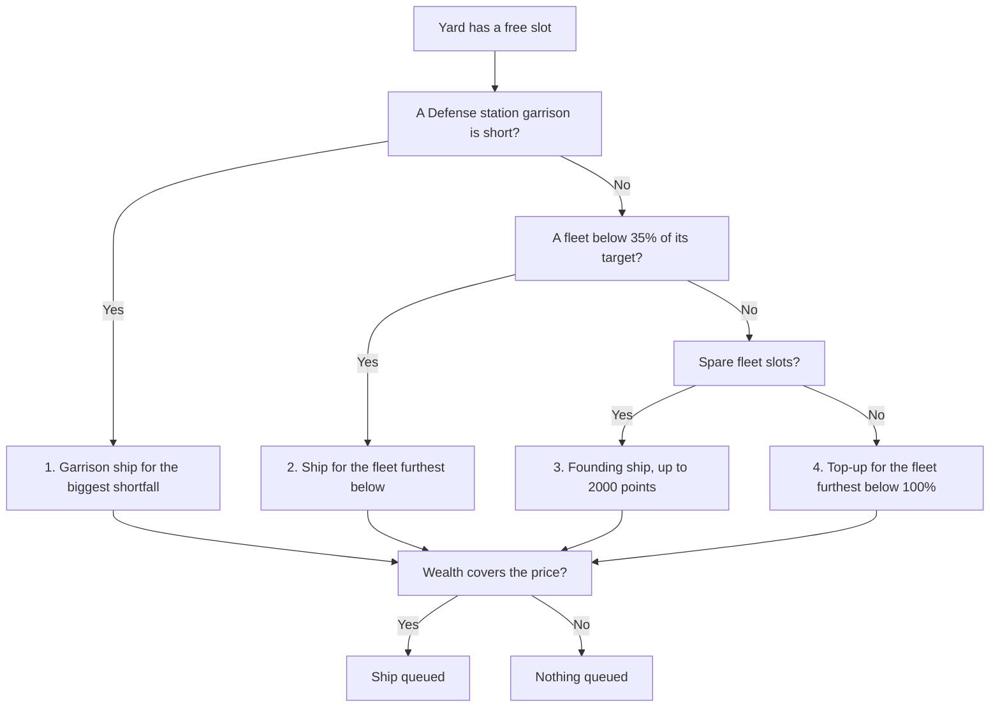
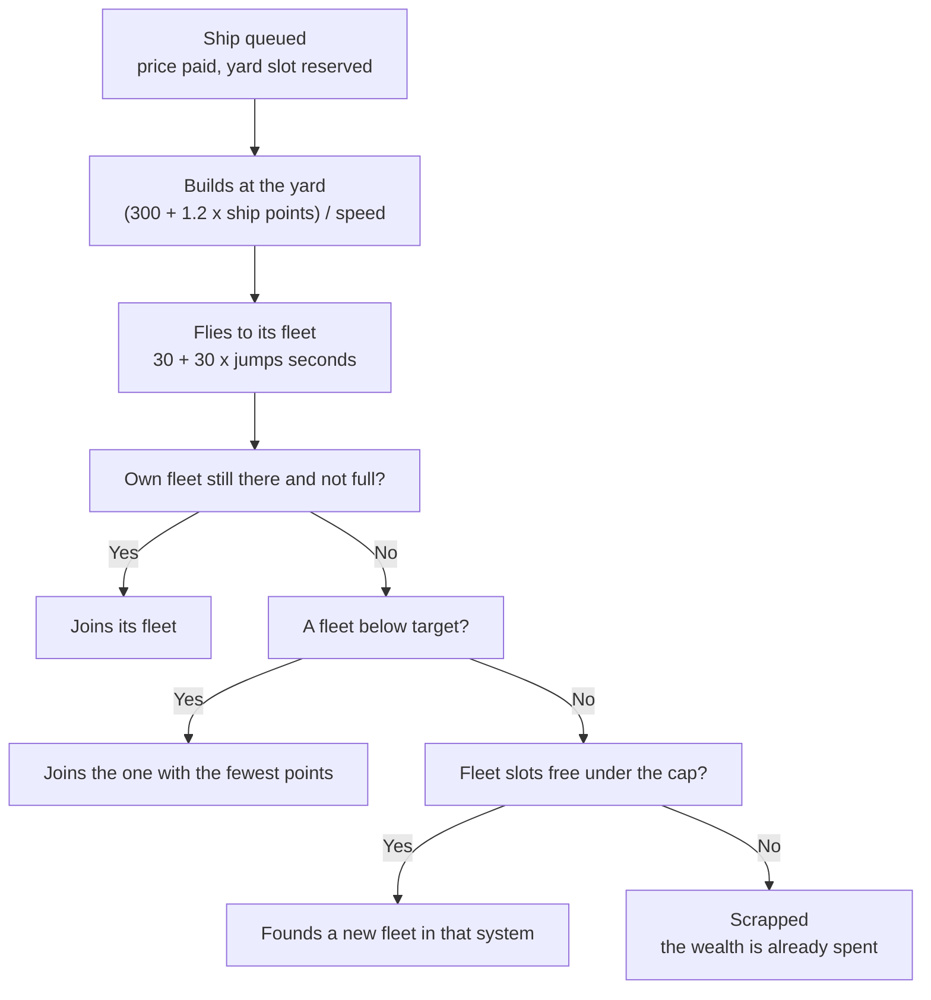

# Faction Economy and Ship Production

This page covers where an NPC faction's money comes from, what it spends it on, how it builds economic outposts and Construction Yards, how warships are paid for, built and delivered, and which of your actions slow that down. NPC means non-player character: a faction the game controls. Every value was read from the decompiled game code of version 0.8.3.4, not measured in play. The code was then compared with the 0.8.3.5 and 0.8.3.7 sources, and every statement that changed in either was rewritten. Ship point values are not in the decompiled source. They were read from a runtime dump of the ship prefabs of 0.8.3.4 and 0.8.3.5, and none of them changed between those two. There is no 0.8.3.7 dump, so the point values below are carried over from 0.8.3.5 (the pricing code did not change). This page belongs to the conquest stage, which opens at level 28 with the Sector Control missions. Battles, fleet orders, raids and captures are in [War Zone and Battles](war.md). Stations under attack in the war are in [War Stations](war-stations.md). Attacking stations in general is in [stations](../basics/stations.md).

Terms and abbreviations are explained in the [conquest glossary](glossary.md) and the [basics glossary](../basics/glossary.md). The code names behind the terms are in the last part of the page, [In the Game Code](#in-the-game-code).

A few terms used throughout:

- Wealth, shown as "Economic Power" on the Faction overview, is a single number per faction. Ships cost wealth only, no materials, so cutting the supply of ore or goods does not slow warship production.
- The war zone is the Conquest sector (Ara Martis). The Frontier, Staging and Darkspace regions are not part of it. The expansion sectors join it with Beyond the Front ([Your empire](../expansion/your-empire.md)).
- An economic outpost is a station that produces something: Mining, Salvage, Refinery, Forge, Production, Trading, Recruitment or Construction Yard. The Faction overview shows them as "Economic Outposts". A system holds two stations in total, and a Defense station takes one of the two. This page writes "yard" for a Construction Yard.
- Points are a ship's fleet value. Fleet cards in the game call the total "strength", but this page writes "points".
- The planner is the part of the game that decides what an NPC faction builds and where its fleets go.
- The garrison is the group of warships that an NPC Defense station holds.
- The fleet cap is the number of fleet slots a faction may fill.

## What the Faction Overview Shows

The Factions tab of the galaxy map shows, for an NPC faction:

| Tile or row | Value |
|---|---|
| Economic Power | The faction's current wealth, with the change against the previous hourly sample |
| Combat Power | The faction's total fleet points over all its fleets, with the same change figure. This is not the Combat Power ship stat |
| Economic Outposts | Every station the faction owns (Defense stations included) plus every station under construction, shown against a total of 2 x the number of systems held ("slots used") |
| Building | The first economic outpost under construction and its time remaining |
| Power and Power History graphs | The last 24 hourly samples of wealth and fleet points |

The card that lists the income and spending ledger, the Construction Yards count, active ship builds, deliveries and recent builds exists in the game files, but the game only enables it when running inside the Unity editor. It does not appear in the released game. The ledger entries below are therefore only visible indirectly, as movement in the Economic Power tile.

For a conquest faction, the faction's detail view also has a Conquest section with Headquarters, Area Conquered and Your Contribution. Once Conquest missions you completed at one of its war-zone hubs have given it war footing, the section adds War Footing, Footing Contribution (out of 2000), War Fleets (out of 2), Next War Fleet (out of 250, or "Waiting" when a war fleet is earned but cannot be sent yet) and the totals War Fleets Earned, Systems Taken, Raids Won and Enemy Ships Destroyed. What they mean is in [War Footing and War Fleets](war.md#war-footing-and-war-fleets).

In the code: [What the Faction Overview Shows](#code-what-the-faction-overview-shows).

## When Things Happen

| Cadence | What runs |
|---|---|
| Every story second | Economic outpost builds, warship builds, warship deliveries and work-bay ship orders all advance |
| Every 3600 s (1 hour), the hourly economy tick, not shown in the game | Taxes are paid. Then each faction's planner runs: economic outposts, the warship queue with Defense stations and fleet orders, and the home subsidy with Great Gate reinforcement. After that the Canisec patrols are handled, and the ledger closes the hour |
| Every 3600 s (1 hour), the conquest update, a separate timer | Recalculates Area Conquered, rebuilds damaged stations and counts down settling. The galaxy map shows it as the "Conquest Update" countdown card |
| Every 600 s (10 minutes) | Expired war fleets are removed and an earned war fleet is sent. The warship queue is refilled and fleet orders are reassigned |
| After battles | The attacker, the defender, the owner of the target system and the supporters of a battle that just ended are re-planned immediately |

A yard slot that frees up is therefore refilled within about ten minutes, not an hour. Economic outposts and taxes move on the hourly economy tick.

Story seconds are game seconds. They stop while the game is paused, which popups, dialogues and the station builder do, and they do not pass on the main menu.

In the code: [When Things Happen](#code-when-things-happen).

## Where a Faction's Wealth Comes From

NPC factions add each earning to their wealth directly. The ledger groups earnings under these labels ("Wealth (last 24h)"):

| Label in the game | Amount | When |
|---|---|---|
| Taxes | Each system the faction owns that is not a reserved slot (see [Where Economic Outposts Go](#where-economic-outposts-go)) pays a random amount from 5,000 to 15,000, with every value equally likely. The amount is doubled in a war-zone system and is 0 while the system is in unrest | Every hourly economy tick |
| Trade deliveries | 10% of the cargo value of a finished delivery, counted as item cost x amount summed over the cargo. The share is 14% when the destination is an embassy, which is a faction's neutral station in the Staging sector | When a delivery from a Production station is unloaded at a destination that is not a faction station |
| Intertrade sales | 10% of the sale value | When a Production station's run is sold into an Intertrade market |
| Home subsidy | See [Catch-Up Mechanics](#catch-up-mechanics) | Every hourly economy tick, plus one-off grants |
| Your embassy missions | The wealth reward of your embassy missions, see below | When you complete one |
| Raids | What a raid takes: wealth drained from the victim plus 10% of the value of the materials taken from the economic outpost | When the faction's raid on an economic outpost completes |

A faction that holds N systems outside the war zone and W systems in it earns 10,000 x N + 20,000 x W per hour on average from taxes.

Unrest is the game's unnamed state for the first hours after a system changes owner. A captured system starts with a settling count of 6 that drops by one per conquest update (hourly). It pays no taxes while the count is above 4. The hourly tax payments made while the count is 6 and 5 are therefore zero. That is one or two payments, because taxes are paid on the hourly economy tick, a separate timer from the conquest update. From the count of 4 on, the system pays normally.

Trade and sales only count for Production stations. A Production station gets its first route to the nearest Intertrade market within 10 jumps. If there is none, it falls back to the nearest civilian station of its own faction. It prefers an embassy over any other station, even if the embassy is farther. Mining and Salvage stations route all materials to the nearest Refinery. Refineries route canisters to the nearest Production station. Each of these routes is limited to 10 jumps. The chain routes pay nothing themselves.

The ledger also has a "Lost to your raids" line. NPC factions never use it: it is defined and labelled, but nothing in the game records it.



In the code: [Where a Faction's Wealth Comes From](#code-where-a-factions-wealth-comes-from).

### Your Embassy Missions Feed the Faction

A mission taken at an embassy of a conquest faction carries a faction-wealth reward of 80,000 to 120,000. The reward is halved for idle missions, which ECHO, your ship's AI companion, completes for you while you are away. On completion the amount is added to that faction's wealth under "Your embassy missions". It is also added to your running embassy wealth with that faction, the "Wealth your missions brought" counter. The mission's contribution amount still adds to "Your Contribution" (your conquest standing) and to the 10 points of the first sector-control mission, but it does not add to war footing, which only missions at a war-zone hub feed. The game uses the word contribution for all of these counters and for "Footing Contribution"; the [conquest glossary](glossary.md#missions-and-standing) separates them. The faction gets the wealth whether or not you later fight it.

In the code: [Your Embassy Missions Feed the Faction](#code-your-embassy-missions-feed-the-faction).

## What Factions Spend Wealth on

| Spending | Cost | Notes |
|---|---|---|
| Stations | New economic outpost: 50,000. Defense station: 100,000. Upgrade: 15,000 from tier 1, 25,000 from tier 2, 50,000 from tier 3 and 100,000 from tier 4 | Paid when the build or upgrade starts |
| Warships | Per hull, by size category (table below). Half price while under the fleet cap | Paid when the build is queued, never refunded |
| Ships for station work bays | The same price per size as warships. A work bay is the mining or salvage bay of a faction station, and these are the ships it sends out to claim a mining site or salvage yard | Paid when the build starts at a free yard. These ships occupy a yard slot |
| "Great Gate fleets" | Full roster cost of the Great Gate reinforcement | Only when the faction has at least one fleet that is not a war fleet and holds at least 10% of the war zone; otherwise the reinforcement is free (see [Catch-Up Mechanics](#catch-up-mechanics)) |
| Lost to raids | Drained by a raid | See [Raids and the Economy](#raids-and-the-economy) |

Raiders and Canisec pay for their fleets through the Warships row, at the full price of every ship in the fleet (the full roster price).

In the code: [What Factions Spend Wealth on](#code-what-factions-spend-wealth-on).

## How NPC Factions Build Economic Outposts

### Order of Builds

Each hourly economy tick the planner first makes sure the supply routes exist, then takes up to 2 actions. One action is either a new economic outpost or an upgrade:

- If the stations it owns (Defense stations included) plus those under construction are below 2 x systems held, it tries to build.
- Otherwise it upgrades one station instead.

A build only goes ahead if wealth is at least 50,000 and a site exists. The planner chooses the type in this order:

1. A faction with no Mining or Salvage station builds a Mining station first.
2. The chain targets depend on E, the number of extractors (Mining plus Salvage stations). The target for each chain stage is E / 6 rounded up, and at least 1. The stages are built in the order Refinery, Production, Construction Yard. Refinery and Production are only built when the previous stage's storage is at least 3% full (Mining or Salvage storage for the Refinery, Refinery storage for Production). The Construction Yard has no such condition.
3. Once the chain targets are met, a further extractor is built only when some extractor's storage is at least 3% full. The planner alternates between Mining and Salvage to keep their numbers equal, starting with Mining.
4. A Production station picks its trade good from what the faction can make from its own refined materials. Near an Intertrade market within 10 jumps, it takes the good with the lowest supply score, with a slight lean toward higher-priced goods. The supply score of a good is the market's current stock of it plus the units that other Production stations already plan to make, divided by the market's demand for it, so a low score means the market is short of that good. It avoids goods that other Production stations already plan to make. With no market in range, the pick is random. When a Production station is upgraded, its good changes only if the best alternative scores less than half of the current good's score.

Mindus Holdings and Steel Vultures are guild factions with restricted chains. They build in this order: Refinery, Production station, their one extractor type, then a Construction Yard. Mindus builds only Mining stations and Steel Vultures build only Salvage stations. Neither builds the other extractor type. After that, the same stage targets and 3% conditions apply, but the yard is not a stage.

If a Construction Yard has no valid site, the planner builds an extractor instead.



An economic outpost takes 3600 s (1 hour) to build.

In the code: [Order of Builds](#code-order-of-builds).

### Where Economic Outposts Go

A system is a valid site when all of these hold:

- It belongs to the faction and is not a reserved slot. A reserved slot is a placeholder system that only exists in saves made before version 0.8.3: the game does not draw it, search it or give it stations, and the save-upgrade step that runs when an older save is loaded removes it. Nothing in the game creates reserved slots any more, and the code gives them no role besides being skipped or deleted.
- It is in the Frontier or Conquest quadrant, or in an expansion quadrant ("Quadrant" is the game's name for the large map regions).
- It holds fewer than 2 stations of any kind (Defense stations and stations of other owners count, and so do this faction's builds already under construction there).
- Pocket systems only accept economic outposts if they are a "Motherlode" or a "Graveyard" system. A pocket system is a small side system that hangs off a host system through a locked jumpgate. The game names them "{name}, the Motherlode" (mining), "{name} Graveyard" (salvage), "Warzone {name}" and "Dread Port {name}"; the last two never take faction outposts.
- A Construction Yard is never built in a war-zone system. Every yard sits in home space, meaning outside the war zone.

Among valid systems the planner picks the one with the fewest economic outposts, then the highest total economic outpost prosperity.

In the code: [Where Economic Outposts Go](#code-where-economic-outposts-go).

### Upgrades and the Starting Layout

When station slots are full, the planner upgrades the station with the highest storage fullness among those below their maximum tier (5, or 4 for Production). Every station type is in that pool, Defense stations included. The planner picks the target by fullness, not by type, so a Construction Yard is not preferred. A Construction Yard is upgraded only when it happens to be the fullest.

New games and fresh war zones start with stations already built: 80% of each faction's slots are filled, and 100% in the war zone.

In the code: [Upgrades and the Starting Layout](#code-upgrades-and-the-starting-layout).

### Defense Stations

A faction builds one Defense station at a time, for 100,000 wealth and 3600 s (1 hour), when it holds fewer than the cap:

```
cap = the smaller of
      (war-zone systems the faction holds / 4, rounded up)
      (frontline systems x 0.5, rounded up)
```

The site is a frontline system, meaning one of the faction's systems that touches an enemy or unowned war-zone system. It needs fewer than 2 stations in total and no build already pending there. The planner prefers the site where the faction has the fewest Defense stations already. A Defense station built by the planner starts with an empty garrison. The warship queue fills it (see below).

In the code: [Defense Stations](#code-defense-stations).

## Construction Yards

Every yard has a tier from 1 to 5. The tier sets how many ships build at once and how fast:

| Tier | Build slots | Build-time multiplier |
|---|---|---|
| 1 | 1 | 1.0 |
| 2 | 1 | 0.8 |
| 3 | 2 | 0.7 |
| 4 | 2 | 0.6 |
| 5 | 3 | 0.5 |

A yard starts at tier 1. The only way its tier rises is the planner upgrade described above. That upgrade costs 15,000 to 100,000 wealth, happens only when every economic outpost slot is used, and only applies if the yard is the fullest eligible station. Builds of work-bay ships (see [Cost](#cost)) use yard slots too. A ship build reserves its slot from the moment it is queued.

The number of yards scales with extractors: one yard per 6 extractors (rounded up). A faction with up to 6 extractors has one yard. If a war faction has none outside the war zone, the game builds one at a valid home-space site.

In the code: [Construction Yards](#code-construction-yards).

## How Warships Get Built

### Cost

A hull's price is set by its size category, not by its point value: 50 wealth per price point.

| Size | Price points | Cost (wealth) | Cost while under fleet cap | Combat hulls: fleet point values | Wealth per fleet point |
|---|---|---|---|---|---|
| 1 | 15 | 750 | 375 | 15, 20, 25 | 30 to 50 |
| 2 | 30 | 1,500 | 750 | 40, 45 | 33 to 38 |
| 3 | 60 | 3,000 | 1,500 | 80, 100, 120, 140 | 21 to 38 |
| 4 | 150 | 7,500 | 3,750 | 180, 200, 210 | 36 to 42 |
| 5 | 300 | 15,000 | 7,500 | 300, 320 | 47 to 50 |
| 6 | 600 | 30,000 | 15,000 | 460, 480 | 62 to 65 |
| 7 | 1,200 | 60,000 | 30,000 | none among combat hulls | n/a |
| 8 | 2,400 | 120,000 | 60,000 | none among combat hulls | n/a |

Size 3 hulls are the cheapest per point, and size 5 and 6 hulls are the most expensive. The size 7 and 8 rows exist in the price table, but the only size-7 entries in the ship prefabs are two wrecks (point value 999,999), and there is no size-8 prefab. Build times for work-bay ships (mining and salvage ships for a station's work bay; 60 s at size 1 up to 420 s at size 8) apply to work-bay ships only, not warships.

One more size-1 combat hull, the Acolyte Voidweaver, has a point value of 2,500 and is not in the table. No faction can build it: the warship picker skips hulls that are flagged as not for random spawning, and the Voidweaver carries that flag. Only a story mission uses it, as the enemy of one Umbral mission.

A fleet of 2000 points costs about 43,000 wealth at full price if every ship is a 140-point size 3 hull (3,000 each, the cheapest per point in the table) and about 130,000 if every ship is the 460-point size 6 hull (30,000 each, the dearest per point). Any real mix costs between the two. A faction picks from its own hulls first, so the figure differs by faction.

In the code: [Cost](#code-cost).

### Build Time

```
duration = (300 + 1.2 x ship points) / speed
speed    = (3 if under the fleet cap, else 1) / yard build-time multiplier
```

The speed is fixed when the build is queued, from the yard tier and cap state at that moment.

| Ship points (the ship's fleet point value) | Tier 1, at cap | Tier 1, under cap | Tier 5, at cap | Tier 5, under cap |
|---|---|---|---|---|
| 45 | 354 s | 118 s | 177 s | 59 s |
| 100 | 420 s | 140 s | 210 s | 70 s |
| 200 | 540 s | 180 s | 270 s | 90 s |
| 320 | 684 s | 228 s | 342 s | 114 s |
| 480 | 876 s | 292 s | 438 s | 146 s |

Throughput of one yard is build slots divided by build time. A tier-1 yard at the cap produces about 6.7 ships of 200 points per hour (about 1,330 points per hour). A tier-5 yard under the cap builds 3 ships at once at 90 s each, which is about 120 ships per hour. Wealth, not yard time, then becomes the limit.

In the code: [Build Time](#code-build-time).

### The Under-Cap Discount

While a faction has fewer fleet slots in use than its fleet cap, every ship it queues costs 50% and builds 3 times faster. This applies to every build queued while the faction is below its fleet cap, including garrison ships and top-ups of existing fleets. Each fleet uses one slot per 2000 points of its target size (rounded to the nearest whole number, at least one), so a combined task force occupies several slots. A war fleet uses no slot, so it neither ends the discount nor counts against the cap.

In the code: [The Under-Cap Discount](#code-the-under-cap-discount).

### Fleet Caps

| Faction | Cap |
|---|---|
| Mindus Holdings, Steel Vultures, Stranded | 0 if the faction holds no war-zone systems. Otherwise 3 below 2.25 million embassy wealth, 4 from 2.25 million and 5 from 3 million |
| Corsair Syndicate while holding no war-zone system | 2 |
| Any faction not listed in this table | 1 |
| Darkspace Compact | 5 |
| Kolyatov, Stellar, Luminate, Meridia's Chosen, Corsairs holding a war-zone system | The smaller of the territory cap and 5 + (war-zone systems held / 15, rounded down) |

The territory cap is 8, except for Meridia's Chosen (6) and the Darkspace Compact (12) once the expansion war has opened. The Darkspace Compact's cap of 5 changes at the same point, which comes with Beyond the Front ([Your empire](../expansion/your-empire.md)). With 0 to 14 war-zone systems the formula gives 5, with 15 to 29 it gives 6, and so on, up to the territory cap. For the three guild factions (Mindus Holdings, Steel Vultures, Stranded), the value that counts is the embassy wealth you deliver through embassy missions with that faction (see [Joining a Faction's War](#joining-a-factions-war)).

In the code: [Fleet Caps](#code-fleet-caps).

### What Gets Queued, in Priority Order

For each yard with a free slot, the planner takes the first of these that applies:

1. Garrison. The ship goes to the faction's Defense station with the biggest shortfall. The shortfall is the wanted ships, minus ships in the garrison, minus ships in production for it, minus ships in flight to it.
2. Starved fleet. The ship goes to the fleet furthest below 35% of its target (2000 points).
3. Founding. The ship founds a new fleet. The points wanted are the spare fleet slots times 2000 points, minus what is already queued, capped at 2000 points for the ship.
4. Top-up. The ship goes to the fleet furthest below 100% of its target.

If wealth does not cover the price, nothing is queued. For items 2 to 4, the ship type is a weighted random pick of the faction's warships with a point value at or below the points needed (heavier hulls weigh more). For the garrison, the planner picks the biggest warship that fits the per-ship budget. Items 2 to 4 skip war fleets: they have no target to fall below, so no ship is built to fill one.



Defense station garrison size depends on the station's tier:

| Station tier | Wanted ships | Total budget | Per-ship budget |
|---|---|---|---|
| 1 | 3 | 270 | 90 |
| 2 | 4 | 405 | 101 |
| 3 | 5 | 540 | 108 |
| 4 | 6 | 720 | 120 |
| 5 | 8 | 900 | 112 |

A garrison can also be refilled without a build, but that path only receives anything from a system's combat strength. Nothing in the game raises combat strength above 0: the game only ever sets it to 0, and a save from before version 0.8.3 has it reset to 0 when it loads. In practice, garrisons are refilled only by the yard queue.

In the code: [What Gets Queued, in Priority Order](#code-what-gets-queued-in-priority-order).

### New Ship Level

A ship leaves the yard at the NPC fleet level, which is the galaxy level (at least 1). The galaxy level is your effective level (character level plus Vanguard level, which only starts after you choose to commit to it at level 100) or 30, whichever is higher. Version 0.8.3.5 added 6 levels and counted the highest conquest-system level; 0.8.3.7 removed both. When a save loads, the game lowers every NPC ship above that level (fleet ships, garrison ships and deliveries on the way) to it. A fleet whose point-weighted average level is 3 or more levels below the NPC fleet level is sent to a yard of its faction within 4 jumps and refitted for 300 s. Each faction can refit up to 3 fleets at once.

In the code: [New Ship Level](#code-new-ship-level).

### Delivery

A finished ship is dispatched to its target:

```
travel time = 30 + 30 x jumps   (seconds)
```

Zero jumps, or no route, means the ship joins immediately. The destination is the system where the ship meets its fleet: the fleet's destination if the fleet is travelling, otherwise where the fleet is. A garrison ship flies to its Defense station's system and joins only if that garrison is still short when it arrives. If the ship's fleet is full or gone when the ship arrives, the ship picks another fleet (see below) and flies a new leg from where it landed. The Faction overview card lists "{hull} flying to its fleet at {system}" while the ship flies, but the game only enables that card in the Unity editor.

If the ship's own fleet is gone or full when the build finishes or the delivery arrives, it goes to:

1. The below-target fleet with the fewest points.
2. A new fleet founded in that system, if the faction has fleet slots free under its cap.
3. Otherwise it is scrapped ("scrapped, every fleet full"). The wealth is already spent.



In the code: [Delivery](#code-delivery).

## Factions Without Yards

Corsair Syndicate (while it holds no war-zone system) builds no ships at yards. Each hourly economy tick it:

- Tops up every idle or retreating fleet that is at one of its own systems and below its target (a war fleet has no target, so it is never topped up). The missing points are composed as a roster and paid at full price from wealth.
- If fleet slots are under the cap (2 for Corsairs), raises a new 2000-point fleet at its first owned system, also at full price.

Canisec has no yard either. Each hourly economy tick it pays itself a 200,000 home subsidy, raises an 800-point patrol in each Frontier sector that has none, and tops up idle patrols at home, all at full roster price.

None of these wait for yard time. A wealthy yardless faction rebuilds a whole fleet in one hourly economy tick, so the only limit is wealth. Corsairs earn wealth from taxes on systems they hold and from raids, so each raid they complete both funds their rebuilds and drains the victim.

In the code: [Factions Without Yards](#code-factions-without-yards).

## Catch-Up Mechanics

Several rules push a weak faction back toward parity. They are the reason that making a faction smaller often makes its recovery faster. In these tables "Great Gate reinforcement" means the fleet that appears from the Great Gate map location for Kolyatov, Stellar or Luminate; the game's ledger line for a paid one is "Great Gate fleets".

| Mechanic | Condition | Effect |
|---|---|---|
| Under-cap build discount | Fewer fleet slots used than the fleet cap | Warships cost 50%, build 3 times faster |
| Home subsidy | Kolyatov, Stellar, Luminate and Darkspace, while a war zone exists | 120,000 x (1 - war-zone share / (1/3)) per hour, never below 0. Paid on the hourly economy tick |
| Great Gate reinforcement | Kolyatov, Stellar and Luminate, not sitting out (a faction that has lost its last war-zone system sits out for 5 conquest updates), fleet slots used below half the fleet cap, cooldown over | A fleet of 1500 points appears at the war-zone system nearest the Great Gate. If the faction holds no war-zone system, it appears at the first real (not reserved-slot) system of the embassy staging sector. The cooldown is set to 12 and counts down one per hourly economy tick. A fleet can only be sent on a tick where the cooldown is already 0, so sends are at least 13 hourly economy ticks apart |
| Canisec home subsidy | A Frontier sector exists | 200,000 per hour, paid on the hourly economy tick |
| Darkspace starting top-up | New game | Darkspace wealth is raised to the average of the three Great Gate factions (Kolyatov, Stellar, Luminate) |

The war-zone share is the faction's war-zone systems over all war-zone systems. The home subsidy by share:

| Share | Home subsidy per hour |
|---|---|
| 0% | 120,000 |
| 10% | 84,000 |
| 20% | 48,000 |
| 33.3% or more | 0 |

A Great Gate reinforcement is a free Great Gate fleet when the faction has no fleets other than war fleets or holds under 10% of the war zone. Otherwise it is paid for at the roster's full price. If wealth cannot cover it, no fleet appears and the cooldown does not start. The fleet appears instantly, with no yard, no delivery and nothing to intercept.

Home subsidy does not count toward the amount a raid drains (see below).

In the code: [Catch-Up Mechanics](#code-catch-up-mechanics).

## Joining a Faction's War

Your embassy wealth with a faction (shown as "Wealth your missions brought") rises by the wealth reward of each embassy mission you finish with it. This is not "Your Contribution", the conquest standing that sets your conquest rank. Once your embassy wealth reaches 1,500,000, you meet the embassy wealth part of the join requirement. As an alternative, paying 10,000,000 credits sets the embassy wealth to at least 1,500,000. That payment is removed from your credits and does not add to the faction's wealth.

When you join, the faction gets:

- 1,000,000 wealth as home subsidy.
- A yard at the system you joined, if the faction has none in home space. In that case, stations are removed from the system until two slots are free.
- A Defense station with a provisioned garrison, if the system has a slot.
- Its fleets seeded to full at that system.

For Mindus, Steel Vultures and Stranded the same embassy wealth sets the fleet cap (3 to 5), so feeding them wealth raises their cap.

In the code: [Joining a Faction's War](#code-joining-a-factions-war).

## Intercepting Deliveries and Convoys

From the galaxy map you can click an icon in transit and chase it. You fly to an intercept zone (the game's "Interception" location) at the target's position. You lock on within 1.5 map units of it, and the target freezes while the encounter runs. The encounter ships appear 12 units behind and 8 above you. You cannot intercept while on autopilot. When the encounter ends the target is released, and that target cannot be intercepted again for 300 seconds (a per-target timer kept in memory).

| Target | Ships | What killing it does |
|---|---|---|
| Warship delivery | 1, built from the delivered hull at the delivery's level | The ship is removed for good. Wealth and build time are gone, and nothing is refunded. It carries no cargo, so there is no loot. Your own ships in transit cannot be intercepted |
| Cargo run | 1 ship per 6,210 m3 of cargo (or per 150 passengers), 1 to 10 | Killing some ships removes their share of the cargo from the run, so the trade or sales income for the run drops in proportion. Killing every ship ends the run: no cargo is unloaded and no trade or sales income is booked. The route stays and starts its next run |
| Other | Fleets, work-bay ships, bay-ship orders | Each has its own kind of intercept target. Killing a bay-ship order cancels it |

Every killed ship drops 40% to 60% of each non-ammo cargo stack as loot under your name.

Reputation is charged per ship. Reputation levels are bands of a number: Wary is -4,999 to -500, Hostile is -14,999 to -5,000, and lower levels are worse still.

| Event | Cost with that faction |
|---|---|
| Opening fire on a ship that was not hostile to you (a force-attack) | -1,000 |
| Destroying that ship afterwards, if your standing with the faction was Wary or better (reputation above -5,000) | -3,500 more |

A faction that is already your enemy, meaning at war with you or reputation below -500, cannot be force-attacked in the first place. Its ships are already hostile, so a plain click targets them. Intercepting an enemy faction therefore costs nothing in reputation. The kill penalty is checked for each ship and applies only while your standing is Wary or better when that ship dies. Once earlier penalties push you to Hostile or worse (-5,000 or lower), a force-attacked kill no longer costs the extra -3,500.

Shooting one ship of a convoy or fleet can flag the rest of its faction's ships in the encounter, depending on your standing. The -1,000 is charged when you click the ship. If you are still at -500 or better after it (you had +500 or more before), the first shot that lands marks every ship of that faction in the encounter as force-attacked. Each of those kills then costs -3,500 while you are Wary or better, and the flagged ships cost no further -1,000. If the -1,000 pushes you below -500, the faction is already your enemy when the shot lands, so only the ship you clicked counts as force-attacked. The other ships are plain enemies, and killing them costs nothing.

A delivery is on the map for only 30 + 30 x jumps seconds, so catching it means being near the yard already. A cargo run lasts as long as the route's travel time.

In the code: [Intercepting Deliveries and Convoys](#code-intercepting-deliveries-and-convoys).

## Raids and the Economy

A raid completes when a raiding fleet wins its raid battle at a station that can be raided. That is any faction station, or your station, that is not a Defense station, not wrecked and not on a raid cooldown. The Empire Log shows the result as "raid succeeded" to the raider and "outpost raided" to the victim. A completed raid then does four things:

```
wealth drained   = the smaller of
                   the victim's wealth
                   1.5 x its average hourly income (not counting home subsidy)
materials taken  = half of every stack in the station's storage (10% if the raider is you)
production pause = 3600 s (1 hour)
raid cooldown    = 14400 s (4 hours)
raider earns     = wealth drained + 10% of the value of the materials taken
```

The average hourly income is the sum of the last 24 closed hourly buckets plus the current hour, over all income kinds including trade and raids, divided by 24. The drain therefore equals one and a half average hours of income other than home subsidy, capped by the wealth the faction has. Materials are taken per stack and rounded down, so a stack of one item loses nothing. The stolen materials vanish; only their value is counted as the raider's earnings.

Who gains and who loses:

| Victim | Raider | Result |
|---|---|---|
| NPC faction's station | NPC faction | The victim loses the drain and half of each stack. The raider's wealth rises by the drain plus 10% of the materials' value, booked as "Raids" |
| NPC faction's station | Your empire fleet on a Raid order | The victim loses the drain and 10% of each stack (not half). You are paid credits: 10 credits per point of wealth gained, so (drain + 10% of the materials' value) x 10 |
| Your station | NPC faction | No wealth is drained and no materials are taken, and the raider earns nothing. The pause and cooldown still apply to your station |

The 3600 s pause stops the economic outpost's own jobs. These are the job that fits its type (production for most economic outposts, work-bay ship orders for a Construction Yard, and garrison refit for a Defense station), player construction jobs, prosperity growth and every cargo route that starts there. Its runs, including trade deliveries that would pay income, stop advancing. The 14400 s cooldown means that economic outpost cannot be raided again until it ends.

What a raid does not touch:

- The faction's warship queue. It is kept apart from the economic outpost, so raiding a Construction Yard pauses its player-ordered builds and work bay, not NPC warship builds. The ships in the queue keep progressing and deliveries keep flying.
- Defense stations. They cannot be raided.
- Wealth beyond the drain. A faction with a large stockpile loses only about one and a half hours of income per raid.

Who launches raids and how they are won is in [war](war.md).

In the code: [Raids and the Economy](#code-raids-and-the-economy).

## What Happens When You Destroy a Yard

Destroying a yard marks it wrecked, turns 10% of its storage into loot (the rest is cleared), refunds any player build jobs, and costs reputation:

| Your standing with the faction | Reputation cost |
|---|---|
| Wary or better (reputation above -5,000) | -5,000 |
| Hostile or worse (-5,000 or lower) | -1,000 |

The cost is waived while a Decoy Transponder is active.

The wreck is removed when you leave the system or when a game is loaded. Until then the game still lists it as one of the faction's stations. The planner counts it as a yard, and it takes a station slot.

The ships already in the faction's queue are not cancelled. Once the wreck is removed, each queue entry counts the yard as having 1 slot, so only one entry per destroyed yard progresses at a time. The build speed was fixed when the ship was queued and stays. When the entries finish, the ships are delivered as normal. The queue is only emptied when a system is captured, or when the yard's system no longer exists in the galaxy (the game clears such entries when an expansion is regenerated, and the debug console can do it too). War-zone yards do not exist, so captures do not reach yards in practice.

With no yard, nothing is queued at that site. The planner replaces the yard on its next hourly economy tick if the faction's yard count is below the chain target and wealth is at least 50,000. The replacement takes 3600 s (1 hour) and starts at tier 1. A destroyed tier-5 yard comes back with 1 slot and 1.0 build time instead of 3 slots and 0.5. That is about a sixth of the throughput until it is upgraded again. The replacement site is chosen fresh and need not be the same system.

Destroying a Defense station clears its garrison, so the faction must pay 100,000 and 3600 s for a new station, then rebuild the garrison ship by ship through the yard queue.

In the code: [What Happens When You Destroy a Yard](#code-what-happens-when-you-destroy-a-yard).

## Ways to Slow a Faction

Ranked by how much production they remove per reputation spent. The "Cut" column is what the faction loses, and "Rebuild" is how it recovers. The reputation bands are the ones in "Intercepting Deliveries and Convoys" above.

| # | Action | Reputation cost | Cut | Rebuild |
|---|---|---|---|---|
| 1 | Kill warship deliveries of a faction already your enemy (at war with you, or reputation below -500) | 0 | One ship's price (750 to 30,000 wealth) plus its yard slot time (118 s to 876 s per ship) | The planner re-queues the missing points at its next 600 s pass |
| 2 | Destroy its only Construction Yard | -5,000 (-1,000 if Hostile or worse) | New warship builds stop until a replacement exists, which takes about 1 to 2 hours (the next hourly economy tick plus 3600 s). The replacement returns at tier 1, so throughput can drop to a sixth | Needs 50,000 wealth and a valid site. The yard count is one per 6 extractors, so a faction with 7 or more extractors may have a second yard that keeps working |
| 3 | Intercept and kill deliveries of a faction that is not your enemy | -1,000 to open fire, -3,500 more per kill (4,500 per ship) | Same as row 1 | Same as row 1 |
| 4 | Stop doing embassy missions for it | 0 | Each mission would have given the faction 40,000 to 120,000 wealth | None. This only avoids adding to its wealth |
| 5 | Kill cargo convoys of its Production stations | Same as rows 1 and 3 | The run's trade or sales income (10% of value, 14% for an embassy) | The next run goes out normally. The loss is minor next to taxes |
| 6 | Destroy Defense stations | Same as the yard | Garrison ships are lost with the station. The faction pays 100,000 and 3600 s for a replacement and then for new garrison ships | The faction can only build one Defense station at a time |
| 7 | Capture war-zone systems (see [War Zone and Battles](war.md)). The Empire Log shows "system captured" | Depends on the war | On average 20,000 wealth per hour for each system, and no taxes for the next one or two hourly tax payments after capture (while the system is in unrest) | A Great Gate faction (Kolyatov, Stellar, Luminate) below 1/3 of the war zone gets up to 120,000 per hour of home subsidy. Below 50% of its fleet cap, it also gets a free or paid Great Gate reinforcement of 1500 points, at least 13 hours apart |

In the code: [Ways to Slow a Faction](#code-ways-to-slow-a-faction).

### What Does Not Work

- Destroying a yard does not cancel the ships already in its queue. They keep progressing, one at a time per destroyed yard, and deliver normally.
- Raiding a yard pauses its station jobs, not the NPC warship queue or deliveries.
- Attacking ore, canister or material supply does not slow warships. NPC warships cost wealth only.
- Wiping fleets speeds replacement. Once the faction's fleet slots in use fall under the cap, every queued ship is half price and three times as fast. For Kolyatov, Stellar and Luminate, it also triggers Great Gate reinforcement once the slots in use are below half of the cap. Remove fleets only if you can keep removing them, or remove the yard first.
- Capturing systems until Kolyatov, Stellar, Luminate or Darkspace hold less than a third of the war zone raises their home subsidy. For the first three, dropping below 10% of the war zone also makes Great Gate reinforcements free. Territory loss does not drive them to zero income.
- Draining wealth with raids is capped at 1.5 hours of income, and only matters when wealth is the faction's limit. A faction at the cap with a full yard can be wealth-rich and yard-limited.
- Yardless Corsairs and Canisec do not queue anything, so destroying their stations does not slow them. Their rebuilds are only limited by wealth. Taking away their raid income and taxes is the only lever.

## In the Game Code

This part holds the code detail behind the player sections above: class and method names, field names, timers as written in the code, raw formulas and the `Source:` lines. The code was read in version 0.8.3.4 and compared with the 0.8.3.5 and 0.8.3.7 sources. To check a claim, find the named method in a decompiler (the `Source:` line of each section lists them) and read it. Ship point values come from the `SpaceShip.pointValue` field of the ship prefabs, which the runtime dumps of 0.8.3.4 and 0.8.3.5 both list with the same values. There is no 0.8.3.7 dump.

| Term | Code name |
|---|---|
| Wealth ("Economic Power") | `FactionEconomy.wealth` |
| Combat Power (fleet points) | `totalPoints` summed over the faction's fleets |
| Under-cap state | `fleetSlotsUsed < MaxFleetsFor(faction)` |

### Code: What the Faction Overview Shows

Combat Power is `totalPoints` summed over the faction's fleets. The Economic Outposts tile shows `FactionStation.GetAllOwnedBy(faction).Count + economy.constructions.Count` (every `FactionStation`, Defense stations and wrecks included) over `economy.outpostSlots` (`2 x systems held`, "slots used").

For a conquest faction, `FactionOverviewContent.BuildConquestSection` adds the Headquarters, Area Conquered (`currentConqueredPercentage`) and Your Contribution (`playerContribution`) rows. `AddWarRows` adds the war rows only when `ConquestFactionStanding.hasHelpedInWar` is true (`warContribution` or `warFleetProgress` above 0, or `warFleetsGranted` above 0). War Footing shows `warFootingBonus` and `warFootingSeconds`, Footing Contribution `warContribution` out of 2000, War Fleets `WarFleets.CountActive` out of 2, and Next War Fleet `warFleetProgress` out of 250 (the text key `FactionOverviewWarFleetWaiting`, "Waiting", once `isWarFleetReady`). The four totals are `warFleetsGranted`, `warSystemsTaken`, `warRaidsWon` and `warShipsDestroyed`.

The card that lists the income and spending ledger, the Construction Yards count, active ship builds, deliveries and recent builds (`FactionOverviewContent.BuildShipyardSection`) exists in the code but is only enabled when running inside the Unity editor, so it does not appear in the released game. The ledger entries are therefore only visible indirectly, as movement in the Economic Power tile.

Source: `FactionOverviewContent.BuildShipyardSection`, `FactionOverviewContent.SetEconomicPowerTile`, `FactionOverviewContent.SetCombatPowerTile`, `FactionOverviewContent.BuildConquestSection`, `FactionOverviewContent.AddWarRows`, `FactionOverviewContent.SetWarRows`, `FactionPowerHistory.Record`

### Code: When Things Happen

| Cadence | What runs |
|---|---|
| Every story second | `FactionEconomy.ProgressConstructions`: economic outpost builds, warship builds, warship deliveries, work-bay ship orders. The story clock is `GamePlayer.UpdateStorytellers(Time.deltaTime)`, called from `GameplayManager.Update` |
| Every 3600 s (hourly economy tick, not shown in the game) | `GrowWealth` pays taxes, then each faction's planner runs: `FactionEconomicPlanner.Tick` (economic outposts), `ConquestFleetPlanner.Tick` (warship queue, Defense stations, fleet orders), `GreatGateReinforcement.Tick` (home subsidy and Great Gate reinforcement). Then Canisec patrols, then the ledger hour closes |
| Every 3600 s (conquest update, a separate timer) | `Conquest.DoConquestTick`: recalculates Area Conquered, rebuilds damaged stations and counts down settling. The galaxy map shows it as the "Conquest Update" countdown card |
| Every 600 s | `ConquestFleetPlanner.PlanBetweenTicks`: `ConquestFleetOrders.ExpireWarFleets` removes war fleets whose `lifetimeHoursLeft` has run out (unless held by an intercept, committed to a battle or defending on site), `WarFleets.TryGrant` sends an earned war fleet, the warship queue is refilled and fleet orders reassigned. `TryGrant` also runs when a Conquest mission completes (`ConquestWarContribution.AddToFaction`) |
| After battles | `LivingUniverse.RequestMilitaryPlanning` queues the attacker, defender, target owner and supporter factions; `PlanRequestedFactions` runs `PlanBetweenTicks` for them on the next update |

`Time.deltaTime` is scaled by `Time.timeScale`, which `GameTimeScale.Apply` sets to 0 while `GameTimeScale.paused` is true. `GameManager.Pause` sets it, and `AlertPopup`, `DialogueManager`, `StationBuilderPopup` and other popups call it. `GamePlayer.Update` is only called from `GameplayManager.Update`, so no story time passes outside a loaded game, including on the main menu.

Source: `LivingUniverse.StoryUpdate`, `LivingUniverse.RunHourlyTick`, `LivingUniverse.TickMilitaryPlanning`, `LivingUniverse.RecordPowerSamples`, `FactionLedger.CloseHour`, `Conquest.DoConquestTick`

### Code: Where a Faction's Wealth Comes From

Each earning is booked under a `LedgerEntry` kind. NPC factions add the amount to wealth directly.

| Kind | Label in the game |
|---|---|
| `Passive` | Taxes |
| `Trade` | Trade deliveries |
| `Sales` | Intertrade sales |
| `Subsidy` | Home subsidy |
| `PlayerSupport` | Your embassy missions |
| `Raids` | Raids |

In code, `isInUnrest` is true while `settlingTicks` is above 4. A captured system starts at 6 (`SettlingTicks`) and loses one per conquest update (hourly), so `RollSystemWealth` returns 0 for the hourly tax rolls made at counts 6 and 5.

`PlayerRaids` ("Lost to your raids") is a ledger kind NPC factions never use: it is defined and labelled but nothing in the code records it.

Source: `FactionEconomicPlanner.GrowWealth`, `FactionEconomicPlanner.RollSystemWealth`, `FactionEconomicPlanner.ApplyDeliveryProsperity`, `FactionEconomicPlanner.ApplySaleProsperity`, `FactionEconomicPlanner.EnsureChainRoutes`, `FactionEconomicPlanner.EnsureDeliveryRoutes`, `CargoRoute.Deliver`, `CargoRoute.isSaleRoute`, `ConquestSystem.isInUnrest`, `Conquest.TickSettling`

#### Code: Your Embassy Missions Feed the Faction

On completion the amount is added to that faction's wealth under `PlayerSupport` ("Your embassy missions") and to your running embassy wealth with it (`joinWealth`, the "Wealth your missions brought" counter). This is one of the three things the game calls contribution.

Source: `MissionGenerator.RollEmbassyWealth`, `ConquestStrength.OnComplete`, `ConquestJoin.DeliverMissionWealth`

`ConquestStrength.OnComplete` adds `amount` to `playerContribution` (and fires `EarnCombatStrengthForFaction`) for every mission whose `sourceFaction` is set, embassy missions included. It calls `DeliverMissionWealth` when `wealth` is above 0 and `ConquestWarContribution.Apply` otherwise, so an embassy mission never reaches war footing.

### Code: What Factions Spend Wealth on

| Kind | Meaning |
|---|---|
| `Stations` | New economic outposts, Defense stations and upgrades |
| `Warships` | Warship hulls; raiders and Canisec also pay here at full roster price |
| `BayShips` | Ships for station work bays |
| `GreatGate` ("Great Gate fleets") | Full roster cost of the Great Gate reinforcement, only when `TryPay` charges it: the faction has at least one fleet that is not a war fleet (`economy.fleets.All(isWarFleet)` is false) and `GetWarZoneShare` is 0.1 or more; otherwise it returns true without charging |
| `Raided` | Drained by a raid |

Source: `FactionEconomicPlanner.TryBuildNext`, `FactionEconomicPlanner.TryUpgrade`, `FactionEconomicPlanner.GetUpgradeCost`, `GameMath.FactionOutpostUpgradeCost`, `ConquestFleetPlanner.TryBuildDefenseStation`, `ConquestFleetPlanner.TryQueueBuild`, `BayShipSupply.TryStartBuild`, `GreatGateReinforcement.TryPay`, `YardlessFleetSupply.TryPay`

### Code: How NPC Factions Build Economic Outposts

#### Code: Order of Builds

Each hourly economy tick `FactionEconomicPlanner.Tick` first makes sure chain routes exist, then takes up to 2 actions (`TryTakeAction`). One action is either a new economic outpost or an upgrade. If `FactionStation.GetAllOwnedBy(faction).Count + economy.constructions.Count` (all `FactionStation` types, Defense stations included) is below `economy.outpostSlots` (`2 x systems held`), the planner tries to build (`TryBuildNext`). Otherwise it upgrades one station (`TryUpgrade`).

With E extractors (Mining plus Salvage), the chain target is `max(1, ceil(E / 6))` of each chain stage, built in the order Refinery, Production, Construction Yard.

Source: `FactionEconomicPlanner.ChooseNextStationType`, `FactionEconomicPlanner.ChooseGuildStationType`, `FactionEconomicPlanner.FindFirstMissingGuildStation`, `FactionEconomicPlanner.ChooseRedundantExtractorType`, `FactionEconomicPlanner.IsChainStageBackingUp`, `FactionEconomicPlanner.ChooseBuild`, `ProductionGoodPicker.Choose`, `ProductionGoodPicker.Repick`, `FactionStationConstruction.BuildDuration`

#### Code: Where Economic Outposts Go

A Construction Yard is never built in a war-zone system. The one exception, `CanHostHeadquartersYard`, is never true because `ConquestWarTuning.HeadquartersYardFactions` is empty. Every yard sits in home space, meaning outside the war zone. `IsValidSite` also requires `ConquestScope.AllowsStations` (not the Meridia sector), `IsInScopeQuadrant` (Frontier, Conquest or an expansion quadrant) and `FactionStation.CountIn(system) + CountPendingIn < 2`. `CountIn` counts every `FactionStation` in the system, whatever its type or owner. Pocket systems (`SystemMapData.pocketSystem`, set by the `Motherlode`, `DerelictFleet`, `FactionSkirmish` and `PirateHideout` storytellers and by `SandboxWorld.AddSideContentSystemToSystem`, which links the pocket to its host with a locked jumpgate) pass `PocketSystemAllowsFactionStation` only for `Motherlode` and `DerelictFleet`, whose names come from `PocketSystemMotherlode` and `PocketSystemDerelictWreck` ("Graveyard"). `isReservedSlot` systems fail `IsValidSite` and are skipped by the map drawing code. Nothing assigns `isReservedSlot = true`: the field is only read from save data (`SectorMapData` and `SystemMapData` loading) and copied by `ConquestAreaTiling`. The save-upgrade step `GamePatch.RemoveReservedSlots` deletes them. It runs in the `GamePlayer.ApplyVersionPatches` block for saves below version 0.8.3 (through `ApplyGalaxyLayoutPatches`) and from the debug console.

Source: `FactionEconomicPlanner.IsValidSite`, `FactionEconomicPlanner.CompareSites`, `FactionEconomicPlanner.IsInScopeQuadrant`, `FactionEconomicPlanner.CanHostHeadquartersYard`, `ConquestWarTuning.HeadquartersYardFactions`

#### Code: Upgrades and the Starting Layout

Source: `FactionEconomicPlanner.TryUpgrade`, `FactionEconomicPlanner.ChooseUpgradeTarget`, `PlayerStation.GetMaxTier`, `LivingUniverse.SeedNewGameOutpostsStaged`, `ConquestWarSeeder.SeedWarFaction`

#### Code: Defense Stations

```
cap = min( ceil(warZoneSystems / 4), ceil(frontlineSystems * 0.5) )
```

Source: `ConquestFleetPlanner.TryBuildDefenseStation`, `ConquestFleetPlanner.DefenseStationCap`, `ConquestFleetPlanner.ChooseDefenseSite`

### Code: Construction Yards

Source: `ConquestWarTuning.YardBuildSlots`, `ConquestWarTuning.YardBuildTimeMultiplier`, `ConstructionYardCapacity.GetSlots`, `ConstructionYardCapacity.HasFreeSlot`, `ConstructionYardCapacity.GetBuildTimeMultiplier`

If a war faction has no yard outside the war zone, `EnsureYardOutsideWarZone` builds one at a valid home-space site.

Source: `FactionEconomicPlanner.ChainStageTarget`, `ConquestWarSeeder.EnsureYardOutsideWarZone`

### Code: How Warships Get Built

#### Code: Cost

```
cost = FactionShipPricePoints[size] * 50 wealth
```

The point values in the size table are read from the `SpaceShip.pointValue` field of the ship prefabs, and the values for the combat hulls of each size match the dumps of both versions. The bay-ship build times in `FactionShipPricing` (60 s at size 1 up to 420 s at size 8) apply to work-bay ships only, not warships.

A fleet of 2000 points costs `2000 / 140 * 3000 = 42,857` at full price with only the 140-point hulls (`Siren Overseer`, `Tribune`) and `2000 / 460 * 30000 = 130,435` with only the 460-point size 6 hull (`Absolution`); these are the extreme wealth-per-point values among the size-1 to size-6 combat hulls in the `SpaceShip` dump.

`AcolyteVoidweaver` is a size-1 combat hull with `pointValue` 2500, so it is not in the size table. Its prefab has `noRandomSpawn` set. `Faction.GetNPCShipTypes` and `Faction.GetArmedIndustrialTypes` both skip ships with that flag, and every warship pick goes through one of them (`Faction.GetWarshipTypes`, used by `FactionGarrison.PickShip` and `ConquestFleetComposer`). No faction yard, garrison or fleet can build it. `UmbralMissions` creates it as a Champion-rank guard for the Smugglers in an Umbral story mission (`GamePatch` lists it under `ConquestUmbral8b`). `NB-15` and `SL-406` carry the same flag.

Source: `FactionShipPricing.GetCost`, `GameMath.FactionShipPricePoints`, `FactionShipPricing.GetBuildSeconds`, `Faction.GetWarshipTypes`, `Faction.GetNPCShipTypes`, `Faction.GetArmedIndustrialTypes`; point values read from the `SpaceShip.pointValue` field of the ship prefabs

#### Code: Build Time

```
duration = (300 + 1.2 * points) / speedMultiplier
speedMultiplier = (underCap ? 3 : 1) / yardBuildTimeMultiplier
```

`points` is the hull's point value. `speedMultiplier` is fixed when the build is queued, from the yard tier and cap state at that moment.

Throughput of one yard is `slots / duration`: build slots divided by the build time of one ship, which gives the ships-per-hour figures in the player section.

Source: `FleetShipConstruction.duration`, `ConquestFleetPlanner.TryQueueBuild`, `FleetShipConstruction.BaseBuildDuration`, `FleetShipConstruction.DurationPerPoint`

#### Code: The Under-Cap Discount

```
underCap = fleetSlotsUsed < MaxFleetsFor(faction)
cost  x 0.5 and speed x 3 while underCap
```

`fleetSlotsUsed` is `sum(fleet.fleetSlots)` over its fleets. `ConquestFleet.fleetSlots` is `max(1, round(targetPoints / 2000))`, 1 for an empire fleet and 0 for a war fleet. `isBelowTarget` is false for a war fleet, so `ChooseNeediestFleet`, `ChooseReinforceTarget` and `YardlessFleetSupply.NeedsTopUp` never pick one.

Source: `ConquestFleetPlanner.TryQueueBuild`, `FactionEconomy.fleetSlotsUsed`, `ConquestFleet.fleetSlots`

#### Code: Fleet Caps

| Faction | Cap (`MaxFleetsFor`) |
|---|---|
| Mindus Holdings, Steel Vultures, Stranded | 0 if no war-zone systems. Otherwise `3 + floor(InverseLerp(1.5M, 3M, embassy wealth) x 2)`: 3 below 2.25M embassy wealth, 4 from 2.25M, 5 from 3M |
| Corsair Syndicate while holding no war-zone system | 2 |
| Any faction outside the war-fielding list | 1 |
| Darkspace Compact | 5 |
| Kolyatov, Stellar, Luminate, Meridia's Chosen, Corsairs holding a war-zone system | `min(territoryCap, 5 + floor(warZoneSystems / 15))` |

`territoryCap` is 8 (`MaxTerritoryFleets`), except Meridia's Chosen (6, once `Faction.ExpansionWarOpen`) and the Darkspace Compact (12). Before the expansion war the Darkspace Compact is fixed at 5. For the three guild factions the value that counts is the embassy wealth you deliver through embassy missions with that faction; the code calls it contribution.

Source: `ConquestFleetPlanner.MaxFleetsFor`, `ConquestFleetPlanner.MaxTerritoryFleets`, `ConquestJoin.GetContributionFleetCap`, `ConquestJoin.GetFleetCapForContribution`, `ConquestWarTuning.FleetFieldingFactions`, `ConquestWarTuning.ContributionFleetFactions`

#### Code: What Gets Queued, in Priority Order

For each yard with a free slot (`QueueWarshipBuilds`), `ChooseBuildOrder` takes the first of these that applies:

1. Garrison. The faction's Defense station with the biggest shortfall: `wanted - garrisonShips - in production for it - in flight to it`.
2. Starved fleet. The fleet furthest below 35% of its target (2000 points) takes the ship.
3. Founding. Spare fleet slots times 2000 points, minus what is already queued, capped at 2000 points for the ship.
4. Top-up. The fleet furthest below 100% of its target.

A separate path refills garrisons without a build (`FactionGarrison.Repair`), but it only receives anything from a system's `combatStrength`. The field is only ever assigned 0 (`ConquestOwnership.Abandon`, `ConquestOwnership.ReleaseToIndependent`, the siege capture in `BattleManager`, the debug console) and is otherwise only saved and loaded with the system. `GamePatch.ResetConquestCombatStrength` zeroes it for saves below version 0.8.3. Nothing adds to it, so `Conquest.DrainCombatStrengthIntoGarrisons` never reaches `Repair` and garrisons are refilled only by the yard queue.

Source: `ConquestFleetPlanner.ChooseBuildOrder`, `ConquestFleetPlanner.ChooseGarrisonToSupply`, `ConquestFleetPlanner.ChooseFleetToSupply`, `ConquestFleetPlanner.GetFoundingPointsNeeded`, `FactionGarrison.GetWantedCount`, `FactionGarrison.PickShip`, `FactionGarrison.ProgressRefit`, `ConquestFleetComposer.PickReinforcement`, `FactionShipCollection.GetUnit`, `Conquest.DrainCombatStrengthIntoGarrisons`

#### Code: New Ship Level

A ship leaves the yard at `FleetLevels.GetNewShipLevel(faction)` (`WarshipDeliveries.Dispatch` and `ConquestFleetPlanner.SendBuiltShip` both call it with the faction only), which for a non-player faction is `max(1, galaxyLevel)` (`FleetLevels.GetNpcFleetLevel`). `galaxyLevel` is `max(effectiveLevel, 30)` (`FleetLevels.GetGalaxyLevel`). `effectiveLevel` is `commander.level + commander.vanguardLevel`, and Vanguard levels are only gained once `CaptainData.vanguardCommitted` is set (the "Start Vanguard levels" choice at level 100). `LivingUniverse.Start` calls `FleetLevels.LowerNpcShipsToCap`, which caps every fleet ship, garrison ship and warship delivery of a non-player faction at the NPC fleet level. `ConquestFleetOrders.IsDueRefit` sends a fleet to a yard system within 4 jumps (`ChooseRefitYard`) when its point-weighted level is at or below the NPC fleet level minus 3 (`FleetLevels.IsDueRefit`); in 0.8.3.5 every fleet is compared to the NPC fleet level, no longer to the system level. A war fleet is never sent (`IsDueRefit` returns false for it). The refit takes 300 s (`BeginRefit`), and `AssignRefit` allows 3 at once. A garrison refit is due on the same 3-level rule (`FactionGarrison.IsDueRefit`), takes 300 s and is skipped while the system is besieged.

Source: `FleetLevels.GetNewShipLevel`, `FleetLevels.GetNpcFleetLevel`, `ConquestWarTuning.RefitSeconds`, `ConquestWarTuning.MaxConcurrentRefits`

#### Code: Delivery

```
travel time = 30 + 30 * jumps   (seconds)
```

If the ship's own fleet is gone or full when the build finishes or the delivery arrives, it goes to:

1. The below-target fleet with the fewest points (`ChooseReinforceTarget`).
2. A new fleet founded in that system, if `fleetSlotsUsed < MaxFleetsFor`.
3. Otherwise it is scrapped ("scrapped, every fleet full"). The wealth is already spent.

Source: `WarshipDeliveries.Dispatch`, `WarshipDeliveries.DispatchToGarrison`, `WarshipDeliveries.TravelDuration`, `WarshipDeliveries.Arrive`, `WarshipDeliveries.TryJoinGarrison`, `ConquestFleetPlanner.SendBuiltShip`, `ConquestFleetPlanner.ChooseReinforceTarget`, `WarshipDeliveries.FoundFleetIfRoom`

### Code: Factions Without Yards

Each hourly economy tick `CorsairRaids.Tick` tops up idle or retreating Corsair fleets that are below target (`YardlessFleetSupply.NeedsTopUp`, false for a war fleet) and raises a new 2000-point fleet if slots are under the cap. Each hourly economy tick `CanisecPatrols.Tick` pays itself a 200,000 home subsidy, raises an 800-point patrol in each Frontier sector that has none, and tops up idle patrols at home, all at full roster price. Corsairs earn wealth from taxes on systems they hold and from `Raids`.

Source: `CorsairRaids.Tick`, `CorsairRaids.TryRaiseFleet`, `YardlessFleetSupply.TryTopUp`, `YardlessFleetSupply.TryRaise`, `CanisecPatrols.Tick`, `CanisecPatrols.MaintainPatrol`, `ConquestJoin.IsRaider`, `ConquestWarTuning.CanisecPatrolPoints`

### Code: Catch-Up Mechanics

| Mechanic | Condition | Effect |
|---|---|---|
| Under-cap build discount | `fleetSlotsUsed < MaxFleetsFor` | Warships cost 50%, build 3 times faster |
| Home subsidy | Kolyatov, Stellar, Luminate and Darkspace, while a war zone exists | `120,000 x clamp01(1 - warZoneShare / (1/3))` per hour (hourly economy tick) |
| Great Gate reinforcement | Kolyatov, Stellar and Luminate, not sitting out (`Conquest.IsSittingOut`: `rejoinConquestCooldown` above 0 and no owned system; `OnSystemLost` sets it to 5), `fleetSlotsUsed < 0.5 x MaxFleetsFor`, cooldown over | A fleet of 1500 points appears at the war-zone system nearest the Great Gate (`ChooseEntrySystem`); with no war-zone system it appears in the first non-reserved system of the embassy staging sector; `greatGateCooldown` is set to 12 and decremented once per tick, and `Tick` sends only when it is 0, so sends are at least 13 hourly economy ticks apart |
| Canisec home subsidy | A Frontier sector exists | 200,000 per hour (hourly economy tick) |
| Darkspace starting top-up | New game | Darkspace wealth is raised to the average of the three Great Gate factions (Kolyatov, Stellar, Luminate) |

`warZoneShare` is the faction's war-zone systems over all war-zone systems.

Source: `GreatGateReinforcement.Tick`, `GreatGateReinforcement.NeedsReinforcement`, `GreatGateReinforcement.TrySendFleet`, `GreatGateReinforcement.TryPay`, `GreatGateReinforcement.GetSubsidy`, `GreatGateReinforcement.ChooseEntrySystem`, `ConquestWarTuning.GreatGateFactions`, `ConquestWarTuning.SubsidyFactions`, `ConquestScope.GetWarZoneShare`, `ConquestWarSeeder.GrantDarkspacerStartingWealth`

### Code: Joining a Faction's War

Your embassy wealth with a faction (`joinWealth`, shown as "Wealth your missions brought") rises by the wealth reward of each embassy mission you finish with it. The 1,000,000 wealth the faction gets on joining is booked as `Subsidy`.

Source: `ConquestJoin.TryDonate`, `ConquestJoin.DeliverMissionWealth`, `ConquestJoin.HasJoinContribution`, `ConquestJoin.Apply`, `ConquestJoin.GetContributionFleetCap`, `ConquestMissions.OfferJoinContribution`

### Code: Intercepting Deliveries and Convoys

The target freezes (`interceptHeld`) while the encounter runs.

| Target | Class and rule |
|---|---|
| Warship delivery (`WarshipDeliveryInterceptTarget`) | `WarshipDeliveries.Lose` removes the ship for good |
| Cargo run (`CargoRouteInterceptTarget`) | `ConvoyShipsFor`: 1 ship per 6,210 m3 of cargo (or per 150 passengers), 1 to 10. Killing every ship ends the run: no `Trade` or `Sales` income is booked |

Reputation is charged per ship (`InterceptForceAttack`, `LootManager`). The no-penalty case for an enemy faction is read from `CanForceAttack`, which returns false for ships that are already player enemies.

`InterceptForceAttack.Attack` sets `unitData.playerHostile` on the clicked ship and charges -1,000 only if that flag was not already set. `InterceptRules.AppliesKillPenalty` needs the dying ship's own `playerHostile` flag (`WasForceAttacked`) and a standing of Wary or better. The first damage that lands runs `AbstractUnit.TakeDamage`. If the target's faction is not an enemy of the player at that moment and the damage comes from the player's faction, it calls `BasePoiManager.MarkFactionPlayerHostile`, which sets `playerHostile` on every unit of that faction in the point of interest's unit list (`poi.GetUnits(includeInactive: true)`). `InterceptManager.PlaceEncounterShips` puts every encounter ship in that list through `InterceptZone.AddEncounterShip`, so a convoy's or fleet's ships are all marked. Marked ships skip the -1,000 in `Attack` and each carries the -3,500 kill penalty. `Faction.IsEnemy` is true when the faction is at war with you or the reputation is below -500, and it is read after the -1,000 was charged. When the -1,000 leaves the reputation below -500, the call is skipped and only the clicked ship is flagged.

A delivery is on the map for only `30 + 30 x jumps` seconds (the delivery travel time), so the intercept window is that long.

Source: `InterceptManager.TryIntercept`, `InterceptManager.LockOn`, `InterceptManager.PlaceEncounterShips`, `InterceptManager.ReleaseTarget`, `InterceptManager.OnShipDestroyed`, `InterceptZone.AddEncounterShip`, `WarshipDeliveryInterceptTarget.OnShipDestroyed`, `WarshipDeliveries.Lose`, `WarshipDeliveryMapIcon.isInterceptable`, `CargoRouteInterceptTarget.OnShipDestroyed`, `CargoRoute.LoseActiveRun`, `CargoRoute.ConvoyShipsFor`, `InterceptRules.RollCargoDrop`, `InterceptRules.AppliesKillPenalty`, `InterceptRules.WasForceAttacked`, `InterceptForceAttack.Attack`, `InterceptForceAttack.CanForceAttack`, `AbstractUnit.TakeDamage`, `BasePoiManager.MarkFactionPlayerHostile`, `Faction.IsEnemy`

### Code: Raids and the Economy

The result is logged as `BattleOutcome.Raided`. `StationRaid.ApplyRaid` then does four things:

```
drain          = min(wealth, 1.5 * max(0, (income24h - subsidy24h) / 24))   // from an NPC owner; 0 if the owner is the player
materials      = floor(count * share) of every stack in the station's storage   // 0 if the owner is the player
                 share = 0.5 for an NPC raider, 0.1 for the player (GetMaterialShare)
station.productionPausedFor = 3600 s
station.raidCooldown        = 14400 s
raider earns   = drain + 0.1 * (value of the materials taken)   // Earn(LedgerEntry.Raids)
```

`income24h` is the sum of the last 24 closed hourly buckets plus the current hour, over all income kinds (the `IsIncome` set: taxes, trade, sales, subsidy, embassy missions, raids, trade bay) including trade and raids. Dividing by 24 gives an average hour. When the raider is the player faction, `FactionEconomy.Earn` pays credits through `EmpireIncome.ToCredits`, which is `wealth x 10`. Empire fleets can be given a Raid order on any `FactionStation` (`EmpireFleets`).

The warship queue is in `FactionEconomy.shipConstructions`, not in the economic outpost. `CanRaid` is false until the cooldown ends.

Source: `StationRaid.ApplyRaid`, `StationRaid.DrainOwner`, `StationRaid.GetMaterialShare`, `StationRaid.CanRaid`, `SpaceStation.TickRaidRecovery`, `FactionStation.UpdateJobs`, `StationTrade.ProgressJobs`, `BattleManager.CompleteRaid`, `FactionLedger.GetRecentIncome`

### Code: What Happens When You Destroy a Yard

`FactionStationDestruction.OnDestroyedByPlayer` marks the yard wrecked, turns 10% of its storage into loot (the rest is cleared), refunds any player build jobs, and costs reputation (`ApplyDestroyReputation` charges nothing while `hasUmbralTransponder`, the Decoy Transponder, is active).

With the yard gone, each queue entry looks up a slot count for a missing yard, which falls back to 1. Until `CompleteWreck` swaps the wreck out (on leaving the system, or `CompleteAllWrecks` at load), the wrecked `FactionStation` is still returned by `GetAllOwnedBy` and `QueueWarshipBuilds` does not check `wrecked`. The queue is only emptied when a system is captured or its yard system no longer exists: `PurgeStaleShipConstructions` removes entries whose `yardSystemGuid` finds no system, and `PurgeStaleWarState` calls it only from `Conquest.RegenerateExpansion` and the debug console (`SystemCaptureCleanup` handles captures).

With no yard, `QueueWarshipBuilds` queues nothing at that site.

Source: `FactionStationDestruction.OnDestroyedByPlayer`, `FactionStationDestruction.GetDestroyReputationLoss`, `FactionStationDestruction.ApplyDestroyReputation`, `FactionEconomy.TakeFreeSlot`, `ConstructionYardCapacity.GetSlots`, `SystemCaptureCleanup.CancelFormerOwnerBuilds`, `LivingUniverse.PurgeStaleShipConstructions`, `TravelManager` (calls `CompleteWreck` on leaving)

### Code: Ways to Slow a Faction

Row 5 income is the `Trade` or `Sales` income of the run. The reputation cost of row 6 is the same as for a yard (`FactionStationDestruction`). Rows 1 and 3 use the intercept reputation costs from the "Intercepting Deliveries and Convoys" section. In "What Does Not Work", the fleet slots in use are `fleetSlotsUsed`.
