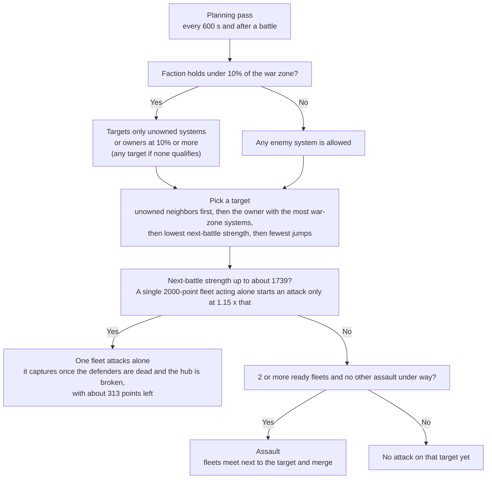
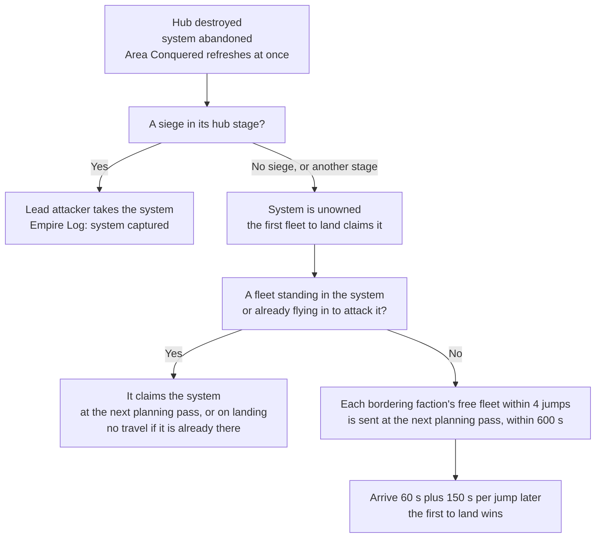
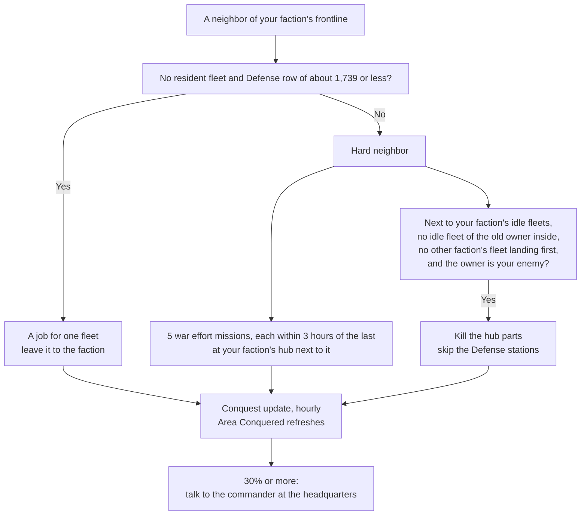

# Sector Control

This page covers the 30% sector-control mission and what you can and cannot do in the war before you hold a system of your own. It applies from the level 28 story step into the Conquest sector ([Conquest](README.md)) until you accept "Beyond the Front" ([gate](../expansion/README.md)). Values were read from the game code of version 0.8.3.4 (the decompiled source, not in-game testing). The code was then compared with the 0.8.3.5 source, and every statement that changed there was rewritten. Anything not confirmed in code is marked `(not verified)`. The last section, "In the Game Code", has the method names behind each claim.

Terms and abbreviations are explained in the [conquest glossary](glossary.md) and the [basics glossary](../basics/glossary.md). Battles, the Defense number and NPC fleet planning are in [war](war.md).

## The 30% Sector-Control Mission

Three story missions ask you to push one faction to 30% of the systems in the Conquest sector: "Hostile Takeover" (Stellar Industries), "The People's Sector" (Kolyatov Collective) and "Harmony" (Luminate Combine). Finishing any one of them is required before "Beyond the Front" is offered (see [the gate](../expansion/README.md)). You cannot hold systems yourself at this point, so your play changes the outcome only by nudging a war that NPC (non-player character) factions fight on their own. This section covers how to get the mission, what its objective counts, where in the game you can read progress, how the war behaves without you, what moves the share, and a plan.

> In short
> 30% means your chosen faction owns 30% of the systems in the Conquest sector. That is 21 to 27 systems, depending on how many the galaxy has (the world generator makes 70 to 84, but a save checked in play had 88).
> Progress shows in two places: the "Area Conquered" row for that faction (press E on the galaxy map, open the Factions tab and click the faction) and the mission's own objective line, "Conquer for {faction} {current}/30.00%".
> The number refreshes once an hour, when the "Conquest Update" countdown on the galaxy map runs out. It also refreshes at once when a system is abandoned (a hub kill). A capture by siege, or by a fleet arriving at an unowned system, shows up late.
> To win, let the faction's own fleets take the systems that a single fleet attacks. Those have no resident fleet and a next-battle strength of about 1,739 or less, for a full 2,000-point fleet. Help on the harder ones with war effort missions. Destroy a hub only where your faction has idle fleets next door and the old owner has none in the system. Be standing at the faction's commander in its headquarters when the number reads 30% or more.

Some terms before the details. The war zone is every system where factions fight over ownership, which is the Conquest sector (Ara Martis, the original war zone). Only the Conquest sector counts for this mission. Every war-zone system has a hub, its main station (the map calls it "Space Station"), which carries the owner's flag. Destroying the hub abandons the system. A faction's headquarters is the one system it cannot lose to a fleet, and its hub has the faction's commander and shop. An ordinary owned system that fleets can besiege and capture is an outpost system.

In the code: [The 30% Sector-Control Mission](#code-the-30-sector-control-mission).

### Spoiler: Getting the Mission

1. The story mission "Sector Control" asks you to find the three embassies (each faction's neutral station in the Staging sector, outside the war zone) and talk to their representatives. Its description says "The choice of faction is not permanent".
2. Talking to a representative offers to align you with that faction. The offer is refused if the faction is your enemy, and refused while the faction has no headquarters. The game counts a faction as your enemy when you are at war with it or your reputation with it is below -500. Reputation is a number that the game shows as a level name. Below -500 means the Wary level (except exactly -500) or any worse level, while Neutral covers -499 to 1,499 (all bands are in the [glossary](../basics/glossary.md#reputation)). Otherwise you are asked to confirm, and the faction's first mission is added ("Internship" for Stellar, "For the Collective!" for Kolyatov, "Alignment" for Luminate).
3. The first mission has four steps: fly to the faction's embassy gate, go to its headquarters and talk to the commander, earn 10 contribution points by running missions for that faction ("Run missions for {faction}"), and talk to the commander again. The 10 points are a counter that only runs while that third step is current, so missions you finished before talking to the commander do not count toward it. The same amounts also add to "Your Contribution" on the Faction overview. That is your conquest standing with the faction, and it sets your conquest rank. The wealth your embassy missions bring is a separate thing. Each completed Conquest mission from that faction's hub or embassy adds its contribution amount. Such a mission is one on the mission board of a war-zone hub that raises war effort, or of an embassy that gives wealth. The base amount is 3 to 6 points, or 1 to 3 for ECHO's idle missions (the ones ECHO, your ship's AI companion, completes while you are away). It is doubled when the mission's enemy is a conquest faction other than the Corsair Syndicate and Meridia's Chosen, and a bonus from your conquest rank with that faction is added. That is 2 to 4 missions at the base amount, or 1 to 2 when the doubling applies. The mission pays 2,000,000 credits, 60 Vanguard Marks (the currency used to buy ships and systems), XP (experience points) and the second mission.
4. The second mission ("Hostile Takeover", "The People's Sector" or "Harmony") has the percentage step and the report-back step. It cannot be abandoned and has no time limit. It pays 400 Vanguard Marks, 10,000,000 credits, 1 skill point and XP.

You can start the missions for more than one faction. Standings are tracked for all conquest factions all the time, and the game accepts any of the three second missions as the requirement. So the cheapest route is whichever of your factions the war favors. The percentage step is complete the moment the mission starts if the faction is already at 30%.

Reputation matters for the alignment check. Whether a low reputation with your chosen faction later blocks docking or talking at its headquarters is `(not verified)`. No other reputation threshold gates the mission in code.

In the code: [Getting the Mission](#code-getting-the-mission).

### What the Objective Counts

```
percentage = (systems owned by the mission's faction) / (all systems in the Conquest sector)
complete   = percentage >= 30%
```

| Question | Answer |
|---|---|
| Which systems count | Systems owned by exactly that faction. Its headquarters counts. Allies, other factions and systems with no owner do not count. You cannot hold a system yourself before claiming unlocks, and a system you held would not count for the faction anyway. |
| What the total is | Every war-zone system in the Ara Martis part of the Conquest sector, owned or not. Unowned and abandoned systems, and every rival's headquarters, are in the total. The Darkspace region (Penumbra and its neighbours), the staging sectors and the Frontier are not. |
| How many systems that is | The Ara Martis area is built from seven batches of 10 to 12 systems, so it has 70 to 84 systems when the galaxy is created (derived). A save checked in play had 88 systems in Ara Martis, so the total can be higher. Where the extra systems come from is `(not verified)`. The game does not show the total. |
| When it is computed | The game stores the percentage for every conquest faction at the start of every conquest update. That is the hourly step (3600 s of game time, 1 hour) whose countdown the galaxy map shows as the "Conquest Update" card. Loading a save on a later calendar day also runs 1 to 5 catch-up updates. The percentage is also stored whenever a system is abandoned, which includes a hub kill and the hand-over to a besieging fleet that follows it. A capture by siege, or a claim by a fleet arriving at an unowned system, does not refresh it. So the stored value, and the objective, lag the map by up to an hour. |
| What the interface shows | The objective reads "Conquer for {faction} {current}/{30.00%}", where current is the stored value with 2 decimals. The "Area Conquered" row on the Faction overview for any conquest faction is the same stored value. |
| Can it go backwards | Yes. Every conquest update recomputes it from the current owners. |
| Do you need to hold 30% | Only at the moment you talk to the commander. Nothing locks the objective in once it reads 30%. Mission steps are checked in order, and the first incomplete one is the current step. The final step ("Go to the {faction} HQ and talk to {commander}"; the game's text shortens headquarters to "HQ") only counts your conversation with the commander while the percentage step is complete. So the stored value must be at 30% or more when you talk to the commander in the headquarters. After that the mission completes, and later drops do not matter. A value that reached 30% at one conquest update and is gone by the next is enough if you are already at the commander. |

Systems needed, derived from the rule that systems divided by total must be at least 0.3:

| Total systems | 70 | 71 to 73 | 74 to 76 | 77 to 80 | 81 to 83 | 84 to 86 | 87 to 90 |
|---|---|---|---|---|---|---|---|
| Systems the faction must own | 21 | 22 | 23 | 24 | 25 | 26 | 27 |

To find your total, count the faction's systems in the Conquest sector on the galaxy map and divide by its Area Conquered percentage.

In the code: [What the Objective Counts](#code-what-the-objective-counts).

### Where to Read Progress

Everything the plan below asks you to check is on screen somewhere. These are the places to look:

- The Faction overview. On the galaxy map, press E or click the Empire button in the map's corner panel (tooltip "Empire (E)"). The key does nothing while you type in a text field, and the window is locked during the prologue. The window is titled "Empire". Open its Factions tab (in 0.8.3.5 an icon-only tab with a flag; the name shows when you hover it), then click a faction in the list. For a conquest faction, the detail shows three rows: Headquarters (the system's name), Area Conquered and Your Contribution. The Log tab (also icon-only now) is the Empire Log, your record of battles, captures and claims. It says "system captured", "attack repelled" and so on (see [Outcomes](war.md#outcomes)).
- The Conquest Update card. In the corner panel of the galaxy map, a card titled "Conquest Update" has a countdown and a bar that drains over 3600 s. Its tooltip reads "Damaged stations are rebuilt and factions rethink their strategy". When the countdown ends, the conquest update runs and Area Conquered refreshes. It is one of three clocks. The game does not show the 600 s planning pass or the hourly economy tick. The conquest update itself does not assign fleet orders, whatever the tooltip says (see [Cadence](war.md#cadence)).
- A system's tooltip. Hover a war-zone system on the galaxy map. Its conquest section has the Defense row and the "Your war effort" row. The Defense row (the Defense number) is the strength the defenders put into a siege round, counted in points (the game's fleet cards call the same unit "strength"). It adds up the hub's firepower, the garrisons of the system's Defense stations, and the fleets defending the system. A Defense station is an extra station that fires on enemies and holds a garrison, which is a group of warships stationed in it. War effort is a temporary multiplier on a system's station firepower. Conquest missions you complete raise it, and it lasts 3 hours from the last one. The row is green for a bonus and red for a penalty, and it shows the time left.
- Next-battle strength. The game never shows this figure. It is what NPC fleets compare themselves against (see [What NPC Factions Use Instead of the Defense Number](war.md#what-npc-factions-use-instead-of-the-defense-number)). You can estimate it from what you do see. With no Defense station in the system, it equals the Defense row (plus any same-faction fleets already on the way). With Defense stations, it is lower: the weakest Defense station's own firepower plus its garrison plus all defending fleets (plus fleets on the way). So the Defense row is the upper bound, except in the hours after a system changes owner. While the system is settling, the row halves the stations' firepower, but the figure for a system with Defense stations does not, so it can then be higher.
- Fleet icons and their labels. Fleets show as icons on the galaxy map. Each has a label for its current order, for example "Attacking", "Gathering for an assault" or "Holding position". All labels are listed in [Fleet Labels on the Map](war.md#fleet-labels-on-the-map).
- The siege banner. Hovering a hub, or its system, during the hub stage of a siege shows "Under Attack! Holds {n} min at most". A Defense station's own tooltip shows the same line while that station's stage runs.
- The mission board. Each Conquest mission lists its reward line, for example "+10% Station firepower, -10% for X next system". The part after the comma names the faction whose neighbouring systems get the war effort penalty.

In the code: [Where to Read Progress](#code-where-to-read-progress).

### What the War Does Without You

At the start of the game, Kolyatov, Stellar and Luminate each get 3 systems, and Meridia's Chosen get 3. The Darkspace Compact gets everything else, because its starting claim limit is unlimited while the others stop at 3. With 70 to 84 systems that is about 58 to 72 Darkspace systems and 3.6% to 4.3% for each major (derived from the partition rules; the map shows the real start). Every war faction starts with fleets filled to its fleet cap, which is the number of fleets it may field (each one fills a fleet slot). That is 5 fleets of 2000 points. The cap is 5 fleets plus 1 for every 15 systems held, up to 8, and Darkspace is fixed at 5 until the expansion war opens.

What limits an NPC capture:

- Which target: only neighbours of a system the faction already owns. A faction with no such border looks at any open system. Unowned neighbours come first, then the owner with the most war-zone systems, then the lowest next-battle strength, then the fewest jumps. A single fleet acting alone starts an attack at 1.15 times next-battle strength or better, so a 2000-point fleet can start on anything with next-battle strength up to about 1739. Above that, the faction needs an assault: several of its fleets meeting next to the target and merging to attack it. An assault needs at least 2 ready fleets, and a faction runs one assault at a time (see [Assaults](war.md#assaults)).
- Finishing an attack: a siege captures once every defender is dead and the hub's structure is broken, with the attackers still holding 1.25 times the Defense left at that moment. By then the Defense is down to the 250 floor (times war effort), so about 313 points must be left, and the 1.25 margin rarely decides a capture by itself. What decides it is whether the attackers kill the garrisons, the defending fleets and the structure inside the 1800 s stage while the defenders shoot back. A siege that reaches the cap with the structure standing ends in a skirmish (attacker points at least the Defense left) or a repelled attack.
- How long: a clash (the game's Fleet Battle) against a resident fleet runs up to 600 s. Each Defense station is its own siege stage of at least 600 s, and the hub stage is at least 600 s. Damage reaches a station's structure only after every defending ship in the fight is dead. A 2000-point fleet breaks a medium hub's structure in about 10 rounds, so a hub with no defending ships falls at that 600 s minimum if the fleet also meets the capture margin. Travel is 60 s plus 150 s per jump. Some outcomes of a siege block that fleet from the same system for 3600 s (which ones is in [Outcomes](war.md#outcomes)). Nothing in the code caps captures per hour, so an unopposed fleet can in principle finish one every 11 minutes or so plus travel (derived).
- Planning cadence: orders are reassigned for every faction every 600 s, at the hourly economy tick, and at once for the factions of a battle that just ended.
- What a resident fleet does: a 2000-point fleet in a system pushes its next-battle strength above the single-fleet limit, so those systems wait for an assault.
- The peace rule: a faction holding under 10% of the war zone (fewer than 7 to 9 systems) only targets unowned systems or owners at 10% or more. If that leaves it no target at all, it falls back to every target. At the start none of the three majors is at 10%, so they ignore each other and only go after Darkspace and unowned systems. Once your faction passes 10%, any major still below it that borders it treats it as a legal target, though Darkspace stays the preferred one while it is larger.



Two things help a faction that is behind (see [Catch-Up Mechanics](faction-economy.md#catch-up-mechanics)). The first is the home subsidy. Wealth is the money a faction spends on warships and stations, and the Faction overview shows it as "Economic Power". The home subsidy is wealth handed to Kolyatov, Stellar, Luminate and Darkspace every hour, larger the smaller their share of the war zone. It is the "Home subsidy" line of the faction ledger, not the taxes a faction earns from its systems. The second is the Great Gate reinforcement. It is a 1500-point fleet that appears from the Great Gate (a map location) for the three majors when they have few fleets.

| Share | Home subsidy per hour (Kolyatov, Stellar, Luminate, Darkspace) | Great Gate reinforcement |
|---|---|---|
| Start (3.6% to 4.3%) | about 104,600 to 107,100 | Free, if the faction has 2 fleets or fewer |
| 10% | 84,000 | Paid from wealth, if the faction has 2 fleets or fewer |
| 20% | 48,000 | Paid |
| 30% | 12,000 | Paid |
| 33.3% or more | 0 | Paid |

The Great Gate reinforcement is 1500 points. It appears when the faction has fewer than half its fleet cap (2 or fewer of 5), at most once every 13 hourly economy ticks. The hourly economy tick is the separate hourly step that pays taxes and the home subsidy and plans builds, and the game does not show it. The reinforcement is free when the faction holds under 10% of the war zone or has no fleets at all, and paid from wealth otherwise. Darkspace gets the home subsidy but no Great Gate reinforcements. A faction that is wiped to no systems sits out 5 conquest updates, then its fleets start claiming systems again. Every build is half price and three times faster while a faction has fewer fleet slots than its cap.

For scale, a war-zone system pays 5,000 to 15,000 per hour in taxes (the "Taxes" ledger line) before doubling. That makes 10,000 to 30,000 in the war zone, and none while the system is in unrest (the first 1 to 2 hours after a system changes owner). Three systems earn about 60,000 per hour on top of the home subsidy (derived).

In the code: [What the War Does Without You](#code-what-the-war-does-without-you).

### What Moves Your Faction's Share

The frontline is a faction's systems that touch an enemy or unowned war-zone system. That is where its fleets push. In the table, "non-idle" missions are the ones you fly yourself, not the ones ECHO completes while you are away.

| Lever | What it changes | Cost and limits |
|---|---|---|
| Lower the next-battle strength of a hard target | Every point of next-battle strength you remove cuts what attackers must bring by 1.15. Killing a resident 2000-point fleet takes a target from needing an assault to one a single fleet can start, and leaves 2000 fewer points of defenders to kill before the hub. Killing garrison ships at its Defense station removes up to 900 (270 to 900 by tier). | Real combat against ships at the NPC fleet level (see [What You Face](#what-you-face)), near stations with 20 times the normal hit points (HP). Fleets can be intercepted from the map. |
| War effort penalty on the target | Removes 125 to 350 from the target's station term at the cap. That lowers the points attackers need to start an attack by about 144 to 403. The station also fires at half strength through the siege. | You need 5 non-idle missions, each within 3 hours of the one before (the penalty clears 3 hours after the last). Fly them at your faction's hub in a system next to the target. Each mission must name the target faction as its enemy (reward line "-10% for X next system"). |
| Kill the hub, not the Defense stations | The hub goes down and the system is abandoned. A fleet of your faction takes it only under the conditions below. When the system is claimed, the old owner's Defense stations are destroyed too, so you skip them. | Hub parts have 20 times the normal HP. The owner must already be your enemy, because you cannot force-attack a station and a plain click only targets enemies. Part kills cost 5 reputation each if you are at -500 or lower with the owner, and 100 each otherwise. A hub does not count as a faction station, so the -5000 station penalty does not apply. |
| Kill the Defense station live while your fleet besieges it | The siege stage ends at once ("Defense station destroyed" in the Empire Log). | -5000 reputation if a part you hit was among those destroyed (-1000 if you are already Hostile or worse, at -5000 or lower), plus part kills. |
| War effort bonus at your frontline hubs | Adds up to +250 to 700 of Defense to the systems that rivals attack. This protects the share you have. | You need 10 missions at the system, or 20 at a neighbour, each within 3 hours of the one before (the bonus clears 3 hours after the last). |
| Embassy missions | 80,000 to 120,000 wealth each, a random amount that averages 100,000 (that is where "about 100,000" comes from). Idle missions pay half, so 40,000 to 60,000. A full 2000-point fleet costs roughly 40,000 to 130,000 at full price `(not verified)`. | They help rebuild a lost fleet at once. They do nothing for a faction whose fleets are already full, and they do not raise the fleet cap. |
| ECHO idle Conqueror missions | Each idle mission adds a step of 0.1 x (1 + 0.2 x node points) ("ECHO The Conqueror" skill). | Idle missions also pay a smaller share of contribution and wealth. |
| Intercepting enemy deliveries | A killed delivery is a ship their wealth already paid for. | -1000 per ship force-attacked and -3500 per kill if your reputation with the faction is Wary or better when it dies. It costs nothing if the faction is already your enemy. It rarely moves a system count. |

The hub-kill conversion is what happens after you destroy a hub. The system is abandoned. The Empire Log says "Lost control of {system} - its station was destroyed.", and the Area Conquered numbers refresh at once. Because claiming is locked for you, what happens next depends on any siege there:

- If a siege is in its hub stage, the game hands the system to that siege's lead attacker ("system captured" in the Empire Log), unless that attacker is a raider faction.
- If the siege is in any other stage, or there is none, every fight there ends and the system is unowned until a fleet claims it ("Claimed {system}."). The first fleet to land claims it.

Which fleet lands first:

- A fleet already flying in to attack the system claims it on landing.
- A fleet standing in the system claims it at the next planning pass with no travel, so the old owner's idle fleet there takes it straight back.
- Otherwise each faction that owns a system next to it sends the fleet that its planning picks at its next planning pass, within 600 s (at once for the factions of a fight that just ended there). A faction with no frontline looks at any open system. Its idle fleets are taken in list order, less those going to a refit, answering a distress call at a system of their own or gathering for an assault. Each takes its best target within 4 jumps, with an unowned system first (next-battle strength 0, so no fleet is too weak). That fleet arrives 60 s plus 150 s per jump later, and the first to land wins.

So do it where your faction has a system next door and a free fleet within 1 or 2 jumps, where the old owner has no idle fleet in the system, and where no other faction has a fleet closer or already on its way.



In the code: [What Moves Your Faction's Share](#code-what-moves-your-factions-share).

### Pitfalls

- A hub kill with no hub-stage siege by your faction in the system leaves it unowned for the first fleet that lands. Only factions that own a neighbouring system consider it. A faction with no frontline considers any open system. Claims by an arriving fleet need no siege and no wait. A fleet already flying in to attack it, or a nearer fleet of another faction, lands before yours. The old owner's own idle fleet standing in the system claims it back at the next planning pass with no travel, so a hub kill is wasted there.
- A hub kill during a rival's siege hands the system to that rival at once if the siege is in its hub stage (and the rival is not a raider faction).
- You cannot shoot a hub of a faction that is not your enemy. Making it an enemy costs reputation first: one force-attacked kill is -1000 and -3500, about -4,500 in total, which is enough to make most factions enemies (under -500). Check the faction's reputation before you commit.
- Reputation with the Darkspace Compact matters later. The "Beyond the Front" questgiver stands at the Darkspace embassy ([gate](../expansion/README.md)). Whether bad reputation blocks docking there is `(not verified)`.
- Wiping a faction's fleets completely frees fleet slots. Below its cap every build is half price and three times faster. Kolyatov, Stellar and Luminate also get a 1500-point Great Gate reinforcement when they are at 2 fleets or fewer (free below 10% share or with no fleets left). Darkspace gets only the cheaper rebuild. Killing ships out of a fleet that survives does not free a slot.
- Pushing a faction to 0 systems makes it sit out for 5 conquest updates, after which its fleets start claiming systems again. It is a delay, not a removal.
- When your faction passes 10%, the smaller majors that border it can start attacking it. When it is larger than Darkspace, every NPC faction that borders it prefers it as a target, because the owner with the most systems is picked first.
- War effort needs a mission from a hub in a war-zone system. Embassy missions are outside the war zone and give wealth only. Missions at another faction's hub strengthen that faction's stations.
- The 30% value is stored hourly, so a capture an hour before you talk may not show yet. Watch the Conquest Update card.
- Wealth and fleets do not raise the fleet cap. The cap rises only with systems held: to 6 at 15 systems and to 7 at 30.

### A Step-by-Step Plan

1. Choose the faction. Press E on the galaxy map, open the Factions tab and click each major faction to read its Area Conquered and Headquarters rows. Pick one that is not your enemy, has a headquarters, and has a frontline with Darkspace Compact systems (its systems sit next to theirs on the map). Its second mission needs 30% of the total, rounded up (21 to 26, see the table above).
2. Finish the first mission. It needs 10 contribution points, counted only after you have talked to the commander in the headquarters. Take Conquest missions for that faction from its hub's mission board or from its embassy, because both count. Prefer hub missions whose enemy is a conquest faction other than the Corsair Syndicate and Meridia's Chosen, because their contribution is doubled. The objective line "Run missions for {faction}" shows your count.
3. Find the frontline on the galaxy map. It is made of your faction's systems next to Darkspace systems. Hover or click the fleet icons nearby. Fleets labelled "Attacking" and "Gathering for an assault" show where its next push goes.
4. Hover each neighbouring system and read the Defense row. A neighbour with no resident fleet and a Defense row of about 1,739 or less is a job for one full 2000-point fleet. That fleet attacks at 1.15 times the next-battle strength, which equals the Defense row when the system has no Defense station, and a hub with no defenders breaks in about 10 rounds. The NPC faction will take it itself within a planning pass or two, so leave it alone. If the system has Defense stations, its real next-battle strength is lower than the row, and each station and then the hub is a separate stage.
5. Spend your time on the hard ones. For a neighbour with a resident 2000-point fleet, do 5 war effort missions at your faction's hub next to it, each within 3 hours of the one before. Choose missions on the hub's mission board whose reward line names that faction ("-10% for X next system"). That cuts the attackers' requirement by about 144 to 403 points. It does not remove the fleet. The red "Your war effort" row in the target's tooltip shows that it worked and how long it lasts.
6. Kill a hub only where it can convert. Check these first. The owner is already your enemy, and the target is next to one of your faction's systems. Your faction has free fleets within 4 jumps (idle icons labelled "Holding position" or "Guarding faction space", not on their way to a refit or an assault). The old owner has no idle fleet in the system, and no other faction has a fleet closer or already flying there. Then fly to the system and kill the hub parts (20 times the normal HP, 5 reputation each at -500 or lower). Do not bother with its Defense stations. The Empire window's Log tab shows "Lost control of {system}" at once and "Claimed {system}" when the first fleet lands.
7. Watch the clock. The conquest update is hourly, and the Conquest Update card on the galaxy map counts it down. A siege capture or an arriving fleet's claim shows up only at the next update (a hub kill shows at once), so finish captures well before the countdown ends. Then be docked at the headquarters (the "Gate to {faction} headquarters" at the faction's embassy leads there). Talk to the commander as soon as the Area Conquered row or the objective line shows 30% or more.
8. If your faction stalls below 10%, the Great Gate reinforcement and the home subsidy (84,000 to 120,000 per hour at a war-zone share between 10% and 0%) already work for it. Do not try to wipe a rival major's fleets outright. A wiped fleet frees a slot, which halves its build costs and triples build speed. A major at 2 fleets or fewer also gets a 1500-point Great Gate reinforcement.



Not verified:

- How fast the three majors actually grow on their own (no rate exists in code, only the limits above).
- Whether bad reputation with the Darkspace Compact blocks docking.
- Whether bad reputation with your chosen faction blocks its headquarters.
- The points of the "ECHO The Conqueror" node.
- Whether idle ECHO missions choose the aligned faction's hubs.
- The total number of systems in your galaxy (derived from the generator, not read from a save).
- The wealth cost of a full fleet (it depends on the ships picked).

In the code: [A Step-by-Step Plan](#code-a-step-by-step-plan).

## Level 60 or Below

This section applies until you accept "Beyond the Front" ([gate](../expansion/README.md)).

### What You Can and Cannot Do

| You can | Notes |
|---|---|
| Run Conquest missions | Each completed mission from a war-zone station adds war effort (see [War Effort](war.md#war-effort)). This needs no system of your own. |
| Let ECHO run idle Conquest missions | The step is larger: 0.1 x (1 + 0.2 x points) in the "ECHO The Conqueror" node. The node's maximum point count is in game data and not read here `(not verified)`. |
| Attack stations and ships live | Hubs take 20 times the normal HP (30 times at a headquarters); see [War Stations](war-stations.md). You can only target a station's parts with a plain click if its faction is already your enemy, and force-attacking a station is not possible. Destroying a faction station (not a hub) costs -5000 reputation with that faction if a part you hit was among those destroyed, or -1000 if you are already Hostile or worse (-5000 or lower). |
| Intercept fleets and warship deliveries | Intercepting a fleet builds its real ships at the intercept zone, and losses come off the fleet. If the faction is not your enemy, confirming the force attack costs -1000 reputation for each ship you first target. Each kill of a force-attacked ship costs another -3500 if your reputation with the faction is still Wary or better when the ship dies. Enemy ships cost nothing. |
| Join a smaller faction's war | A faction with an embassy and no headquarters of its own can be joined once your embassy missions have brought it 1,500,000 wealth, or once you have paid a 10,000,000 credit donation. The factions that can be joined this way are the Mining Guild, Salvage Guild, Corsair Syndicate and Stranded. The requirement and what the faction gets are in [Joining a Faction's War](faction-economy.md#joining-a-factions-war). |
| Destroy a hub in a siege | Destroying a hub live ends the fight and abandons the system. With claiming locked, the besieger takes it if it was in the hub stage of a siege. Otherwise the system is unowned and a fleet of a faction bordering it claims it (see [the hub-kill conversion](#what-moves-your-factions-share)). |

| You cannot | Why |
|---|---|
| Claim, buy or hold a system | The game refuses with "Claiming systems unlocks with Beyond the Front". |
| Anything that needs a system of your own | Fielding Empire Fleets, building economic outposts, Defense stations or patrols, and the Empire Level tile and line all unlock with Beyond the Front ([Your empire](../expansion/your-empire.md), [Empire fleets](../expansion/empire-fleets.md)). Other ways the game might give you a station before your first claim are `(not verified)`. |

In the code: [What You Can and Cannot Do](#code-what-you-can-and-cannot-do).

### What You Face

- Systems: Ara Martis systems are created at level 32 to 36. Each conquest update (hourly) lifts every system by 2 if you are more than 3 levels above it, by 1 if you are 1 to 3 levels above it, and by 1 with a 50% roll if it is level with you or up to 3 levels above you. A system 4 or more levels above you does not rise, so systems settle around your level plus up to 4 (derived).
- NPC fleet ship level: the higher of your effective level and the highest conquest system level, plus 6. At the start (level 28) the highest system is level 32 to 36, so fleets are up to level 42, your level plus up to 14 (derived; the highest system level in your galaxy is not shown). Systems never drop. From about level 32 on, once they have risen to your level plus 4, fleets are at your level plus 10 (derived). Fleet target size is 2000 points regardless of your level. The number of fleets per faction is in [Faction Economy](faction-economy.md).
- Station turrets: below system level 45, generated conquest stations always use small turret platforms (the "S2" platform: two small turrets, the Small Turret Mk II). At level 45 or higher each such platform is rolled 50/50 between two medium turrets ("M2", the Medium Turret Mk II) and one large turret ("L1", the Large Turret Mk I). A Defense platform's score uses its weapon size total, where each turret counts Small 1, Medium 2 and Large 3 (and at least 1). Below level 45 that total is 2 (90 hull, 80 firepower); at level 45 or higher with two medium turrets it is 4 (120 hull, 160 firepower). See [war-stations](war-stations.md) for per-part data. A station that has never been visited has not been generated yet, so its score uses the flat estimate for its size instead: 240 firepower for a small station, 480 for a medium one and 560 for a large one.
- Garrisons: ship count and budget follow the station tier, not your level (3 to 8 ships, 270 to 900 points). Garrison ship levels follow the NPC fleet level above.
- Station hit points (HP): live hubs and Defense stations take 20 times the normal HP, and headquarters hubs take 30 times.

In the code: [What You Face](#code-what-you-face).

### Most Efficient Approach

What matters before your first system is that your own faction reaches 30% of the Conquest sector, because that opens "Beyond the Front". You cannot hold anything yourself, so every action here is a nudge to the war between NPC (non-player character) factions. The counting rule, the faction behaviour you are pushing against, the ranked levers, the pitfalls and a step-by-step plan are in [The 30% Sector-Control Mission](#the-30-sector-control-mission).

Embassy missions give the faction wealth in place of war effort (amounts are in the Embassy missions row of [the levers table](#what-moves-your-factions-share)). Faction wealth buys warships (see [Faction Economy](faction-economy.md)).

In the code: [Most Efficient Approach](#code-most-efficient-approach).

## Numbers to Watch

| Number | Value | Why |
|---|---|---|
| 1.15 | NPC attack margin | Attackers need this ratio over next-battle strength. |
| 1.25 | Capture margin | Attackers need this ratio over current Defense to capture. |
| 600 s | Minimum siege time before capture | The minimum applies to each stage. |
| 1800 s / 600 s | Siege / clash cap | A stage's maximum length when simulated. |
| 60 s, 4%-6% | Round length, damage share | A fleet deals about 5% of its strength per round. |
| 250, 700 | Station firepower floor and cap | Station firepower above the cap adds nothing to Defense. |
| 0.5 times | Settling and war effort floor | Settling halves the station profile. A full war effort penalty halves the station term. |
| 35% / 75% | Retreat / recovery thresholds | NPC fleets retreat below 35% and are ready again at 75%. |
| 3600 s / 10800 s | Re-attack block after a stalled siege / war effort duration per mission | Both are per-event timers, not a schedule. |
| 14400 s | Raid cooldown per station | The station cannot be raided again until the cooldown ends. |
| 30% | Faction share to finish the sector control mission | Needed before "Beyond the Front" is offered. |

## In the Game Code

This part is the decompiled code behind the sections above: class and method names, formulas as the code writes them, and the `Source:` lines. It was read in version 0.8.3.4 and compared with the 0.8.3.5 source. To check a claim, search the decompiled source for the method name. Anything not confirmed in code is marked `(not verified)`.

### Code: The 30% Sector-Control Mission

| Mission | Faction | Id |
|---|---|---|
| "Hostile Takeover" | Stellar Industries | `ConquestStellar2` |
| "The People's Sector" | Kolyatov Collective | `ConquestKolyatov2` |
| "Harmony" | Luminate Combine | `ConquestLuminate2` |

The war zone is the set of `ConquestSystem` objects; the original war zone is the Ara Martis conquest sectors.

#### Code: Getting the Mission

| Step | Mission id |
|---|---|
| Find the three embassies | `ConquestThreeFactions` ("Sector Control") |
| First mission | `ConquestStellar1` "Internship", `ConquestKolyatov1` "For the Collective!", `ConquestLuminate1` "Alignment" |
| Second mission | `ConquestStellar2`, `ConquestKolyatov2`, `ConquestLuminate2` |

Alignment: `ConquestMissions.FactionAlignmentChoice` makes the offer and `FactionData.IsEnemy` supplies the enemy test. The conquest rank bonus on each contribution amount is `GetFleetStrengthRewardBonus`. The percentage step and the report-back step are built by `ConquestMissions.CreateFactionConquestProgressMission`, the first mission by `ConquestMissions.CreateFactionHQIntroMission`. `HasCompletedSectorControl` accepts any of the three second missions. The 10-point step is `ConquestFleetStrength`; `MissionObjective.Trigger` only reaches the current step of a mission, so contribution earned while an earlier step is still current does not count toward it. `ConquestStrength.OnComplete` adds the same amount to `playerContribution` and fires `EarnCombatStrengthForFaction`. The amount is `round((3..6, or 1..3 idle) x (2 if the enemy is a conquest faction other than Marauders and Fanatics) x (1 + rank bonus))` from `MissionGenerator.AddRewards`.

Source: `ConquestMissions.FactionAlignmentChoice`, `ConquestMissions.CreateFactionHQIntroMission`, `ConquestMissions.CreateFactionConquestProgressMission`, `ConquestMissions.HasCompletedSectorControl`, `Characters.AlignWithMajorFaction`, `ConquestFleetStrength`, `ConquestStrength.OnComplete`, `MissionGenerator.AddRewards`, `FactionData.IsEnemy`

#### Code: What the Objective Counts

```
percentage = (conquest systems owned by the mission's faction) / (all conquest systems)
complete   = percentage >= 0.3
```

| Question | Answer |
|---|---|
| Numerator | Systems whose owner is exactly that faction (`sys.faction == faction`). |
| Denominator | Every war-zone system (`ConquestSystem`) in the Ara Martis conquest sectors. |
| How many systems that is | The Ara Martis area is seven draws of 10 to 12 systems (`CreateContinuousAraMartis`, `SeededRandom.RandomRange` excludes its upper bound), so 70 to 84 systems at creation. A save checked in play had 88 `ConquestSystem`s across Ara Martis I to VII (`Conquest.systems`, the denominator), so the total can be higher; how is `(not verified)`. |
| When it is computed | The game stores the percentage (`currentConqueredPercentage`) for every conquest faction at the start of every conquest update, the hourly step (3600 s of game time; `Conquest.DoConquestTick` calls `UpdateFactionStandings`). `Conquest.Start` runs up to 5 catch-up ticks (`ComputePendingDayTicks`, by calendar day) on load. It is also stored when a system is abandoned: `ConquestOwnership.Abandon` calls `HandOverToClaimant` first and then `Conquest.OnSystemAbandoned`, which calls `RefreshStandingsAndGates`. A siege capture (`BattleManager.ApplyDecisiveStationCapture`) and a claim on arrival (`ConquestOwnership.Claim`) do not call it. |
| Do you need to hold 30% | No latch exists on the objective. Mission steps are checked in order (`Mission.currentStep`), and the first incomplete one is the current step. The final step only receives your talk event (`MissionObjective.Trigger`) while the percentage step is complete. |

Systems needed: `count / total >= 0.3`.

Source: `SystemsConquered.IsComplete`, `SystemsConquered.statusText`, `Conquest.UpdateConquestArea`, `Conquest.UpdateFactionStandings`, `Conquest.DoConquestTick`, `Conquest.RefreshStandingsAndGates`, `Conquest.PopulateSystems`, `Conquest.IsWarZoneSector`, `ConquestWorld.CreateContinuousAraMartis`, `Mission.currentStep`, `MissionObjective.Trigger`, `FactionOverviewContent.AddConquestRows`

#### Code: Where to Read Progress

The conquest card is built by `MapCornerPanel.BuildConquestCard` (strings `MapConquestUpdateTitle`, `MapConquestUpdateTooltip`), the E hotkey is handled in `MapCornerPanel.HandleHotkeys`, and the Empire window is `EmpireWindow` (tab string `FactionOverviewTab` = "Factions", log tab `EmpireTabLog`). `CommandTabUnlocks.IsEmpireWindowUnlocked` is the prologue lock. The three conquest rows come from `FactionOverviewContent.AddConquestRows`, the tooltip rows from `MapTooltipCardBuilder.BuildConquestSection`, fleet labels from `ConquestFleetMapIcon.GetTaskLabel`, the siege tooltip from `ConquestStationUnderAttack`, and the reward line from `MissionGenerator.AddRewards`.

Source: `MapCornerPanel.BuildConquestCard` (strings `MapConquestUpdateTitle`, `MapConquestUpdateTooltip`), `MapCornerPanel.HandleHotkeys`, `EmpireWindow` (tabs, string `FactionOverviewTab` = "Factions", `EmpireTabLog`), `CommandTabUnlocks.IsEmpireWindowUnlocked`, `FactionOverviewContent.AddConquestRows`, `MapTooltipCardBuilder.BuildConquestSection`, `ConquestFleetMapIcon.GetTaskLabel`, `ConquestStationUnderAttack`, `MissionGenerator.AddRewards`

#### Code: What the War Does Without You

The three majors and Meridia's Chosen each stop at 3 systems and Darkspace gets the rest because of `ConquestWarSeeder.StartingClaimLimit` (unlimited for Darkspace, 3 for the others). The fleet cap is `5 + floor(systems / 15)` up to 8 (`ConquestFleetPlanner.MaxFleetsFor`) and Darkspace is fixed at 5 until `Faction.ExpansionWarOpen` (then `MaxTerritoryFleets` allows 12); the initial fleets come from `ConquestWarSeeder.SeedFleets`. Target choice and the 1.15 margin are in `ConquestFleetOrders.TryAttack`, the peace rule in `ConquestFleetOrders.ApplyPeace`, the 600 s planning pass in `LivingUniverse.TickMilitaryPlanning`, the Great Gate reinforcement in `GreatGateReinforcement.GetSubsidy`, `GreatGateReinforcement.NeedsReinforcement` and `GreatGateReinforcement.TryPay`, the wiped-faction return (the "beachhead rule") in `ConquestFrontline.GetBeachheadCandidates`, and the system tax roll in `FactionEconomicPlanner.RollSystemWealth`.

Targets and margins: candidates are the contested neighbours of the faction's own systems (`ConquestFrontline.GetAttackCandidates`); a faction with no such system uses `GetBeachheadCandidates`. `ApplyPeace` returns the unfiltered list when the filtered list is empty. `AttackTarget.IsBetterThan` sorts "continuing" (the fleet already in the system) first, then the larger owner (unowned counts as `int.MaxValue`), then lower next-battle strength, then fewer jumps. An attack starts at `fleet.totalPoints >= nextBattleStrength * 1.15`. A siege captures only if `GetAttackerPoints >= ConquestCombat.GetDefenseStrength(target) * 1.25` and the station structure is broken (`JudgeSiegeAtCap`, `CanCaptureEarly` after 600 s of siege; a Defense station stage uses `GetDefenseStationStrength * 1.25` in `CanTakeDefenseStation`). Structure only takes damage from the spill left after every defending ship is dead (`BattleSimulation.SpendPool`). A skirmish, raid or repelled outcome blocks the fleet from that system for 3600 s (`ConquestWarTuning.ReattackCooldownSeconds`). The Great Gate cooldown is set to 12 and decremented once per economy tick, and a fleet is only sent on a tick where it is already 0, so the gap is 13 ticks at best. `TryPay` is free when the faction has no fleets or its share is under 0.1. The subsidy is `120000 x clamp01(1 - share / (1/3))`.

Source: `ConquestWarSeeder.PartitionTerritory`, `ConquestWarSeeder.StartingClaimLimit`, `ConquestWarSeeder.SeedFleets`, `Conquest.AssignInitialSystems`, `ConquestFleetOrders.TryAttack`, `ConquestFleetOrders.ApplyPeace`, `ConquestFleetOrders.AttackTarget.IsBetterThan`, `ConquestFleetPlanner.MaxFleetsFor`, `LivingUniverse.TickMilitaryPlanning`, `GreatGateReinforcement.Tick`, `GreatGateReinforcement.GetSubsidy`, `GreatGateReinforcement.NeedsReinforcement`, `GreatGateReinforcement.TryPay`, `ConquestFrontline.GetAttackCandidates`, `ConquestFrontline.GetContestedNeighbors`, `ConquestFrontline.GetBeachheadCandidates`, `FactionEconomicPlanner.RollSystemWealth`, `BattleManager.JudgeSiegeAtCap`, `BattleManager.CanCaptureEarly`, `BattleManager.BlockReattackAfterStalledSiege`, `BattleSimulation.SpendPool`

#### Code: What Moves Your Faction's Share

| Lever | Code detail |
|---|---|
| Lower the next-battle strength of a hard target | Fleets can be intercepted from the map (`ConquestFleetInterceptTarget`). |
| Kill the hub, not the Defense stations | On the claim `ConquestOwnership.Claim` also razes the old owner's Defense stations, so you skip them. A hub is not a `FactionStation`, so the -5000 station penalty does not apply. |
| Kill the Defense station live while your fleet besieges it | `OnDefenseStationDestroyedLive` ends that stage as `DefenseStationDestroyed` ("Defense station destroyed" in the Empire Log) at once. |

The hub-kill conversion. When a hub dies, `ConquestOwnership.Abandon` runs (Empire Log string `EmpireLogSystemAbandoned`, "Lost control of {system} - its station was destroyed."). Because claiming is locked for you (`SystemClaim.GetRefusal` is not null), `HandOverToClaimant` calls `EndBattlesAt(..., besiegerClaims: true)`, which stops every battle at the system and hands it to the lead attacker of a siege in the hub stage (`StationSiege`; `Captured`, "system captured" in the Empire Log) if that faction `CanConquer` (is not a raider). If the siege is in any other stage, or there is none, the system is unowned until a fleet arrives: `BattleManager.OnFleetArrived` calls `ConquestOwnership.Claim` when `IsClaimableOnArrival` is true (`EmpireLogSystemClaimed`, "Claimed {system}."). Each stopped battle calls `RequestReplan`, which queues its factions for `PlanBetweenTicks`. Only fleets for which the system is an attack candidate go there (see above): `AttackTarget.IsBetterThan` ranks a fleet's current system first, then a larger owner (unowned counts as `int.MaxValue`), and `GetNextBattleStrength` is 0 for an unowned system, so any free fleet qualifies. `AssignOrders` leaves out fleets in a battle, defending on site, sent to a refit (`AssignRefit`), answering a distress call (`AssignDistressResponders`) or gathering for an assault (`AdvanceAssaults`), and `TryAttack` visits the rest in fleet-list order. The first fleet to land claims the system; the old owner's idle resident fleet takes it straight back at the next planning pass.

Source: `ConquestOwnership.Abandon`, `ConquestOwnership.Claim`, `ConquestOwnership.HandOverToClaimant`, `Conquest.OnSystemAbandoned`, `BattleManager.EndBattlesAt`, `BattleManager.OnFleetArrived`, `BattleManager.IsClaimableOnArrival`, `ConquestFrontline.GetContestedNeighbors`, `ConquestFleetOrders.TryAttack`, `ConquestFleetOrders.AttackTarget`, `ConquestWarEffort.Apply`, `MissionGenerator.GetConquestEnemyFactions`, `MissionGenerator.AddRewards`, `BattleManager.OnDefenseStationDestroyedLive`, `LootManager.HandleKillReputation`, `InterceptForceAttack.Attack`, `ConquestJoin.DeliverMissionWealth`

#### Code: A Step-by-Step Plan

The systems the second mission needs are `ceil(0.3 x total)`. Step 5 numbers come from `ConquestCombat.BoundStationFirepower`: the station term is `max(250 x m, min(firepower, 700 x m) x structureFraction) x warEffortMultiplier`, with `m` the sector station-defense multiplier (1 where no sector bonus applies). `ConquestSystem.AddWarEffortPenalty` caps the penalty at 0.5 and `AddWarEffortBonus` caps the bonus at 1, both for 10800 s from the last mission. A full penalty removes 0.5 x the term (125 to 350 for a term of 250 to 700), which is 0.575 x the term in attacker points to start an attack (144 to 403). The capture check (`BattleManager.CanCaptureEarly`, `JudgeSiegeAtCap`) runs against `GetDefenseStrength` at that moment: with the structure broken the defenders are dead (`BattleSimulation.FireAtDefenders` spills onto the structure only past the last defender), so the term is the floor, 250 x the multiplier, and the attackers need 1.25 x that (313, or 156 at a full penalty). `ConquestWarEffort.Apply` gives the full step to the mission's own system (bonus, only if the employer owns it) and half a step to neighbours the employer owns, and the full penalty step to neighbours owned by the mission's enemy faction. The enemy comes from `MissionGenerator.GetConquestEnemyFactions` (Marauders, Fanatics, the owners of neighbouring systems, and half the time all corporations).

### Code: Level 60 or Below

#### Code: What You Can and Cannot Do

- Run Conquest missions: war effort comes from `ConquestWarEffort.Apply` when the mission completes.
- ECHO idle missions: the step is `0.1 * (1 + 0.2 * points)` in the "ECHO The Conqueror" node. The node's maximum point count is in prefab data and not read here `(not verified)`.
- Attack stations: force-attacking a `SpaceStation` is not possible. The reputation loss for a faction station is `FactionStationDestruction.GetDestroyReputationLoss`.
- Intercept: `ConquestFleetInterceptTarget` builds the fleet's real ships at the intercept zone; losses come off the fleet. The -1000 per ship is charged by `InterceptForceAttack.Attack` and the -3500 per kill by `LootManager.TryApplyInterceptKillPenalty`; the rules live in `InterceptRules`.
- Join: `ConquestJoin.CanJoin`, `ConquestJoin.HasJoinContribution`, `ConquestJoin.TryDonate`.
- Hub destroyed in a siege: `ConquestOwnership.Abandon`, then `BattleManager.EndBattlesAt` and `ConquestOwnership.HandOverToClaimant`.
- Refusals: `SystemClaim.GetRefusal` and `PlayerSectorPurchase.GetRefusal` return "Claiming systems unlocks with Beyond the Front".

Source: `ConquestStrength.OnComplete`, `ConquestWarEffort.Apply`, `ConquestJoin.CanJoin`, `ConquestJoin.HasJoinContribution`, `ConquestJoin.TryDonate`, `InterceptRules`, `LootManager.TryApplyInterceptKillPenalty`, `ConquestFleetInterceptTarget`, `FactionStationDestruction.GetDestroyReputationLoss`, `ConquestOwnership.Abandon`, `ConquestOwnership.HandOverToClaimant`, `BattleManager.EndBattlesAt`, `SystemClaim.GetRefusal`, `PlayerSectorPurchase.GetRefusal`

#### Code: What You Face

- Systems: Ara Martis systems are created at level 32 to 36 (`random.RandomRange(32, 37)` in `ConquestWorld`). Each conquest update `RaiseTowardPlayer` (called from `GenerateConquestEvents`, so not in load catch-up ticks) lifts every system by 2 if you are more than 3 levels above it, by 1 if you are 1 to 3 levels above it, and by 1 with a 50% roll if it is level with you or up to 3 levels above you. A system 4 or more levels above you does not rise. Levels never fall.
- NPC fleet ship level: `FleetLevels.GetNpcFleetLevel` is `max(your effective level, highest conquest system level) + 6`. The galaxy level comes from `FleetLevels.GetGalaxyLevel`, which takes your effective level from `FleetLevels.GetPlayerLevel` (1 when there is no commander).
- Station turrets: `CombatStationFactory` picks the turret by `poi.level >= 45`.
- Garrisons: sized by `FactionGarrison`.
- Station HP: the multiplier is `CombatStationPart.GetStationHpMultiplier`.

Source: `ConquestWorld` (system creation at `random.RandomRange(32, 37)`), `Conquest.RaiseTowardPlayer`, `FleetLevels.GetGalaxyLevel`, `FleetLevels.GetNpcFleetLevel`, `CombatStationFactory` (`poi.level >= 45` turret choice), `FactionGarrison`, `CombatStationPart.GetStationHpMultiplier`

#### Code: Most Efficient Approach

Source: `ConquestWarEffort`, `ConquestSystem.AddWarEffortBonus`, `ConquestFleetOrders.PlanAssault`, `ConquestFleetOrders.TryAttack`, `BattleManager.EndBattlesAt`, `ConquestOwnership.HandOverToClaimant`, `InterceptRules.AppliesKillPenalty`
