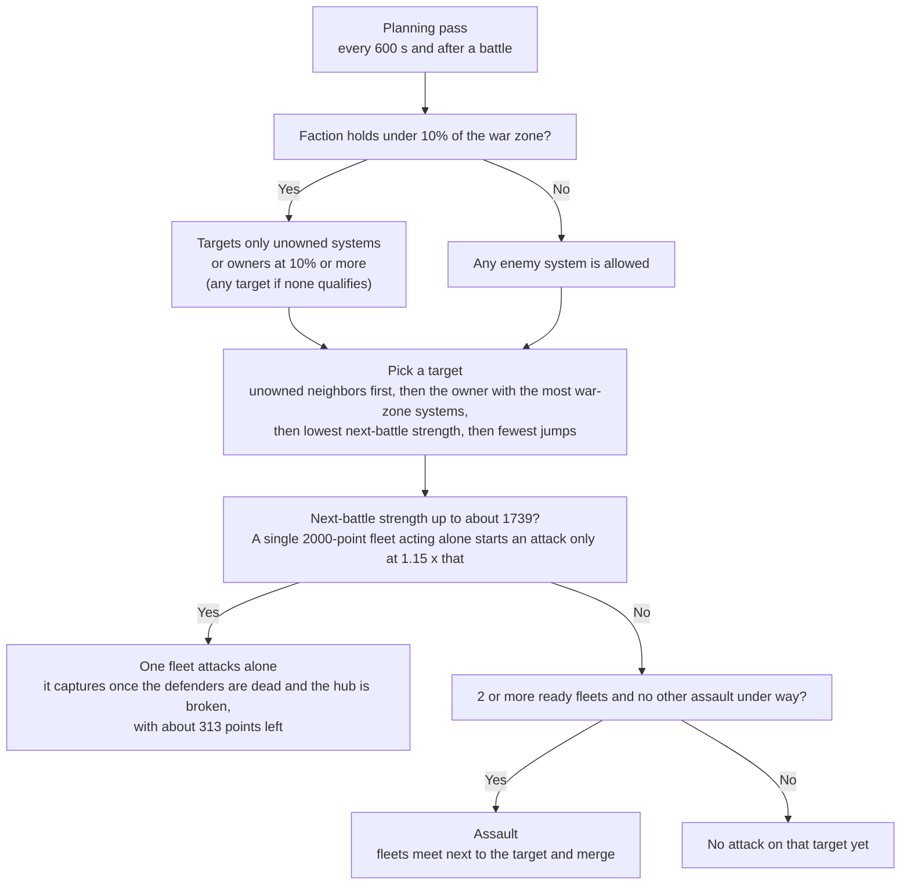
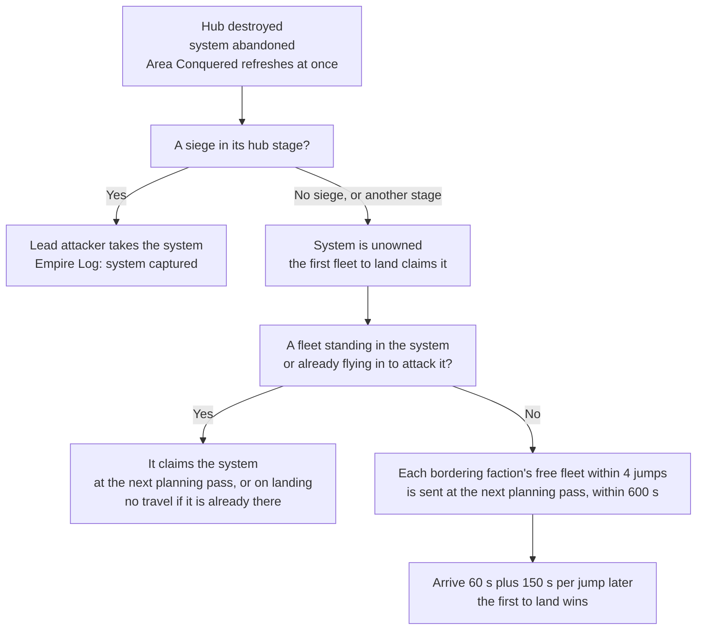
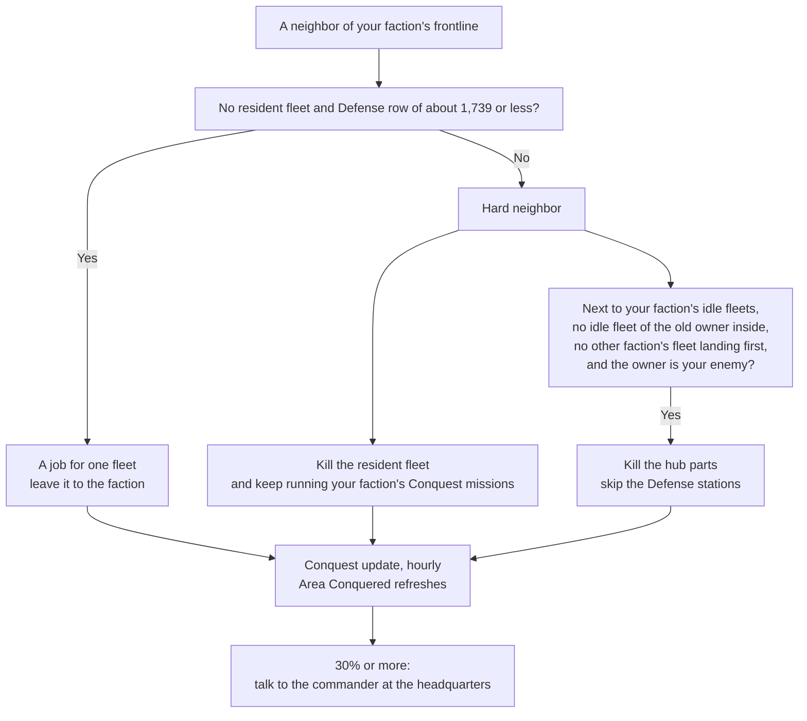

# Sector Control

This page covers the 30% sector-control mission and what you can and cannot do in the war before you hold a system of your own. It applies from the level 28 story step into the Conquest sector ([Conquest](README.md)) until you accept "Beyond the Front" ([gate](../expansion/README.md)). Values were read from the game code of version 0.8.3.4 (the decompiled source, not in-game testing). The code was then compared with the 0.8.3.5 and 0.8.3.7 sources, and every statement that changed in either was rewritten. The last section, "In the Game Code", has the method names behind each claim.

Terms and abbreviations are explained in the [conquest glossary](glossary.md) and the [basics glossary](../basics/glossary.md). Battles, the Defense number and NPC fleet planning are in [war](war.md).

## The 30% Sector-Control Mission

Three story missions ask you to push one faction to 30% of the systems in the Conquest sector: "Hostile Takeover" (Stellar Industries), "The People's Sector" (Kolyatov Collective) and "Harmony" (Luminate Combine). Finishing any one of them is required before "Beyond the Front" is offered (see [the gate](../expansion/README.md)). You cannot hold systems yourself at this point, so your play changes the outcome only by nudging a war that NPC (non-player character) factions fight on their own. This section covers how to get the mission, what its objective counts, where in the game you can read progress, how the war behaves without you, what moves the share, how your presence changes a battle, and a plan.

> In short
> 30% means your chosen faction owns 30% of the systems in the Conquest sector. That is 21 to 27 systems, depending on how many the galaxy has (the world generator makes 70 to 84, but a save checked in play had 88).
> Progress shows in two places: the "Area Conquered" row for that faction (press E on the galaxy map, open the Factions tab and click the faction) and the mission's own objective line, "Conquer for {faction} {current}/30.00%".
> The number refreshes once an hour, when the "Conquest Update" countdown on the galaxy map runs out. It also refreshes at once when a system is abandoned (a hub kill). A capture by siege, or by a fleet arriving at an unowned system, shows up late.
> To win, let the faction's own fleets take the systems that a single fleet attacks. Those have no resident fleet and a next-battle strength of about 1,739 or less, for a full 2,000-point fleet. Help on the harder ones by killing the resident fleet, and keep running the faction's Conquest missions, which raise its war footing and send it war fleets. Destroy a hub only where your faction has idle fleets next door and the old owner has none in the system. Be standing at the faction's commander in its headquarters when the number reads 30% or more.
> A battle you are not at runs on a clock and looks untouched when you arrive. Being at it stops the clock, and ending a fight live frees your faction's fleet to defend a siege elsewhere (see [Turning Up at Battles](#turning-up-at-battles)).

Some terms before the details. The war zone is every system where factions fight over ownership, which is the Conquest sector (Ara Martis, the original war zone). Only the Conquest sector counts for this mission. Every war-zone system has a hub, its main station (the map calls it "Space Station"), which carries the owner's flag. Destroying the hub abandons the system. A faction's headquarters is the one system it cannot lose to a fleet, and its hub has the faction's commander and shop. An ordinary owned system that fleets can besiege and capture is an outpost system.

In the code: [The 30% Sector-Control Mission](#code-the-30-sector-control-mission).

### Spoiler: Getting the Mission

1. The story mission "Sector Control" asks you to find the three embassies (each faction's neutral station in the Staging sector, outside the war zone) and talk to their representatives. Its description says "The choice of faction is not permanent".
2. Talking to a representative offers to align you with that faction. The offer is refused if the faction is your enemy, and refused while the faction has no headquarters. The game counts a faction as your enemy when you are at war with it or your reputation with it is below -500. Reputation is a number that the game shows as a level name. Below -500 means the Wary level (except exactly -500) or any worse level, while Neutral covers -499 to 1,499 (all bands are in the [glossary](../basics/glossary.md#reputation)). Otherwise you are asked to confirm, and the faction's first mission is added ("Internship" for Stellar, "For the Collective!" for Kolyatov, "Alignment" for Luminate).
3. The first mission has four steps: fly to the faction's embassy gate, go to its headquarters and talk to the commander, earn 10 contribution points by running missions for that faction ("Run missions for {faction}"), and talk to the commander again. The 10 points are a counter that only runs while that third step is current, so missions you finished before talking to the commander do not count toward it. The same amounts also add to "Your Contribution" on the Faction overview. That is your conquest standing with the faction, and it sets your conquest rank. The wealth your embassy missions bring is a separate thing. Each completed Conquest mission from that faction's hub or embassy adds its contribution amount. Such a mission is one on the mission board of a war-zone hub that adds to the faction's war footing, or of an embassy that gives wealth. The base amount is 3 to 6 points, or 1 to 3 for ECHO's idle missions (the ones ECHO, your ship's AI companion, completes while you are away). It is doubled when the mission's enemy is a conquest faction other than the Corsair Syndicate and Meridia's Chosen, and a bonus from your conquest rank with that faction is added. That is 2 to 4 missions at the base amount, or 1 to 2 when the doubling applies. The mission pays 2,000,000 credits, 60 Vanguard Marks (the currency used to buy ships and systems), XP (experience points) and the second mission.
4. The second mission ("Hostile Takeover", "The People's Sector" or "Harmony") has the percentage step and the report-back step. It cannot be abandoned and has no time limit. It pays 400 Vanguard Marks, 10,000,000 credits, 1 skill point and XP.

You cannot change the faction after you say yes. The first yes finishes "Sector Control", so the other two representatives only give their ordinary dialogue from then on, and nothing else adds a faction's first mission. The faction missions cannot be abandoned. The game stores no alignment beyond the mission itself. The mission text and the prompt say the choice is "not permanent" because standings and contribution are tracked for all conquest factions all the time, so you can keep running missions for the others. If you answer no at the prompt, nothing starts and you can talk to a representative again. Decide before you say yes. The percentage step is complete the moment the mission starts if the faction is already at 30%.

Reputation matters for the alignment check and again at the headquarters. A station will not let you dock if you are enemies with its faction (the enemy test in step 2), except an embassy, which never refuses you. So if your reputation with your chosen faction falls below -500, you cannot dock at its headquarters to talk to the commander until you raise it again. No other reputation threshold gates the mission in code.

In the code: [Getting the Mission](#code-getting-the-mission).

### What the Objective Counts

```
percentage = (systems owned by the mission's faction) / (all systems in the Conquest sector)
complete   = percentage >= 30%
```

| Question | Answer |
|---|---|
| Which systems count | Systems owned by exactly that faction. Its headquarters counts. Allies, other factions and systems with no owner do not count. You cannot hold a system yourself before claiming unlocks, and a system you held would not count for the faction anyway. |
| What the total is | Every war-zone system in the Ara Martis part of the Conquest sector, owned or not. Unowned and abandoned systems, and every rival's headquarters, are in the total. The Darkspace region (Penumbra and its neighbours), the staging sectors and the Frontier are not. |
| How many systems that is | The Ara Martis area is built from seven batches of 10 to 12 systems, so a galaxy made by this version has 70 to 84 systems. The galaxy's war zone is made once, when the story step into the Conquest sector starts, and never gains systems afterwards. A save checked in play had 88 systems in Ara Martis, and so did every other save checked, whichever game version wrote it, with no change over time. The generator of 0.8.3.4 and 0.8.3.5 cannot make 88, so that war zone was generated by a version older than 0.8.3.4, and your total is whatever your own galaxy was made with. The game does not show the total. |
| When it is computed | The game stores the percentage for every conquest faction at the start of every conquest update. That is the hourly step (3600 s of game time, 1 hour) whose countdown the galaxy map shows as the "Conquest Update" card. Loading a save on a later calendar day also runs 1 to 5 catch-up updates. The percentage is also stored whenever a system is abandoned, which includes a hub kill and the hand-over to a besieging fleet that follows it. A capture by siege, or a claim by a fleet arriving at an unowned system, does not refresh it. So the stored value, and the objective, lag the map by up to an hour. |
| What the interface shows | The objective reads "Conquer for {faction} {current}/{30.00%}", where current is the stored value with 2 decimals. The "Area Conquered" row on the Faction overview for any conquest faction is the same stored value. |
| Can it go backwards | Yes. Every conquest update recomputes it from the current owners. |
| Do you need to hold 30% | Only at the moment you talk to the commander. Nothing locks the objective in once it reads 30%. Mission steps are checked in order, and the first incomplete one is the current step. The final step ("Go to the {faction} HQ and talk to {commander}"; the game's text shortens headquarters to "HQ") only counts your conversation with the commander while the percentage step is complete. So the stored value must be at 30% or more when you talk to the commander in the headquarters. After that the mission completes, and later drops do not matter. A value that reached 30% at one conquest update and is gone by the next is enough if you are already at the commander. |

Systems needed, derived from the rule that systems divided by total must be at least 0.3:

| Total systems | 70 | 71 to 73 | 74 to 76 | 77 to 80 | 81 to 83 | 84 to 86 | 87 to 90 |
|---|---|---|---|---|---|---|---|
| Systems the faction must own | 21 | 22 | 23 | 24 | 25 | 26 | 27 |

To find your total, count the faction's systems in the Conquest sector on the galaxy map and divide by its Area Conquered percentage.

In the code: [What the Objective Counts](#code-what-the-objective-counts).

### Where to Read Progress

Everything the plan below asks you to check is on screen somewhere. These are the places to look:

- The Faction overview. On the galaxy map, press E or click the Empire button in the map's corner panel (tooltip "Empire (E)"). The key does nothing while you type in a text field, and the window is locked during the prologue. The window is titled "Empire". Open its Factions tab (in 0.8.3.5 an icon-only tab with a flag; the name shows when you hover it), then click a faction in the list. For a conquest faction, the detail shows Headquarters (the system's name), Area Conquered and Your Contribution. Once a Conquest mission from one of its war-zone hubs has given the faction war footing (0.8.3.7), it also shows War Footing, Footing Contribution, War Fleets, Next War Fleet and the totals War Fleets Earned, Systems Taken, Raids Won and Enemy Ships Destroyed. The Log tab (also icon-only now) is the Empire Log, your record of battles, captures and claims. It says "system captured", "attack repelled" and so on (see [Outcomes](war.md#outcomes)).
- The Conquest Update card. In the corner panel of the galaxy map, a card titled "Conquest Update" has a countdown and a bar that drains over 3600 s. Its tooltip reads "Damaged stations are rebuilt and factions rethink their strategy". When the countdown ends, the conquest update runs and Area Conquered refreshes. It is one of three clocks. The game does not show the 600 s planning pass or the hourly economy tick. The conquest update itself does not assign fleet orders, whatever the tooltip says (see [Cadence](war.md#cadence)).
- A system's tooltip. Hover a war-zone system on the galaxy map. Its conquest section has the Defense row (and, late in the game, the "Umbral Reach control" row). The Defense row (the Defense number) is the strength the defenders put into a siege round, counted in points (the game's fleet cards call the same unit "strength"). It adds up the hub's firepower, the garrisons of the system's Defense stations, and the fleets defending the system. A Defense station is an extra station that fires on enemies and holds a garrison, which is a group of warships stationed in it. The garrisons and fleets count at 1 plus their faction's war footing bonus (see [War Footing and War Fleets](war.md#war-footing-and-war-fleets)). Version 0.8.3.7 removed the "Your war effort" row and the per-system war effort behind it. The faction's footing shows on its Faction overview instead.
- Next-battle strength. The game never shows this figure. It is what NPC fleets compare themselves against (see [What NPC Factions Use Instead of the Defense Number](war.md#what-npc-factions-use-instead-of-the-defense-number)). You can estimate it from what you do see. With no Defense station in the system, it equals the Defense row (plus any same-faction fleets already on the way). With Defense stations, it is lower: the weakest Defense station's own firepower plus its garrison plus all defending fleets (plus fleets on the way). So the Defense row is the upper bound, except in the hours after a system changes owner. While the system is settling, the row halves the stations' firepower, but the figure for a system with Defense stations does not, so it can then be higher.
- Fleet icons and their labels. Fleets show as icons on the galaxy map. Each has a label for its current order, for example "Attacking", "Gathering for an assault" or "Holding position". All labels are listed in [Fleet Labels on the Map](war.md#fleet-labels-on-the-map).
- The siege banner. Hovering a hub, or its system, during the hub stage of a siege shows "Under Attack! Holds {n} min at most". A Defense station's own tooltip shows the same line while that station's stage runs.
- The mission board. Each Conquest mission lists its reward line, for example "+12 Contribution". The amount goes to the faction that gave the mission and adds to its war footing and to its war fleet progress.

In the code: [Where to Read Progress](#code-where-to-read-progress).

### What the War Does Without You

At the start of the game, Kolyatov, Stellar and Luminate each get 3 systems, and Meridia's Chosen get 3. The Darkspace Compact gets everything else, because its starting claim limit is unlimited while the others stop at 3. With 70 to 84 systems that is about 58 to 72 Darkspace systems and 3.6% to 4.3% for each major (derived from the partition rules; the map shows the real start). Every war faction starts with fleets filled to its fleet cap, which is the number of fleets it may field (each one fills a fleet slot). That is 5 fleets of 2000 points. The cap is 5 fleets plus 1 for every 15 systems held, up to 8, and Darkspace is fixed at 5 until the expansion war opens.

What limits an NPC capture:

- Which target: only neighbours of a system the faction already owns. A faction with no such border looks at any open system. Unowned neighbours come first, then the owner with the most war-zone systems, then the lowest next-battle strength, then the fewest jumps. A single fleet acting alone starts an attack at 1.15 times next-battle strength or better, so a 2000-point fleet can start on anything with next-battle strength up to about 1739 (more with war footing, see the levers table). Above that, the faction needs an assault: several of its fleets meeting next to the target and merging to attack it. An assault needs at least 2 ready fleets, and a faction runs one assault at a time (see [Assaults](war.md#assaults)).
- Finishing an attack: a siege captures once every defender is dead and the hub's structure is broken, with the attackers still holding 1.25 times the Defense left at that moment. By then the Defense is down to the 250 floor, so 312.5 (about 313) points of strength must be left (the attackers' points count with their faction's war footing, so 250 raw points are enough at the top footing, since 250 x 1.25 is exactly 312.5), and the 1.25 margin rarely decides a capture by itself. What decides it is whether the attackers kill the garrisons, the defending fleets and the structure inside the 1800 s stage while the defenders shoot back. A siege that reaches the cap with the structure standing ends in a skirmish (attacker strength at least the Defense left) or a repelled attack.
- How long: a clash (the game's Fleet Battle) against a resident fleet runs up to 600 s. Each Defense station is its own siege stage of at least 600 s, and the hub stage is at least 600 s. Damage reaches a station's structure only after every defending ship in the fight is dead. A 2000-point fleet breaks a medium hub's structure in about 10 rounds, so a hub with no defending ships falls at that 600 s minimum if the fleet also meets the capture margin. Travel is 60 s plus 150 s per jump. Some outcomes of a siege block that fleet from the same system for 3600 s (which ones is in [Outcomes](war.md#outcomes)). Nothing in the code caps captures per hour, so an unopposed fleet can in principle finish one every 11 minutes or so plus travel (derived).
- Planning cadence: orders are reassigned for every faction every 600 s, at the hourly economy tick, and at once for the factions of a battle that just ended.
- What a resident fleet does: a 2000-point fleet in a system pushes its next-battle strength above the single-fleet limit, so those systems wait for an assault.
- The peace rule: a faction holding under 10% of the war zone (fewer than 7 to 9 systems) only targets unowned systems or owners at 10% or more. If that leaves it no target at all, it falls back to every target. At the start none of the three majors is at 10%, so they ignore each other and only go after Darkspace and unowned systems. Once your faction passes 10%, any major still below it that borders it treats it as a legal target, though Darkspace stays the preferred one while it is larger.
- Growth rate: none is coded. The hourly conquest update shuffles, settles and repairs but changes no owner. A system changes owner only when a fleet captures or claims it, when its hub is destroyed, or when a faction joins the war. So how fast a major grows is whatever its fleets manage under the limits above.



Two things help a faction that is behind (see [Catch-Up Mechanics](faction-economy.md#catch-up-mechanics)). The first is the home subsidy. Wealth is the money a faction spends on warships and stations, and the Faction overview shows it as "Economic Power". The home subsidy is wealth handed to Kolyatov, Stellar, Luminate and Darkspace every hour, larger the smaller their share of the war zone. It is the "Home subsidy" line of the faction ledger, not the taxes a faction earns from its systems. The second is the Great Gate reinforcement. It is a 1500-point fleet that appears from the Great Gate (a map location) for the three majors when they have few fleets.

| Share | Home subsidy per hour (Kolyatov, Stellar, Luminate, Darkspace) | Great Gate reinforcement |
|---|---|---|
| Start (3.6% to 4.3%) | about 104,600 to 107,100 | Free, if the faction has 2 fleets or fewer |
| 10% | 84,000 | Paid from wealth, if the faction has 2 fleets or fewer |
| 20% | 48,000 | Paid |
| 30% | 12,000 | Paid |
| 33.3% or more | 0 | Paid |

The Great Gate reinforcement is 1500 points. It appears when the faction has fewer than half its fleet cap (2 or fewer of 5), at most once every 13 hourly economy ticks. A war fleet uses no fleet slot, so it does not count toward that. The hourly economy tick is the separate hourly step that pays taxes and the home subsidy and plans builds, and the game does not show it. The reinforcement is free when the faction holds under 10% of the war zone or has no fleets besides war fleets, and paid from wealth otherwise. Darkspace gets the home subsidy but no Great Gate reinforcements. A faction that is wiped to no systems sits out 5 conquest updates, then its fleets start claiming systems again. Every build is half price and three times faster while a faction has fewer fleet slots than its cap.

For scale, a war-zone system pays 5,000 to 15,000 per hour in taxes (the "Taxes" ledger line) before doubling. That makes 10,000 to 30,000 in the war zone, and none while the system is in unrest (the first 1 to 2 hours after a system changes owner). Three systems earn about 60,000 per hour on top of the home subsidy (derived).

In the code: [What the War Does Without You](#code-what-the-war-does-without-you).

### What Moves Your Faction's Share

The frontline is a faction's systems that touch an enemy or unowned war-zone system. That is where its fleets push. In the table, "non-idle" missions are the ones you fly yourself, not the ones ECHO completes while you are away.

| Lever | What it changes | Cost and limits |
|---|---|---|
| Lower the next-battle strength of a hard target | Every point of next-battle strength you remove cuts what attackers must bring by 1.15. Killing a resident 2000-point fleet takes a target from needing an assault to one a single fleet can start, and leaves 2000 fewer points of defenders to kill before the hub. Killing garrison ships at its Defense station removes up to 900 (270 to 900 by tier). | Real combat against ships at the NPC fleet level (see [What You Face](#what-you-face)), near stations with 20 times the normal hit points (HP). Fleets can be intercepted from the map. |
| War footing of your faction | Its fleets count up to 25% more when they judge a target and when they fight: at the top footing a 2,000-point fleet counts as 2,500, so it starts an attack on a next-battle strength of up to about 2,173 instead of 1,739. Once the faction has earned 250 contribution, the game also sends it a free 1,500-point war fleet at its headquarters (3 hours, at most 2 at once). A war fleet attacks on its own. | The bonus is 25% x contribution / 2,000, so each mission adds a fraction of a percent. A mission you fly gives 3 to 12 contribution (1 to 6 for an idle one), before your conquest rank bonus of up to +100% and, for idle missions, ECHO's multiplier. The whole bonus clears 3 hours after the last mission. Embassy missions don't count. It lifts every system of the faction, not one target. A war fleet needs the faction to have a headquarters and a fleet cap above 0. Progress toward the next war fleet stops at 250 and resets to 0 when one is sent, so extra contribution is lost. |
| Kill the hub, not the Defense stations | The hub goes down and the system is abandoned. A fleet of your faction takes it only under the conditions below. When the system is claimed, the old owner's Defense stations are destroyed too, so you skip them. | Hub parts have 20 times the normal HP. The owner must already be your enemy, because you cannot force-attack a station and a plain click only targets enemies. Part kills cost 5 reputation each if you are at -500 or lower with the owner, and 100 each otherwise. A hub does not count as a faction station, so the -5000 station penalty does not apply. |
| Kill the Defense station live while your fleet besieges it | The siege stage ends at once ("Defense station destroyed" in the Empire Log). | -5000 reputation if a part you hit was among those destroyed (-1000 if you are already Hostile or worse, at -5000 or lower), plus part kills. |
| War footing of a faction under attack | Adds up to 25% to its garrison points and to its defending fleets' strength, in the Defense number and in next-battle strength. This protects the share you have. | Same missions as above, run for the faction you want to protect. It is one number for the whole faction, not for a system. |
| Embassy missions | 80,000 to 120,000 wealth each, a random amount that averages 100,000 (that is where "about 100,000" comes from). Idle missions pay half, so 40,000 to 60,000. A full 2000-point fleet costs about 43,000 to 130,000 at full price, depending on the ships. | They help rebuild a lost fleet at once. They do nothing for a faction whose fleets are already full, and they do not raise the fleet cap. |
| ECHO idle Conqueror missions | Each idle mission adds its contribution times (1 + 0.2 x node points) ("ECHO The Conqueror" skill). The node takes up to 5 points, so an idle mission's contribution is x1 with none and x2 with all 5. | The multiplier applies to war footing only, not to "Your Contribution" or the 10-point mission step. Idle missions also pay a smaller share of contribution and wealth. ECHO does not favour your faction. It takes a mission from the board of the friendly station it is docked at, or of the nearest station with a mission board, so the contribution goes to that station's faction. |
| Intercepting enemy deliveries | A killed delivery is a ship their wealth already paid for. | -1000 for the ship you click and -3500 per kill of a force-attacked ship, if your reputation with the faction is Wary or better when it dies. With +500 or more before the click, the first hit flags every ship of that faction in the encounter, so the others cost only the -3500. It costs nothing if the faction is already your enemy. It rarely moves a system count. |

The hub-kill conversion is what happens after you destroy a hub. The system is abandoned. The Empire Log says "Lost control of {system} - its station was destroyed.", and the Area Conquered numbers refresh at once. Because claiming is locked for you, what happens next depends on any siege there:

- If a siege is in its hub stage, the game hands the system to that siege's lead attacker ("system captured" in the Empire Log), unless that attacker is a raider faction.
- If the siege is in any other stage, or there is none, every fight there ends and the system is unowned until a fleet claims it ("Claimed {system}."). The first fleet to land claims it.

Which fleet lands first:

- A fleet already flying in to attack the system claims it on landing.
- A fleet standing in the system claims it at the next planning pass with no travel, so the old owner's idle fleet there takes it straight back.
- Otherwise each faction that owns a system next to it sends the fleet that its planning picks at its next planning pass, within 600 s (at once for the factions of a fight that just ended there). A faction with no frontline looks at any open system. Its idle fleets are taken in list order, less those going to a refit, answering a distress call at a system of their own or gathering for an assault. Each takes its best target within 4 jumps, with an unowned system first (next-battle strength 0, so no fleet is too weak). That fleet arrives 60 s plus 150 s per jump later, and the first to land wins.

So do it where your faction has a system next door and a free fleet within 1 or 2 jumps, where the old owner has no idle fleet in the system, and where no other faction has a fleet closer or already on its way.



In the code: [What Moves Your Faction's Share](#code-what-moves-your-factions-share).

### Turning Up at Battles

This section started as one player's notes from finishing the mission after a week of attempts on version 0.8.3.5, the version before 0.8.3.7. Each point was then checked against the 0.8.3.5 code and the 0.8.3.7 code. All three ideas hold up in 0.8.3.5: your presence changes how a battle runs, ending a fight early frees a fleet for a siege somewhere else, and missions at border hubs steer attackers away. The first two work the same in 0.8.3.7, because the code behind them did not change. The third does not, because 0.8.3.7 removed the per-system bonus it relied on.

What the player saw: a hub "Under Attack" for 15 minutes showed no damage on arrival, and neither did the attacking or defending ships, most often on the first visit to a battle. Some damage did show when the player had already been in the system without going to the station. Sieges the player stayed away from often ran the full 30 minutes.

What the code does (the full rules are in [live battles](war.md#when-you-are-there-live-battles)):

- A battle you are not at runs as simulated rounds, one every 60 s. A Fleet Battle stage lasts at most 10 minutes and a siege stage at most 30, and the banner ("Holds {n} min at most") counts down the current stage. Each Defense station siege and the hub siege after them start a new 30 minutes.
- The simulation removes whole ships and leaves no visible damage. When you arrive, the remaining ships spawn at full hull and the station spawns with its own part HP, so a fight 15 minutes in looks like it just started. The missing ships are the only trace.
- The battle runs live only at its venue: the Fleet Battle location, the Defense station under siege, or the hub during the hub stage. Anywhere else in the system the simulation keeps going. Damage on a ship or the station comes only from live fighting, either since you arrived or on an earlier visit to the same battle, because spawned ships stay at the venue until the battle ends.
- At the venue the clock stops. A clash then ends when one side is out of ships, and a siege when the attackers are out of ships or the station dies.
- Battles that look alike end at different times because each round deals a random 4% to 6% of a side's strength, a ship dies only when the round's damage covers its whole point value, the structure takes damage only after every defender is dead, and a capture before the cap needs 600 s, a broken structure, no defenders left and 1.25 times the remaining Defense ([How a Siege Ends](war.md#how-a-siege-ends)).

#### Freeing a Fleet for a Siege

A fleet of your faction cannot answer a distress call while it is in a battle, or while it stands in one of its own besieged systems, because it is defending there. When a battle ends, every faction in it plans again at once. The owner of a besieged system sends one responder at a time per battle: the nearest idle fleet that can land before that battle's clock runs out, which means within (time left - 60) / 150 jumps, rounded down. The game also looks for responders every 60 s while any battle is running.

| Time left on the siege | Farthest responder (derived) |
|---|---|
| 30 min | 11 jumps |
| 20 min | 7 jumps |
| 10 min | 3 jumps |
| 5 min | 1 jump |
| Under 3.5 min | None |

The banner rounds the minutes up, so "Holds 4 min at most" can already be too late. The player's method, with the code behind each step:

1. Leave the siege you cannot win alone, and find a fight nearby that ties up one of your faction's fleets. A Fleet Battle where that fleet is the defender is the clearest case.
2. Fly to the "Fleet Battle" location and help kill the attackers. The clash ends when they are all dead, not at its 10-minute cap, and in play that came well before the cap. The loser of a live clash is wiped. That costs the attacking faction a whole fleet, and if your side loses instead, your faction loses its whole fleet.
3. Your faction plans again the moment the clash ends. The freed fleet goes to the besieged system as its responder if it is the nearest idle fleet in reach, is not below 35% of its target points (it retreats instead) and is not due for a refit with a Construction Yard in reach. It shows "Responding to a distress call".
4. Fly to the besieged hub while the responder travels. Your arrival stops that siege's clock, and the responder spawns into the live fight when it lands.

While you are at a besieged hub of your faction, the siege cannot reach its cap. The attackers can still take the system by destroying every hub part live (20 times the normal HP, 30 times at a headquarters). During a Defense station stage the venue is that Defense station, so waiting at the hub does not stop the clock.

Where your faction is the attacker, a live hub siege ends only when the attackers die or the hub does. If the hub's owner is already your enemy, destroying the hub during the hub stage gives the system to your faction's lead attacker at once and frees that fleet (see the hub-kill conversion in [What Moves Your Faction's Share](#what-moves-your-factions-share)).

#### Steering Attackers with Missions (0.8.3.5 and Earlier)

The player ran a few Conquest missions at hubs near the border. The system tooltip then showed a bonus such as "+5% to firepower for 2h" (+10% at the system of the mission's hub, +5% at its neighbours), and attackers turned toward systems without it. In 0.8.3.4 and 0.8.3.5 the code did this through a per-system "war effort":

- Each completed Conquest mission from a war-zone hub gave the hub's system +10% if the mission's faction owned it, and +5% to every neighbouring system that faction owned. Every neighbour owned by the mission's enemy, if that enemy was another conquest faction, got a -10% penalty instead. An idle mission (completed by ECHO) gave 10% x (1 + 0.2 x points in "ECHO The Conqueror").
- Missions stacked up to +100% (and a penalty up to -50%). Each one reset the system's timer to 3 hours of game time, and the tooltip showed the time left. A change of owner cleared it.
- The bonus multiplied the station firepower term of the system, the 250 floor included, both in the Defense number and in next-battle strength. It also raised the Combat Power, Drone Power and Torpedo Power of the station's parts in a live fight. It did not touch garrisons or fleets.
- Attackers pick, among the targets they can beat, the owner with the most systems first and then the lowest next-battle strength. So among one owner's border systems, even +5% on some of them sent attackers to the others, and a large stack could lift a system past the most a fleet would attack alone (1.15 times next-battle strength). The station term counts at most 700, so +15% adds at most 105 points, and +100% at most 700 (derived).

That matches what the player saw. Version 0.8.3.7 removed the per-system war effort and put nothing local in its place: the tooltip row and its text are gone, and missions feed the faction-wide war footing instead. The side-by-side comparison is in [Compared with the 0.8.3.5 War Effort](war.md#compared-with-the-0835-war-effort). In short, war footing is one number for the whole faction, it raises garrisons and fleets but not station firepower, and +15% takes 1,200 contribution, which is 50 missions at the top amount of 24.

##### What Still Steers Attackers in 0.8.3.7

Attackers choose the same way as before: among the targets they can beat (1.15 times next-battle strength), the owner with the most war-zone systems first, then the lowest next-battle strength, then the fewest jumps. What you lost is a way to raise one system's strength from a mission board. These levers are left:

- War footing moves attackers, but not where you choose. It raises only systems with a fleet or a Defense station garrison in them, and there it adds more than the old bonus did (a resident 2,000-point fleet counts 2,500 at +25%). Systems with neither gain nothing, so attackers drift toward your faction's undefended systems. The same footing lifts what one of your faction's fleets will attack alone from 1,739 to 2,173.
- Owner size and the 10% rule decide who gets attacked at all. Rival majors go for the owner with the most systems first, which is usually the Darkspace Compact. A faction under 10% of the war zone only attacks unowned systems and owners at 10% or more. Expect your faction to draw attacks once it passes 10% and again once it is larger than Darkspace.
- Fleets on the way count. A system's next-battle strength includes the plain points of its own faction's fleets travelling to it, so intercepting them lowers it.
- Weakening a system pulls attackers in rather than pushing them away. Killing a system's resident fleet or garrison ships lowers its next-battle strength, which makes it a preferred target for every attacker in reach, rivals included. Use it on the enemy systems you want your faction to take.
- New captures are soft. For 5 to 6 hours after a system changes owner its station profile counts half in the Defense number ([Settling and Unrest](war.md#settling-and-unrest)), so your faction's newest systems are likely targets.

The closest thing to the old tactic now runs the other way: weaken the enemy systems you want your faction to take, and defend live with the method in [Freeing a Fleet for a Siege](#freeing-a-fleet-for-a-siege). Both work in 0.8.3.7, because the battle code and the order in which attackers rank targets did not change.

In the code: [Turning Up at Battles](#code-turning-up-at-battles).

### Pitfalls

- A hub kill with no hub-stage siege by your faction in the system leaves it unowned for the first fleet that lands. Only factions that own a neighbouring system consider it. A faction with no frontline considers any open system. Claims by an arriving fleet need no siege and no wait. A fleet already flying in to attack it, or a nearer fleet of another faction, lands before yours. The old owner's own idle fleet standing in the system claims it back at the next planning pass with no travel, so a hub kill is wasted there.
- A hub kill during a rival's siege hands the system to that rival at once if the siege is in its hub stage (and the rival is not a raider faction).
- You cannot shoot a hub of a faction that is not your enemy. Making it an enemy costs reputation first: one force-attacked kill is -1000 and -3500, about -4,500 in total, which is enough to make most factions enemies (under -500). Check the faction's reputation before you commit.
- Reputation with the Darkspace Compact does not block the "Beyond the Front" questgiver. The questgiver stands at the Darkspace embassy ([gate](../expansion/README.md)), and the game never refuses docking at an embassy, whatever your reputation. The questgiver's dialogue checks no reputation either, only your level, whether you finished a 30% mission, and whether the mission is already running or done.
- Wiping a faction's fleets completely frees fleet slots. Below its cap every build is half price and three times faster. Kolyatov, Stellar and Luminate also get a 1500-point Great Gate reinforcement when they are at 2 fleets or fewer (free below 10% share or with no fleets left besides war fleets). Darkspace gets only the cheaper rebuild. Killing ships out of a fleet that survives does not free a slot.
- Pushing a faction to 0 systems makes it sit out for 5 conquest updates, after which its fleets start claiming systems again. It is a delay, not a removal.
- When your faction passes 10%, the smaller majors that border it can start attacking it. When it is larger than Darkspace, every NPC faction that borders it prefers it as a target, because the owner with the most systems is picked first.
- Footing needs a mission from a hub in a war-zone system. Embassy missions are outside the war zone and give wealth only. Missions at another faction's hub strengthen that faction.
- The 30% value is stored hourly, so a capture an hour before you talk may not show yet. Watch the Conquest Update card.
- Wealth and fleets do not raise the fleet cap. The cap rises only with systems held: to 6 at 15 systems and to 7 at 30.

### A Step-by-Step Plan

1. Choose the faction before you say yes at its embassy, because the choice cannot be changed afterwards. Press E on the galaxy map, open the Factions tab and click each major faction to read its Area Conquered and Headquarters rows. Pick one that is not your enemy, has a headquarters, and has a frontline with Darkspace Compact systems (its systems sit next to theirs on the map). Its second mission needs 30% of the total, rounded up (21 to 26, see the table above).
2. Finish the first mission. It needs 10 contribution points, counted only after you have talked to the commander in the headquarters. Take Conquest missions for that faction from its hub's mission board or from its embassy, because both count. Prefer hub missions whose enemy is a conquest faction other than the Corsair Syndicate and Meridia's Chosen, because their contribution is doubled. The objective line "Run missions for {faction}" shows your count.
3. Find the frontline on the galaxy map. It is made of your faction's systems next to Darkspace systems. Hover or click the fleet icons nearby. Fleets labelled "Attacking" and "Gathering for an assault" show where its next push goes.
4. Hover each neighbouring system and read the Defense row. A neighbour with no resident fleet and a Defense row of about 1,739 or less is a job for one full 2000-point fleet. That fleet attacks at 1.15 times the next-battle strength, which equals the Defense row when the system has no Defense station, and a hub with no defenders breaks in about 10 rounds. The NPC faction will take it itself within a planning pass or two, so leave it alone. If the system has Defense stations, its real next-battle strength is lower than the row, and each station and then the hub is a separate stage.
5. Spend your time on the hard ones. For a neighbour with a resident 2000-point fleet, kill that fleet: it takes 2,300 points off what attackers need and the faction's fleets then take the system themselves. Between fights, run Conquest missions for your faction at its hubs. They lift its war footing and send it war fleets, but this is slow and it is not aimed at one target.
6. When a siege threatens one of your faction's systems and you cannot beat the attackers yourself, free a fleet for it. Fly to a nearby Fleet Battle where your faction's fleet defends, help kill the attackers, and then go to the besieged hub while the freed fleet answers the distress call. Do it early: a responder must land before the siege's clock runs out, and the reach shrinks to 3 jumps with 10 minutes left ([Freeing a Fleet for a Siege](#freeing-a-fleet-for-a-siege)).
7. Kill a hub only where it can convert. Check these first. The owner is already your enemy, and the target is next to one of your faction's systems. Your faction has free fleets within 4 jumps (idle icons labelled "Holding position" or "Guarding faction space", not on their way to a refit or an assault). The old owner has no idle fleet in the system, and no other faction has a fleet closer or already flying there. Then fly to the system and kill the hub parts (20 times the normal HP, 5 reputation each at -500 or lower). Do not bother with its Defense stations. The Empire window's Log tab shows "Lost control of {system}" at once and "Claimed {system}" when the first fleet lands.
8. Watch the clock. The conquest update is hourly, and the Conquest Update card on the galaxy map counts it down. A siege capture or an arriving fleet's claim shows up only at the next update (a hub kill shows at once), so finish captures well before the countdown ends. Then be docked at the headquarters (the "Gate to {faction} headquarters" at the faction's embassy leads there). Talk to the commander as soon as the Area Conquered row or the objective line shows 30% or more.
9. If your faction stalls below 10%, the Great Gate reinforcement and the home subsidy (84,000 to 120,000 per hour at a war-zone share between 10% and 0%) already work for it. Do not try to wipe a rival major's fleets outright. A wiped fleet frees a slot, which halves its build costs and triples build speed. A major at 2 fleets or fewer also gets a 1500-point Great Gate reinforcement.



In the code: [A Step-by-Step Plan](#code-a-step-by-step-plan).

## Level 60 or Below

This section applies until you accept "Beyond the Front" ([gate](../expansion/README.md)).

### What You Can and Cannot Do

| You can | Notes |
|---|---|
| Run Conquest missions | Each completed mission from a war-zone station adds contribution to the faction that gave it, which raises its war footing and brings war fleets (see [War Footing and War Fleets](war.md#war-footing-and-war-fleets)). This needs no system of your own. |
| Let ECHO run idle Conquest missions | Each idle mission's contribution is multiplied by 1 + 0.2 x points in the "ECHO The Conqueror" node, which takes up to 5 points (x2 at the maximum). ECHO takes missions from whatever mission board it is docked at, not from your faction's hubs only. |
| Attack stations and ships live | Hubs take 20 times the normal HP (30 times at a headquarters); see [War Stations](war-stations.md). You can only target a station's parts with a plain click if its faction is already your enemy, and force-attacking a station is not possible. Destroying a faction station (not a hub) costs -5000 reputation with that faction if a part you hit was among those destroyed, or -1000 if you are already Hostile or worse (-5000 or lower). |
| Intercept fleets and warship deliveries | Intercepting a fleet builds its real ships at the intercept zone, and losses come off the fleet. If the faction is not your enemy, confirming the force attack costs -1000 reputation for the ship you click. Each kill of a force-attacked ship costs another -3500 if your reputation with the faction is still Wary or better when the ship dies. With +500 or more before the click, the first hit flags every ship of that faction in the encounter, so the others cost only the -3500. Below that, the other ships are plain enemies and cost nothing. Enemy ships cost nothing. |
| Join a smaller faction's war | A faction with an embassy and no headquarters of its own can be joined once your embassy missions have brought it 1,500,000 wealth, or once you have paid a 10,000,000 credit donation. The factions that can be joined this way are the Mining Guild, Salvage Guild, Corsair Syndicate and Stranded. The requirement and what the faction gets are in [Joining a Faction's War](faction-economy.md#joining-a-factions-war). |
| Destroy a hub in a siege | Destroying a hub live ends the fight and abandons the system. With claiming locked, the besieger takes it if it was in the hub stage of a siege. Otherwise the system is unowned and a fleet of a faction bordering it claims it (see [the hub-kill conversion](#what-moves-your-factions-share)). |

| You cannot | Why |
|---|---|
| Claim, buy or hold a system | The game refuses with "Claiming systems unlocks with Beyond the Front". |
| Anything that needs a system of your own | Fielding Empire Fleets, building economic outposts, Defense stations or patrols, and the Empire Level tile and line all unlock with Beyond the Front ([Your empire](../expansion/your-empire.md), [Empire fleets](../expansion/empire-fleets.md)). The game has no other way to give you a station before your first claim. You can only build in a system you own, and you can only own one by claiming or buying it. No mission reward grants a station, and setting a home station only marks a friendly station that already exists. |

In the code: [What You Can and Cannot Do](#code-what-you-can-and-cannot-do).

### What You Face

- Systems: Ara Martis systems are created at level 32 to 36. Each conquest update (hourly) steps every system 1 to 4 levels toward its own target, your effective level plus an offset of -6 to +6 that depends on its temperament (Backwater, Settled, Contested or Hot), and never under its floor of 30 to 36. Systems can go down as well as up (see [How System Levels Rise](war.md#how-system-levels-rise)).
- NPC fleet ship level: your effective level, or 30 if you are lower. Version 0.8.3.5 added 6 levels and used the highest system level; 0.8.3.7 removed both. Fleet target size is 2000 points regardless of your level. The number of fleets per faction is in [Faction Economy](faction-economy.md).
- Station turrets: below system level 45, generated conquest stations always use small turret platforms (the "S2" platform: two small turrets, the Small Turret Mk II). At level 45 or higher each such platform is rolled 50/50 between two medium turrets ("M2", the Medium Turret Mk II) and one large turret ("L1", the Large Turret Mk I). A Defense platform's score uses its weapon size total, where each turret counts Small 1, Medium 2 and Large 3 (and at least 1). Below level 45 that total is 2 (90 hull, 80 firepower); at level 45 or higher with two medium turrets it is 4 (120 hull, 160 firepower). See [war-stations](war-stations.md) for per-part data. A station that has never been visited has not been generated yet, so its score uses the flat estimate for its size instead: 240 firepower for a small station, 480 for a medium one and 560 for a large one.
- Garrisons: ship count and budget follow the station tier, not your level (3 to 8 ships, 270 to 900 points). Garrison ship levels follow the NPC fleet level above.
- Station hit points (HP): live hubs and Defense stations take 20 times the normal HP, and headquarters hubs take 30 times.

In the code: [What You Face](#code-what-you-face).

### Most Efficient Approach

What matters before your first system is that your own faction reaches 30% of the Conquest sector, because that opens "Beyond the Front". You cannot hold anything yourself, so every action here is a nudge to the war between NPC (non-player character) factions. The counting rule, the faction behaviour you are pushing against, the ranked levers, the pitfalls and a step-by-step plan are in [The 30% Sector-Control Mission](#the-30-sector-control-mission).

Embassy missions give the faction wealth in place of war footing (amounts are in the Embassy missions row of [the levers table](#what-moves-your-factions-share)). They still add to "Your Contribution". Faction wealth buys warships (see [Faction Economy](faction-economy.md)).

In the code: [Most Efficient Approach](#code-most-efficient-approach).

## Numbers to Watch

| Number | Value | Why |
|---|---|---|
| 1.15 | NPC attack margin | Attackers need this ratio over next-battle strength. |
| 1.25 | Capture margin | Attackers need this ratio over current Defense to capture. |
| 600 s | Minimum siege time before capture | The minimum applies to each stage. |
| 1800 s / 600 s | Siege / clash cap | A stage's maximum length when simulated. |
| 60 s, 4%-6% | Round length, damage share | A fleet deals about 5% of its strength per round. |
| 250, 700 | Station firepower floor and cap | Station firepower above the cap adds nothing to Defense. |
| 0.5 times | Settling | Settling halves the station profile. |
| 1.25 | Top war footing | A faction at 2,000 contribution counts its fleets, garrisons and defenders at 1.25 times their points. |
| 35% / 75% | Retreat / recovery thresholds | NPC fleets retreat below 35% and are ready again at 75%. |
| 3600 s / 10800 s | Re-attack block after a stalled siege / war footing and war fleet duration | Both are per-event timers, not a schedule. |
| 14400 s | Raid cooldown per station | The station cannot be raided again until the cooldown ends. |
| 30% | Faction share to finish the sector control mission | Needed before "Beyond the Front" is offered. |

## In the Game Code

This part is the decompiled code behind the sections above: class and method names, formulas as the code writes them, and the `Source:` lines. It was read in version 0.8.3.4 and compared with the 0.8.3.5 and 0.8.3.7 sources. To check a claim, search the decompiled source for the method name.

### Code: The 30% Sector-Control Mission

| Mission | Faction | Id |
|---|---|---|
| "Hostile Takeover" | Stellar Industries | `ConquestStellar2` |
| "The People's Sector" | Kolyatov Collective | `ConquestKolyatov2` |
| "Harmony" | Luminate Combine | `ConquestLuminate2` |

The war zone is the set of `ConquestSystem` objects; the original war zone is the Ara Martis conquest sectors.

#### Code: Getting the Mission

| Step | Mission id |
|---|---|
| Find the three embassies | `ConquestThreeFactions` ("Sector Control") |
| First mission | `ConquestStellar1` "Internship", `ConquestKolyatov1` "For the Collective!", `ConquestLuminate1` "Alignment" |
| Second mission | `ConquestStellar2`, `ConquestKolyatov2`, `ConquestLuminate2` |

Alignment: `Characters.AlignWithMajorFaction` shows the prompt and `FactionData.IsEnemy` supplies the enemy test. The Yes button calls `ConquestMissions.FactionAlignmentChoice`, which fires the embassy trigger and adds the faction's first mission. The conquest rank bonus on each contribution amount is `GetFleetStrengthRewardBonus`. The percentage step and the report-back step are built by `ConquestMissions.CreateFactionConquestProgressMission`, the first mission by `ConquestMissions.CreateFactionHQIntroMission`. `HasCompletedSectorControl` accepts any of the three second missions. The 10-point step is `ConquestFleetStrength`; `MissionObjective.Trigger` only reaches the current step of a mission, so contribution earned while an earlier step is still current does not count toward it. `ConquestStrength.OnComplete` adds the same amount to `playerContribution` and fires `EarnCombatStrengthForFaction`. The amount is `round((3..6, or 1..3 idle) x (2 if the enemy is a conquest faction other than Marauders and Fanatics) x (1 + rank bonus))` from `MissionGenerator.AddRewards`.

Changing the choice: `ConquestThreeFactions` has one step with `requireAllObjectives = false`, so any one of its three embassy triggers completes the step (`MissionStep.isComplete`), and the mission is `autoComplete`. A representative's dialogue is offered only while an open story mission has an incomplete trigger objective that matches it (`GamePlayer.GetCurrentDialogueTrigger`), so after the first yes the three representatives only give their default dialogue. `ConquestStellar1`, `ConquestKolyatov1` and `ConquestLuminate1` are added by nothing except `FactionAlignmentChoice`, and they cannot be abandoned (`canAbandon = false` in `BuildFactionMissionHeader`). No code removes or swaps them. The contribution and standing are kept per conquest faction (`ConquestStrength.OnComplete` uses the mission's `sourceFaction`). A No at the prompt starts nothing, so the trigger stays open.

Docking and talking: `SpaceStation.PlayerIsFriendly` is false when `Faction.player.IsEnemy(faction)`, unless the station is an `EmbassyStation`. `DockTargets.Collect` lists a station only when it is true, `SpacestationExteriorManager` assigns a docking option only then, and `IdleManager` and `TravelManager` use the same test. `ConquestStation` and `EmbassyStation` add no check of their own, and the station interior and character code contain no reputation test. `ExpansionDialogues.CreateGotoExpansionDialogue` gates only on level 60 (`ExpansionMissions.IsGoToExpansionAvailable`), `HasCompletedSectorControl` and a running or archived "Beyond the Front".

Source: `ConquestMissions.FactionAlignmentChoice`, `ConquestMissions.BuildFactionMissionHeader`, `ConquestMissions.CreateFactionHQIntroMission`, `ConquestMissions.CreateFactionConquestProgressMission`, `ConquestMissions.HasCompletedSectorControl`, `Characters.AlignWithMajorFaction`, `GamePlayer.GetCurrentDialogueTrigger`, `MissionStep.isComplete`, `SpaceStation.PlayerIsFriendly`, `DockTargets.Collect`, `ExpansionDialogues.CreateGotoExpansionDialogue`, `ExpansionMissions.IsGoToExpansionAvailable`, `ConquestFleetStrength`, `ConquestStrength.OnComplete`, `MissionGenerator.AddRewards`, `FactionData.IsEnemy`

#### Code: What the Objective Counts

```
percentage = (conquest systems owned by the mission's faction) / (all conquest systems)
complete   = percentage >= 0.3
```

| Question | Answer |
|---|---|
| Numerator | Systems whose owner is exactly that faction (`sys.faction == faction`). |
| Denominator | Every war-zone system (`ConquestSystem`) in the Ara Martis conquest sectors. |
| How many systems that is | The Ara Martis area is seven draws of 10 to 12 systems (`CreateContinuousAraMartis`, `SeededRandom.RandomRange` excludes its upper bound; `SystemHexPlacement.GrowAreaCluster` places exactly that many), so 70 to 84 systems at creation. `ConquestWorld.CreateWarZoneSystem` is the only place that creates a `ConquestSystem`. Its callers are `CreateConquestAreaSystem` (the Ara Martis systems, and the debug command `CreateIsolatedConquestSystem`, which uses a standalone sector that is not a war-zone sector) and the expansion generator (expansion quadrants, after Beyond the Front). The war zone is generated once: `StoryMissionSkipToConquest` adds the `Conquest` storyteller, whose `SetupNewGame` calls `ConquestWorld.SetupWorld`. `Conquest.PopulateSystems` counts only systems whose storyteller is a `ConquestSystem` in a `conquestSector`, so side-quest pocket systems (`SandboxWorld.AddSideContentSystemToSystem`) are not counted. No save upgrade adds systems: `GamePatch.SplitConquestSectorIntoSeven` regroups the systems of the one old sector. `ConquestWorld`, `GamePatch`, `SystemHexPlacement`, `ConquestAreaTiling`, `SandboxWorld`, `Conquest` and `SeededRandom` are byte-identical in 0.8.3.4 and 0.8.3.5. Saves in `Saves` (copied and read, version fields 0.8.3.4 and 0.8.3.5, one seed) all hold 88 `ConquestSystem`s in Ara Martis I to VII (10, 13, 12, 13, 13, 14 and 13), each with one hub, no pocket or reserved systems, and the same count in the earliest and latest save. The save has no creation-version field. A generator capped at 84 did not make 88, so an older version did (`Conquest.systems`, the denominator). The code of that older generator is not in the decompiled sources. |
| When it is computed | The game stores the percentage (`currentConqueredPercentage`) for every conquest faction at the start of every conquest update, the hourly step (3600 s of game time; `Conquest.DoConquestTick` calls `UpdateFactionStandings`). `Conquest.Start` runs up to 5 catch-up ticks (`ComputePendingDayTicks`, by calendar day) on load. It is also stored when a system is abandoned: `ConquestOwnership.Abandon` calls `HandOverToClaimant` first and then `Conquest.OnSystemAbandoned`, which calls `RefreshStandingsAndGates`. A siege capture (`BattleManager.ApplyDecisiveStationCapture`) and a claim on arrival (`ConquestOwnership.Claim`) do not call it. |
| Do you need to hold 30% | No latch exists on the objective. Mission steps are checked in order (`Mission.currentStep`), and the first incomplete one is the current step. The final step only receives your talk event (`MissionObjective.Trigger`) while the percentage step is complete. |

Systems needed: `count / total >= 0.3`.

Source: `SystemsConquered.IsComplete`, `SystemsConquered.statusText`, `Conquest.UpdateConquestArea`, `Conquest.UpdateFactionStandings`, `Conquest.DoConquestTick`, `Conquest.RefreshStandingsAndGates`, `Conquest.PopulateSystems`, `Conquest.IsWarZoneSector`, `ConquestWorld.CreateContinuousAraMartis`, `ConquestWorld.CreateWarZoneSystem`, `SystemHexPlacement.GrowAreaCluster`, `GamePatch.SplitConquestSectorIntoSeven`, `SandboxWorld.AddSideContentSystemToSystem`, `Mission.currentStep`, `MissionObjective.Trigger`, `FactionOverviewContent.AddConquestRows`

#### Code: Where to Read Progress

The conquest card is built by `MapCornerPanel.BuildConquestCard` (strings `MapConquestUpdateTitle`, `MapConquestUpdateTooltip`), the E hotkey is handled in `MapCornerPanel.HandleHotkeys`, and the Empire window is `EmpireWindow` (tab string `FactionOverviewTab` = "Factions", log tab `EmpireTabLog`). `CommandTabUnlocks.IsEmpireWindowUnlocked` is the prologue lock. The three conquest rows come from `FactionOverviewContent.AddConquestRows`, the war rows from `FactionOverviewContent.AddWarRows` (only when `ConquestFactionStanding.hasHelpedInWar`), the tooltip rows from `MapTooltipCardBuilder.BuildConquestSection`, fleet labels from `ConquestFleetMapIcon.GetTaskLabel`, the siege tooltip from `ConquestStationUnderAttack`, and the reward line from `ConquestStrength.rewardText` (text key `MissionRewardContribution`, built by `MissionGenerator.AddRewards`).

Source: `MapCornerPanel.BuildConquestCard` (strings `MapConquestUpdateTitle`, `MapConquestUpdateTooltip`), `MapCornerPanel.HandleHotkeys`, `EmpireWindow` (tabs, string `FactionOverviewTab` = "Factions", `EmpireTabLog`), `CommandTabUnlocks.IsEmpireWindowUnlocked`, `FactionOverviewContent.AddConquestRows`, `FactionOverviewContent.AddWarRows`, `MapTooltipCardBuilder.BuildConquestSection`, `ConquestFleetMapIcon.GetTaskLabel`, `ConquestStationUnderAttack`, `ConquestStrength.rewardText`, `MissionGenerator.AddRewards`

#### Code: What the War Does Without You

The three majors and Meridia's Chosen each stop at 3 systems and Darkspace gets the rest because of `ConquestWarSeeder.StartingClaimLimit` (unlimited for Darkspace, 3 for the others). The fleet cap is `5 + floor(systems / 15)` up to 8 (`ConquestFleetPlanner.MaxFleetsFor`) and Darkspace is fixed at 5 until `Faction.ExpansionWarOpen` (then `MaxTerritoryFleets` allows 12); the initial fleets come from `ConquestWarSeeder.SeedFleets`. Target choice and the 1.15 margin are in `ConquestFleetOrders.TryAttack`, the peace rule in `ConquestFleetOrders.ApplyPeace`, the 600 s planning pass in `LivingUniverse.TickMilitaryPlanning`, the Great Gate reinforcement in `GreatGateReinforcement.GetSubsidy`, `GreatGateReinforcement.NeedsReinforcement` and `GreatGateReinforcement.TryPay`, the wiped-faction return (the "beachhead rule") in `ConquestFrontline.GetBeachheadCandidates`, and the system tax roll in `FactionEconomicPlanner.RollSystemWealth`.

Growth: `Conquest.DoConquestTick` calls `ShuffleSystems`, `TickSettling`, `ApplyControlLevelUpgrades`, `DrainCombatStrengthIntoGarrisons`, `RepairConquestStations`, `TickUmbralSpread`, `UpdateFactionStandings` and `GenerateConquestEvents` (skirmish and encounter points of interest, embassy gates, system levels). None of them writes a system's owner. The owner is written only by `ConquestOwnership.Claim`, `ConquestOwnership.Abandon`, the decisive-capture path in `BattleManager`, the seeding in `ConquestWarSeeder` and `Conquest.JoinConquestSector`. No rate, schedule or target share per faction exists in the code.

Targets and margins: candidates are the contested neighbours of the faction's own systems (`ConquestFrontline.GetAttackCandidates`); a faction with no such system uses `GetBeachheadCandidates`. `ApplyPeace` returns the unfiltered list when the filtered list is empty. `AttackTarget.IsBetterThan` sorts "continuing" (the fleet already in the system) first, then the larger owner (unowned counts as `int.MaxValue`), then lower next-battle strength, then fewer jumps. An attack starts at `WarFooting.GetJudgedStrength(fleet) >= nextBattleStrength * 1.15`, where the judged strength is `fleet.totalPoints x (1 + warFootingBonus)`. A siege captures only if `GetAttackerStrength >= ConquestCombat.GetDefenseStrength(target) * 1.25` (`GetAttackerStrength` sums the judged strength of the attacker fleets) and the station structure is broken (`JudgeSiegeAtCap`, `CanCaptureEarly` after 600 s of siege; a Defense station stage uses `GetDefenseStationStrength * 1.25` in `CanTakeDefenseStation`). Structure only takes damage from the spill left after every defending ship is dead (`BattleSimulation.SpendPool`). A skirmish, raid or repelled outcome blocks the fleet from that system for 3600 s (`ConquestWarTuning.ReattackCooldownSeconds`). The Great Gate cooldown is set to 12 and decremented once per economy tick, and a fleet is only sent on a tick where it is already 0, so the gap is 13 ticks at best. `TryPay` is free when the faction has no fleet other than a war fleet or its share is under 0.1. The subsidy is `120000 x clamp01(1 - share / (1/3))`.

Source: `ConquestWarSeeder.PartitionTerritory`, `ConquestWarSeeder.StartingClaimLimit`, `ConquestWarSeeder.SeedFleets`, `Conquest.AssignInitialSystems`, `Conquest.DoConquestTick`, `Conquest.JoinConquestSector`, `ConquestOwnership.Claim`, `ConquestOwnership.Abandon`, `ConquestFleetOrders.TryAttack`, `ConquestFleetOrders.ApplyPeace`, `ConquestFleetOrders.AttackTarget.IsBetterThan`, `ConquestFleetPlanner.MaxFleetsFor`, `LivingUniverse.TickMilitaryPlanning`, `GreatGateReinforcement.Tick`, `GreatGateReinforcement.GetSubsidy`, `GreatGateReinforcement.NeedsReinforcement`, `GreatGateReinforcement.TryPay`, `ConquestFrontline.GetAttackCandidates`, `ConquestFrontline.GetContestedNeighbors`, `ConquestFrontline.GetBeachheadCandidates`, `FactionEconomicPlanner.RollSystemWealth`, `BattleManager.JudgeSiegeAtCap`, `BattleManager.CanCaptureEarly`, `BattleManager.BlockReattackAfterStalledSiege`, `BattleSimulation.SpendPool`

#### Code: What Moves Your Faction's Share

| Lever | Code detail |
|---|---|
| Lower the next-battle strength of a hard target | Fleets can be intercepted from the map (`ConquestFleetInterceptTarget`). |
| Kill the hub, not the Defense stations | On the claim `ConquestOwnership.Claim` also razes the old owner's Defense stations, so you skip them. A hub is not a `FactionStation`, so the -5000 station penalty does not apply. |
| Kill the Defense station live while your fleet besieges it | `OnDefenseStationDestroyedLive` ends that stage as `DefenseStationDestroyed` ("Defense station destroyed" in the Empire Log) at once. |

The hub-kill conversion. When a hub dies, `ConquestOwnership.Abandon` runs (Empire Log string `EmpireLogSystemAbandoned`, "Lost control of {system} - its station was destroyed."). Because claiming is locked for you (`SystemClaim.GetRefusal` is not null), `HandOverToClaimant` calls `EndBattlesAt(..., besiegerClaims: true)`, which stops every battle at the system and hands it to the lead attacker of a siege in the hub stage (`StationSiege`; `Captured`, "system captured" in the Empire Log) if that faction `CanConquer` (is not a raider). If the siege is in any other stage, or there is none, the system is unowned until a fleet arrives: `BattleManager.OnFleetArrived` calls `ConquestOwnership.Claim` when `IsClaimableOnArrival` is true (`EmpireLogSystemClaimed`, "Claimed {system}."). Each stopped battle calls `RequestReplan`, which queues its factions for `PlanBetweenTicks`. Only fleets for which the system is an attack candidate go there (see above): `AttackTarget.IsBetterThan` ranks a fleet's current system first, then a larger owner (unowned counts as `int.MaxValue`), and `GetNextBattleStrength` is 0 for an unowned system, so any free fleet qualifies. `AssignOrders` leaves out fleets in a battle, defending on site, sent to a refit (`AssignRefit`), answering a distress call (`AssignDistressResponders`) or gathering for an assault (`AdvanceAssaults`), and `TryAttack` visits the rest in fleet-list order. The first fleet to land claims the system; the old owner's idle resident fleet takes it straight back at the next planning pass.

Source: `ConquestOwnership.Abandon`, `ConquestOwnership.Claim`, `ConquestOwnership.HandOverToClaimant`, `Conquest.OnSystemAbandoned`, `BattleManager.EndBattlesAt`, `BattleManager.OnFleetArrived`, `BattleManager.IsClaimableOnArrival`, `ConquestFrontline.GetContestedNeighbors`, `ConquestFleetOrders.TryAttack`, `ConquestFleetOrders.AttackTarget`, `ConquestWarContribution.Apply`, `MissionGenerator.GetConquestEnemyFactions`, `MissionGenerator.AddRewards`, `BattleManager.OnDefenseStationDestroyedLive`, `LootManager.HandleKillReputation`, `InterceptForceAttack.Attack`, `ConquestJoin.DeliverMissionWealth`

#### Code: Turning Up at Battles

Read in 0.8.3.7 and compared with 0.8.3.5. `BattleManager.Tick`, `IsPlayerPresent`, `TickLive`, `AdvanceBattleClock`, `TryResolveLiveFleetClash`, `TryResolveLiveStationSiege` and `SpawnFleetRoster`, and `ConquestFleetOrders.ChooseResponder`, `MaxHopsWithin` and `IsAvailable`, are identical in both versions. The live-battle rules and their method names are in [Code: When You Are There: Live Battles](war.md#code-when-you-are-there-live-battles). A Fleet Battle starts with `timeRemaining = 600` (`BattleManager.StartFleetClash`), and every siege stage with 1800 (`BattleManager.StartStage`).

Freeing a fleet: a fleet can answer distress only when `ConquestFleetOrders.IsAvailable` holds, which needs it idle, not in a battle (`IsInBattle`) and not defending on site (`IsDefendingOnSite`, through `BattleManager.GetDefendedSiegeVenue`). `BattleManager.RemoveBattle` calls `RequestReplan`, which queues the attacker, the defender, the system's owner and the supporters for `LivingUniverse.PlanRequestedFactions` on the next tick. `LivingUniverse.TickDistressResponses` also runs `ConquestFleetOrders.RespondToDistress` every 60 s while a battle is active. `AssignDistressResponders` skips a battle while `HasLiveResponder` finds its `respondingFleetGuid` fleet heading there or standing in the system. `ChooseResponder` takes the nearest available fleet 1 or more jumps away within `MaxHopsWithin(timeRemaining)` = `min(floor((seconds - 60) / 150), 60)`. Retreats are removed first (`AssignOrders` calls `TryRetreat`; `RespondToDistress` filters `NeedsToRetreat`), and refits are assigned before distress (`AssignRefit`).

Missions: `ConquestWarContribution.Apply` adds the contribution to `mission.sourceFaction` whenever `GetMissionSystem` finds a war-zone system. Nothing in it records which system the mission came from. `ConquestFactionStanding.warFootingBonus` is `0.25 * Clamp01(warContribution / 2000)`. The mission amount is `RandomRange(3, 6)`, doubled by the enemy rule, times `1 + GetFleetStrengthRewardBonus` (0.1 to 1.0 by conquest rank) in `MissionGenerator.AddRewards`. `ConquestSystem.combatStrength`, the old per-system store, is only ever set to 0 in 0.8.3.7. Target order is `ConquestFleetOrders.AttackTarget.IsBetterThan`.

War effort in 0.8.3.4 and 0.8.3.5 (`decompiled-0.8.3.5`): `ConquestStrength.OnComplete` called `ConquestWarEffort.Apply` with `GetStep` = `0.1 * (1 + 0.2 * conquerorLevel)` for idle missions and `0.1` otherwise. `Apply` called `AddWarEffortBonus(step)` on the mission's system when `missionSystem.faction == mission.sourceFaction`, and `ApplyToNeighbor` for each of its `connectedSystems`: `AddWarEffortBonus(step * 0.5)` where the employer owns the neighbour, `AddWarEffortPenalty(step)` where `GetTargetedFaction` (the mission's enemy, if another conquest faction) owns it. `AddWarEffortBonus` caps at 1 (`WarEffortMax`) and `AddWarEffortPenalty` at 0.5 (`WarEffortPenaltyMax`); both set the timer to 10800 s (`WarEffortSeconds`), which `Conquest.TickWarEffort` counts down from `LivingUniverse` each tick. `SystemMapData.SetConquestFaction` and `ConquestOwnership.Abandon` call `ClearWarEffort`. `ConquestSystem.warEffortMultiplier` is `max(0, 1 + bonus - penalty)`; `ConquestCombat.BoundStationFirepower` returned `max(250 x m, min(firepower, 700 x m) x structureFraction) x warEffortMultiplier`, used by both `GetDefenseStrength` and `GetNextBattleStrength`, and `CombatStationPart.ApplyWarEffort` multiplied stat indices 21, 25 and 26. The tooltip rows were `MapTooltipCardBuilder.AddWarEffortRows` (`SystemCardWarEffort`, `SystemCardWarEffortValue`). In 0.8.3.7 `ConquestWarEffort` and the `warEffort*` fields are gone, and the game's text table has no `SystemCardWarEffort` or `MissionRewardWarEffort` key.

Steering in 0.8.3.7: `ConquestFleetOrders.AttackTarget.IsBetterThan` and `ConquestFleetOrders.ApplyPeace` are identical in 0.8.3.5 and 0.8.3.7. `ConquestFleetOrders.CanBeat` and the assault strength checks now sum `WarFooting.GetJudgedStrength` where 0.8.3.5 summed plain `totalPoints`. `ConquestCombat.GetNextBattleStrength` adds `GetIncomingRelief` (plain `totalPoints` of same-faction fleets travelling to the system). Footing enters next-battle strength only through `FactionGarrison.GetStrength` and `FleetMixBonus.GetBattleStrength`; `BoundStationFirepower` has no footing or war effort factor. Settling halves the profile in `StationDefense.GetProfile` (`target.isSettling`).

Source: `BattleManager.StartFleetClash`, `BattleManager.StartStage`, `BattleManager.RemoveBattle`, `BattleManager.GetDefendedSiegeVenue`, `LivingUniverse.RequestMilitaryPlanning`, `LivingUniverse.PlanRequestedFactions`, `LivingUniverse.TickDistressResponses`, `ConquestFleetOrders.AssignOrders`, `ConquestFleetOrders.RespondToDistress`, `ConquestFleetOrders.IsAvailable`, `ConquestFleetOrders.IsDefendingOnSite`, `ConquestFleetOrders.AssignDistressResponders`, `ConquestFleetOrders.HasLiveResponder`, `ConquestFleetOrders.ChooseResponder`, `ConquestFleetOrders.MaxHopsWithin`, `ConquestWarContribution.Apply`, `ConquestFactionStanding.warFootingBonus`, `MissionGenerator.AddRewards`, `ConquestRankExtension.GetFleetStrengthRewardBonus`, `ConquestFleetOrders.AttackTarget.IsBetterThan`, `ConquestFleetOrders.ApplyPeace`, `ConquestFleetOrders.CanBeat`, `ConquestCombat.GetNextBattleStrength`, `ConquestCombat.GetIncomingRelief`, `StationDefense.GetProfile`; 0.8.3.5: `ConquestWarEffort.Apply`, `ConquestWarEffort.ApplyToNeighbor`, `ConquestWarEffort.GetStep`, `ConquestWarEffort.GetTargetedFaction`, `ConquestSystem.AddWarEffortBonus`, `ConquestSystem.AddWarEffortPenalty`, `ConquestSystem.warEffortMultiplier`, `Conquest.TickWarEffort`, `ConquestCombat.BoundStationFirepower`, `CombatStationPart.ApplyWarEffort`, `MapTooltipCardBuilder.AddWarEffortRows`, `ConquestWarTuning.WarEffortStep`, `ConquestWarTuning.WarEffortNeighborShare`, `ConquestWarTuning.WarEffortSeconds`

#### Code: A Step-by-Step Plan

The systems the second mission needs are `ceil(0.3 x total)`. Step 5 numbers come from `ConquestCombat.BoundStationFirepower`: the station term is `max(250 x m, min(firepower, 700 x m) x structureFraction)`, with `m` the sector station-defense multiplier (1 where no sector bonus applies). Since 0.8.3.7 it has no war effort factor. The capture check (`BattleManager.CanCaptureEarly`, `JudgeSiegeAtCap`) compares `BattleManager.GetAttackerStrength` with `GetDefenseStrength` at that moment: with the structure broken the defenders are dead (`BattleSimulation.FireAtDefenders` spills onto the structure only past the last defender), so the term is the floor, 250 x the multiplier, and the attackers need 1.25 x that (313). `ConquestWarContribution.Apply` credits the mission's `sourceFaction` when the mission's `sourcePoi` is in a war-zone `ConquestSystem`; it no longer looks at neighbours or at the mission's enemy faction. The enemy still comes from `MissionGenerator.GetConquestEnemyFactions` (Marauders, Fanatics, the owners of neighbouring systems, and half the time all corporations), and only doubles the base amount.

### Code: Level 60 or Below

#### Code: What You Can and Cannot Do

- Run Conquest missions: contribution goes to the faction through `ConquestWarContribution.Apply` when the mission completes.
- ECHO idle missions: the contribution is `ConquestWarContribution.GetContribution` = `amount * (1 + 0.2 * points)` (`EchoConquerorContributionPerLevel`), with `points` read from `SkilltreeNode.promptFleetStrengthBoost.currentPoints`. That node is the "FleetStrengthBoost" `SkilltreeNode` under the "PromptEngineering" prefab in `resources.assets` (`maxSkillPoints` 5, `customIncrease` 0.2, `requiredPointsInTree` 13), so the multiplier runs from 1 to 2. ECHO gets its mission from `MissionBoard.GenerateIdleMission` on the station it is docked at (`IdleManager.TryFindNewMission`) or the nearest station with a mission board (`TravelManager.TravelToClosestSpacestationWithFacility`). The generator rejects a mission whose enemy faction is not your enemy and has no faction preference. `ConquestStrength.OnComplete` credits the contribution to `sourceFaction`.
- Attack stations: force-attacking a `SpaceStation` is not possible. The reputation loss for a faction station is `FactionStationDestruction.GetDestroyReputationLoss`.
- Intercept: `ConquestFleetInterceptTarget` builds the fleet's real ships at the intercept zone; losses come off the fleet. The -1000 is charged by `InterceptForceAttack.Attack` for a clicked ship that is not yet `playerHostile`, and the -3500 per kill by `LootManager.TryApplyInterceptKillPenalty`; the rules live in `InterceptRules`. `AbstractUnit.TakeDamage` calls `BasePoiManager.MarkFactionPlayerHostile` when the faction is not yet an enemy, which flags every ship of that faction in the zone (see [faction-economy](faction-economy.md#code-intercepting-deliveries-and-convoys)).
- Join: `ConquestJoin.CanJoin`, `ConquestJoin.HasJoinContribution`, `ConquestJoin.TryDonate`.
- Hub destroyed in a siege: `ConquestOwnership.Abandon`, then `BattleManager.EndBattlesAt` and `ConquestOwnership.HandOverToClaimant`.
- Refusals: `SystemClaim.GetRefusal` and `PlayerSectorPurchase.GetRefusal` return "Claiming systems unlocks with Beyond the Front".
- Stations of your own: `StationConstruction.PromptBuild` and `PendingStationConstruction` build a `PlayerStation` only where `StationSiteRules.GetRefusal` is null, which needs `system.faction == Faction.player`. A system gets that owner only through `ConquestOwnership.Claim` (`SystemClaim.Claim`, `PlayerSectorPurchase`), and `PlayerStationCapture.TakeOverOutposts` runs on that claim; both refuse while `systemClaimUnlocked` is false. Only `SystemClaimUnlock` (a mission reward) and debug commands set that flag, and no reward class grants a station. `GamePlayer.homeStation` is only a marker on an existing friendly station.

Source: `ConquestStrength.OnComplete`, `ConquestWarContribution.Apply`, `ConquestWarContribution.GetContribution`, `SkilltreeNode.promptFleetStrengthBoost`, `MissionBoard.GenerateIdleMission`, `IdleManager.TryFindNewMission`, `ConquestJoin.CanJoin`, `ConquestJoin.HasJoinContribution`, `ConquestJoin.TryDonate`, `InterceptRules`, `LootManager.TryApplyInterceptKillPenalty`, `ConquestFleetInterceptTarget`, `FactionStationDestruction.GetDestroyReputationLoss`, `ConquestOwnership.Abandon`, `ConquestOwnership.HandOverToClaimant`, `BattleManager.EndBattlesAt`, `SystemClaim.GetRefusal`, `PlayerSectorPurchase.GetRefusal`, `StationSiteRules.GetRefusal`

#### Code: What You Face

- Systems: Ara Martis systems are created at level 32 to 36 (`random.RandomRange(32, 37)` in `ConquestWorld`). Each conquest update `Conquest.UpdateSystemLevels` calls `SystemLevelDrift.Creep` for every system, which steps the level 1 to 4 toward `max(effectiveLevel + GetOffset(system), GetFloor(system))`, up or down. `Conquest.SettleSystemLevels` lowers any system above its target when the war loads.
- NPC fleet ship level: `FleetLevels.GetNpcFleetLevel` is `max(1, galaxy level)` and `FleetLevels.GetGalaxyLevel` is `max(your effective level, 30)`. Your effective level comes from `FleetLevels.GetPlayerLevel` (1 when there is no commander).
- Station turrets: `CombatStationFactory` picks the turret by `poi.level >= 45`.
- Garrisons: sized by `FactionGarrison`.
- Station HP: the multiplier is `CombatStationPart.GetStationHpMultiplier`.

Source: `ConquestWorld` (system creation at `random.RandomRange(32, 37)`), `Conquest.UpdateSystemLevels`, `SystemLevelDrift.Creep`, `FleetLevels.GetGalaxyLevel`, `FleetLevels.GetNpcFleetLevel`, `CombatStationFactory` (`poi.level >= 45` turret choice), `FactionGarrison`, `CombatStationPart.GetStationHpMultiplier`

#### Code: Most Efficient Approach

Source: `ConquestWarContribution`, `WarFooting`, `ConquestFleetOrders.PlanAssault`, `ConquestFleetOrders.TryAttack`, `BattleManager.EndBattlesAt`, `ConquestOwnership.HandOverToClaimant`, `InterceptRules.AppliesKillPenalty`
