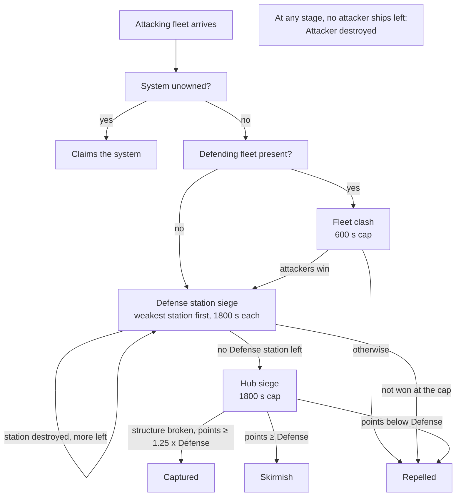
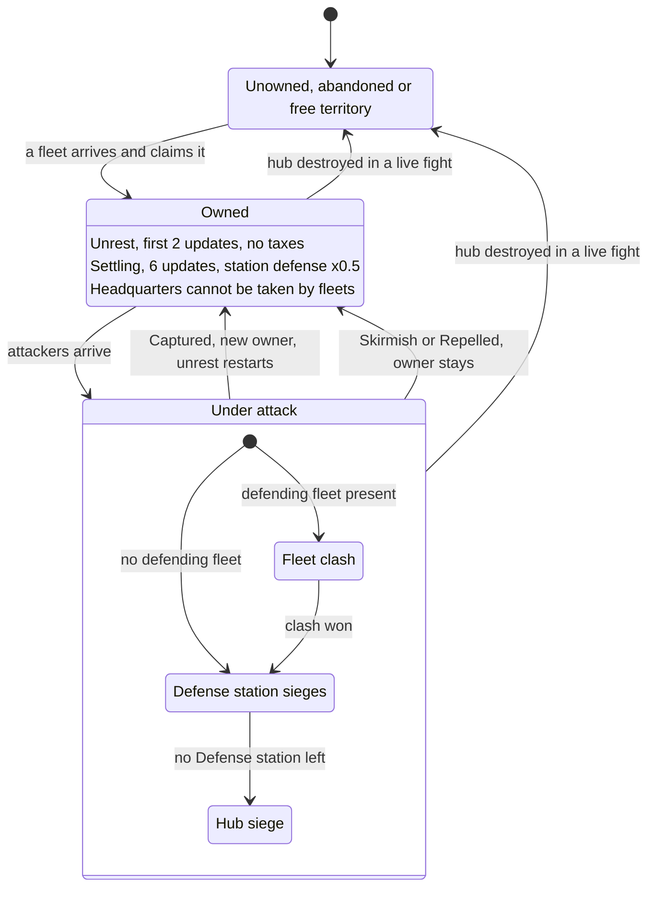
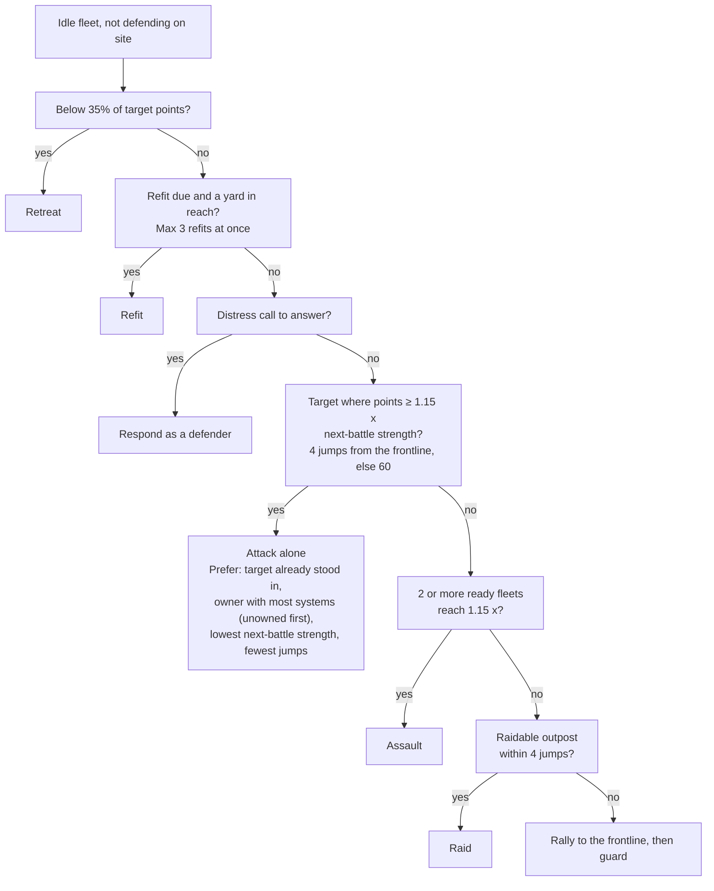
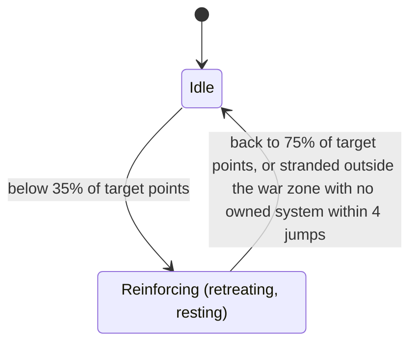

# War zone and battles

This page covers the Conquest war as the Conquest Map shows it: the war zone and the kinds of system in it, what the Defense number on a system tooltip is made of, what war effort does, how battles and sieges run and end, what capture and abandonment do, how NPC (non-player character) factions pick fights and raids, and what each fleet label on the map means. The war opens with the level 28 story step described in [Conquest](README.md). Values are read from the game code of version 0.8.3.4 (the decompiled source, not in-game testing); quoted in-game wording comes from the game's English text table. Anything not confirmed in code is marked (not verified). The last section, "In the game code", holds the class and method names behind each claim.

Terms and abbreviations are explained in the [conquest glossary](glossary.md) and the [basics glossary](../basics/glossary.md).

"Points" below are ship point values; the fleet cards in the game call the same unit "strength". How those values are derived is covered in [scaling](../basics/scaling.md). The hourly step the game shows as the "Conquest Update" card on the galaxy map is called the conquest update here; a separate hourly step that runs the faction economy is the hourly economy tick, which the game does not show. Faction income, shipyards, warship delivery, the Great Gate and raid economics are in [faction-economy](faction-economy.md). Per-part station HP (hit points) and conquest station layouts are in [war-stations](war-stations.md); loot and stations outside the war are in [stations](../basics/stations.md). Damage between live ships is in [combat-damage](../basics/combat-damage.md).

## The war zone and the kinds of system

The war zone is every system where factions fight over ownership: the Conquest sector (Ara Martis, the original war zone). The Frontier, Staging and Darkspace regions are not part of it. Every war-zone system stores who owns it, its war effort timers and its settling state, and has a hub: its main station (shown as "Space Station" on the map), which carries the owner's flag. Destroying the hub abandons the system. Systems outside the war zone are not part of fleet conquest. More war-zone sectors open with Beyond the Front ([gate](../expansion/README.md)).

| Kind | System card title or hint | What it means |
|---|---|---|
| Outpost system | "Conquest outpost" | Any owned war-zone system that is not a headquarters or your capital. Fleets can besiege and capture it. |
| Headquarters | "Conquest headquarters" | One system per conquest faction. It has the faction's commander and shop, and its hub takes x30 live hit points (HP) instead of x20. Fleets cannot take it, and NPC fleets leave it out of their target lists. |
| Your capital | "Your capital - no faction can take it" | The system you made your capital ([Your empire](../expansion/your-empire.md)). Fleets cannot take it, and NPC fleets leave it out of their target lists. |
| Unowned | (section empty) | No faction owns it. The Defense number is 0 and no rows show, unless the hub is an abandoned hulk (then the Defense row shows 0). |
| Abandoned | same as unowned; "Abandoned - the first faction to arrive claims this system" on the hub | A system whose hub was destroyed. It remembers which faction abandoned it, which matters when someone claims it (see below). |
| Free territory | (section empty); "Free territory is settled by the factions - you can only take a system from its owner" | Unowned system whose hub is Independent. NPC factions can claim it. |

In the code: [the war zone and the kinds of system](#code-the-war-zone-and-the-kinds-of-system).

## What the system tooltip shows

The conquest section of a war-zone system tooltip (the system card) has up to three kinds of row: the Defense row, "Your war effort" (green for a bonus, red for a penalty, with time left), and, from a later stage, a row for a second control value (see [the gate](../late-game/README.md)). The game has a "Control" label, but version 0.8.3.4 never adds it to the card, so no Control row appears. Each system still has a control level (0, 1 or 2); the section below on control level covers what it does.

In the code: [what the system tooltip shows](#code-what-the-system-tooltip-shows).

### What the Defense number means

The Defense number, shown as the Defense row, is the strength the defenders put into a siege round, in the same unit as ship points. A Defense station is a station type that holds a garrison (warships stationed in it) and fires on enemies; it is not the same thing as the Defense number. The number is the sum of three terms. An unowned system is 0.

```
Defense = station firepower term
        + garrison points of every faction Defense station in the system
        + points of every defending fleet in the system

station firepower term = max(250 x m, min(firepower, 700 x m) x structure fraction) x war effort multiplier + sector flat bonus
```

`m` here is the sector's station-defense multiplier and the flat bonus is a sector bonus. Nothing in version 0.8.3.4 creates either one, so in a standard game m = 1 and the flat bonus is 0 (not verified for old saves).

The station term uses the firepower of the system's hub and every Defense station of the same owner that is not wrecked, each scaled by m. Parts score as follows; destroyed parts (HP at 0 and damage taken) are skipped:

| Part | Hull | Firepower |
|---|---|---|
| Defense platform | 60 + 15 x sizes | 40 x sizes |
| Core | 200 | 0 |
| Connector | 5 | 0 |
| Anything else | 20 | 0 |

"sizes" is the sum over the platform's turret slots of the slot size, with Small = 1, Medium = 2, Large = 3 (never less than 1). A platform with two medium turrets has sizes 4, so hull 120 and firepower 160. A station whose contents have not been generated yet uses a flat estimate:

| Station size | Hull | Firepower |
|---|---|---|
| Small | 560 | 240 |
| Medium | 940 | 480 |
| Large | 1390 | 560 |

Three things shape the station term:

- Firepower above 700 does not count. Past that cap, extra platforms only add hull.
- The floor of 250 applies even to a station with no weapons left.
- While a hub siege is running, the structure fraction is the siege's remaining station hull fraction, so the term falls as the station breaks, down to the 250 floor. Outside a siege, or during a Defense station stage, the fraction is 1.

The whole profile is multiplied by 0.5 while the system is settling after a change of owner (see "Settling and unrest"). The 250 floor is not halved.

Each faction Defense station holds a garrison, a group of warships stationed in it. The number of ships and the point budget depend on its tier:

| Tier | 1 | 2 | 3 | 4 | 5 |
|---|---|---|---|---|---|
| Garrison ships | 3 | 4 | 5 | 6 | 8 |
| Garrison budget (points) | 270 | 405 | 540 | 720 | 900 |

For each slot the game picks the biggest warship that costs at most the budget divided by the number of ships (90 to 120 points), so a full garrison is at most its budget; how close it gets depends on the ship catalog (not verified). The garrison counts for a system's Defense in full, summed across every Defense station in it. Ships lost from a garrison are restocked by warships built at a Construction Yard (a faction station that builds warships); see [faction-economy](faction-economy.md). An older mechanism in which combat strength drains into garrisons never fires in this version.

A defending fleet counts if it belongs to the owner's faction, is in the system, is not traveling, and is set to join defense. NPC fleets always are. In the systems you hold, the number also gets a term for your patrol ships and a fleet mix bonus on your own fleets. Both unlock with Beyond the Front ([Your fleets and patrols in the Defense number](../expansion/empire-fleets.md#your-fleets-and-patrols-in-the-defense-number)).

An illustrative case: a hub that scores 480 firepower, one tier-3 Defense station with one platform carrying two medium turrets (160 firepower) and a garrison at its 540-point budget, and one full NPC fleet of 2000 points. The station term is min(480 + 160, 700) = 640, so the Defense number is 640 + 540 + 2000 = 3180. That is a worked figure from the formulas, not a value read from the game.

In the code: [what the Defense number means](#code-what-the-defense-number-means).

### What NPC factions use instead of the Defense number

NPC factions do not compare against the tooltip number. Their fleet planning uses "next-battle strength", which the game does not show anywhere. If the system has Defense stations, it is the strength of the weakest one (that station's own firepower, its garrison, and all defending fleets in the system); otherwise it is the full Defense number. It then adds the points of every same-faction fleet that is traveling toward the system as relief. You can estimate it from what the game shows: with no Defense station in the system it equals the Defense row (plus any fleets already on the way); with Defense stations it is usually lower. The Defense row is the upper bound, before fleets on the way, except while the system is settling: the row halves the station profile, but a Defense station's own strength is not halved, so next-battle strength can then exceed the row.

In the code: [what NPC factions use instead of the Defense number](#code-what-npc-factions-use-instead-of-the-defense-number).

### Ways to lower or raise Defense

| Lever | Effect |
|---|---|
| War effort penalty on the system | Station term x0.5 at the maximum penalty. See "War effort". |
| Destroy defender ships or fleets | Removes their points one for one. Intercepting fleets that are still traveling removes the relief term. |
| Destroy turret platforms or core by hand | Removes each platform's hull and firepower from the profile. Parts must be fully destroyed (HP 0 with damage taken). |
| Attack within a few hours of a capture | Station profile x0.5 while settling. |
| Siege progress | Each hub siege round that breaks station structure lowers the station term toward 250. |
| To raise it: war effort bonus | Up to x2 on the station term. See "War effort". |
| To raise it: more turret platforms | Helps only up to 700 firepower. |

In the code: [ways to lower or raise Defense](#code-ways-to-lower-or-raise-defense).

### Control level

Every owned system has a control level of 0 (unowned), 1 or 2. It rises by 1 each conquest update for an owned system with no battle in it and every neighboring system held by the same owner. The step from 1 to 2 in an NPC-owned system can inject a conquest dungeon. A hub siege that ends in the Skirmish or Raided outcome (see "Outcomes") lowers it by 1 if above 0; capture sets it to 1. Beyond the dungeon, the only other thing that uses it is the tie-break that decides which system is a faction's headquarters: garrison strength first, then resident fleet points, then control level.

In the code: [control level](#code-control-level).

## Levels in the war

The general level curves (what a level does to HP, damage and loot) are on [scaling](../basics/scaling.md). This section covers the levels the war itself sets: how system levels rise, what level NPC warships get, and how the ship rank and hull nodes of conquest fleets differ from ordinary enemies.

### Effective level

| Name | Where it comes from | What it drives |
|---|---|---|
| Effective level | commander level + Vanguard level | Galaxy level, NPC fleet level, system level catch-up (in addition to the item level cap and kill XP, which are listed in the [level table](../basics/scaling.md#which-level-is-used-for-what) on the basics page) |

Effective level sets the NPC fleet level (+6) and the system level catch-up, so raising it makes new NPC ships stronger too.

In the code: [effective level](#code-effective-level).

### How system levels rise

Once an hour, when the "Conquest Update" countdown on the galaxy map runs out (3600 s of game time), every system in the war moves toward your effective level. How far it moves depends on the gap:

| Your level compared with the system | Change each hour |
|---|---|
| More than 3 levels above it | +2 |
| 1 to 3 levels above it | +1 |
| Level with it, or 1 to 3 levels below it | +1, half the time |
| 4 or more levels below it | none |

Levels never go down. A system settles at about your effective level + 4 (at +3 it still has a 50% chance to step up, at +4 it stops). Frontier systems only rise this way after a hidden switch is flipped. The only thing I found that flips it is a debug command, and the switch is saved with the game. Whether story events also flip it was not verified.

In the code: [how system levels rise](#code-how-system-levels-rise).

### Fleet levels

Conquest fleets and garrisons use a single galaxy-wide level instead of the level of the system they stand in. The "NPC fleet level" below is the level NPC factions give their new warships.

```
galaxy level    = max(your effective level, highest conquest system level)
NPC fleet level = max(1, galaxy level + 6)
```

| Question | Answer |
|---|---|
| Level of a newly built NPC warship | NPC fleet level at the moment the ship is built (delivery, or founding a fleet) |
| Level shown for a fleet or garrison | Average of its ships' levels, weighted by each ship's points (a ship with no stored level counts as the system level) |
| When is an NPC fleet "due" for a refit | Fleet level <= NPC fleet level - 3 |
| What an NPC refit does | Raises every ship's stored level to the current NPC fleet level (takes 300 s at a Construction Yard) |
| Slow catch-up without a Construction Yard | At each hourly economy tick (not the conquest update) every due fleet that is not refitting gains +1 level per ship, capped at the NPC fleet level |

So NPC warships sit about 6 levels above you or the highest system, whichever is higher. A fleet counts as due once it is 3 or more levels behind, so old fleets mostly sit 0 to 2 levels behind between hourly economy ticks, and further behind for a few ticks after the NPC fleet level rises.

Do not forget the +6 on NPC fleets: a conquest fleet facing you at your level is fleet level + 6. That is more than the +5 column and less than the +10 column of the table in [scaling](../basics/scaling.md#how-much-tougher-is-an-enemy-five-or-ten-levels-higher) (at level 30 the +5 column is x1.56 damage and x1.57 HP, and the HP ratio is higher further up).

In the code: [fleet levels](#code-fleet-levels).

### Ship rank and hull nodes of conquest fleets

Conquest fleets and fleet hull ratings roll their ship rank at the default tier 0, so escalation does not raise their ship rank odds. The [Escalation](../basics/scaling.md#escalation) HP and damage multipliers do apply to ships in conquest battles.

NPC fleet entries start with at most 85 hull nodes. If hull nodes set later exceed the rolled rarity's budget (conquest fleet ships and garrison ships), the ship's rarity is raised to the smallest rarity that holds them. A generated NPC also cannot reach Legendary through nodes: conquest fleet entries are capped at 85, under the 100 an Exotic ship holds. How these ratings turn into a battle bonus is under "Hull edge" below.

In the code: [ship rank and hull nodes of conquest fleets](#code-ship-rank-and-hull-nodes-of-conquest-fleets).

## War effort

War effort is a per-system multiplier on station firepower, set by Conquest missions you complete (missions from a war-zone hub; the game shows them with a reward line such as "+10% Station firepower"). The tooltip shows it in the "Your war effort" row as "{percent} firepower ({time left})". Idle missions are the ones ECHO, your ship's AI companion, completes while you are away.

```
multiplier = max(0, 1 + bonus - penalty)
step       = 0.1 x (1 + 0.2 x points in ECHO The Conqueror)    for idle missions (done by ECHO)
step       = 0.1                                                otherwise
```

When you complete a mission whose source station is in a war-zone system:

| Where | Condition | Change |
|---|---|---|
| The mission's system | owned by the mission's source faction | bonus + step |
| Each neighboring system | owned by the source faction | bonus + step/2 |
| Each neighboring system | owned by the mission's targeted enemy faction | penalty + step |

The targeted faction is the mission's enemy faction, if it is a conquest faction and is not the employer. The mission reward line says so ("+10% Station firepower, -10% for X next system").

| Limit | Value |
|---|---|
| Bonus cap | +1.0 (multiplier x2) |
| Penalty cap | 0.5 (multiplier x0.5 if no bonus) |
| Duration | 10800 s (3 h) |

Each side (bonus and penalty) has one timer, and every new step on that side resets it to the full 10800 s. When the timer runs out the whole bonus or penalty clears at once; it does not decay gradually. The timers count down in real game time, not once per conquest update. War effort is cleared on any change of owner, and when a system is abandoned.

The multiplier applies in two places:

- In the Defense formula, to the whole station firepower term, including the 250 floor. With m = 1, the maximum bonus (x2) puts the term between 500 (floor) and 1400 (cap); the maximum penalty (x0.5) puts it between 125 and 350.
- On live stations: while you are at a conquest hub or a faction Defense station in a war-zone system, the multiplier scales the combat power, drone power and torpedo power of that station's parts. See [war-stations](war-stations.md) for the live HP multipliers (x20, x30 at a headquarters).

"ECHO The Conqueror" (a skill node) adds 20% of the base step per point, to idle Conquest missions only.

In the code: [war effort](#code-war-effort).

## Battles

### Types and stages

Every fight is in one of four stages:

| Stage | Who fights | Time cap | Ends with |
|---|---|---|---|
| Fleet clash (the game calls it a Fleet Battle) | The arriving attackers against the first defending fleet in the system. A "Fleet Battle" location appears in the system. | 600 s | Winner goes on to a siege stage; otherwise the battle ends. |
| Defense station siege | Attackers against one faction Defense station's garrison, its firepower and every defending fleet. | 1800 s | Defense station destroyed (Empire Log: "Defense station destroyed") or another outcome. Starts with the weakest Defense station. |
| Hub siege | Attackers against the hub: all garrisons and fleets, plus station firepower. Used when no Defense station is left. | 1800 s | Captured ("system captured"), Skirmish ("inconclusive skirmish"), Repelled ("attack repelled") and so on. |
| Raid | A raider fleet against one economic outpost's raid profile and its defenders. | 900 s | Raided ("raid succeeded"), Repelled, Attacker destroyed ("fleet destroyed"). |

When an attacking fleet arrives at a hostile system, unowned systems are claimed, not fought over (below). Otherwise, if any defending fleet is present, a fleet clash starts against the first one; if none, a siege starts. A fleet whose faction is already the attacker in an active non-raid fight at that system joins it as a supporter instead, bringing its points. Allied NPC factions do not defend each other; defenders must be the same faction as the owner.

After a clash win the same battle becomes a siege. A Defense station falls in its own battle; the attacking faction's fleet planning then sends it again, and the next siege starts with the weakest remaining Defense station. Each stage has a fresh 1800 s timer. You may see several battles back to back in one system.



In the code: [types and stages](#code-types-and-stages).

### One round

When you are not in the battle's venue, a battle runs as simulated rounds every 60 s. The cap timers above count down in the same 60 s steps, and the battle is judged at the cap instead of running another round, so a hub or Defense station siege gets at most 29 rounds (1800 s), a clash 9 (600 s) and a raid 14 (900 s).

```
damage pool of a side = leftover damage + strength x random(0.04, 0.06)
attackers: strength = sum of fleet points x (1 + hull edge)
defenders: strength = (Defense, Defense-station strength, or raid defense) x (1 - hull edge)
```

Each pool is spent on that side's own ships one at a time. The next victim is picked at random with weight 1 / sqrt(ship points), so cheaper ships are picked more often. A ship dies only if the remaining pool covers its whole point value. If the picked ship costs more than what is left, spending stops and the remainder stays as leftover damage, to be added to next round's pool. Fleets keep unspent damage after a battle as carried damage and repair it only while resting at home, 100 points per hour.

The defenders' pool can go past their last ship. That spill is the only damage the station structure takes: the station hull falls only after every garrison ship and defending fleet in the fight is dead.

Over a full 29-round siege each side deals roughly 29 x 0.05 = 1.45 times its own strength in total damage (derived from the constants, not read as one number). A 9-round clash deals about 0.45 times. A clash is therefore usually decided on points at its cap, not by wiping a fleet. Your own fleets count their points plus the fleet mix bonus from Beyond the Front in these strengths, as in the Defense number.

In the code: [one round](#code-one-round).

### Hull edge

Each round the game computes an average hull rating for each side's remaining ships, weighted by point value, and gives the attacker a bonus or malus:

```
edge = clamp((attacker rating - defender rating) x 0.005, -0.15, +0.15)
```

The attacker's strength is multiplied by 1 + edge and the defender's by 1 - edge. A gap of 30 rating points reaches the 15% cap. A side with no ships (only the station) has no rating, so the edge is 0. A ship's rating is its hull points clamped to 0 to 100. NPC ships start with hull points rolled from their level and ship rank (the Rookie to Legendary tier shown on an enemy ship's tooltip; max 85 at roll). Winners gain hull XP (experience points):

| Event | XP |
|---|---|
| Battle ends in a win for that side (siege, or a clash the attacker lost) | 4 per surviving ship |
| Raid ends in a win for that side | 1 per surviving ship |

The next point costs ceil(7 + 0.65 x points) XP, and ships stop earning at 85 hull points. XP is paid when a battle ends, to every surviving ship of the winning side's fleets (and Defense garrisons). The winning side is the attacker for Captured, Skirmish, Raided and Defense station destroyed, and the defender for Repelled, Attacker destroyed and Withdrew. A clash the attackers win does not pay XP, because it continues into a siege instead of ending.

Your own fleet cards (Beyond the Front) show "Hull edge ... vs ... fleets nearby": your fleet's edge against the highest-rated hostile fleet within 2 jumps.

In the code: [hull edge](#code-hull-edge).

### When you are there: live battles

If your ship is in the battle's venue (the Fleet Battle zone, the besieged station, or the raided economic outpost), the game spawns the real ships of both sides there and the battle is live. In a live battle:

- Simulated rounds and the time cap stop. Nothing is resolved by the clock while you are present.
- Every 5 s the game checks which spawned ships died and removes them from their fleets.
- A clash ends when one side has no ships left in the zone. A siege ends early as Attacker destroyed when the attackers have none left. If you destroy the hub, the system is abandoned; if you destroy a Defense station, the siege ends as Defense station destroyed.
- Ships that die in NPC fleets are removed permanently.

An undefended raid is simulated by rounds even if you are present; a raid with defenders runs live.

In the code: [when you are there: live battles](#code-when-you-are-there-live-battles).

### How a siege ends

Checks run after each simulated round, and again at the cap.

A hub siege ends early if the lead attacker has no ships (Attacker destroyed) or the early capture conditions hold. A Defense station siege uses the same rule against its own structure.

The early capture conditions require all of:

- 600 s have passed in this stage.
- The system is capturable (not a headquarters or your capital).
- The station structure is at 0.
- There are no defenders left: no garrison ships or defending fleets.
- Attacker points (summed over attacker fleets still standing) are at least 1.25 x the current Defense number.

For a Defense station the checks are the same but compared against that station's strength with its structure fraction, and defenders means that garrison and the defending fleets.

At the cap (1800 s), a hub siege is judged like this:

```
structure broken, system capturable, points >= 1.25 x Defense  ->  Captured (Raided if the attacker cannot conquer)
points >= Defense                                              ->  Skirmish
otherwise                                                      ->  Repelled
```

The cap check does not require defenders to be dead; the defenders still alive are already in the Defense figure. Defense station siege at the cap: if the structure is broken and points are at least 1.25 x the station's strength, all defending fleets in the system are wiped and the station is destroyed (Defense station destroyed, or Raided if the attacker cannot conquer); otherwise Repelled.

A clash at its cap (600 s) goes to the attackers if their combined points beat the defender fleet's points; they then continue to a siege. Otherwise they go idle and the outcome is Repelled (or Attacker destroyed if the lead attacker is gone).

In the code: [how a siege ends](#code-how-a-siege-ends).

### Outcomes

| Outcome | Empire Log text (attacker's view / defender's view) | What triggers it | Result |
|---|---|---|---|
| Captured | "system captured" / "system lost" | Hub siege breakthrough by a faction that can conquer; a besieger that claims an abandoned system | System changes hands. See "Capture". |
| Skirmish | "inconclusive skirmish" | Hub siege at the cap with points at or above Defense but the capture conditions unmet (structure still standing, or points under 1.25x Defense) | Control level -1 if above 0. Attackers go idle. No re-attack block. |
| Repelled | "attack repelled" | Attacker points below Defense at the cap; clash lost at the cap; raid broken off; Defense station siege at the cap not won | Attackers go idle. A Defense station siege that ends Repelled blocks re-attack for 3600 s. A hub siege Repelled at its cap, a lost clash and a broken-off raid do not. |
| Attacker destroyed | "fleet destroyed" / "attackers destroyed" | No attacker ships left in any stage | Fleet dissolves if empty. |
| Aborted | no text of its own | The target or station vanished, the station was wrecked, or the raided economic outpost changed hands | Attackers go idle. |
| Defense station destroyed | "Defense station destroyed" / "Defense station lost" | A Defense station siege won as above, or you destroyed the station live | Station destroyed (a wreck for 3600 s that holds 10% of its stock); garrison counted as lost. No re-attack block. |
| Withdrew | "withdrew before relief arrived" / "attackers withdrew" | The lead attacker is ordered away with no standing supporters | Attackers go idle. In practice this takes your own fleets, which unlock with Beyond the Front ([Empire fleets](../expansion/empire-fleets.md)). |
| Raided | "raid succeeded" / "outpost raided" | A raid succeeds; or a siege breakthrough by a raider faction (Corsair Syndicate while it holds no war-zone systems, and a faction from a later stage that always counts as a raider, see [the gate](../late-game/README.md)) | In a hub siege: control -1, no capture. Re-attack is blocked for 3600 s when the siege ends early or is a Defense station siege, but not when a hub siege reaches its cap. For a Defense station siege the station survives and control is unchanged. In a raid: see below. |

The Empire Log shows the wording in the second column. The battle report text uses the English outcome name, plus losses, station structure left and the hull edge.

In the code: [outcomes](#code-outcomes).

### Raids

A raid targets one economic outpost: a station that produces something (Mining, Salvage, Refinery, Forge, Production, Trading, Recruitment or Construction Yard) and is not a Defense station. It can belong to an NPC faction or to you. Structure and firepower come from the station's normal profile scaled to 15% hull and 50% firepower. Defenders are the owner's fleets in the system, plus your patrol ships when the outpost is yours.

| Rule | Value |
|---|---|
| Cap | 900 s |
| Earliest success | 600 s elapsed, structure broken, and no defenders left |
| Breaks off (Repelled) | Raider has lost 50% or more of its starting points (not for frontier raid parties) |
| Any raider at the cap | Success if the outpost is taken (structure broken, no defenders). A raid party still facing defenders gets 60 more seconds, repeatedly. Otherwise Repelled. |

On success the station gets a 14400 s raid cooldown, during which it cannot be raided again, and its production pauses 3600 s. Against an NPC owner the raider also takes 50% of stored materials (10% when the raider is you) and the owner loses wealth (the money a faction spends on warships and stations; the Faction overview shows it as "Economic Power"). Raiding your own stations takes nothing from your storage or wealth. Details in [faction-economy](faction-economy.md).

In the code: [raids](#code-raids).

## Capture, abandonment and claiming



### Capture by siege

When a hub siege ends in Captured, this happens in order:

1. Every defending fleet of an NPC faction is wiped.
2. Every Defense station of the old owner is destroyed (it becomes a wreck).
3. The system's owner becomes the attacker. The hub and economic outposts of the old owner flip to the new owner. War effort in the system clears.
4. Cargo routes that now cross owners are cancelled, the old owner's pending station constructions and queued warship constructions for yards in that system are removed, and work bays are emptied.
5. The headquarters flag is removed, control level is set to 1, and the settling timer starts.
6. The old owner is checked: a faction with no systems left starts a 5-update cooldown (counted in conquest updates) before it can rejoin the war.

In the code: [capture by siege](#code-capture-by-siege).

### Settling and unrest

The game has no name for the two states below; "unrest" and "settling" are plain words used on this page. The conquest update runs every 3600 s. Capture and claim start a settling timer of 6 conquest updates, and each conquest update lowers it by 1.

| State | Condition | Effect |
|---|---|---|
| Unrest | The first 2 conquest updates after the change of owner | The system pays no taxes, the wealth a faction earns every hour from the systems it owns (the "Taxes" ledger line; see [faction-economy](faction-economy.md)). |
| Settling | Until the timer reaches 0 | The station profile (hub and Defense stations, hull and firepower) is x0.5. This applies to the Defense number and to a hub siege's structure, not to a Defense station's own siege. |

Because the first conquest update can come at any time up to 3600 s after the capture, settling lasts between 5 and 6 hours of game time, and unrest between 1 and 2.

In the code: [settling and unrest](#code-settling-and-unrest).

### Unowned and abandoned systems

Destroying the conquest hub of an owned war-zone system with a live fight (you flying at the station) abandons it. A simulated siege that ends in Captured does not go through this path. The system becomes unowned, control and war effort reset, and the headquarters flag drops. The code does not check whether the system is a headquarters here, so destroying a headquarters hub abandons it (not verified in play). The battles at the system then end, and the claim goes to the fleet that was besieging, if it can conquer. If you have unlocked claiming and your flagship or an Empire Fleet is in the system, you get the claim offer first; declining hands the system to the besieger if it is still there. Claiming systems yourself unlocks with Beyond the Front ([Your empire](../expansion/your-empire.md)).

A fleet that arrives at an unowned system claims it unless the system is waiting on a claim offer. If the system was abandoned by a different faction, that faction's Defense stations in it are destroyed first.

In the code: [unowned and abandoned systems](#code-unowned-and-abandoned-systems).

## How NPC factions pick fights

### Cadence

| What | Cadence |
|---|---|
| Conquest update (the "Conquest Update" card on the galaxy map): control level, settling, headquarters check | 3600 s |
| Hourly economy tick (not shown in the game): queues builds, assigns fleet orders | 3600 s |
| Military planning between the hourly steps | every 600 s, plus immediately after any battle ends for each faction involved |
| Distress response check | 60 s, only while a battle is active |
| Fleet travel time | 60 s + 150 s per jump |

NPC fleets target 2000 points each. How many fleets a faction fields is in [faction-economy](faction-economy.md).

In the code: [cadence](#code-cadence).

### Frontline score

A faction's frontline is every war-zone system it owns that has at least one contested neighbor: a neighbor owned by a hostile owner and open to the faction, or (for non-raiders) an unowned war-zone neighbor. Each frontline system gets:

```
score = highest neighbor Defense + 0.6 x max(0, 2000 - lowest neighbor Defense) - 250 x covering fleets
```

The highest and lowest neighbor Defense are taken among contested neighbors. Covering fleets are the faction's fleets in that system plus fleets traveling to it. A high score means a strong enemy neighbor, or a weak one worth taking, and few fleets assigned. Fleets rally to the highest score; every fleet already rallying there lowers it by 250 for the next. Hostile means any faction other than the owner or a war ally; against you, a faction must be your enemy (at war with you, or your reputation with it below -500).

In the code: [frontline score](#code-frontline-score).

### Choosing a target

Idle fleets that are not defending on site, in this order:

1. Retreat check (below).
2. Refit, if due and a yard is in reach (max 3 refits at once per faction).
3. Distress response.
4. Attack: with a frontline, the contested neighbors of frontline systems, up to 4 jumps away. Without one, any open, targetable war-zone system that is unowned or owned by a hostile faction (raiders skip unowned ones), up to 60 jumps away.
5. Assault planning with other fleets.
6. Raid.
7. Rally to the frontline, then guard.

A fleet attacks alone only if its points are at least 1.15 times the target's next-battle strength. Among valid targets it prefers:

1. A target it is already standing in.
2. The owner with the most war-zone systems (unowned systems rank above any owner).
3. The lowest next-battle strength.
4. The fewest jumps.

Targets already claimed by another of the faction's fleets are skipped, as is a system the fleet was blocked from re-attacking for 3600 s. A faction holding under 10% of war-zone systems only considers unowned targets or owners that hold at least 10%, unless that leaves nothing.



In the code: [choosing a target](#code-choosing-a-target).

### Assaults

When no single fleet can beat a target, the faction looks for 2 or more ready fleets whose combined points reach 1.15 x the target's next-battle strength. An assault is several of one faction's fleets meeting next to a target and merging to attack it.

1. The staging system is the first war-zone neighbor of the target owned by the faction (neighbor order is shuffled every conquest update).
2. The nearest ready fleets are chosen until the sum reaches the threshold; at least 2 are needed. They travel to staging with the order shown as "Gathering for an assault".
3. Once all are at staging, the sum is checked again. If it fell below the threshold, the assault disbands. Otherwise the fleets merge into one (the first fleet takes all ships and target points) and attack with the "Attacking" order.
4. If the staging system is lost, or no member is left gathering, the assault disbands. A member that stops being able to gather just leaves it.
5. A merged fleet above one fleet slot is split back into 2000-point fleets when idle.

A faction runs one assault at a time.

In the code: [assaults](#code-assaults).

### NPC raids

A fleet with no attack or assault gets a raid order if it is not below the retreat threshold. It picks the nearest (up to 4 jumps) raidable economic outpost among those owned by the factions on its frontline candidate list, plus yours if the faction is your enemy. An economic outpost qualifies if it is in the war zone, open to the raider, not a Defense station, not on raid cooldown, not already under raid or targeted, and has no defending fleet. Raiding fleets show the "Raiding an outpost" label.

Frontier raid parties are separate. Every hour, each Frontier sector with systems / 5 slots tries to fill each free slot with a 25% roll. A party is 200 to 300 points, has 2 raids, and lives 3 hours; it leaves when its raids or time are gone, or when it drops below 50% of its starting points. Corsair Syndicate parties start from the nearest Corsair system. The two highest-level Frontier sectors can also spawn Meridia's Chosen parties. Targets are stations of Kolyatov Collective, Stellar Industries and Luminate Combine in the same sector (and your own stations, if the party's faction is your enemy), scored by stock value / (1 + jumps)^2. Canisec patrols (800 points) defend raided stations in Frontier sectors.

In the code: [NPC raids](#code-npc-raids).

### Retreats, recovery and distress

A fleet needs to retreat when it is below 35% of its target points. The check applies to idle fleets; a fleet defending a battle gets one 25% roll per battle to leave, and fleets with no roll left stay. The retreat destination is the nearest yard system within 4 jumps (skipped for a fleet outside the war zone whose faction still holds war-zone systems), otherwise the nearest safe owned war-zone system that is not on the frontline, otherwise any safe owned system. A fleet already at its retreat site is parked there as retreating; a fleet that has to travel shows the same label on the way. The label is "Reinforcing" until the fleet is back to 75% of its target points or it is stranded outside the war zone with no owned war-zone system within 4 jumps. Resting fleets repair 100 points of carried damage per hour; lost ships are rebuilt at yards.



A besieged system's owner can send a responder: the nearest available fleet that can arrive before the battle's remaining time runs out ((time remaining - 60) / 150 jumps, max 60). That fleet shows "Responding to a distress call" and arrives as a defender. For raids, the owner's fleets answer too; war-zone fleets answer only if the outpost is in the war zone.

In the code: [retreats, recovery and distress](#code-retreats-recovery-and-distress).

## Fleet labels on the map

The label on a fleet is the first line below that matches:

| Order | Label | When |
|---|---|---|
| 1 | Refitting - {time} left | The fleet is refitting (300 s per refit) |
| 2 | Flying to a construction yard to refit | On its way to a refit |
| 3 | Moving | A raid party heading home |
| 4 | Supporting {fleet} at {system} | The fleet joined another fleet's battle as a supporter |
| 5 | Joining the siege of {system} | Your own fleet (Beyond the Front) traveling under a Join siege order |
| 6 | Defending an outpost from raiders | Idle fleet in a system where its owner's economic outpost is being raided |
| 7 | Defending the system | Idle fleet in a system where its owner is under a Defense station siege or hub siege (not a fleet clash) |
| 8 | One of the labels below | Otherwise |

| Label | Set when |
|---|---|
| Attacking | Sent to take a system (NPC attack, an assault launching), or a supporter joining a battle. |
| Reinforcing | An idle fleet that is not on the frontline is sent to the best-scoring frontline system; also every retreating fleet. Warship deliveries use it as well. |
| Responding to a distress call | Sent to a besieged or raided system the faction owns. |
| Holding position | Fleet is idle already on a frontline system, and the default after any battle, finished refit, or cancelled order. |
| Guarding faction space | Fleets left over after rally. They spread over the faction's station systems, fewest covering fleets first, then nearest. |
| Gathering for an assault | Fleets heading to or waiting at the staging system of an assault. |
| Refitting at a construction yard | A fleet carrying a refit order that is not yet in the refitting state. |
| Raiding an outpost | Sent to raid, including raid parties. |

A retreating NPC fleet still shows "Reinforcing".

In the code: [fleet labels on the map](#code-fleet-labels-on-the-map).

## Reputation cost of destroying stations

| Action | Reputation effect |
|---|---|
| Destroying a faction station while you hit it (live) | -5000 with its faction, or -1000 if your reputation with it is already at or below -5000 (Hostile or worse). Hubs are not faction stations: killing a hub costs only the per-part penalty (see [war-stations](war-stations.md)). |

A station destroyed only by the simulation does not cost you reputation. The cost is also waived while a Decoy Transponder is active ([the gate](../late-game/README.md)).

In the code: [reputation cost of destroying stations](#code-reputation-cost-of-destroying-stations).

## In the game code

Everything above is read from the decompiled code of version 0.8.3.4 (not from in-game testing). Names are written as `Class.Method` or `Class.field`; to check a claim, search the decompiled source for the name. Claims the code does not settle are marked `(not verified)`. The conquest update is `Conquest.DoConquestTick`; the hourly economy tick is `ConquestFleetPlanner.Tick`.

### Code: The war zone and the kinds of system

In code the war zone is every system whose sector is a conquest sector (the Ara Martis region), excluding reserved slots. Every war-zone system has a `ConquestSystem` that stores who owns it, war effort timers and settling state, and a hub: its main station (`ConquestStation`, shown as "Space Station" on the map). The Frontier, Staging and Darkspace regions are not part of it.

| Term | Code name |
|---|---|
| Headquarters cannot be taken | `cannotBeTaken` is `headquarters` or `isPlayerCapital`, and NPC fleet target lists skip it |
| Which faction abandoned a system | `abandonedBy` |

Source: `ConquestScope.IsWarZone`, `ConquestScope.IsOpenTo`, `ConquestSystem.cannotBeTaken`, `ConquestSystem.isHubless`, `MapTooltipCardBuilder.GetConquestSectionTitleKey`, `SystemClaim.IsFreeTerritory`

### Code: What the system tooltip shows

The localization key `SystemCardControl` ("Control") exists, but `BuildConquestSection` never adds it in 0.8.3.4, so no Control row appears. The `controlLevel` field (0, 1 or 2) is still tracked, and the section on control level covers what it does. The section title comes from `GetConquestSectionTitleKey` (`SystemCardPlayerCapital` when `isPlayerCapital`, otherwise `SystemCardConquestOutpost` or `SystemCardConquestHeadquarters`). The Defense row is `GetDefenseStrength`. An unowned system returns the bare section unless its hub is an abandoned hulk (`Conquest.IsAbandonedHulk`). `BuildConquestSection` also adds a further control row when a later-stage field is above 0.

Source: `MapTooltipCardBuilder.BuildConquestSection`, `MapTooltipCardBuilder.AddWarEffortRows`

### Code: What the Defense number means

```
Defense = StationFirepower
        + sum over faction Defense stations: garrison ship points
        + sum over defending fleets: totalPoints

StationFirepower = bound(profile.firepower) + sectorFlatBonus
bound(fp)        = max(250*m, min(fp, 700*m) * structureFraction) * warEffortMultiplier
```

`m` is the sector StationDefense multiplier and `sectorFlatBonus` the sector flat bonus. No code in 0.8.3.4 creates a StationDefense sector bonus (only SafeSector is created), so in a standard game `m = 1` and the flat bonus is 0 `(not verified for old saves)`.

The station term uses a profile summed over the system's hub and every non-wrecked Defense station of the same owner, each scaled by `m`. `sizes` is the sum over the platform's turret slots of `max(1, size)` with Small = 1, Medium = 2, Large = 3. While a hub siege (the `StationSiege` stage) is running, `structureFraction` is the siege's remaining station hull fraction; outside a siege, or during a Defense station stage, it is 1.

A defending fleet counts if it is of the owner's faction, is in the system, is not traveling, and "joins defense". NPC fleets always do.

The older "combat strength drains into garrisons" path in `Conquest.DrainCombatStrengthIntoGarrisons` never fires because nothing in the code raises `combatStrength` above 0.

Source: `ConquestCombat.GetDefenseStrength`, `ConquestCombat.GetStationFirepower`, `ConquestCombat.BoundStationFirepower`, `StationDefense.GetProfile`, `StationDefense.ScorePart`, `StationDefense.EstimateFromSize`, `FactionGarrison.GetStrength`, `FactionGarrison.PickShip`

### Code: What NPC factions use instead of the Defense number

Next-battle strength is `GetNextBattleStrength`. If the system has Defense stations, `ConquestCombat.ChooseNextDefenseStation` picks the weakest and `ConquestCombat.GetDefenseStationStrength` gives its strength; `ConquestCombat.GetIncomingRelief` adds the points of every same-faction fleet that is Traveling toward the system.

Source: `ConquestCombat.GetNextBattleStrength`, `ConquestCombat.ChooseNextDefenseStation`, `ConquestCombat.GetIncomingRelief`, `ConquestCombat.GetDefenseStationStrength`

### Code: Ways to lower or raise Defense

The stations counted in the profile are the ones `StationDefense.GetDefendingStations` returns.

Source: `StationDefense.GetDefendingStations`

### Code: Control level

`controlLevel` is 0 (unowned), 1 or 2. It rises by 1 each conquest update for an owned system with no battle in it and every neighboring system held by the same owner. The step from 1 to 2 in an NPC-owned system can inject a conquest dungeon. A hub siege that ends in `Skirmish` or `Raided` lowers it by 1 if above 0; capture sets it to 1. Beyond the dungeon, the only other readers in the code are the headquarters tie-break in `Conquest.EnsureSingleHeadquarters` (garrison strength, then resident fleet points, then control level) and a debug command.

Source: `Conquest.ApplyControlLevelUpgrades`, `Conquest.EnsureSingleHeadquarters`, `BattleManager.ApplyStationSiegeSkirmish`

### Code: Levels in the war

The subsections below hold the code behind the level rules.

#### Code: Effective level

| Name | Code name |
|---|---|
| Effective level | `GamePlayer.effectiveLevel` (commander level + Vanguard level) |

#### Code: How system levels rise

`Conquest.DoConquestTick` runs every 3600 s of game time and calls `Conquest.UpdateSystemLevels`, which applies `Conquest.RaiseTowardPlayer` to every conquest system:

```
gap = effectiveLevel - system.level
gap > 3             -> +2
0 < gap <= 3        -> +1
-4 < gap <= 0       -> +1 with 50% chance
gap <= -4           -> +0
```

Frontier systems are included only after the `frontierLevelsRise` flag is set. The only caller of `StartFrontierLevelRise` I found is the debug console; the flag is saved with the game. Whether story events also set it was not verified.

Source: `Conquest.UpdateSystemLevels`, `Conquest.RaiseTowardPlayer`, `Conquest.DoConquestTick`

#### Code: Fleet levels

The code class is `FleetLevels`. The hourly economy tick that does the slow catch-up is `ConquestFleetPlanner.Tick`, not the conquest update.

```
galaxy level      = max(effectiveLevel, highest conquest system level)
NPC fleet level   = max(1, galaxy level + 6)
```

| Question | Code |
|---|---|
| NPC fleet level | `FleetLevels.GetNpcFleetLevel` |
| Galaxy level | `FleetLevels.GetGalaxyLevel` |
| Fleet or garrison level (points-weighted average) | `FleetLevels.GetFleetLevel` |
| Due for refit (fleet level <= NPC fleet level - 3) | `FleetLevels.IsDueRefit` |
| Refit (300 s at a Construction Yard) | `ConquestFleetOrders.CompleteRefit` |
| Slow catch-up (+1 level per ship each hourly economy tick) | `ConquestFleetOrders.DriftLaggingFleets` |

Source: `FleetLevels.GetGalaxyLevel`, `FleetLevels.GetNpcFleetLevel`, `FleetLevels.GetFleetLevel`, `FleetLevels.IsDueRefit`, `ConquestFleetOrders.CompleteRefit`, `ConquestFleetOrders.DriftLaggingFleets`

#### Code: Ship rank and hull nodes of conquest fleets

Conquest fleets and fleet hull ratings roll their ship rank with the default tier 0. The hull nodes set later by `SetNpcHullNodes` can exceed the rolled rarity's budget; the ship's rarity is then raised to the smallest rarity that holds them.

Source: `ConquestCombat.BuildShip`, `HullRating.RollStartingPoints`, `ShipUpgradeCalculator.SetNpcHullNodes`, `HullRating.ToRating`

### Code: War effort

```
warEffortMultiplier = max(0, 1 + warEffortBonus - warEffortPenalty)
step                = 0.1 * (1 + 0.2 * ECHO_Conqueror_points)    for idle missions (done by ECHO)
step                = 0.1                                         otherwise
```

`ConquestWarEffort.Apply` runs when you complete a mission whose source station is in a war-zone system. Each side (bonus and penalty) has one timer of 10800 s, counted down every game update (`ConquestSystem.TickWarEffort`), not once per conquest update. On live stations the multiplier scales stat indices 21, 25 and 26 (combat power, drone power and torpedo power) of that station's parts (`CombatStationPart.ApplyWarEffort`). The skill node behind "ECHO The Conqueror" is `PromptEngineeringFleetStrengthBoost`.

Source: `ConquestWarEffort.GetStep`, `ConquestWarEffort.Apply`, `ConquestSystem.AddWarEffortBonus`, `ConquestSystem.AddWarEffortPenalty`, `ConquestSystem.TickWarEffort`, `LivingUniverse.StoryUpdate`, `ConquestStrength.OnComplete`, `CombatStationPart.ApplyWarEffort`, `SystemMapData.SetConquestFaction`

### Code: Battles

The subsections below hold the code behind the battle rules.

#### Code: Types and stages

Every fight is a `BattleInstance` in one `BattleStage`:

| Stage in the game | Code name |
|---|---|
| Fleet clash | `FleetClash` |
| Defense station siege | `DefenseStationSiege` (ends in `DefenseStationDestroyed`) |
| Hub siege | `StationSiege` (ends in `Captured`, `Skirmish`, `Repelled` and so on) |
| Raid | `Raid` (ends in `Raided`, `Repelled`, `AttackerDestroyed`) |

Flow when an attacking fleet arrives at a hostile system (`OnFleetArrived`): unowned systems are claimed, not fought over. Otherwise, if any defending fleet is present, a `FleetClash` starts against the first one; if none, a siege starts. A fleet whose faction is already the attacker in an active non-raid fight at that system joins it as a supporter instead, bringing its points (`pointsAtJoin`).

Source: `BattleManager.OnFleetArrived`, `BattleManager.StartEngagement`, `BattleManager.StartFleetClash`, `BattleManager.StartSieges`, `BattleManager.BeginNextSiegeStage`, `BattleManager.TransitionToStationSiege`, `BattleManager.TryJoinBattleOnArrival`, `BattleManager.StartRaid`

#### Code: One round

Simulated rounds run through `BattleManager.TickOffscreen`.

```
pool(side)  = carriedDamage(side) + strength(side) * random(0.04, 0.06)
attackers:  strength = sum of fleet totalPoints * (1 + hullEdge)
defenders:  strength = (Defense, Defense-station strength, or raid defense) * (1 - hullEdge)
```

The next victim is picked at random with weight `pointValue^-0.5` (`BattleTargetSizeBias` 0.5). If the picked ship costs more than what is left, spending stops and the remainder stays in `damageOnAttacker` or `damageOnDefender`, to be added to next round's pool. Fleets keep unspent damage after a battle as `carriedDamage`. The station hull is `stationHull`, and it falls only after every garrison ship and defending fleet in the fight is dead.

A round runs each time `roundTimer` (60 s) runs out. When `timeRemaining` reaches 0, `ResolveAtCap` runs instead of another round, so the last step is never a round: 29 rounds in 1800 s, 9 in 600 s, 14 in 900 s. `FleetMixBonus.GetBattleStrength` is `totalPoints x (1 + mix bonus)`, and the bonus is 0 unless the fleet is an empire fleet.

Source: `BattleSimulation.RollDamage`, `BattleSimulation.SpendPool`, `BattleSimulation.PickTarget`, `BattleSimulation.TargetWeight`, `BattleSimulation.RunSiegeRound`, `BattleSimulation.RunDefenseStationRound`, `BattleSimulation.RunClashRound`, `BattleSimulation.RunRaidRound`, `BattleManager.TickOffscreen`, `ConquestWarTuning.BattleDamageShareMin`, `ConquestWarTuning.BattleTargetSizeBias`

#### Code: Hull edge

```
edge = clamp((attackerRating - defenderRating) * 0.005, -0.15, +0.15)
```

The attacker's strength is multiplied by `1 + edge` and the defender's by `1 - edge`. The next hull point costs `ceil(7 + 0.65 * points)` XP. Hull XP is paid by `BattleManager.AwardHullXp`. The winning side is the attacker for `Captured`, `Skirmish`, `Raided` and `DefenseStationDestroyed`, and the defender for `Repelled`, `AttackerDestroyed` and `Withdrew`. A ship's rating is its hull points clamped to 0 to 100.

Source: `HullRating.GetEdge`, `HullRating.GetSideRating`, `HullRating.GetFleetRating`, `HullRating.GetHullPoints`, `HullXp.Award`, `HullXp.GetXpForNextPoint`, `BattleManager.AwardHullXp`, `BattleSimulation.UpdateHullEdge`

#### Code: When you are there: live battles

The 5 s check of which spawned ships died is `SyncLiveLosses`.

Source: `BattleManager.Tick`, `BattleManager.TickLive`, `BattleManager.EnsureVenueUnits`, `BattleManager.SyncLiveLosses`, `BattleManager.TryResolveLiveFleetClash`, `BattleManager.OnDefenseStationDestroyedLive`, `BattleManager.IsRaidLeftToRounds`, `CombatStationPart.CheckCombatStationFullyDestroyed`

#### Code: How a siege ends

A hub siege (`StationSiege`) ends early if the lead attacker has no ships (`AttackerDestroyed`) or `CanCaptureEarly` holds. A Defense station siege uses the same rule against its own structure.

`CanCaptureEarly` requires all of:

- 600 s have passed in this stage.
- The system is capturable (`cannotBeTaken` is false: not a headquarters or your capital).
- The station structure is at 0.
- There are no defenders left: no garrison ships or defending fleets.
- Attacker points (`totalPoints`, summed over attacker fleets still standing) are at least 1.25 x the current Defense number.

At the cap (1800 s), a hub siege is judged like this:

```
structure broken, system capturable, points >= 1.25 * Defense  ->  Captured (Raided if the attacker cannot conquer)
points >= Defense                                               ->  Skirmish
otherwise                                                       ->  Repelled
```

A Defense station siege at the cap ends in `DefenseStationDestroyed` (or `Raided` if the attacker cannot conquer) or `Repelled`. A clash at its cap (`ResolveFleetClashAtCap`) goes to the attackers, and a siege starts, if their `GetAttackerPoints` is above the defender fleet's `totalPoints`; otherwise it ends `Repelled` (or `AttackerDestroyed` if the lead attacker is gone).

Source: `BattleManager.JudgeSiegeAtCap`, `BattleManager.CanCaptureEarly`, `BattleManager.TryEndSiegeEarly`, `BattleManager.ResolveDefenseStationSiegeAtCap`, `BattleManager.ResolveFleetClashAtCap`, `BattleManager.TryEndDefenseStationStageEarly`, `BattleManager.CanTakeDefenseStation`

#### Code: Outcomes

Outcome names in the code, as listed in the table above: `Captured`, `Skirmish`, `Repelled`, `AttackerDestroyed`, `Aborted`, `DefenseStationDestroyed`, `Withdrew`, `Raided`.

- `Skirmish`: no re-attack block, because the hub cap path does not call `BlockReattackAfterStalledSiege`.
- `Repelled`: a Defense station siege that ends `Repelled` blocks re-attack for 3600 s. A hub siege `Repelled` at its cap, a lost clash and a broken-off raid do not.
- `Raided`: for a siege breakthrough by a raider faction, `ConquestJoin.IsRaider` is true (Corsair Syndicate while it holds no war-zone systems). `GetBreakthroughOutcome` picks `Captured` or `Raided`.
- The battle report text comes from `BattleReport.Describe`.

Source: `BattleManager.ApplySiegeOutcome`, `BattleManager.BlockReattackAfterStalledSiege`, `BattleManager.GetBreakthroughOutcome`, `ConquestJoin.IsRaider`, `BattleReport.Describe`, `ConquestWarTuning.SiegeCaptureMargin`

#### Code: Raids

A raid is simulated through `StationRaid.GetRaidProfile`. The breaking-off check is `BattleManager.IsBreakingOff`: a raider that has lost 50% or more of its starting points (`attackerPointsLost >= 0.5 x (totalPoints + attackerPointsLost)`) breaks off with `Repelled`, never for a frontier raid party. On success `StationRaid.ApplyRaid` sets the raid cooldown (`CanRaid` is false until it ends) and pauses production. Materials and wealth are only taken when the owner is not you (`GetMaterialShare` 0.5, or 0.1 when you are the raider).

Source: `StationRaid.GetRaidProfile`, `StationRaid.ApplyRaid`, `BattleManager.TryEndRaid`, `BattleManager.ResolveRaidAtCap`, `BattleManager.IsBreakingOff`, `BattleManager.StartRaid`

### Code: Capture, abandonment and claiming

The subsections below hold the code behind capture and ownership changes.

#### Code: Capture by siege

When a hub siege ends in `Captured`, `ApplyDecisiveStationCapture` runs in this order:

1. Every defending fleet of an NPC faction is wiped.
2. Every Defense station of the old owner is destroyed (it becomes a wreck).
3. The system's owner becomes the attacker. The hub and economic outposts of the old owner flip to the new owner. War effort in the system clears.
4. `SystemCaptureCleanup` cancels cargo routes that now cross owners, removes the old owner's pending station constructions and queued warship constructions for yards in that system, and empties work bays.
5. The headquarters flag is removed, control level is set to 1, and the settling timer starts.
6. The old owner is checked: a faction with no systems left starts a 5-update cooldown (counted in conquest updates) before it can rejoin the war.

Source: `BattleManager.ApplyDecisiveStationCapture`, `BattleManager.DestroyDefenders`, `SystemCaptureCleanup.Apply`, `ConquestOwnership`, `SystemMapData.SetConquestFaction`, `SystemClaim.OnOwnerChanged`, `Conquest.OnSystemLost`

#### Code: Settling and unrest

The conquest update runs every 3600 s (`Conquest.DoConquestTick`). Capture and claim set `settlingTicks` to 6, and each conquest update lowers it by 1.

| State | Condition | Effect |
|---|---|---|
| Unrest | `settlingTicks` above 4: the first 2 conquest updates | No taxes (`FactionEconomicPlanner`). |
| Settling | `settlingTicks` above 0 | `StationDefense.GetProfile` (hub and Defense stations, hull and firepower) is x0.5. `GetStationProfile`, used for a Defense station's own siege, is not scaled. |

Source: `ConquestSystem.StartSettling`, `ConquestSystem.isInUnrest`, `Conquest.TickSettling`, `StationDefense.GetProfile`, `FactionEconomicPlanner`, `ConquestWarTuning.SettlingTicks`, `ConquestWarTuning.SettlingDefenseMultiplier`

#### Code: Unowned and abandoned systems

Destroying the conquest hub of an owned war-zone system with a live fight calls `ConquestOwnership.Abandon`. The code does not check whether the system is a headquarters here, so destroying a headquarters hub abandons it `(not verified in play)`. A simulated siege that ends in `Captured` does not go through this path. The code then ends the battles at the system, and `HandOverToClaimant` either offers the claim to you (`SystemClaim.OfferClaim`, when `SystemClaim.GetRefusal` is null; `Decline` hands it to the besieger) or gives it to the fleet that was besieging, if it can conquer. A fleet that arrives at an unowned system claims it (`ConquestOwnership.Claim`) unless the system is waiting on a claim offer.

Source: `ConquestOwnership.Abandon`, `ConquestOwnership.HandOverToClaimant`, `ConquestOwnership.Claim`, `BattleManager.OnFleetArrived`, `BattleManager.IsClaimableOnArrival`, `ConquestOwnership.OnStationDestroyed`

### Code: How NPC factions pick fights

The subsections below hold the code behind NPC fleet planning.

#### Code: Cadence

| What | Code |
|---|---|
| Conquest update | `Conquest.DoConquestTick` |
| Hourly economy tick | `ConquestFleetPlanner.Tick` |
| Military planning between the hourly steps | `PlanBetweenTicks` |
| Fleet target size | `FleetTargetPoints` (2000 points) |

Source: `Conquest.DoConquestTick`, `LivingUniverse.TickMilitaryPlanning`, `LivingUniverse.RequestMilitaryPlanning`, `LivingUniverse.TickDistressResponses`, `ConquestFleetPlanner.TravelDuration`, `ConquestFleetPlanner.Tick`

#### Code: Frontline score

```
score = maxNeighborDefense + 0.6 * max(0, 2000 - minNeighborDefense) - 250 * coveringFleets
```

`maxNeighborDefense` and `minNeighborDefense` are the highest and lowest Defense numbers among contested neighbors. `coveringFleets` counts the faction's fleets in that system plus fleets traveling to it.

Source: `ConquestFrontline.TryBuildFrontlineSystem`, `ConquestFrontline.GetContestedNeighbors`, `ConquestFrontline.IsHostileOwner`, `ConquestFleetOrders.ChooseRallyPoint`

#### Code: Choosing a target

A fleet attacks alone only if `totalPoints >= 1.15 * GetNextBattleStrength(target)`.

Source: `ConquestFleetOrders.AssignOrders`, `ConquestFleetOrders.AssignFrontlineOrders`, `ConquestFleetOrders.TryAttack`, `ConquestFleetOrders.AttackTarget`, `ConquestFleetOrders.ApplyPeace`, `ConquestWarTuning.PeaceShareThreshold`, `ConquestFleet.IsReattackBlocked`

#### Code: Assaults

`PlanAssault` looks for 2 or more ready fleets whose combined points reach 1.15 x the target's next-battle strength. Fleets travel to staging with the `Assembling` order. `AdvanceAssaults` calls `LeaveAssault` on a member that is no longer gathering, and disbands the assault when none is left or the staging system is no longer owned.

Source: `ConquestFleetOrders.PlanAssault`, `ConquestFleetOrders.TryPlanAssault`, `ConquestFleetOrders.AdvanceAssaults`, `ConquestFleetOrders.AdvanceAssault`, `ConquestFleetOrders.Launch`, `ConquestFleetOrders.SplitTaskForces`, `ConquestWarTuning.MinAssaultFleets`

#### Code: NPC raids

Frontier raid parties: each Frontier sector with `systems / 5` slots tries to fill each free slot with a 25% roll. Targets are scored `stockValue / (1 + jumps)^2`. `FrontierRaids.GetTargetsInSector` and `ConquestFleetOrders.TryOrderRaid` add your own stations to the target owners when the raider's faction is your enemy.

Source: `ConquestFleetOrders.TryOrderRaid`, `ConquestFleetOrders.ChooseRaidTarget`, `FrontierRaids.Tick`, `FrontierRaids.TrySpawnInSector`, `FrontierRaids.PlanParty`, `FrontierRaids.GetTargetScore`, `StationRaid.CanRaid`, `ConquestWarTuning.RaidPartyPointsMin`, `ConquestWarTuning.RaidPartyPointsMax`, `ConquestWarTuning.RaidsPerParty`, `ConquestWarTuning.RaidPartyLifetimeHours`, `ConquestWarTuning.RaidSpawnChance`, `CanisecPatrols`

#### Code: Retreats, recovery and distress

`TryRetreat` sets state `Retreating` (order reason `Reinforcing`, shown as "Reinforcing") only when the fleet is already at its retreat site; otherwise the fleet travels there with reason `Reinforcing`. `RefreshStaleOrder` returns a `Retreating` fleet to `Idle` once `HasRecovered` (75% of target points) or `IsWaitingOutsideWarZone` holds. `ChooseRetreatSite` only looks for a yard within 4 jumps if the fleet is in the war zone or its faction holds no war-zone system. The distress responder must arrive within `(timeRemaining - 60) / 150` jumps, max 60.

Source: `ConquestFleetOrders.TryRetreat`, `ConquestFleetOrders.NeedsToRetreat`, `ConquestFleetOrders.ChooseRetreatSite`, `ConquestFleetOrders.WinsDefenderRetreatRoll`, `ConquestFleetOrders.RefreshStaleOrder`, `ConquestFleetOrders.AssignDistressResponders`, `ConquestFleetOrders.MaxHopsWithin`, `LivingUniverse.RepairRestingFleets`, `ConquestWarTuning.RetreatThreshold`, `ConquestWarTuning.RetreatRecoveredThreshold`, `ConquestWarTuning.DefenderRetreatChance`

### Code: Fleet labels on the map

`ConquestFleetMapIcon.GetTaskLabel` picks the first matching line. Row 1 is state Refitting; row 2 is Traveling with reason Refitting; row 3 is Traveling with reason Loitering; then the supporter label and the join-siege label (`GetJoinSiegeLabel`: `FindBattleSupportedBy`, or Traveling under the player order `JoinSiege`), then `StationRaid.GetDefendedRaidTarget` and `BattleManager.GetDefendedSiegeVenue` (siege stages only).

| Label | Reason |
|---|---|
| Attacking | `Attacking` (NPC `TryAttack`, an assault launching, or a supporter joining a battle) |
| Reinforcing | `Reinforcing` (warship deliveries use it too) |
| Responding to a distress call | `RespondingToDistress` |
| Holding position | `Loitering` |
| Guarding faction space | `Guarding` |
| Gathering for an assault | `Assembling` |
| Refitting at a construction yard | `Refitting` (reason shown outside the Refitting state) |
| Raiding an outpost | `Raiding` |

An NPC fleet that is Retreating still shows "Reinforcing", because the label comes from the reason and not the state.

Source: `ConquestFleetMapIcon.GetTaskLabel`, `ConquestFleetOrders.Rally`, `ConquestFleetOrders.Guard`, `ConquestFleetOrders.AdvanceAssault`, `ConquestFleetOrders.StartAssault`, `BattleManager.JoinAsSupporter`

### Code: Reputation cost of destroying stations

Source: `FactionStationDestruction.ApplyDestroyReputation`, `FactionStationDestruction.GetDestroyReputationLoss`, `CombatStationPart.OnFactionStationDestroyed`
