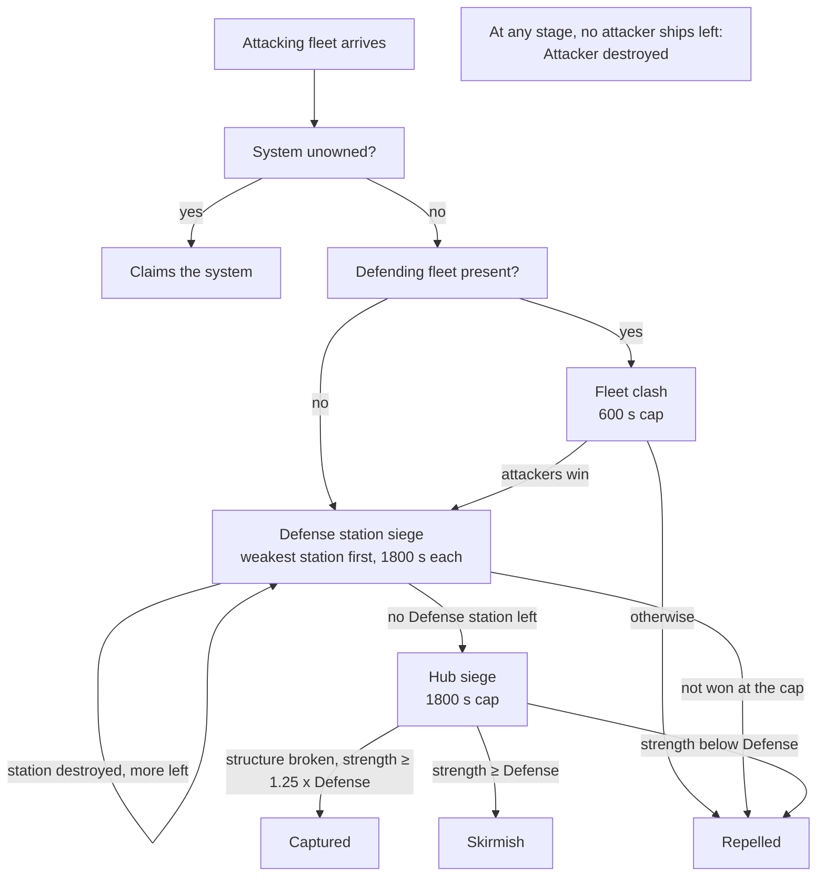
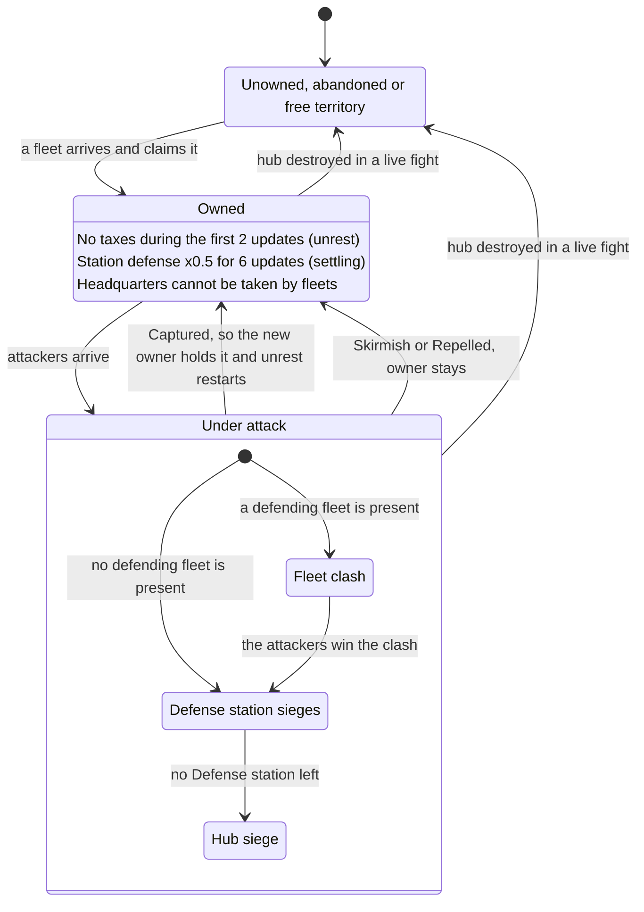
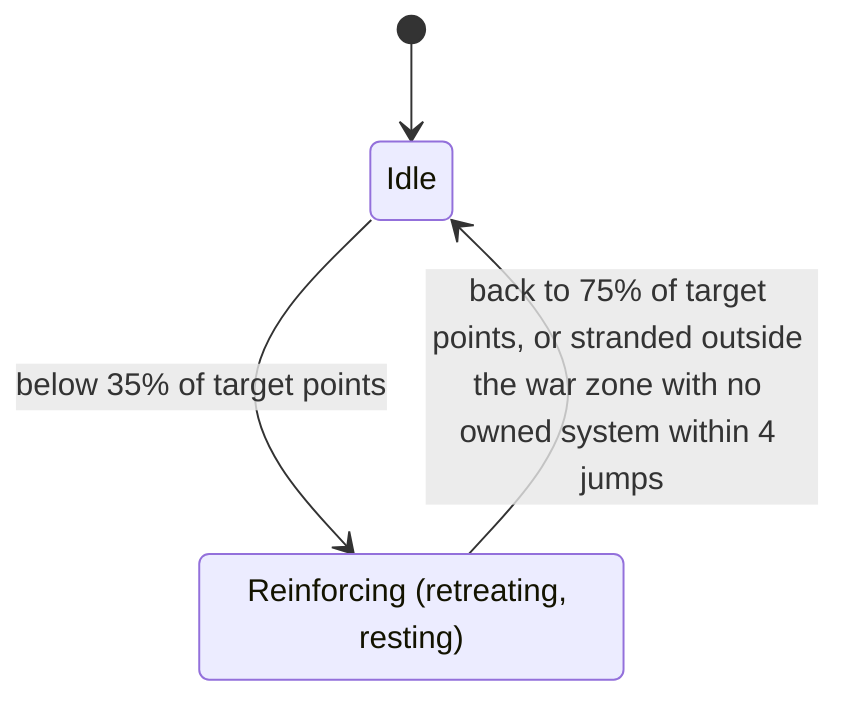

# War Zone and Battles

This page covers the Conquest war as the Conquest Map shows it. It describes the war zone and the kinds of system in it, what the Defense number on a system tooltip is made of, what war footing and war fleets do, how battles and sieges run and end, what capture and abandonment do, how NPC (non-player character) factions pick fights and raids, and what each fleet label on the map means. The war opens with the level 28 story step described in [Conquest](README.md). Values were read from the game code of version 0.8.3.4 (the decompiled source, not in-game testing). The code was then compared with the 0.8.3.5 source, and every statement that changed there was rewritten. Version 0.8.3.7 replaced the per-system war effort with faction-wide war footing and war fleets, changed how system and NPC fleet levels are set, and counted war footing in every strength a battle compares; those sections were rewritten from the 0.8.3.7 source. Quoted in-game wording comes from the game's English text table: the war footing, war fleet and Faction overview wording was read from the 0.8.3.7 table, and the rest was read in 0.8.3.4 and not re-read for 0.8.3.5 or 0.8.3.7. The last section, "In the Game Code", holds the class and method names behind each claim.

Terms and abbreviations are explained in the [conquest glossary](glossary.md) and the [basics glossary](../basics/glossary.md).

"Points" below are ship point values. The fleet cards in the game call the same unit "strength". How those values are derived is covered in [scaling](../basics/scaling.md).

The game shows an hourly step as the "Conquest Update" card on the galaxy map. This page calls it the conquest update. A separate hourly step runs the faction economy. This page calls it the hourly economy tick, and the game does not show it.

Faction income, shipyards, warship delivery, the Great Gate and raid economics are in [faction-economy](faction-economy.md). Per-part station HP (hit points) and conquest station layouts are in [war-stations](war-stations.md). Loot and stations outside the war are in [stations](../basics/stations.md). Damage between live ships is in [combat-damage](../basics/combat-damage.md).

## The War Zone and the Kinds of System

The war zone is every system where factions fight over ownership: the Conquest sector (Ara Martis, the original war zone). The Frontier, Staging and Darkspace regions are not part of it. Systems outside the war zone are not part of fleet conquest. More war-zone sectors open with Beyond the Front ([gate](../expansion/README.md)).

Every war-zone system stores who owns it and its settling state. Each one also has a hub, which is its main station (shown as "Space Station" on the map) and carries the owner's flag. Destroying the hub abandons the system.

| Kind | System card title or hint | What it means |
|---|---|---|
| Outpost system | "Conquest outpost" | Any owned war-zone system that is not a headquarters or your capital. Fleets can besiege and capture it. |
| Headquarters | "Conquest headquarters" | One system per conquest faction. It has the faction's commander and shop. Its hub's live hit points (HP) are multiplied by 30 instead of 20. Fleets cannot take it, and NPC fleets leave it out of their target lists. |
| Your capital | "Your capital - no faction can take it" | The system you made your capital ([Your empire](../expansion/your-empire.md)). Fleets cannot take it, and NPC fleets leave it out of their target lists. |
| Unowned | (section empty) | No faction owns it. The Defense number is 0 and no rows show, unless the hub is an abandoned hub (see the next row), in which case the Defense row shows 0. |
| Abandoned | same as unowned; "Abandoned - the first faction to arrive claims this system" on the hub | A system whose hub was destroyed and that has no owner yet. The hub is still an ordinary station, not a salvage wreck or a derelict ship. It has no faction, so the station card shows the "Abandoned" warning and the system card lists it as "Abandoned" in its Stations section. The system remembers which faction abandoned it, which matters when someone claims it (see below). |
| Free territory | (section empty); "Free territory is settled by the factions - you can only take a system from its owner" | Unowned system whose hub is Independent. NPC factions can claim it. |

In the code: [The War Zone and the Kinds of System](#code-the-war-zone-and-the-kinds-of-system).

## What the System Tooltip Shows

The conquest section of a war-zone system tooltip (the system card) has up to two kinds of row. The first is the Defense row. The second is the "Umbral Reach control" row, which only shows once the Umbral Reach has spread into that system and is a late-game story row (see [the gate](../late-game/README.md)). Until 0.8.3.5 a "Your war effort" row sat between them; 0.8.3.7 removed it together with the per-system war effort. The game has a "Control" label, but the card code never adds it, so no Control row appears. Each system still has a control level (0, 1 or 2). The section "Control Level" below covers what it does.

In the code: [What the System Tooltip Shows](#code-what-the-system-tooltip-shows).

### What the Defense Number Means

The Defense number, shown as the Defense row, is the strength the defenders put into a siege round, in the same unit as ship points. A Defense station is a station type that holds a garrison (warships stationed in it) and fires on enemies. It is not the same thing as the Defense number. The number is the sum of three terms. For an unowned system it is 0.

```
Defense = station firepower term
        + garrison points of every faction Defense station in the system, times 1 + the owner's war footing bonus
        + strength of every defending fleet in the system (its points times 1 + mix bonus + the owner's war footing bonus)

station firepower term = max(250 x m, min(firepower, 700 x m) x structure fraction) + sector flat bonus
```

`m` here is the sector's station-defense multiplier and the flat bonus is a sector bonus. Nothing in versions 0.8.3.4 or 0.8.3.5 creates either one, so in a standard game m = 1 and the flat bonus is 0. Sector bonuses are part of the save file, so a save that already lists such a bonus on a sector keeps it. The game removes one only from your player sector, which it turns into a safe sector when the save loads.

The station term uses the firepower of the system's hub and of every Defense station of the same owner that is not wrecked, each scaled by m. Parts score as follows. Destroyed parts (HP at 0 with damage taken) are skipped:

| Part | Hull | Firepower |
|---|---|---|
| Defense platform | 60 + 15 x sizes | 40 x sizes |
| Core | 200 | 0 |
| Connector | 5 | 0 |
| Anything else | 20 | 0 |

"sizes" is the sum over the platform's turret slots of the slot size, with Small = 1, Medium = 2, Large = 3 (never less than 1). A platform with two medium turrets has sizes 4, so hull 120 and firepower 160. A station whose contents have not been generated yet uses a flat estimate:

| Station size | Hull | Firepower |
|---|---|---|
| Small | 560 | 240 |
| Medium | 940 | 480 |
| Large | 1390 | 560 |

Three things shape the station term:

- Firepower above 700 does not count. Past that cap, extra platforms only add hull.
- The floor of 250 applies even to a station with no weapons left.
- While a hub siege is running, the structure fraction is the siege's remaining station hull fraction, so the term falls as the station breaks, down to the 250 floor. Outside a siege, or during a Defense station stage, the fraction is 1.

The whole profile is multiplied by 0.5 while the system is settling after a change of owner (see "Settling and Unrest"). The 250 floor is not halved.

Each faction Defense station holds a garrison, a group of warships stationed in it. The number of ships and the point budget depend on its tier:

| Tier | 1 | 2 | 3 | 4 | 5 |
|---|---|---|---|---|---|
| Garrison ships | 3 | 4 | 5 | 6 | 8 |
| Garrison budget (points) | 270 | 405 | 540 | 720 | 900 |

For each slot, the game picks the biggest warship that costs at most the budget divided by the number of ships (90 to 120 points). A full garrison therefore costs at most its budget. How close it gets depends on the hulls the faction owns, because the pick is the largest own hull at or under the per-ship budget. Stellar and Luminate each own a 100-point hull, so their garrisons use 100-point ships from tier 2 (400 of 405 points at tier 2, 500 of 540 at tier 3, 800 of 900 at tier 5), and Luminate's 120-point Exemplar fills tier 4 (720 of 720). At tier 1 their largest hull under the 90-point budget is 40 points, so a tier-1 garrison costs 120 of 270. Kolyatov and the Darkspace Compact have no hull between 80 and 180 points, so they stop at 80 points a ship (640 of 900 at tier 5). The garrison counts for a system's Defense in full, summed across every Defense station in it. Ships lost from a garrison are restocked by warships built at a Construction Yard (a faction station that builds warships); see [faction-economy](faction-economy.md). An older mechanism in which combat strength drains into garrisons never fires in this version.

A defending fleet counts if it belongs to the owner's faction, is in the system, is not traveling, and is set to join defense. NPC fleets always are. A war fleet standing in the system counts like any other fleet there. A defending fleet adds its points times 1 + its fleet mix bonus + the owner's war footing bonus. In the systems you hold, the number also gets a term for your patrol ships, and your own fleets get a fleet mix bonus. Both unlock with Beyond the Front ([Your fleets and patrols in the Defense number](../expansion/empire-fleets.md#your-fleets-and-patrols-in-the-defense-number)).

Here is an illustrative case. A hub scores 480 firepower. One tier-3 Defense station has one platform carrying two medium turrets (160 firepower) and a garrison at its 540-point budget. One full NPC fleet of 2000 points is in the system, and the owner has no war footing. The station term is min(480 + 160, 700) = 640, so the Defense number is 640 + 540 + 2000 = 3180. At the top footing of +25% the garrison counts 675 and the fleet 2500, so the number is 640 + 675 + 2500 = 3815. These are worked figures from the formulas, not values read from the game.

In the code: [What the Defense Number Means](#code-what-the-defense-number-means).

### What NPC Factions Use Instead of the Defense Number

NPC factions do not compare against the tooltip number. Their fleet planning uses "next-battle strength", which the game does not show anywhere.

If the system has Defense stations, next-battle strength is the strength of the weakest one. That strength is the station's own firepower, its garrison, and all defending fleets in the system. Otherwise it is the full Defense number. The planner then adds the points of every same-faction fleet that is traveling toward the system as relief.

You can estimate it from what the game shows. With no Defense station in the system, it equals the Defense row, plus any fleets already on the way. With Defense stations, it is usually lower. So the Defense row is the upper bound, before fleets on the way. The exception is a system that is settling: the row halves the station profile, but a Defense station's own strength is not halved, so next-battle strength can then exceed the row.

A system with no owner has a next-battle strength of 0. No fleet is too weak to attack it, and a fleet that arrives claims it instead of fighting.

War footing is part of the figure through the defenders. The owner's war footing multiplies the garrison points of its Defense stations by 1 + bonus and counts in its defending fleets' strength as an extra bonus on top of the fleet mix bonus (see "War Footing and War Fleets"). The station firepower term no longer has a multiplier of its own. Defending fleets count in full in both branches.

A fleet or assault attacks at 1.15 times next-battle strength, and the usual fleet is 2000 points. The game compares the fleets' judged strength, which is their points times 1 + the attacking faction's war footing bonus. With no footing, the number of full fleets an attack needs is 1.15 times the figure divided by 2000, rounded up: one fleet up to 1,739, two up to 3,478, and so on (derived). At the top footing of +25% the limits rise to 2,173 and 4,347. Killing a defending fleet of 2000 points that has no footing or mix bonus takes 2,300 points off what attackers need. With no footing on the attackers' side, that always lowers the count by at least one. At +25% footing the attackers' fleets are worth 2500 each, and 2,300 is 0.92 of a fleet. A defending fleet that has footing counts for more than its points, so killing it removes more.

In the code: [What NPC Factions Use Instead of the Defense Number](#code-what-npc-factions-use-instead-of-the-defense-number).

### Ways to Lower or Raise Defense

| Lever | Effect |
|---|---|
| War footing of the attacker | Its fleets count 1 + bonus times their points when they decide to attack and when they fight, up to x1.25. See "War Footing and War Fleets". |
| Destroy defender ships or fleets | Removes their strength (points times 1 + mix bonus + the owner's war footing bonus) from the Defense number. Intercepting fleets that are still traveling removes the relief term, which counts plain points. |
| Destroy turret platforms or the core by hand | Removes each platform's hull and firepower from the profile. Parts must be fully destroyed (HP 0 with damage taken). |
| Attack within a few hours of a capture | Halves the station profile while the system is settling. |
| Siege progress | Each hub siege round that breaks station structure lowers the station term toward the floor of 250. |
| To raise it: war footing of the owner | Multiplies garrison points by up to 1.25 and adds up to 0.25 per point to defending fleets' strength. See "War Footing and War Fleets". |
| To raise it: more turret platforms | Helps only until the station reaches 700 firepower. |

In the code: [Ways to Lower or Raise Defense](#code-ways-to-lower-or-raise-defense).

### Control Level

Every owned system has a control level of 0 (unowned), 1 or 2. It rises by 1 at each conquest update, provided the system has no battle in it and every neighbouring system is held by the same owner. The step from 1 to 2 in an NPC-owned system can add a Military Outpost, a facility you can enter, at one of its locations. A hub siege that ends in the Skirmish or Raided outcome (see "Outcomes") lowers the control level by 1 if it is above 0. Capture sets it to 1.

Apart from the Military Outpost, the only other thing that uses the control level is the tie-break that decides which system is a faction's headquarters: garrison strength first, then resident fleet points, then control level.

The game's text table holds the word "Control" (`SystemCardControl`) and "Tenuous", "Contested" and "Secure" (`ConquestSystemStatus0` to `2`), which look like names for the three levels. The game's code never reads any of these text keys, and no scene or prefab refers to them, so the game shows none of them. "Control level" on this page is a plain name for the stored number, not a label the game shows.

In the code: [Control Level](#code-control-level).

## Levels in the War

The general level curves (what a level does to HP, damage and loot) are on [scaling](../basics/scaling.md). This section covers the levels the war itself sets: how system levels rise, what level NPC warships get, and how the ship rank and hull nodes of conquest fleets differ from ordinary enemies.

### Effective Level

| Name | Where it comes from | What it drives |
|---|---|---|
| Effective level | Your commander level plus your Vanguard level | Galaxy level, NPC fleet level and each war-zone system's level target. It also drives the item level cap and kill XP (experience points), which are listed in the [level table](../basics/scaling.md#which-level-is-used-for-what) on the basics page. |

Effective level sets the NPC fleet level and the level each war-zone system drifts toward, so raising it makes new NPC ships stronger too.

In the code: [Effective Level](#code-effective-level).

### How System Levels Rise

Version 0.8.3.7 gave every war-zone system its own level target instead of one rule for all. Once an hour, when the "Conquest Update" countdown on the galaxy map runs out (3600 s of game time), every system in the war steps toward its target by 1 to 4 levels, up or down:

```
target = max(your effective level + offset, floor)
floor  = 30 to 36, fixed for each system
```

The offset is fixed for each system and comes from its temperament. The share of systems in each band shifts from west to east across the war zone:

| Temperament | Offset | Share, west to east |
|---|---|---|
| Backwater | -6 to -4 | 20% to 15% |
| Settled | -3 to -1 | 55% to 50% |
| Contested | 0 to +1 | 20% to 25% |
| Hot | +2 to +6 | 5% to 10% |

A system above its target drops toward it, so levels can go down. When a save loads, a system above its target is set to the target at once. The hourly step and the load-time settle cover every war-zone system, which includes the Beyond the Front sectors once they are war zones. Frontier systems only step up toward their target, with no floor, and only after a hidden switch is flipped. Only a debug command flips it, and the switch is saved with the game. No story event, mission or scene sets it, so in a normal game Frontier systems do not move this way.

In the code: [How System Levels Rise](#code-how-system-levels-rise).

### Fleet Levels

Conquest fleets and garrisons use a single galaxy-wide level instead of the level of the system they stand in. The "NPC fleet level" below is the level NPC factions give their new warships.

```
galaxy level    = max(your effective level, 30)
NPC fleet level = max(1, galaxy level)
```

| Question | Answer |
|---|---|
| Level of a newly built NPC warship | NPC fleet level at the moment the ship is built (delivery, or founding a fleet) |
| Level shown for a fleet or garrison | Average of its ships' levels, weighted by each ship's points (a ship with no stored level counts as the system level). Your own Empire Fleets are the exception: they always show your level, and have no refit (see [Empire Fleets](../expansion/empire-fleets.md#service-levels-and-standard-issue-copies)) |
| When is an NPC fleet "due" for a refit? | Its fleet level is at least 3 below the NPC fleet level |
| What does an NPC refit do? | Raises every ship's stored level to the current NPC fleet level. It takes 300 s at a Construction Yard. |
| How does a fleet catch up slowly without a Construction Yard? | At each hourly economy tick (not the conquest update), every due fleet that is not refitting gains 1 level on each ship, up to the NPC fleet level. |

So NPC warships sit at your level, or at level 30 when you are below it. A fleet counts as due once it is 3 or more levels behind, so old fleets mostly sit 0 to 2 levels behind between hourly economy ticks, and further behind for a few ticks after the NPC fleet level rises. When a save loads, the game also caps every NPC ship, warship delivery and garrison ship at the NPC fleet level (`FleetLevels.LowerNpcShipsToCap`), which lowers ships built at the old +6 level.

Remember that NPC fleets no longer get extra levels. Since 0.8.3.7 a conquest fleet has the galaxy level, which is your effective level or 30, whichever is higher. Versions 0.8.3.4 and 0.8.3.5 added 6 levels on top, and used the highest system level in place of 30. A fleet facing you at your level is therefore at your level, not above it. See the table in [scaling](../basics/scaling.md#how-much-tougher-is-an-enemy-five-or-ten-levels-higher) for what a level gap is worth.

In the code: [Fleet Levels](#code-fleet-levels).

### Ship Rank and Hull Nodes of Conquest Fleets

Conquest fleets and fleet hull ratings roll their ship rank at the default tier 0, so escalation does not raise their ship rank odds. The [Escalation](../basics/scaling.md#escalation) HP and damage multipliers do apply to ships in conquest battles.

NPC fleet entries start with at most 85 hull nodes. If hull nodes set later exceed the budget of the rolled rarity (for conquest fleet ships and garrison ships), the ship's rarity is raised to the smallest rarity that holds them. A generated NPC also cannot reach Legendary through nodes: conquest fleet entries are capped at 85, which is under the 100 an Exotic ship holds. How these ratings turn into a battle bonus is under "Hull Edge" below.

In the code: [Ship Rank and Hull Nodes of Conquest Fleets](#code-ship-rank-and-hull-nodes-of-conquest-fleets).

## War Footing and War Fleets

Version 0.8.3.7 removed the per-system war effort (a multiplier on one system's station firepower, with a "Your war effort" row on the system card) and replaced it with two effects that belong to a whole faction. Both are fed by the Conquest missions you complete for that faction. These are missions from a war-zone hub, and the game shows them with a reward line such as "+12 Contribution". Embassy missions give the faction wealth in place of contribution. Idle missions are the ones ECHO, your ship's AI companion, completes while you are away. Once you have helped a faction, its Faction overview shows War Footing (the bonus and the time left), Footing Contribution out of 2000, War Fleets out of 2, Next War Fleet out of 250 (or "Waiting"), and the totals War Fleets Earned, Systems Taken, Raids Won and Enemy Ships Destroyed.

```
contribution of one mission = amount x (1 + 0.2 x points in ECHO The Conqueror)    for idle missions (done by ECHO)
contribution of one mission = amount                                               otherwise
amount                      = 3 to 6 (idle: 1 to 3), doubled when the mission's enemy is a conquest faction other than the Marauders or Fanatics,
                              times 1 + the rank bonus for fleet strength rewards, rounded to a whole number
```

Each mission adds its contribution to the faction whose hub or station gave it (the mission's source faction), and the mission has to come from a war-zone system.

| Faction value | Rule | Limit |
|---|---|---|
| Contribution | Adds up, and resets to 0 when the timer runs out | 2000 |
| Timer | Resets to 10800 s (3 hours) on every mission | Counts down in game time, not once per conquest update |
| War footing bonus | 0.25 x contribution / 2000 | +25% |
| War fleet progress | Adds up with every mission and has no timer. A war fleet is granted at 250 and the progress resets to 0. While the faction already has 2 war fleets it stays at 250, and the overview shows "Waiting" | 250 |

War footing multiplies a faction's strength by 1 + bonus, in these places:

- Fleets attacking. The game judges a fleet at its points times 1 + bonus whenever it decides to attack alone, to gather an assault, whether a gathering group is strong enough, and who wins a fleet clash, a hub siege or a Defense station siege. A siege round itself adds the bonus to the fleet mix bonus.
- Defending. The garrison points of the faction's Defense stations are multiplied by 1 + bonus, and its defending fleets get the bonus added to their fleet mix bonus. Both count in the Defense number and in next-battle strength.
- Live fights. The combat power, drone power and torpedo power of the ships the faction fields in a battle you watch are multiplied by 1 + bonus.

Contribution is the same for every system of the faction, so no single system can be aimed at. The full bonus takes 2000 contribution. A Conquest mission you fly gives 3 to 12 (1 to 6 for an idle one) before your conquest rank bonus, and ECHO's idle missions get more with points in ECHO The Conqueror, so it is a long effort.

War fleets: a faction is granted a war fleet when its war fleet progress is at 250 and all of these hold: it has fewer than 2 war fleets, it has a headquarters, the game lets it field fleets at all (a dormant faction cannot), and the game can compose a roster for it. The grant is a roster built to 1,500 points at the NPC fleet level, placed at the headquarters, with a notice: "{faction}: your contribution raised {fleet name} at {system}." The fleet's name is in the faction's own style with a Roman numeral. Kolyatov Collective has "Spearhead Battlegroup", Luminate Combine "Armada of the Forlorn Hope", Stellar Industries "Legio Oathbound", Meridia's Chosen "Host of the Martyrs", the Darkspace Compact "Pyre Flotilla" and the Corsair Syndicate "Bloodsworn Warband". Any other faction gets "{faction} Spearhead {numeral}". The numeral is the lowest one that no other war fleet of that faction uses. The fleet's map card shows the type "War Fleet", the description "A temporary fleet your missions raised for this faction." and a "Time left" row. A war fleet:

- lasts 3 hours of game time. It is removed at the next planning pass after that, unless it is in a battle, held by an intercept or defending a besieged or raided system on site, so it can outlast the 3 hours
- never retreats, never counts as below target, has no fleet slot and is never sent for a refit or topped up with warships
- takes no part in refits, distress or raid responses, assaults or the faction's regular frontline orders. It gets its own order at each hourly tick and planning pass: attack a target it can beat (the same 1.15 rule as other fleets), else raid, else attack the target with the lowest next-battle strength within reach even if it cannot beat it (4 jumps from the frontline, or 60 without one), else rally to the frontline
- counts as a defending fleet in the system where it stands, and is not given new orders while it defends a besieged or raided system on site
- adds to the faction's tallies in the Faction overview: Systems Taken when it leads a battle that ends Captured, Raids Won when it leads one that ends Raided, and Enemy Ships Destroyed for each defending ship destroyed in a battle it attacks in (derived from the code)

The game checks for a grant when a mission completes and at every planning pass (the 600 s pass, and for the factions of a battle that just ended). The hourly economy tick does not check, and the expiry check also runs only at the planning pass.

In the code: [War Footing and War Fleets](#code-war-footing-and-war-fleets).

### Compared with the 0.8.3.5 War Effort

Nothing local replaced the per-system war effort. War footing took over the mission's contribution value and moved the live combat bonus from station parts to ships, but it applies to every system of the faction at once. The old tooltip row is gone, and the new values show on the Faction overview (War Footing, Footing Contribution, War Fleets, Next War Fleet).

| | 0.8.3.4 and 0.8.3.5: war effort | 0.8.3.7: war footing and war fleets |
|---|---|---|
| Where it applies | The system of the mission's hub +10%, neighbours owned by the mission's faction +5%, neighbours owned by the mission's enemy -10% | The whole faction. Where the mission's hub stands makes no difference |
| What it raises | The station firepower term (Defense number, next-battle strength) and the weapons of the station's parts in a live fight | Garrison ships and fleets, when they defend, attack and fight live. Station firepower gets no bonus |
| Size per mission | +10% flat (idle: 10% x (1 + 0.2 x points in ECHO The Conqueror)) | 3 to 24 contribution, for a bonus of 25% x contribution / 2,000 |
| Cap | +100% bonus, -50% penalty | +25% at 2,000 contribution |
| Duration | 3 hours per system, reset by each mission there, cleared when the system changes owner | 3 hours for the faction, reset by any mission. When it runs out, contribution drops to 0 |
| Shown on | The system tooltip, for example "+5% to firepower for 2h" | The Faction overview |
| Penalty on enemy neighbours | Yes | None |
| Extra | None | A 1,500-point war fleet at the headquarters for every 250 contribution, at most 2 at once |

Because the station term counts at most 700 points, +15% of war effort added at most 105 points to a system. At +25% footing a resident 2,000-point fleet counts 2,500 and a 900-point garrison 1,125, so footing adds more to a defended system than the old bonus did, but nothing to a system with no fleet or garrison, and it takes about 84 missions at the top amount to reach (derived). What this means for steering attackers is in [Steering Attackers with Missions](sector-control.md#steering-attackers-with-missions-0835-and-earlier).

In the code: [Turning Up at Battles](sector-control.md#code-turning-up-at-battles) has the 0.8.3.5 war effort methods; [War Footing and War Fleets](#code-war-footing-and-war-fleets) has the 0.8.3.7 ones.

## Battles

### Types and Stages

"Stage" is this page's word for the code's `BattleStage`; the game's text has no such word. What the game shows is the location "Fleet Battle" and the lines "Under Attack! Holds {n} min at most" (a station) and "Under Attack, resolves in {n} min" (a Fleet Battle). Every fight is in one of four stages:

| Stage | Who fights | Time cap | Ends with |
|---|---|---|---|
| Fleet clash (the game calls it a Fleet Battle) | The arriving attackers against the first defending fleet in the system. A "Fleet Battle" location appears in the system. | 600 s | If the attackers win, the battle goes on to a siege stage. Otherwise it ends. |
| Defense station siege | Attackers against one faction Defense station's garrison, its firepower and every defending fleet. | 1800 s | The Defense station is destroyed (Empire Log: "Defense station destroyed"), or another outcome. The first siege is against the weakest Defense station. |
| Hub siege | Attackers against the hub: all garrisons and fleets, plus station firepower. Used when no Defense station is left. | 1800 s | An outcome such as Captured ("system captured"), Skirmish ("inconclusive skirmish") or Repelled ("attack repelled"). |
| Raid | A raider fleet against one economic outpost's raid profile and its defenders. | 900 s | Raided ("raid succeeded"), Repelled, or Attacker destroyed ("fleet destroyed"). |

When an attacking fleet arrives at a hostile system, the first check is who owns it. An unowned system is claimed, not fought over (see "Unowned and Abandoned Systems"). Otherwise, if any defending fleet is present, a fleet clash starts against the first one. If none is present, a siege starts. A fleet whose faction is already the attacker in an active non-raid fight at that system joins it as a supporter instead, bringing its points. Allied NPC factions do not defend each other. Defenders must be the same faction as the owner. Since 0.8.3.5, a fleet that arrives while answering a distress call does not start a clash or a siege and does not claim an unowned system. It goes idle there. Your own Empire Fleets do the same unless their Attack order points at that system.

After a clash win, the same battle becomes a siege. A Defense station falls in its own battle. The attacking faction's fleet planning then sends the fleet again, and the next siege starts with the weakest remaining Defense station. Each stage has a fresh 1800 s timer. You may see several battles back to back in one system.



In the code: [Types and Stages](#code-types-and-stages).

### One Round

When you are not in the battle's venue (see "When You Are There: Live Battles" below), a battle runs as simulated rounds every 60 s. The cap timers above count down in the same 60 s steps, and the battle is judged at the cap instead of running another round. So a hub or Defense station siege gets at most 29 rounds (1800 s), a clash gets 9 (600 s) and a raid gets 14 (900 s).

```
damage pool of a side = leftover damage + strength x random(0.04, 0.06)
attackers: strength = sum of fleet strength x (1 + hull edge)
defenders: strength = (Defense, Defense-station strength, or raid defense) x (1 - hull edge)
```

Each pool is spent on the other side's ships: the attackers' pool destroys defender ships and the defenders' pool destroys attacker ships. The next victim is picked at random with weight 1 / sqrt(ship points), so cheaper ships are picked more often. A ship dies only if the remaining pool covers its whole point value. If the picked ship costs more than what is left, spending stops and the remainder stays as leftover damage, to be added to next round's pool. Fleets keep unspent damage after a battle as carried damage and repair it only while resting at home, 100 points per hour.

The attackers' pool can go past the defenders' last ship. That spill is the only damage the station structure takes: the station hull falls only after every garrison ship and defending fleet in the fight is dead.

Over a full 29-round siege, each side deals roughly 29 x 0.05 = 1.45 times its own strength in total damage (derived from the constants, not read as one number). A 9-round clash deals about 0.45 times its strength. A clash is therefore usually decided on strength at its cap, not by wiping a fleet. In these strengths, a fleet counts its points times 1 + its fleet mix bonus (your own fleets, from Beyond the Front) + its faction's war footing bonus, as in the Defense number.

In the code: [One Round](#code-one-round).

### Hull Edge

Each round, the game computes an average hull rating for each side's remaining ships, weighted by point value, and gives the attacker a bonus or a penalty:

```
edge = clamp((attacker rating - defender rating) x 0.005, -0.15, +0.15)
```

The attacker's strength is multiplied by 1 + edge, and the defender's by 1 - edge. A gap of 30 rating points reaches the 15% cap. A side with no ships (only the station) has no rating, so the edge is 0. A ship's rating is its number of hull nodes, limited to the range 0 to 100. The game shows it as "Hull rating", written "Type-" plus a letter and the number (for example "Type-C62"; see [Ship Rarity and Hull Nodes](../basics/scaling.md#ship-rarity-and-hull-nodes)). NPC ships start with hull nodes rolled from their level and ship rank (the Rookie to Legendary tier shown on an enemy ship's tooltip), up to 85 at the roll. Winners gain hull XP (experience points):

| Event | XP |
|---|---|
| Battle ends in a win for that side (siege, or a clash the attacker lost) | 4 per surviving ship |
| Raid ends in a win for that side | 1 per surviving ship |

The next hull node costs ceil(7 + 0.65 x nodes) XP, where ceil rounds up and nodes are the ship's current hull nodes. Ships stop earning at 85 hull nodes. XP is paid when a battle ends, to every surviving ship of the winning side's fleets (and Defense garrisons). The winning side is the attacker for Captured, Skirmish, Raided and Defense station destroyed, and the defender for Repelled, Attacker destroyed and Withdrew. A clash the attackers win does not pay XP, because it continues into a siege instead of ending.

Your own fleet cards (Beyond the Front) show "Hull edge ... vs ... fleets nearby": your fleet's edge against the highest-rated hostile fleet within 2 jumps.

In the code: [Hull Edge](#code-hull-edge).

### When You Are There: Live Battles

A battle runs live only while your ship is at its venue. The venue depends on the stage: the "Fleet Battle" location during a clash, the besieged Defense station during that station's stage, the hub during the hub stage, and the raided economic outpost during a raid. Being somewhere else in the same system does not count, so the battle keeps running as simulated rounds while you fly around the system or sit at the hub during a Defense station stage. When the venue is where you are, or where you are flying to, the game spawns the real ships of both sides there. In a live battle:

- Simulated rounds and the time cap stop. The minutes in "Under Attack! Holds {n} min at most" and "Under Attack, resolves in {n} min" do not go down while you are there. The 600 s minimum before an early capture counts on the same clock, so it stops too.
- Every 5 s the game checks which spawned ships died and removes them from their fleets and garrisons.
- A clash ends when one side has no ships left in the zone. The losing fleet is wiped.
- A hub siege ends only when the attackers have no ships left (Attacker destroyed) or the hub is destroyed. The clock cannot end it. The hub counts as destroyed when its last part other than a Connector dies, whoever kills it, so the attacking ships can destroy it too. The system is then abandoned, and a siege in its hub stage hands it to its lead attacker (see "Unowned and Abandoned Systems").
- A Defense station siege ends when the attackers have no ships left or the station is destroyed (Defense station destroyed).
- Ships that die in NPC fleets are removed permanently.
- A defending fleet that arrives during a siege, such as a distress responder, spawns into the fight.

What you find when you arrive is not what the simulation has done so far:

- Every spawned ship has full hull. The simulation never damages part of a ship. A round destroys whole ships and keeps the rest of its damage as a number (leftover damage, and carried damage between battles), and spawned ships do not take that number. The ships the simulation destroyed are not spawned. A battle that has run for 15 minutes therefore shows fewer ships, not damaged ones.
- The station spawns with the hit points of its own parts. The structure a simulated siege wears down is a separate number kept on the battle (the "Station structure" in the battle report), and it never reaches the live station. A hub whose simulated structure is broken still spawns undamaged, unless it took damage in a live fight since the hourly rebuild (see [How Long Damage Lasts in a War Zone](war-stations.md#how-long-damage-lasts-in-a-war-zone)).
- Spawned ships stay at the venue until the battle ends. If you leave and come back during the same battle, the damage from your earlier visit is still on them, and the ships the simulation destroyed in the meantime are gone.

When you leave the venue, the battle goes back to simulated rounds with the ships that are left, and its clock carries on from where it stopped. Ending a battle sooner also frees its fleets sooner, because every faction in a battle plans again the moment it ends (see [Cadence](#cadence)).

An undefended raid is simulated by rounds even if you are present. A raid with defenders runs live.

In the code: [When You Are There: Live Battles](#code-when-you-are-there-live-battles).

### How a Siege Ends

Checks run after each simulated round, and again at the cap.

A hub siege ends early if the lead attacker has no ships (Attacker destroyed) or the early capture conditions hold. A Defense station siege uses the same rule against its own structure.

The early capture conditions require all of:

- 600 s have passed in this stage.
- The system is capturable (not a headquarters or your capital).
- The station structure is at 0.
- There are no defenders left: no garrison ships or defending fleets.
- Attacker strength (summed over attacker fleets still standing, each at its points times 1 + its faction's war footing bonus) is at least 1.25 x the current Defense number.

For a Defense station siege, the checks are the same, but attacker strength is compared with that station's strength (scaled by its structure fraction). "Defenders" there means that station's garrison and the defending fleets.

At the cap (1800 s), a hub siege is judged like this. "Strength" is the attackers' judged strength: their points times 1 + the war footing bonus, summed over the attacker fleets still standing.

```
structure broken, system capturable, strength >= 1.25 x Defense  ->  Captured (Raided if the attacker cannot conquer)
strength >= Defense                                              ->  Skirmish
otherwise                                                        ->  Repelled
```

The cap check does not require defenders to be dead. The defenders still alive are already in the Defense figure.

A Defense station siege at the cap is judged differently. If the structure is broken and attacker strength is at least 1.25 x the station's strength, all defending fleets in the system are wiped and the station is destroyed. The outcome is then Defense station destroyed, or Raided if the attacker cannot conquer. Otherwise the outcome is Repelled.

A clash at its cap (600 s) goes to the attackers if their combined judged strength (points times 1 + war footing bonus) is above the defender fleet's judged strength, and they then continue to a siege. Otherwise they go idle, and the outcome is Repelled (or Attacker destroyed if the lead attacker is gone).

In the code: [How a Siege Ends](#code-how-a-siege-ends).

### Outcomes

| Outcome | Empire Log text (attacker's view / defender's view) | What triggers it | Result |
|---|---|---|---|
| Captured | "system captured" / "system lost" | A hub siege breaks through and the attacker's faction can conquer, or a besieger claims an abandoned system. | The system changes hands. See "Capture by Siege". |
| Skirmish | "inconclusive skirmish" | A hub siege reaches its cap with strength at or above Defense, but the capture conditions are not met (the structure is still standing, or strength is under 1.25 x Defense). | Control level drops by 1 if it is above 0. Attackers go idle. There is no re-attack block. |
| Repelled | "attack repelled" | Attacker strength is below Defense at the cap, the attackers lose a clash at the cap, a raid is broken off, or a Defense station siege is not won at the cap. | Attackers go idle. A Defense station siege that ends Repelled blocks re-attack for 3600 s. A hub siege Repelled at its cap, a lost clash and a broken-off raid do not. |
| Attacker destroyed | "fleet destroyed" / "attackers destroyed" | No attacker ships are left in any stage. | The fleet dissolves if it is empty. |
| Aborted | It has no text of its own | The target or station vanished, the station was wrecked, or the raided economic outpost changed hands. | Attackers go idle. |
| Defense station destroyed | "Defense station destroyed" / "Defense station lost" | A Defense station siege is won as described above, or you destroy the station yourself in a live fight. | The station is destroyed and remains as a wreck for 3600 s that holds 10% of its stock. The garrison counts as lost. There is no re-attack block. |
| Withdrew | "withdrew before relief arrived" / "attackers withdrew" | The lead attacker is ordered away while no supporters are standing by. | Attackers go idle. Only your own Empire Fleets get this outcome: the only callers are the ones that give an Empire Fleet a new order or make it retreat below its retreat limit. Empire Fleets unlock with Beyond the Front ([Empire fleets](../expansion/empire-fleets.md)). |
| Raided | "raid succeeded" / "outpost raided" | A raid succeeds, or a raider faction breaks through in a siege. Raider factions are the Corsair Syndicate while it holds no war-zone systems, and Malcyte, which always counts as a raider (it does not act until it wakes; see [the gate](../late-game/README.md)). | In a hub siege, the control level drops by 1 and the system is not captured. Re-attack is blocked for 3600 s when the siege ends early or is a Defense station siege, but not when a hub siege reaches its cap. For a Defense station siege, the station survives and the control level is unchanged. For a raid, see "Raids". |

The Empire Log shows the wording in the second column. The battle report text uses the English outcome name, plus the losses, the station structure left and the hull edge.

In the code: [Outcomes](#code-outcomes).

### Raids

A raid targets one economic outpost: a station that produces something (Mining, Salvage, Refinery, Forge, Production, Trading, Recruitment or Construction Yard) and is not a Defense station. It can belong to an NPC faction or to you. Structure and firepower come from the station's normal profile scaled to 15% hull and 50% firepower. Defenders are the owner's fleets in the system, plus your patrol ships when the outpost is yours.

| Rule | Value |
|---|---|
| Cap | 900 s |
| Earliest success | After 600 s, once the structure is broken and no defenders are left |
| Breaks off (Repelled) | The raider has lost 50% or more of its starting points (not for frontier raid parties) |
| Raider at the cap | Success if the outpost is taken (structure broken, no defenders). A raid party still facing defenders gets 60 more seconds, and this repeats. Otherwise the outcome is Repelled. |

On success, the station gets a 14400 s raid cooldown, during which it cannot be raided again, and its production pauses for 3600 s. Against an NPC owner, the raider also takes 50% of the stored materials (10% when the raider is you), and the owner loses wealth. Wealth is the money a faction spends on warships and stations, which the Faction overview shows as "Economic Power". Raiding your own stations takes nothing from your storage or wealth. Details are in [faction-economy](faction-economy.md).

In the code: [Raids](#code-raids).

## Capture, Abandonment and Claiming



### Capture by Siege

When a hub siege ends in Captured, this happens in order:

1. Every defending fleet of an NPC faction is wiped.
2. Every Defense station of the old owner is destroyed (it becomes a wreck).
3. The system's owner becomes the attacker. The hub and economic outposts of the old owner flip to the new owner.
4. Cargo routes that now cross owners are cancelled. The old owner's pending station constructions are removed, as are its queued warship constructions for Construction Yards in that system. Work bays are emptied.
5. The headquarters flag is removed, control level is set to 1, and the settling timer starts.
6. The old owner is checked: a faction with no systems left starts a 5-update cooldown (counted in conquest updates) before it can rejoin the war.

In the code: [Capture by Siege](#code-capture-by-siege).

### Settling and Unrest

The game has no name for the two states below. "Unrest" and "settling" are plain words used on this page. The conquest update runs every 3600 s. Capture and claim start a settling timer of 6 conquest updates, and each conquest update lowers it by 1.

| State | Condition | Effect |
|---|---|---|
| Unrest | The first 2 conquest updates after the change of owner | The system pays no taxes. Taxes are the wealth a faction earns every hour from the systems it owns (the "Taxes" ledger line; see [faction-economy](faction-economy.md)). |
| Settling | Until the timer reaches 0 | The station profile (hull and firepower of the hub and Defense stations) is multiplied by 0.5. This applies to the Defense number and to a hub siege's structure, not to a Defense station's own siege. |

Because the first conquest update can come at any time up to 3600 s after the capture, settling lasts between 5 and 6 hours of game time, and unrest lasts between 1 and 2 hours.

In the code: [Settling and Unrest](#code-settling-and-unrest).

### Unowned and Abandoned Systems

Destroying the conquest hub of an owned war-zone system abandons it. In practice this means you are flying at the station when its last part dies. The Empire Log says "Lost control of {system} - its station was destroyed." and the notice reads "{faction} lost {system} - the system is unclaimed".

The system becomes unowned and remembers the faction that abandoned it. Its control level resets, and the headquarters flag drops. The code does not check whether the system is a headquarters here, so destroying a headquarters hub abandons it. The faction then names a new headquarters at once from the systems it still owns, if it has any (see "Control Level"). A simulated siege that ends in Captured does not go through this path. In your player sector, the system goes back on sale instead ([Your empire](../expansion/your-empire.md)).

Every fight at the system ends at once, and the system goes to whoever comes first:

1. A hub siege hands the system at once to its lead attacker ("system captured" in the Empire Log), unless that attacker's faction is a raider. A fight in any other stage (a fleet clash, a Defense station siege or a raid) just ends, and its fleets go idle.
2. If claiming is unlocked and your flagship or an idle Empire Fleet is in the system, you are offered the claim first, as you normally are when you destroyed the hub yourself. No arriving fleet can claim the system while the offer is open. Declining hands the system to the hub siege's lead attacker if that fleet is still there. With no such siege, the system stays unowned. Claiming systems unlocks with Beyond the Front ([Your empire](../expansion/your-empire.md)).
3. Otherwise the system is unowned, and the first fleet to land claims it. That is either a fleet already flying in to attack it (it claims on landing), or a fleet that a faction sends at its next planning pass.

A faction that was in a fight at the system plans again at once. The other factions wait for the 600 s planning pass, and the hourly economy tick also assigns orders. A fleet already standing in the system ranks first for its faction, so an idle fleet of the old owner there claims the system straight back with no travel.

Otherwise, each faction that owns a neighbouring war-zone system sends the fleet its planner picks, as under "Choosing a Target". The planner goes through the faction's idle fleets in list order. It leaves out fleets that are going to a refit, answering a distress call at a system of their own, or gathering for an assault. Each remaining fleet takes its best target within 4 jumps, where an unowned system comes first and needs no minimum strength. A faction with no frontline looks up to 60 jumps. Travel takes 60 s plus 150 s per jump. A fleet that lands after another faction has claimed the system starts attacking it (if hostile) instead.

A fleet that arrives at an unowned system claims it. There are three exceptions: the system is waiting on a claim offer, the fleet's faction is a raider faction, or the system is for sale in the player sector. Your Empire Fleets also do not claim free territory. A fleet that is answering a distress call does not claim on arrival either (0.8.3.5). The claim sets the control level to 1 and starts settling. If a different faction abandoned the system, that faction's Defense stations in it are destroyed first (your own claim prompt lists them as "Destroyed: {n} Defense stations of {faction}"). If the faction that abandoned the system takes it back, its Defense stations stay.

In the code: [Unowned and Abandoned Systems](#code-unowned-and-abandoned-systems).

## How NPC Factions Pick Fights

### Cadence

| What | Cadence |
|---|---|
| Conquest update (the "Conquest Update" card on the galaxy map): updates Area Conquered, control level, settling and station rebuilds, and checks the headquarters | 3600 s |
| Hourly economy tick (not shown in the game): handles taxes, the home subsidy, builds and fleet orders | 3600 s |
| Planning pass between the hourly steps (not shown in the game): queues warships, assigns fleet orders for every faction, removes expired war fleets and grants new ones | Every 600 s, and at once for the factions of a battle that just ended (attacker, defender, owner of the system, supporters) |
| Distress response check | 60 s, only while a battle is active |
| Fleet travel time | 60 s + 150 s per jump |

NPC fleets aim for 2000 points each. How many fleets a faction fields is in [faction-economy](faction-economy.md).

The three clocks run on their own phases. The game shows only the first, as the "Conquest Update" card, and its tooltip says "Damaged stations are rebuilt and factions rethink their strategy". The conquest update never reassigns fleet orders. Orders are assigned at the planning pass, at the hourly economy tick and after a battle, and the game shows none of those timers. The time to the next planning pass says nothing about the time to the conquest update or to the economy tick.

In the code: [Cadence](#code-cadence).

### Frontline Score

A faction's frontline is every war-zone system it owns that has at least one contested neighbour. A contested neighbour is either a neighbour owned by a hostile owner and open to the faction, or (for non-raiders) an unowned war-zone neighbour. Each frontline system gets:

```
score = highest neighbor Defense + 0.6 x max(0, 2000 - lowest neighbor Defense) - 250 x covering fleets
```

The highest and lowest neighbour Defense are taken among contested neighbours. Covering fleets are the faction's fleets in that system plus fleets traveling to it. A high score means the system has a strong enemy neighbour, or a weak one worth taking, and few fleets assigned to it. Fleets rally to the highest score, and every fleet already rallying there lowers it by 250 for the next one. Hostile means any faction other than the owner or a war ally. Against you, a faction must be your enemy, meaning it is at war with you or your reputation with it is below -500.

In the code: [Frontline Score](#code-frontline-score).

### Choosing a Target

Each idle fleet that is not defending on site goes through these steps in order. War fleets do not; they have their own order (see "War Footing and War Fleets").

1. Retreat check (see "Retreats, Recovery and Distress").
2. Refit, if the fleet is due and a Construction Yard is in reach (at most 3 refits at once per faction).
3. Distress response, which means answering a besieged or raided system of its own faction.
4. Attack. With a frontline, the targets are the contested neighbours of frontline systems, up to 4 jumps away. Without one, the targets are any open, targetable war-zone systems that are unowned or owned by a hostile faction (raiders skip unowned ones), up to 60 jumps away.
5. Assault planning with other fleets (see "Assaults").
6. Raid (see "NPC Raids").
7. Rally to the frontline, and then guard.

A fleet attacks alone only if its strength (points times 1 + its faction's war footing bonus) is at least 1.15 times the target's next-battle strength. Among valid targets, it prefers these, in order:

1. A target it is already standing in.
2. The owner with the most war-zone systems (unowned systems rank above any owner).
3. The lowest next-battle strength.
4. The fewest jumps.

Targets already claimed by another of the faction's fleets are skipped, as is a system the fleet was blocked from re-attacking for 3600 s. A faction holding under 10% of war-zone systems only considers unowned targets or owners that hold at least 10%, unless that leaves nothing.

Fleets decide one after another in the order of the faction's fleet list, so the first fleet in the list that can take a target gets it and the rest skip it. A target also counts as claimed while one of the faction's fleets is flying to attack it or a fight of the faction is already running there. A fleet already standing in a target system ranks first, so an idle fleet in a system that has just become unowned claims it on the spot. An unowned system has a next-battle strength of 0, so no fleet is too weak for it.


In the code: [Choosing a Target](#code-choosing-a-target).

### Assaults

When no single fleet can beat a target, the faction looks for 2 or more ready fleets whose combined strength (points times 1 + war footing bonus) reaches 1.15 x the target's next-battle strength. An assault is several of one faction's fleets meeting next to a target and merging to attack it.

1. The staging system is the first war-zone neighbour of the target owned by the faction (neighbour order is shuffled every conquest update).
2. The nearest ready fleets are chosen until the sum reaches the threshold, and at least 2 are needed. They travel to the staging system with the order shown as "Gathering for an assault".
3. Once all of them are at the staging system, the sum is checked again. If it fell below the threshold, the assault disbands. Otherwise the fleets merge into one (the first fleet takes all ships and target points) and attack with the "Attacking" order.
4. If the staging system is lost, or no member is left gathering, the assault disbands. A member that stops being able to gather just leaves it.
5. A merged fleet above one fleet slot is split back into 2000-point fleets when idle.

A faction runs one assault at a time, and war fleets never join one.

In the code: [Assaults](#code-assaults).

### NPC Raids

A fleet with no attack or assault gets a raid order if it is not below the retreat threshold. It picks the nearest raidable economic outpost (up to 4 jumps away) among those owned by the factions that own at least one system on the list of attack targets the fleet has just looked at (the frontline's contested neighbours, or the open targets when the faction has no frontline), plus yours if the faction is your enemy. An economic outpost qualifies if it is in the war zone and open to the raider. It must not be a Defense station, must not be on raid cooldown, must not already be under raid or targeted, and must have no defending fleet. Raiding fleets show the "Raiding an outpost" label.

Frontier raid parties are separate. Every hour, each Frontier sector has one slot for every 5 systems and tries to fill each free slot with a 25% roll. A party is worth 200 to 300 points, makes 2 raids and lives for 3 hours. It leaves when its raids or its time are used up, or when it drops below 50% of its starting points. Corsair Syndicate parties start from the nearest Corsair system. The two highest-level Frontier sectors can also spawn Meridia's Chosen parties. Targets are stations of Kolyatov Collective, Stellar Industries and Luminate Combine in the same sector (and your own stations, if the party's faction is your enemy). Each target is scored as its stock value divided by (1 + jumps) squared. Canisec patrols (800 points) defend raided stations in Frontier sectors.

In the code: [NPC Raids](#code-npc-raids).

### Retreats, Recovery and Distress

A fleet needs to retreat when it is below 35% of its target points. The check applies to idle fleets. A fleet defending a battle gets one 25% roll per battle to leave, and fleets with no roll left stay.

The retreat destination is the first of these that exists: the nearest Construction Yard system within 4 jumps (skipped for a fleet outside the war zone whose faction still holds war-zone systems), then the nearest safe owned war-zone system that is not on the frontline, then any safe owned system. A fleet already at its retreat site is parked there as retreating. A fleet that has to travel shows the same label on the way. The label is "Reinforcing" until the fleet is back to 75% of its target points, or until it is stranded outside the war zone with no owned war-zone system within 4 jumps. Resting fleets repair 100 points of carried damage per hour. Lost ships are rebuilt at Construction Yards.



A besieged system's owner can send a responder. This is the nearest available fleet that can arrive before the battle's remaining time runs out, meaning within (time remaining - 60) / 150 jumps, at most 60. That fleet shows "Responding to a distress call" and arrives as a defender. For raids, the owner's fleets answer too. War-zone fleets answer only if the outpost is in the war zone.

In the code: [Retreats, Recovery and Distress](#code-retreats-recovery-and-distress).

## Fleet Labels on the Map

The label on a fleet is the first line below that matches:

| Order | Label | When |
|---|---|---|
| 1 | Refitting - {time} left | The fleet is refitting (300 s per refit) |
| 2 | Flying to a construction yard to refit | The fleet is on its way to a refit |
| 3 | Moving | The fleet is a raid party heading home |
| 4 | Supporting {fleet} at {system} | The fleet joined another fleet's battle as a supporter |
| 5 | Joining the siege of {system} | One of your own fleets (Beyond the Front) is traveling under a Join siege order |
| 6 | Defending an outpost from raiders | An idle fleet is in a system where an economic outpost of its owner is being raided |
| 7 | Defending the system | An idle fleet is in a system where its owner is under a Defense station siege or hub siege (not a fleet clash) |
| 8 | One of the labels below | None of the above applies |

| Label | Set when |
|---|---|
| Attacking | The fleet was sent to take a system (an NPC attack or a launching assault), it is a supporter joining a battle, or it just started a clash or siege on arrival (0.8.3.5). |
| Reinforcing | An idle fleet that is not on the frontline was sent to the best-scoring frontline system. Every retreating fleet shows it too, and so do warship deliveries. |
| Responding to a distress call | The fleet was sent to a besieged or raided system that its faction owns. |
| Holding position | The fleet is idle on a frontline system. It is also the default after any battle, a finished refit or a cancelled order. |
| Guarding faction space | The fleet was left over after rallying. Such fleets spread over the faction's station systems, fewest covering fleets first, then nearest. |
| Gathering for an assault | The fleet is heading to, or waiting at, the staging system of an assault. |
| Refitting at a construction yard | The fleet has a refit order but is not yet refitting. |
| Raiding an outpost | The fleet was sent to raid. Raid parties show it too. |

A retreating NPC fleet still shows "Reinforcing".

In the code: [Fleet Labels on the Map](#code-fleet-labels-on-the-map).

## Reputation Cost of Destroying Stations

| Action | Reputation effect |
|---|---|
| You destroy a faction station in a live fight | -5000 with its faction, or -1000 if your reputation with it is already at or below -5000 (Hostile or worse). Hubs are not faction stations, so killing a hub costs only the per-part penalty (see [war-stations](war-stations.md)). |

A station destroyed only by the simulation does not cost you reputation. The cost is also waived while a Decoy Transponder is active ([the gate](../late-game/README.md)).

In the code: [Reputation Cost of Destroying Stations](#code-reputation-cost-of-destroying-stations).

## In the Game Code

Everything above was read from the decompiled code of version 0.8.3.4 (not from in-game testing). The code was then compared with the 0.8.3.5 source, and every statement that changed there was rewritten. Names are written as `Class.Method` or `Class.field`; to check a claim, search the decompiled source for the name. The conquest update is `Conquest.DoConquestTick`; the hourly economy tick is `ConquestFleetPlanner.Tick`.

### Code: The War Zone and the Kinds of System

In code the war zone is every system whose sector is a conquest sector (the Ara Martis region), excluding reserved slots. Every war-zone system has a `ConquestSystem` that stores who owns it and its settling state, and a hub: its main station (`ConquestStation`, shown as "Space Station" on the map). The Frontier, Staging and Darkspace regions are not part of it.

| Term | Code name |
|---|---|
| Headquarters cannot be taken | `cannotBeTaken` is `headquarters` or `isPlayerCapital`, and NPC fleet target lists skip it |
| Which faction abandoned a system | `abandonedBy` |

Source: `ConquestScope.IsWarZone`, `ConquestScope.IsOpenTo`, `ConquestSystem.cannotBeTaken`, `ConquestSystem.isHubless`, `MapTooltipCardBuilder.GetConquestSectionTitleKey`, `SystemClaim.IsFreeTerritory`

### Code: What the System Tooltip Shows

The localization key `SystemCardControl` ("Control") exists, but `BuildConquestSection` never adds it. The method is identical in 0.8.3.4 and 0.8.3.5, so no Control row appears. The `controlLevel` field (0, 1 or 2) is still tracked, and the section "Control Level" covers what it does. The section title comes from `GetConquestSectionTitleKey` (`SystemCardPlayerCapital` when `isPlayerCapital`, otherwise `SystemCardConquestOutpost` or `SystemCardConquestHeadquarters`). The Defense row is `GetDefenseStrength`. An unowned system returns the bare section unless its hub is abandoned. `Conquest.IsAbandonedHulk` is true for a `ConquestStation` whose `faction` is null, which is the hub of a system just abandoned and not yet claimed; `PoiTooltipCardBuilder.AddStationOwnerRow` shows the `ConquestStationAbandoned` banner for it and `MapTooltipCardBuilder.BuildStationsSection` groups it under `ConquestStationAbandonedShort` ("Abandoned"). It is not a `Salvage` point of interest. `BuildConquestSection` also adds the "Umbral Reach control" row (`PoiTooltipUmbralControl`) when `umbralControlLevel` is above 0.

Nothing in the code of 0.8.3.4 or 0.8.3.5 references `SystemCardControl`, and nothing references the text keys `ConquestSystemStatus0` to `ConquestSystemStatus2` ("Tenuous", "Contested", "Secure") either.

Source: `MapTooltipCardBuilder.BuildConquestSection` (`AddWarEffortRows` is gone in 0.8.3.7)

### Code: What the Defense Number Means

```
Defense = StationFirepower
        + sum over faction Defense stations: garrison ship points * WarFooting.GetMultiplier(owner)
        + sum over defending fleets: FleetMixBonus.GetBattleStrength = totalPoints * (1 + mix bonus + WarFooting.GetBonus(owner))
        + your patrol ships in a system you own (PatrolFleet.GetShipPoints)

StationFirepower = bound(profile.firepower) + sectorFlatBonus
bound(fp)        = max(250*m, min(fp, 700*m) * structureFraction)
```

`m` is the sector StationDefense multiplier (`StationDefense.GetSectorDefenseMultiplier`, which multiplies the matching `SectorBonus` entries through `SectorMapData.GetBonusMultiplier`) and `sectorFlatBonus` the sector flat bonus (`StationDefense.GetSectorDefenseFlat`). No code in 0.8.3.4 or 0.8.3.5 creates a StationDefense sector bonus (only SafeSector is created, in `ConquestWorld.CreateSafeSectorBonus`), so in a standard game `m = 1` and the flat bonus is 0. Sector bonuses are saved in the sector's `bonuses` array and read back by `SectorMapData.LoadBonuses`, so a save that already lists a StationDefense bonus keeps it. The only code that removes one is `GamePatch.MakePlayerSectorSafe`, which strips the StationDefense bonuses from the player sector and adds SafeSector.

The station term uses a profile summed over the system's hub and every non-wrecked Defense station of the same owner, each scaled by `m`. `sizes` is the sum over the platform's turret slots of `max(1, size)` with Small = 1, Medium = 2, Large = 3. While a hub siege (the `StationSiege` stage) is running, `structureFraction` is the siege's remaining station hull fraction; outside a siege, or during a Defense station stage, it is 1.

A defending fleet counts if it is of the owner's faction, is in the system, is not traveling, and "joins defense". NPC fleets always do.

The older "combat strength drains into garrisons" path in `Conquest.DrainCombatStrengthIntoGarrisons` never fires because nothing in the code raises `combatStrength` above 0.

Source: `ConquestCombat.GetDefenseStrength`, `ConquestCombat.GetStationFirepower`, `ConquestCombat.BoundStationFirepower`, `StationDefense.GetProfile`, `StationDefense.ScorePart`, `StationDefense.EstimateFromSize`, `FactionGarrison.GetStrength`, `FactionGarrison.PickShip`

### Code: What NPC Factions Use Instead of the Defense Number

Next-battle strength is `GetNextBattleStrength`. If the system has Defense stations, `ConquestCombat.ChooseNextDefenseStation` picks the weakest and `ConquestCombat.GetDefenseStationStrength` gives its strength; `ConquestCombat.GetIncomingRelief` adds the plain `totalPoints` (no mix bonus or footing) of every same-faction fleet that is Traveling toward the system.

It returns 0 for an unowned system. Both branches add `FactionGarrison.GetStrength` (garrison points times `WarFooting.GetMultiplier` of the owner) and `FleetMixBonus.GetBattleStrength` of the defending fleets (`totalPoints * (1 + mix bonus + WarFooting.GetBonus)`); `ConquestCombat.BoundStationFirepower` no longer has a war effort factor. The attacking side is judged with `WarFooting.GetJudgedStrength(fleet)`, which is `totalPoints * WarFooting.GetMultiplier(fleet.faction)`. The number of full fleets an attack needs is derived: `ceil(1.15 x next-battle strength / (2000 x WarFooting.GetMultiplier(attacker)))` (`FleetTargetPoints`).

Source: `ConquestCombat.GetNextBattleStrength`, `ConquestCombat.ChooseNextDefenseStation`, `ConquestCombat.GetIncomingRelief`, `ConquestCombat.GetDefenseStationStrength`

### Code: Ways to Lower or Raise Defense

The stations counted in the profile are the ones `StationDefense.GetDefendingStations` returns.

Source: `StationDefense.GetDefendingStations`

### Code: Control Level

`controlLevel` is 0 (unowned), 1 or 2. It rises by 1 each conquest update for an owned system with no battle in it and every neighbouring system held by the same owner. The step from 1 to 2 in an NPC-owned system can add a Military Outpost, a facility you can enter, at one of its locations. A hub siege that ends in `Skirmish` or `Raided` lowers it by 1 if above 0; capture sets it to 1. Beyond the dungeon, the only other readers in the code are the headquarters tie-break in `Conquest.EnsureSingleHeadquarters` (garrison strength, then resident fleet points, then control level) and a debug command.

Source: `Conquest.ApplyControlLevelUpgrades`, `Conquest.EnsureSingleHeadquarters`, `BattleManager.ApplyStationSiegeSkirmish`

### Code: Levels in the War

The subsections below hold the code behind the level rules.

#### Code: Effective Level

| Name | Code name |
|---|---|
| Effective level | `GamePlayer.effectiveLevel` (commander level + Vanguard level) |

#### Code: How System Levels Rise

`Conquest.DoConquestTick` runs every 3600 s of game time and, except in the setup call (`inSetup`), calls `Conquest.UpdateSystemLevels`, which calls `SystemLevelDrift.Creep` for every conquest system with the player level from `FleetLevels.GetPlayerLevel`:

```
target = max(playerLevel + GetOffset(system), GetFloor(system))
GetFloor(system)  = 30 + random 0..6, seeded by the system's guid
GetOffset(system) = from the temperament band rolled from the system's guid and its east-west position
Creep: level moves to target by StepToward = random 1..4 (up or down, not past the target)
```

`SystemLevelDrift.Bands` gives the offsets and shares: Backwater -6 to -4 (0.2 west, 0.15 east), Settled -3 to -1 (0.55, 0.5), Contested 0 to 1 (0.2, 0.25), Hot 2 to 6 (0.05, 0.1). `EastScale.For` places each system between the westmost conquest system and the average of the planned Meridia sector systems. `Conquest.Start` calls `SettleSystemLevels`, which lowers a system above its target to the target when the war loads. Version 0.8.3.5 raised every system toward your level with `Conquest.RaiseTowardPlayer`; that method and `Conquest.GetHighestSystemLevel` are gone.

Frontier systems are included only after the `frontierLevelsRise` flag is set, and then only step up (`SystemLevelDrift.CreepUpOnly`, with no floor). The only caller of `StartFrontierLevelRise` is the debug console (`ConsoleScreen.RaiseFrontierLevels`). The method name appears once in the game assembly and in none of the asset files, so no story event, mission or scene sets the flag. It is written to the save only when set and read back on load.

Source: `Conquest.UpdateSystemLevels`, `Conquest.SettleSystemLevels`, `SystemLevelDrift.Creep`, `SystemLevelDrift.CreepUpOnly`, `SystemLevelDrift.Settle`, `SystemLevelDrift.GetOffset`, `SystemLevelDrift.GetFloor`, `Conquest.DoConquestTick`

#### Code: Fleet Levels

The code class is `FleetLevels`. The hourly economy tick that does the slow catch-up is `ConquestFleetPlanner.Tick`, not the conquest update.

```
galaxy level      = max(effectiveLevel, 30)             (SystemLevelDrift.WarZoneLevelFloor)
NPC fleet level   = max(1, galaxy level)
```

| Question | Code |
|---|---|
| NPC fleet level | `FleetLevels.GetNpcFleetLevel` |
| Galaxy level | `FleetLevels.GetGalaxyLevel` |
| Fleet or garrison level (points-weighted average; an Empire Fleet returns `GetPlayerLevel`) | `FleetLevels.GetFleetLevel` |
| Due for refit (fleet level <= NPC fleet level - 3) | `FleetLevels.IsDueRefit` |
| Your level (1 with no commander, otherwise `effectiveLevel`), used for your Empire Fleets and player-faction ships | `FleetLevels.GetPlayerLevel` |
| Refit (300 s at a Construction Yard) | `ConquestFleetOrders.CompleteRefit` (raises entry levels to the NPC fleet level) |
| Slow catch-up (+1 level per ship each hourly economy tick) | `ConquestFleetOrders.DriftLaggingFleets` |

Source: `FleetLevels.GetGalaxyLevel`, `FleetLevels.GetPlayerLevel`, `FleetLevels.GetNpcFleetLevel`, `FleetLevels.GetFleetLevel`, `FleetLevels.IsDueRefit`, `FleetLevels.LowerNpcShipsToCap`, `ConquestFleetOrders.CompleteRefit`, `ConquestFleetOrders.DriftLaggingFleets`

#### Code: Ship Rank and Hull Nodes of Conquest Fleets

Conquest fleets and fleet hull ratings roll their ship rank with the default tier 0. The hull nodes set later by `SetNpcHullNodes` can exceed the rolled rarity's budget; the ship's rarity is then raised to the smallest rarity that holds them. The code calls the same count "hull points" (`HullRating.GetHullPoints`, `ToRating`).

Source: `ConquestCombat.BuildShip`, `HullRating.RollStartingPoints`, `ShipUpgradeCalculator.SetNpcHullNodes`, `HullRating.ToRating`

### Code: War Footing and War Fleets

```
ConquestWarContribution.GetContribution(amount, idle, level) = amount * (1 + (idle ? 0.2 * level : 0))      level = ECHO_Conqueror_points for idle missions
warFootingBonus      = 0.25 * clamp01(warContribution / 2000)                                                (ConquestFactionStanding)
WarFooting.GetMultiplier(faction) = 1 + warFootingBonus                                                      (0 bonus for no faction, the player and non-conquest factions)
WarFooting.GetJudgedStrength(fleet) = fleet.totalPoints * GetMultiplier(fleet.faction)
```

`ConquestStrength.OnComplete` calls `ConquestWarContribution.Apply` for a mission with no wealth reward (the embassy missions that carry wealth go to `ConquestJoin.DeliverMissionWealth` instead). `Apply` needs `GetMissionSystem` to find a war-zone `ConquestSystem` at the mission's source station and `mission.sourceFaction` to be a conquest faction. It calls `AddToFaction`, which runs `ConquestFactionStanding.AddWarContribution` (contribution up to 2000, `warFootingSeconds` reset to 10800, `warFleetProgress` up to 250) and then `WarFleets.TryGrant`. `Conquest.TickWarFooting` (from `LivingUniverse`'s update) counts `warFootingSeconds` down in game time; when it reaches 0 the contribution clears. The `ConquestWarTuning` values are `WarFootingMax` 0.25, `WarFootingFullContribution` 2000, `WarFootingSeconds` 10800, `WarFleetContribution` 250, `WarFleetPoints` 1500, `WarFleetMaxActive` 2, `WarFleetLifetimeHours` 3 and `EchoConquerorContributionPerLevel` 0.2. Standing numbers are saved in the faction's standing under `warContribution`, `warFootingSeconds`, `warFleetProgress`, `warFleetsGranted`, `warSystemsTaken`, `warRaidsWon` and `warShipsDestroyed`.

Where the bonus is read: `FleetMixBonus.GetBattleStrength` (siege, clash and raid strength, and defending fleets in the Defense number), `FactionGarrison.GetStrength` (garrison points times `GetMultiplier`), `ConquestFleetOrders.CanBeat`, `TryAttack`, `PlanAssault`'s gathering test (all through `GetJudgedStrength`), `BattleManager.GetAttackerStrength` (the sum of `GetJudgedStrength` over the attackers, used by `CanCaptureEarly`, `CanTakeDefenseStation`, `JudgeSiegeAtCap`, `ResolveFleetClashAtCap` and the defense-station checks) and `AbstractUnit.ApplyWarFooting`, which multiplies stat indices 21, 25 and 26 (combat power, drone power and torpedo power) of a unit whose generation identity starts with `conquestbattle:`.

`WarFleets.TryGrant` runs from `ConquestWarContribution.AddToFaction` and from `ConquestFleetPlanner.PlanBetweenTicks`, the 600 s planning pass. `ConquestFleetPlanner.Tick`, the hourly tick, does not call it or `ExpireWarFleets`. It needs the faction to be in `Conquest.conquestFactions`, `isWarFleetReady` (progress at least 250), fewer than 2 war fleets (`CountActive`), a headquarters, `ConquestFleetPlanner.MaxFleetsFor(faction)` not 0 (0 for a dormant faction), and a non-empty roster from `ConquestFleetComposer.ComposeRoster`. `Spawn` composes the roster for 1,500 points at `FleetLevels.GetNpcFleetLevel`, makes a `ConquestFleet` at the headquarters system with `isWarFleet`, `lifetimeHoursLeft` 3, `nameIndex` -2 and the lowest free `nameNumber` (`GetFreeNumber`), then `OnWarFleetGranted` sets the progress to 0 and adds 1 to `warFleetsGranted`, and you get the `@WarFleetArrived` notice. `LivingUniverse.TickReattackCooldowns` takes `delta / 3600` off `lifetimeHoursLeft` of every war fleet. `ConquestFleetOrders.ExpireWarFleets` removes war fleets whose lifetime is out unless they are held (`interceptHeld`), committed to a battle or defending on site (`IsDefendingOnSite`). `ConquestFleetNames.GetWarFleetName` writes the name: the text key `FleetFormatWarFleet` plus the faction identifier for the factions in `WarFleetWordFactions` (Red, Gold, Blue, Fanatics, Darkspacers, Marauders), otherwise `FleetFormatWarFleetDefault`, with `ItemHelper.ToRoman(nameNumber)`. `ConquestFleetMapIcon` shows `@ConquestWarFleetTypeLabel`, `@ConquestWarFleetDescription` and `@ConquestWarFleetTimeLeft` (`lifetimeHoursLeft` x 3600 s). A war fleet is left out of `AssignAvailableFleets`, `RespondToDistress` (distress and raid responders), `AssignRefit` and `DriftLaggingFleets` (`IsDueRefit` is false), `NeedsToRetreat` (always false), the `isBelowTarget` and `fleetSlots` (0) counts and the planner's reinforcement pick. `GreatGateReinforcement.TryPay` treats a faction whose fleets are all war fleets as having none. `AssignWarFleets` gives each war fleet with lifetime left its own order: `TryAttack`, else `TryOrderRaid`, else `TryAttackWeakest` (the candidate with the lowest next-battle strength within `GetAttackHops`, whatever the fleet's strength and ignoring claimed targets), else `Rally`. `WarFleets.RecordBattle` (from `EndBattle` and `ResolveStationSiegeAtCap`) adds to `warSystemsTaken` for `Captured` and `warRaidsWon` for `Raided` when a war fleet leads the battle. `WarFleets.RecordKills` (from `BattleInstance.RecordLosses` on the defender side) adds the lost ship count to `warShipsDestroyed` when a war fleet is among the attackers.

Source: `ConquestWarContribution.GetContribution`, `ConquestWarContribution.Apply`, `ConquestWarContribution.AddToFaction`, `ConquestFactionStanding.AddWarContribution`, `ConquestFactionStanding.TickWarFooting`, `ConquestFactionStanding.warFootingBonus`, `Conquest.TickWarFooting`, `WarFooting.GetBonus`, `WarFooting.GetMultiplier`, `WarFooting.GetJudgedStrength`, `WarFleets.TryGrant`, `WarFleets.Spawn`, `WarFleets.RecordBattle`, `WarFleets.RecordKills`, `ConquestFleetOrders.AssignWarFleets`, `ConquestFleetOrders.TryAttackWeakest`, `ConquestFleetOrders.ExpireWarFleets`, `FleetMixBonus.GetBattleStrength`, `FactionGarrison.GetStrength`, `BattleManager.GetAttackerStrength`, `AbstractUnit.ApplyWarFooting`, `ConquestStrength.OnComplete`

### Code: Battles

The subsections below hold the code behind the battle rules.

#### Code: Types and Stages

Every fight is a `BattleInstance` in one `BattleStage`:

| Stage in the game | Code name |
|---|---|
| Fleet clash | `FleetClash` |
| Defense station siege | `DefenseStationSiege` (ends in `DefenseStationDestroyed`) |
| Hub siege | `StationSiege` (ends in `Captured`, `Skirmish`, `Repelled` and so on) |
| Raid | `Raid` (ends in `Raided`, `Repelled`, `AttackerDestroyed`) |

Flow when an attacking fleet arrives at a hostile system (`OnFleetArrived`): unowned systems are claimed, not fought over. Otherwise, if any defending fleet is present, a `FleetClash` starts against the first one; if none, a siege starts. A fleet whose faction is already the attacker in an active non-raid fight at that system joins it as a supporter instead, bringing its points (`pointsAtJoin`). Before the claim and engagement checks, `HoldsFireOnArrival` sends the fleet idle if its order reason is `RespondingToDistress`, or if it is an Empire Fleet whose order is not an Attack on the system it stands in (`EmpireFleets.AttacksOnArrival`). `StartEngagement` sets the order reason to `Attacking`.

Source: `BattleManager.OnFleetArrived`, `BattleManager.HoldsFireOnArrival`, `EmpireFleets.AttacksOnArrival`, `BattleManager.StartEngagement`, `BattleManager.StartFleetClash`, `BattleManager.StartSieges`, `BattleManager.BeginNextSiegeStage`, `BattleManager.TransitionToStationSiege`, `BattleManager.TryJoinBattleOnArrival`, `BattleManager.StartRaid`

#### Code: One Round

Simulated rounds run through `BattleManager.TickOffscreen`.

```
pool(side)  = carriedDamage(side) + strength(side) * random(0.04, 0.06)
attackers:  strength = sum of FleetMixBonus.GetBattleStrength(fleet) * (1 + hullEdge)    (BattleSimulation.GetSideStrength)
defenders:  strength = (Defense, Defense-station strength, or raid defense) * (1 - hullEdge)
```

Each side's pool is spent on the other side: `BattleSimulation.FireAtDefenders` spends the attackers' pool on defender casualties and returns the spill to `stationHull`, and `FireAtAttacker` spends the defenders' pool on attacker casualties. The next victim is picked at random with weight `pointValue^-0.5` (`BattleTargetSizeBias` 0.5). If the picked ship costs more than what is left, spending stops and the remainder stays in `damageOnAttacker` or `damageOnDefender`, to be added to next round's pool. Fleets keep unspent damage after a battle as `carriedDamage`. The station hull is `stationHull`, and it falls only after every garrison ship and defending fleet in the fight is dead.

A round runs each time `roundTimer` (60 s) runs out. When `timeRemaining` reaches 0, `ResolveAtCap` runs instead of another round, so the last step is never a round: 29 rounds in 1800 s, 9 in 600 s, 14 in 900 s. `FleetMixBonus.GetBattleStrength` is `totalPoints x (1 + mix bonus + WarFooting.GetBonus(faction))`. The mix bonus is 0 unless the fleet is an empire fleet with at least 2 ship types. `BattleSimulation.GetSideStrength` sums it over the attacker fleets.

Source: `BattleSimulation.RollDamage`, `BattleSimulation.SpendPool`, `BattleSimulation.PickTarget`, `BattleSimulation.TargetWeight`, `BattleSimulation.RunSiegeRound`, `BattleSimulation.RunDefenseStationRound`, `BattleSimulation.RunClashRound`, `BattleSimulation.RunRaidRound`, `BattleManager.TickOffscreen`, `ConquestWarTuning.BattleDamageShareMin`, `ConquestWarTuning.BattleTargetSizeBias`

#### Code: Hull Edge

```
edge = clamp((attackerRating - defenderRating) * 0.005, -0.15, +0.15)
```

The attacker's strength is multiplied by `1 + edge` and the defender's by `1 - edge`. The next hull node (hull point in code) costs `ceil(7 + 0.65 * points)` XP. Hull XP is paid by `BattleManager.AwardHullXp`. The winning side is the attacker for `Captured`, `Skirmish`, `Raided` and `DefenseStationDestroyed`, and the defender for `Repelled`, `AttackerDestroyed` and `Withdrew`. A ship's rating is its hull points clamped to 0 to 100 (`HullRating.FormatRating` writes "Type-" plus the rarity letter and the count).

Source: `HullRating.GetEdge`, `HullRating.GetSideRating`, `HullRating.GetFleetRating`, `HullRating.GetHullPoints`, `HullXp.Award`, `HullXp.GetXpForNextPoint`, `BattleManager.AwardHullXp`, `BattleSimulation.UpdateHullEdge`

#### Code: When You Are There: Live Battles

Read in 0.8.3.7. `BattleManager.Tick` calls `TickLive` when `IsPlayerPresent` is true (the battle's target system is current and `MapPointOfInterest.current` is `GetVenue(battle)`), and `TickOffscreen` otherwise. `GetVenue` returns the `BattleZone` for `FleetClash`, the raid target for `Raid`, the Defense station for `DefenseStationSiege` and the hub (`ConquestSystem.station`) for `StationSiege`. Only `AdvanceBattleClock`, called from `TickOffscreen`, lowers `timeRemaining`; `TickLive` adds to `elapsedSeconds` only. `siegeElapsedSeconds` is `1800 - timeRemaining`, and the banners print `ceil(timeRemaining / 60)`.

`EnsureVenueUnits` spawns when the venue is `MapPointOfInterest.currentOrNext`. `SpawnFleetRoster` spawns every remaining `FleetShipEntry` through `ConquestCombat.SpawnShip`, which passes ship type, level and hull nodes but no damage. `damageOnAttacker` and `damageOnDefender` are read only by `BattleSimulation.FireAtDefenders` and `FireAtAttacker`. A simulated kill calls `ConquestCombat.RemoveFleetShip` (or `FactionGarrison.RemoveShip`) and `ConquestCombat.RemoveBattleUnit`. `ConquestCombat.IsBattleUnitSpawnedOrGone` skips units already at the venue, and `ConquestCombat.ClearBattleUnits` removes them only from `BattleManager.RemoveBattle`, which also calls `RequestReplan`. `BattleInstance.stationHull` is read by the simulation, the capture checks, `BattleReport` and a debug command, never by the live station.

Live resolution: `TryResolveLiveFleetClash` calls `WipeFleet` on the defender or `WipeAttackers` once one side has no units in the zone. `TryResolveLiveStationSiege` ends only through `EndIfLiveAttackersGone`. `TryResolveLiveDefenseStationSiege` ends through `EndIfDefenseStationSiegeGone` or `EndIfLiveAttackersGone`, and `OnDefenseStationDestroyedLive` ends it when the station dies. `CombatStationPart.CheckCombatStationFullyDestroyed` calls `ConquestOwnership.OnStationDestroyed` once no part other than a Connector is left, with no check of who destroyed the parts. The 5 s check of which spawned ships died is `SyncLiveLosses`.

Source: `BattleManager.Tick`, `BattleManager.IsPlayerPresent`, `BattleManager.GetVenue`, `BattleManager.TickLive`, `BattleManager.TickOffscreen`, `BattleManager.AdvanceBattleClock`, `BattleManager.EnsureVenueUnits`, `BattleManager.SpawnFleetRoster`, `BattleManager.SyncLiveLosses`, `BattleManager.TryResolveLiveFleetClash`, `BattleManager.TryResolveLiveStationSiege`, `BattleManager.TryResolveLiveDefenseStationSiege`, `BattleManager.OnDefenseStationDestroyedLive`, `BattleManager.RemoveBattle`, `BattleManager.IsRaidLeftToRounds`, `BattleInstance.siegeElapsedSeconds`, `ConquestCombat.SpawnShip`, `ConquestCombat.IsBattleUnitSpawnedOrGone`, `ConquestCombat.ClearBattleUnits`, `BattleSimulation.FireAtDefenders`, `CombatStationPart.CheckCombatStationFullyDestroyed`, `ConquestOwnership.OnStationDestroyed`

#### Code: How a Siege Ends

A hub siege (`StationSiege`) ends early if the lead attacker has no ships (`AttackerDestroyed`) or `CanCaptureEarly` holds. A Defense station siege uses the same rule against its own structure.

`CanCaptureEarly` requires all of:

- 600 s have passed in this stage.
- The system is capturable (`cannotBeTaken` is false: not a headquarters or your capital).
- The station structure is at 0.
- There are no defenders left: no garrison ships or defending fleets.
- Attacker strength (`BattleManager.GetAttackerStrength`, the sum of `WarFooting.GetJudgedStrength` over attacker fleets still standing) is at least 1.25 x the current Defense number.

At the cap (1800 s), a hub siege is judged like this:

```
structure broken, system capturable, strength >= 1.25 * Defense  ->  Captured (Raided if the attacker cannot conquer)
strength >= Defense                                              ->  Skirmish
otherwise                                                        ->  Repelled
```

A Defense station siege at the cap ends in `DefenseStationDestroyed` (or `Raided` if the attacker cannot conquer) or `Repelled`. A clash at its cap (`ResolveFleetClashAtCap`) goes to the attackers, and a siege starts, if their `GetAttackerStrength` is above `WarFooting.GetJudgedStrength` of the defender fleet; otherwise it ends `Repelled` (or `AttackerDestroyed` if the lead attacker is gone).

Source: `BattleManager.JudgeSiegeAtCap`, `BattleManager.CanCaptureEarly`, `BattleManager.TryEndSiegeEarly`, `BattleManager.ResolveDefenseStationSiegeAtCap`, `BattleManager.ResolveFleetClashAtCap`, `BattleManager.TryEndDefenseStationStageEarly`, `BattleManager.CanTakeDefenseStation`

#### Code: Outcomes

Outcome names in the code, as listed in the table above: `Captured`, `Skirmish`, `Repelled`, `AttackerDestroyed`, `Aborted`, `DefenseStationDestroyed`, `Withdrew`, `Raided`.

- `Skirmish`: no re-attack block, because the hub cap path does not call `BlockReattackAfterStalledSiege`.
- `Repelled`: a Defense station siege that ends `Repelled` blocks re-attack for 3600 s. A hub siege `Repelled` at its cap, a lost clash and a broken-off raid do not.
- `Raided`: for a siege breakthrough by a raider faction, `ConquestJoin.IsRaider` is true (the Corsair Syndicate, `Faction.marauders`, while it holds no war-zone systems, or the homeland raider `Faction.amalgam`, which is always a raider). `GetBreakthroughOutcome` picks `Captured` or `Raided`.
- The battle report text comes from `BattleReport.Describe`.

Source: `BattleManager.ApplySiegeOutcome`, `BattleManager.BlockReattackAfterStalledSiege`, `BattleManager.GetBreakthroughOutcome`, `ConquestJoin.IsRaider`, `BattleReport.Describe`, `ConquestWarTuning.SiegeCaptureMargin`

#### Code: Raids

A raid is simulated through `StationRaid.GetRaidProfile`. The breaking-off check is `BattleManager.IsBreakingOff`: a raider that has lost 50% or more of its starting points (`attackerPointsLost >= 0.5 x (totalPoints + attackerPointsLost)`) breaks off with `Repelled`, never for a frontier raid party. On success `StationRaid.ApplyRaid` sets the raid cooldown (`CanRaid` is false until it ends) and pauses production. Materials and wealth are only taken when the owner is not you (`GetMaterialShare` 0.5, or 0.1 when you are the raider).

Source: `StationRaid.GetRaidProfile`, `StationRaid.ApplyRaid`, `BattleManager.TryEndRaid`, `BattleManager.ResolveRaidAtCap`, `BattleManager.IsBreakingOff`, `BattleManager.StartRaid`

### Code: Capture, Abandonment and Claiming

The subsections below hold the code behind capture and ownership changes.

#### Code: Capture by Siege

When a hub siege ends in `Captured`, `ApplyDecisiveStationCapture` runs in this order:

1. Every defending fleet of an NPC faction is wiped.
2. Every Defense station of the old owner is destroyed (it becomes a wreck).
3. The system's owner becomes the attacker. The hub and economic outposts of the old owner flip to the new owner. The station parts of those stations take the new owner's faction too (new in 0.8.3.5, `SystemMapData.UpdateStationPartFactions`).
4. `SystemCaptureCleanup` cancels cargo routes that now cross owners, removes the old owner's pending station constructions and queued warship constructions for yards in that system, and empties work bays.
5. The headquarters flag is removed, control level is set to 1, and the settling timer starts.
6. The old owner is checked: a faction with no systems left starts a 5-update cooldown (counted in conquest updates) before it can rejoin the war.

Source: `BattleManager.ApplyDecisiveStationCapture`, `BattleManager.DestroyDefenders`, `SystemCaptureCleanup.Apply`, `ConquestOwnership`, `SystemMapData.SetConquestFaction`, `SystemMapData.UpdateStationPartFactions`, `SystemClaim.OnOwnerChanged`, `Conquest.OnSystemLost`

#### Code: Settling and Unrest

The conquest update runs every 3600 s (`Conquest.DoConquestTick`). Capture and claim set `settlingTicks` to 6, and each conquest update lowers it by 1.

| State | Condition | Effect |
|---|---|---|
| Unrest | `settlingTicks` above 4: the first 2 conquest updates | No taxes (`FactionEconomicPlanner`). |
| Settling | `settlingTicks` above 0 | `StationDefense.GetProfile` (hub and Defense stations, hull and firepower) is x0.5. `GetStationProfile`, used for a Defense station's own siege, is not scaled. |

Source: `ConquestSystem.StartSettling`, `ConquestSystem.isInUnrest`, `Conquest.TickSettling`, `StationDefense.GetProfile`, `FactionEconomicPlanner`, `ConquestWarTuning.SettlingTicks`, `ConquestWarTuning.SettlingDefenseMultiplier`

#### Code: Unowned and Abandoned Systems

Destroying the conquest hub of an owned war-zone system calls `ConquestOwnership.OnStationDestroyed`, which calls `ConquestOwnership.Abandon` (not for a hub flagged `rebuildOnLeave`). `Abandon` stores `abandonedBy`, clears the headquarters flag and control level, posts the log line `EmpireLogSystemAbandoned` and the notice `ConquestSystemAbandoned`, then calls `ReturnToSale` for a player-sector system and `HandOverToClaimant` for any other. The code does not check whether the system is a headquarters, so destroying a headquarters hub abandons it. `Abandon` ends with `Conquest.OnSystemAbandoned`, which runs `UpdateFactionStandings`, and `EnsureSingleHeadquarters` gives the faction a new headquarters from its remaining systems. A simulated siege that ends in `Captured` does not go through this path.

`HandOverToClaimant` reads `SystemClaim.GetRefusal`. It is null when claiming is unlocked, the system is an open war-zone system with no owner that is not player sector or free territory, and your flagship or an idle Empire Fleet is there. `BattleManager.EndBattlesAt(systemGuid, besiegerClaims)` stops every battle at the system (outcome `Aborted`, attackers set idle) and returns the lead attacker of the first `StationSiege` (hub siege) battle whose faction `CanConquer` (is not a raider). With a refusal, `besiegerClaims` is true: that battle ends as `Captured` and `ConquestOwnership.Claim` gives that fleet's faction the system at once. With no refusal, `SystemClaim.OfferClaim` opens an offer (`IsClaimableOnArrival` is false while it is open), and `Decline` calls `Claim` for the besieger if the system is still unowned and its fleet still has ships there. Every stopped battle calls `RequestReplan`, so `LivingUniverse.RequestMilitaryPlanning` queues its attacker, defender, target owner and supporter factions for `PlanBetweenTicks` on the next update.

Otherwise the system waits for `BattleManager.OnFleetArrived`, which calls `ConquestOwnership.Claim` when `IsClaimableOnArrival` holds: the system is unowned, the fleet's faction `CanConquer`, no offer is open, it is not an Empire Fleet on free territory, and it is not for sale in the player sector. A fleet that lands on a system another faction has taken meanwhile starts an engagement instead (`StartEngagement`). The planner reaches the system through `GatherCandidates` (`ConquestFrontline.GetAttackCandidates`, or `GetBeachheadCandidates` for a faction with no frontline) and `TryAttack`; `GetNextBattleStrength` is 0 for an unowned system. `Claim` calls `RazeDefenseStations` (`FactionStationDestruction.Destroy` on each of the old owner's Defense stations) when the claimant is not `abandonedBy`, sets control level 1 and calls `StartSettling`.

Source: `ConquestOwnership.Abandon`, `ConquestOwnership.HandOverToClaimant`, `ConquestOwnership.Claim`, `ConquestOwnership.RazeDefenseStations`, `SystemClaim.GetRefusal`, `SystemClaim.OfferClaim`, `SystemClaim.Decline`, `BattleManager.EndBattlesAt`, `BattleManager.OnFleetArrived`, `BattleManager.IsClaimableOnArrival`, `BattleManager.RequestReplan`, `ConquestOwnership.OnStationDestroyed`, `ConquestFleetOrders.TryAttack`, `ConquestFleetOrders.AttackTarget`

### Code: How NPC Factions Pick Fights

The subsections below hold the code behind NPC fleet planning.

#### Code: Cadence

| What | Code |
|---|---|
| Conquest update | `Conquest.DoConquestTick`: `TickSettling`, `ApplyControlLevelUpgrades`, `RepairConquestStations`, `UpdateFactionStandings`; it never calls the fleet planner (only `BattleManager`, `LivingUniverse` and `ConquestFleetPlanner` do) |
| Hourly economy tick | `ConquestFleetPlanner.Tick`: `QueueWarshipBuilds`, `TryBuildDefenseStation`, `ConquestFleetOrders.AssignOrders` |
| Military planning between the hourly steps | `PlanBetweenTicks` (`ExpireWarFleets`, `WarFleets.TryGrant`, `QueueWarshipBuilds`, `AssignOrders`), every time `militaryPlanningTime` runs out (reset to 600 s); for the factions of an ended battle, from `PlanRequestedFactions` on the next update |
| Fleet target size | `FleetTargetPoints` (2000 points) |

Source: `Conquest.DoConquestTick`, `LivingUniverse.TickMilitaryPlanning`, `LivingUniverse.RequestMilitaryPlanning`, `LivingUniverse.PlanRequestedFactions`, `LivingUniverse.RunHourlyTick`, `LivingUniverse.TickDistressResponses`, `ConquestFleetPlanner.TravelDuration`, `ConquestFleetPlanner.Tick`, `ConquestFleetPlanner.PlanBetweenTicks`

#### Code: Frontline Score

```
score = maxNeighborDefense + 0.6 * max(0, 2000 - minNeighborDefense) - 250 * coveringFleets
```

`maxNeighborDefense` and `minNeighborDefense` are the highest and lowest Defense numbers among contested neighbours. `coveringFleets` counts the faction's fleets in that system plus fleets traveling to it.

Source: `ConquestFrontline.TryBuildFrontlineSystem`, `ConquestFrontline.GetContestedNeighbors`, `ConquestFrontline.IsHostileOwner`, `ConquestFleetOrders.ChooseRallyPoint`

#### Code: Choosing a Target

A fleet attacks alone only if `WarFooting.GetJudgedStrength(fleet) >= 1.15 * GetNextBattleStrength(target)` (`ConquestFleetOrders.CanBeat`, `TryAttack`).

`AssignFrontlineOrders` walks the available fleets (`economy.fleets` in list order, idle, not in a battle, not `IsDefendingOnSite`, after `AssignRefit` and `AssignDistressResponders` took theirs) and calls `TryAttack` for each; `AdvanceAssaults` runs first, so fleets gathering for an assault are not available. `TryAttack` skips targets in `GetClaimedTargets` (fleets Traveling with reason `Attacking`, and every battle the faction is attacking in) and adds the one it picks. A fleet's own system has distance 0 and wins `IsBetterThan` as the "continuing" target. `ApplyPeace` uses `ConquestScope.GetWarZoneShare` (the faction's war-zone systems over every war-zone system) and returns the unfiltered list when the filter would leave nothing.

Source: `ConquestFleetOrders.AssignOrders`, `ConquestFleetOrders.AssignFrontlineOrders`, `ConquestFleetOrders.TryAttack`, `ConquestFleetOrders.AttackTarget`, `ConquestFleetOrders.GetClaimedTargets`, `ConquestFleetOrders.ApplyPeace`, `ConquestScope.GetWarZoneShare`, `ConquestWarTuning.PeaceShareThreshold`, `ConquestFleet.IsReattackBlocked`

#### Code: Assaults

`PlanAssault` looks for 2 or more ready fleets whose combined `GetJudgedStrength` reaches 1.15 x the target's next-battle strength. Fleets travel to staging with the `Assembling` order. `AdvanceAssaults` calls `LeaveAssault` on a member that is no longer gathering, and disbands the assault when none is left or the staging system is no longer owned.

Source: `ConquestFleetOrders.PlanAssault`, `ConquestFleetOrders.TryPlanAssault`, `ConquestFleetOrders.AdvanceAssaults`, `ConquestFleetOrders.AdvanceAssault`, `ConquestFleetOrders.Launch`, `ConquestFleetOrders.SplitTaskForces`, `ConquestWarTuning.MinAssaultFleets`

#### Code: NPC Raids

Frontier raid parties: each Frontier sector with `systems / 5` slots tries to fill each free slot with a 25% roll. Targets are scored `stockValue / (1 + jumps)^2`. `FrontierRaids.GetTargetsInSector` and `ConquestFleetOrders.TryOrderRaid` add your own stations to the target owners when the raider's faction is your enemy.

Source: `ConquestFleetOrders.TryOrderRaid`, `ConquestFleetOrders.ChooseRaidTarget`, `FrontierRaids.Tick`, `FrontierRaids.TrySpawnInSector`, `FrontierRaids.PlanParty`, `FrontierRaids.GetTargetScore`, `StationRaid.CanRaid`, `ConquestWarTuning.RaidPartyPointsMin`, `ConquestWarTuning.RaidPartyPointsMax`, `ConquestWarTuning.RaidsPerParty`, `ConquestWarTuning.RaidPartyLifetimeHours`, `ConquestWarTuning.RaidSpawnChance`, `CanisecPatrols`

#### Code: Retreats, Recovery and Distress

`TryRetreat` sets state `Retreating` (order reason `Reinforcing`, shown as "Reinforcing") only when the fleet is already at its retreat site; otherwise the fleet travels there with reason `Reinforcing`. `RefreshStaleOrder` returns a `Retreating` fleet to `Idle` once `HasRecovered` (75% of target points) or `IsWaitingOutsideWarZone` holds. `ChooseRetreatSite` only looks for a yard within 4 jumps if the fleet is in the war zone or its faction holds no war-zone system. The distress responder must arrive within `(timeRemaining - 60) / 150` jumps, max 60.

Source: `ConquestFleetOrders.TryRetreat`, `ConquestFleetOrders.NeedsToRetreat`, `ConquestFleetOrders.ChooseRetreatSite`, `ConquestFleetOrders.WinsDefenderRetreatRoll`, `ConquestFleetOrders.RefreshStaleOrder`, `ConquestFleetOrders.AssignDistressResponders`, `ConquestFleetOrders.MaxHopsWithin`, `LivingUniverse.RepairRestingFleets`, `ConquestWarTuning.RetreatThreshold`, `ConquestWarTuning.RetreatRecoveredThreshold`, `ConquestWarTuning.DefenderRetreatChance`

### Code: Fleet Labels on the Map

`ConquestFleetMapIcon.GetTaskLabel` picks the first matching line. Row 1 is state Refitting; row 2 is Traveling with reason Refitting; row 3 is Traveling with reason Loitering; then the supporter label and the join-siege label (`GetJoinSiegeLabel`: `FindBattleSupportedBy`, or Traveling under the player order `JoinSiege`), then `StationRaid.GetDefendedRaidTarget` and `BattleManager.GetDefendedSiegeVenue` (siege stages only).

| Label | Reason |
|---|---|
| Attacking | `Attacking` (NPC `TryAttack`, an assault launching, a supporter joining a battle, or `StartEngagement` on arrival) |
| Reinforcing | `Reinforcing` (warship deliveries use it too) |
| Responding to a distress call | `RespondingToDistress` |
| Holding position | `Loitering` |
| Guarding faction space | `Guarding` |
| Gathering for an assault | `Assembling` |
| Refitting at a construction yard | `Refitting` (reason shown outside the Refitting state) |
| Raiding an outpost | `Raiding` |

An NPC fleet that is Retreating still shows "Reinforcing", because the label comes from the reason and not the state.

Source: `ConquestFleetMapIcon.GetTaskLabel`, `ConquestFleetOrders.Rally`, `ConquestFleetOrders.Guard`, `ConquestFleetOrders.AdvanceAssault`, `ConquestFleetOrders.StartAssault`, `BattleManager.JoinAsSupporter`

### Code: Reputation Cost of Destroying Stations

Source: `FactionStationDestruction.ApplyDestroyReputation`, `FactionStationDestruction.GetDestroyReputationLoss`, `CombatStationPart.OnFactionStationDestroyed`
