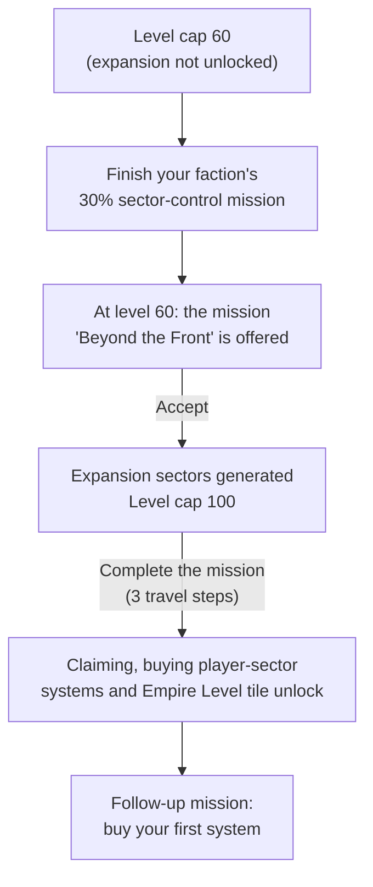

# Beyond the Front

This stage covers what opens once you accept the "Beyond the Front" mission: the expansion sectors, claiming and buying systems, your empire, and your own Empire Fleets. It needs captain level 60 and one finished 30% sector-control mission. Values were read from the game code of version 0.8.3.4 (the decompiled source, not in-game testing). The code was then compared with the 0.8.3.5 source, and every statement that changed there was rewritten. The war, fleet and level statements were checked again against the 0.8.3.7 source.

Terms and abbreviations are explained in the [Beyond the Front glossary](glossary.md), the [Conquest glossary](../conquest/glossary.md) and the [basics glossary](../basics/glossary.md).

## Spoiler: What Level 60 and "Beyond the Front" Gate

Level 60 is a real gate, but it works through the level cap. The game does not check your level when you take conquest actions.

| Gate | What you need | What it opens |
|---|---|---|
| Level 10 | Captain level 10 and a system you hold | Empire Fleet budgets exist from level 10, but you cannot field a fleet until you hold a system. |
| Level cap 60 | You have not accepted "Beyond the Front" | You cannot pass level 60 until the expansion is unlocked. |
| "Beyond the Front" offered | Level 60, one finished 30% sector-control mission for your faction (see the [30% sector-control missions](../conquest/sector-control.md#the-30-sector-control-mission)), and the expansion not yet unlocked | The mission appears only once you are at the cap and have finished your faction's 30% sector-control mission. |
| Expansion unlock | Accept the mission from the questgiver | Generates the expansion sectors and raises the level cap to 100. Raises the cap on skill points found in Locked Containers and facilities from 10 to 30. Raises the cap on bonus skill points (the kind the Vanguard Marks shop sells) from 61 to 101. Raises the reputation cap from Distinguished to Exalted. Changes the fleet caps of two NPC factions: the Darkspace Compact goes from a flat 5 to up to 12, and Meridia's Chosen goes from up to 8 to up to 6. |
| Claim unlock | Complete the mission | Lets you claim systems, buy systems in the player sector, and see the Empire Level tile and line (on your Faction overview and on the Captain's command card). Empire Fleets, Defense stations and patrol fleets also need a held system. |

The mission has three travel steps: the Penumbra gate, the player sector gate and the home hub. It pays 1 skill point and +300 reputation with the Darkspace Compact. It then starts a follow-up mission, "A... Big Place of Your Own", which asks you to buy your first system.

"Level 60 or below" therefore means everyone who has not accepted the mission, and "above level 60" means everyone who has. Between accepting and completing the mission you can already level past 60 and the expansion exists, but claiming is still locked.

Your faction's 30% sector-control mission checks the "Area Conquered" figure: that faction's systems divided by all Conquest sector systems. Before you can leave level 60, the war itself has to go your faction's way. That mission pays 400 Vanguard Marks, 10,000,000 credits and a skill point. How to finish it is explained in [the 30% sector-control mission](../conquest/sector-control.md#the-30-sector-control-mission).

The game counts the expansion sectors among all war-zone systems only once the expansion is unlocked, which happens after that mission ([the 30% sector-control mission](../conquest/sector-control.md#what-the-objective-counts)).

Level 60 also shows up in these places. None of them gate conquest actions.

- Empire upkeep divides its cost multiplier by the multiplier at level 60.
- Legendary loot can drop only at level 60 or higher. Its weight is (your level - 60) / 2000, so it is 0 at exactly 60.
- Every expansion system is created at level 60. Its level then follows the war-zone level targets (your effective level plus an offset, see [How System Levels Rise](../conquest/war.md#how-system-levels-rise)), so 60 is only where it starts. The 60 to 100 ramp across the expansion sets the ore level and the tier of seeded outposts.
- The Empire Fleet budget steps every 5 levels (2500 points and 12 ships at level 60, see [slots and size](empire-fleets.md#slots-and-size)). Level 60 is not special in that table.

In the code: [What Level 60 and "Beyond the Front" Gate](#code-what-level-60-and-beyond-the-front-gate).

## Pages

- [Common Questions](faq.md): short answers to questions players ask about your empire and Empire Fleets. Each answer links to the section with the full numbers.
- [Glossary](glossary.md): the terms and abbreviations used in the Beyond the Front pages.
- [Your Empire](your-empire.md): the expansion sectors, buying and claiming systems, the capital, Empire Level and upkeep, your stations, reputation from capture and claim, and the economy once the expansion war is open.
- [Empire Fleets](empire-fleets.md): fleet slots and size, orders, stances, the outmatched warning, map labels, how your fleets count in the Defense number, and what changes above level 60.

The previous stage is [Conquest](../conquest/README.md). The mission that opens this stage is described in [the 30% sector-control mission](../conquest/sector-control.md#the-30-sector-control-mission).

## In the Game Code

This part holds the code names behind the gate table above. It comes from the decompiled game code of version 0.8.3.4, compared with the 0.8.3.5 and 0.8.3.7 sources. To check a claim, look up the class and method named in the `Source:` line.

### Code: What Level 60 and "Beyond the Front" Gate

Level 60 is a real code gate, but it works through the level cap, not through a check on conquest actions.

| Gate | Condition in code | What it controls |
|---|---|---|
| Level 10 | `FleetLevelSteps.UnlockLevel` | Empire Fleet budgets exist from level 10, but you also need a held system (see the Claim unlock row). |
| Level cap 60 | `Conquest.maxPlayerLevel` is 60 while `expansionUnlocked` is false, and 100 after | You cannot pass level 60 until the expansion is unlocked. |
| "Beyond the Front" offered | `ExpansionMissions.IsGoToExpansionAvailable`: `player.level >= 60`, one of `ConquestStellar2`, `ConquestKolyatov2` or `ConquestLuminate2` completed (the [30% sector-control missions](../conquest/sector-control.md#the-30-sector-control-mission)), and the expansion not yet unlocked | The mission appears only once you are at the cap and have finished your faction's 30% sector-control mission. |
| Expansion unlock | Creating the mission (when you accept it from the questgiver) calls `Conquest.UnlockExpansion()` | Generates the expansion sectors and raises the level cap to 100 (`Conquest.maxPlayerLevel`). Raises the cap on skill points found in Locked Containers and facilities from 10 to 30 (`maxLootBoxSkillPoints`). Raises the bonus skill point cap from 61 to 101 (`maxBonusSkillpoints`, which is `maxPlayerLevel + 1`). Raises the reputation cap from Distinguished to Exalted (`maxReputation`). Changes the fleet caps of the Darkspace Compact and Meridia's Chosen (`Faction.ExpansionWarOpen` in `ConquestFleetPlanner.MaxFleetsFor` and `MaxTerritoryFleets`). |
| Claim unlock | Completing the mission pays `SystemClaimUnlock`, which sets `systemClaimUnlocked` | Lets you claim systems, buy systems in the player sector, and see the Empire Level tile and line. `CommandTabUnlocks.IsEmpireLevelUnlocked` is `systemClaimUnlocked`, and it gates `PlayerEmpireTiles` in `FactionOverviewContent` and `CaptainCommandCard.AddEmpireLevelLine`. Empire Fleets, Defense stations and patrol fleets also need a held system. |

After the mission completes, it starts `StoryMissionBuyFirstSystem`, which asks you to buy the first system.

Your faction's 30% sector-control mission checks `currentConqueredPercentage`, which is the "Area Conquered" figure: that faction's systems divided by all Conquest sector systems.

Other level 60 references in code do not gate conquest actions:

- `EmpireUpkeep.ReferenceLevel` is the level whose cost multiplier upkeep is divided by.
- `LootRarity` adds Legendary loot only at level 60 or higher, with weight `(level - 60) / 2000`, so it is 0 at exactly 60.
- `ConquestWorld.CreateExpansionSystem` creates each expansion system at level 60 and gives it an `oreLevel` from the `ExpansionLevels.FloorAt` ramp (60 to 100, plus up to 4 levels of jitter). `ExpansionLevels.SeamLevel` (60) has no other caller in 0.8.3.7. `SystemLevelDrift` then moves the system level (see [What You Face](empire-fleets.md#code-what-you-face)).
- The Empire Fleet budget steps every 5 levels (2500 points and 12 ships at level 60). Level 60 is not special in that table.

Source: `ExpansionMissions.IsGoToExpansionAvailable`, `ExpansionMissions.BuildBeyondTheFront`, `ExpansionDialogues.GetTooEarlyLine`, `Conquest.maxPlayerLevel`, `Conquest.UnlockExpansion`, `Conquest.maxLootBoxSkillPoints`, `Conquest.maxReputation`, `SystemClaimUnlock`, `GamePlayer.UnlockSystemClaim`, `ConquestMissions.CreateFactionConquestProgressMission` (`SystemsConquered` at 0.3), `Conquest.UpdateConquestArea`, `LootRarity.GetRarityChances`, `EmpireUpkeep`, `ExpansionLevels`, `ConquestFleetPlanner.MaxFleetsFor`, `CommandTabUnlocks`
