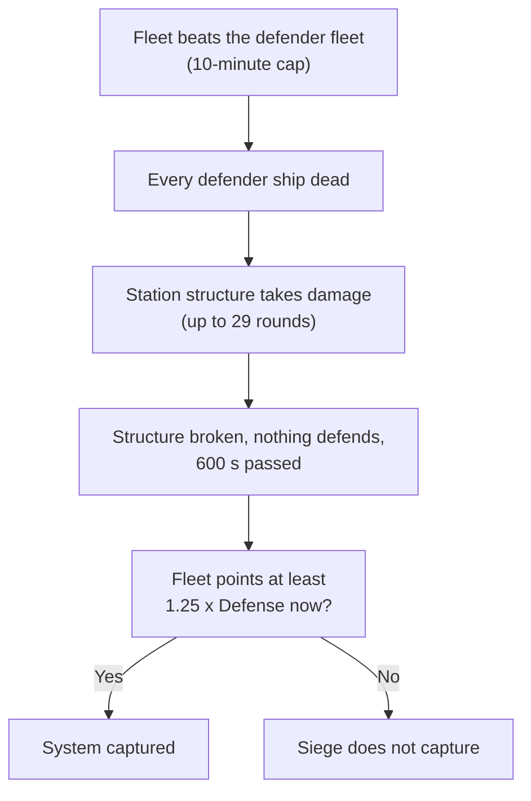

# Empire Fleets

This page covers your own Empire Fleets and patrol fleets: slots and size, service levels, orders, stances, the outmatched warning, how your fleets show on the map and in the Defense number, and what the war looks like above level 60. Fleets need captain level 10 and a held system. The war options on this page open with "Beyond the Front", which needs level 60 and one finished 30% sector-control mission ([gate](README.md)). Values were read from the game code of version 0.8.3.4 (the decompiled source, not in-game testing). The code was then compared with the 0.8.3.5 source, and every statement that changed there was rewritten.

Terms and abbreviations are explained in the [Beyond the Front glossary](glossary.md), the [Conquest glossary](../conquest/glossary.md) and the [basics glossary](../basics/glossary.md). Buying and claiming systems, upkeep and your stations are covered in [Your Empire](your-empire.md).

## Slots and Size

The number of fleet slots depends on the war-zone systems you hold, and the size of each fleet depends on your level. A fleet slot is room for one Empire Fleet. The game shows it as "{n} / {m} fleet slots".

The empire points and empire ships columns of the personal points table in [scaling](../basics/scaling.md#how-many-enemies-a-hostile-site-gets) are this budget. The full table is below.

| Systems held | 1 | 5 | 10 | 20 | 40 | 80 | 160 |
|---|---|---|---|---|---|---|---|
| Fleet slots | 1 | 2 | 3 | 4 | 5 | 6 | 7 |

Fleets unlock at captain level 10. The budget steps every 5 levels:

| Level | 10 | 15 | 20 | 25 | 30 | 35 | 40 | 45 | 50 | 55 |
|---|---|---|---|---|---|---|---|---|---|---|
| Points | 100 | 200 | 350 | 500 | 700 | 900 | 1150 | 1450 | 1800 | 2150 |
| Ships | 2 | 3 | 4 | 5 | 6 | 6 | 7 | 8 | 9 | 10 |

| Level | 60 | 65 | 70 | 75 | 80 | 85 | 90 | 95 | 100 |
|---|---|---|---|---|---|---|---|---|---|
| Points | 2500 | 2700 | 2875 | 3050 | 3250 | 3450 | 3625 | 3800 | 4000 |
| Ships | 12 | 14 | 15 | 17 | 18 | 20 | 21 | 23 | 25 |

In the code: [Slots and Size](#code-slots-and-size).

## Service Levels and Standard-Issue Copies

These rows belong to the fleet-level question table in [war](../conquest/war.md#fleet-levels). They cover your own ships.

| Question | Answer |
|---|---|
| What level is a newly built player-faction ship? | Your own level. |
| What level is an Empire Fleet? | Your own level, and it follows you as you level. |
| When is a patrol fleet "due" for a refit? | When its service level is at or below the system level minus 3. |
| What does a patrol refit do? | It raises the service level to the system level plus 3. |

Empire Fleets no longer have a refit. In 0.8.3.5 their ships fight at your current level, so there is nothing to bring up to date. The Refit order, its fleet-bar button and the "Refit due" chip on the fleet card are gone. A fleet that was mid-refit in an older save is set back to idle when the save loads. Patrol ships at your Defense stations still use the system-level rule above, with the level of the station's system. The refit timer is 300 s.

Your own ships in a patrol have a service level, which is set to the system level when they join. Ships assigned to an Empire Fleet report your own level instead of the stored value. When they are spawned into a battle, they do not use your own loadout. Instead, the game generates a "standard issue" copy of each ship at that service level (see [Standard-Issue Gear](../basics/scaling.md#standard-issue-gear)). The copy keeps the ship's rank and rarity, and it gets hull nodes as if it were an NPC of that level.

The standard-issue copies get the NPC ship HP curve (see [NPC Ship HP Curve](../basics/scaling.md#npc-ship-hp-curve)). Your actual flagship does not get it. The copies also get no ship rank modifiers and no escalation buffs.

Standard-issue equipment is used for the copies of your Empire Fleet and patrol ships in battle, at each ship's service level. Hangar-bay fighters use it too. Your own fitted gear does not carry over into those battles.

In the code: [Service Levels and Standard-Issue Copies](#code-service-levels-and-standard-issue-copies).

## Orders

| Order | Rules |
|---|---|
| Move | The fleet travels to a system and stays there. |
| Stop | This is a button on the fleet bar, not an order of its own. It gives a Move order to the system the fleet is in or crossing. Once the fleet sits there, the game shows "Idling". |
| Attack | The target must be a war-zone system. The game refuses the order in the cases listed below the table. Arriving at an unowned system claims it. |
| Raid | The target must be an economic outpost in the war zone, owned by a hostile faction. It cannot be a Defense station, a wrecked outpost, or an outpost that is already being raided. |
| Return | The fleet goes to its home system, or to your nearest held system if the home system is lost. |
| Join siege | There must be a fight in that system with exactly one friendly side. |

The game refuses an Attack order when the target system is any of these:

- closed to you
- your own
- a headquarters
- a system whose hub is already gone
- a system for sale in the player sector
- free territory
- already fought over by a non-friendly faction
- owned by a faction that is not your enemy (unless you declare war)

The range is 30 jumps. You cannot order a fleet that is defending against another fleet in a fleet clash, and you cannot remove ships from a fleet that is in a battle. When you attack an ally or a neutral faction, you can declare war from the order dialog. Giving a new order breaks off an attack in progress. While the Meridia quadrant is closed to you, the game refuses Attack, Raid and Join siege orders there with "This system is closed to you for now."

Join siege lets your fleet help whichever side is yours or allied. If the owner is friendly and the attacker is not, the fleet defends and counts in the system's Defense. If the attacker is friendly and the owner is not, the fleet joins as a supporter of the attacker. The game refuses the order if both sides are friendly, or if neither is.

A fleet only starts a fight of its own on arrival if its order is an Attack on the system it has reached. After a Move or Return order it just stops there. In 0.8.3.5 a fleet that is answering a distress call (the Defend sector stance) also holds fire on arrival.

In the code: [Orders](#code-orders).

## Defense Stances and Other Behaviour

| Stance | What the fleet does |
|---|---|
| None | Does not defend. It counts toward Defense only while it is on a Join siege order. |
| Defend system (the default) | While idle, joins the defense of the system it is in. |
| Defend sector | Does the same as Defend system, and also answers sieges and raids on your systems anywhere in the same sector as the system it is posted to (the system its current standing order points at; the map label reads "Defending sector {name}"). It travels there with the "Responding" label. |

Clicking the active stance again returns the fleet to None.

A fleet counts toward Defense if it has a stance or a Join siege order, is in the system, and is not traveling. A fleet that is fighting there still counts. If a system with your defending fleets is captured, those fleets fall back to their home system. A fleet with the Defend sector stance stays if the system it is posted to is still yours.

The fleet retreat threshold defaults to 0, and the setting is hidden in this version, so your fleets never break off on their own. A fleet retreats only if that value is changed.

Your Empire Fleet ships and patrol ships are real ships. When they die in a simulated or live battle, they are removed permanently.

The fleet card shows the fleet mix bonus as "Fleet mix +x% off-screen strength (n ship sizes)". The bonus applies to simulated rounds and to the Defense number, not to live combat.

In the code: [Defense Stances and Other Behaviour](#code-defense-stances-and-other-behaviour).

## Outmatched Warning

The game shows this warning when you give an Attack order and the fleet's points are below 1.15 x the target's next-battle strength. NPC fleet planning uses the same threshold. The warning reads: "{fleet} ({points} points) is outmatched here ({defense} defense) and will likely be wiped out." It offers "Attack anyway".

The number in the warning, which the game labels "defense", is the next-battle strength (defined in the [Conquest glossary](../conquest/glossary.md)). It can be lower than the full number in the Defense row when the system has Defense stations.

In the code: [Outmatched Warning](#code-outmatched-warning).

## Your Fleets in Battle and on the Map

- In a live battle, ships of your own Empire Fleets and patrol fleets that die are removed permanently. NPC ships in their fleets are removed as well.
- In simulated battles, your ships use the larger of two figures for their hull rating: their spent upgrade points, or an NPC-equivalent figure (see [Hull Edge](../conquest/war.md#hull-edge)). Since 0.8.3.5 the NPC-equivalent figure for an Empire Fleet ship is worked out at your current level, and for a patrol ship at its service level.
- The "Withdrew" outcome appears in the Empire Log as "withdrew before relief arrived" (see [Outcomes](../conquest/war.md#outcomes)). It happens when the lead attacker is ordered away and has no standing supporters. Only Empire Fleets get this outcome, because the only code that ends a battle this way is the one that gives an Empire Fleet a new order or makes it retreat.
- Your Attack order on a headquarters is refused with "A faction's headquarters can't be taken by a fleet."
- The Fleets tab of the Empire window lists your own Empire Fleets.
- The game checks Empire Fleet orders every 5 s.

One label applies only to your fleets. In the label order in [war](../conquest/war.md#fleet-labels-on-the-map), "Moving" also covers an Empire Fleet Move order. This row sits between "Supporting" and "Defending an outpost from raiders":

| Label | When |
|---|---|
| Joining the siege of {system} | Your fleet is traveling on a Join siege order. |

Some of the other reason labels also apply to your fleets. Your Attack order sets "Attacking". "Responding to a distress call" is also set for your fleets with the Defend sector stance when they go to a system under attack in their sector, and for a Join siege order that defends.

The map callout for your own fleets uses a different set of texts:

- "Moving to {system}"
- "Holding at {system}"
- "Returning to {system}"
- "Attacking {system}"
- "Raiding {station}"
- "Joining the siege of {system}"
- For the stance: "Defending {system}", "Defending sector {sector}" or "Not defending"

In the code: [Your Fleets in Battle and on the Map](#code-your-fleets-in-battle-and-on-the-map).

## Your Fleets and Patrols in the Defense Number

These rules add to the Defense formula and its explanation in [war](../conquest/war.md#what-the-defense-number-means).

A defending fleet also counts when it is an allied Empire Fleet on a Join siege order for an allied system. Only Empire Fleets have a fleet mix bonus.

In the code: [Your Fleets and Patrols in the Defense Number](#code-your-fleets-and-patrols-in-the-defense-number).

### Fleet Mix Bonus

Empire Level gives a fleet mix bonus to Empire Fleets that have 2 or more distinct non-drone ship sizes. The bonus counts toward the Defense row and toward battle strength in simulated battles. Empire Level also sets how many systems you may hold without upkeep ([Empire Level and Upkeep](your-empire.md#empire-level-and-upkeep)).

```
bonus = number of distinct ship sizes x rate    (only with 2 or more distinct non-drone ship sizes)
rate = 1% per size at Empire Level 1-4, 2% at Empire Level 5-9, 3% at Empire Level 10+
```

In the code: [Fleet Mix Bonus](#code-fleet-mix-bonus).

### Patrol Ships

Patrol ships count only for your own systems. Every ship assigned to a patrol fleet at one of your Defense stations in the system counts for its full points. Patrol ships get no mix bonus. A patrol fleet is a group of ships you assign to guard one of your Defense stations.

The patrol fleet capacity depends on the tier of your Defense station:

| Tier | 1 | 2 | 3 | 4 | 5 |
|---|---|---|---|---|---|
| Patrol fleets | 1 | 1 | 2 | 2 | 3 |
| Points per fleet | 120 | 240 | 260 | 400 | 500 |

In the code: [Patrol Ships](#code-patrol-ships).

### Levers That Raise Your Own Defense

These two rows extend the levers table in [war](../conquest/war.md#ways-to-lower-or-raise-defense), which lists the other ways to raise the Defense of a system.

| Lever | Effect |
|---|---|
| Stack fleets | Fleets with a defense stance count in full, plus the mix bonus. |
| Add patrol fleets | Each Defense station gives 1 to 3 patrol fleets of 120 to 500 points each, depending on tier. |

## Above Level 60, After "Beyond the Front"

What you could do before, at level 60 or below, is in [sector control](../conquest/sector-control.md#level-60-or-below). This section applies once you have accepted "Beyond the Front" ([gate](README.md)).

In the code: [Above Level 60, After "Beyond the Front"](#code-above-level-60-after-beyond-the-front).

### What You Can and Cannot Do

| You can | Notes |
|---|---|
| Buy systems in the player sector | The price and purchase rules are in [Buying Systems in the Player Sector](your-empire.md#buying-systems-in-the-player-sector). The first system you hold becomes your capital. |
| Claim unowned war-zone systems | Your flagship or an idle Empire Fleet in the system is enough. You cannot claim free territory or player-sector systems this way. |
| Take systems by siege | Use Attack orders from Empire Fleets. Capture needs the conditions in [How a Siege Ends](../conquest/war.md#how-a-siege-ends). |
| Field Empire Fleets | Your level sets the slots and budget (see [Slots and Size](#slots-and-size)): 2500 points and 12 ships at level 60, and 4000 points and 25 ships at level 100. |
| Build Defense stations and patrol fleets | Each system has 2 station slots, and captured economic outposts use them too. Each station holds 1 to 3 patrol fleets of 120 to 500 points, depending on tier. |
| Raid, join sieges and set defense stances | These are Empire Fleet orders. |
| Level past 60 | The cap is 100 once the expansion is unlocked. |

| You still cannot | Why |
|---|---|
| Take a headquarters or your capital | The game flags them as untakeable. |
| Claim free territory | Independent hubs in the expansion are left for NPC factions to settle. |
| Claim a system without being present | Your flagship or an idle fleet must be in the system. |

The safe-sector rule and the upkeep that follow from holding systems are explained in [Buying Systems in the Player Sector](your-empire.md#buying-systems-in-the-player-sector).

In the code: [What You Can and Cannot Do](#code-what-you-can-and-cannot-do).

### What You Face

- Systems: expansion systems are created at level 60 and rise toward your level by the rule in [How System Levels Rise](../conquest/war.md#how-system-levels-rise). Once you are past 60, they sit near your level plus up to 4 (worked out from the formulas). Their ore levels ramp from 60 to 100 across the expansion.
- NPC fleet ship level: this is still the higher of your effective level and the highest conquest system level, plus 6 ([Fleet Levels](../conquest/war.md#fleet-levels)). With expansion systems in the list, the highest system level is at least 60. NPC ships are therefore at least level 66 from the moment the expansion unlocks, and about your level plus 10 once you are above 60 (worked out from the formulas).
- Station turrets: every expansion system is level 60 or higher, so every generated conquest station gets the M2 or L1 turret layouts. Ara Martis stations switch to them when their system level reaches 45.
- Fleets: NPC fleets are 2000 points. The fleet caps once the expansion is open are in [Fleet Caps Once the Expansion War Is Open](your-empire.md#fleet-caps-once-the-expansion-war-is-open). Great Gate reinforcement fleets are 1500 points. Raid parties are 200 to 300 points.
- Hostility: taking a system sets your reputation with the former owner to -5000. The game tells you "Factions hostile to you will attack this system".

In the code: [What You Face](#code-what-you-face).

### Taking a System With Empire Fleets

The worked cases below come from the Defense formula in [war](../conquest/war.md#what-the-defense-number-means) and from the patrol and mix terms above. They use station firepower with the sector station multiplier at 1, no war effort, and a system that is not settling.

Next-battle strength is the figure that NPC fleet planning compares attackers against. See [What NPC Factions Use Instead of the Defense Number](../conquest/war.md#what-npc-factions-use-instead-of-the-defense-number).

| System | Defense number | Next-battle strength (NPC planning figure) | Points to avoid the outmatched warning |
|---|---|---|---|
| Hub only, medium (480 firepower) | 480 | 480 | 553 |
| Hub plus one tier-5 Defense station (garrison 900, firepower capped at 700) | up to 1600 | up to 1600 | up to 1840 |
| The same, plus one resident 2000-point fleet | up to 3600 | up to 3600 | up to 4140 |

A level 60 fleet is 2500 points, so it clears the outmatched threshold for the first two systems. The third needs a level 100 fleet (4000 points, plus the mix bonus) or several fleets, because the 1.15 and 1.25 margins apply to the total.

To capture a system, you need 1.25 times the Defense at that moment. Once the structure is broken and every defender is dead, Defense falls to the floor of 250, so about 313 points is enough. While defenders are alive at the cap, you need 1.25 times their points plus the station term.



- Read the Defense row, then work out which figure the warning uses: the next-battle strength, which is the weakest Defense station plus fleets, or the full Defense number. Your Empire Fleet needs at least 1.15 times the next-battle strength to avoid the outmatched warning, and at least 1.25 times the current Defense number to capture.
- A fleet that beats the defender fleet at the 10-minute cap passes to the siege. Remove fleets first by fighting them, or by intercepting reinforcements while they are still traveling and before they reach the system.
- Station structure takes damage only after every defender ship is dead. A siege with large defenders needs most of its 29 rounds just to clear them.
- Capture is allowed at 600 s once the station is broken and nothing defends. You do not have to stay until the cap if those conditions hold.
- Attack right after a system changes hands. For the first 5 to 6 hours its station firepower is halved (settling), and for the first 1 to 2 hours it pays no taxes (unrest).
- Missions against the owner, done next to the target, lower the target's station firepower by up to half. One mission adds one step, which is 10% of the station firepower (more for missions that ECHO completes with the "ECHO The Conqueror" skill; see [War Effort](../conquest/war.md#war-effort)). It also restarts the 3-hour timer on the penalty. A red "Your war effort" row shows the effect.
- A hull rating lead over the defenders is worth up to 15% of strength. The hull ratings of garrisons come from level and rank. The upgrades on your ships raise yours.
- You can also take a system by destroying its hub in a live battle, from inside the system. That abandons the system and shows "{faction} lost {system} - the system is unclaimed".
    - With claiming unlocked, the game offers you the claim first. Taking it destroys the old owner's Defense stations there and drops your reputation with that owner to Hostile.
    - If you decline, or claiming is still locked, the fleet that was besieging the hub takes the system at once.
    - With no hub siege running, the system stays unowned until the first fleet lands (see [Unowned and Abandoned Systems](../conquest/war.md#unowned-and-abandoned-systems)).
    - In a player-sector system, a hub kill puts the system back on sale instead.
- Damage converts to destroyed points one for one, so a fleet of many small ships and a fleet of a few big ships lose points at the same rate. The size bias of 0.5 only changes which ships go first. The ships you lose are removed permanently.
- You have to win against a Defense station first. Each stage is its own battle with its own 600 s minimum, so a fortified system takes several battles and several NPC planning passes.
- Check the share rule before you expand. A faction that holds under 10% of the war-zone systems attacks only unowned systems, or owners that hold 10% or more. If that leaves it no target at all, it attacks anyone. While you hold under 10%, the small factions therefore leave you alone, but the large ones do not. The share is the faction's war-zone systems divided by all war-zone systems.

In the code: [Taking a System With Empire Fleets](#code-taking-a-system-with-empire-fleets).

### Defending a System You Hold

- Keep a fleet in the system with a defense stance. It counts in full for Defense, plus the mix bonus (2 or more ship sizes, up to 3% per size at Empire Level 10).
- Build Defense stations and assign patrol fleets. They count in full for Defense, and a hub siege goes straight to the hub instead of through station stages. Patrol ships lost in a siege are lost for good.
- War effort does not apply to systems you hold. Missions that raise it never reach a system you own (see [War Effort on Your Own Systems](your-empire.md#war-effort-on-your-own-systems)), so it adds nothing to your Defense number. Against NPC-held systems, a +1.0 bonus doubles the station term, which adds 250 to 700 of Defense (the term goes from 250 to 700 up to 500 to 1400).
- Stay out of reach of the 1.15 threshold that NPC fleet planning uses. NPC fleets attack when their points are at least 1.15 times the weakest-station strength plus any fleets already traveling to relieve it. A lone NPC fleet is 2000 points, so a Defense number above about 1740 stops single-fleet attacks. Assaults combine 2 or more fleets and can exceed that.
- If a flagship or fleet of yours is in the system, the battle turns live and the simulation freezes. The fight then depends on the ships alone. The real station HP is multiplied by 20 (30 at a headquarters), and war effort scales the station weapons.
- A defending fleet or patrol in the system stops a raid from running unopposed. An undefended raid finishes at its 600 s minimum once the station structure (15% of normal hull) is broken.

In the code: [Defending a System You Hold](#code-defending-a-system-you-hold).

## Where the Efficient Choice Differs

| Question | Level 60 or below, no system | Above 60, claim unlocked |
|---|---|---|
| What can I hold? | You cannot hold any system. | You can hold systems, with 1 fleet slot per threshold. |
| What is the main lever on a war? | Interception, live hub kills at the right moment, and war effort bursts. | Your own fleets, attacking and defending. War effort is a small add-on. |
| How useful is war effort? | It is most of what you can do to the war. | It is a minor boost of at most 250 to 700 Defense at the cap. |
| What does intercepting cost? | It is cheap to start. It costs -1000 reputation for the ship you click and -3500 per kill with factions at Wary or better. A first hit can flag the faction's other ships in the encounter (see [faction-economy](../conquest/faction-economy.md#intercepting-deliveries-and-convoys)). It costs nothing against factions that are already your enemies. | The cost is the same, but a big fleet of yours can usually fight the real fight instead. |
| What does a hub kill do? | It hands the system to the lead attacker of a hub siege at once. Otherwise it leaves the system unowned until a fleet lands. | It offers the claim to you first, with a reputation drop to Hostile with the old owner. A player-sector system goes back on sale instead. |
| What happens to my reputation? | You lose it station by station. | You lose it system by system (to -5000), and the owner attacks you afterwards. |
| What level are enemy ships? | Your level plus about 10. | At least 66, and your level plus about 10 above level 60. |
| What are the station turrets? | Small below level 45, then M2 and L1. | M2 and L1 throughout the expansion. |

The 1.15 NPC attack margin also sets the outmatched warning for your Attack orders. The 1.25 capture margin applies to captures by your own fleets. Both rows are in [Numbers to Watch](../conquest/sector-control.md#numbers-to-watch).

## In the Game Code

This part holds the code names, call details and `Source:` lines behind the sections above. It comes from the decompiled game code of version 0.8.3.4, compared with the 0.8.3.5 source. To check a claim, look up the class and method named in the `Source:` line.

### Code: Slots and Size

The `EmpirePoints` and `EmpireShips` columns of the `PersonalPoints` table in [scaling](../basics/scaling.md#how-many-enemies-a-hostile-site-gets) are this budget.

Source: `EmpireFleets.FleetSlotSystems`, `EmpireFleets.MaxFleets`, `FleetLevelSteps`, `FleetLevelSteps.EmpirePoints`

### Code: Service Levels and Standard-Issue Copies

These rows belong to the `FleetLevels` question table (the table is in [war](../conquest/war.md#fleet-levels)). They cover your own ships.

`BuildStandardIssueCopy` generates a "standard issue" copy at the service level. It keeps the ship's rank and rarity, and gives it hull nodes as if it were an NPC of that level.

The standard-issue copies (faction player, `isPlayer` false) get the NPC ship HP curve (`ApplyNpcShipHpCurve`). Your actual flagship does not get it. The copies get no ship rank modifiers and no escalation buffs, because those check the faction.

`LoadStandardIssueEquipment` is used for the copies of your Empire Fleet and patrol ships in battle (at each ship's service level), and for hangar-bay fighters.

Source: `FleetLevels.GetNewShipLevel`, `FleetLevels.GetPlayerLevel`, `FleetLevels.GetFleetLevel`, `FleetLevels.IsDueRefit`, `FleetLevels.GetRefitLevel`, `ServiceLevels.GetLevel`, `ServiceLevels.Join`, `ServiceLevels.IsPatrolDueRefit`, `ConquestFleet.EndOldEmpireRefit`, `ConquestCombat.BuildStandardIssueCopy`, `AbstractUnitData.LoadStandardIssueEquipment`

### Code: Orders

| Code name | Name in the game |
|---|---|
| `Hold` | Move |
| `Attack` | Attack |
| `Raid` | Raid |
| `Return` | Return |
| `JoinSiege` | Join siege |

The range is 30 jumps. You cannot order a fleet that is the defender in a `FleetClash`, and you cannot remove ships from a fleet that is in a battle. When you attack an ally or a neutral faction, you can declare war from the order dialog. Giving a new order breaks off an attack in progress (`Withdrew`).

`EmpireFleetOrder` has no `Refit` value in 0.8.3.5. `EmpireFleets.GetRefitPlan`, `FindRefitYard`, `RefuseRefit`, `SendToRefit`, `IsRefitDue`, `ServiceLevels.CompleteFleetRefit` and `EmpireFleetCommands.ConfirmRefit` are gone too.

The Attack rule "a system whose hub is already gone" is the code's "hubless" check.

Source: `EmpireFleets.TryOrder`, `EmpireFleets.GetRefusal`, `EmpireFleets.RefuseAttack`, `EmpireFleets.RefuseRaid`, `EmpireFleets.RefuseJoinSiege`, `EmpireFleets.GetJoinSide`, `EmpireFleets.DefendsAlly`, `EmpireFleets.MaxOrderHops`, `EmpireFleets.AttacksOnArrival`, `BattleManager.HoldsFireOnArrival`, `EmpireFleetCommands.Stop`, `EmpireFleetCommands.IsIdling`

### Code: Defense Stances and Other Behaviour

The fleet retreat threshold (`retreatFraction`) defaults to 0, and the setting is hidden (`RetreatSettingShown` is false), so your fleets never break off on their own.

Source: `EmpireFleets.JoinsDefense`, `EmpireFleets.GuardSector`, `EmpireFleets.FallBack`, `EmpireFleets.CheckRetreat`, `EmpireFleetCommands`, `FleetMixBonus`

### Code: Outmatched Warning

Source: `EmpireFleets.GetOutmatchingDefense`, `EmpireFleetCommands`

### Code: Your Fleets in Battle and on the Map

The NPC-equivalent hull figure is `HullRating.GetNpcHullPoints`, which uses `ServiceLevels.GetLevel` in 0.8.3.5 (your level for an Empire Fleet ship, the stored service level for a patrol ship). `HullRating.GetServiceHullPoints` takes the larger of that and `TotalPointsSpent`.

Source: `ConquestFleetMapIcon.GetTaskLabel`, `MapFleetCallout`, `EmpireFleets.RefuseAttack`, `HullRating.GetHullPoints`, `HullRating.GetServiceHullPoints`, `HullRating.GetNpcHullPoints`, `BattleManager.TickLive`

### Code: Your Fleets and Patrols in the Defense Number

The subsections below back the fleet mix and patrol rules above.

#### Code: Fleet Mix Bonus

```
FleetMixBonus = sizes * rate    (only if the fleet has 2 or more distinct non-drone ship sizes)
rate = 1% per size at Empire Level 1-4, 2% at Empire Level 5-9, 3% at Empire Level 10+
```

Source: `FleetMixBonus.GetBattleStrength`, `FleetMixBonus`, `EmpireLevel`

#### Code: Patrol Ships

Source: `ConquestCombat.GetPatrolShips`, `PlayerStation.patrolFleetCount`, `PlayerStation.patrolFleetBudget`

### Code: Above Level 60, After "Beyond the Front"

The subsections below back the claims in the sections of the same names.

#### Code: What You Can and Cannot Do

For the "Take a headquarters or your capital" row, the reason is `cannotBeTaken`.

Source: `SystemClaim`, `EmpireFleets.MaxFleets`, `FleetLevelSteps`, `PlayerStation.patrolFleetCount`, `StationSiteRules`

#### Code: What You Face

Ore levels ramp from 60 to 100 across the expansion (`ExpansionLevels.FloorAt`). The NPC fleet ship level is `max(your effective level, highest conquest system level) + 6` ([Fleet Levels](../conquest/war.md#fleet-levels)).

Source: `ConquestWorld.CreateExpansionSystem`, `ExpansionLevels.FloorAt`, `Conquest.RaiseTowardPlayer`, `FleetLevels.GetNpcFleetLevel`, `CombatStationFactory`, `ConquestFleetPlanner.MaxFleetsFor`, `ConquestFleetPlanner.MaxTerritoryFleets`, `SystemClaim.ApplyReputationRule`

#### Code: Taking a System With Empire Fleets

The share-rule bullet counts war-zone systems held over all war-zone systems (`ConquestScope.GetWarZoneShare`, threshold `ConquestWarTuning.PeaceShareThreshold`). `ConquestFleetOrders.ApplyPeace` keeps the full candidate list when the filter would leave none.

A live hub kill reaches `ConquestOwnership.Abandon` through `ConquestOwnership.OnStationDestroyed`, for the hub of an owned war-zone system. `Abandon` records `abandonedBy`, clears the headquarters flag, hub owner, control level, combat strength and war effort, and posts `@ConquestSystemAbandoned`.

In the player sector, `ReturnToSale` ends the battles without a claim. Elsewhere, `HandOverToClaimant` checks `SystemClaim.GetRefusal`. When it is null (claiming unlocked, open to you, unowned, not player sector, not free territory, your flagship or an idle Empire Fleet in the system), `BattleManager.EndBattlesAt` ends the battles without a capture and `SystemClaim.OfferClaim` offers you the system. `SystemClaim.Decline` gives the system to the lead attacker of the hub siege (`BattleStage.StationSiege`) if that fleet still has ships in the system.

When the refusal is not null, `EndBattlesAt` returns that lead attacker if its faction can conquer (not a raider), and `ConquestOwnership.Claim` hands it the system at once. With no such fleet, the system stays unowned until an arriving fleet claims it or `ConquestFleetOrders.AssignFrontlineOrders` sends one. An arriving fleet claims it under `BattleManager.IsClaimableOnArrival`: the system is not waiting on an offer, is not for sale in the player sector, and is not free territory claimed by an Empire Fleet. `AssignFrontlineOrders` uses a jump range of 4 for a faction with a front, and 60 without one.

`Claim` destroys the old owner's Defense stations when the claimant is another faction, and `SystemClaim.OnOwnerChanged` then applies `SystemClaim.ApplyReputationRule`.

The worked-case table uses station firepower with `m = 1` (the sector station-defense multiplier).

Source: `ConquestCombat.GetNextBattleStrength`, `EmpireFleets.GetOutmatchingDefense`, `BattleManager.CanCaptureEarly`, `ConquestFleetOrders.ApplyPeace`, `ConquestWarTuning.PeaceShareThreshold`, `ConquestScope.GetWarZoneShare`, `ConquestOwnership.OnStationDestroyed`, `ConquestOwnership.Abandon`, `ConquestOwnership.HandOverToClaimant`, `ConquestOwnership.Claim`, `BattleManager.EndBattlesAt`, `BattleManager.IsClaimableOnArrival`, `SystemClaim.GetRefusal`, `SystemClaim.OfferClaim`, `SystemClaim.Decline`

#### Code: Defending a System You Hold

War effort never reaches a system you hold. `ConquestWarEffort.Apply` is called only from `ConquestStrength.OnComplete`, and `MissionGenerator.AddRewards` adds a `ConquestStrength` reward only when the source station's faction is in `Conquest.conquestFactions`, which does not contain `Faction.player`. See [War Effort on Your Own Systems](your-empire.md#code-war-effort-on-your-own-systems).

Source: `EmpireFleets.JoinsDefense`, `ConquestWarEffort.Apply`, `ConquestStrength.OnComplete`, `MissionGenerator.AddRewards`, `Conquest.conquestFactions`
