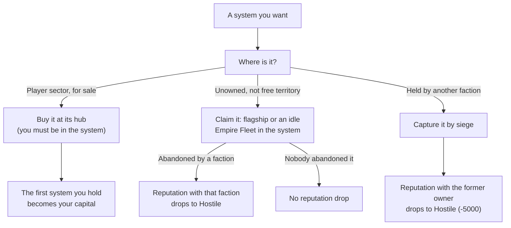

# Your empire

This page covers what changes for the war zone and for you once you accept "Beyond the Front": the expansion sectors, buying and claiming systems, your capital, Empire Level and upkeep, your own stations, reputation from capture and claim, and the faction economy once the expansion war is open. It applies from accepting that mission, which needs level 60 and one finished 30% sector-control mission ([gate](README.md)). Values are read from the game code of version 0.8.3.4 (the decompiled source, not in-game testing). Anything not confirmed in code is marked `(not verified)`.

Terms and abbreviations are explained in the [Beyond the Front glossary](glossary.md), the [conquest glossary](../conquest/glossary.md) and the [basics glossary](../basics/glossary.md). Your fleets are in [empire fleets](empire-fleets.md).

## Spoiler: The expanded war zone

The war zone is the Conquest sector (Ara Martis) plus the expansion sectors once you unlock them by accepting the "Beyond the Front" mission. The Frontier, Staging and Darkspace regions are not part of it. (The [Faction economy](../conquest/faction-economy.md) page defines the war zone as the Conquest sector only; this is the extension.)

These rows extend the kinds-of-system table in [war](../conquest/war.md#the-war-zone-and-the-kinds-of-system).

| Kind | System card title or hint | What it means |
|---|---|---|
| Your capital | "Your capital - no faction can take it" | The first system you hold becomes your capital. Same protection as a headquarters. Your economic outposts in it can still be raided. |
| Player sector | "set aside for you - buy it at its hub" | One expansion sector is set aside for you. NPC factions cannot enter its unowned systems. You buy these at their hub. |
| Safe sector | "safe from invasions" | A sector with the safe-sector rule. Closed to every faction except you, and any NPC battle already running there is aborted. The player sector gets this rule. |

In the free territory row of that table, you cannot claim it ("you can only take a system from its owner"); NPC factions can claim it.

In the code: [the expanded war zone](#code-the-expanded-war-zone).

## Spoiler: Level cap and other changes

Accepting the mission raises the level cap to 100, the loot box skill point cap from 10 to 30, the cap on bonus skill points from 61 to 101 and the reputation cap to Exalted. All of the unlock effects are in the [gate table](README.md#spoiler-what-level-60-and-beyond-the-front-gate). How the war itself changes for your level and for NPC fleets above level 60 is in [what you face](empire-fleets.md#what-you-face).

## Buying systems in the player sector

Price in credits is 10,000,000 x 1.5^n, where n is the number of systems you have bought. The Vanguard Marks price is the credit price divided by 5000, rounded. You pay both, you must be in the system, and the system must be unowned and still for sale at its hub. A system you bought before and lost is priced one step lower (n - 1, never below 0). The first one you hold becomes your capital. First purchase prices:

| n | 0 | 1 | 2 | 3 | 4 | 5 |
|---|---|---|---|---|---|---|
| Credits | 10,000,000 | 15,000,000 | 22,500,000 | 33,750,000 | 50,625,000 | 75,937,500 |
| Vanguard Marks | 2,000 | 3,000 | 4,500 | 6,750 | 10,125 | 15,188 |

Systems in the player sector have the safe-sector rule: NPC factions cannot enter them, so no siege or raid reaches them. The capital is also uncapturable. Systems you hold elsewhere are targets for any faction hostile to you.

In the code: [buying systems in the player sector](#code-buying-systems-in-the-player-sector).

## Claiming systems

The arrival rule in [war](../conquest/war.md#unowned-and-abandoned-systems) (a fleet that arrives at an unowned system claims it) has two more exceptions: the system is for sale in the player sector, or the fleet is yours and the system is free territory.



You can claim an unowned war-zone system yourself when: claiming is unlocked (the "Beyond the Front" milestone), the system is open to you, it is not a player-sector system or free territory, and your flagship or an idle Empire Fleet is in the system. An abandoned system you claim drops your reputation with the faction that abandoned it to Hostile, as a capture does.

In the player sector, the system returns to sale when its hub is destroyed, and any battle there ends without a capture. Elsewhere an abandoned system's claim goes to you first if you can claim, otherwise to the fleet that was besieging, if it can conquer.

In the code: [claiming systems](#code-claiming-systems).

## When a system changes hands against you or by your capture

If the old owner was you, your stations are converted to the captor's. 75% of stored materials go to a refund station at your capital (or home station), and the rest to the captor.

If you capture, your reputation with the former owner is set to the Hostile threshold (-5000) if it was higher. The in-game takeover dialog notes that a Decoy Transponder does not hide this. Captured economic outposts of the old owner become yours one tier lower (minimum 1), with 10% of their stock, and the system gets 2 slots for your own economic outposts. The first system you hold becomes your capital.

In the capture order in [war](../conquest/war.md#capture-by-siege), a defending Empire Fleet of yours is not wiped the way an NPC fleet is, and if the loser is you, ships flee home. After the owner changes, your Empire Fleets that defended the system fall back to their home system (see [Defense stances and other behavior](empire-fleets.md#defense-stances-and-other-behavior)).

In the code: [when a system changes hands](#code-when-a-system-changes-hands-against-you-or-by-your-capture).

## Empire Level and upkeep

| Name | Where it comes from | What it drives |
|---|---|---|
| Empire Level | your empire's own level, shown as "Empire Level {n}" | How many systems you may hold without upkeep, and the [fleet mix bonus](empire-fleets.md#fleet-mix-bonus). Separate from every level in the basics [level table](../basics/scaling.md#which-level-is-used-for-what). |

Holding systems costs nothing up to your Empire Level's capacity:

| Empire Level | 1 | 2 | 3 | 4 | 5 | 6 | 7 | 8 | 9 | 10 |
|---|---|---|---|---|---|---|---|---|---|---|
| Systems without upkeep | 10 | 14 | 19 | 25 | 32 | 41 | 52 | 65 | 81 | 101 |

| Empire Level | 11 | 12 | 13 | 14 | 15 | 16 | 17 | 18 | 19 | 20 |
|---|---|---|---|---|---|---|---|---|---|---|
| Systems without upkeep | 125 | 155 | 191 | 235 | 289 | 355 | 436 | 534 | 654 | 800 |

Empire Level 20 is the maximum.

Past capacity the upkeep is charged every hour, in credits:

```
upkeep per hour = 2,000,000 x 2^(systems over capacity - 1) x cost multiplier at your effective level / cost multiplier at level 60
```

The cost multiplier is the same level-based price multiplier the game uses for item values; it rises with level, so the level-60 value is the baseline. Your effective level (level plus Vanguard level) is used, not the plain level. The upkeep is charged only while you hold more systems than capacity, and every system you hold counts, the capital included.

If you cannot pay for 6 hours in a row, the newest system you gained revolts and goes independent. The capital never revolts: if it is the newest, or the newest system is under siege or has a station that cannot be removed, nothing revolts that hour. Paying, or dropping to capacity, resets the count. Each Empire Level needs 1000 x 1.65^(level - 1) Empire XP (experience points). Gaining a system gives 250 and building a station 50 (each system and station pays once), each hour gives 3 per station tier, and winning a battle gives 5 per enemy ship killed. Smaller sources: 1 per work-bay trip, 3 per trade run, and 0.5 per route delivery once you have a capital.

In the code: [Empire Level and upkeep](#code-empire-level-and-upkeep).

## Your stations

### Player stations

You can build economic outposts, Defense stations and patrols only in a system you own.

A station you build has no facilities, so it uses a Small layout. Nothing in the combat station code treats it differently from other Small stations.

- A Defense station you build holds patrol fleets (the NPC factions' Defense stations hold a garrison) and fires on enemies. When a siege targets a hub, your patrols spawn at the hub together with the garrisons of every Defense station in the system ([War stations](../conquest/war-stations.md#defense-stations-and-garrisons)). Patrol fleet sizes by tier are in [your fleets and patrols in the Defense number](empire-fleets.md#your-fleets-and-patrols-in-the-defense-number).
- The economic outposts you own are your own kind of station, separate from the NPC kind listed in the economic outpost row on [Combat stations](../basics/stations.md#which-station-is-which).
- Economic outposts stake mining and salvage claims in their system, with 300 to 180 second re-stake cooldowns by tier. This has no link to combat stations.
- When a system you hold falls, your stations are handed over: build jobs are cancelled, serving ships are released, routes end, and the captor gets a faction station holding the stock. 75% of the stock goes to your refund station and the rest stays with the captor. If you are at the station, the handover waits until you leave. The other direction, economic outposts you capture becoming yours one tier lower with 10% of their stock, is described under capture above.
- Removing a station on your request leaves a "Remains of {station}" salvage site for 3600 seconds (1 hour) only if the station held materials, crew, build jobs or cargo in transit; an empty station leaves nothing.
- A Defense station you own counts toward the siege profile of a system whose conquest owner is you.
- Your stations cannot be force-attacked (see [Reputation and force attacks](../basics/stations.md#reputation-and-force-attacks)).

In the code: [player stations](#code-player-stations).

### War effort on your own systems

War effort from a mission counts for a system only if the mission's source faction owns it, so whether it applies to systems you hold is `(not verified)`. What war effort does is in [war](../conquest/war.md#war-effort).

In the code: [war effort on your own systems](#code-war-effort-on-your-own-systems).

## Reputation

Rows for capture, claim and declaring war. The row for destroying a faction station is in [war](../conquest/war.md#reputation-cost-of-destroying-stations).

| Action | Reputation effect |
|---|---|
| Capturing a system from a faction, or claiming one it abandoned | Reputation with the former owner drops to Hostile (-5000) if above it. |
| Claiming an unowned system nobody abandoned | No drop. |
| Declaring war | Treated as enemy everywhere. |

In the code: [reputation](#code-reputation).

## Faction economy after the expansion war opens

The economy changes below start when the expansion war opens with the unlock.

In the code: [faction economy after the expansion war opens](#code-faction-economy-after-the-expansion-war-opens).

### Where economic outposts go

An expansion quadrant is a valid site for an economic outpost, besides the Frontier and Conquest quadrants ("Quadrant" is the game's name for the large map regions).

In the code: [where economic outposts go](#code-where-economic-outposts-go).

### Starting layout in expansion systems

New games and fresh war zones start pre-built ([Upgrades and the starting layout](../conquest/faction-economy.md#upgrades-and-the-starting-layout)). Expansion systems are seeded with 40% of slots filled (2 slots per system), and each war faction there also gets its seeded Defense stations. The tier of a seeded economic outpost follows the planned level of its system: tier 1 up to about level 73, tier 2 from about 74 and tier 3 from about 87 (level 60 to 100 is split in thirds). Every Darkspace Compact system with a gate leading toward Meridia's quadrant gets a Defense station at tier 5 (the "gate fortress") if it has a free slot. A Construction Yard's tier rises only by the planner upgrade ([Construction Yards](../conquest/faction-economy.md#construction-yards)) and by this seeding.

In the code: [starting layout in expansion systems](#code-starting-layout-in-expansion-systems).

### Fleet caps once the expansion war is open

The territory cap in the [fleet cap formula](../conquest/faction-economy.md#fleet-caps) is 8. Once the expansion war is open it is 12 for Darkspace and 6 for Meridia's Chosen, so Meridia's Chosen lose room (8 to 6) while Darkspace gains it. Darkspace Compact stops using the flat cap of 5 at that point: it moves to the same formula as the other war factions, the smaller of the territory cap and 5 + (war-zone systems / 15, rounded down).

In the code: [fleet caps once the expansion war is open](#code-fleet-caps-once-the-expansion-war-is-open).

### Ledger kinds on your own empire

Of the ledger kinds in [Where a faction's wealth comes from](../conquest/faction-economy.md#where-a-factions-wealth-comes-from), the upkeep and trade-bay kinds are booked only on your own empire's ledger; NPC factions never use them.

In the code: [ledger kinds on your own empire](#code-ledger-kinds-on-your-own-empire).

### Intercepting: other targets

The "Other" row of the intercept table in [Intercepting deliveries and convoys](../conquest/faction-economy.md#intercepting-deliveries-and-convoys) also lists trade-bay ships, which belong to your own stations, as a target class.

### Raids against your stations and by your Empire Fleets

A raid can target an economic outpost of a faction or one of yours ([Raids and the economy](../conquest/faction-economy.md#raids-and-the-economy)). When the owner is you, nothing is taken from you and the raid only sets the production pause and cooldown. The share of each storage stack taken as materials is 0.5 for an NPC raider and 0.1 for the player. NPC raiders list you among their targets if their faction is your enemy, and Frontier raid parties add your stations to their target list if the raider is your enemy. A raid by one of your Empire Fleets (your own fleets on the Conquest Map) pays you credits at 10 credits per wealth point.

In the code: [raids against your stations and by your Empire Fleets](#code-raids-against-your-stations-and-by-your-empire-fleets).

### Ways to slow a faction: Empire Fleet raids

Added to the table in [Ways to slow a faction](../conquest/faction-economy.md#ways-to-slow-a-faction):

| # | Action | Reputation cost | Cut | Rebuild |
|---|---|---|---|---|
| 8 | Raid its economic outposts (via your Empire Fleets; see [war](../conquest/war.md)) | Depends on the war | 1.5 average hours of income other than home subsidy per raid, one economic outpost pause of 3600 s | Cooldown 4 hours on that economic outpost. Does not slow ships |

## In the game code

This part holds the code names, formulas and `Source:` lines behind the sections above. It comes from the decompiled game code of version 0.8.3.4; to check a claim, look up the class and method named in the `Source:` line.

### Code: The expanded war zone

The Safe sector row is a sector with the `SafeSector` rule.

Source: `ConquestScope.IsSafeSector`, `ConquestWorld.MarkPlayerSector`

### Code: Buying systems in the player sector

Price `10,000,000 * 1.5^n` credits and `price / 5000` Vanguard Marks, where `n` is the number of systems you have bought. You must be in the system. The first one becomes your capital.

Systems in the player sector have the SafeSector rule: NPC factions cannot enter them, so no siege or raid reaches them.

Source: `PlayerSectorPurchase`, `ConquestScope.IsOpenTo`, `ConquestWorld.MarkPlayerSector`

### Code: Claiming systems

The arrival rule in [war](../conquest/war.md#unowned-and-abandoned-systems) (a fleet that arrives at an unowned system claims it, `ConquestOwnership.Claim`) has two more exceptions: the system is for sale in the player sector, or the fleet is yours and the system is free territory.

Source: `ConquestOwnership.Abandon`, `ConquestOwnership.HandOverToClaimant`, `ConquestOwnership.Claim`, `BattleManager.IsClaimableOnArrival`, `SystemClaim.GetRefusal`, `SystemClaim.OfferClaim`

### Code: When a system changes hands against you or by your capture

If the old owner was you, `PlayerStationCapture.HandOver` converts your stations to the captor's.

Source: `SystemClaim.ApplyReputationRule`, `PlayerStationCapture`

### Code: Empire Level and upkeep

| Name | Code name |
|---|---|
| Empire Level | `EmpireLevel` |

Holding systems costs nothing up to your Empire Level's capacity (10 systems at Empire Level 1, 14 at 2, 19 at 3, 25 at 4, 32 at 5, 41 at 6, 52 at 7, 65 at 8, 81 at 9, 101 at 10, 125 at 11, 155 at 12, 191 at 13, 235 at 14, 289 at 15, 355 at 16, 436 at 17, 534 at 18, 654 at 19, 800 at 20; `EmpireLevel.SystemCapacityByLevel`, `MaxLevel` 20).

Past capacity the hourly upkeep is `2,000,000 * 2^(over - 1) * CostMultiplier(effectiveLevel) / CostMultiplier(60)` credits (`EmpireUpkeep.GetHourly`; `effectiveLevel` is commander level plus Vanguard level). Revolt happens at `unpaidHours >= 6` (`EmpireUpkeep.RevoltNewest`, which does nothing when `EmpireSystems.GetNewest` is the capital or `EmpireSystemRelease.GetRefusal` is set). Empire Level needs `1000 * 1.65^(level - 1)` Empire XP. XP sources in `EmpireExperience`: system gained 250 and station built 50 (once per guid), 3 per station tier per hour, 5 per enemy ship in a won battle, work-bay trip 1, trade run 3, route delivery 0.5 (with a capital).

Source: `EmpireLevel`, `EmpireExperience`, `EmpireUpkeep`

### Code: Your stations

#### Code: Player stations

`StationSiteRules.GetRefusal` requires `system.faction == Faction.player`.

A player-owned station is a `PlayerStation` built with no facilities, so it uses a Small layout with the `Generic_` prefix. Nothing in the combat station code treats it differently from other Small stations.

- A `PlayerStation` of type Defense is the player's Defense station: it holds patrol fleets (the NPC factions' Defense stations hold a garrison) and fires on enemies.
- An economic outpost you own is a `PlayerStation`, not a `FactionStation`, so the code name in the economic outpost row on [Combat stations](../basics/stations.md#which-station-is-which) (`FactionStation` that is not a Defense station) is the NPC kind.
- `StationClaim` is about mining and salvage claims that economic outposts stake in their system, with 300 to 180 second re-stake cooldowns by tier. It has no link to combat stations.
- `PlayerStationCapture` hands your stations over when the system you hold falls: build jobs are cancelled, serving ships are released, routes end, and a faction station is created for the captor holding the stock. 75% of the stock goes to your refund station and the rest stays with the captor. If you are at the station, the handover waits until you leave. The same file converts economic outposts you own into player stations (tier drops by 1, 10% of their storage moves over).
- `StationDecommission` removes a station on your request; it leaves a "Remains of {station}" salvage site for 3600 seconds (`RemainsLifetimeSeconds`) only when the preview's `leavesRemains` holds (material storage not empty, crew aboard, jobs queued, or cargo carried by a route or ship).
- Player stations cannot be force-attacked (`PlayerStation` is a `SpaceStation`; see [Reputation and force attacks](../basics/stations.md#reputation-and-force-attacks)).

Source: `StationSiteRules.GetRefusal`, `StationClaim.GetCooldownSeconds`, `PlayerStationCapture.HandOver`, `PlayerStationCapture.HandOverStation`, `PlayerStationCapture.TakeOver`, `PlayerStationCapture.GetTakeoverTier`, `StationDecommission`, `StationDefense.IsDefenseStation`

#### Code: War effort on your own systems

War effort from a mission counts for a system only if the mission's source faction (`mission.sourceFaction`) owns it, so whether it applies to systems you hold is `(not verified)`.

### Code: Reputation

Source: `SystemClaim.ApplyReputationRule`, `EmpireFleets.DeclareWar`

### Code: Faction economy after the expansion war opens

The subsections below start when the expansion war opens, which `Conquest.UnlockExpansion` does (see the [gate](README.md#code-what-level-60-and-beyond-the-front-gate)).

#### Code: Where economic outposts go

Source: `FactionEconomicPlanner.IsInScopeQuadrant`

#### Code: Starting layout in expansion systems

Source: `ExpansionEconomySeeder.SeedExpansion`, `ExpansionEconomySeeder.TierForPlannedLevel`

#### Code: Fleet caps once the expansion war is open

`territoryCap` in the [fleet cap formula](../conquest/faction-economy.md#fleet-caps) is 8 (`MaxTerritoryFleets`). Once the expansion war is open it is 12 for Darkspace and, for Meridia's Chosen (`Faction.fanatics`), 6. Darkspace Compact stops using the flat cap of 5 at that point: it moves to the same formula as the other war factions, `min(territoryCap, 5 + floor(warZoneSystems / 15))`.

Source: `ConquestFleetPlanner.MaxFleetsFor`, `ConquestFleetPlanner.MaxTerritoryFleets`

#### Code: Ledger kinds on your own empire

Of the ledger kinds in [Where a faction's wealth comes from](../conquest/faction-economy.md#where-a-factions-wealth-comes-from), `Upkeep` and `TradeBay` are booked only on your own empire's ledger; NPC factions never use them.

#### Code: Raids against your stations and by your Empire Fleets

Source: `StationRaid.ApplyRaid`, `StationRaid.GetMaterialShare`, `StationRaid.CanRaid`, `EmpireIncome.CreditsPerWealth`
