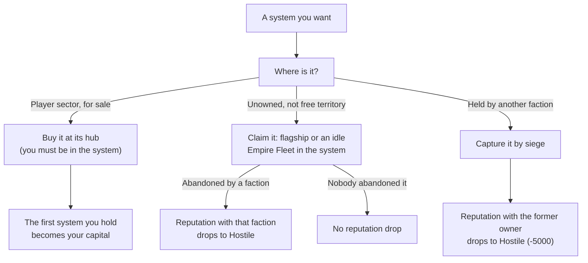

# Your Empire

This page covers what changes for the war zone and for you once you accept "Beyond the Front". The topics are the expansion sectors, buying and claiming systems, your capital, Empire Level and upkeep, your own stations, reputation from capture and claim, and the faction economy once the expansion war is open. It applies from the moment you accept that mission, which needs level 60 and one finished 30% sector-control mission ([gate](README.md)). Values were read from the game code of version 0.8.3.4 (the decompiled source, not in-game testing). The code was then compared with the 0.8.3.5 source, and every statement that changed there was rewritten.

Terms and abbreviations are explained in the [Beyond the Front glossary](glossary.md), the [Conquest glossary](../conquest/glossary.md) and the [basics glossary](../basics/glossary.md). Your fleets are covered in [Empire Fleets](empire-fleets.md).

## Spoiler: The Expanded War Zone

The war zone is the Conquest sector (Ara Martis) plus the expansion sectors, which join it once you accept the "Beyond the Front" mission. The Frontier, Staging and Darkspace regions are not part of it. The [Faction Economy](../conquest/faction-economy.md) page defines the war zone as the Conquest sector only. This page extends that definition.

The rows below extend the kinds-of-system table in [war](../conquest/war.md#the-war-zone-and-the-kinds-of-system).

| Kind | System card title or hint | What it means |
|---|---|---|
| Your capital | "Your capital - no faction can take it" | The first system you hold becomes your capital. It has the same protection as a headquarters. Raids can still hit your economic outposts in it. |
| Player sector | "set aside for you - buy it at its hub" | One expansion sector is set aside for you. NPC factions cannot enter its unowned systems. You buy these systems at their hub. |
| Safe sector | "safe from invasions" | A sector with the safe-sector rule. It is closed to every faction except you, and any NPC battle already running there is aborted. The player sector has this rule. |

The table of system kinds in [war](../conquest/war.md#the-war-zone-and-the-kinds-of-system) also has a free territory row. You cannot claim free territory ("you can only take a system from its owner"), but NPC factions can.

In the code: [The Expanded War Zone](#code-the-expanded-war-zone).

## Spoiler: Level Cap and Other Changes

Accepting the mission raises four caps:

- The level cap goes to 100.
- The cap on skill points found in Locked Containers and facilities goes from 10 to 30.
- The cap on bonus skill points goes from 61 to 101.
- The reputation cap goes to Exalted.

All of the unlock effects are in the [gate table](README.md#spoiler-what-level-60-and-beyond-the-front-gate). [What You Face](empire-fleets.md#what-you-face) explains how the war changes for your level and for NPC fleets above level 60.

## Buying Systems in the Player Sector

The price in credits is 10,000,000 x 1.5^n, where n is the number of systems you have bought. The price in Vanguard Marks is the credit price divided by 5000, rounded. You pay both.

To buy a system, you must be in it, and it must be unowned and still for sale at its hub. A system you bought before and then lost is priced one step lower (n - 1, never below 0). The first system you hold becomes your capital.

The first purchase prices are:

| n | 0 | 1 | 2 | 3 | 4 | 5 |
|---|---|---|---|---|---|---|
| Credits | 10,000,000 | 15,000,000 | 22,500,000 | 33,750,000 | 50,625,000 | 75,937,500 |
| Vanguard Marks | 2,000 | 3,000 | 4,500 | 6,750 | 10,125 | 15,188 |

Systems in the player sector have the safe-sector rule. NPC factions cannot enter them, so no siege or raid reaches them. The capital cannot be captured either. Systems you hold elsewhere are targets for any faction hostile to you.

In the code: [Buying Systems in the Player Sector](#code-buying-systems-in-the-player-sector).

## Claiming Systems

In [war](../conquest/war.md#unowned-and-abandoned-systems), a fleet that arrives at an unowned system claims it. That rule does not apply to a system for sale in the player sector. For your own fleets, it also does not apply to free territory.



You can claim an unowned war-zone system yourself when all of these are true:

- Claiming is unlocked (the "Beyond the Front" milestone).
- The system is open to you.
- The system is not in the player sector and is not free territory.
- Your flagship or an idle Empire Fleet is in the system.

If another faction abandoned the system, claiming it drops your reputation with that faction to Hostile, as a capture does. It also destroys that faction's Defense stations in the system. The claim prompt says "Destroyed: {n} Defense stations of {faction}". The faction's other outposts become yours.

In the player sector, a destroyed hub puts the system back on sale, and any battle there ends without a capture.

Elsewhere, destroying the hub while you are in the system with claiming unlocked offers you the claim first. No fleet claims the system while the offer is open. If you decline, the lead attacker of a hub-stage siege takes the system, provided its fleet is still there. Otherwise the system stays unowned until a fleet lands (see [war](../conquest/war.md#unowned-and-abandoned-systems)).

In the code: [Claiming Systems](#code-claiming-systems).

## When a System Changes Hands Against You or by Your Capture

If the old owner was you, your stations are converted to the captor's. 75% of the stored materials go to a refund station at your capital (or at your home station), and the captor gets the rest.

If you capture a system, your reputation with the former owner is set to the Hostile threshold (-5000) if it was higher. The in-game takeover dialog notes that a Decoy Transponder does not hide this. The economic outposts of the old owner become yours, one tier lower (minimum 1), with 10% of their stock. The system gets 2 slots for your own economic outposts. The first system you hold becomes your capital.

The capture order in [war](../conquest/war.md#capture-by-siege) treats your fleets differently from NPC fleets. A defending Empire Fleet of yours is not wiped the way an NPC fleet is, and if the loser is you, ships flee home. After the owner changes, your Empire Fleets that defended the system fall back to their home system (see [Defense Stances and Other Behaviour](empire-fleets.md#defense-stances-and-other-behaviour)).

In the code: [When a System Changes Hands Against You or by Your Capture](#code-when-a-system-changes-hands-against-you-or-by-your-capture).

## Empire Level and Upkeep

| Name | Where it comes from | What it drives |
|---|---|---|
| Empire Level | Your empire's own level, shown as "Empire Level {n}" | How many systems you may hold without upkeep, and the [fleet mix bonus](empire-fleets.md#fleet-mix-bonus). It is separate from every level in the basics [level table](../basics/scaling.md#which-level-is-used-for-what). |

Holding systems costs nothing up to the capacity of your Empire Level:

| Empire Level | 1 | 2 | 3 | 4 | 5 | 6 | 7 | 8 | 9 | 10 |
|---|---|---|---|---|---|---|---|---|---|---|
| Systems without upkeep | 10 | 14 | 19 | 25 | 32 | 41 | 52 | 65 | 81 | 101 |

| Empire Level | 11 | 12 | 13 | 14 | 15 | 16 | 17 | 18 | 19 | 20 |
|---|---|---|---|---|---|---|---|---|---|---|
| Systems without upkeep | 125 | 155 | 191 | 235 | 289 | 355 | 436 | 534 | 654 | 800 |

Empire Level 20 is the maximum.

Once you hold more systems than your capacity, the game charges upkeep every hour, in credits:

```
upkeep per hour = 2,000,000 x 2^(systems over capacity - 1) x cost multiplier at your effective level / cost multiplier at level 60
```

The cost multiplier is the same level-based price multiplier the game uses for item values. It rises with level, so the level-60 value is the baseline. The game uses your effective level (level plus Vanguard level), not your plain level. Upkeep is charged only while you hold more systems than your capacity. Every system you hold counts, including the capital.

If you cannot pay for 6 hours in a row, the newest system you gained revolts and goes independent. The capital never revolts. If the capital is the newest system, or the newest system is under siege or has a station that cannot be removed, nothing revolts that hour. Paying, or dropping to capacity, resets the count.

Each Empire Level needs 1000 x 1.65^(level - 1) Empire XP (experience points). These are the sources:

- Gaining a system gives 250 XP, and building a station gives 50 XP. Each system and each station pays once.
- Each hour gives 3 XP per station tier.
- Winning a battle gives 5 XP per enemy ship killed.
- Smaller sources are 1 XP per work-bay trip, 3 XP per trade run, and 0.5 XP per route delivery once you have a capital.

In the code: [Empire Level and Upkeep](#code-empire-level-and-upkeep).

## Your Stations

### Player Stations

You can build economic outposts, Defense stations and patrols only in a system you own.

A station you build has no facilities, so it uses a Small layout. Nothing in the combat station code treats it differently from other Small stations.

- A Defense station you build holds patrol fleets and fires on enemies. (The Defense stations of NPC factions hold a garrison instead.) When a siege targets a hub, your patrols spawn at the hub together with the garrisons of every Defense station in the system ([War Stations](../conquest/war-stations.md#defense-stations-and-garrisons)). The patrol fleet sizes by tier are in [Your Fleets and Patrols in the Defense Number](empire-fleets.md#your-fleets-and-patrols-in-the-defense-number).
- The economic outposts you own are a separate kind of station from the NPC kind in the economic outpost row of [Which Station Is Which](../basics/stations.md#which-station-is-which).
- Economic outposts stake mining and salvage claims in their system, with re-stake cooldowns of 300 to 180 seconds depending on tier. This has no link to combat stations.
- When a system you hold falls, the game hands your stations over. Build jobs are cancelled, serving ships are released and routes end. The captor gets a faction station that holds the stock. 75% of the stock goes to your refund station, and the rest stays with the captor. If you are at the station, the handover waits until you leave. Economic outposts you capture become yours one tier lower with 10% of their stock. That direction is described under capture above.
- Removing a station on your request leaves a "Remains of {station}" salvage site for 3600 seconds (1 hour). It does so only if the station held materials, crew, build jobs or cargo in transit. An empty station leaves nothing.
- A Defense station you own adds its hull and firepower to the station profile that defends a system you hold (the same station profile that goes into the Defense number; see [The Station's Off-Screen Siege Numbers](../conquest/war-stations.md#the-stations-off-screen-siege-numbers)), because the profile sums the hub and every Defense station owned by the system's owner.
- Your stations cannot be force-attacked (see [Reputation and Force Attacks](../basics/stations.md#reputation-and-force-attacks)).

In the code: [Player Stations](#code-player-stations).

### War Effort on Your Own Systems

War effort never applies to a system you hold. A mission raises war effort only at its source station's system when the mission's source faction owns that system, and at that faction's neighbouring systems. The game gives a mission its war effort reward only when the station's faction is one of the ten conquest factions, and you are not one of them, so missions from a system you hold carry no such reward. What war effort does is explained in [war](../conquest/war.md#war-effort).

In the code: [War Effort on Your Own Systems](#code-war-effort-on-your-own-systems).

## Reputation

The table below has the rows for capture, claim and declaring war. The row for destroying a faction station is in [war](../conquest/war.md#reputation-cost-of-destroying-stations).

| Action | Reputation effect |
|---|---|
| Capturing a system from a faction, or claiming one it abandoned | Your reputation with the former owner drops to Hostile (-5000) if it is above that. |
| Claiming an unowned system that nobody abandoned | No drop. |
| Declaring war | The faction treats you as an enemy everywhere. |

In the code: [Reputation](#code-reputation).

## Faction Economy After the Expansion War Opens

The economy changes below start when the expansion war opens with the unlock.

In the code: [Faction Economy After the Expansion War Opens](#code-faction-economy-after-the-expansion-war-opens).

### Where Economic Outposts Go

An expansion quadrant is a valid site for an economic outpost, alongside the Frontier and Conquest quadrants. "Quadrant" is the game's name for the large map regions.

In the code: [Where Economic Outposts Go](#code-where-economic-outposts-go).

### Starting Layout in Expansion Systems

New games and fresh war zones start pre-built ([Upgrades and the Starting Layout](../conquest/faction-economy.md#upgrades-and-the-starting-layout)). Expansion systems are seeded with 40% of their slots filled (2 slots per system), and each war faction there also gets its seeded Defense stations.

The tier of a seeded economic outpost follows the planned level of its system. Level 60 to 100 is split in thirds:

- Tier 1 up to about level 73.
- Tier 2 from about level 74.
- Tier 3 from about level 87.

Every Darkspace Compact system with a gate leading toward Meridia's quadrant gets a tier 5 Defense station, if it has a free slot. A Construction Yard's tier rises only by the planner upgrade ([Construction Yards](../conquest/faction-economy.md#construction-yards)) and by this seeding.

In the code: [Starting Layout in Expansion Systems](#code-starting-layout-in-expansion-systems).

### Fleet Caps Once the Expansion War Is Open

The territory cap in the [fleet cap formula](../conquest/faction-economy.md#fleet-caps) is 8. Once the expansion war is open, it is 12 for Darkspace and 6 for Meridia's Chosen. Meridia's Chosen therefore lose room (8 to 6), and Darkspace gains it.

The Darkspace Compact also stops using the flat cap of 5 at that point. It moves to the same formula as the other war factions: the smaller of the territory cap and 5 + (war-zone systems / 15, rounded down).

In the code: [Fleet Caps Once the Expansion War Is Open](#code-fleet-caps-once-the-expansion-war-is-open).

### Ledger Kinds on Your Own Empire

Among the ledger kinds in [Where a Faction's Wealth Comes From](../conquest/faction-economy.md#where-a-factions-wealth-comes-from), only your own empire's ledger books the upkeep and trade-bay kinds. NPC factions never use them.

In the code: [Ledger Kinds on Your Own Empire](#code-ledger-kinds-on-your-own-empire).

### Intercepting: Other Targets

The "Other" row of the intercept table in [Intercepting Deliveries and Convoys](../conquest/faction-economy.md#intercepting-deliveries-and-convoys) also lists trade-bay ships as a target class. Trade-bay ships belong to your own stations.

### Raids Against Your Stations and by Your Empire Fleets

A raid can target an economic outpost of a faction or one of yours ([Raids and the Economy](../conquest/faction-economy.md#raids-and-the-economy)). When the owner is you, nothing is taken from you, and the raid only sets the production pause and the cooldown.

The share of each storage stack that a raid takes as materials is 0.5 for an NPC raider and 0.1 for the player.

NPC raiders list you among their targets if their faction is your enemy. Frontier raid parties add your stations to their target list if the raider is your enemy.

A raid by one of your Empire Fleets (your own fleets on the Conquest Map) pays you credits at 10 credits per wealth point.

In the code: [Raids Against Your Stations and by Your Empire Fleets](#code-raids-against-your-stations-and-by-your-empire-fleets).

### Ways to Slow a Faction: Empire Fleet Raids

This row is added to the table in [Ways to Slow a Faction](../conquest/faction-economy.md#ways-to-slow-a-faction):

| # | Action | Reputation cost | Cut | Rebuild |
|---|---|---|---|---|
| 8 | Raid its economic outposts with your Empire Fleets (see [war](../conquest/war.md)) | Depends on the war | Each raid cuts 1.5 average hours of the faction's income other than the home subsidy, and pauses one economic outpost for 3600 s | The economic outpost has a 4 hour cooldown. The raid does not slow ships. |

## In the Game Code

This part holds the code names, formulas and `Source:` lines behind the sections above. It comes from the decompiled game code of version 0.8.3.4, compared with the 0.8.3.5 source. To check a claim, look up the class and method named in the `Source:` line.

### Code: The Expanded War Zone

The Safe sector row is a sector with the `SafeSector` rule.

Source: `ConquestScope.IsSafeSector`, `ConquestWorld.MarkPlayerSector`

### Code: Buying Systems in the Player Sector

The price is `10,000,000 * 1.5^n` credits and `price / 5000` Vanguard Marks, where `n` is the number of systems you have bought. You must be in the system. The first one becomes your capital.

Systems in the player sector have the SafeSector rule. NPC factions cannot enter them, so no siege or raid reaches them.

Source: `PlayerSectorPurchase`, `ConquestScope.IsOpenTo`, `ConquestWorld.MarkPlayerSector`

### Code: Claiming Systems

The arrival rule in [war](../conquest/war.md#unowned-and-abandoned-systems) (a fleet that arrives at an unowned system claims it, `ConquestOwnership.Claim`) does not apply to a system for sale in the player sector. For your own fleets, it also does not apply to free territory (`BattleManager.IsClaimableOnArrival`).

When you destroy a hub, `ConquestOwnership.HandOverToClaimant` opens the offer (`SystemClaim.OfferClaim`) if `SystemClaim.GetRefusal` is null. `SystemClaim.Decline` then gives the system to the lead attacker of a `StationSiege` (hub siege) if that fleet is still there. With a refusal, `BattleManager.EndBattlesAt` gives the system to that lead attacker at once. With no hub siege, the system stays unowned.

`ConquestOwnership.Claim` destroys the Defense stations of `abandonedBy` (`RazeDefenseStations`) when the claimant is a different faction. The claim prompt text `SystemClaimDestroyed` lists them.

Source: `ConquestOwnership.Abandon`, `ConquestOwnership.HandOverToClaimant`, `ConquestOwnership.Claim`, `BattleManager.IsClaimableOnArrival`, `SystemClaim.GetRefusal`, `SystemClaim.OfferClaim`

### Code: When a System Changes Hands Against You or by Your Capture

If the old owner was you, `PlayerStationCapture.HandOver` converts your stations to the captor's.

Source: `SystemClaim.ApplyReputationRule`, `PlayerStationCapture`

### Code: Empire Level and Upkeep

| Name | Code name |
|---|---|
| Empire Level | `EmpireLevel` |

Holding systems costs nothing up to the capacity of your Empire Level: 10 systems at Empire Level 1, 14 at 2, 19 at 3, 25 at 4, 32 at 5, 41 at 6, 52 at 7, 65 at 8, 81 at 9, 101 at 10, 125 at 11, 155 at 12, 191 at 13, 235 at 14, 289 at 15, 355 at 16, 436 at 17, 534 at 18, 654 at 19 and 800 at 20 (`EmpireLevel.SystemCapacityByLevel`, `MaxLevel` 20).

Past capacity, the hourly upkeep is `2,000,000 * 2^(over - 1) * CostMultiplier(effectiveLevel) / CostMultiplier(60)` credits (`EmpireUpkeep.GetHourly`). `effectiveLevel` is commander level plus Vanguard level.

Revolt happens at `unpaidHours >= 6` (`EmpireUpkeep.RevoltNewest`). It does nothing when `EmpireSystems.GetNewest` is the capital or `EmpireSystemRelease.GetRefusal` is set.

Empire Level needs `1000 * 1.65^(level - 1)` Empire XP. The XP sources in `EmpireExperience` are:

- system gained: 250, and station built: 50 (each once per guid)
- 3 per station tier per hour
- 5 per enemy ship in a won battle
- work-bay trip: 1, trade run: 3, route delivery: 0.5 (with a capital)

Source: `EmpireLevel`, `EmpireExperience`, `EmpireUpkeep`

### Code: Your Stations

#### Code: Player Stations

`StationSiteRules.GetRefusal` requires `system.faction == Faction.player`.

A player-owned station is a `PlayerStation` built with no facilities, so it uses a Small layout with the `Generic_` prefix. Nothing in the combat station code treats it differently from other Small stations.

- A `PlayerStation` of type Defense is the player's Defense station. It holds patrol fleets (the NPC factions' Defense stations hold a garrison) and fires on enemies.
- An economic outpost you own is a `PlayerStation`, not a `FactionStation`. The code name in the economic outpost row of [Which Station Is Which](../basics/stations.md#which-station-is-which) (`FactionStation` that is not a Defense station) is therefore the NPC kind.
- `StationClaim` covers the mining and salvage claims that economic outposts stake in their system, with re-stake cooldowns of 300 to 180 seconds by tier. It has no link to combat stations.
- `PlayerStationCapture` hands your stations over when the system you hold falls. Build jobs are cancelled, serving ships are released, routes end, and a faction station is created for the captor holding the stock. 75% of the stock goes to your refund station, and the rest stays with the captor. If you are at the station, the handover waits until you leave. The same file converts economic outposts you capture into player stations (the tier drops by 1, and 10% of their storage moves over).
- `StationDecommission` removes a station on your request. It leaves a "Remains of {station}" salvage site for 3600 seconds (`RemainsLifetimeSeconds`) only when the preview's `leavesRemains` holds: material storage is not empty, crew is aboard, jobs are queued, or cargo is carried by a route or ship.
- Player stations cannot be force-attacked (`PlayerStation` is a `SpaceStation`; see [Reputation and Force Attacks](../basics/stations.md#reputation-and-force-attacks)).

Source: `StationSiteRules.GetRefusal`, `StationClaim.GetCooldownSeconds`, `PlayerStationCapture.HandOver`, `PlayerStationCapture.HandOverStation`, `PlayerStationCapture.TakeOver`, `PlayerStationCapture.GetTakeoverTier`, `StationDecommission`, `StationDefense.IsDefenseStation`

#### Code: War Effort on Your Own Systems

`ConquestWarEffort.Apply(mission, step)` is called only from `ConquestStrength.OnComplete`, and only when the reward's `wealth` is 0. `MissionGenerator.AddRewards` adds a `ConquestStrength` reward only when `Conquest.conquestFactions.Contains(faction)` (the source station's faction) and the source POI is an `EmbassyStation` or `ConquestStation`. `Conquest.conquestFactions` holds the ten conquest factions (Kolyatov, Stellar, Luminate, Mining Guild, Salvage Guild, Marauders, Meridia's Chosen, Darkspace Compact, Stranded, Malcyte), so `Faction.player` is not in it. `MissionGenerator` sets `Mission.sourceFaction` from `poi.faction`; the only missions with `Faction.player` as source are tutorial missions. `Apply` raises the bonus at the mission's system only if `missionSystem.faction == mission.sourceFaction`, and at neighbours only if their owner is that employer. The targeted-faction penalty also needs a conquest faction. A system you hold has `faction == Faction.player`, so none of these branches reaches it.

Source: `ConquestWarEffort.Apply`, `ConquestWarEffort.GetMissionSystem`, `ConquestStrength.OnComplete`, `MissionGenerator.AddRewards`, `Conquest.conquestFactions`

### Code: Reputation

Source: `SystemClaim.ApplyReputationRule`, `EmpireFleets.DeclareWar`

### Code: Faction Economy After the Expansion War Opens

The subsections below start when the expansion war opens, which `Conquest.UnlockExpansion` does (see the [gate](README.md#code-what-level-60-and-beyond-the-front-gate)).

#### Code: Where Economic Outposts Go

Source: `FactionEconomicPlanner.IsInScopeQuadrant`

#### Code: Starting Layout in Expansion Systems

The code calls the tier 5 Defense station at a Darkspace Compact gate toward Meridia's quadrant the "gate fortress".

Source: `ExpansionEconomySeeder.SeedExpansion`, `ExpansionEconomySeeder.TierForPlannedLevel`

#### Code: Fleet Caps Once the Expansion War Is Open

`territoryCap` in the [fleet cap formula](../conquest/faction-economy.md#fleet-caps) is 8 (`MaxTerritoryFleets`). Once the expansion war is open, it is 12 for Darkspace and 6 for Meridia's Chosen (`Faction.fanatics`). The Darkspace Compact stops using the flat cap of 5 at that point. It moves to the same formula as the other war factions, `min(territoryCap, 5 + floor(warZoneSystems / 15))`.

Source: `ConquestFleetPlanner.MaxFleetsFor`, `ConquestFleetPlanner.MaxTerritoryFleets`

#### Code: Ledger Kinds on Your Own Empire

Among the ledger kinds in [Where a Faction's Wealth Comes From](../conquest/faction-economy.md#where-a-factions-wealth-comes-from), only your own empire's ledger books `Upkeep` and `TradeBay`. NPC factions never use them.

#### Code: Raids Against Your Stations and by Your Empire Fleets

Source: `StationRaid.ApplyRaid`, `StationRaid.GetMaterialShare`, `StationRaid.CanRaid`, `EmpireIncome.CreditsPerWealth`
