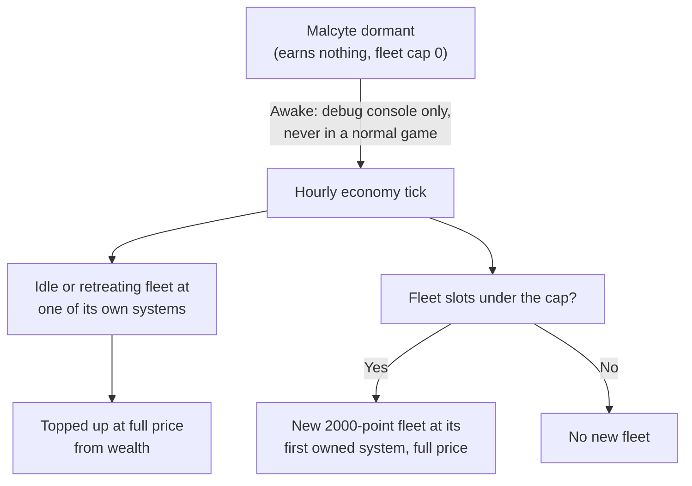

# The Closed Sector Story Line

This page covers the Meridia sector and the quadrant around it, Malcyte as a dormant raider with no yards, its fleet cap, how boarding it differs, and its alliance with Meridia's Chosen. It is a spoiler for the Malcyte story. In versions 0.8.3.4, 0.8.3.5 and 0.8.3.7 only the debug console wakes Malcyte or opens Meridia, so in a normal game Malcyte stays dormant and Meridia stays closed (see the [late-game gates](README.md#spoiler-gates)). Values are read from the game code of version 0.8.3.4 (the decompiled source, not in-game testing). The code was then compared with the 0.8.3.5 source, and none of the rules on this page changed. The war-related statements were checked again against the 0.8.3.7 source, where they still hold.

Terms are in the [late-game glossary](glossary.md) and the [basics glossary](../basics/glossary.md).

## Spoiler: The Closed Sector in the Kinds of System

These rows extend the kinds-of-system table in [war](../conquest/war.md#the-war-zone-and-the-kinds-of-system).

| Kind | System card title or hint | What it means |
|---|---|---|
| Meridia | "There is nothing to besiege here - the Malcyte hold this system without stations." when you order an attack once the quadrant is open to you | The Meridia sector allows no stations, so Malcyte hold it without hubs. There is nothing to besiege, and fleets cannot attack it. While the quadrant is closed, the order is refused as closed first. |

In the code: [The Closed Sector in the Kinds of System](#code-the-closed-sector-in-the-kinds-of-system).

### The Closed Quadrant

While Meridia is closed, the quadrant is open only to Malcyte, their war ally Meridia's Chosen and, outside the Meridia sector itself, the Darkspace Compact. You are not on that list. Claiming a system there, or ordering an Empire Fleet or raid there, is refused with "This system is closed to you for now."

The game also treats jump gates into the quadrant, and into the Meridia sector from outside it, as closed, and it sells no Jump Gate Pass for them. Those gates also physically stop your travel: they are locked from the start, and a locked gate cannot be used. Only a Jump Gate Pass unlocks one, and none is sold while the gate counts as closed. Nothing outside the debug console opens the quadrant, so in a normal game it stays closed.

In the code: [The Closed Quadrant](#code-the-closed-quadrant).

### Your Options in the Closed Sector

This extends the "You still cannot" table of the "above level 60" scenario in [Empire Fleets](../expansion/empire-fleets.md#what-you-can-and-cannot-do).

| You still cannot | Why |
|---|---|
| Touch Meridia | There are no stations to besiege, and the quadrant is closed to you while Meridia is closed. |

## Spoiler: The Dormant Raider Faction

### Dormant Until Awake

Dormant factions earn no system taxes, field no fleets and have a fleet cap of 0. Malcyte is dormant until it is awake.

In the code: [Dormant Until Awake](#code-dormant-until-awake).

### As a Raider

A siege breakthrough by a raider faction gives the "Raided" outcome instead of "Captured". The raider factions are the Corsair Syndicate, while it holds no war-zone systems, and Malcyte. This restores the Malcyte half of the raider list in the "Raided" row of the [outcomes table](../conquest/war.md#outcomes).

In the code: [As a Raider](#code-as-a-raider).

### Fleet Cap

These rows extend the [fleet cap table](../conquest/faction-economy.md#fleet-caps) in Faction economy.

| Faction | Fleet cap |
|---|---|
| Dormant | 0 |
| Malcyte | 5 plus 1 for every 15 war-zone systems (rounded down), but never more than 8, the same limit as Kolyatov, Stellar and Luminate |

In the code: [Fleet Cap](#code-fleet-cap).

### Yardless Fleets

Malcyte builds no ships at yards, like the Corsair Syndicate while it holds no war-zone system (see [Factions without yards](../conquest/faction-economy.md#factions-without-yards)). Each hourly economy tick, Malcyte refills the missing ship points of every idle or retreating fleet at one of its own systems, paying the full price from its wealth. If it has fleet slots under the cap, it also raises a new 2000-point fleet at its first owned system, which for Malcyte is a Meridia system. That fleet is also paid for at full price.

None of this waits for yard time, so a wealthy Malcyte rebuilds a whole fleet in one hourly economy tick, and the only limit is its wealth. Malcyte earns wealth from taxes on systems it holds and from raids. Each raid it completes both funds its rebuilds and drains the victim. Destroying its stations does not slow it. The only way to slow it is to take away its raid income and taxes.

In the code: [Yardless Fleets](#code-yardless-fleets).

### No Economic Outposts in the Closed Sector

A Meridia system is not a valid site for an economic outpost, so no faction builds one there (see [Where economic outposts go](../conquest/faction-economy.md#where-economic-outposts-go)). A Meridia system cannot hold an economic outpost, so Malcyte, which owns only Meridia systems, has no yard. Meridia's Chosen also owns systems outside Meridia, such as the Lucifer sector in the Darkspace region. Those systems allow stations and are outside the war zone, so its yard can stand there.

In the code: [No Economic Outposts in the Closed Sector](#code-no-economic-outposts-in-the-closed-sector).

## Spoiler: The Dormant Faction's War Ally

Meridia's Chosen is Malcyte's war ally, and both are admitted to the Meridia quadrant while it is closed (see [The closed quadrant](#the-closed-quadrant)). Meridia's Chosen is an ordinary faction in the earlier stages; only this tie belongs to the story.

In the code: [The Dormant Faction's War Ally](#code-the-dormant-factions-war-ally).

## Spoiler: Boarding the Dormant Faction

### Harder to Board

Malcyte is one of the factions that are harder to board, like Meridia's Chosen, Canisec and The Radiant. Its ships are simulated at the higher of the ship's own level and your effective level plus 10, unless the boarding comes from a capture mission. That alone puts the defenders at least 10 levels above you, which sets their HP multiplier to at least about 2.8 (see [Level scaling of defenders](../basics/boarding.md#level-scaling-of-defenders) and [Factions that are harder to board](../basics/boarding.md#factions-that-are-harder-to-board)).

In the code: [Harder to Board](#code-harder-to-board).

### Defender Profile

This is the Malcyte row for the faction defender profile table ([Faction defender profiles](../basics/boarding.md#faction-defender-profiles)), with the same columns. Each Malcyte defender fights with 1.5 times the boarding power of a default defender (the defender power multiplier). Its counterattack chance is 100%, which is the base 50% plus the bonus of 0.5 (see the explanation under that table):

| Faction | Defender power multiplier | Surrender chance | Other effects |
|---|---|---|---|
| Malcyte | 1.5 | 0% | Scuttle chance 100%, can vent airlocks, counterattack chance 100% |

In the code: [Defender Profile](#code-defender-profile).

### Scuttle Rate

The ship scuttle rule ([What defenders do on ships](../basics/boarding.md#what-defenders-do-on-ships)) gives Malcyte a rate of 0.08 per second, the same as Meridia's Chosen. The Corsair Syndicate's rate is 0.016.

In the code: [Scuttle Rate](#code-scuttle-rate).

## In the Game Code

This part holds the code names behind the sections above. It comes from the decompiled source of version 0.8.3.4, compared with the 0.8.3.5 and 0.8.3.7 sources. To check a claim, search the decompiled source for the method or field named here.

### Code: The Closed Sector in the Kinds of System

The Meridia sector allows no stations (`AllowsStations` false).

#### Code: The Closed Quadrant

`ConquestScope.IsOpenTo` is `false` for the player in the closed quadrant (`IsMalcyteSide` or, outside the Meridia sector, `darkspacers`, are the only admitted factions), and `SystemClaim` and `EmpireFleets` answer `@SystemClaimRefusalClosed` when it is false. `EmpireFleets.RefuseAttack` checks it before the hubless rule, so the "nothing to besiege" text (`@EmpireFleetAttackHubless`) only shows once the quadrant is open. `ConquestScope.IsClosedMeridiaGate` marks the gates; its only caller in 0.8.3.4 and 0.8.3.5 is the Jump Gate Pass shop in `SpaceStation`, which skips closed gates. It does not decide whether a gate can be used. That is `JumpGate.canUseJumpGate` (`jumpgateOpen` and not `hidden`). `ConquestWorld.LinkExpansionSectors` creates the quadrant entrances (`LinkMeridiaQuadrantEntrances`) with `isUnlocked: false` and then `ConquestLinkClassifier.LockCrossSectorLinks` calls `JumpGate.LockGate` on every gate that joins two sectors, on both ends. `TheGate.Update` lets the player jump only while `canUseJumpGate` is true, and `GamePlayer.DoFastLaneTravel` also requires it. `JumpGate.UnlockJumpgate` is the only way back to open. It is called when a Jump Gate Pass is consumed (`JumpGateManager.TryAutoUnlockWithStoredPass`, `JumpgateTractor`) and by the debug console. `Conquest.OpenMeridia` only sets `meridiaOpen`: it does not unlock any gate, it makes the shop sell passes for these gates. Nothing in the decompiled code outside the debug console calls `Conquest.OpenMeridia`, so in a normal game the quadrant stays closed. `Conquest.WakeMalcyte` and `Conquest.OpenMeridia` are only called from the debug console in 0.8.3.4 (see the [late-game gates](README.md#code-gates)).

Source: `ConquestScope.IsClosedMeridiaGate`, `ConquestScope.IsOpenTo`, `SystemClaim`, `EmpireFleets`, `SpaceStation`, `JumpGate.canUseJumpGate`, `JumpGate.LockGate`, `JumpGate.UnlockJumpgate`, `ConquestWorld.LinkExpansionSectors`, `ConquestLinkClassifier.LockCrossSectorLinks`, `TheGate.Update`, `JumpGateManager.TryAutoUnlockWithStoredPass`

### Code: The Dormant Raider Faction

#### Code: Dormant Until Awake

Malcyte (`amalgam`) is a homeland raider (`ConquestWarTuning.HomelandRaiderFactions`), and `ConquestJoin.IsDormant` is true for it until `Faction.MalcyteAwake`. A dormant faction gets no system taxes (`FactionEconomicPlanner.GrowWealth` returns early), a fleet cap of 0 and no fleet planning (`ConquestFleetPlanner.Tick` only disbands its uncommitted fleets).

Source: `ConquestJoin.IsDormant`, `FactionEconomicPlanner.GrowWealth`, `ConquestFleetPlanner.MaxFleetsFor`, `ConquestFleetPlanner.Tick`

#### Code: As a Raider

A siege breakthrough by a raider faction gives the `Raided` outcome instead of `Captured`. The raider factions are the Corsair Syndicate while it holds no war-zone systems, and Malcyte.

Source: `ConquestJoin.IsRaider`

#### Code: Fleet Cap

| Faction | Cap (`MaxFleetsFor`) |
|---|---|
| Dormant | 0 |
| Malcyte | `min(territoryCap, 5 + floor(warZoneSystems / 15))`, with `territoryCap` 8, like Kolyatov, Stellar and Luminate |

Source: `ConquestFleetPlanner.MaxFleetsFor`, `ConquestWarTuning.FleetFieldingFactions`

#### Code: Yardless Fleets

Each hourly economy tick `CorsairRaids.Tick` tops up every idle or retreating fleet that is at one of its own systems and below its target points. If fleet slots are under the cap, it raises a new 2000-point fleet at `FindHome`, the first system the faction owns; for a homeland raider that must be a Meridia system. Both pay `FactionShipPricing.GetRosterCost` from wealth (`YardlessFleetSupply.TryPay`, no 50% discount, nothing happens if wealth is short). Malcyte earns wealth from taxes on systems it holds (`GrowWealth`) and from `Raids` (`StationRaid`).

Source: `CorsairRaids.Tick`, `CorsairRaids.TryRaiseFleet`, `YardlessFleetSupply.TryTopUp`, `YardlessFleetSupply.TryRaise`, `ConquestJoin.IsRaider`

#### Code: No Economic Outposts in the Closed Sector

A Meridia system is not a valid site for an economic outpost (`ConquestScope.AllowsStations`). `ExpansionOwnership.PlanOwners` gives `amalgam` only the Meridia sector, so Malcyte holds no system outside it and has no yard site; its fleets are supplied by `YardlessFleetSupply`. `Faction.fanatics` owns the `Lucifer` sector (`ConquestWorld.FillDarkspaceRemainingSystemSlots`) in the Conquest quadrant, outside the war zone. `ConquestWarSeeder.EnsureYardOutsideWarZone` (through `IsYardSite`) builds a Construction Yard for a war faction in such a system, and `FactionEconomicPlanner.IsValidSite` accepts it.

Source: `FactionEconomicPlanner.IsValidSite`, `ConquestScope.AllowsStations`, `ExpansionOwnership.PlanOwners`, `ConquestWorld.FillDarkspaceRemainingSystemSlots`, `ConquestWarSeeder.EnsureYardOutsideWarZone`

### Code: The Dormant Faction's War Ally

Source: `ConquestScope.IsOpenTo`

### Code: Boarding the Dormant Faction

#### Code: Harder to Board

The Malcyte (`amalgam`) is flagged `isHardBoardingFaction`, like Meridia's Chosen, Canisec and The Radiant. Its ships are simulated at level `max(shipLevel, yourEffectiveLevel + 10)` unless the boarding comes from a capture mission. The HP multiplier is `sqrt(2^(1 + clamp(gap, 0, 15) / 5) * lerp(0.5, 1, clamp01(gap / 10)))` for a level gap `gap`, which is 2.83 at a gap of 10 and 4 at 15 or more (`DungeonSimulation.ComputeLevelDifficultyMod`, `ApplyLevelScaling`).

Source: `Faction.isHardBoardingFaction`, `DungeonSimulation.ComputeCombatLevel`.

#### Code: Defender Profile

| Faction | Defender power multiplier | Surrender chance | Other effects |
|---|---|---|---|
| Malcyte (`amalgam`) | 1.5 (`defenseModifier`) | 0% | `canScuttleReactor` 1, `canVentAirlocks`, `counterattackBonus` 0.5 (chance 0.5 + 0.5) |

Source: `FactionBoardingProfile.Build`.

#### Code: Scuttle Rate

The ship scuttle rule is `0.08 * canScuttleReactor` per second. The Malcyte's rate is 0.08 per second, the same as Meridia's Chosen (0.016 for the Corsair Syndicate). A ship flagged `shipNoScuttle` has its `canScuttleReactor` set to 0 and never scuttles.

Source: `DungeonSimulation.TryScuttle`, `DungeonSimulation.FireScuttleOutcome`.
