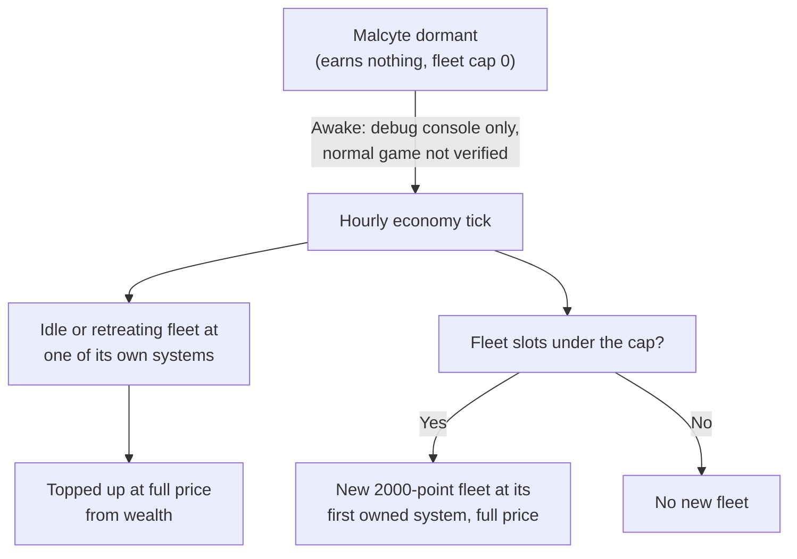

# The closed sector story line

This page covers the Meridia sector and the quadrant around it, Malcyte as a dormant and yardless raider, its fleet cap, how boarding it differs, and its alliance with Meridia's Chosen. It is a spoiler for the Malcyte story. In version 0.8.3.4 only the debug console wakes Malcyte or opens Meridia (see the [late-game gates](README.md#spoiler-gates)). Values are read from the game code of version 0.8.3.4 (the decompiled source, not in-game testing). Anything not confirmed in code is marked "(not verified)".

Terms are in the [late-game glossary](glossary.md) and the [basics glossary](../basics/glossary.md).

## Spoiler: The closed sector in the kinds of system

These rows extend the kinds-of-system table in [war](../conquest/war.md#the-war-zone-and-the-kinds-of-system).

| Kind | System card title or hint | What it means |
|---|---|---|
| Meridia | "There is nothing to besiege here - the Malcyte hold this system without stations." when you order an attack | The Meridia sector allows no stations, so Malcyte hold it without hubs. There is nothing to besiege, and fleets cannot attack it. |

In the code: [the closed sector in the kinds of system](#code-the-closed-sector-in-the-kinds-of-system).

### The closed quadrant

While Meridia is closed, the quadrant is open only to Malcyte, their war ally Meridia's Chosen, and (outside the Meridia sector itself) Darkspace Compact. You are not on that list: claiming a system there, or ordering an Empire Fleet or raid there, is refused as "closed". The game also treats jump gates into the quadrant, and into the Meridia sector from outside it, as closed, and sells no Jumpgate Pass for them. Whether those gates physically stop your travel is "(not verified)", because the gate open state is saved data, not set in the code. Nothing outside the debug console opens the quadrant, so how it opens in a normal game is "(not verified)".

In the code: [the closed quadrant](#code-the-closed-quadrant).

### Your options in the closed sector

This extends the "You still cannot" table of the "above level 60" scenario in [Empire fleets](../expansion/empire-fleets.md#what-you-can-and-cannot-do).

| You still cannot | Why |
|---|---|
| Touch Meridia | No stations to besiege. Closed to you while Meridia is closed. |

## Spoiler: The dormant raider faction

### Dormant until awake

Dormant factions earn no system taxes, field no fleets and have a fleet cap of 0. Malcyte is dormant until it is awake.

In the code: [dormant until awake](#code-dormant-until-awake).

### As a raider

A siege breakthrough by a raider faction gives the "Raided" outcome instead of "Captured". The raider factions are the Corsair Syndicate while it holds no war-zone systems, and Malcyte. This restores the Malcyte half of the raider list in the "Raided" row of the [outcomes table](../conquest/war.md#outcomes).

In the code: [as a raider](#code-as-a-raider).

### Fleet cap

These rows extend the [fleet cap table](../conquest/faction-economy.md#fleet-caps) in Faction economy.

| Faction | Fleet cap |
|---|---|
| Dormant | 0 |
| Malcyte | 5 plus 1 for every 15 war-zone systems (rounded down), but never more than 8, the same limit as Kolyatov, Stellar and Luminate |

In the code: [fleet cap](#code-fleet-cap).

### Yardless fleets

Malcyte builds no ships at yards, like Corsair Syndicate while it holds no war-zone system (see [Factions without yards](../conquest/faction-economy.md#factions-without-yards)). Each hourly economy tick it tops up every idle or retreating fleet that is at one of its own systems, composing the missing points as a roster and paying at full price from wealth. If fleet slots are under the cap, it raises a new 2000-point fleet at its first owned system, which for Malcyte is a Meridia system, also at full price.

None of this waits for yard time, so a wealthy Malcyte rebuilds a whole fleet in one hourly economy tick and the only limit is wealth. Malcyte earns wealth from taxes on systems it holds and from raids, so each raid it completes both funds its rebuilds and drains the victim. Destroying its stations does not slow it; taking away its raid income and taxes is the only lever.

In the code: [yardless fleets](#code-yardless-fleets).

### No economic outposts in the closed sector

A Meridia system is not a valid site for an economic outpost, so no faction builds one there (see [Where economic outposts go](../conquest/faction-economy.md#where-economic-outposts-go)). A Meridia system cannot hold an economic outpost, so Meridia's Chosen and Malcyte yards cannot be in Meridia.

In the code: [no economic outposts in the closed sector](#code-no-economic-outposts-in-the-closed-sector).

## Spoiler: The dormant faction's war ally

Meridia's Chosen is Malcyte's war ally, and both are admitted to the Meridia quadrant while it is closed (see [The closed quadrant](#the-closed-quadrant)). Meridia's Chosen is an ordinary faction in the earlier stages; only this tie belongs to the story.

In the code: [the dormant faction's war ally](#code-the-dormant-factions-war-ally).

## Spoiler: Boarding the dormant faction

### Hard boarding

The Malcyte is a "hard boarding" faction, like Meridia's Chosen, Canisec and The Radiant. Its ships are simulated at the higher of the ship's own level and your effective level + 10, unless the boarding comes from a capture mission. That alone puts the defenders at least 10 levels above you, which sets their HP multiplier to at least about 2.8 (see [Level scaling of defenders](../basics/boarding.md#level-scaling-of-defenders) and [Hard-boarding factions](../basics/boarding.md#hard-boarding-factions)).

In the code: [hard boarding](#code-hard-boarding).

### Defender profile

Row for the Malcyte in the faction defender profile table ([Faction defender profiles](../basics/boarding.md#faction-defender-profiles)), same columns:

| Faction | Defense x | Surrender | Other |
|---|---|---|---|
| Malcyte | 1.5 | 0% | scuttle 100%, can vent airlocks, counterattack +0.5 |

In the code: [defender profile](#code-defender-profile).

### Scuttle rate

The ship scuttle rule ([What defenders do on ships](../basics/boarding.md#what-defenders-do-on-ships)) gives the Malcyte a rate of 0.08 per second, the same as Meridia's Chosen (0.016 for the Corsair Syndicate).

In the code: [scuttle rate](#code-scuttle-rate).

## Not verified

- Whether Meridia's Chosen owns a non-Meridia system that can host its yard. The yard rules imply a faction with none builds no yards.

## In the game code

This part holds the code names behind the sections above. It comes from the decompiled source of version 0.8.3.4. To check a claim, search the decompiled source for the method or field named here.

### Code: The closed sector in the kinds of system

The Meridia sector allows no stations (`AllowsStations` false).

#### Code: The closed quadrant

`ConquestScope.IsOpenTo` is `false` for the player in the closed quadrant (`IsMalcyteSide` or, outside the Meridia sector, `darkspacers`, are the only admitted factions), and `SystemClaim` and `EmpireFleets` answer `@SystemClaimRefusalClosed` when it is false. `ConquestScope.IsClosedMeridiaGate` marks the gates; its only caller in 0.8.3.4 is the Jumpgate Pass shop in `SpaceStation`, which skips closed gates. Whether the gates stop travel is `(not verified)`. Nothing in the decompiled code outside the debug console calls `Conquest.OpenMeridia`, so how it opens in a normal game is `(not verified)`. `Conquest.WakeMalcyte` and `Conquest.OpenMeridia` are only called from the debug console in 0.8.3.4 (see the [late-game gates](README.md#code-gates)).

Source: `ConquestScope.IsClosedMeridiaGate`, `ConquestScope.IsOpenTo`, `SystemClaim`, `EmpireFleets`, `SpaceStation`

### Code: The dormant raider faction

#### Code: Dormant until awake

Malcyte (`amalgam`) is a homeland raider (`ConquestWarTuning.HomelandRaiderFactions`), and `ConquestJoin.IsDormant` is true for it until `Faction.MalcyteAwake`. A dormant faction gets no system taxes (`FactionEconomicPlanner.GrowWealth` returns early), a fleet cap of 0 and no fleet planning (`ConquestFleetPlanner.Tick` only disbands its uncommitted fleets).

Source: `ConquestJoin.IsDormant`, `FactionEconomicPlanner.GrowWealth`, `ConquestFleetPlanner.MaxFleetsFor`, `ConquestFleetPlanner.Tick`

#### Code: As a raider

A siege breakthrough by a raider faction gives the `Raided` outcome instead of `Captured`. The raider factions are the Corsair Syndicate while it holds no war-zone systems, and Malcyte.

Source: `ConquestJoin.IsRaider`

#### Code: Fleet cap

| Faction | Cap (`MaxFleetsFor`) |
|---|---|
| Dormant | 0 |
| Malcyte | `min(territoryCap, 5 + floor(warZoneSystems / 15))`, with `territoryCap` 8, like Kolyatov, Stellar and Luminate |

Source: `ConquestFleetPlanner.MaxFleetsFor`, `ConquestWarTuning.FleetFieldingFactions`

#### Code: Yardless fleets

Each hourly economy tick `CorsairRaids.Tick` tops up every idle or retreating fleet that is at one of its own systems and below its target points. If fleet slots are under the cap, it raises a new 2000-point fleet at `FindHome`, the first system the faction owns; for a homeland raider that must be a Meridia system. Both pay `FactionShipPricing.GetRosterCost` from wealth (`YardlessFleetSupply.TryPay`, no 50% discount, nothing happens if wealth is short). Malcyte earns wealth from taxes on systems it holds (`GrowWealth`) and from `Raids` (`StationRaid`).

Source: `CorsairRaids.Tick`, `CorsairRaids.TryRaiseFleet`, `YardlessFleetSupply.TryTopUp`, `YardlessFleetSupply.TryRaise`, `ConquestJoin.IsRaider`

#### Code: No economic outposts in the closed sector

A Meridia system is not a valid site for an economic outpost (`ConquestScope.AllowsStations`).

Source: `FactionEconomicPlanner.IsValidSite`, `ConquestScope.AllowsStations`

### Code: The dormant faction's war ally

Source: `ConquestScope.IsOpenTo`

### Code: Boarding the dormant faction

#### Code: Hard boarding

The Malcyte (`amalgam`) is flagged `isHardBoardingFaction`, like Meridia's Chosen, Canisec and The Radiant. Its ships are simulated at level `max(shipLevel, yourEffectiveLevel + 10)` unless the boarding comes from a capture mission. The HP multiplier is `sqrt(2^(1 + clamp(gap, 0, 15) / 5) * lerp(0.5, 1, clamp01(gap / 10)))` for a level gap `gap`, which is 2.83 at a gap of 10 and 4 at 15 or more (`DungeonSimulation.ComputeLevelDifficultyMod`, `ApplyLevelScaling`).

Source: `Faction.isHardBoardingFaction`, `DungeonSimulation.ComputeCombatLevel`.

#### Code: Defender profile

| Faction | Defense x | Surrender | Other |
|---|---|---|---|
| Malcyte (`amalgam`) | 1.5 | 0% | scuttle 100%, can vent airlocks, counterattack +0.5 |

Source: `FactionBoardingProfile.Build`.

#### Code: Scuttle rate

The ship scuttle rule is `0.08 * canScuttleReactor` per second. The Malcyte's rate is 0.08 per second, the same as Meridia's Chosen (0.016 for the Corsair Syndicate). A ship flagged `shipNoScuttle` has its `canScuttleReactor` set to 0 and never scuttles.

Source: `DungeonSimulation.TryScuttle`, `DungeonSimulation.FireScuttleOutcome`.
