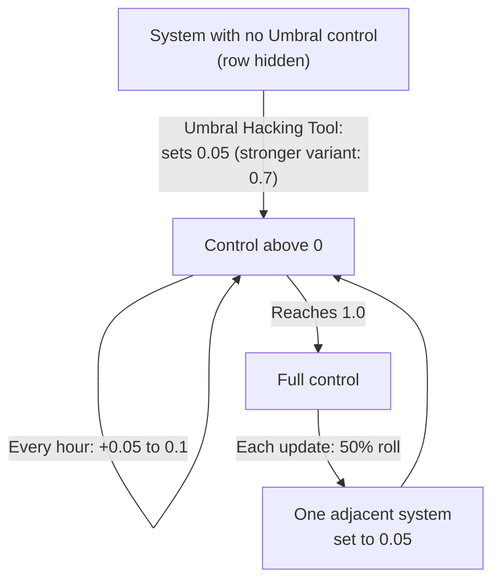

# The Control Story Line

This page covers the Umbral Reach: its control row and how it spreads, the Umbral Hacking Tool, the puppeteers' station, and every exception the Umbral transponder makes to the early rules. It is a spoiler for the Umbral story line, which opens as part of the reward for your faction's first Conquest mission (see the [late-game gates](README.md#spoiler-gates)). Values are read from the game code of version 0.8.3.4 (the decompiled source, not in-game testing). The code was then compared with the 0.8.3.5 source, and none of the rules on this page changed. The war-related statements were checked again against the 0.8.3.7 source, which removed the "Your war effort" row and added system level changes to the hourly update.

Terms are in the [late-game glossary](glossary.md) and the [basics glossary](../basics/glossary.md).

## Spoiler: The Control Row and Its Spread

The "Umbral Reach control" row shows how far the Umbral Reach has spread into a system, as a percentage. It appears only above 0.

- Growth. Each conquest update (every 3600 s, which is 1 hour), a system already above 0 rises by a random 0.05 to 0.1, up to a maximum of 1 (100%).
- Spread. Each update makes one 50% roll in total. When the roll passes, the game finds the first system at 1.0 that has a neighbour with no control (0) and sets that neighbour to 0.05. That is at most one new system per update.
- Starting an infection. The Umbral Hacking Tool (the item you can buy in an Umbral shop) starts it by setting a system to 0.05. The stronger variant, the Umbral Hacking Multitool, sets it to 0.7 (the code calls it the "uber" variant). Use either at the conquest station (the hub) of a system where you are friendly with the owner and the system has no control yet. Unless you use the Multitool, the hub of a neighbouring system must also have control above 0.19. The game's message says "at least 20%".
- At an Umbral station. The mission board gets an Umbral mission button at 5% station control, and shops get an Umbral shop slot at 50%. The puppeteers' station in quadrant 2 always counts as 100%. A war-zone hub uses its system's control row.

This page does not cover what Umbral control does beyond those thresholds.

In the code: [The Control Row and Its Spread](#code-the-control-row-and-its-spread).

### On the System Tooltip and in System Data

The conquest section of a war-zone system tooltip has a second kind of row, "Umbral Reach control", next to the Defense row (see [What the system tooltip shows](../conquest/war.md#what-the-system-tooltip-shows)). Until 0.8.3.5 a "Your war effort" row sat between them; 0.8.3.7 removed it. An unowned system whose hub is abandoned (a hub left without an owner after it was destroyed) can also show an Umbral Reach row. On such a system the Defense row shows 0.

In the code: [On the System Tooltip and in System Data](#code-on-the-system-tooltip-and-in-system-data).

### The Conquest Update

The hourly conquest update also spreads the Umbral Reach. The [faction economy](../conquest/faction-economy.md#when-things-happen) page lists what else it does: it recalculates Area Conquered, rebuilds damaged stations and counts down settling. Since 0.8.3.7 it also moves every war-zone system's level toward its target ([How System Levels Rise](../conquest/war.md#how-system-levels-rise)).

In the code: [The Conquest Update](#code-the-conquest-update).

## Spoiler: The Story Faction's Station

The puppeteers' station in quadrant 2 is not an economic outpost or an outpost system. It has 6 parts.

| Core | Energy | Refinery | Cargo Dock | Docking Pad (Small / Medium) | Tunnel | Platforms | Connectors |
|---|---|---|---|---|---|---|---|
| 1 | 0 | 1 | 0 | 1 / 0 | 1 | 2 turrets (same tier roll) | 0 |

The columns are the same as in the part list tables on [Combat stations](../basics/stations.md#part-lists) and [War stations](../conquest/war-stations.md#part-lists).

The two "tier" turrets follow the same tier rule as the Small, Medium and Large conquest stations ([War stations](../conquest/war-stations.md#turret-tier-rules)). Below location level 45, both are Small Turret Mk II. At level 45 or above, both are Medium Turret Mk II or both are Large Turret Mk I, with a 50/50 roll. Here the roll is not tied to a per-station seed, and both turrets share one roll.

These are the off-screen siege numbers (scored as in [War stations](../conquest/war-stations.md#the-stations-off-screen-siege-numbers)). Hull is the structure score of the station's parts added together, and Firepower is the firepower score of its platforms added together:

| Both tier turrets are | Hull | Firepower |
|---|---|---|
| Small Turret Mk II (below level 45) | 440 | 160 |
| Both Medium Turret Mk II or both Large Turret Mk I (level 45 and above) | 470 to 500 | 240 to 320 |

In the code: [The Story Faction's Station](#code-the-story-factions-station).

## Stations With No Reputation Loss

Several mission stations and Umbral stations are flagged so that killing their parts costs no reputation with the owner. The flag overrides the per-part kill penalty. That penalty is 100 points a part while you are Neutral or better, and 5 points otherwise (see [Killing parts](../basics/stations.md#killing-parts)).

In the code: [Stations With No Reputation Loss](#code-stations-with-no-reputation-loss).

## Spoiler: What the Transponder Changes

The item is called the Decoy Transponder in the game, and this page calls it the Umbral transponder. While it is active, several reputation costs from the early pages are skipped. The item text says reputation gains from combat are prevented too. Each section below names the rule it changes and links to it. Using the item switches the transponder on. It switches off again the next time you dock at a station, and the game notifies you.

### Entering a Facility or Boarding a Ship

Changes [Reputation cost of entering](../basics/boarding.md#reputation-cost-of-entering). With the Umbral transponder, you pay no reputation penalty for entering a facility or boarding a ship. That page also explains the ships that skip the penalty anyway.

In the code: [Entering a Facility or Boarding a Ship](#code-entering-a-facility-or-boarding-a-ship).

### Killing Station Parts

Changes [Killing parts](../basics/stations.md#killing-parts). If you have the Umbral transponder, every unit you kill, station parts and ships alike, skips the owner's reputation hit.

In the code: [Killing Station Parts](#code-killing-station-parts).

### Destroying a Faction Station

Changes [Wrecking a faction station](../basics/stations.md#wrecking-a-faction-station) and [Reputation cost of destroying stations](../conquest/war.md#reputation-cost-of-destroying-stations). Destroying a faction station while you hit it costs -5000 reputation with its faction, or -1000 if your reputation with it is already at or below -5000 (Hostile or worse). With the Umbral transponder, you skip that loss.

In the code: [Destroying a Faction Station](#code-destroying-a-faction-station).

### Destroying a Yard

Changes [What happens when you destroy a yard](../conquest/faction-economy.md#what-happens-when-you-destroy-a-yard). The reputation cost for destroying a Construction Yard is 0 if you carry the Umbral transponder, whatever your standing with the faction.

| Your standing with the faction | Reputation cost |
|---|---|
| You carry the Umbral transponder | 0 |

In the code: [Destroying a Yard](#code-destroying-a-yard).

### Slowing a Faction by Destroying Its Only Yard

Changes [Ways to slow a faction](../conquest/faction-economy.md#ways-to-slow-a-faction). In that table, row 2 is destroying the faction's only Construction Yard. With the Umbral transponder, it costs 0 reputation instead of -5,000 (-1,000 if you are Hostile or worse).

## In the Game Code

This part holds the code names behind the sections above. It comes from the decompiled source of version 0.8.3.4, compared with the 0.8.3.5 and 0.8.3.7 sources. To check a claim, search the decompiled source for the method or field named here.

### Code: The Control Row and Its Spread

The row shows `umbralControlLevel` as a percentage and appears only above 0. `Conquest.TickUmbralSpread` runs inside `DoConquestTick` every 3600 s. It draws one `RandomBool` for the whole update. Then, over the shuffled systems: a system at exactly 1.0 with that draw false takes its first neighbour at exactly 0, sets it to 0.05 and sets the draw to true (so at most one spread per update); any other system above 0 rises by `RandomRange(0.05, 0.1)`, clamped at 1. `UmbralHackingTool.OnUse` needs `MapPointOfInterest.current` to be a `ConquestStation` that `PlayerIsFriendly()` and whose control is 0, and unless `isUberVariant` an adjacent system's `ConquestStation` above 0.19. `UmbralHackingBot.Start` then sets the system's `umbralControlLevel` to `controlPercentage` (0.05, or 0.7 for the uber variant). `SpaceStation.umbralControlLevel` returns 1 for a puppeteers station in quadrant 2 and the system's value for a `ConquestStation`. `MissionBoard.RefreshUmbralButton` shows the Umbral mission button at 0.05 or more, and `InventoryShop` puts the Umbral shop slot first at 0.5 or more. This page does not cover what umbral control does beyond those thresholds.

The Umbral line is opened by `ConquestUmbral1` (see the [late-game gates](README.md#code-gates)).

Source: `Conquest.TickUmbralSpread`, `UmbralHackingTool.OnUse`, `UmbralHackingBot.Start`, `SpaceStation.umbralControlLevel`, `MissionBoard.RefreshUmbralButton`, `InventoryShop`, `SpaceStationButton`

#### Code: On the System Tooltip and in System Data

Every war-zone system's `ConquestSystem` also stores umbral control, next to who owns it and its settling state.

#### Code: The Conquest Update

`Conquest.DoConquestTick`, the hourly conquest update, also spreads the Umbral Reach (`TickUmbralSpread`). In 0.8.3.7 `GenerateConquestEvents`, which `DoConquestTick` calls unless it runs in setup, also calls `UpdateSystemLevels` (`SystemLevelDrift.Creep`).

Source: `Conquest.DoConquestTick`

### Code: The Story Faction's Station

The puppeteers' station in quadrant 2 is built by `CreateUmbralOutpost`. "Umbral outpost" is the code builder name for it. It is not an economic outpost or an outpost system. It has 6 parts.

| Seed | Builder | Result |
|---|---|---|
| (puppeteers station, quadrant 2) | `CreateUmbralOutpost` | 6 parts |

Part list (columns as in the part list tables on [Combat stations](../basics/stations.md#part-lists) and [War stations](../conquest/war-stations.md#part-lists)):

| Builder | Core | Energy | Refinery | Cargo Dock | Docking Pad (Small / Medium) | Tunnel | Platforms | Connectors |
|---|---|---|---|---|---|---|---|---|
| Umbral outpost | 1 | 0 | 1 | 0 | 1 / 0 | 1 | 2 tier (same roll) | 0 |

Turret tier rule: the two "tier" turrets follow the same tier rule as the Small, Medium and Large conquest builders ([War stations](../conquest/war-stations.md#turret-tier-rules)): below location level 45 they are S2 (Small Turret Mk II); at level 45 or above they are M2 (Medium Turret Mk II) or L1 (Large Turret Mk I) with a 50/50 roll. In the Umbral outpost the roll uses the global random generator instead of a per-station seed, and both turrets share one roll.

Off-screen siege numbers ("Hull" is the sum of the part structure scores and "Firepower" the sum of the platform firepower scores), with both tier turrets S2 (below level 45) and, in brackets, the range when they are both M2 or both L1:

| Builder | Hull | Firepower |
|---|---|---|
| Umbral outpost | 440 (470 to 500) | 160 (240 to 320) |

Source: `CombatStationFactory.CreateUmbralOutpost`, `CombatStationFactory.CreateStationVariant`, `StationDefense.ScorePart`.

### Code: Stations With No Reputation Loss

The flag is `noReputationLoss`. Killing their parts costs no reputation with the owner, which overrides the per-part kill penalty.

Source: `LootManager.HandleKillReputation`, `LootManager.DropLoot`.

### Code: What the Transponder Changes

The transponder is the `hasUmbralTransponder` flag. `UmbralTransponderItem.OnUse` sets it. `SpaceStationInterior` clears it when the station interior opens and shows the "deactivated" notification.

#### Code: Entering a Facility or Boarding a Ship

The transponder check is in `DungeonManager.ApplyFriendlyFactionPenalty`, which both entering a facility (`StartOperation` for a location, base 25) and boarding a ship (`StartOperation` for a ship) call. The ships that skip the penalty anyway are the `noReputationLoss` ships (`StartOperation` skips the call for them). `DungeonManager.TriggerFriendlyFactionAggro` does not check the transponder, only `noReputationLoss`.

Source: `DungeonManager.StartOperation`, `DungeonManager.ApplyFriendlyFactionPenalty`, `DungeonManager.TriggerFriendlyFactionAggro`.

#### Code: Killing Station Parts

`LootManager.HandleKillReputation` returns early when `unit.faction` is null, `unit.unitData.noReputationLoss` is set, or `hasUmbralTransponder` is set. It runs for every killed unit, so the transponder covers ships as well as station parts.

Source: `LootManager.HandleKillReputation`.

#### Code: Destroying a Faction Station

The code check is `hasUmbralTransponder`.

Source: `FactionStationDestruction.ApplyDestroyReputation`, `FactionStationDestruction.OnDestroyedByPlayer`, `FactionStationDestruction.GetDestroyReputationLoss`.

#### Code: Destroying a Yard

Source: `FactionStationDestruction.GetDestroyReputationLoss`
