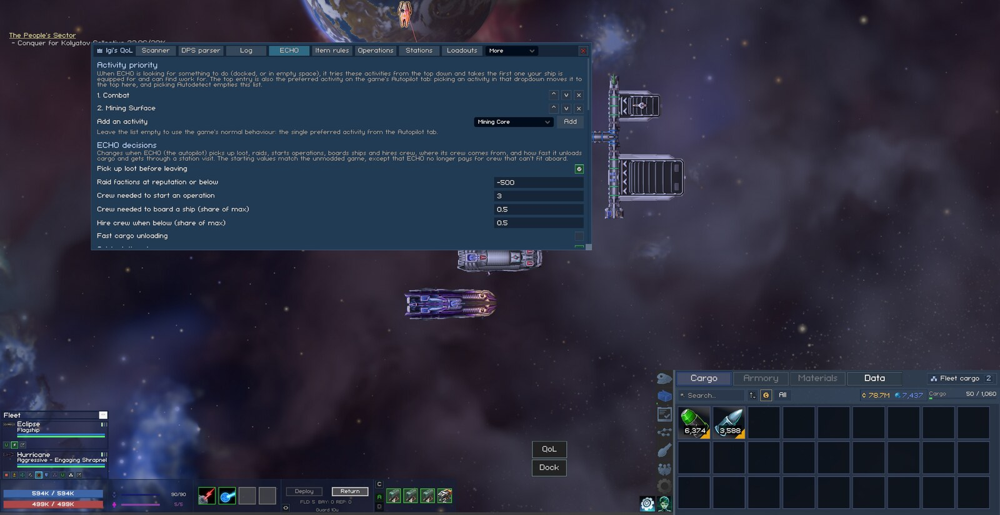

# Igi's QoL Modpack

One BepInEx plugin (`igi.qol`, in `BepInEx/plugins/IgiQoL/`) with 45 quality-of-life features for Vanguard Galaxy. They include a mod window with its own tabs, more say over ECHO's decisions, fleet-wide station services, ship loadouts, per-ship combat settings, the numbers behind the Conquest war, logs and a damage parser. Every feature can be switched off on its own.

The defaults play like the unmodded game, apart from the added HUD elements and a few fixes that are on by default. The added HUD elements are:

- the QoL button;
- the Scanner counter and markers;
- the fleet bars and command strip;
- the jump and mission distance lines;
- the sort buttons on the mission board and the missions window;
- the Favourite button and the service buttons in the airlock;
- the War Overview button and timers on the galaxy map.

The fixes that are on by default are:

- ECHO no longer pays for crew that can't fit aboard.
- ECHO skips a place for 5 minutes after finding nothing to do there, so it doesn't fly between the same two places.
- The crew slider on the Operations tab shows the crew actually aboard.
- Hover cards that would run off the screen slide back inside.

Tested on game version 0.8.3.7.

The modpack was developed and tested on Linux only, with the game running under Proton. Proton runs the game's Windows build, so the mod should work the same on Windows, but nobody has tested it there yet.

## Install

1. Install BepInEx 5 (`win_x64`, version 5.4.23 or later) into the game folder and start the game once. On Linux under Proton, BepInEx also needs a DLL override; [setup.md](../setup.md#installing-bepinex) explains it.
2. Download `IgiQoL-<version>.zip` from the [releases page](https://github.com/williammabernathy/Igi-s-QoL-Modpack/releases) and extract it into the game folder. It adds `BepInEx/plugins/IgiQoL/`.
3. Start the game. `BepInEx/LogOutput.log` should have a line like `IgiQoL startup: 46 active, 1 disabled, 0 failed` (the disabled one is the developer harness).

To update, extract the new zip over the old one. To remove the mod, delete `BepInEx/plugins/IgiQoL/` (and `BepInEx/config/igi.qol.cfg` and `BepInEx/config/IgiQoL/` if you want its settings and files gone too).

## Using It

Press F6, click the QoL button in space, or click the QoL icon button above the Airlock tab when docked. Every feature's switch and setting is in that window; see [Window and HUD](features/interface.md#mod-window). Your ships' own settings are in the popup behind the last button on each fleet row.

The features, by area:

| Area | Features |
|---|---|
| [Window and HUD](features/interface.md) | Mod Window, the ship settings popup, Fleet Command Strip, Fleet Shield and Armor Bars, Text Size, Zoom Out Further, Jumps Remaining, Mission Distance, Mission Sort, Mission Fit |
| [ECHO, the Autopilot](features/echo.md) | ECHO Activity Priority, ECHO Decisions, ECHO Missions, ECHO Retreat, ECHO Abilities and Deployables, Preferred Ores, ECHO's Operations, ECHO Cargo Rules |
| [Fleet and Combat](features/fleet-combat.md) | Target Priority, Engagement Distance, Keep Distance in Combat, Ship Collisions, Retreat for Repairs, Ship Stats on Hover, Combat Overview, Missile Retargeting, Drone Modes, Drones on Arrival |
| [Loot and Cargo](features/loot-and-cargo.md) | Item Rules, Loot Pickup Limits, Shared Fleet Holds, Pinned Cargo, Scanner |
| [Stations, Loadouts and Crafting](features/stations.md) | Station Services, Ship Loadouts, Crafting Roll-Up (the modpack's own forge helper), Refinery Filter, Used in (Forge Recipes), the Operations tab, Favourite Stations |
| [Conquest](features/conquest.md) | Conquest Details: Defense breakdowns and capture figures on the map's cards, fleet orders explained, faction rows and the hidden ledger, the War Overview window |
| [Logs, Reference and Other Mods](features/logs-and-reference.md) | Event Log, DPS Parser, Stat Reference, Notes, Other Mods |

[settings.md](settings.md) lists every setting with its default and range.

## Files It Writes

| Where | What |
|---|---|
| `BepInEx/config/igi.qol.cfg` | Every setting, one section per feature |
| The save game, key `Player.igiQol` | Per-ship settings and loadouts, item rules, preferred ores, ECHO's activity list and ability rules, the runs of the [Crafting Roll-Up](features/stations.md#crafting-roll-up) feature that are still going, crew losses and favourite stations |
| `BepInEx/config/IgiQoL/item-rules.json` | Optional. Starting item rules for saves that have none ([format](features/loot-and-cargo.md#starting-rules-for-new-saves)) |
| `BepInEx/config/IgiQoL/notes.json` | The Notes tab. The mod writes it through a temporary `notes.json.tmp`. If the mod can't parse the file, it renames it to `notes.json.broken-<number>` instead of overwriting it |
| `BepInEx/config/IgiQoL/combat-log.txt` | Only with the DPS Parser's "Write each fight to a file" setting on |
| The game's Unity PlayerPrefs | Where the mod window and the [pop-out windows](features/interface.md#pop-out-windows) sit, their size, their options and the open tab. It also holds the open note on the Notes tab |
| `BepInEx/config/IgiQoL/dumps/` | Only from the developer harness |
| Next to the game's `Saves` folder (Unity's `LocalLow/Bat Roost Games/VanguardGalaxy`) | `igiqol-*.png` screenshots, only from the developer harness |

The mod keeps its own data under that one key and leaves the game's values in their vanilla form. For example, drone modes are saved as the game's Free roam or Follow ship. A save should therefore still load without the mod and only lose the mod's data. Loading such a save in an unmodded game hasn't been tested yet, so keep a backup.

## When Something Breaks

When a feature's patch or save-load handler throws an error, the feature switches itself off and logs the stack trace to `BepInEx/LogOutput.log` (`[<Feature>] switched off at ...`). The main menu lists the feature in a popup. The other features and the mod's save data carry on. After a game update, a patch that the update broke shows up the same way, or as a Harmony error at startup.

The Mods tab ([Other Mods](features/logs-and-reference.md#other-mods)) shows which game methods another mod also patches. Look there when two mods conflict.

## For Developers

- [developing.md](https://github.com/williammabernathy/Igi-s-QoL-Modpack/blob/main/docs/modpack/developing.md): how the code is laid out, the conventions every feature follows, and how to add a feature.
- [dev-harness.md](https://github.com/williammabernathy/Igi-s-QoL-Modpack/blob/main/docs/modpack/dev-harness.md): the in-game test harness, self-checks, data dumps and profiling.
- [building.md](https://github.com/williammabernathy/Igi-s-QoL-Modpack/blob/main/docs/building.md) and [ci.md](https://github.com/williammabernathy/Igi-s-QoL-Modpack/blob/main/docs/ci.md): building, game updates, CI and releases.
