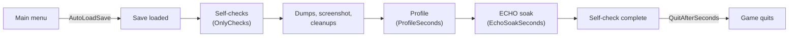

# Developer Harness

The `[Dev]` section of `igi.qol.cfg` turns the game into a test runner. It loads a save by itself, runs every feature's self-check, writes `CHECK` lines to `BepInEx/LogOutput.log`, takes screenshots and quits. It's off by default and doesn't count as a player feature. The startup line counts it as the one disabled feature.

Point it at a copy of a save, never at a save you care about. While the harness is on, it suppresses autosaves. The checks still change the loaded game (credits, cargo, crew) until their cleanups undo the changes at the end of the run. Settings that the checks change aren't written to `igi.qol.cfg`.

## A Run



`tools/Harness` does steps 1 to 5 below for you. It copies the save, sets the `[Dev]` keys, starts the game through Steam and waits for it to quit. It then prints the counts and every FAIL, keeps the log in `artifacts/harness/`, puts the `[Dev]` keys back and deletes the copy. Close the game first.

```bash
dotnet run --project tools/Harness -- --save autosave-0 --name igiqol-dev
dotnet run --project tools/Harness -- --save vgmod-dev --name igiqol-combat --only DroneModes --runs 3
```

Options:

- `--only` sets `OnlyChecks`.
- `--skips` also prints the SKIP lines.
- `--keep` leaves the save copy in place.
- `--timeout` is how many seconds one run may take (default 1200).
- `--game` and `--saves` override the folders. The defaults are the paths below, or Steam's default library on Windows.
- `--name` defaults to `igiqol-dev` and can't be the same as `--save`.
- `--runs` above 1 repeats the run and lists every check whose result changed between runs, which is how a check that passes or fails by chance shows up.

The `[Dev]` keys have to be in `igi.qol.cfg` already, so start the game once with the mod first. The tool changes `Enabled`, `AutoLoadSave`, `SelfCheck`, `OnlyChecks` and `QuitAfterSeconds`, and writes back the old values afterwards. It doesn't turn `Screenshot` on.

The tool exits with 1 when a run has a FAIL, doesn't reach `Self-check complete`, or has a check that changed between runs. It exits with 2 when the options are wrong, a file is missing or the game is already running.

By hand:

1. Copy a save to a name of its own:

   ```bash
   G="/mnt/data/SteamLibrary/steamapps/common/Vanguard Galaxy"
   S="/mnt/data/SteamLibrary/steamapps/compatdata/3471800/pfx/drive_c/users/steamuser/AppData/LocalLow/Bat Roost Games/VanguardGalaxy/Saves"
   newest=$(ls -t "$S"/autosave-*.save | head -1)
   cp "$newest" "$S/igiqol-dev.save"; cp "${newest%.save}.meta" "$S/igiqol-dev.meta"
   ```

   On Windows, in PowerShell:

   ```powershell
   $G = "C:\Program Files (x86)\Steam\steamapps\common\Vanguard Galaxy"
   $S = "$env:USERPROFILE\AppData\LocalLow\Bat Roost Games\VanguardGalaxy\Saves"
   $newest = Get-ChildItem "$S\autosave-*.save" | Sort-Object LastWriteTime -Descending | Select-Object -First 1
   Copy-Item $newest.FullName "$S\igiqol-dev.save"; Copy-Item ($newest.FullName -replace '\.save$', '.meta') "$S\igiqol-dev.meta"
   ```

   Some checks need things in the save: a fleet ship besides the flagship, a station with a hangar and a mission board, and an asteroid field in the system. Without them, those checks SKIP and give the reason.
2. In the `[Dev]` section of `BepInEx/config/igi.qol.cfg`, set `Enabled = true`, `AutoLoadSave = igiqol-dev`, `SelfCheck = true` and `QuitAfterSeconds = 10`.
3. Start the game through Steam (`steam -applaunch 3471800` on Linux, or Play in the Steam library) and wait for `Self-check complete` in `LogOutput.log`. A full run takes a little over five minutes.
4. Read the results:

   ```bash
   grep -E "startup:|switched off|Self-check complete|CHECK .* (FAIL|SKIP)" "$G/BepInEx/LogOutput.log"
   ```

   In PowerShell: `Select-String -Path "$G\BepInEx\LogOutput.log" -Pattern "startup:|switched off|Self-check complete|CHECK .* (FAIL|SKIP)"`.

   No single save reaches every check, so run on two saves:
   - a copy of your newest autosave, which has your current game (the Conquest war, your stations and missions);
   - a save whose fleet has a second ship with weapons, for the fleet checks of Target Priority and Keep distance (`TargetPriority/live-fleet`, `flagship-assist`, `Separation/live` and `other-ships`). Those checks skip on a save without such a ship.

   Two saves were used for the 2026-11-04 review: a copy of that day's autosave, and an older save with an armed fleet ship. Full runs on them ended with `343 pass, 0 fail, 28 skip` and `351 pass, 0 fail, 21 skip`. After the game's 0.8.3.5 update (2026-11-05), the same two saves ended with `344 pass, 2 fail, 25 skip` and `351 pass, 0 fail, 21 skip`. The two fails are `CraftRollup/run` and `parts-to-storage` on the 2026-11-05 autosave; they come and go between runs of that save and failed the same way on 0.8.3.4 that morning. The skip count moves by a few between runs of the same save. Some checks skip when the fleet kills an enemy mid-check, or when another ship sits where the check would place one.

   Skips name what the save lacks, for example:

   - a dungeon at the location;
   - a combat flagship (`EchoMissions/kinds`);
   - a board offer ECHO would take;
   - the game's Autopilot tab;
   - a hired mercenary;
   - a refinery;
   - a mission board within 3 jumps with a mission in another system;
   - fleet or delivery icons in the galaxy map's view.

   The five `EchoCargo` docked checks skip in a full run, because the flagship is in space by then. They run in a run limited to `OnlyChecks = EchoCargo`, which starts docked. `Separation/push`, `apart` and `own-target` skip when another ship sits where the check would place one, and the reason names that ship. A check that needs a fight and finds that the fleet has killed everything spawns enemies (`SelfCheckContext.SpawnEnemies`). It skips with the counts when none arrive.

   The last line before `Self-check complete` is `CHECK Dev/unity-errors`. The harness listens to Unity's own log while it runs, and this check fails on any error or exception with the mod in its message or stack, naming the check that was running. Those errors are mostly exceptions in a `MonoBehaviour` update or a UI callback. No check's own try/catch sees them, and Unity writes them to `Player.log`, not to `LogOutput.log`.

   `ConquestDetails/hub-kill-siege` and `hub-kill-race` are the last ConquestDetails checks because they change the war for the rest of the run. Each one abandons a system the way a destroyed hub does, runs the game's fleet planning pass for every faction, and compares two things with the prediction on the hub card: the faction the game hands the system to, or the faction it sends first. When no fleet in the save is free, `hub-kill-race` first moves one NPC fleet out of no fight into a system of its faction next to the target, and the line says so ("staged: ..."). The harness never saves, so the change ends with the run.

5. Set `Enabled = false` again and delete the copy. Steam Cloud sometimes restores a deleted save. If it comes back, delete it again.

Each check writes one line:

```
CHECK StationServices/sell-above-fleet PASS - keep=8 quote=896 run=896 credits +896 (expected 896) stored=8 cargo 0/0
```

## Settings

| Key | Default | What it does |
|---|---|---|
| `Enabled` | `false` | Turns the harness on and suppresses autosaves |
| `AutoLoadSave` | (empty) | Save name, without extension, to load at the main menu |
| `SelfCheck` | `false` | Run every active feature's self-check after the save loads |
| `OnlyChecks` | (empty) | Comma-separated feature ids whose checks run; empty runs all. A run limited this way starts docked, and checks that need space undock first |
| `Screenshot` | `false` | Write `igiqol-screenshot.png` after the checks, and let checks write their own `igiqol-<name>.png`, next to the `Saves` folder |
| `QuitAfterSeconds` | `0` | Quit this long after the harness finishes; 0 never quits |
| `DumpHierarchy` | (empty) | Comma-separated component type names whose UI hierarchy goes to `BepInEx/config/IgiQoL/dumps/` |
| `DumpIcons` | `false` | Every icon key of the game's icon library to `dumps/icons.txt` |
| `DumpTurretRanges` | `false` | Identifier, rarity, item level and base range of every turret item to `dumps/turret-ranges.txt` |
| `DumpRecipes` | `false` | Every forge recipe with ingredients, results and the recipe that makes each ingredient to `dumps/recipes.txt` |
| `DumpMissiles` | `false` | Every missile launcher's flight values and your ships' thrust and mass to `dumps/missiles.txt` |
| `DumpGameData` | `false` | The game's 15 content registries to `dumps/<game version>/` ([below](#data-dumps)) |
| `DumpStatics` | (empty) | Your own list of static members to dump ([below](#data-dumps)) |
| `ProfileSeconds` | `0` | Profile for this many seconds after the checks ([below](#profiling)) |
| `ProfileEnemies` | `12` | Hostile ships the profile spawns; 0 profiles wherever the save is, without a fight |
| `EchoSoakSeconds` | `0` | After the checks, switch ECHO on for this long, log its status every 15 s (`[Dev] soak` lines) and the whole event log at the end |

## Writing a Self-Check

Override `SelfCheck` in the feature. It's a coroutine, so it can wait for the game:

```csharp
public override IEnumerator SelfCheck(SelfCheckContext ctx)
{
    var ship = Fleet.Flagship;
    if (ship == null) { ctx.Skip("settings-roundtrip", "not in space"); yield break; }
    var before = ShipSettings.Get(ship.spaceShipData.guid).separation;
    ctx.Cleanup(() => { ShipSettings.Edit(ship.spaceShipData.guid).separation = before; });

    // change something, wait, measure
    yield return new WaitForSeconds(1f);

    if (/* the observed result is right */) ctx.Pass("settings-roundtrip", "detail for the log");
    else ctx.Fail("settings-roundtrip", "what was observed");
    yield return ctx.Screenshot("my-feature");
}
```

| Member | Use |
|---|---|
| `Pass(name, detail)`, `Fail(name, detail)`, `Skip(name, reason)` | One `CHECK <Feature>/<name>` line each. Put the measured values in `detail`, so a failing line explains itself |
| `Cleanup(action)` | Undo what the check changed. All cleanups run once every check, dump and screenshot is done, in the order they were added, also for a check that threw. A later check sees the earlier checks' changes, so snapshot what you touch before changing it |
| `Screenshot(name)` | Writes `igiqol-<name>.png` when `[Dev] Screenshot` is on |
| `SelfCheckContext.EnsureInSpace()` | Undock and wait for the HUD |
| `SelfCheckContext.SpawnEnemies(count)` | Hostile small combat ships at the current location, as the console's SpawnEnemy does |
| `SelfCheckContext.SpawnAsteroid(position, ore)`, `RemoveAsteroid(data)` | A test asteroid with one surface ore |

An exception inside a check, including one inside a coroutine that the check yields, fails the check (`CHECK <Feature>/exception FAIL`). The run goes on with the next feature.

Check behaviour the player sees: credits moved, cargo counts, the target picked, a row on a tab. A check that only proves a method was called or a setting was stored catches nothing. When the save can't exercise a check, skip with a reason rather than passing.

Ways the existing checks reach the game's real paths, instead of calling the mod's own code and checking its answer:

- Input: move the real cursor with `Mouse.current.WarpCursorPosition(point)` and wait two frames, because Unity's `Input.mousePosition` follows a frame later. Then queue an event with `InputSystem.QueueStateEvent(Mouse.current, new MouseState { position, scroll })` or a keyboard state. The event arrives at the next input update, before any `Update`. `ConquestDetails/popout-wheel` and `detail-key` do this. When the game window doesn't have focus (for example a run started while you work in another window), the Input System disables the keyboard and drops its events. `detail-key` therefore sets `InputSystem.settings.backgroundBehavior` to `IgnoreFocus` for its frames and puts it back afterwards, and its line says whether the window had focus.
- Damage: call the target's own `TakeDamage(new DamageData(attacker) { power, hitTransform, hitCoordinates })`, so every prefix, postfix and game reaction on the way runs (`TargetPriority/flagship-assist`, `CombatLog/dealt`).
- Missiles: spawn a launcher's `missilePrefab` through `ProjectilePool.Spawn`, as `MissileTurret` does (since 0.8.3.5 the pool puts a missile in flight, and a missile made with `Instantiate` never tracks), and call its `Initialize` with a turret's tracking point and `new DamageData(turret)`. Then switch or kill targets (`MissileRetarget/switch`, `nearest-kill`). Pooled missiles are reused after they land, so a check tells its own apart by their zero damage. A missile aims where its target will be when it arrives (the target's velocity times the flight time). Compare its `targetPosition` with that lead point, not with the target's position.
- The war: abandon a system with `ConquestOwnership.Abandon` and run `ConquestFleetPlanner.PlanBetweenTicks` for every faction economy to see what the game's own planner does (`ConquestDetails/hub-kill-race`). These can't be undone, so such checks run last in their feature.
- Layout: read rectangles with `RectTransform.GetWorldCorners` (screen pixels on the overlay canvases) and text widths with `TMP_Text.GetPreferredValues`. For a label that shrinks to fit, measure `textBounds` after `ForceMeshUpdate()`. Compare positions before and after a refresh to catch rows that move (`Operations/running-layout`, `StationServices/airlock-stable`, `FleetStrip/slots`).
- A situation the save lacks can sometimes be made for the check and put back in a `finally`. Examples are a fleet ship lent the Aggressive stance, a shorter forge popup (`CraftRollup/panel-layout-short`), a remembered slider value (`Operations/crew-slider`), and a wreck or asteroid spawned clear of the hull (`DroneModes/gatherer-guard`). Unity objects that a list rebuilds can be destroyed while a check waits. Keep what you measured, not the object (`Contacts/loot-row-layout`).

## Data Dumps

Two dumps read any value the game holds, without new code.

- `DumpGameData = true` writes the 15 content registries (items, recipes, equipment and item builders, ships, drones, station parts, modules, defensive turrets, aspects, hazards, crew types, skill trees and nodes, dungeons) to `dumps/<game version>/`, about 10 MB, in under a second.
- `DumpStatics` takes your own comma-separated list of static members, `TypeName.member` with an optional `:depth` (default 3), for example `Faction.all:2`.

Each file starts with a `# <Type>.<member> game <version> depth <n>` line, then has one line per value: element key, field path, value, tab-separated, sorted:

```
CanisterOxide	identifier	CanisterOxide
CanisterOxide	displayName	@RPCanisterRefinedOxide
```

Grep it to find a number (`grep _range dumps/<game version>/InventoryItemType.allItems.txt`) or compare two game versions with `VersionDiff data` ([building.md](../building.md#after-a-game-update)). The walk follows fields, not properties. It expands game components on prefabs, including sibling components (`definition.@LaserTurret._range`), lists the first 64 entries of each collection, and prints other Unity objects by name.

## Profiling

With `ProfileSeconds` above 0, after the checks the harness spawns `ProfileEnemies` hostile ships next to the fleet and measures for that long:

- frame times: mean, p50, p95, p99;
- the time spent in each of the modpack's Harmony patches and `MonoBehaviour` updates;
- the game's own `SimMarker` sections.

The report goes to `BepInEx/config/IgiQoL/dumps/profile.txt`. Profile before and after a change to a per-frame path, with the same save and enemy count.
