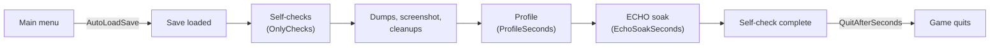

# Developer harness

The `[Dev]` section of `igi.qol.cfg` turns the game into a test runner: it loads a save by itself, runs every feature's self-check, writes `CHECK` lines to `BepInEx/LogOutput.log`, takes screenshots and quits. It's off by default and doesn't count as a player feature (the startup line counts it as the one disabled feature).

Point it at a copy of a save, never at a save you care about. While it's on it suppresses autosaves, but the checks still change the loaded game (credits, cargo, crew) until their cleanups undo it at the end of the run. Settings the checks change aren't written to `igi.qol.cfg`.

## A run



1. Copy a save to a name of its own:

   ```bash
   G="/mnt/data/SteamLibrary/steamapps/common/Vanguard Galaxy"
   S="/mnt/data/SteamLibrary/steamapps/compatdata/3471800/pfx/drive_c/users/steamuser/AppData/LocalLow/Bat Roost Games/VanguardGalaxy/Saves"
   newest=$(ls -t "$S"/autosave-*.save | head -1)
   cp "$newest" "$S/igiqol-dev.save"; cp "${newest%.save}.meta" "$S/igiqol-dev.meta"
   ```

   On Windows, in PowerShell:

   ```powershell
   $G = "C:\Program Files (x86)\Steam\steamapps\common\Vanguard Galaxy"
   $S = "$env:USERPROFILE\AppData\LocalLow\Bat Roost Games\VanguardGalaxy\Saves"
   $newest = Get-ChildItem "$S\autosave-*.save" | Sort-Object LastWriteTime -Descending | Select-Object -First 1
   Copy-Item $newest.FullName "$S\igiqol-dev.save"; Copy-Item ($newest.FullName -replace '\.save$', '.meta') "$S\igiqol-dev.meta"
   ```

   Some checks need things in the save: a fleet ship besides the flagship, a station with a hangar and a mission board, an asteroid field in the system. Without them those checks SKIP with the reason.
2. In `BepInEx/config/igi.qol.cfg`, `[Dev]`: `Enabled = true`, `AutoLoadSave = igiqol-dev`, `SelfCheck = true`, `QuitAfterSeconds = 10`.
3. Start the game through Steam (`steam -applaunch 3471800` on Linux, or Play in the Steam library) and wait for `Self-check complete` in `LogOutput.log`. A full run takes about four minutes.
4. Read the results:

   ```bash
   grep -E "startup:|switched off|Self-check complete|CHECK .* (FAIL|SKIP)" "$G/BepInEx/LogOutput.log"
   ```

   In PowerShell: `Select-String -Path "$G\BepInEx\LogOutput.log" -Pattern "startup:|switched off|Self-check complete|CHECK .* (FAIL|SKIP)"`.

   A clean run ends with `Self-check complete: 165 pass, 0 fail, 5 skip` on the reference save. The five skips need a situation the test save doesn't reach: a dungeon at the location (`EchoGates/dungeon-min`), a target while docked (`EngagementDistance/live`), the game's Autopilot tab in the scene (`EchoPriority/dropdown-to-list`), being docked at that point of the run (`EchoCargo/live-keep`) and a salvage module (`DroneModes/gatherer-assist`). `RefineryFilter/filter` adds a sixth skip when the save's station has no refinery; at a station with one, the refinery filter adds 7 passes. The "Used in" tooltip and its Stat reference search add 8 passes. `UsedIn/rarities` skips when none of the listed recipes is craftable in more than one rarity, and `UsedIn/learned` when every recipe is already craftable. The Item rules "rarity and below" rules add 2 passes (`ItemRules/resolve-upto`, `ItemRules/roundtrip-upto`). Selling from the data inventory adds 3 passes (`EchoCargo/data-plan`, `StationServices/sell-data`, `StationServices/sell-data-kept`) and `EchoCargo/data-echo`, which skips like `live-keep` when the full run isn't docked at that point. ECHO's sell-before-deposit pass adds `EchoCargo/sell-first`, which skips the same way. Selling from station storage adds 2 passes (`StationServices/sell-storage`, `StationServices/sell-storage-off`) and `EchoCargo/storage-echo`, which skips the same way. Selling from the armory adds 3 passes (`EchoCargo/armory-keeps`, `StationServices/sell-armory`, `StationServices/sell-armory-off`) and `EchoCargo/armory-echo`, which skips the same way. All four of those EchoCargo checks pass in a run limited to `OnlyChecks = EchoCargo`, which starts docked. The on-dock sell running before the fleet auto-deposit adds 1 pass (`StationServices/sell-before-deposit`), which skips without a managed fleet ship or when station storage is already full. The Operations tab's extract/abandon button adds 2 passes (`Operations/exit-states`, `Operations/exit-button`).
5. Set `Enabled = false` again and delete the copy. Steam Cloud sometimes restores a deleted save; delete it again if it comes back.

Each check writes one line:

```
CHECK StationServices/sell-above-fleet PASS - keep=8 quote=896 run=896 credits +896 (expected 896) stored=8 cargo 0/0
```

## Settings

| Key | Default | What it does |
|---|---|---|
| `Enabled` | `false` | Turns the harness on and suppresses autosaves |
| `AutoLoadSave` | (empty) | Save name, without extension, to load at the main menu |
| `SelfCheck` | `false` | Run every active feature's self-check after the save loads |
| `OnlyChecks` | (empty) | Comma-separated feature ids whose checks run; empty runs all. A run limited this way starts docked, and checks that need space undock first |
| `Screenshot` | `false` | Write `igiqol-screenshot.png` after the checks, and let checks write their own `igiqol-<name>.png`, next to the `Saves` folder |
| `QuitAfterSeconds` | `0` | Quit this long after the harness finishes; 0 never quits |
| `DumpHierarchy` | (empty) | Comma-separated component type names whose UI hierarchy goes to `BepInEx/config/IgiQoL/dumps/` |
| `DumpIcons` | `false` | Every icon key of the game's icon library to `dumps/icons.txt` |
| `DumpTurretRanges` | `false` | Identifier, rarity, item level and base range of every turret item to `dumps/turret-ranges.txt` |
| `DumpRecipes` | `false` | Every forge recipe with ingredients, results and the recipe that makes each ingredient to `dumps/recipes.txt` |
| `DumpMissiles` | `false` | Every missile launcher's flight values and your ships' thrust and mass to `dumps/missiles.txt` |
| `DumpGameData` | `false` | The game's 15 content registries to `dumps/<game version>/` ([below](#data-dumps)) |
| `DumpStatics` | (empty) | Your own list of static members to dump ([below](#data-dumps)) |
| `ProfileSeconds` | `0` | Profile for this many seconds after the checks ([below](#profiling)) |
| `ProfileEnemies` | `12` | Hostile ships the profile spawns; 0 profiles wherever the save is, without a fight |
| `EchoSoakSeconds` | `0` | After the checks, switch ECHO on for this long, log its status every 15 s (`[Dev] soak` lines) and the whole event log at the end |

## Writing a self-check

Override `SelfCheck` in the feature. It's a coroutine, so it can wait for the game:

```csharp
public override IEnumerator SelfCheck(SelfCheckContext ctx)
{
    var ship = Fleet.Flagship;
    if (ship == null) { ctx.Skip("settings-roundtrip", "not in space"); yield break; }
    var before = ShipSettings.Get(ship.spaceShipData.guid).separation;
    ctx.Cleanup(() => { ShipSettings.Edit(ship.spaceShipData.guid).separation = before; });

    // change something, wait, measure
    yield return new WaitForSeconds(1f);

    if (/* the observed result is right */) ctx.Pass("settings-roundtrip", "detail for the log");
    else ctx.Fail("settings-roundtrip", "what was observed");
    yield return ctx.Screenshot("my-feature");
}
```

| Member | Use |
|---|---|
| `Pass(name, detail)`, `Fail(name, detail)`, `Skip(name, reason)` | One `CHECK <Feature>/<name>` line each. Put the measured values in `detail`, so a failing line explains itself |
| `Cleanup(action)` | Undo what the check changed. All cleanups run once every check, dump and screenshot is done, in the order they were added, also for a check that threw. A later check sees the earlier checks' changes, so snapshot what you touch before changing it |
| `Screenshot(name)` | Writes `igiqol-<name>.png` when `[Dev] Screenshot` is on |
| `SelfCheckContext.EnsureInSpace()` | Undock and wait for the HUD |
| `SelfCheckContext.SpawnEnemies(count)` | Hostile small combat ships at the current location, as the console's SpawnEnemy does |
| `SelfCheckContext.SpawnAsteroid(position, ore)`, `RemoveAsteroid(data)` | A test asteroid with one surface ore |

An exception inside a check, also inside a coroutine it yields, fails the check (`CHECK <Feature>/exception FAIL`) and the run goes on with the next feature.

Check behaviour the player sees: credits moved, cargo counts, the target picked, a row on a tab. A check that only proves a method was called or a setting was stored catches nothing. Skip with a reason when the save can't exercise the check, rather than passing.

## Data dumps

Two dumps read any value the game holds, without new code.

- `DumpGameData = true` writes the 15 content registries (items, recipes, equipment and item builders, ships, drones, station parts, modules, defensive turrets, aspects, hazards, crew types, skill trees and nodes, dungeons) to `dumps/<game version>/`, about 9.5 MB, in under a second.
- `DumpStatics` takes your own comma-separated list of static members, `TypeName.member` with an optional `:depth` (default 3), for example `Faction.all:2`.

Each file starts with a `# <Type>.<member> game <version> depth <n>` line, then has one line per value: element key, field path, value, tab-separated, sorted:

```
CanisterOxide	identifier	CanisterOxide
CanisterOxide	displayName	@RPCanisterRefinedOxide
```

Grep it to find a number (`grep _range dumps/0.8.3.4/InventoryItemType.allItems.txt`) or compare two game versions with `VersionDiff data` ([building.md](../building.md#after-a-game-update)). The walk follows fields, not properties. It expands game components on prefabs, including sibling components (`definition.@LaserTurret._range`), lists the first 64 entries of each collection, and prints other Unity objects by name.

## Profiling

With `ProfileSeconds` above 0, after the checks the harness spawns `ProfileEnemies` hostile ships next to the fleet and measures for that long:

- frame times: mean, p50, p95, p99;
- the time spent in each of the modpack's Harmony patches and `MonoBehaviour` updates;
- the game's own `SimMarker` sections.

The report goes to `BepInEx/config/IgiQoL/dumps/profile.txt`. Profile before and after a change to a per-frame path, with the same save and enemy count.
