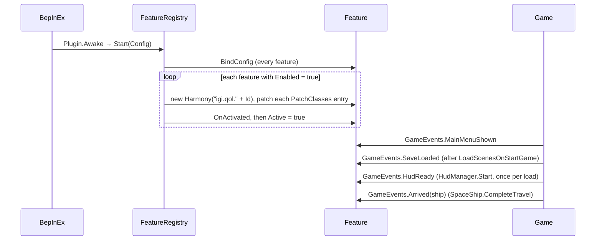

# Developing the modpack

How `src/IgiQoL` is put together and the rules every feature follows. Building and deploying are in [building.md](../building.md); testing in the game is in [dev-harness.md](dev-harness.md).

## Layout

| Folder | Contents |
|---|---|
| `Plugin.cs` | The BepInEx plugin (`igi.qol`). Logs the game version against `TestedGameVersion`, then starts the registry |
| `Core/` | The feature registry, the `Feature` base class, game events, save data, per-ship settings, the startup report, the `[Dev]` harness and its dumps and profiler |
| `Features/<Name>/` | One folder per feature: the `Feature` subclass, its Harmony patch classes, its tab, its self-check |
| `Game/` | Small helpers over game objects shared by several features: `Fleet` (flagship, fleet ship list, data-to-unit), `Cargo` (count, move, deposit target), `Items` (rule keys, the ammo a ship's fit fires), `Resists` (the share of a hit a unit takes by damage type, shields and hull, then armour) |
| `Rules/` | `ItemRules`, the per-save item rule table that loot pickup limits, ECHO cargo rules and station services read |
| `UI/` | The mod window and its widgets (`Kit`), pop-out windows (`Popout`), settings rows, the ship settings popup, drag handles, fleet row layout |

## Startup and lifecycle



`FeatureRegistry.All` lists the features in start order; `Core` is first and always on. Each feature gets its own Harmony instance, so `Fail` can unpatch just that feature. A feature whose patching or `OnActivated` throws is marked failed and the rest start anyway; if `Core` fails, nothing else starts. The startup line `IgiQoL startup: N active, N disabled, N failed` sums it up, and `StartupReport` shows failures in a popup at the main menu.

`Feature` members a subclass fills in:

| Member | Purpose |
|---|---|
| `Id` | Config section and Harmony id suffix. Never rename it; users' settings are keyed by it |
| `Title`, `Description` | The heading and plain-language text in the mod window. `Description` is also the `Enabled` entry's description in the `.cfg` |
| `PatchClasses` | The `[HarmonyPatch]` classes to apply |
| `SettingsTab` | The tab that shows this feature's settings (e.g. `"ECHO"`); the Settings tab then shows only the on/off switch |
| `BindConfig` | Call `base.BindConfig(cfg)` (binds `Enabled`), then bind settings with `SettingInfo.Describe(label, help, ...)` |
| `OnActivated` | Subscribe to `GameEvents`, add a tab with `ModWindow.AddTab(id, title, order, build)` |
| `SelfCheck` | The in-game test, see [dev-harness.md](dev-harness.md) |

## Game events

`Core/GameEvents.cs` raises four events. Each subscriber runs in its own try/catch; an exception logs `[Core] <Event> handler <Type.Method>` and switches off the subscriber's feature only (when the handler is an instance method on a `Feature`).

| Event | When | Use it for |
|---|---|---|
| `MainMenuShown` | `MainMenuUI.Start` | Main-menu work (the dev harness's auto-load, the Mods tab's overlap log) and dropping state tied to the session that just ended |
| `SaveLoaded` | After `SceneLoader.LoadScenesOnStartGame`; `GamePlayer.current` is set and `SaveData` is attached | Resetting per-save statics, loading per-save data |
| `HudReady` | `HudManager.Start`, once per save load; `HudManager.Instance` and its serialized buttons are set | Creating HUD elements. Don't poll for the HUD |
| `Arrived` | `SpaceShip.CompleteTravel` | Things that happen when a ship arrives somewhere |

## Save data

`SaveData.Root` is the mod's JSON object in the save, under `Player.igiQol`:

```
{ "schema": 1, "ships": { "<ship guid>": {...} }, "features": { "<feature id>": {...} } }
```

- `SaveData.Ship(guid, create)` and `SaveData.Feature(id, create)` return the record (or `null` when `create` is false and it doesn't exist). `SaveData.Child(parent, key, create)` does the same one level down.
- On load, a prefix on `GamePlayer.FromJsonStaged` captures the object and `SaveLoaded` attaches it; returning to the main menu discards anything captured but not attached.
- On save, a postfix on `GamePlayer.ToJson` writes `Export()`: ship records of ships you no longer own are pruned, and the result is a copy, because the autosave thread serialises it while the game keeps running.
- Write your record when the value changes. There's no save hook per feature.

`ShipSettings` is the typed view of the per-ship records: `Get(guid)` reads (cached), `Edit(guid)` returns the instance to change, `Save(guid)` writes it to the save. `null` or `Auto` in a field means "use the feature's config value". `Snapshot`/`Restore` copy a ship's settings as JSON, which loadouts use.

## Mod window and settings

`ModWindow.AddTab(id, title, order, build)` registers a tab; `build(RectTransform content)` runs each time the tab is shown, so build rows from the current state and don't keep references to old rows. `ModWindow.Open(id)`, `Show(id)` (rebuild) and `Close()` are the rest of the API. Widgets come from `Kit`: `Row`, `Column`, `Label`, `Muted`, `TextButton`, `Toggle`, `Input`, `Dropdown`, `Tile`, `Tooltip`.

A view that floats outside the window registers a `PopoutKind` with `Popouts.Register` from `OnActivated`: an id, a title, the owning feature, default and minimum size, the default show condition with its `Relevant` test, a `Build(popout, body)` for the body and an optional `BuildOptions` for rows of its own in the Options panel. `Popouts.Open(id)`, `Close(id)`, `Toggle(id)` and `Rebuild(id)` drive it. The frame handles dragging, collapsing, resizing, opacity, click-through, the show condition and saving the layout; the kind's own options go in `popout.State.options`, saved with `State.Save(id)`. The combat overview (`Features/CombatOverview/`) is the example.

Config entries become rows through `SettingRows.AddSection(column, feature)` and `AddEntries(column, section)`, which read the label, help and choices from `SettingInfo`. A feature that sets `SettingsTab` builds its rows on that tab; the Settings tab shows every feature's on/off switch and the rows of features without a tab. When the owning tab's feature is off, the rows fall back to the Settings tab.

## Conventions

Every patch body has the same shape:

```csharp
[HarmonyPostfix]
[HarmonyPatch(typeof(SomeGameType), nameof(SomeGameType.SomeMethod))]
private static void SomeMethodPostfix(SomeGameType __instance)
{
    if (!MyFeature.Instance.Active) return;
    try
    {
        // ...
    }
    catch (Exception e) { MyFeature.Instance.Fail(e, nameof(SomeMethodPostfix)); }
}
```

`Fail` switches the feature off, unpatches it on the next frame and reports it, so a bug costs one feature, not the game. `MonoBehaviour.Update` methods and UI callbacks follow the same shape.

- Compare UnityEngine objects with `== null` / `!= null`, never `?.` or `??`: those skip Unity's destroyed-object check.
- Reset per-save static state from `GameEvents.SaveLoaded`, or from `MainMenuShown` when it must be gone before the next save starts loading. Statics keyed by Unity objects (caches, cooldowns) need this too, or they keep destroyed objects from the last save alive.
- No LINQ and no allocation on per-frame paths (patches on `Update`, `FixedUpdate`, targeting, physics). Reuse lists; look things up with tuple keys rather than building strings.
- `Dictionary.GetValueOrDefault` doesn't exist on net472; use `TryGetValue`.
- Use `Fleet.Flagship` for the ship you fly (null outside space), `Fleet.Ships(withMercenaries)` for the flown ship plus the active fleet, `Fleet.Unit(data)` for a ship's live unit.
- Text the player reads (descriptions, labels, tooltips, log lines) is plain language: what it does, the game's own names for things, no internal ids.
- Comments explain why, in plain sentences, and don't restate the code. Don't restyle code you aren't changing.
- Builds have no `warning CS` lines.

## Adding a feature

1. Create `Features/<Name>/<Name>.cs` with a `Feature` subclass (`public static <Name> Instance;` set in the constructor) and its patch classes.
2. Add it to `FeatureRegistry.All`. Order matters only for features that depend on another's state at activation.
3. Bind its settings in `BindConfig` with `SettingInfo.Describe`, and decide whether they belong on an existing tab (`SettingsTab`) or on Settings.
4. Write a `SelfCheck` that exercises the change in the game, with `ctx.Cleanup` undoing whatever it touched.
5. Build, run the harness with `OnlyChecks = <Id>`, then the full harness.
6. Document it in the matching page under `docs/modpack/features/`, add its settings to [settings.md](settings.md), and bump the feature and startup counts in [README.md](README.md).

Task tracking lives in one local file at the repo root: `FEATURELIST.md` (open features, bugs found in play, checks still owed in play, dropped ideas, standing decisions, harness notes). It's gitignored and stays on the machine it was written on.
