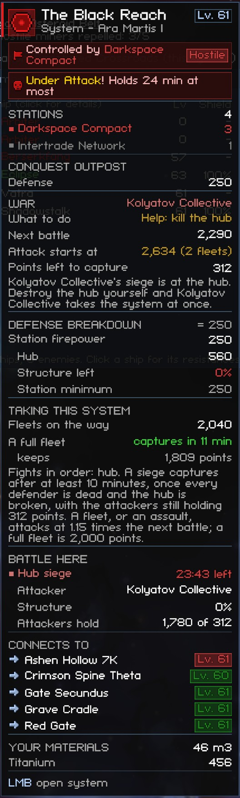
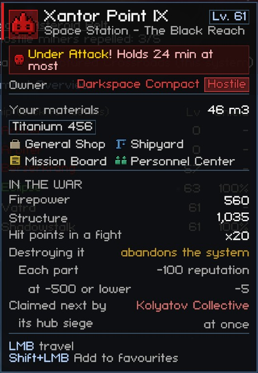
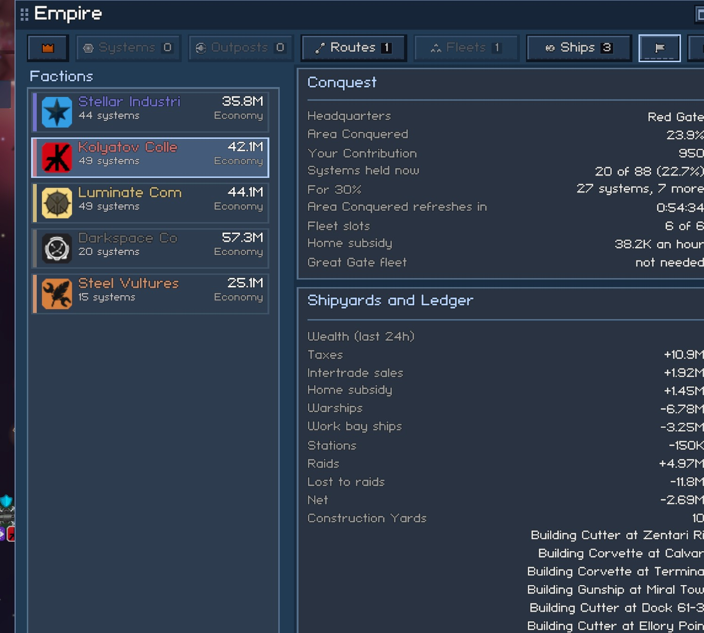

# Conquest

The Conquest war opens with the level 28 story step, so this page uses the terms of that stage: Defense, war effort, Combat Power and Area Conquered. What those numbers mean in the game is explained on the [war](../../mechanics/conquest/war.md) and [sector control](../../mechanics/conquest/sector-control.md) pages. The config keys for these settings are listed in [settings.md](../settings.md).

## Conquest Details

The game shows a war-zone system's Defense as one number, and it shows a fleet as a label such as "Reinforcing". The figures the game plans with stay hidden. These include what the Defense number adds up from, the next battle strength that NPC fleets compare against, how many fleets a capture needs, and two of the three timers.

The Conquest Details feature puts these figures on the cards and windows you already use, plus one window of its own. It also turns them into a short piece of advice per system. Every total is read through the game's own functions, so a breakdown always adds up to the game's Defense row.

### System Cards

Hover a war-zone system on the galaxy map, or in a sector. The card gets a short War block right below the game's Conquest outpost block. The block has at most six rows, so the card stays under half the screen:

- What to do: the advice for the faction you back (see [What to Do](#what-to-do)). The block's header names that faction.
- Next battle: the strength that NPC fleets compare against, with the fleets on the way counted in.
- Attack starts at: the points a fleet, or an assault, needs before it starts an attack. This is 1.15 times the next battle. The row also shows how many full 2,000-point fleets that is.
- Points left to capture: what the attackers must still hold when the hub breaks.
- Firepower halved: shown for the hours after a system changes hands, with the time until the station firepower is back at full.
- A running fight, with its stage and the time left.

The card ends with the hint "Hold Shift for the full breakdown". The key is set in "Key for the full breakdown". It is LeftShift by default, and either Shift key counts. The key is ignored while you type in a text field. While you hold it, the card rebuilds with these parts:

- Defense Breakdown: the station firepower term and what shaped it. The shaping parts are the hub's firepower, the Defense stations' firepower together, "Just changed hands" at x0.5, the station cap, the station minimum, the structure left, the war effort multiplier and the sector bonus. Below those come the garrisons with the ships present and wanted, the defending fleets and your patrol ships. The header reads "= Defense".
- Taking This System: the fleets on the way. For a system with no Defense station, defending fleet or patrol, "A full fleet" plays the hub siege out with the average damage roll and no hull edge. It shows when the siege captures the system and how many points it keeps, or that it ends in a skirmish, is repelled or is destroyed. "No taxes for" counts down the first two hours after a capture. Below the rows come the fights in order and the rule for a capture.
- The reasoning behind the advice, under the War block.
- Battle Here: every fight at the system. Each fight shows its stage, the time left, the attacker, the structure left, the defenders still alive, and what the attackers hold against what the stage's end needs.

Setting "System card detail" to "Always the full breakdown" shows all of this all the time. The War Overview's system cards are always the full breakdown, because that window is where you study systems.

A card taller than the screen slides along the screen edge beside the mouse instead of running off it. This is the "Keep hover cards on the screen" setting, described in [Hover Cards Stay on Screen](interface.md#hover-cards-stay-on-screen).

The War block also covers three special cases:

- An unowned system's War block says it is free. The first fleet to arrive claims it, and the block names the faction that abandoned it ("Abandoned by").
- A headquarters says it can't be taken.
- Your capital says "Your capital".

#### What to Do

The card gives one short phrase per system, for the faction you back. That faction is the one of your accepted 30% mission. If you have none, it is the major faction that holds the most systems. The War Overview can pick another faction. The phrase is worked out from the game's own numbers. The rules run in the order of the table, and the first rule that fits wins:

| Phrase | Color | When it shows |
|---|---|---|
| Can't be taken | muted | The system is a headquarters. |
| Your capital | muted | The system is your capital. |
| (none) | none | The faction already holds the system. |
| Battle running | muted | A fight is on at the system (but see "Help: kill the hub" below). |
| Free: claimed on arrival | green | The system is unowned. |
| Not on the front | muted | None of the faction's systems border the system, so its fleets can't pick it. |
| Skipped: under-10% rule | muted | The faction holds under 10% of the war zone, and the owner holds 10% or more. |
| Fleet already on the way | green | One of the faction's fleets is attacking the system, or gathering for an assault on it. |
| Leave it: 1 fleet takes it | green | One full fleet is enough to start, and the hub siege estimate captures the system. |
| Leave it: 1 fleet starts | green | One full fleet starts the attack, but there are defenders to kill first, so the finish is unknown. |
| Help: kill its fleet | orange | An assault is needed, and killing the fleets that defend the system brings the attack down to fewer fleets (an exact figure). |
| Help: war effort missions | orange | An assault is needed, and the full war effort penalty (5 missions of 0.1, lasting 3 hours) brings the attack down to fewer fleets, or turns a failing single fleet into a capture. |
| Help: 1 fleet falls short | orange | One full fleet starts the attack but doesn't finish it, and nothing you can do here changes that. |
| Skip: needs N fleets | muted | No single action brings the number of fleets down. |
| Help: kill the hub | orange | Replaces "Battle running" (only when the fight is a siege at its hub stage), "Skipped: under-10% rule", "Help: 1 fleet falls short" or "Skip". Destroying the hub hands the system to the faction (see [Hub Kills](#hub-kills)), and the owner is your enemy, because a plain click only targets an enemy's station. |

The reasoning under the advice on the full card gives the numbers:

- the fleets before and after
- the missions needed, counting the penalty the system already has and its time left
- where to run the missions: a hub next to the system, ideally one of your faction's, with a reward line that names the owner

The war effort what-if runs the game's own Defense function with the penalty set, so it matches the number the game will show after the missions.

Some systems have no way to help: the advice is "Skip", "Skipped" or "Help: 1 fleet falls short". For these, the reasoning also says what a hub kill would do instead, or why it wouldn't help. The reasons are:

- another faction's fleet gets there first
- the old owner's own fleet in the system claims it straight back
- no faction next door has a free fleet
- the owner isn't your enemy yet

#### Hub Kills

Destroying a war-zone hub abandons the system. The feature works out who gets the system from the game's own rules. The [sector control](../../mechanics/conquest/sector-control.md#what-moves-your-factions-share) page has the mechanics.

- If a siege is at its hub stage, the siege's lead attacker takes the system the moment the hub dies.
- Otherwise every fight there ends and the system is unowned. A fleet already flying in to attack the system claims it when it lands. At the next Fleet orders countdown, each faction that borders the system sends a free fleet. The countdown runs every 10 minutes for all factions at once, and it runs straight away for the factions of a fight that just ended there. The feature picks the fleet the way the game's planner does:
  - A faction's free fleets are its idle fleets in order, less the ones it sends to a refit, the ones it sends to defend one of its own systems under attack, and the ones that are gathering for an assault.
  - Each free fleet takes its best target within 4 jumps, and an unowned system comes first.
  - The fleet that lands first claims the system. Landing takes 60 seconds plus 150 seconds a jump.
- Once claiming is unlocked for you ("Beyond the Front"), the game offers you the system first. The prediction describes what happens if you decline.

When a faction other than the old owner claims the system, the old owner's Defense stations are razed, so you can leave them.

The planner can still differ from the prediction. A free fleet's best target can be another unowned system that it reaches first. A fleet that the same pass sends elsewhere for reasons the feature doesn't model isn't free. The developer harness checks the prediction against the game's own planner on a staged hub kill ([dev-harness.md](https://github.com/williammabernathy/Igi-s-QoL-Modpack/blob/main/docs/modpack/dev-harness.md)).

### Fleet, Delivery and Station Cards

A fleet's card gets a War Status block. It shows these things:

- The fleet's strength as a share of full strength, with a bar.
- The strength below which it retreats (35%) and the strength at which it's back on duty (75%).
- What its order means.

The map's "Reinforcing" label stands for three different things, and the block says which one applies: moving up to the frontline, retreating to recover (under 35%), or resting after a retreat. An idle fleet says when it gets its next order.

A fleet that defends a system your faction can attack says how destroying it changes that attack. For example: "Destroying it takes the Kolyatov Collective's attack on Pale Zone from 3 full fleets to 1."

A fleet on its way to attack, or gathering for an assault, shows its target's next battle against its own strength. For an assault, it shows the whole assault's strength. The block then shows any system the fleet is blocked from attacking again and for how long, damage it hasn't repaired yet (100 points an hour while resting at home), and whether it's due for a refit.

A warship delivery, which the map also labels "Reinforcing", gets a note: a new warship is on its way to its fleet or garrison.

A hub's or Defense station's card gets an In the war block. It shows these things:

- The firepower and structure the station adds to the Defense number. It reads "estimate" while the station's contents aren't generated yet.
- Its hit points in a fight (x20, or x30 for a headquarters hub).
- What destroying it costs. A hub abandons the system, and each part costs reputation. A Defense station costs 5,000 reputation, or 1,000 if you're already Hostile.

A hub also shows "Claimed next by". This is the faction that would get the system if you destroyed the hub now, and how it would get it: its hub siege at once, or its fleet with the jumps and the time. The row reads "toss-up" when two factions' fleets would land together, and "no one yet" when no faction would claim it. With claiming unlocked, a "Claim offer" row comes first. A headquarters hub shows no claim rows, because the system can't be abandoned.

A Defense station also shows its garrison, the garrison's points and its ship level. It adds a line saying that its Defense stations are razed when another faction claims the system after a hub kill. An economic outpost shows its raid cooldown.

Every row the feature adds is kept short enough for the game's row layout, which doesn't wrap and cuts text with no ellipsis. Longer text goes in a wrapping note or description.

### Faction Overview

On the galaxy map, the Empire window's Factions tab shows a faction's Headquarters, Area Conquered and Your Contribution. For a conquest faction, the feature adds these rows:

| Row | What it says |
|---|---|
| Systems held now | The faction's systems counted now, out of the total that the 30% missions divide by. Area Conquered is the share stored at the last Conquest Update. |
| For 30% | The systems "Hostile Takeover", "The People's Sector" and "Harmony" need, and how many more the faction needs. |
| Area Conquered refreshes in | The countdown to the next Conquest Update, in H:MM:SS. |
| Fleet slots | The fleets the faction fields, out of its cap. Below the cap, warships cost half as much and build three times faster. |
| Home subsidy | The wealth the faction gets every economy tick. |
| Great Gate fleet | Whether a Great Gate fleet is wanted, when it is wanted, and whether it is free or paid. |
| Under 10% of the war zone | Shown only when the faction is under 10%. A faction in that position attacks only unowned systems and factions that hold 10% or more. |

Hover a row's name for the longer explanation.

The game also has a card that lists each faction's wealth ledger for the last 24 hours. The ledger covers taxes, trade, home subsidy, warships, raids and the rest. The card also lists the faction's Construction Yards, the warships it's building and delivering, and its build history. The released game only shows that card inside the Unity editor. The feature turns it on, and the game fills and refreshes it itself.

### Galaxy Map Corner and the War Overview

The Conquest Update card in the map's corner gets two rows under its bar. They show the clocks the game doesn't show, in the same H:MM:SS format as the big timer:

- "Fleet orders": when NPC factions next re-plan their fleets. This happens every 10 minutes, and right after a battle they were in.
- "Economy tick": the hourly tick that pays taxes and the home subsidy, queues builds and sends Great Gate fleets.

The game's own (i) tooltip on that card says that factions rethink their strategy at the Conquest Update. The feature adds a line saying that they do it on the Fleet orders clock. A flag button under the map's own corner buttons opens the War Overview.

The War Overview is a [pop-out window](interface.md#pop-out-windows). By default it shows while the galaxy map is open, and it draws over the map. At the top are the three timers in H:MM:SS. Below them is one row per faction in the war, with these columns:

- systems held
- "Systems Now %", the live share
- Area Conquered, the share stored at the last Conquest Update
- "30% Goal", the systems held out of the systems it needs
- fleet slots
- Combat Power
- wealth

Under the table is a block for the faction the window tracks. That is the faction of your accepted 30% mission. If you have none, it is the major faction that holds the most systems. The Options button has "Targets of" to pick another faction. The block has four parts:

1. Where it stands: the faction's systems against what 30% needs, and when Area Conquered updates. With enough systems, it says whether to talk to the commander now (Area Conquered already shows 30%) or after the next Conquest Update.
2. "Do this next": the best place for your help. The order is:
   1. A system where one action turns an assault into a one-fleet job comes first.
   2. Then comes a hub kill that hands a system to the faction.
   3. Then comes the system that comes closest to a one-fleet job.

   The line names the system, the action and the fleet count before and after. When there is nothing to help with, it says that the faction's fleets are already on the way, or that nothing is worth doing.
3. "Leave alone": the systems the faction will take on its own, with up to three names.
4. Until "Beyond the Front" unlocks claiming, a line saying what you can do instead. You can kill a defending fleet, run war effort missions at a hub next door, or destroy a hub where the faction's fleet would claim the system first.

Below that is a list of systems with their owner, Defense, next battle and what to do. The "List" option in the window's Options picks which systems the list shows:

- "Targets of a faction" is the default. It lists the systems that the faction's fleets pick their attacks from. The "Sort targets by" option sets the order. The default, "Where your help counts first", puts the systems where your help counts first. Then come the systems the faction handles alone, and then the ones not worth a visit. The faction's own preference order breaks ties. The other choice, "Order its fleets prefer", keeps the order its fleets prefer. The last column is the advice. A running fight shows its stage and clock. A help row names its action and the fleet counts ("Help: kill its fleet, 3 to 1 fleets", "Help: 2 war effort missions, 3 to 1 fleets"). It reads "Help: kill the hub now" when the siege is already at the hub. The other rows use the phrases from the [What to Do](#what-to-do) table.
- "Sector shown on the map" lists every war-zone system of the sector the map shows, by name. Click a sector on the map to change it. The advice is the tracked faction's. A system it can't reach says "Not on the front", and one it already holds says "held by" and its name.

The window refreshes once a second while it shows. With click-through on, hold the key set in "Key to use a click-through pop-out" and hover a system's name for its full card.

