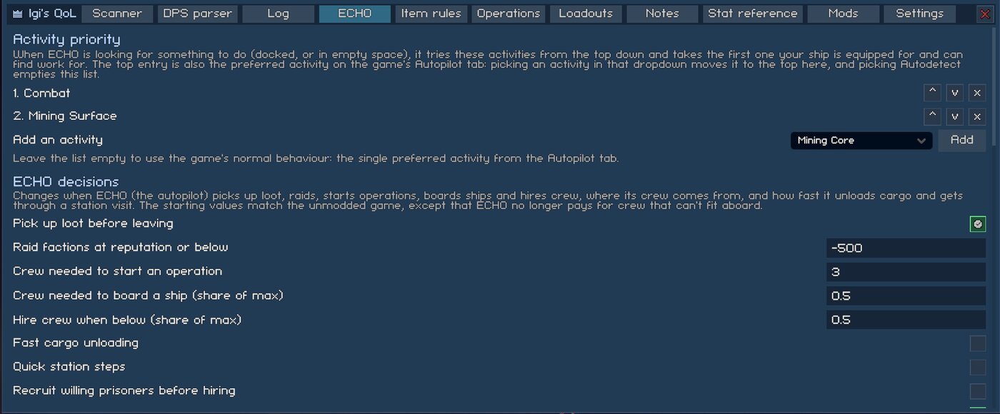
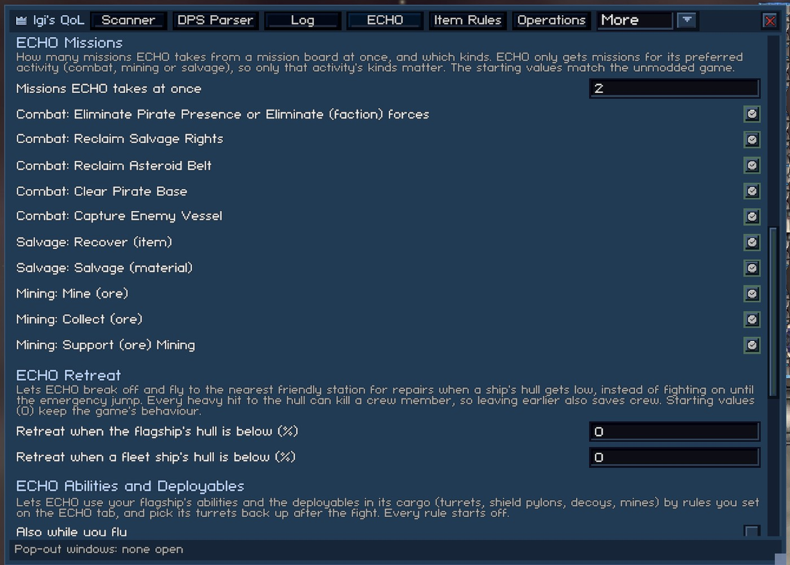
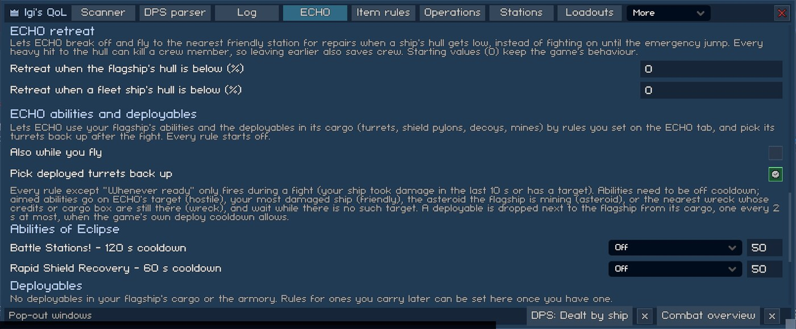
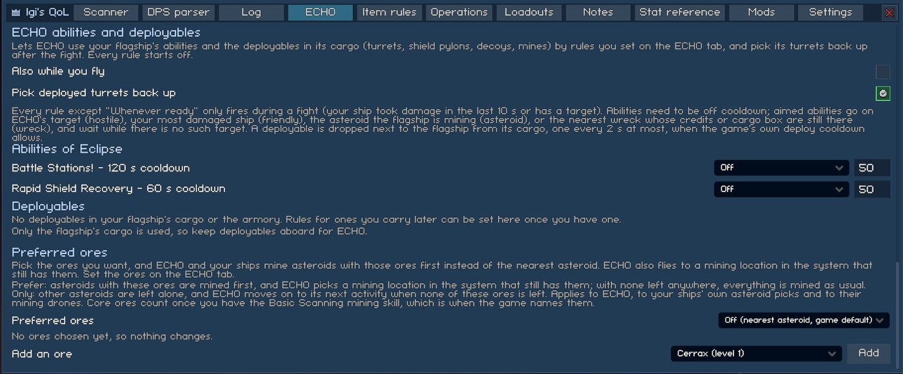
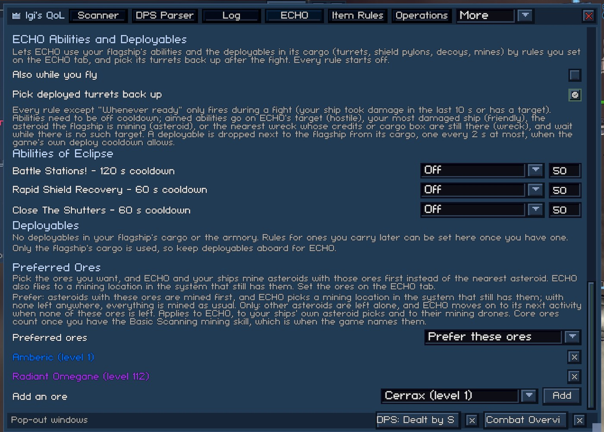

# ECHO, the Autopilot

ECHO is the game's autopilot. When it is switched on, it picks missions, mines, salvages, fights, unloads at stations and hires crew without you. The features on this page change how ECHO decides. Most of their settings are on the ECHO tab of the mod window, and that tab is there while any ECHO feature is on. The config keys for these settings are listed in [settings.md](../settings.md).

Every setting here starts at the game's own behaviour, with two exceptions:

- ECHO no longer pays for crew that can't fit aboard ("Hire only crew that fits aboard", see [ECHO Decisions](#echo-decisions)).
- ECHO skips a location for five minutes after it finds nothing to do there ("Skip empty locations for (minutes)", see [Empty Locations and Back-and-Forth Trips](#empty-locations-and-back-and-forth-trips)).

## ECHO Activity Priority

The activity list is an ordered list of activities: Mining Surface, Mining Core, Salvage Surface, Salvage Core, Combat and Cargo. These are the same names as in the Autopilot tab's dropdown. Each row has up, down and remove buttons. An "Add an activity" dropdown at the bottom adds the activities that aren't listed.

When ECHO looks for something to do (docked, or in empty space), it tries the activities from the top down. It takes the first one that your ship is equipped for and that has work to find. Cargo has no search of its own (the game has none either), so it only matters at the top of the list. If none of the listed activities fits the ship's loadout, the status line says there is no suitable loadout for the top one.

The top entry is also the game's preferred activity:

- Picking an activity in the Autopilot tab's dropdown moves it to the top of this list.
- Picking Autodetect empties the list.
- Putting Cargo at the top turns on the Autopilot tab's missions switch.
- An empty list is the game's behaviour, with one preferred activity.

The list is saved per save game.

Missions follow the top activity only. ECHO works on a held mission when its kind matches the top entry, and the mission boards offer it missions for that activity only. With "Prefer missions" off on the Autopilot tab, ECHO tries the listed activities before the missions you accepted. A listed activity that always finds something to do therefore keeps ECHO away from those missions.

### Empty Locations and Back-and-Forth Trips

The game picks a place to work from a distance. A location qualifies when it has asteroids, salvage or hostile units. The game checks again once ECHO has arrived, with a stricter test. Where the two tests disagree, ECHO flies to the location and finds nothing it can use (the game logs "No valid targets for modules"). It then flies to a station, and the first test sends it straight back. The same can happen between two mission locations when "Missions ECHO takes at once" is above 1.

"Skip empty locations for (minutes)" breaks that loop. The setting is on the ECHO tab under the activity list. It accepts 0-60 minutes, and the default is 5. When ECHO arrives somewhere and finds nothing to work on, it remembers the place for that many minutes. During that time ECHO skips the remembered place in two situations:

- its search for something to do (the activity list, or the game's single preferred activity)
- its flight to the next open mission

After the time is up, ECHO considers the place again. The memory is cleared when you load a save or switch ECHO on. A value of 0 turns the setting off, which is the unmodded game. If a location fills up after ECHO left, for example because hostile miners arrive over time, ECHO leaves it alone for those minutes anyway.

When ECHO makes four trips in a row between the same two places (A, B, A, B) within six minutes, the mod writes one line about it. The line goes to two places:

- the Log tab, as an ECHO line
- the BepInEx log (`BepInEx/LogOutput.log`), as a warning tagged `[EchoPriority]`, followed by one line per recent trip

The line reads like this:

> ECHO made four trips in a row between Tower I and Iron Belt in 3.1 minutes. Status: "Going to Iron Belt". Decided by: activity list, entry 1 (Mining Surface). Mission: 'Mine Iron' at Iron Belt, accepted by you. Activity list: Mining Surface, Combat. Last stop: found nothing it could work on at Iron Belt (the game's "No valid targets for modules"). Skipping as empty for now: Iron Belt. If ECHO was mining, salvaging or unloading in between, this is normal.

Each line says three things:

- what chose the trip: an activity list entry, the next open mission, or the game's own decision
- whether ECHO took the mission itself or you accepted it
- where ECHO last found nothing to do

The same pair of places is reported once until ECHO goes somewhere else. Short normal trips can also trigger the line. The last sentence of the line says so.

## ECHO Decisions

These are the thresholds ECHO checks before it acts. Each one defaults to the game's value, except where noted. The number in brackets is the default.

| Setting | What it does |
|---|---|
| Pick up loot before leaving | ECHO collects the loot floating nearby before it flies on. When this is off, ECHO leaves sooner. |
| Raid factions at reputation or below (-500) | Raiding costs reputation, so ECHO only raids factions that you are already at or below this reputation with. A higher number such as 0 lets ECHO raid factions you get on better with, and you lose that reputation. The Umbral transponder skips the check, as in the game. |
| Crew needed to start an operation (3) | ECHO only starts an operation when at least this many of your crew can take part. Pilots don't count. |
| Crew needed to board a ship (0.5) | For operations aboard ships, ECHO also needs crew equal to at least this share of the flagship's maximum crew. |
| Hire crew when below (0.5) | ECHO flies off to hire crew when the flagship's crew drops below this share of its maximum. A value of 0 stops those trips. |
| Fast cargo unloading (off) | ECHO unloads a whole stack per step, as much as storage has room for. Normally it unloads a few items every few seconds. With this on, a full hold empties in a few steps instead of minutes. |
| Quick station steps (off) | At a friendly station, ECHO makes its next decision 2 s after it docks. This is the game's minimum. It also decides after 2 s following a decision that changed its missions, flagship crew, cargo or credits, and once the flagship is repaired. Normally it waits its whole decision time (12 s, less with the Prompt Engineering skills). A visit that turns in a mission and takes the next one is about half a minute shorter. While ECHO waits for a mission to come up, it keeps the normal time, so it doesn't decide more often than it would anyway. |
| Recruit willing prisoners before hiring (off) | When ECHO tops up the flagship's crew, it recruits willing prisoners of the missing crew types. This happens after the crew reserve is used and before hiring, and it takes prisoners from the flagship brig, the fleet brigs and the station brig. A recruit costs 40% of the crew price, as on the brig screens. This needs ECHO's "buy crew" setting to be on. |
| Hire only crew that fits aboard (on) | The game asks for a crew type's whole shortfall, charges for all of it and drops what doesn't fit. With this on, ECHO takes crew from the reserve and pays only for the crew that fit. |
| Make room for short crew types (off) | Before it tops up the crew, ECHO moves crew that are above their share in the crew ratios to the reserve. It moves as many as the short types can get right away. Types with no share set are never moved. |

## ECHO Missions

The "Missions ECHO takes at once" setting (1-5, default 1) lets ECHO take several missions from a board in one visit. ECHO only takes missions it would work on itself, meaning missions that aren't too risky for the flagship and that the flagship's loadout fits. It stops at the game's own mission limit.

ECHO flies from each finished mission location to the nearest open one in the system. It then turns all the missions in on one trip home. This takes one station decision (12 s by default) instead of one per mission. ECHO turns in finished missions at the station it's docked at before it picks a new one.

ECHO still goes home first when any of these is true:

- The hold is full.
- It has no ammo it could restock.
- Crew is short.
- The flagship's hull or armor is below half.
- A ship is below its hull threshold, with [ECHO Retreat](#echo-retreat) on.

At 1, or with travel off in the Autopilot tab, ECHO goes home after each mission, as the game does.

Below that setting is one switch per mission kind that ECHO can be given. Each switch is labelled with its activity:

- "Combat: Eliminate Pirate Presence or Eliminate (faction) forces"
- "Combat: Reclaim Salvage Rights"
- "Combat: Reclaim Asteroid Belt"
- "Combat: Clear Pirate Base"
- "Combat: Capture Enemy Vessel"
- "Salvage: Recover (item)"
- "Salvage: Salvage (material)"
- "Mining: Mine (ore)"
- "Mining: Collect (ore)"
- "Mining: Support (ore) Mining"

A kind that is switched off is never offered to ECHO. ECHO only gets missions for its preferred activity, so only that activity's kinds matter. If every kind of that activity is off and no mission is held, ECHO skips missions and goes on to its activities, whatever the other activities' switches say. A flagship without a preferred activity skips missions only when every kind is off. Courier missions (the Cargo activity) have no switch here. They stay under the Autopilot tab's own switch.

Missions you accepted yourself before you switched ECHO on follow the same rules, with one fix for courier missions. With courier missions off on the Autopilot tab, the game still sent ECHO to a courier mission's station. The game also refused to work on any mission while that courier mission came first in your list, so ECHO flew to the station and did nothing else.

With this mod on, ECHO ignores courier missions while that switch is off. It works on the next mission instead, and it doesn't count the courier mission against "Missions ECHO takes at once". A finished courier mission at the station ECHO is docked at is still turned in. ECHO only sees held missions whose kind matches the top activity of the list. A mining mission you accepted while Combat is on top is left alone.

Clear Pirate Base is an installation raid. It takes 3-5 minutes, finds credits and items aboard, and costs some crew, which ECHO hires again at the station. In two 30-minute test runs, these missions paid far more than the other combat missions. The Autopilot tab's operations setting also rules out Clear Pirate Base and Capture Enemy Vessel.

## ECHO Retreat

Two settings, "Retreat when the flagship's hull is below (%)" and "Retreat when a fleet ship's hull is below (%)", set the hull level at which ECHO retreats. Each accepts 0-90, and 0 turns it off.

While ECHO is on, it checks the flagship's hull and the hull of each fleet ship at the same location. When one drops below its threshold, ECHO takes these steps:

1. It stops fighting and skips the loot pickup.
2. It flies the fleet to the nearest friendly station, or to the home station when that is in this system.
3. It docks and waits for the Personal Hangar's free auto-repair, which takes about 200 s. The Station Services setting "Pay for repairs when you dock" buys the 20 s repair instead ([Station Services](stations.md#station-services)).
4. It carries on.

The status line reads, for example, "Retreating to Tower I for repairs: Eclipse hull at 20%".

ECHO doesn't leave in three cases: while an operation or boarding is running, from next to a station, or on a trip it's already making. When the Autopilot tab's travel is off, or no friendly station can be reached, ECHO stays, and the status line says so.

Without these settings, the flagship fights until the emergency jump at 0 hull, and every heavy hull hit can kill a crew member. The 10 autopilot sessions that one save kept had 50 emergency jumps in 48 hours. Fleet ships already leave by themselves at 10% hull for two minutes of repairs, so "Retreat when a fleet ship's hull is below (%)" only matters above 10.

## ECHO Abilities and Deployables

Each flagship ability and each deployable type gets a rule. Deployables are listed from the flagship's cargo or the armory, but only what is in the flagship's cargo is dropped. A rule is one of these:

- "Off"
- "In combat, when ready"
- "Shields below %"
- "Armor below %"
- "Hull below %"
- "Targeted by at least" (a number of enemies)
- "Whenever ready"

Each rule has a number box next to it (1-100, default 50) for the percent or the number of enemies. All rules start off. The rules only run while the flagship is in space and not travelling, and the ability rows show while you're in space.

- Every rule except "Whenever ready" only fires in a fight, meaning damage in the last 10 s or a target.
- Untargeted abilities fire as they are. Hostile-targeted abilities go on ECHO's target. Friendly-targeted abilities go on your most damaged ship. Asteroid abilities (Crackshot Drone) go on the asteroid the flagship mines. Wreck abilities (LB-RTR, SF-CRK) go on the nearest wreck whose cargo box or credits are still there. Drone-targeted abilities aren't automated.
- Toggle abilities are switched on while the rule holds. They are switched off again, once the ability is ready, only if the rule switched them on.
- Deployables (turrets, shield pylons, decoys, mines) are dropped from the flagship's cargo. ECHO drops at most one per 2 s, and only when the game's deploy cooldown allows it.

"Pick deployed turrets back up" (on) picks up the turrets these rules dropped, using the tractor beam. It does this 5 s after the fight and before ECHO leaves the location. ECHO waits for the turrets as it does for its own loot, also when "Pick up loot before leaving" is off. Turrets you placed yourself stay where they are. "Also while you fly" (off) applies the rules while you fly the ship yourself.

## Preferred Ores

This feature has a list of ores and a mode, saved per save game. The mode dropdown reads "Off (nearest asteroid, game default)", "Prefer these ores" or "Only these ores". You add ores from an "Add an ore" dropdown. The dropdown lists them by name and level and colours them by rarity. Adding the first ore switches the mode from Off to Prefer.

- Prefer: ECHO, your ships' own asteroid picks and their mining drones take the nearest asteroid with a listed ore first. ECHO picks a mining location in the system that still has one. When no listed ore is left anywhere, mining works as usual.
- Only: other asteroids are left alone. ECHO moves on to its next activity when no listed ore is left.
- Off (the default), or an empty list: the game's behaviour.

Core ores count only once you have the Basic Scanning mining skill, because that is the point where the game's asteroid tooltip names them. The [Scanner](loot-and-cargo.md#scanner) marks the listed ores and can point edge markers at them.

## ECHO's Operations

This feature adds three choices for operations that ECHO starts on its own: Stealth, Ammo and Auto Accept Buyouts. They are labelled "ECHO: Stealth", "ECHO: Ammo" and "ECHO: Auto Accept Buyouts". They sit on the [Operations tab](stations.md#operations-tab), under "Operations ECHO starts", below your own defaults.

- Stealth is "Same as yours", "Silent", "Balanced" or "Aggressive".
- Ammo is "Same as yours", "Standard", "Armor Piercing" or "Hollow".
- "Same as yours" is the game's behaviour. It uses whatever Stealth or Ammo you last picked yourself.
- "ECHO: Auto Accept Buyouts" lets ECHO accept defenders' offers to switch sides for credits when you can pay. The game never accepts these offers for ECHO.

## ECHO Cargo Rules

When ECHO unloads at a station, the dock action from the [Item Rules tab](loot-and-cargo.md#item-rules) decides what happens to each stack. The actions are to deposit as usual, keep it aboard, sell it, or deposit up to an amount and sell the rest. Three kinds of items are never touched: favourite stacks, the ammo a ship fires, and the usable items the game keeps aboard while ECHO unloads. The fleet auto-deposit described below does deposit those, as the game does. The Sell and "Sell, keep up to" actions both leave the items your missions still need aboard.

ECHO sells before it deposits. Each unload step first looks for something to sell on the flagship and on every fleet cargo ship. It deposits only once nothing is left to sell. With "Sell, keep up to", the part above the amount you set is sold right away, and only that amount goes to storage.

At a station without a shop, nothing can be sold. The game's own unload then takes over once storage holds that amount, and it deposits the rest chunk by chunk past it. A full material storage or armory then holds up only the deposits. The game's ECHO stops at the first stack that doesn't fit and never reaches the stacks behind it.

"Apply when fleet cargo auto-deposits on dock" (on) covers the game's fleet auto-deposit too. That feature empties fleet holds the moment you dock. With the setting on:

- "Keep aboard" stays aboard.
- "Sell" stays aboard until ECHO unloads it.
- "Sell, keep up to" deposits up to the amount you set.

When you dock yourself, nothing is sold, unless Station Services' "Sell by item rules when you dock" is on or you press the airlock's Sell by rules button. With that setting on, the fleet auto-deposit runs after the sale instead of at docking. With "Apply when fleet cargo auto-deposits on dock" off, the game deposits everything as usual, so the rules only matter for fleet ships with auto-deposit off.

A delivery mission (salvage or ore samples, a black box, a trade order) counts what sits in its delivery station's storage, your armory, your data inventory and your fleet's holds. Material stored at any other station doesn't count. A cargo route can also haul the material out of the delivery station's storage, or sell it. Either way the mission stops counting it, so ECHO goes back for more and never turns the mission in. "Keep items your missions need" (on by default, because the game's handling loops ECHO) prevents this:

- When ECHO unloads, and when fleet cargo auto-deposits on dock, ships keep aboard the materials your missions still need. At the station the delivery goes to, they deposit as usual, because that storage counts.
- Your cargo routes leave the amount your missions need in a station's storage. They ship only what is above it.

Items that go to the armory or the data inventory are deposited as usual, because those count wherever the delivery is. Selling by item rules never touches the items your missions need, with this setting on or off.

Data items (intel and records, blueprint pieces, jumpgate passes, claims) never sit in cargo. The game puts them straight into your data inventory. With "Sell from the data inventory" (on), a "Sell" or "Sell, keep up to" rule that names the item or its category sells them from there. It sells one stack per unload step, after the cargo sales and before any deposit. "Sell, keep up to" keeps the amount you set in the data inventory. The default rule and the any-category "rarity and below" rules never sell from the data inventory, so a catch-all rule can't sell your blueprint pieces. Favourites and the items your missions need stay. The setting applies to Station Services' selling too.

Material storage is kept per station. With "Sell from station storage" (off by default), the same rules also sell what is already stored at the station you're docked at. Only the rules that name the item or its category do this. ECHO sells one stack per unload step, after the data inventory and before any deposit. "Sell, keep up to" keeps the amount you set in that station's storage, so a storage that already holds more is trimmed back to it. Favourites and the items your missions need stay. The setting is off by default because it sells stock you stored on purpose. It applies to Station Services' selling too.

The armory holds the weapons, modules, boosters, ammo and usables that you or ECHO stored, for every station at once. With "Sell from the armory" (off by default), the same rules also sell from the armory. Again, only the rules that name the item or its category do this. ECHO sells one stack per unload step, last: after cargo, the data inventory and station storage, and before any deposit. "Sell, keep up to" keeps the amount you set in the armory.

On top of favourites and the items your missions need, the armory keeps these items:

- the usables the game keeps aboard
- warp fuel
- every ammo type that a ship of your fleet fires
- the exact pieces that any saved [loadout](stations.md#ship-loadouts) uses

A piece of the same type and rarity that no loadout names can still be sold. The setting is off by default because it sells gear you stored on purpose. It applies to Station Services' selling too.
