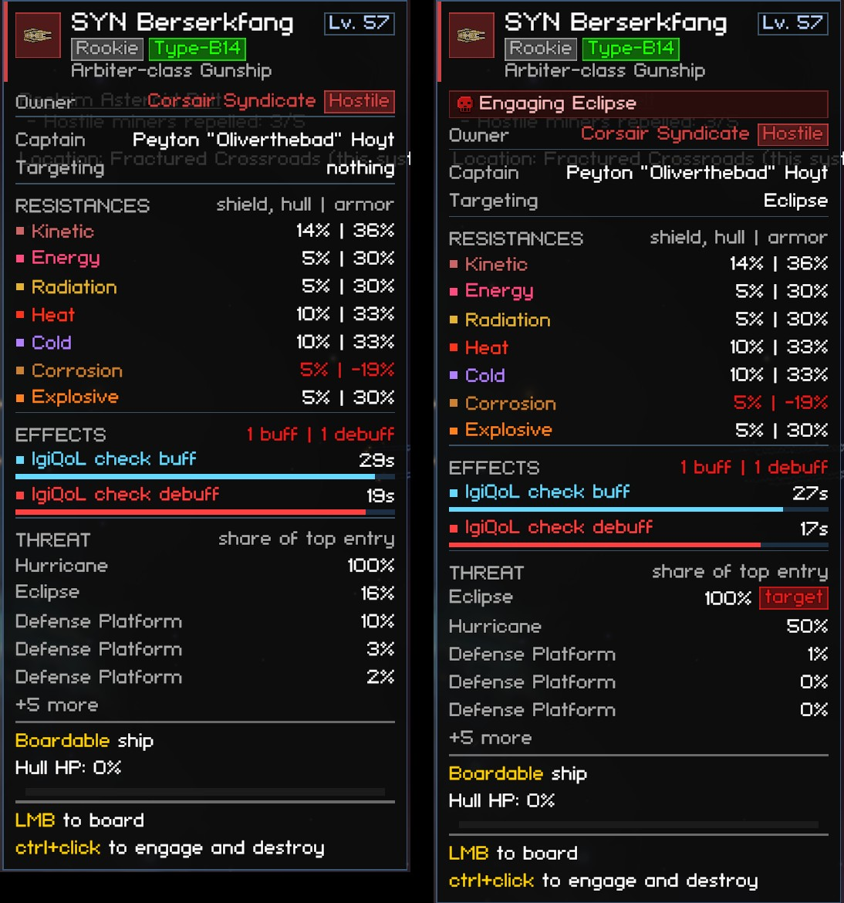
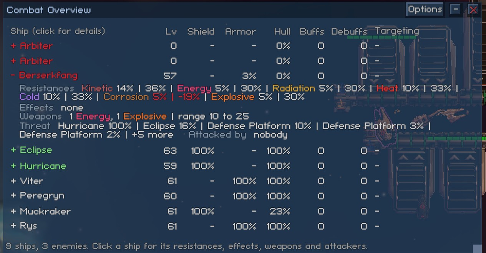

# Fleet and Combat

This page covers how your ships pick targets, how close they fly, and what their missiles and drones do. Most of these features have a default on the Settings tab and a per-ship override in the [ship settings popup](interface.md#ship-settings-popup). The config keys for these settings are listed in [settings.md](../settings.md).

Your own clicks on the flagship and your attack orders always win over everything on this page.

## Target Priority

Target Priority decides which enemy your ships attack when they pick a target on their own. The Settings tab's "Target choice" sets the rule for every ship:

| Rule | What it picks |
|---|---|
| Nearest | The closest enemy. On its own, with nothing else set, it leaves the choice to the game, which doesn't always take the closest (see below). |
| Lowest hull / Highest hull | The most damaged enemy, or the healthiest enemy. |
| Hurting my fleet most | The enemy that has hurt your ships most in the last 3 seconds. |
| Attacking my flagship | Enemies that hit the ship you fly in the last 3 seconds, or that have it as their target. |
| Smallest first / Largest first | Enemies ordered by hull class. Drones and carrier fighters count as the smallest. Anything that isn't a ship (turrets, station parts) counts as the largest. |
| Lowest level / Highest level | Enemies ordered by their level. |
| Most vulnerable to my weapons | The enemy that takes the most damage from the ship's guns. The game works this out from each gun's expected DPS times what the enemy lets through of that damage type, on the layer a hit lands on now. Shields have no resistance per damage type. Armor adds its own resistance or weakness, including the paint strip. |
| Most debuffs first | The enemy carrying the most debuffs. This counts the debuffs the game's buff bar marks red, stat penalties applied from outside such as the painter drone's strip, and an armor paint strip. |

"Most vulnerable to my weapons" and "Most debuffs first" only prefer an enemy that leads by more than their "needs a lead of (%)" setting (0 to 200, default 25). For example, an enemy is only preferred when it takes more than 25% more damage than the other choice. A smaller lead counts as a tie, so a small resistance gap never drags a ship across the field. Any debuff beats none.

"Re-check target every (seconds)" (0 to 30, default 0) sets how often a ship applies its rule again.

- At 0, a ship stays on the target its rules chose until the target dies or leaves. With Nearest alone, the game re-picks about once a second and switches when another enemy scores 25% higher.
- Above 0, the ship switches only when another enemy beats its target by the rule's margin, for example 10 points of hull or 20% closer. This keeps ships from flickering between two similar targets.

"Finish off targets below (% of hull)" (0 to 100, default 0) keeps a ship on a target whose hull is below that share, so nearly dead enemies get finished off.

Nearest alone leaves the choice to the game. Since game version 0.8.3.5, that isn't the nearest enemy. All of a faction's ships at a location share one threat list, fed by every hit any of them takes. About once a second, each ship scores the enemies on that list by their share of the threat, by how far away they are, and by how many allies already fight them. It switches only when another enemy scores 25% higher. The ship you fly is moved onto that pick too, unless you hold a target yourself.

With any other rule, a re-check time, a level cap or a distance limit, the ship's rules decide for your ships instead of that score. They rank the enemies at the location that are in the ship's scanner range. If none is in range, the game's pick is used, except for a fleet ship with "Only attack within": it gets no target past that distance. A Defensive ship answering a hit keeps the game's choice.

"Attacking my flagship" adds an answer the game doesn't have. A fleet ship that has this as its first rule switches to whoever hits the ship you fly, even when re-checking is set to 0. It checks with each pick, about once a second. The ship keeps its current target in these cases:

- The attacker doesn't beat its current target by the margins of its rules.
- The ship is finishing off a target.
- The attacker is past the ship's "Only attack within" distance.
- The ship is on Hold Fire.
- The ship has a target from you, an attack order or its stance (Escort and Defensive).

In the popup, a ship can use up to three rules in order: "Target choice", then two "Then by" rows. For example: "Attacking my flagship", then "Most vulnerable to my weapons", then "Nearest". Enemies are compared rule by rule. A difference within a rule's margin counts as a tie, and the next rule decides. The margins are:

- "Lowest hull" and "Highest hull": 10 percentage points of hull (for example 40% against 48% is a tie).
- "Nearest": 20% of the current target's distance, and at least 2 units.
- "Hurting my fleet most": 25% of the damage taken.
- "Most vulnerable to my weapons" and "Most debuffs first": the lead described above.
- Size, level and "Attacking my flagship": an exact tie.

After the last rule, the nearest enemy wins. So a rule placed first wins over the ones after it, and a rule placed later is a fallback. Re-checks go through the same rules.

"Attacking my flagship" only pulls a ship onto whoever hits your flagship when it's the first rule. Further down the list, it breaks ties like any other rule. Weapon rules stay one rule each, and the Settings tab's "Target choice" stays the one rule for ships without their own. Choosing "None" in a "Then by" row ends the list of rules there. Saves from before ships could have several rules load each ship's rule as a single rule.

The ship settings popup adds these settings per ship:

- Its own rules, its re-check interval (Never, 2 s, 5 s or 10 s) and its finish-off threshold (Off, below 25% or below 50% hull). The interval and threshold start on "Default", which follows the Settings tab. The two "Then by" rows are always listed. They are dimmed until the rule above them is set.
- "Avoid enemies above level" (0-999). The ship only picks enemies above this level when nothing else is in range. A value of 0 turns it off.
- "Only attack within (units) of the flagship" (0 to 200). Fleet ships don't pick enemies further than this from the ship you fly, and they drop a target that moves past it. A value of 0 turns it off.
- One rule per combat weapon (hardpoint). A weapon with a rule shoots the best enemy by that rule among the enemies it can hit and has in range. Otherwise it follows the ship's target, and since game version 0.8.3.5 the game turns it on the nearest enemy it can reach while the ship's target is out of its range or one it can't hurt. For example, one turret can shoot drones while the rest follow the ship. The ship itself keeps flying at its own target, and a weapon with its own pick doesn't steer it.

The Escort and Defensive stances take targets from the game. Escort copies your target. Defensive answers enemies that have hit your fleet with the game's own choice, and otherwise copies your target. Under these stances the target rules, "Attacking my flagship" included, don't decide. New fleet ships start in the Defensive stance, so set Aggressive for the rules to decide every pick. A ship on Hold Fire picks no targets. Weapon rules still apply under every stance. The ship you fly picks targets by itself while ECHO, the Autopilot, is flying it. Otherwise the game moves it onto the fleet's pick about once a second unless you hold a target, and with a rule set, the ship keeps its target until the re-check says otherwise.

## Engagement Distance

Engagement Distance sets how close each ship flies to its combat target. You set it per ship in the popup:

- Auto (game default): the game decides.
- Weapons' max range: the ship stays as far back as the shortest-range weapon that can hit the target allows. Launchers that are out of ammo don't count, as in the game.
- Fixed distance: the ship stays this many units away. The range is 6 to 30, because the game never holds closer than 6 or further than 30. If the weapons can't reach the target from that distance, the ship stops at the Weapons' max range distance.

The game measures a weapon's range to the target's hull, but steers a ship by the distance to the target's center. It only moves the ship in again once the ship is 1.2 times its distance away. Weapons' max range and Fixed distance allow for both. The farthest the ship drifts out to is still in reach of every weapon that can hit the target.

The game's own distance (Auto) leaves the target's hull out. Against a big ship, Weapons' max range therefore holds further back than Auto. Against a small ship, the two are about the same.

Engagement Distance only changes combat targeting. Mining, salvage, repair and painter modules approach their targets as the game does.

It also only matters while a ship is chasing its target. The game ignores this setting in these cases:

- A fleet ship flies in formation on Escort and Hold Fire.
- The ship has a Hold or Move order.
- The ship is on Defensive and nothing has hit it yet.

The ship you fly stays put while Hold Position is switched on in the HUD. The ship popup's tooltip says the same.

## Keep Distance in Combat

In a fight, the game flies every ship straight at a ring around its target and switches its obstacle-avoiding navigator off, so ships pile on top of each other. The "Keep distance from other ships" setting (off by default) changes this for your ships, and each ship can override it in the popup.

With it on, a fighting ship has its destination pushed away from every ship whose hull outline is closer than "Gap between hulls (units)" (0.5 to 10, default 2). A ship counts as fighting when it is chasing a target: it is not in formation, it has no Hold or Move order, and it is not held by Hold Position. The game measures the push again every 0.25 s and adds it on top of the game's own destination, so it doesn't build up.

Two rules keep this feature from fighting the game:

- A ship never pushes off the ship it is attacking. The game already parks the ship on a ring around that target. Pushing off the target as well made the two fight over the ring when a close Fixed distance put the ring inside a big hull.
- A push shorter than 0.3 units is ignored. The game counts a ship as arrived only at the pushed point. Following the last sliver of a gap kept a ship on its ring turning and thrusting sideways instead of settling.

Ships can end up a few tenths of a unit inside the gap.

The game's formation code flies a fleet ship that is in formation, on Escort or Hold Fire, or under a Hold or Move order. "Keep distance from other ships" does nothing for such a ship. While chasing, fleet ships pass through each other and the flagship by the game's own rule. They collide only once they settle into formation, which this feature doesn't touch.

"Other ships keep distance too" (off) makes enemy and allied ships that aren't yours do the same. It changes how enemies move, which is why it's off by default.

In spawned fights with 12 enemies and 4 allies (4 rounds of 33 s each way), overlapping ship pairs dropped by 42% with both settings on. The share of turrets with their target in range dropped from 78% to 71%, because ships that slide apart sometimes slide out of reach.

## Retreat for Repairs

In the game, a fleet ship leaves a fight for repairs once a hit drops it below 10% hull. It flies out, repairs for 120 s and rejoins. Your fleet ships can't be destroyed, but every hull hit of 2% or more can kill crew aboard.

The popup's "Retreat for repairs" makes a ship leave sooner, below 20%, 30%, 50% or 75% hull. "Game default (below 10%)" keeps the 10%.

The check runs when the ship takes a hit, as the game's does. It has no effect on the ship you fly. A hired mercenary ship leaves for good, as it does at 10% in the game.

## Ship Stats on Hover

Hovering a ship adds a Resistances block to the game's hover card. This works on any enemy, any neutral ship and any of your fleet ships. The game shows no card for the ship you fly. The block has one row per damage type, with the share of a hit that the ship resists right now. Buffs and debuffs are counted, so a ship hit by a resistance debuff shows the lower figure. This figure can't go above 80%, and it goes below 0% when debuffs push it there.

Ships with armor get a second figure per row, after the `|`. The block's header reads "shield, hull | armor". The second figure is what a hit on the armor loses in total: the ship's resistance plus the armor's own resistance or weakness to that type, paint strip included. That figure applies only while the armor has HP left. A row turns red when either figure is below 0%, which means that damage type hits harder than normal.

Below that, an Effects block lists what the game's buff bar would show if that ship were yours. It has one row per effect, with its stacks (`x3`), the time left and a bar that empties as the effect runs out. Buffs are blue and debuffs are red, as in the game's buff bar, and the block's header counts both. An ability that's running without a timer of its own reads "active", or "on" for a toggle. The block is left out when the ship has no effects.

The card also says what the ship is targeting right now ("Targeting", next to the Captain row). It adds two more blocks when they have something to show:

- Threat: the threat list the ship picks its targets from, highest first. All of a faction's ships at a location share one list, so every ship of that faction shows the same entries. Each entry is a share of the top entry, so you can see how close another ship is to pulling the target away. The unit the ship is attacking has a red "target" badge. That isn't always the top entry, because the ship also weighs distance and how many of its allies already fight each enemy. Any ship that picks targets shows a list, yours included. Drones, torpedoes and carrier fighters have none. Entries fade by 15% a second, so the list empties soon after a fight.
- Attacked by: the units whose current target is this ship, on any ship, yours included. Units with the same name share a row ("Defense Platform x6"), and the header gives the total.

Each block shows 5 rows, then "+N more". Your drones show up in these lists with "(drone)" after their name.

The card rebuilds twice a second while you hover it. Timers count down, the resistance figures follow debuffs as they land and expire, and the threat shares and attackers stay current.

## Combat Overview

The combat overview is a pop-out window (see [pop-out windows](interface.md#pop-out-windows)) that lists every ship at your location. Enemies come first, then your ships, then everyone else, with the nearest first within each group. Carrier fighters and drones aren't listed.

You can open and close it in two ways:

- Press F7. This is the "Combat overview hotkey" setting. Type another key name such as F8 to change it, or None to turn the key off.
- Click the "Combat overview" button on the DPS Parser tab. The button reads "Close combat overview" while the window is open.

Each ship gets one row with these columns:

- its level
- its shield, armor and hull, each as a share of the maximum
- how many buffs and how many debuffs it carries (debuffs are counted as for "Most debuffs first" and shown in red when there are any)
- what it is targeting

Names are red for enemies and green for your ships. Click a ship's name to see its details, which are the same figures as the [hover card](#ship-stats-on-hover) shows:

- Resistances: the share of a hit it resists, by damage type. After the `|` comes the total on armor.
- Effects: every buff and debuff with stacks and time left, plus the number of stat penalties that have no buff-bar entry.
- Weapons: its combat weapons by damage type, and their range.
- Threat (any ship that picks targets) and Attacked by.

The list refreshes twice a second while the window shows. It rebuilds only when a ship arrives or leaves, and a ship's details stay open until you close them.

By default the window shows only while you're in combat. You are in combat after a hit within the DPS Parser's fight gap, or while any of your ships holds a target. The window's Options button has "Show: Always", the opacity, click-through and "Ships shown" (all ships, enemies only, or enemies and your fleet).

## Missile Retargeting

Missile Retargeting decides what your missiles do when their target is destroyed before they hit. The setting is "When a missile's target dies":

- Fly on (game default): the game's behaviour. The missile flies on and is wasted.
- Weapon's target: the missile steers to whatever the launcher aims at next.
- Nearest enemy: the missile steers to the enemy closest to the missile that the launcher could hit. Only enemies count, using the game's own test for what a ship may target. With none in range, the missile steers to the weapon's target instead. A target you give the launcher afterwards wins. A click on the flagship, or an attack order to a fleet ship, turns the missile to it. Since game version 0.8.3.5 a launcher that can't reach the ship's target fires at a nearer enemy instead, and its missiles follow that enemy, so a click on a target out of the launcher's range moves the missiles only once the launcher can reach it.

A missile in flight loses its target when the enemy dies. It also loses it every time its launcher switches targets, because the game aims each missile at a tracking point that the launcher replaces on a switch. The feature tells the two cases apart by remembering which enemy each missile was fired at. While that enemy lives, a missile follows the launcher's new target in both "Weapon's target" and "Nearest enemy", so selecting another target always redirects the missiles already flying. "Fly on" leaves this to the game, which redirects missiles only from launchers that fire seeking missiles.

Each ship can override the setting in the popup.

## Drone Modes

Drone Modes add drone behaviours beyond the game's Free Roam and Follow Ship. In the table, N is the drone distance:

| Mode | Combat and painter drones | Mining and salvage drones | Repair drones |
|---|---|---|---|
| Follow the ship | Without a target, come back once further than N units. | Without a target, come back once further than N units. | Without a target, come back once further than N units. |
| Guard the ship | Only take targets whose hull is within N units of the ship. Drop targets that drift past 1.25 × N. Without a target, come back once further than N. | Join the ship's asteroid or wreck when nothing free is within N. | Fix the ship first when it's damaged, else anything within N. |
| Ship's target only | Attack the ship's target, otherwise follow. | Join the ship's asteroid or wreck when they can (a driller only if the asteroid has room), else take one within N. | Fix the ship first when it's damaged, else anything within N. |

The distance is never less than the ship's hull plus 2 units, so on a ship wider than the distance, "within N" doesn't mean inside its hull.

On the flagship you fly yourself, "Ship's target only" has little to copy. The ship only has a target after you click one, or after something shoots at it or at an ally. It doesn't pick its own unless ECHO, the Autopilot, is flying it. Your other ships take their target from their stance. Until the ship has a target, the drones wait. The setting "Ship's target only: guard when the ship has none" (off by default) makes the drones act like Guard the ship while the ship has no target.

A drone with nothing to do inside its distance stops where it is, instead of drifting and turning at a stale point. It moves again as soon as it has a target or goes further than the distance from the ship. "Game toggle" is untouched.

The game stops every scanner of yours, drones included, while a route is set. In the mod's modes, drones keep scanning twice a second during a route, so they still find targets near the ship. Your ship's own scanner stays stopped, as in the game.

In Guard the ship and Ship's target only, a combat or painter drone drops a target that the game gave it on its own once that target breaks the mode's rule. The game sends every drone after the attacker when your ship is hit. The rule is:

- In Guard the ship: the target is further than 1.25 × N from the ship.
- In Ship's target only: the target is not the ship's target.

A target you picked yourself, meaning the one your ship has by hand, always stays.

Hold Position doesn't reach drones in the game. With the setting "Drones stay near the ship on Hold Position" on (off by default), drones in any of the mod's modes follow the Guard the ship rules while the ship they stay with is on Hold Position.

Mining, salvage and repair drones switch at their next pick, so nothing is pulled off a job. "Drones stay with" in the popup makes "the ship" another ship of your fleet. While that ship is elsewhere (travelling, docked or destroyed), the drones stay with their own ship.

The HUD's drone button cycles through these modes for the flagship: Free Roam, Follow Ship, Follow, Guard, Ship's target. Its label shows the mode ("Follow 10u", "Guard 10u", "Ship's target"). Every ship has the mode, the distance (2 to 40 units, default 10) and the anchor in its popup ("Drone mode" and "Drones stay with"). The game's own saved mode stays Free Roam or Follow Ship, so a save loads fine without the mod.

## Drones on Arrival

"Launch drones on arrival" (off) makes every ship of yours launch its docked drones as soon as it arrives somewhere that isn't a station. Drones you recalled yourself stay docked. On a route with several stops, only the last arrival launches them, so the ship doesn't recall its drones and wait for them at every leg. Each ship can override the setting in the popup.
