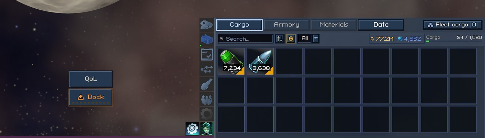
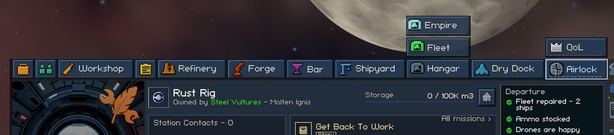
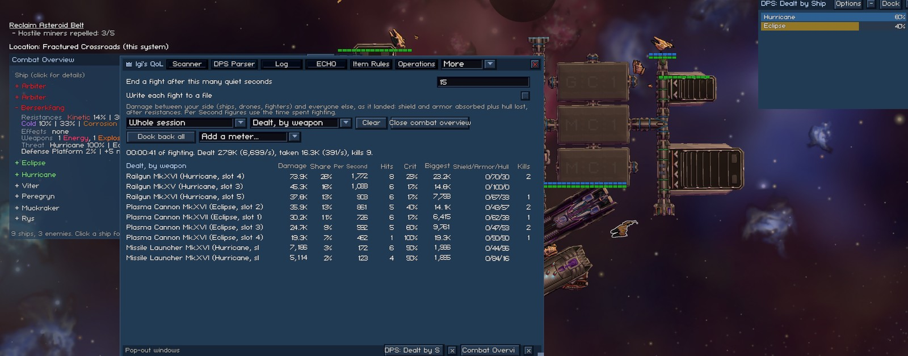
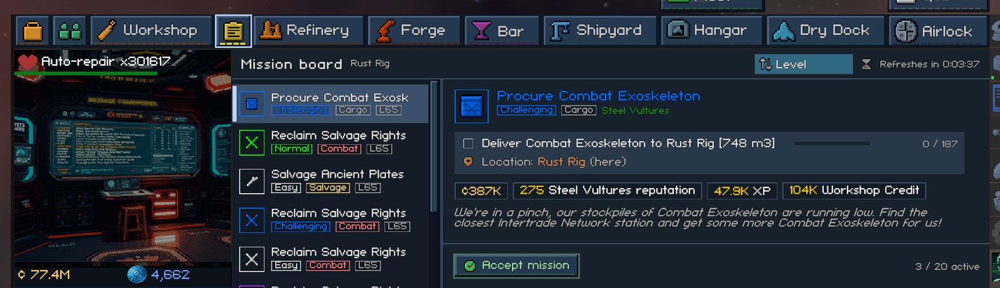
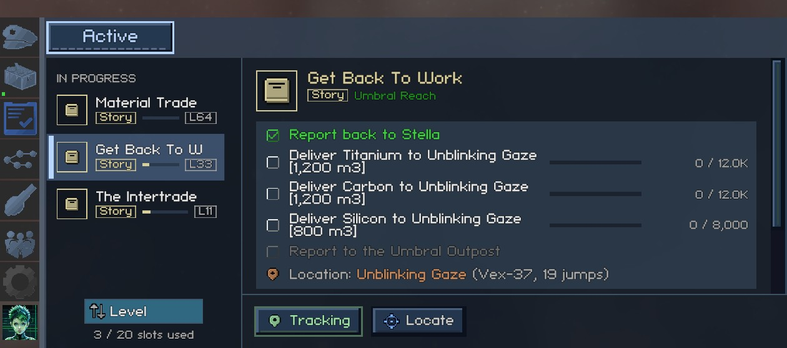
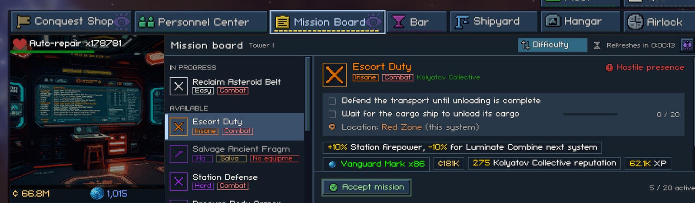

# Window and HUD

This page covers the mod window, the per-ship settings popup, and the small additions to the game's own HUD. The config keys for these settings are listed in [settings.md](../settings.md).

## Mod Window

Every tab of the modpack lives in one window. You can open and close it in three ways:

- Press F6. This is the "Mod window hotkey" setting. It accepts any key name and is ignored while you type in a text field.
- Click the QoL button in space.
- While docked, click the QoL tab next to the game's Fleet button, above the station's tabs.

Hovering either button names the hotkey. The tabs are Scanner, DPS Parser, Log, ECHO, Item Rules, Operations, Stations, Loadouts, Notes, Stat Reference, Mods and Settings. A tab whose feature is switched off isn't there. The window opens on the tab you last used.

The window starts 760 px wide and 520 px tall (wider at a larger text size) and never goes below 480 px by 300 px. Drag it by its header and resize it from the corner at the bottom right. It remembers its position, size and tab. A position or size saved at a larger resolution or text size comes back inside the screen.

The tab bar shows the tabs that fit. At the default width that is Scanner to Loadouts. The rest (Notes, Stat Reference, Mods, Settings) wait in the "More" dropdown at the right end of the bar. Make the window wider and more tabs move into the bar. When the open tab is one of the hidden ones, "More" shows its name.

The window is never narrower than the open tab's rows need. A tab with wide rows widens the window while it's open, and the window goes back to your width when you switch to the next tab.

The Settings tab has every feature's on/off switch, plus the settings that have no tab of their own. Each switch is labelled "Feature on". A change to it applies after you restart the game.

A feature with its own tab (ECHO, Operations, Item Rules) keeps its settings on that tab, so each setting lives in one place. Its section on the Settings tab says which tab holds them. If the feature that owns a tab is switched off, the settings that would have been on that tab show up on the Settings tab instead.

Every row has a plain-language name. Hover it for the full explanation. Switches are check boxes, lists of choices are dropdowns and numbers are text fields. A number outside its range is pulled into it. Changes are written to `BepInEx/config/igi.qol.cfg` at once. The Window section ends with a "QoL button position" row with a Reset button (see below). Right-click a search box anywhere in the mod window to clear it.

In space, the QoL button looks like the game's own buttons and is labelled "QoL". By default it sits on top of the side menu's button column at the right, as a square as wide as the column. It moves with the column when the side panel opens and closes. Setting "QoL button in space" to "Above the Dock button" puts it above the HUD's Dock button at the bottom middle instead, at the Dock button's size.

You can drag the button away from either place. A drag never opens the window, and a drop off screen is pulled back on. The offset is kept separately for each place, and "Reset" under the Window settings puts the button back. The button hides whenever the game hides its HUD (while docked and during dialogues), so it never covers a station screen.

While you're docked, the same toggle is a QoL tab that floats above the station's tabs, beside the game's Fleet button:

### Hover Cards Stay on Screen

The game puts a hover card beside the mouse. It moves the card above or below the mouse only by checking which side the card starts on. A card taller than the room on both sides ran off the top or bottom of the screen, which cut off the hints and the last sections.

"Keep hover cards on the screen" (on by default) slides such a card up or down just far enough to be fully visible. The card stays beside the mouse, so it never covers what you point at. A card that runs off the left or right edge is moved back in the same way.

The setting applies to every hover card except an item's compare card. A card taller than the whole screen keeps its top. Switch the setting off to get the game's own placement.

## Pop-Out Windows

Some views float in their own window, outside the mod window:

- the [combat overview](fleet-combat.md#combat-overview)
- the [DPS meters](logs-and-reference.md#dps-meters)
- the [Log](logs-and-reference.md#event-log)
- the [notes](logs-and-reference.md#notes)
- the [Scanner](loot-and-cargo.md#scanner-window)
- the [War Overview](conquest.md#galaxy-map-corner-and-the-war-overview)

Each one works like the game's fleet panel:

- Drag it by its header. It stays on screen, and a layout saved at a larger resolution or text size comes back inside the screen.
- The header has an Options button, `-` and `+` buttons that collapse the window to its header and open it again, a Dock button (only for views that come from a tab) and an `x` button that closes it. The corner at the bottom right resizes the window, down to a minimum size that depends on the view.
- Click-through is on by default. Clicks on the window's body reach the game under it, and the header keeps working. The mouse wheel doesn't pass through. Over the body it scrolls the window, and the galaxy map or the space view behind it doesn't zoom. To use the body, hold the key set in "Key to use a click-through pop-out" (Ctrl by default). Type LeftCtrl, LeftShift, LeftAlt or any other key name. Either Ctrl, Shift or Alt key counts. You can also switch click-through off in Options.
- A view that comes from a tab (all but the combat overview and the War Overview) has a Pop out button on that tab. For the DPS meters the button reads "Pop out meters". While the view is out, the button reads "Dock back" ("Dock back all" for the DPS meters). The Dock button on the window's own header closes it and opens the tab. The tab stays as it was. DPS meters and notes can have several windows at once, each with its own layout and settings.

The Options button sets when the window shows:

- "Always" keeps the window open.
- "Only when relevant" shows the window only while its own condition holds. A line under the dropdown spells the condition out. The conditions are:
  - Combat Overview and DPS meters: you are in combat.
  - Log: ECHO is running.
  - Notes: you're docked.
  - Scanner: there is something here to board, salvage or pick up.
  - War Overview: the galaxy map is open.

Options also sets the window's opacity (20-100%, in steps of 10) and click-through, and it resets the window's position and size. The combat overview and the War Overview start on "Only when relevant". The other windows start on "Always". A window hidden by its show condition keeps its place and comes back when the condition holds. The condition is checked four times a second.

Each window keeps its position, size, collapsed state, opacity and options per machine, in Unity's PlayerPrefs next to the mod window's position, so they don't travel with a save. An open window comes back after you load a save and after a restart. It closes by itself if the feature behind it is switched off.

Pop-outs sit under the mod window, so one never covers a tab. The War Overview is the exception. It sits above the galaxy map, which would hide it otherwise, and so above the mod window too.

The mod window always shows a "Pop-out windows" strip along its bottom, so opening a pop-out never moves the tab above it. With nothing popped out, the strip reads "Pop-out windows: none open". Otherwise it has a small button for each open window, all the same width.

- Click the button to bring the window back on screen and flash its header.
- Click the button's `x` to close the window, or to dock it back if the view has a tab.
- A button is greyed while its window is hidden by its show condition, and its tooltip says what the window is waiting for.

A small window grows while its Options panel is open, so the whole panel fits.

## Ship Settings Popup

Each of your ships has its own settings:

- missile retargeting
- drones on arrival
- drone mode, drone distance, and which ship the drones stay with
- engagement distance
- keeping distance from other ships
- the share of its hull at which the ship retreats for repairs
- target choice, with up to two "Then by" rules
- how often the ship re-checks its target
- finishing off weak targets
- a level to avoid
- how far from the flagship the ship attacks
- one target rule per weapon
- which cargo stays aboard when the fleet cargo moves everything to the flagship: pinned items and the ammo the ship fires ([pinned cargo](loot-and-cargo.md#pinned-cargo))

Open the popup with the last button on the ship's row in the fleet panel. One popup is open at a time, above the mod window. The Close button or the x shuts it. "Default" means the ship follows the setting on the mod window's Settings tab. A row whose feature is switched off is left out. A one-line note says so for missile retargeting, drones on arrival, engagement distance and target priority. These per-ship settings are saved with the game.

Every row stays in the popup whatever you choose, so the popup doesn't change height while it's open. A control that doesn't apply is dimmed instead of hidden:

- The drone distance and "Drones stay with" are dimmed while the drone mode is Game toggle.
- The engagement distance is dimmed until the mode is Fixed distance.
- The "Then by" rows are dimmed while the rule above them is Default or None. They keep their choice.

If the rows are still taller than the screen, at a large text size or with many weapons, the whole popup scales down so Close stays on screen. Two labels drop the unit they have on the Settings tab ("Re-check target every" and "Finish off targets below"), because their dropdown names the unit.

The features behind these rows are described in [fleet-combat.md](fleet-combat.md) and, for pinned cargo, [loot-and-cargo.md](loot-and-cargo.md#pinned-cargo).

## Fleet Command Strip

Each ship in the fleet panel (bottom left) gets a second row of buttons under it. The buttons always appear in this order:

1. Stop, Hold and Regroup.
2. The four stances: Hold Fire, Aggressive, Defensive and Escort. The stance the ship has is lit.
3. The tractor beam.
4. The Drone Bay, which is lit while the drones are out.
5. Cargo.
6. The ship's own settings.

Every button keeps its place on every ship. A button that doesn't apply to a ship is dimmed and can't be clicked:

- The first seven buttons need a fleet ship.
- The tractor beam button needs a ship you manage that has a tractor.
- The Drone Bay button needs a drone bay.
- The Cargo button needs a ship you manage that isn't the flagship.

The settings button works on every ship. Clicking a button doesn't select the row.

The Stop, Regroup and stance tooltips use the game's own text for the order, the same as the HUD's fleet command bar. They also show the key the bar binds to the order (X, V, F1 to F4), and add that the button orders only this ship while the key orders every selected ship. The Hold tooltip is the game's Hold text with its key (C), followed by the note below. The tractor button shows the game's "Tractor beam on" or "Tractor beam off" and switches it. The Drone Bay button names what a click does now, either "Deploy" or "Return". The Cargo button uses the game's cargo gauge title, and the last button is titled "Ship settings".

The Hold button holds that one ship at its spot until you give it another order or the fleet travels. It is not the Hold position switch on the HUD. That switch holds only the ship you fly (flying it by hand turns the switch on) and never reaches fleet ships. To hold fleet ships, use this button or the game's Hold button on the fleet command bar.

## Fleet Shield and Armor Bars

Each fleet row shows three bars: shield above, the game's hull bar (restyled) in the middle, and armor below. A ship without shields or armor leaves that slot blank.

"Bar height (px)" sets the height of all three bars and applies at once. The range is 2-12 and the default is 4, which is the height of the game's hull bar. Each row grows by three times the difference from the default.

## Text Size

"Text size (%)" (50-200, default 100) draws all game and mod text bigger or smaller. It is separate from the game's own Scale setting, which resizes panels and text together. It applies at once, and the mod window and any open pop-outs are rebuilt for the new size.

Panels keep their size, so larger text can be cut off with "..." or wrap inside narrow labels. For example, cargo stack counts wrap at 130%. Labels keep the lines they show at 100% and spill past their box instead of disappearing.

## Jumps Remaining

While you travel, the travel panel shows "Jumps: N" under the distance line. N is the number of jumps left on your route. The line is hidden when no jumps are left.

## Mission Distance

This feature shows how far away a mission's next location is. It counts with the game's own route search, jump gates included:

- Mission board and missions window rows get a jump gate icon with the number of jumps when the location is in another system. The icon's tooltip is titled with the location and reads, for example, "Zorix, 40 jumps": the system, then the jumps.
- The mission details and the HUD mission tracker add the distance after the location: "Location: Fractured Crossroads (Red Gate, 1 jump)", "(this system)" or "(here)".

Most board missions are in the station's own system and get no row icon. The icons show up on board missions that send you to another system (a combat mission one jump away, in the picture below). In the missions window they show up on missions you took elsewhere and on story missions.

## Mission Sort

The station mission board gets a sort button in its header, left of the refresh timer. Each click moves to the next order and re-sorts the board. The board keeps the mission you had selected. If none is selected any more, it selects the first row shown. The orders are:

- Game order: the order the game lists the missions in. This is the default.
- Type: story, combat, mining, salvage, cargo, repair, then generic missions.
- Level: highest first. While this order is on, each row gets a small level label ("L62"), because the game shows the level nowhere on the row.
- Difficulty: hardest first (Insane, Hard, Challenging, Normal, Easy), then faction and story missions.

Each section of the board ("Ready to turn in", "In progress", "Available") is sorted on its own. Missions that tie keep the game's order. The button and the "Mission board order" setting are the same setting, so the order holds between visits.

The missions window (the side panel's Missions tab) has its own sort button under its list, above the "N / 20 slots used" line. Its order is saved as "Missions window order". It has the same four orders plus one more:

- Distance: nearest first. The location you're at comes first, then this system, then other systems by jumps. Missions without a location or a known route go last.

The window sorts "Ready to turn in" and "In progress" separately. Under Level, a row's level label takes the place of its jump count, because the 190 px list has no room for both beside the progress bar. Some story missions name no location at all, so they have no level. They get no level label and sort last. When the mission you had selected is gone, the window selects the first row shown instead of the first one in the game's order.

## Mission Fit

This feature greys out station mission board offers that none of your ships has the equipment for. A typical case is a mining mission when no ship carries a mining turret, mining drones or a hangar bay that mines. The offer's icon, name and small labels are dimmed, and a red "No equipment" label is added. The label's tooltip is titled "No ship in your fleet has the equipment" and names the missing work, for example "Mining (Core)" or "Salvage (Structural)". The offer keeps its place in the list, and you can still pick and accept it. Only the mission board is marked. The missions window is left alone.

The test is the same loadout check the game itself uses. It looks for a turret, drone bay, torpedo bay or hangar bay for the mission's work, on the layer the mission asks for. Generated mining and salvage missions ask for surface or core. Your flagship and every ship in your active fleet count, even while they're away from you. Hired mercenaries don't count, because their contracts end. Cargo and delivery missions are never greyed out, and neither are missions you already hold.

ECHO checks only the flagship before it takes a mission. It can therefore still answer "no suitable loadout" for an offer that isn't greyed out, when the gear for that offer is on a fleet ship.
