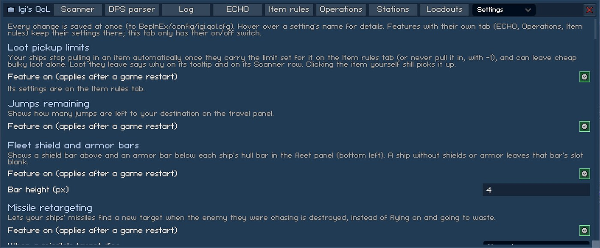
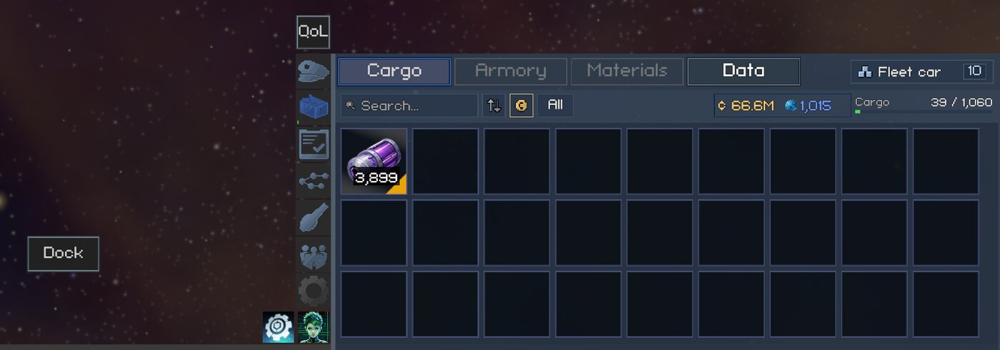
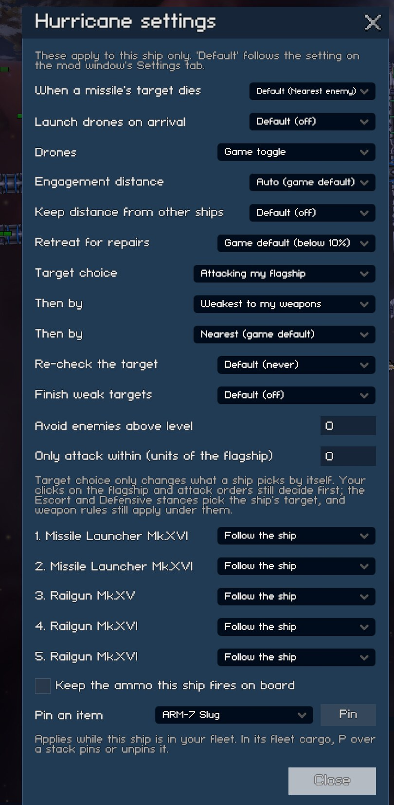
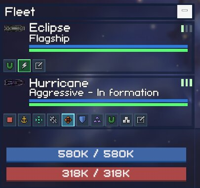
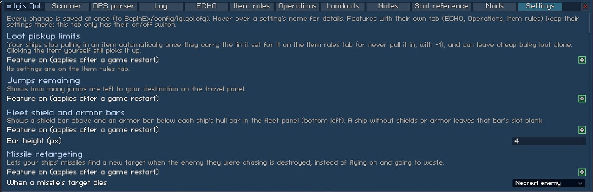
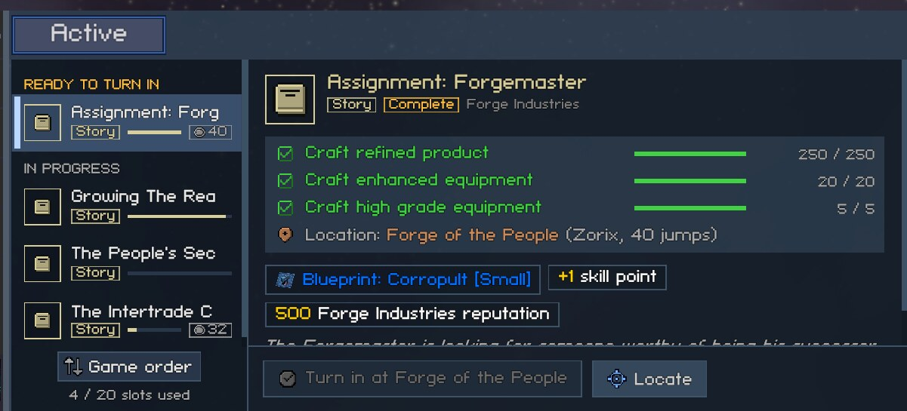

# Window and HUD

The mod window, the per-ship settings popup, and the small additions to the game's own HUD. Settings keys are listed in [settings.md](../settings.md).

## Mod window

Every tab of the modpack lives in one window. Open and close it with F6 (`Hotkey`), with the QoL button in space, or with the QoL tab above the station's Airlock tab while docked. The tabs are Scanner, DPS parser, Log, ECHO, Item rules, Operations, Loadouts, Notes, Stat reference, Mods and Settings. Drag the window by its header; it remembers where you left it and which tab was open.

Settings has every feature's on/off switch plus the settings that have no tab of their own. A feature with its own tab (ECHO, Operations, Item rules) keeps its settings there, so each setting lives in one place. If the feature that owns a tab is switched off, the settings that would have been on it show up on Settings instead. Every row has a plain-language name; hover it for the full explanation. Changes are written to `BepInEx/config/igi.qol.cfg` at once, and on/off switches apply at the next game start.

The QoL button in space sits on top of the side menu's button column at the right by default and moves with the column when the side panel opens and closes. `ButtonPlace` = `DockButton` puts it above the HUD's Dock button instead. You can drag the button away from either place: a drag never opens the window, and a drop off screen is pulled back on. The offset is kept per place, and "Reset" under the Window settings puts the button back. The button hides whenever the game hides its HUD (docked, dialogues), so it never covers a station screen.

## Ship settings popup

Each of your ships has its own settings: missile retargeting, drones on arrival, drone mode and anchor, engagement distance, keeping distance from other ships, the hull % at which it retreats for repairs, target choice and one target rule per weapon. Open the popup with the last button on the ship's row in the fleet panel. "Default" means the ship follows the setting on the mod window's Settings tab. These per-ship settings are saved with the game.

The features behind these rows are described in [fleet-combat.md](fleet-combat.md).

## Fleet command strip

A second row of buttons under each ship in the fleet panel (bottom left): stop, hold position, regroup, the four combat stances (fleet ships only), auto-tractor, deploy or recall drones, the ship's cargo window, and the ship settings popup. Clicking a button doesn't select the row.

## Fleet shield and armor bars

Each fleet row shows three bars: shield above, the game's hull bar (restyled) in the middle, armor below. A ship without shields or armor leaves that slot blank. `BarHeight` (2-12 px, default 4, the height of the game's hull bar) sets all three and applies at once; each row grows by three times the difference.

## Text size

`Percent` (50-200, default 100) draws all game and mod text bigger or smaller, separate from the game's own Scale setting, which resizes panels and text together. It applies at once. Panels keep their size, so larger text can be cut off with "..." or wrap inside narrow labels (cargo stack counts wrap at 130%). Labels keep the lines they show at 100% and spill past their box instead of disappearing.

## Jumps remaining

Adds "Jumps: N" under the distance line of the travel panel while you travel.

## Mission distance

Shows how far away a mission's next location is, counted with the game's own route search (jump gates included):

- Mission board and missions window rows get a jump gate icon with the number of jumps when the location is in another system. The tooltip names the system: "Zorix, 38 jumps".
- The mission details and the HUD mission tracker add it after the location: "Location: Fractured Crossroads (Red Gate, 1 jump)", "(this system)" or "(here)".

Board missions have so far always been in the station's own system, so the row icons mostly show up in the missions window, on missions you took elsewhere and on story missions.

## Mission sort

The station mission board gets a sort button in its header, left of the refresh timer. Each click moves to the next order and re-sorts the board, keeping the mission you had selected:

- Game order: as the game lists them (the default).
- Type: story, combat, mining, salvage, cargo, repair, then generic missions.
- Level: highest first. Each row gets a level chip ("L62") while this order is on, since the game shows the level nowhere on the row.
- Difficulty: hardest first (Insane, Hard, Challenging, Normal, Easy), then faction and story missions.

Each section of the board (ready to turn in, in progress, available) is sorted on its own, and missions that tie keep the game's order. The button and `Board` in the Settings tab are the same setting, so the order holds between visits.

The missions window (the side panel's Missions tab) has its own sort button under its list, above the "N / 20 slots used" line, saved as `Window`. It has the same four orders plus one more:

- Distance: nearest first. The location you're at comes first, then this system, then other systems by jumps. Missions without a location or a known route go last.

The window sorts "ready to turn in" and "in progress" separately. Under Level, a row's level chip takes the place of its jump count, because the 190 px list has no room for both beside the progress bar. Some story missions name no location at all, so they have no level: they get no level chip and sort last. When the mission you had selected is gone, the window selects the first row shown instead of the first one in the game's order.

## Mission fit

Greys out station mission board offers that none of your ships has the equipment for. A typical case is a mining mission when no ship carries a mining turret, mining drones or a hangar bay that mines. The offer's icon, name and chips are dimmed, and a red "No fit" chip is added. Its tooltip names the missing work, for example "Mining (Core)" or "Salvage (Structural)". The offer keeps its place in the list, and you can still pick and accept it.

The test is the game's own (`SpaceShipData.HasLoadout`): a turret, drone bay, torpedo bay or hangar bay for the mission's work, on the layer the mission asks for. Generated mining and salvage missions ask for surface or core. Your flagship and every ship in your active fleet count, even while they're away from you. Hired mercenaries don't count, because their contracts end. Cargo and delivery missions are never greyed out, and neither are missions you already hold.

ECHO checks only the flagship before it takes a mission, so it can still answer "no suitable loadout" for an offer that isn't greyed out, when the gear for it is on a fleet ship.
