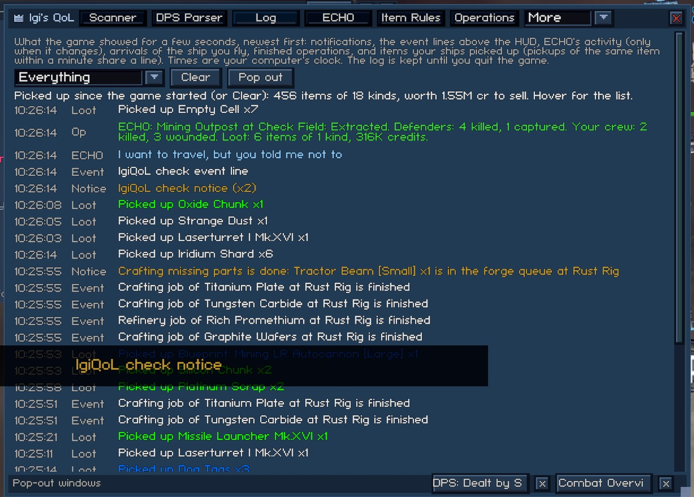
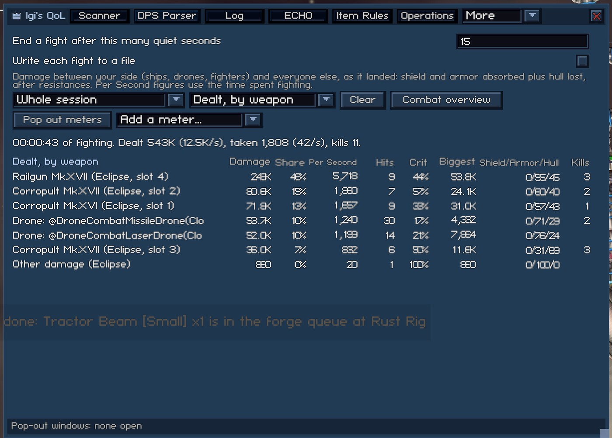
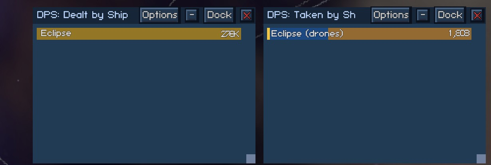
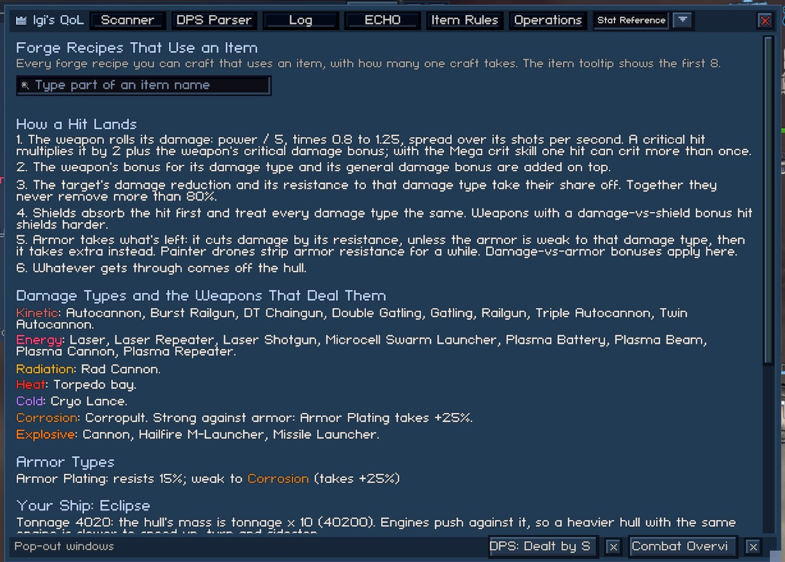
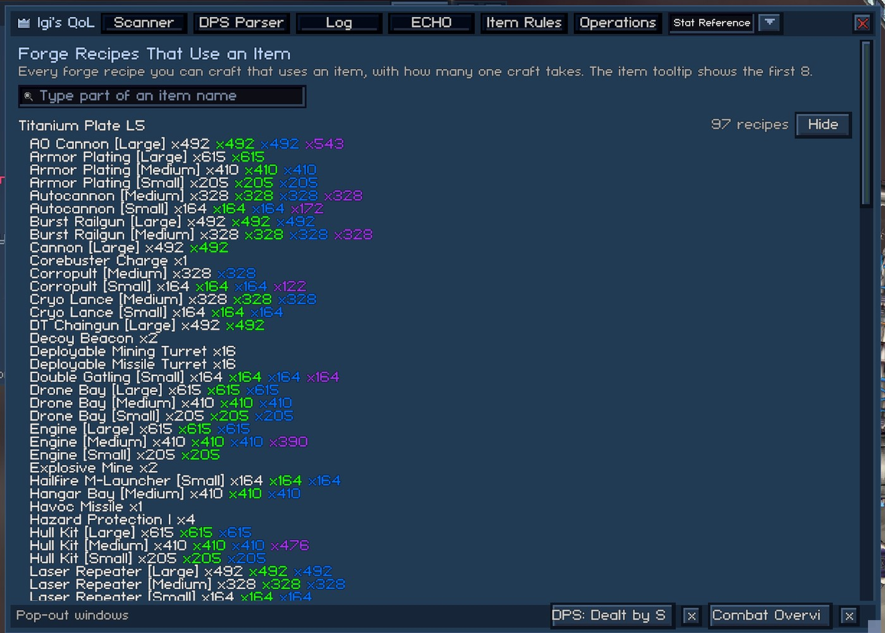
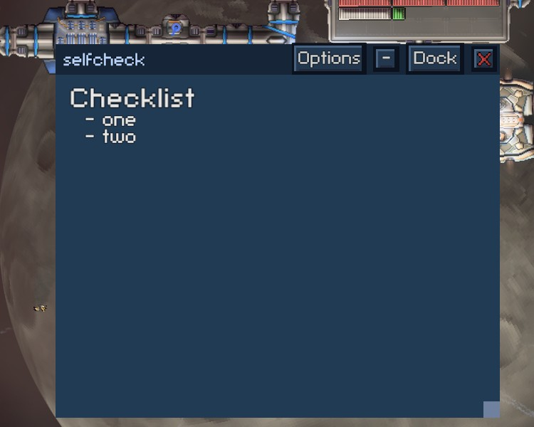
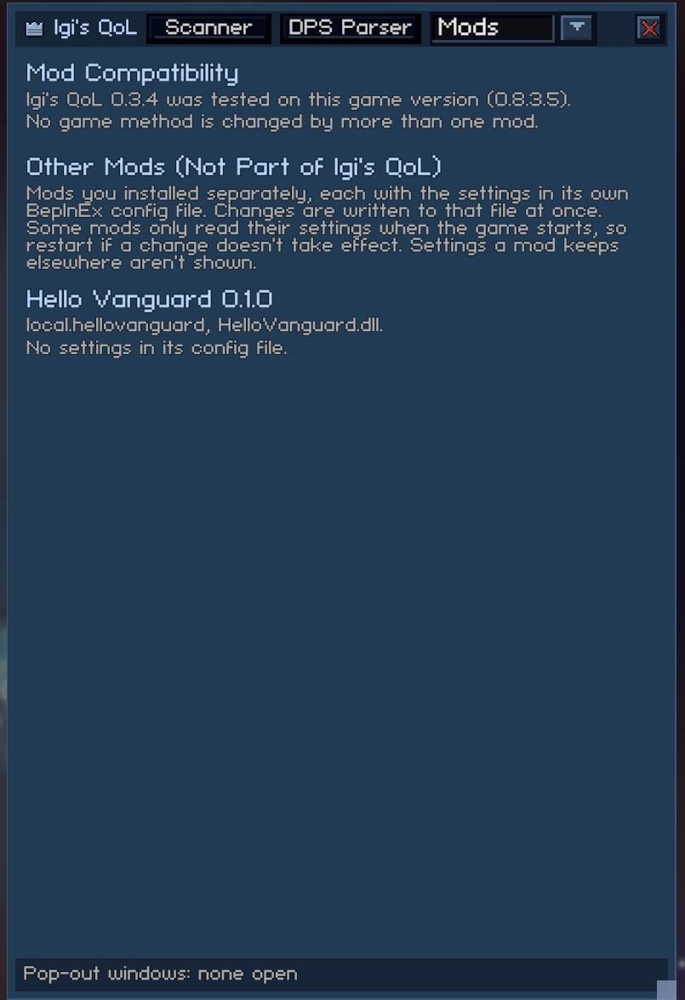

# Logs, Reference and Other Mods

This page covers tabs for reading back what happened, looking numbers up, keeping notes and checking other mods. None of them change how the game plays. The DPS Parser and Log tabs are on the mod window's tab bar. At the default width, Notes, Stat Reference and Mods are in its "More" dropdown. Settings keys are listed in [settings.md](../settings.md).

## Event Log

The Log tab collects the following, newest first and with your computer's clock time:

- The game's pop-up notifications and the event lines above the HUD (reputation, forge and refinery jobs finished, and saves).
- ECHO's status whenever it changes while ECHO is running, and ECHO switching on and off. The "Calculating..." status between decisions is left out.
- Arrivals of the ship you fly, with the system.
- One line per finished operation, taken from the game's own operation log. The line names what the operation was (a boarding names its target, and ECHO's runs start with "ECHO:") and where it happened. It then says how the operation ended, in the words the operation panel uses: Extracted, Retreated or Crew Lost, or Captured or Failed for a boarding. An outcome the game doesn't name reads "Ended". The line also gives the defenders killed and captured, your crew killed and wounded, and the loot: how many items of how many kinds, and separately the credits found. For example: "ECHO: Mining Outpost at Check Field: Extracted. Defenders: 4 killed, 1 captured. Your crew: 2 killed, 3 wounded. Loot: 6 items of 1 kind, 315.8K credits."
- Items your ships pick up. Pickups of the same item within a minute share a line.

A line repeated within 10 seconds counts up "(x3)" instead of adding lines.

Every line keeps one fixed height, so the lines below it never move when a line changes or the window is resized. Operation lines get two text lines and every other line gets one. A longer text ends in "..." with the whole line in its tooltip. A pickup line's tooltip is the item's own card.

The line at the top sums the session's pickups with their sell value. It shows while the filter is Everything or Loot and something has been picked up, and hovering it lists the items. The filter offers Everything, Notifications, Event lines, ECHO, Arrivals, Loot and Operations. Clear empties the log and the pickup totals.

The tab shows the newest 150 lines and says how many older ones it leaves out. The log keeps up to 1000 lines until you quit, and nothing goes into the save. Use it to see what ECHO did while you were away.

Pop out puts the log in a [window of its own](interface.md#pop-out-windows) beside the game. The window shows the newest lines first, without the help text, and has a filter of its own that doesn't change the tab's. Its Options set how many lines it shows (10, 25, 50, 100 or 150; 25 by default). Clear stays on the tab. By default the window is always shown, but its Options can limit it to while ECHO is running.

## DPS Parser

The parser records every hit between your side (ships, drones and fighters) and anyone else, as it landed. It counts the shield and armor absorbed plus the hull lost, after resistances. Damage beyond the hull a target had left isn't counted.

- Dealt views group your damage by weapon (per fitted piece and slot, and per drone type for drones), by damage type, by your ship (drones count for their ship) and by enemy type.
- Taken views group the damage you receive by enemy weapon type, by damage type, by enemy type and by your ship.
- Each row shows the damage, its share, the damage per second of fighting ("Per Second"), the hits, the crit rate and the biggest hit. It also shows the percent of the damage that shields, armor and hull took (the "Shield/Armor/Hull" column). The dealt views add kills, counted by weapon, by ship and by enemy type.
- The table shows the 25 biggest rows, with a line counting the rest. The figures sit in fixed-width columns and use equal-width digits, so they don't shift as they change. Above the table, a two-line summary gives the fight's length, what was dealt and taken with the per-second rate, and the kills.
- Scope: the current or last fight, any of the 9 fights before it, or the whole session.

Per-second figures use the time spent fighting. Quiet stretches longer than the fight gap don't count, which matters for the session total. Clear, or loading a save, starts the parser over. While the [combat overview](fleet-combat.md#combat-overview) is on, the tab has a button that opens it.

Two settings sit at the top of the tab. "End a fight after this many quiet seconds" (5 to 120, default 15) sets how many seconds without damage end a fight. "Write each fight to a file" (off by default) appends each finished fight's tables to `BepInEx/config/IgiQoL/combat-log.txt`. Nothing is saved with the game. The keys are in [settings.md](../settings.md).

### DPS Meters

DPS meters are bar meters that float over the game (see [pop-out windows](interface.md#pop-out-windows)), and you can open as many as you like. Each meter is its own window with its own settings, so one can show the damage your fleet deals, ship by ship, while another shows the damage it takes.

On the DPS Parser tab, "Add a meter..." starts a meter from a preset:

- "My fleet, dealt by ship" uses the Dealt, by your ship view.
- "My fleet, taken by ship" uses the Taken, by your ship view, with a split bar.
- "Dealt by damage type" is coloured by damage type.

"Pop out meters" opens the meters you've saved, or a first one, the dealt-by-ship preset, when there are none. While meters are out, the button reads "Dock back all". The Dock button in a meter's header and the x on its button in the strip along the bottom of the QoL window both bring the meter back to the tab. The header's own close button only closes it. A meter you haven't moved opens beside the combat overview, and each further one opens a little lower, so they don't cover each other. By default a meter is always shown, but its Options can limit it to while you're in combat.

A meter shows one bar per row of the view it follows, longest first, with the top bar at full width and the rest scaled to it. The text on the bar is the row's name and one number. The title reads "DPS: " and the view's short name, with "(Session)" added when the meter follows the whole session. A meter keeps showing the last fight until the next one starts. Its Options button, under the pop-out's own settings, has these choices:

- View: any of the 8 views of the tab. The meter's title and its button in the strip name the view.
- Scope: Current fight (the last one until a new one starts) or Whole session.
- Rows: 5, 8 (the default), 10, 15 or 25.
- Number: "Total" damage (the default), "Per second" of fighting, or "Share" of the view's total.
- Bar: Plain (the default), or Split by shield, armor, hull. A split bar is divided by how the damage was absorbed. This choice sits on its own row in Options.
- Color: By role (the default), By hull class, By damage type or Picked per ship.
  - By role colours your flagship, a fleet ship, a drone or fighter, a hired mercenary and everyone else differently.
  - By damage type gives a ship the colour of the type it dealt or took most.
  - Picked per ship lists your flagship and fleet, each with a button. The button reads "Auto" until you pick a colour and "Next" after that. It steps through eight colours, then back to Auto. Other units keep their role colour.
  - With a split bar, the colour shows as a strip on the left edge.
- Remove this meter: closes the meter and forgets its settings.

Changing the view or scope rebuilds the window, which closes its Options panel. The other settings redraw the panel in place. A row's role and hull class are noted when its first hit lands, so a ship destroyed later keeps its colour. A meter redraws once a second, and only when something was recorded. Layouts and settings are saved on your machine (`IgiQoL.Popout.dps-meter-N` in PlayerPrefs), not in the save.

## Stat Reference

At the top, while the [Used in (Forge Recipes)](stations.md#used-in-forge-recipes) feature is on, [a search](#recipe-search) lists every forge recipe you can craft that uses an item. Below the search, the tab shows the following, read from the game's data and formulas, so it follows game updates:

- How a hit is reduced on its way to the hull: the damage roll, crits, type bonuses, the 80% resistance cap, shields, armor and paint strip.
- Every damage type with the weapons that deal it.
- Every armor type's resistance and weakness. In game version 0.8.3.5 there is one: Armor Plating, with 15% resistance, which takes +25% from Corrosion.
- The ship you fly (shown while you're in space): tonnage, mass, acceleration, top speed, sidestep, crit chance and per-type damage reduction, with the game's own descriptions of those stats.

### Recipe Search

Type at least two letters of an item's name. The list shows up to 20 matching items, sorted by name. A levelled item carries its level, like "Titanium Plate L5". Each item shows how many of your craftable recipes use it, and a Show or Hide button. A single match opens by itself. Hover an item's name for its tooltip.

An open item lists one line per recipe with how many one craft takes, as the [item tooltip](stations.md#used-in-forge-recipes) does, but without the tooltip's cap of 8 lines. A recipe you have in several rarities shows each rarity's amount in that rarity's colour. If more than 20 items match, the list says so and asks for more of the name. If none match, it says no match was found among the items your craftable recipes use. The search and the open item stay when you switch tabs.

## Notes

Named note tabs hold your own notes and links. They are kept in `BepInEx/config/IgiQoL/notes.json` rather than in a save, so they are the same in every save. The bar at the top has these buttons:

- One button per note.
- "+" for a new note, named "Note 2" and so on.
- "<" and ">" to move the open note along the bar.
- Rename.
- Delete, which asks first and is not available while it is your only note.
- Edit or View.
- Pop out.

A note that is empty opens for editing, and one with text opens in View. You edit as plain text, and the note saves when you leave the field or switch notes. View shows `#` and `##` headings, `**bold**`, `*italic*`, `- ` bullets and clickable links (`[text](url)` or a bare `https://` link). The note you had open comes back after a restart.

If `notes.json` can't be parsed, the mod renames it to `notes.json.broken-` plus a number, and you start with an empty note. The tab says so. If the file can't be read at all (for example, another program has it locked), the mod leaves it alone and writes nothing over it. Edits aren't saved until you fix the problem and restart.

Pop out shows the open note in a read-only window of its own, which works as a checklist or reference while you play.

You keep editing on the tab, and the window redraws when you save a change. Each note can have its own window, and the window's Options pick another note. Dock back closes the window, and popping the same note out again brings it back where you left it. Renaming a note retitles its windows, and deleting a note closes them. By default a note window is always shown, but its Options can limit it to while you're docked.

## Other Mods

The Mods tab (in the "More" dropdown at the default width) covers the other BepInEx plugins you have installed.

The top of the tab shows compatibility information:

- The game version the modpack was tested on. If you run a different version, the tab shows a warning that a feature that breaks switches itself off. The pop-up at the main menu names such a feature by its name in the Settings tab, with the error and where it happened. The full error is in `LogOutput.log`.
- The plugins BepInEx refused to load, for example because of a missing dependency, a declared incompatibility or the wrong BepInEx version.
- Every game method that Harmony patches from more than one mod, with each mod's patch kinds (prefix, postfix, transpiler, finalizer, IL manipulator). "Risky overlap" marks a method where a mod has a transpiler or IL manipulator, or a prefix that returns bool and can skip the original. Patches count for the plugin whose assembly holds the patch method, so mods that patch under random Harmony ids are still named. A DLL with several plugins is listed once under all their names. This modpack's own patches are listed with the feature that made them.

The same list goes to `LogOutput.log` once at the main menu, as `[Mods]` lines.

Below that, each other plugin has a heading (name, version, GUID, DLL file and what it needs), followed by its own config file as rows with the same controls as the Settings tab. The tab honours ConfigurationManager tags (`Browsable`, `Category`, `DispName`, `Description`, `Order`, `ReadOnly`) and its sort order: by section, then `Order` with the highest first, then name. A `ReadOnly` entry shows its value as text. `[Flags]` enums and types without their own control get a text field. Changes write that plugin's `.cfg` at once. Mods that read their settings only when the game starts need a restart.
