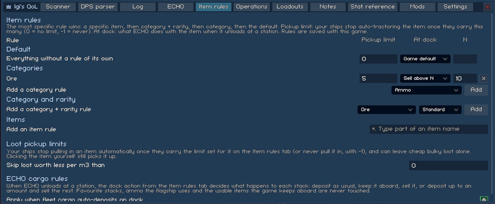
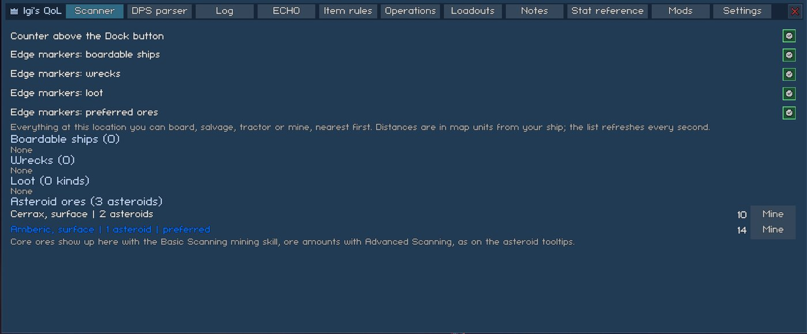

# Loot and cargo

What your ships pick up, where it goes, and finding what's left at a location. Settings keys are listed in [settings.md](../settings.md).

## Item rules



The Item rules tab holds one table of rules, saved with the game. Each rule has two parts:

- Pickup limit: your ships stop auto-tractoring the item once they carry this many. 0 means no limit, -1 means never.
- At dock: what ECHO (and, if you want, [Station services](stations.md#station-services)) does with the item at a station. Game default, Keep aboard, Sell, or Sell above N: deposit until the station storage holds N, sell the rest.

The most specific rule wins: a specific item (optionally at one item level), then category + rarity, then category, then the default. A "Turret / Standard" rule with a pickup limit of -1, for example, makes your ships and ECHO's loot-before-leaving skip common turrets.

The pickup limit is applied by [Loot pickup limits](#loot-pickup-limits) and the dock action by [ECHO cargo rules](echo.md#echo-cargo-rules) and Station services. The same tab carries both features' settings.

### Starting rules for new saves

A save without rules is seeded once from `BepInEx/config/IgiQoL/item-rules.json`, if that file exists. After that the save's own copy is used, so editing the file doesn't change saves that already have rules. The format is the one the mod writes into the save:

```json
{
  "default": { "tractorCap": 0, "dockAction": "Default", "keepAmount": 0 },
  "categories": {
    "Ore": { "tractorCap": 500, "dockAction": "SellAbove", "keepAmount": 2000 }
  },
  "categoryRarity": {
    "Turret/Standard": { "tractorCap": -1 }
  },
  "items": {
    "CanisterOxide": { "dockAction": "Keep" },
    "ArtifactAnalysis@3": { "tractorCap": 2 }
  }
}
```

- `tractorCap`: the pickup limit, -1 or more.
- `dockAction`: `Default`, `Keep`, `Sell` or `SellAbove`.
- `keepAmount`: N for `SellAbove`.
- Categories: `Ore`, `Ammo`, `Turret`, `Module`, `Booster`, `Junk`, `Drone`, `RefinedProduct`, `Torpedo`, `JumpgatePass`, `TradeGoods`, `Usable`, `DefensiveTurret`, `Salvage`, `Currency`, `Crystal`, `Data`, `Blueprint`, `BossSignal`, `SignalFragment`.
- Rarities: `Standard`, `Enhanced`, `HighGrade`, `Exotic`, `Legendary`.
- Item keys are the game's item identifier (`CanisterOxide`, not the display name "Oxide Canister"), with `@level` for one item level. `[Dev] DumpGameData` lists every identifier in `InventoryItemType.allItems.txt` ([dev-harness.md](../dev-harness.md#data-dumps)).

An entry with an unknown category or rarity is skipped with a warning in `LogOutput.log`. Fields you leave out take the vanilla value (0, `Default`, 0).

## Loot pickup limits

Applies the Item rules pickup limits: your ships stop pulling in an item automatically once they carry the limit, or never pull it in with -1. `MinCreditsPerM3` (0 = off, set on the Item rules tab) also skips loot whose sell value per m3 of hold space is below that many credits, so cheap bulky items don't fill the hold. Both apply to your ships' auto-tractor and to ECHO's loot-before-leaving.

Items your missions need and ammo a ship uses are exempt from both, and clicking an item yourself always picks it up.

## Shared fleet holds

`Overflow` (off): when a ship's tractor beam reaches for loot its hold can't take whole, the ship moves cargo to your other ships at the same location (the flagship first, then the one with the most room), biggest stacks first, until the stack plus a quarter of its hold is free. It does this at most once per 2 s per ship. Favourites, ammo the ship uses, usable items, warp fuel and items your missions need stay where they are.

Without it, a single full ship sets ECHO's "inventory full" and the whole fleet flies home even when the others have room. With it, ECHO heads home once every ship is full.

## Scanner



The Scanner tab lists everything at your location you can board, salvage, tractor or mine, nearest first, refreshed every second:

- Boardable ships, wrecks and loot, each with a Board, Salvage or Tractor button.
- Where there are asteroids, "Asteroid ores": one row per ore and layer with the asteroid count and the nearest distance. Ores on your [Preferred ores](echo.md#preferred-ores) list are marked "preferred". The Mine button sends your mining ships to the nearest asteroid of that ore, as clicking it would. Core ores appear once you have the Basic Scanning mining skill and ore amounts with Advanced Scanning, the same as the game's asteroid tooltips.

`HudCounter` puts a one-line count above the Dock button (above the QoL button when that sits there too). Click it to open the Scanner tab.


`MarkBoardable`, `MarkWrecks`, `MarkLoot` and `MarkOres` (all on, also switchable on the tab) put markers at the screen edge for the 8 nearest off-screen contacts of each kind, with the distance under the icon. Loot markers are tinted by rarity; empty wrecks and depleted ships are left out. Ore markers only point at asteroids with an ore from the Preferred ores list, tinted by that ore's rarity, so nothing shows while the list is empty. Clicking a marker boards, salvages, tractors or mines its target.
