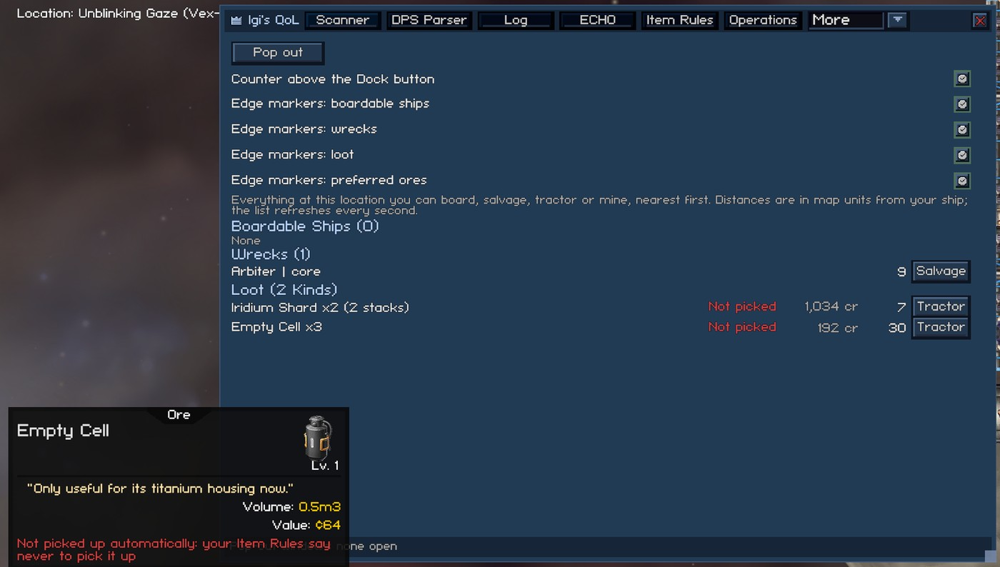
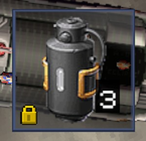
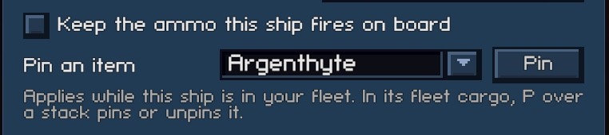
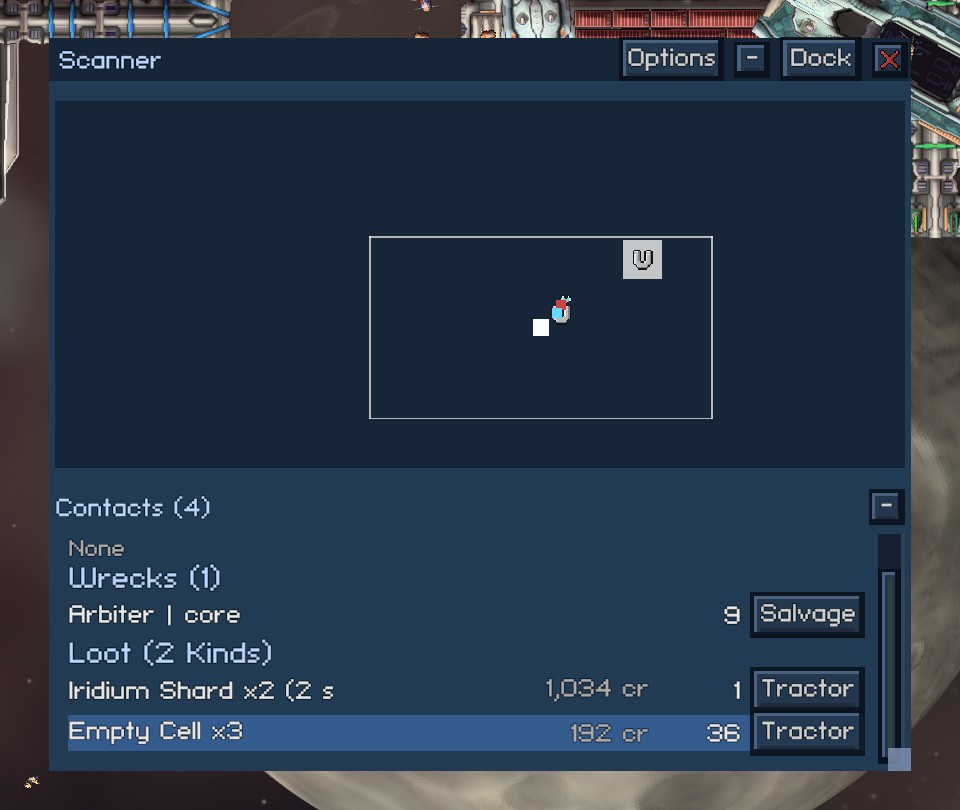

# Loot and Cargo

This page covers what your ships pick up, where it goes, and how to find what is left at a location. Settings keys are listed in [settings.md](../settings.md).

## Item Rules


The Item Rules tab holds one table of rules, saved with the game. Each rule has two parts:

- Pickup Limit: your ships stop picking the item up with their tractor beam once they carry this many of it. A limit of 0 means no limit, and -1 means never pick it up.
- At Dock: what ECHO does with the item at a station, and what [Station Services](stations.md#station-services) does if you want it to. The choices are Game default, Keep aboard, Sell, and Sell, keep up to. Sell, keep up to deposits the item until the station storage holds the Keep Up to amount, then sells the rest. The part above that amount is sold even when the storage is full.

The most specific rule wins. From most to least specific, the rules are checked in this order:

1. An item at one item level.
2. That item at any level.
3. A category and rarity together.
4. A category with a rarity and below.
5. A category on its own.
6. Any category with a rarity and below.
7. The default.

A "Turret / Standard" rule with a pickup limit of -1, for example, makes your ships and ECHO's "Pick up loot before leaving" skip Standard turrets.

A "rarity and below" rule covers the chosen rarity and every rarity under it, so "Turret / High Grade and below: Sell" replaces three rows (Standard, Enhanced and High Grade). Pick "Any category" to cover every item up to that rarity. When several of these rules cover an item, the one with the lowest rarity wins. With "Standard and below: Sell" and "Exotic and below: Keep aboard", for example, Standard items are sold and Enhanced to Exotic items stay aboard. A category's own rules win over an "Any category" rule.

The pickup limit is applied by [Loot Pickup Limits](#loot-pickup-limits). The dock action is applied by [ECHO Cargo Rules](echo.md#echo-cargo-rules) and Station Services. The same tab carries the settings of both features.

The tab lists the rules in five sections: Default, Categories, Category and Rarity, Rarity and Below, and Items.

- Each section except Default ends with an add row. The Categories section says "Every category has a rule." once no category is left.
- For items, type at least two letters of the name and press Add next to the match. The list shows at most 20 matches and leaves out items that already have a rule.
- Each level of an item is its own entry, shown as "Name L3".
- The x at the end of a row removes the rule. The Default row can't be removed.
- The pickup limit takes -1 or more. The Keep Up to box only takes input while the action is Sell, keep up to.

Under the table sit the settings of [Loot Pickup Limits](#loot-pickup-limits) and of ECHO Cargo Rules. While either feature is off, its rules do nothing, and the tab says so.

### Starting Rules for New Saves

When a save has no rules yet, the mod copies them once from `BepInEx/config/IgiQoL/item-rules.json`, if that file exists. After that the save uses its own copy, so editing the file doesn't change saves that already have rules. The file uses the same format the mod writes into the save:

```json
{
  "default": { "tractorCap": 0, "dockAction": "Default", "keepAmount": 0 },
  "categories": {
    "Ore": { "tractorCap": 500, "dockAction": "SellAbove", "keepAmount": 2000 }
  },
  "categoryRarity": {
    "Turret/Standard": { "tractorCap": -1 }
  },
  "categoryUpTo": {
    "Module/Enhanced": { "dockAction": "Sell" }
  },
  "rarityUpTo": {
    "Standard": { "tractorCap": -1 }
  },
  "items": {
    "CanisterOxide": { "dockAction": "Keep" },
    "ArtifactAnalysis@3": { "tractorCap": 2 }
  }
}
```

- `tractorCap` is the pickup limit, -1 or more.
- `dockAction` is `Default`, `Keep`, `Sell` or `SellAbove`.
- `keepAmount` is the Keep Up to amount for `SellAbove`, which the tab shows as "Sell, keep up to".
- The categories are `Ore`, `Ammo`, `Turret`, `Module`, `Booster`, `Junk`, `Drone`, `RefinedProduct`, `Torpedo`, `JumpgatePass`, `TradeGoods`, `Usable`, `DefensiveTurret`, `Salvage`, `Currency`, `Crystal`, `Data`, `Blueprint`, `BossSignal` and `SignalFragment`.
- The rarities are `Standard`, `Enhanced`, `HighGrade`, `Exotic` and `Legendary`. A `categoryUpTo` or `rarityUpTo` key names the highest rarity the rule covers.
- Item keys are the game's item identifier (`CanisterOxide`, not the display name "Oxide Canister"). A key without `@level` covers every level of the item. A key with `@level` covers that level only and wins over the bare key. `[Dev] DumpGameData` lists every identifier in `InventoryItemType.allItems.txt` ([dev-harness.md](https://github.com/williammabernathy/Igi-s-QoL-Modpack/blob/main/docs/modpack/dev-harness.md#data-dumps)).

An entry with an unknown category or rarity is skipped, with a warning in `LogOutput.log`. Fields you leave out take the vanilla value (0, `Default`, 0), and an unknown `dockAction` reads as `Default`. When the file seeds a save, `LogOutput.log` says "imported N rules from item-rules.json into this save". A file that can't be read is logged as an error, and the save starts without rules.

## Loot Pickup Limits

This feature applies the pickup limits from the Item Rules tab. Your ships stop picking an item up with their tractor beam once they carry the limit, or never pick it up when the limit is -1.

"Don't pick up loot worth less than (credits per m3)" (0 to 1000000, default 0, which turns it off; also set on the Item Rules tab) makes ships skip loot whose sell value per m3 of hold space is below that many credits, so cheap bulky items don't fill the hold. Both rules apply to your ships' tractor beams and to ECHO's "Pick up loot before leaving".

A ship that already picked a loot stack before a limit was reached drops that pick at its next scan, instead of hovering at an item it will never pick up. A stack already in the beams, and an item you clicked yourself, are left alone.

A click on loot makes the tractor steer the ship ahead of combat until the item is in. This holds whether the click came from you, the Scanner, the off-screen markers or ECHO. So Engagement Distance and the target rules don't move a ship that is on its way to loot.

Items your missions need and ammo a ship fires are exempt from -1 and from the value floor (a numeric limit still applies to them), and clicking an item yourself always picks it up. Items that can't be sold, such as credits drops and crew pods, are never skipped for being cheap.

Loot that none of your ships at the location will pick up shows the reason. Its tooltip in space gets a red "Not picked up automatically: ..." line, and its [Scanner](#scanner) row shows "Not picked up" in its own column after the name, with the same tooltip. The reasons are "pickup limit of 50 reached", "your Item Rules say never to pick it up" and "worth under 12 cr per m3".

Several ships with a tractor beam (hired mercenaries included) can be held back for different reasons. Then the tooltip shows the first ship's reason, starting with the ship you fly. If any one of them would pick the loot up, there is no reason. The reason only covers these filters, so loot the game itself won't tractor (your own jettisoned cargo, for example) has none either.



## Shared Fleet Holds

"Pass cargo to ships with room" (off by default) changes what happens when a ship's tractor beam reaches for loot that its hold can't take whole. The ship moves cargo to your other ships at the same location, the flagship first and then the one with the most room. It moves the biggest stacks first, until the stack plus a quarter of its hold is free. It does this at most once every 2 seconds per ship. Favourites, ammo the ship fires, the usables the game keeps aboard, warp fuel, items your missions need and pinned stacks stay where they are.

Without this setting, a single full ship sets ECHO's "inventory full", and the whole fleet flies home even when the other ships have room. With it, ECHO heads home once every ship is full.

## Pinned Cargo

The fleet cargo window's "Move all fleet cargo to the flagship" button (it shows a gold crown) moves a fleet ship's whole hold to the flagship, including the ammo that ship fires. Pinned item types stay aboard, and everything else still moves in one click. There are two ways to pin an item type:

- Hover over a stack in one of your ships' cargo and press the pin key, the way you press F to mark a favourite. The "Pin key" setting sets the key (P by default), and the key is ignored while you type in a text field. It works on a fleet ship or one parked in the Personal Hangar (the pin applies while the ship is in your fleet). It does not work on the ship you fly or on a hired mercenary.
  - Pinned stacks get a gold lock in the bottom left corner. So does ammo kept aboard by the switch described in the next bullet.
  - The stack's tooltip says "Pinned: 'Move all fleet cargo to the flagship' leaves it aboard. Press P to unpin it", "'Move all fleet cargo to the flagship' leaves it aboard because this ship fires this ammo", or "P: pin it to this ship, so 'Move all fleet cargo to the flagship' leaves it aboard".
- In the ship's [settings popup](interface.md#ship-settings-popup), use "Keep the ammo this ship fires on board" to keep whatever ammo and torpedoes its current fit uses. Use "Pin an item" to pin or unpin an item aboard, or to remove a pin for an item that is no longer aboard.





A pin covers every stack and level of the item type, on that ship only. Pins are saved with the ship's other settings, so a [loadout](stations.md#ship-loadouts) carries them.

After a refit to another ammo type, a pin on the old ammo stays until you remove it, while the ammo switch follows the fit. The "flagship full" notice only counts stacks the button tried to move.

Shared Fleet Holds leave pinned stacks aboard too. ECHO's unloading, the fleet auto-deposit and the Deposit button ignore pins.

Gear made in play, such as crafted or looted weapons and modules, has no item type to pin it by, so it can't be pinned. The pin key ignores it, its tooltip has no pin hint, and it isn't in the popup's "Pin an item" list. "Move all fleet cargo to the flagship" moves it like any unpinned stack.

## Scanner


The Scanner tab lists everything at your location that you can board, salvage, mine or pick up with a tractor beam, nearest first, and refreshes every second. Rows keep their place while it refreshes. The name takes the space that is left, and the amount, the "Not picked up" or "Preferred" mark, the distance and the button each have a column of fixed width.

- Boardable ships, wrecks and loot, each with a Board, Salvage or Tractor button.
- Where there are asteroids, "Asteroid Ores" lists one row per ore and layer, with the asteroid count and the nearest distance. Ores on your [Preferred Ores](echo.md#preferred-ores) list are marked "Preferred". The Mine button sends your mining ships to the nearest asteroid of that ore, as clicking the asteroid would. Core ores appear once you have the Basic Scanning mining skill, and ore amounts appear with Advanced Scanning, the same as in the game's asteroid tooltips.

Each section is headed by its count: "Boardable Ships (N)", "Wrecks (N)" and "Loot (N Kinds)".

- A boardable row gives the ship and its faction. Where it applies, it also gives "boarding in progress", the operation's phase ("approaching", "operation under way", "crew extracting" or "operation complete"), or "depleted".
- A wreck row says what it still holds (items, surface, core) or "empty".
- Loot is grouped by item type. Each row gives the amount, "(N stacks)" when the item lies in more than one stack, what it would sell for, and the distance to the nearest stack, tinted by rarity. Hover for the item's tooltip. The Tractor button is shown while your flagship has a tractor beam, and it sends the beam after the nearest stack of that item.

Distances are map units from your flagship. An ore row shows the ore amount only with Advanced Scanning.

"Counter above the Dock button" (on by default) puts a one-line count above the Dock button, or above the QoL button when that sits there too. The count reads, for example, "1 boardable ship | 4 wrecks | 5 loot". A kind with none here is left out, and loot counts stacks. The counter disappears when nothing is here or when the HUD is hidden, as it is when you are docked. When the count drops to zero, the counter stays up for 2 seconds first, so it doesn't flicker at the edge of a wreck's range. Click it to open the Scanner tab. While the Scanner window below is open, clicking it brings that window forward and flashes it.


The four "Edge markers" settings ("Edge markers: boardable ships", "Edge markers: wrecks", "Edge markers: loot" and "Edge markers: preferred ores") are all on by default and can also be switched on the tab. They put markers at the screen edge for the 8 nearest off-screen contacts of each kind, with the distance under the icon. Loot markers are tinted by rarity. Empty wrecks and depleted ships are left out. Ore markers only point at asteroids with an ore from the Preferred Ores list, tinted by that ore's rarity, so nothing shows while the list is empty. Clicking a marker boards, salvages, tractors or mines its target. Clicking a loot marker only works with a tractor beam on your flagship.


### Scanner Window

The Pop out button at the top of the Scanner tab opens the Scanner as a [window of its own](interface.md#pop-out-windows) that stays on screen while you play. Dock back on the tab closes the window. Dock on the window's header closes it and opens the tab. By default the window is always shown, but its Options button can limit it to when there is something here to board, salvage or pick up, the same count the HUD counter shows.

- The map draws the location to scale. Your flagship is a white dot, your fleet is blue and enemies are red. Boardable ships, wrecks, loot and asteroids with ore use the same icons as the edge markers, and loot and ore are tinted by rarity. The thin rectangle is what the game camera shows now.
- Dots follow their targets four times a second. The set of ships and contacts is read once a second.
- Under the map, the "Contacts (N)" header has a +/- button that folds the list away, so the map takes the whole window. N is the number of contacts drawn, and the window remembers your choice. The list is the tab's list without its settings and help text.
- Click a dot to select its row, which scrolls into view and is highlighted. Click a row to ring its dot. One contact is selected at a time. A loot row rings every stack of that item. An ore row rings every asteroid listed under that ore. An asteroid with surface ore is listed under its surface ore, and a core-ore row rings the asteroids whose only listed ore it is.
- Board, Salvage, Tractor and Mine work as they do in the tab, but they leave the window and the QoL window as they are.


