# Stations, Loadouts and Crafting

This page covers things you do while docked, for the whole fleet or in one click. Settings keys are listed in [settings.md](../settings.md).

## Station Services

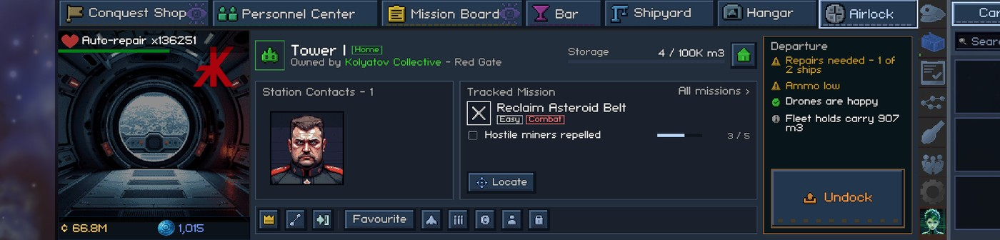

Five service buttons sit at the end of the text buttons in the airlock's action row, after the game's own text buttons. The [Favourite button](#favourite-stations) comes first in that row.

A service button appears when it has work to do, or when it can't do it here, in which case it is greyed out (see below). Once a button has appeared, it stays in its place until you leave the airlock screen. It is greyed out when there is nothing left to do, so none of the buttons in the row move while you use them. Each button keeps one width, wide enough for its longest label, so a changing credit amount never resizes it. Hovering a button lists every ship and stack it would touch, what it costs and what it couldn't do.

| Button | What it does |
|---|---|
| Repair fleet (with the cost) | Starts the Personal Hangar's paid repair on every damaged ship in your fleet. The paid repair takes about 20 seconds and uses the Personal Hangar's own price and reputation discount. The free repair the station does by itself takes minutes |
| Restock ammo (with the cost) | Tops up every fleet ship's ammo to the "Ammo Supply" minutes set on ECHO's Autopilot tab. It uses the armory first, then buys from the station's credit shops. The game's ECHO only restocks the ship you fly |
| Sell by rules (with the credits it earns) | Applies the [Item Rules](loot-and-cargo.md#item-rules) dock actions Sell and "Sell, keep up to" to your fleet's cargo. With "Sell from the data inventory" on, it also sells from your data inventory. With "Sell from station storage" on, it sells from this station's material storage, and with "Sell from the armory" on, from the armory. All three settings are in [ECHO Cargo Rules](echo.md#echo-cargo-rules). "Sell, keep up to" first stores up to the amount you set of the item in the armory or the station's storage, and sells the rest |
| Replace crew (with the cost) | Puts back the crew each ship lost to hull hits (see below) |
| Unload brigs | Moves the prisoners in your ships' brigs to the station brig, so the next boarding's captives fit aboard instead of floating off with "Brig full". Willing prisoners stay willing. The station brig's size grows with your level |

A button whose service can't be done here is greyed out, and its tooltip says why. This happens when there is no Personal Hangar, not enough credits, no shop that sells the ammo, or no storage that takes the item.

When the buttons would be wider than the action row, or would squeeze the game's icon buttons in it, the labels switch to a shorter form until you leave the airlock screen. The short forms are Repair, Restock, Sell, Replace crew (without its cost) and Unload brigs. The game's own buttons and the Favourite button count towards that limit. If even the short labels don't fit, the five become icon buttons like the game's own at the start of the row: a dry dock for Repair, ammo for Restock, credits for Sell, crew for Replace crew and a lock for Unload brigs. Hover one for its name and what it would do.

Clicking a button shows a notification with what it did, plus the first problem it ran into.

Crew losses work like this. Every hull hit of 2% or more can kill one crew member, on every ship. The mod counts those deaths per ship and crew type in the save. Replace crew fills them from three sources, in this order:

1. Your crew reserve.
2. Willing prisoners of that type, from the ship's brig and then the station brig, at 40% of the hire price (the game's recruit cost).
3. New hires at the station's personnel center, at its price and stock.

Crew of that type added to the ship any other way (by you, by ECHO or by a loadout) counts as a replacement, so nothing is replaced twice. Crew coming back aboard from an operation doesn't count. The game's ECHO only hires for the ship you fly, so without this button your fleet ships never get their losses back.

"Warp fuel cells to keep aboard" (0 to 50, where 0 turns it off) makes restocking also keep that many warp fuel cells in the ship you fly, which is the only ship that burns fuel. It takes cells from the armory first, then buys them, fastest kind first. A part-used cell counts as one, as the game counts it. The button reads "Restock fuel" when only fuel is missing.

The same services can run every time you dock, including while ECHO flies. Each has its own setting, and all are off by default: "Pay for repairs when you dock", "Restock ammo when you dock", "Sell by item rules when you dock", "Replace lost crew when you dock" and "Unload brigs when you dock". With ECHO on, selling is left to [ECHO Cargo Rules](echo.md#echo-cargo-rules).

With "Sell by item rules when you dock" on, the game's fleet auto-deposit waits until the sale is done. That way it can use the room the sale frees in station storage and the armory.

A run on docking ends with a "Docked: ..." notification of what it did, plus one notice for each service that fell short. Each notice is shown once per station visit. "Buttons on the airlock screen" (on by default) shows the buttons.

Hired mercenaries are left out of every service. Repair skips ships that are away for repairs, since the game brings those back repaired for free. Favourites, mission items, usables the game keeps aboard, warp fuel and the ammo a ship fires are never sold. Selling from the armory also keeps warp fuel, every ammo type your fleet fires and the pieces your saved loadouts use.

## Ship Loadouts

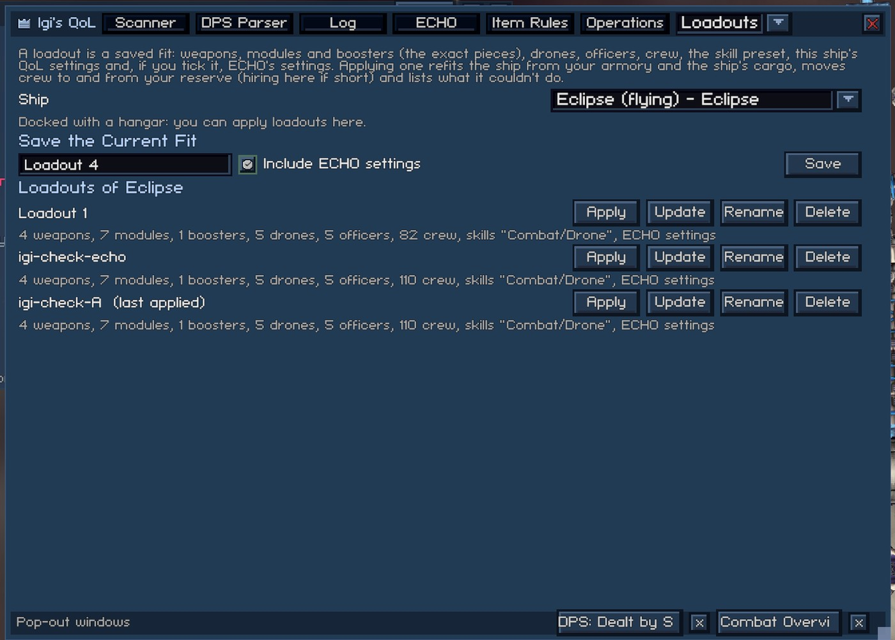

Save a ship's whole fit under a name and apply it later while docked at a station with a Personal Hangar. Open it from the Loadouts tab, or from the "L" button in the row of small buttons at the top right of the Personal Hangar's ship view. The "L" button sits three places left of the game's "S" (skill preset) button, and it opens the tab on the ship the Personal Hangar shows.

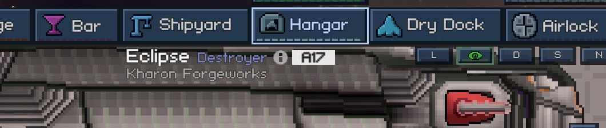

The tab has a ship dropdown (your fleet first, then your other ships), a name field with an "Include ECHO settings" tick and a Save button. Below them is one row per saved loadout, with Apply, Update, Rename and Delete. Saving under a name that already exists asks before it replaces that loadout.

You can save and manage loadouts anywhere. Apply needs a docked station with a Personal Hangar and one of your own ships that the Personal Hangar can refit. When Apply can't run, it is greyed out and the tab says why under the ship dropdown.

A loadout holds the exact weapons, modules and boosters, drones, officers, crew per type, the skill preset name, the ship's [per-ship settings](interface.md#ship-settings-popup) and, when ticked, ECHO's settings. Weapons, modules and boosters are matched by their rolled stats, so socketing an aspect or a booster's unlock progress doesn't break the match.

Applying runs skills, equipment, officers, crew, drones, then settings:

- Skills: the saved skill preset is selected, if it still exists and you have the skill points for it.
- Equipment comes from what is fitted, the armory and the ship's cargo, and replaced pieces go to the armory. A piece that is gone is replaced by the best piece of the same type and rarity, and the report flags this. A favourited piece is never used for this. If no such piece exists, the fitted one stays.
- Officers: the ship's officers that aren't in the loadout go back to your roster, and the saved ones are seated. An officer who is on another ship stays there, and the report says so.
- Crew: surplus crew goes to your reserve, and shortfalls come from the reserve or are hired here.
- Drones are set per slot, and only drones you have unlocked are used.
- The "Last Apply" list at the bottom of the tab says what was done and what wasn't.

Loadouts saved on your other ships of the same hull are listed under "Saved on Your Other ... Hulls". You can apply them there or copy them here with "Copy here".

Applying a loadout with ECHO settings to the ship you fly restores those settings at once. For another ship, the settings are used when you next fly it. Switching to another ship restores the ECHO settings of the loadout last applied to it. Refits and loading a save don't restore them.

## Crafting Roll-Up

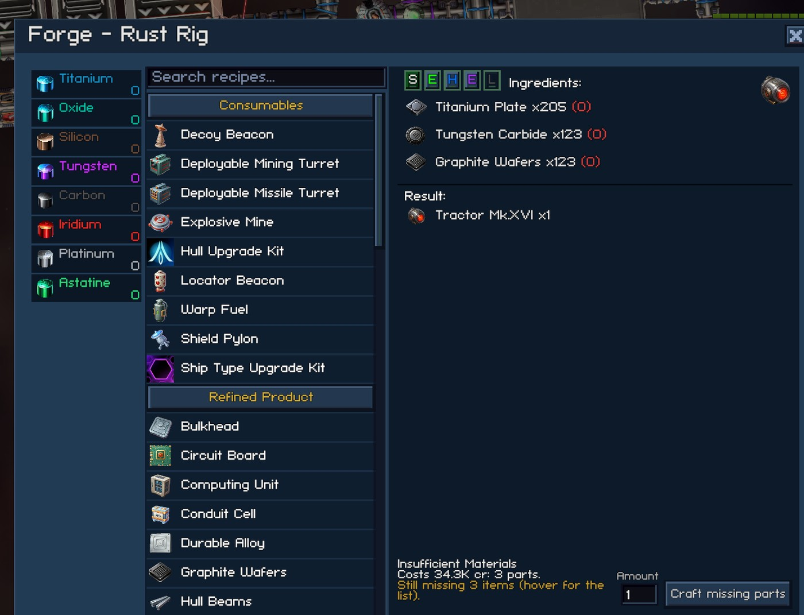

Forge recipes you can't craft yet get a "Craft missing parts" button with an amount field (1-999) in the "insufficient materials" strip. The strip says what crafting costs, for example "Costs 86.8K cr: 5 parts and 6 ores to refine.". In orange, it says how many items are still missing ("Still missing 6 items (hover for the list).").

Hover the strip for every job, with the forge time (summed, as if the jobs ran one after another) and the refinery time. When nothing at the station makes what is missing, the strip says "Nothing here can make the missing items (hover for the list)." in orange, its tooltip lists the missing items, and the button stays greyed out. When the forge's ingredient list is long enough to reach into the strip, the strip's text hides itself instead of drawing over the list. The button's tooltip still has everything.

When the station has a refinery, missing canisters are covered by refining ore from its materials storage, and from your cargo when you are docked there. For each canister, the plan picks the ore with the best yield, counting by-products and the refinery's carried-over fractions. Favourite ore, ore your missions need and ore the game won't auto-refine are left alone.

Pressing "Craft missing parts" starts each refinery job and queues each part job as soon as its ingredients (or ore), a free slot and the credits are there. Then it queues the recipe itself. The mod checks this every second where you are and every 10 seconds at other stations, also while you're away. Parts and canisters made this way go into the station's materials storage even with "deposit in cargo" on. A notification ("Crafting missing parts is done: ...") says when the recipe is queued. Ingredients that no recipe makes (drops) still have to be at the station.

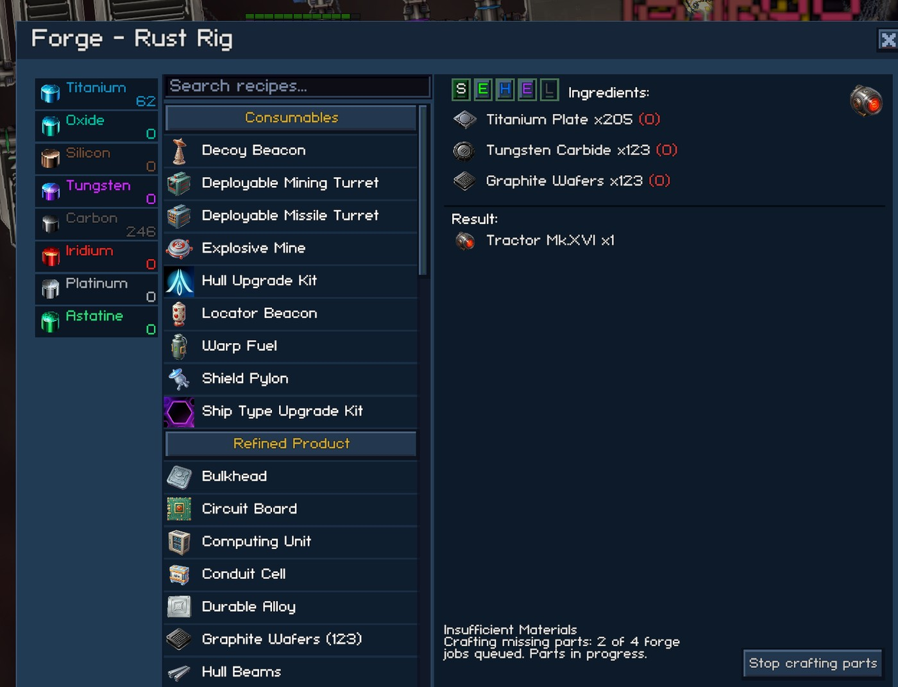

While it runs, the amount field is gone. The strip reads "Crafting missing parts: 2 of 4 forge jobs queued, 1 of 2 refinery jobs started" and says what it is waiting for: an ingredient, credits, room in the materials storage or a free slot. Hover it to see each job marked started, queued or waiting. The button reads "Stop crafting parts". It ends the run, and jobs already queued keep running. Runs are saved with the game, and there is one per recipe and forge.

A new run is planned against what the station holds, minus what your other runs here have yet to use (their waiting steps' ingredients and ore). A part another run has already queued counts as on its way. So the "Still missing" list of a second run includes what the first run still needs. Nothing is held back: items stay where they are, and a craft you queue by hand can still use them first.

## Refinery Filter

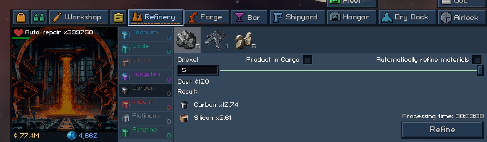

Left-click a material in the refinery's left column to show only the ore that refines into it, sorted by how much of that material one unit yields. The other materials dim while the filter is on, and the material's tooltip says what a click does. Click the material again to show all ore, or click another material to switch. When no ore at the station yields the material, the ore row says so. If the selected ore gets hidden, the first ore left is selected. Leaving the refinery clears the filter. The filter changes only what the screen shows.

## Used in (Forge Recipes)

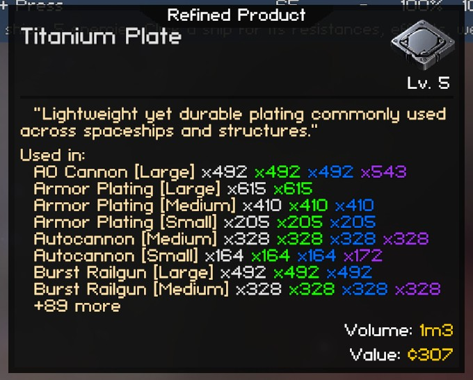

Hover a forge ingredient (a refined product, a canister or a signal fragment) and its tooltip lists the forge recipes that use it, with how many one craft takes. This is the same number the forge's ingredient list shows. Only recipes you can craft are listed, meaning the ones the forge offers you, so a blueprint shows up as soon as you learn it. When you have a recipe in more than one rarity, its line has one count per rarity, in that rarity's colour. The list stops at 8 recipes and says how many more there are. The comparison tooltip for your fitted item doesn't get the list.

For the full list, open the Stat Reference tab (under "More" at the default window width) and type part of the item's name into the search at the top, two letters or more. Each matching ingredient gets a row with its recipe count (up to 20 rows, then the list asks for more of the name). Show opens every recipe that uses the item, in the same format as the tooltip but with no cap, and Hide closes it again. A search with only one match opens by itself.

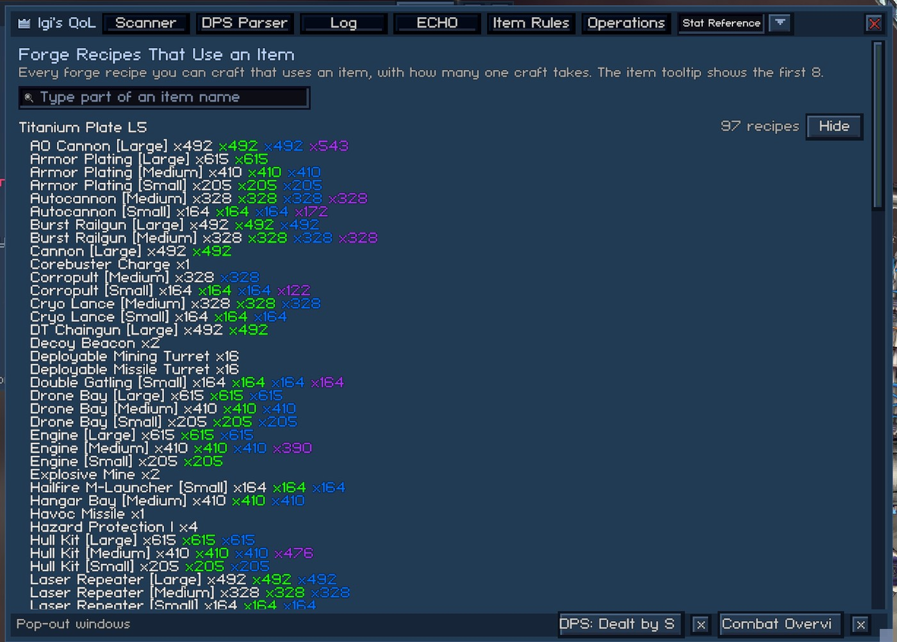

## Operations Tab

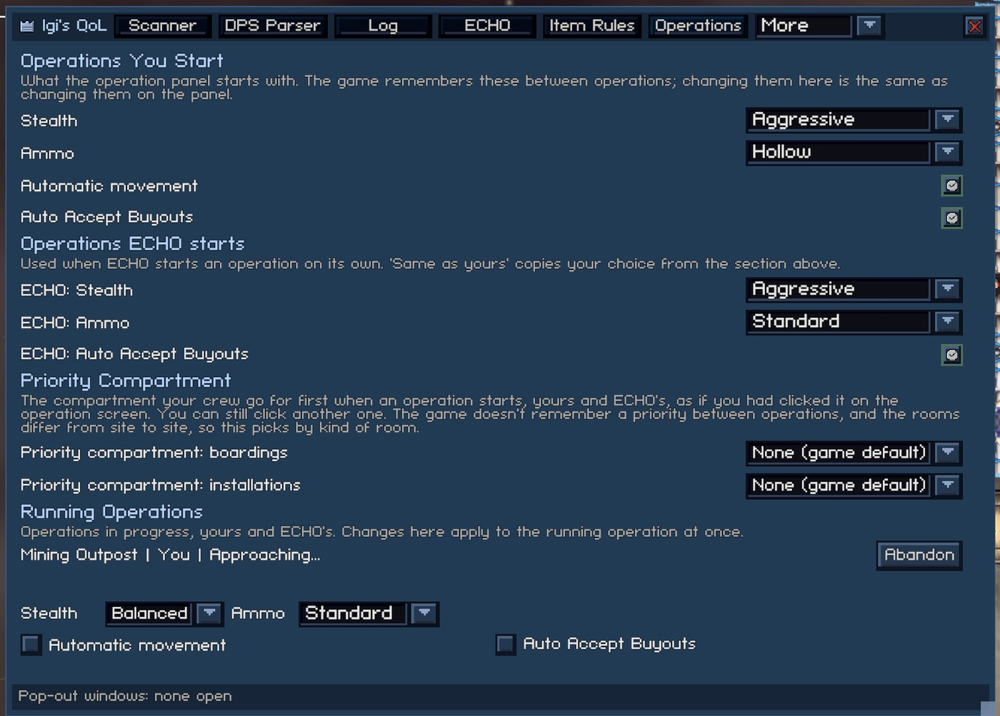

Operations are the game's boarding and installation raids. The tab has four sections:

- Operations You Start: the Stealth, Ammo and Automatic movement choices the operation panel starts with. The game remembers these between operations, and changing them here is the same as changing them on the panel. "Auto Accept Buyouts" (off by default) also ticks Auto Accept Buyouts on every new operation, which the game doesn't remember. The help texts are the game's own.
- Operations ECHO starts: see [ECHO's Operations](echo.md#echos-operations).
- Priority Compartment: the room your crew go for first. There is one choice for boardings of ships ("Priority compartment: boardings") and one for installations, where the crew go in on foot ("Priority compartment: installations"). Both default to "None (game default)".
  - When an operation starts, yours or ECHO's, the first compartment of that type in the layout becomes its priority, as if you had clicked it on the operation screen. You can still click another one. A layout without that room gets no priority.
  - The game keeps no priority between operations, and the rooms differ from ship to ship and site to site. So the choice is a kind of room, not a room number.
  - Each list offers only the rooms that kind of operation can have, without the airlock and corridors.
- Running Operations: yours and ECHO's. Each operation has four lines.
  - The first line gives the site, who started the operation (You or ECHO) and its phase, in the game's words (Approaching..., In progress, Extracting crew..., Complete). The exit button is at the end of this line.
  - The second line gives the elapsed and estimated time as the game's panel shows them, then Enemies defeated, Crew KIA and Crew wounded so far.
  - The third line has that operation's Stealth and Ammo. The fourth has its Automatic movement and Auto Accept Buyouts.
  - Changes apply to the running operation at once, and they follow changes made on the game's panel.
  - The exit button is the same as on the game's operation panel and keeps its place on the line. After a victory it reads Extract, and your crew heads back to your ship with what it collected. Before that it reads Abandon. Abandon asks first, then your crew retreats (or the approach is called off) and the operation ends. Once the crew is already leaving or the extraction has started, the button is greyed out.
  - Every control has a fixed place, so a changing phase, time or count never moves them.

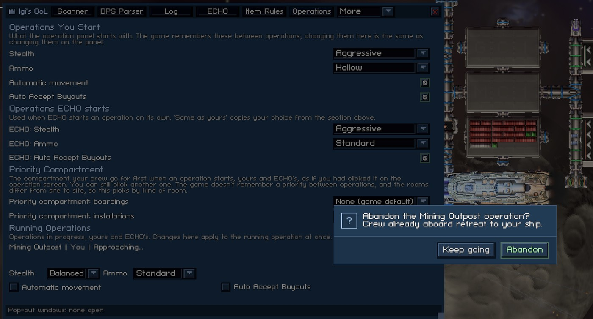

The feature also fixes a game bug on the operation panel. Each crew slider starts on the number you last left it on, for any ship. The game printed that number even when the ship you fly has fewer of that crew, for example "Marine (38)" with 40 beside it. The slider itself stops at 38, and 38 is what the operation takes. The number beside the slider now shows the same 38. The remembered value isn't changed, so a ship with more crew still starts at your old number.

## Favourite Stations

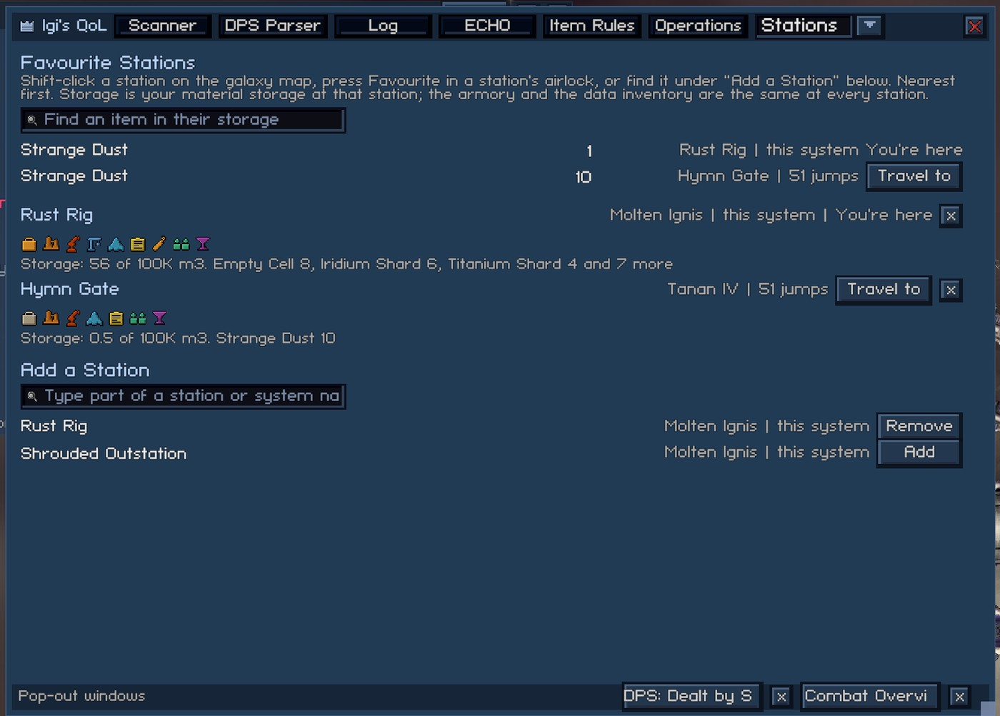

The Stations tab keeps a list of stations you pick, nearest first. Each entry shows:

- its system and the jumps to it from where you are ("this system", "N jumps" or "no known route");
- the game's facility icons (hover one for its name);
- your material storage there: the space used out of the capacity, and the three biggest stacks (hover the line for all of them).

Travel to closes the window and plots the course the way a click on the galaxy map does. It asks first when you are docked and the game has something to warn about. At the station you're docked at, the entry reads "You're here" instead. The x takes the station off the list.

There are three ways to add a station or take it off again:

- Shift-click its marker on the galaxy map. The marker's tooltip says which of the two a Shift-click does.
- The Favourite button at the start of the airlock's button row while you're docked there. It reads Unfavourite on a favourite, and a notification says what changed.
- "Add a Station" at the bottom of the tab: type part of a station or system name (two letters or more). It searches the stations the galaxy map shows, in systems you can reach, and lists up to 12 with an Add or Remove button each.

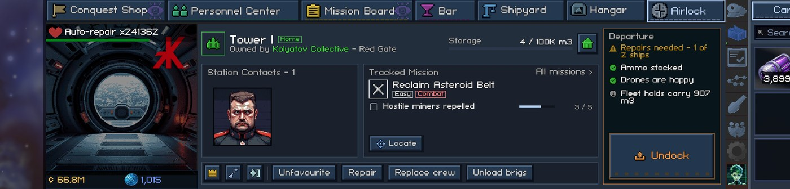

The search box above the list looks through the favourites' material storage. Type part of an item name ("tungsten", two letters or more), and every favourite holding a matching item gets a row with the count and Travel to, up to 30 rows. Hover the item for its tooltip. The armory and the data inventory are the same at every station, so they aren't listed. Shop stock and mission boards only fill in while you are at a station, so the list doesn't show them.

The list is kept in the save. A favourite whose station no longer exists is left out of the list.
