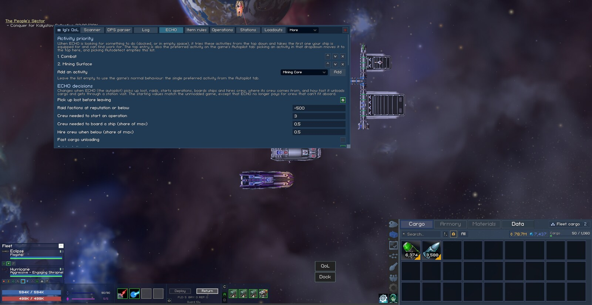
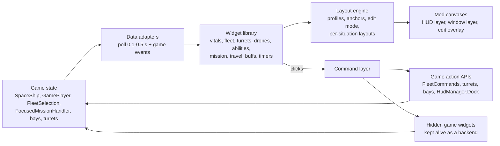

# UI Rework Feasibility

This page collects the research on making Vanguard Galaxy's interface configurable per player: moving, resizing, hiding, fading and restyling HUD pieces and windows, and saving the result as layouts. Nothing here is implemented yet.

The findings come from three sources: the decompiled 0.8.3.5 code in `decompiled/`, the modpack source in `src/IgiQoL/`, and an offline read of the game's scene and prefab files with UnityPy. The game was not launched. Paths are relative to the repository root, and game line numbers drift with updates, so search by symbol name. [Appendix: Reading the UI Offline](#appendix-reading-the-ui-offline) shows how to repeat the scene dumps.

## Short Answer

A configurable HUD is feasible as a modpack feature. I'd build it as a layout layer: a list of about 25 named game objects that the player can move, scale, fade or hide in an edit mode, plus the game's ten draggable windows, all saved as layout profiles on the machine. That covers most of what "modular UI" means to a player, and it needs no new art and no save data.

The bigger option is to hide the game's in-space HUD and rebuild it from mod widgets that read the same game state and call the same game methods. That's realistic for the HUD, which is about 7,200 lines of decompiled code. It isn't realistic for the side panel tabs, station screens or galaxy map, which are mostly game logic. Those stay the game's and join the layout as whole blocks. [Rebuilding the HUD From Scratch](#rebuilding-the-hud-from-scratch) covers that design. The layout layer's registry, edit mode and profiles are the same code in both, so the layout layer is a safe first step either way.

Four things I wouldn't attempt:

- New tabs inside the game's own side panel or settings menu. The side tabs are a closed enum, and the settings tabs are a fixed array of method names.
- A font swap. The font is set per label (178 labels in the three UI scenes alone, plus every prefab), and the boxes are sized for the pixel fonts, so a replacement means reassigning each label and then fixing what no longer fits.
- Recolouring the whole game. The palette is 376 `static readonly` fields read at 1,948 places.
- Rebuilding station screens. Each one is a prefab wired into `SpaceStationInterior`.

The biggest risk is churn. From 0.8.3.4 to 0.8.3.5 the developer added 51 files and changed 132 in the UI namespaces, including a new style layer (`UiStyle`, `UiPalette`, `UiButtonFx`), window chrome (`WindowTitleBarFx`, `WindowResizeZones`) and a Dock button built in code. The game's UI is being reworked right now. A layout mod has to find its targets by stable handles (`HudManager` fields and component types, not object names), and a self-check has to confirm every target after each game update.

## How the Game Builds Its UI

### Scenes and Canvases

When a save loads, `SceneLoader.LoadNeededScenes` (`decompiled/Behaviour.Bootstrap/SceneLoader.cs:197`) adds the Camera, `UI - Sidepanel`, `UI - HUD`, Backdrop and Gameplay scenes. `SpacestationInterior` is added while docked. The always-loaded Bootstrapper scene holds the canvases for popups, tooltips, notifications and the console.

Every canvas is Screen Space Overlay with a ConstantPixelSize `CanvasScaler`, so draw order comes only from sorting orders. These were read from the scene files and the code:

| Canvas | Where it's set | Sorting order |
|---|---|---|
| Station interior (`SpaceStationInterior`) | SpacestationInterior scene | 0 |
| Galaxy map (`GalaxyMapWindow`) | GalaxyMap scene | 0 |
| HUD | UI - HUD scene | 1 |
| Side panel and its button column | UI - Sidepanel scene | 2 |
| Mod pop-outs | `PopoutKind.SortingOrder` | 2 (4 for the War Overview) |
| Game draggable windows | `DraggableWindowBar` (`decompiled/Behaviour.UI/DraggableWindowBar.cs:241`) | 3 |
| Mod window | `Kit.Window` (`src/IgiQoL/UI/Kit.cs:47`) | 3 |
| Mod ship popup | `ShipPopup` (`src/IgiQoL/UI/ShipPopup.cs:41`) | 4 |
| Dialogue, credits | Gameplay and Bootstrapper scenes | 4 |
| Console, notifications | Bootstrapper scene | 5 |
| Popups (`PopupContext`) | Bootstrapper scene | 6 |
| The hover card itself | `UITooltip` (`decompiled/Behaviour.UI/UITooltip.cs:280`) | 32767 |

The station interior sits under both the HUD and the side panel. Anything parented to the HUD canvas draws over station screens, which is why the QoL button hides while docked.

### The HUD Frame and the Strip

The game started as a strip along the bottom of the desktop, and the UI still carries that design. `TransparencyMode` (`decompiled/Behaviour.Bootstrap/TransparencyMode.cs`) has four values: Transparent, Performant, FullScreen and Windowed. In Transparent mode the game window covers the desktop. `TransparentWindow.Update` (`decompiled/Behaviour.Transparency/TransparentWindow.cs:155`) makes it click-through above the strip, except while the mouse is over any UI raycast target. The Win32 calls behind this mode are Windows-only.

The strip is 324 canvas units high. `ScreenSettings.SetScreenPercentage` (`decompiled/Behaviour.Transparency/ScreenSettings.cs:161`) turns that into `clickableScreenPercentage` (324 × Scale / screen height) and sets `gameScreenPercentage` to 1 in FullScreen and Windowed mode, or to the strip's share otherwise. Each UI scene has one `Gameview` object whose anchors `WindowMinimumY.UpdateCameraRect` (`decompiled/Behaviour.Transparency/WindowMinimumY.cs:56`) sets from one of those two values. The serialized flags, read from the scene files, decide which:

| Scene | `useGamePercentage` | `stackUI` | Result in FullScreen and Windowed mode |
|---|---|---|---|
| UI - HUD | on | off | The HUD frame covers the whole screen |
| UI - Sidepanel | off | off | The side panel stays in the bottom strip |
| SpacestationInterior | off | on | Station screens fill the strip, and move to the upper row when the strip stacks |

When the window is narrower than 1920 canvas units and at least two strips tall, `ScreenSettings.DetermineStack` doubles the clickable area to two rows. Only the station interior's `Gameview` has `stackUI`, so it is the one frame that moves to the upper row.

Inside the HUD's `Gameview`, anchors cut the screen into three columns: `BottomLeftDivide` (x 0 to 0.4), `BottomMiddleDivide` (0.4 to 0.6) and `BottomRightDivide (SM)` (0.6 to 1). Pieces anchored to the top of a column, such as the location line, mission tracker and travel panel, therefore sit at the top of the screen in FullScreen mode and at the top of the strip in Transparent mode. The 74-unit `BottomHUD` strip, the Dock button and the side panel stay at the bottom in both. A layout mod sees the parent rects change size when the player switches mode, so positions have to be saved relative to the screen, not the parent.



These are the HUD's top-level pieces. "Handle" is the `HudManager` field a mod can reach them by (`decompiled/Behaviour.UI.HUD/HudManager.cs`). "Moved at runtime by" lists the game code that writes the object's position, which a layout mod would fight.

| Object under `Gameview` | Component | Handle | Moved at runtime by |
|---|---|---|---|
| `BottomLeftDivide/Area Information` | `LocationManager` | `locationManager` | nothing found |
| `BottomLeftDivide/FocusedMissionDisplay` | `FocusedMissionDisplay` | `focusedMissionDisplay` | nothing found |
| `BottomLeftDivide/EventLog` | `EventLogManager` | none | nothing; a layout group and fitter size it |
| `BottomLeftDivide/WingmanTransform` → fleet panel (prefab `Resources/HUD/Fleet/FleetPanel`) | `FleetPanel`, `FleetPanelPlacement` | `wingmanDisplayParent`, `fleetPanel` | `RefreshFleetLayout` → `PlaceDocked`, unless the player has dragged the panel |
| `BottomLeftDivide/Industrial Ops status` | `IndustrialOpsUI` | `industrialOps` | `RefreshFleetLayout` → `SetAnchoredPosition(y)` stacks it above the fleet panel |
| `BottomHUD/LayoutGroup/HealthMonitorPanel` | `ShipHealthMonitor` | `shipHealthMonitor` | the strip's `HorizontalLayoutGroup` |
| `BottomHUD/LayoutGroup/Crew` | `CrewHud` | `crewHud` | the layout group |
| `BottomHUD/LayoutGroup/AbilitiesHolder` | `AbilityHud` (child) | `abilityHud` | the layout group |
| `BottomHUD/LayoutGroup/Carrier`, `Drones` | `HangarControls`, `DroneControls` | `hangarControls`, `droneControls` | the layout group |
| `BottomHUD/LayoutGroup/Turrets` | `TurretControl` | `turretControl` | the layout group; `TurretControl.hud` is this same object, and it slides it 40 units down and back between positions recorded once in `Start` (`decompiled/Behaviour.UI.HUD.Turrets/TurretControl.cs:47`, `:113`) |
| `BottomMiddleDivide/TravelInfo` | `TravelInfo` | none (`TravelInfo.instance`) | nothing for its position |
| `BottomMiddleDivide/TimerInfo` | `TimerInfo` | `timerInfo` | `ShowTimerInfo` sets y to -125, or -325 while `TravelInfo` shows (`HudManager.cs:874`) |
| `BottomMiddleDivide/BuffHud`, `BossHealthHUD` | `BuffHud`, `BossHealthHud` | `buffHud`, `bossHealthHud` | nothing found |
| `BottomMiddleDivide/ECHO` | `EchoRemarks` | `echoRemarks` | its alpha changes every frame |
| `BottomMiddleDivide/Dock` → the holder "Dock" | `HudDockButton` | `dockButton`, `DockRoot` | built once by `HudDockButton.Replace` |
| `TransponderStatus`, `LevelProgressImage` | same names | `transponderStatus`, `progressImage` | nothing found |
| `BottomRightDivide (SM)/SubtleTimerInfo`, `ShowOperationLog`, `POIOperationLogPanel` | `TimerInfo`, button, `POIOperationLogPanel` | `subtleTimerInfo`, `operationLogToggleButton`, `operationLogPanel` | not traced |
| `DungeonPanel` | `DungeonPanel` | `dungeonPanel` | it's an `IDraggableWindow` and saves its own position and size |

Visibility goes through `HudManager.ToggleHudElements(bool)` (`HudManager.cs:574`), which calls one `Toggle*` method per element. Some of them, `ToggleFleetPanel` among them, call `SetActive(visible)` on their element. `FadeOutHudElements` fades the 17 objects listed in `FadeableElements()` (`HudManager.cs:624`) when you dock. The hide-UI hotkey (`GameControls.UIHideUI`) toggles the HUD, the side panel, `TravelInfo` and the station interior together. No game setting hides a single element.

### Scale and Text Size

The game's Scale setting is one number for every canvas. `CanvasScaleUpdater` (`decompiled/Behaviour.Transparency/CanvasScaleUpdater.cs`) sits on the HUD, side panel, map, station and overlay canvases and copies `GameplayerPrefs.GetScaleFactor()` into `CanvasScaler.scaleFactor` whenever it changes. `ScreenSettings.DetermineScale` caps Scale at the size where the 1920 × 324 strip still fits the window.

There's no separate text size in the game. The modpack's `TextScale` feature (`src/IgiQoL/Features/TextScale/TextScale.cs`) adds one by patching `TextMeshProUGUI.GenerateTextMesh` and `TMP_Text.CalculatePreferredValues`. Panels keep their size, so larger text gets cut off.

The HUD's text sizes are baked into the scene and none of them use auto-size. The flagship's vitals panel (`HealthMonitorPanel`) is typical: 240 units wide, with three bars 18 units high. The bar values are `pixelFJ8pt1_ SDF` at size 10, and the crew and officer counts next to them are `pixel16` at size 8, the smallest text on the HUD.

### Windows and Panels

The game has a real window framework. `IDraggableWindow` (`decompiled/Behaviour.UI/IDraggableWindow.cs`) asks a window for its id, default size, position, scale and size. `DraggableWindowBar` provides the rest:

- dragging by the title bar,
- a maximise button and double-click to maximise,
- resize zones on the edges (`WindowResizeZones`, `ResizeDraggableWindowHandle`); a non-scalable window changes size, and a scalable one changes `localScale`,
- clamping to the screen,
- bring-to-front with a highlighted border,
- the close button placed in the corner.

Ten windows implement it: `GalaxyMapWindow`, `EmpireWindow`, `TradeRouteWindow`, `DungeonPanel`, `HangarLoadoutWindow`, `ConstructionYardWindow`, `DryDockPanel`, `SalvageWorkshop`, `ShipUpgradeWindow` and `StationOptionsWindow`. Each stores its position and its scale or size in PlayerPrefs through its own `GameplayerPrefs` getter and setter (`decompiled/Source.Player/GameplayerPrefs.cs`, for example `GetEmpireWindowPosition` and `GetEmpireWindowScale`).

The fleet panel has its own smaller version. `FleetPanelPlacement` (`decompiled/Behaviour.UI.HUD.Fleet/FleetPanelPlacement.cs`) keeps the panel docked in the HUD until the player drags it. After that it saves `FleetPanelX/Y`, clamps the panel to the whole screen, and stops `RefreshFleetLayout` from moving it. A double-click on the handle docks it again. This "docked until dragged" pattern fits other HUD pieces too.

The side panel is fixed. `SidePanel` is anchored to the right edge, 768 units wide: a 730-wide `SideTab` and a 38-wide button column (`SidePanelMenu`, a vertical layout group of 7 `SidePanelMenuButton`s). The tabs are the closed enum `SidePanel.SideTabType`. Their content comes from prefabs (50 of them in `sharedassets14.assets`) that `SideTab` instantiates into `SideTabContentHolder`.

The station interior is a 1154-wide panel anchored right. Its facilities are serialized prefab references on `SpaceStationInterior` (38 service prefabs in `sharedassets15.assets`), opened through a `tabActions` dictionary built in `Awake`.

The settings menu has four tabs bound by method name (`decompiled/Behaviour.UI.Settings/SettingsMenu.cs`), and it throws if the count doesn't match. The Controls page (`ControlSettings.cs`) lists hotkeys as text and can't change them.

### Colours, Fonts and Art

There are two colour layers. `ColorHelper` (`decompiled/Source.Util/ColorHelper.cs`) holds 376 `public static readonly Color` fields, referenced 1,948 times in 413 files. Many prefabs also carry colours on their `Image` components.

The second layer is new in 0.8.3.5. `UiStyle` (`decompiled/Behaviour.UI.Shared/UiStyle.cs`) is a ScriptableObject loaded from `Resources/UI/UiStyle`. Its `UiPalette` has five roles (backdrop, card, card border, focus, focus border), and `UiStyle.NotifyPaletteChanged()` makes every `UiPaletteColor` repaint on its next `Update`. Only 8 calls in 3 files bind to it so far.

The game ships six TextMeshPro font assets. In the three UI scenes, `pixel16` is used by 178 labels, `pixelFJ8pt1_ SDF` by 5 and `LiberationSans SDF` by 3. `Lato-Regular SDF`, `dogicapixel SDF` and `LiberationSans SDF - Fallback` aren't used there. The pixel fonts have no `·`, `•`, `–` or `×` glyphs (LESSONS_LEARNED.md). Game code never assigns a font; new labels copy theirs from a template.

Icons come from `PoiIconLibrary` (`Resources/UI/PoiIconLibrary`, looked up by key). Window grips, alert icons and button prefabs come from `UiStyle`.

### Input

`PlayerControls` (`decompiled/PlayerControls.cs:648`) builds its `InputActionAsset` from JSON in its constructor. `GameControls`, `GlobalControls` and `SpacestationControls` each create their own instance. The game has no rebinding code. Besides the action maps, 23 files read keys directly through the legacy `Input.GetKey*` (map shortcuts, dungeon keys, Ctrl and Shift modifiers).

## What Already Exists

Game code a mod can reuse:

| Piece | Where | Use for a rework |
|---|---|---|
| `IDraggableWindow` + `DraggableWindowBar` | `decompiled/Behaviour.UI/` | Window chrome, drag, resize, maximise and clamp for any mod window that implements the interface; and a known API on the ten game windows for setting position and scale |
| `FleetPanelPlacement` | `decompiled/Behaviour.UI.HUD.Fleet/` | The "docked until dragged" pattern |
| `HudFade` | `decompiled/Behaviour.UI.HUD/HudFade.cs` | Fades relative to an existing `CanvasGroup` alpha and restores it afterwards, so a mod opacity setting survives docking fades |
| `UiStyle.palette` + `NotifyPaletteChanged` | `decompiled/Behaviour.UI.Shared/` | Live recolour of the five palette roles |
| `CardPopupFrame`, `UiCards`, `UiScrollView`, `UiSearchField`, `WindowBorder`, `FleetBarParts` | `decompiled/Behaviour.UI.Shared/`, `Behaviour.UI/`, `Behavior.UI.GalaxyMap/` | Building edit-mode panels and settings rows that look like the game |
| `PersonalFleetButton.Create` | `decompiled/Behaviour.UI.Spacestation/` | Icon buttons that float above a station tab |

Modpack code:

| Piece | Where | State |
|---|---|---|
| `Popout`, `Popouts`, `PopoutState` | `src/IgiQoL/UI/Popout.cs` | Floating windows with drag, corner resize, collapse, opacity, click-through, show conditions, clamping and PlayerPrefs persistence (`IgiQoL.Popout.<id>`) |
| `DragHandle` | `src/IgiQoL/UI/DragHandle.cs` | Drags any `RectTransform`, scale-aware |
| `HudButton` | `src/IgiQoL/Features/Window/WindowHotkey.cs` | The QoL button: placed relative to a game element (side menu column or Dock), with a draggable offset saved per place. This is the closest precedent for re-anchoring |
| `TextScale` | `src/IgiQoL/Features/TextScale/TextScale.cs` | Global text multiplier; the patch point a per-zone multiplier would extend |
| `TooltipClamp` | `src/IgiQoL/Features/Window/TooltipClamp.cs` | Postfix that corrects a game element's position every frame |
| `FleetVitals`, `FleetStrip` | `src/IgiQoL/Features/` | Re-applied edits to game rows in `FleetPanelRow.Bind` and `Refresh` postfixes |
| `[Dev] DumpHierarchy` | `src/IgiQoL/Core/DevFeature.cs:434` | Runtime dump of any component's hierarchy with anchors and sizes |
| Self-check harness | `src/IgiQoL/Core/SelfCheckContext.cs`, `tools/Harness` | Where per-element "target still exists" checks would go |

## Feasibility by Capability

| Capability | Verdict | How | Main obstacle |
|---|---|---|---|
| Move a top-level HUD piece (location, mission tracker, event log, travel info, buffs, boss bar, timers, Dock, transponder) | Medium | Set its position from a saved screen anchor after `HudManager.Start`; re-apply after the writers in the table above | `ShowTimerInfo`, mode and resolution changes, and the Dock rebuild write positions back |
| Move a piece out of the bottom strip (vitals, crew, abilities, turrets, carrier) | Medium | Add a `LayoutElement` with `ignoreLayout = true`, then position it freely; the rest of the strip closes the gap | `TurretControl` slides the turret panel back to the position it recorded in `Start`; its `shownPos` and `hiddenPos` fields have to follow the move |
| Move the fleet panel | Easy | The game already supports it; a profile writes `FleetPanelX/Y` and calls `RefreshFleetLayout` | none |
| Scale one piece | Medium | `localScale` on the piece's root | Inside the strip the layout group ignores scale (`childScaleWidth` is off), so neighbours overlap unless the flag is turned on or the piece leaves the group |
| Change a piece's size (wider bars, not just bigger) | Hard | Change `sizeDelta` and the children's anchors per element | Widths are baked per element; each widget needs its own code |
| Hide one piece | Medium | `CanvasGroup` alpha 0 with raycasts off, rather than `SetActive` | Some `Toggle*` methods call `SetActive(visible)` and would undo a `SetActive(false)`; a `CanvasGroup` doesn't conflict with them |
| Opacity per piece | Easy | A mod-owned `CanvasGroup` | `EchoRemarks` and `FleetPanel.SetVisible` write their own alpha; skip or multiply for those |
| Text size per piece | Medium | Extend `TextScale` with a factor per marked root | Lookups must stay cheap; text still clips in fixed boxes |
| Layout profiles, import and export | Medium | JSON files under `BepInEx/config/IgiQoL/layouts/`, applied at HUD ready | Profiles must survive resolution, Scale and transparency-mode changes |
| Edit mode (drag boxes over the HUD) | Medium | A mod overlay canvas above sort order 6 with one handle per registered piece | Input capture over the game world; leaving edit mode cleanly |
| Game windows: default position, scale, reset all | Easy | Write their `GameplayerPrefs` keys, or call `UpdateAnchoredPosition` and `UpdateScale` | none |
| Make other game windows draggable | Medium per window | Implement `IDraggableWindow` on a helper and attach `DraggableWindowBar` | Each window's own layout code; mission board and station screens are prefab-driven |
| Side panel width, side, or floating | Hard | Patch `SidePanel`'s slide and closed-position code | Inventory drag and drop, the map special case and 50 tab prefabs assume 730 × strip height |
| New tab in the side panel or settings menu | Not feasible | Use the mod window or a pop-out instead (already done) | Closed enum; fixed method-name array that throws on mismatch |
| Recolour the five palette roles | Easy | Set `UiStyle.Instance.palette.*`, call `NotifyPaletteChanged()` | Little of the game uses the roles yet |
| Recolour everything | Hard | Reflection writes to `ColorHelper` before first use, plus prefab `Image` sweeps | `static readonly` fields; untested whether Mono honours the writes after JIT; prefab colours aren't in code |
| Change fonts | Hard | Ship a `TMP_FontAsset` in an AssetBundle and assign it per label | Glyph coverage, pixel-perfect sizes, every label assigned separately |
| Swap icons and window grips | Medium | Replace entries in `PoiIconLibrary` and `UiStyle` sprite fields at runtime | Sprites baked into prefabs stay |
| Rebind hotkeys | Medium | Postfix the `PlayerControls` constructor and apply binding overrides to `asset` | The 23 files that use legacy `Input.GetKey*` need one patch each |
| Station screens rearranged | Hard | Per-screen patches | Prefab wiring in `SpaceStationInterior` |
| Replace a HUD widget with a mod widget | Easy to medium per widget | Hide the game piece with a `CanvasGroup`, draw a mod widget from the same data, send clicks to the same game calls | Widgets with side effects inside them; see [Rebuilding the HUD From Scratch](#rebuilding-the-hud-from-scratch) |
| Rebuild side panel tabs or station screens | Not worth it | Keep them; replace only the side panel's launcher column | About 32,000 lines of screens that are mostly gameplay (inventory, forge, shipyard, missions) |

## What Won't Work

Some ideas look natural but run into hard limits.

- New side-panel tabs. `SideTabType` is an enum, the tab buttons are serialized prefabs, and `SwitchTab` dispatches through a dictionary built from the enum. Adding an enum value is out anyway, because the modpack never adds enum values ([developing.md](developing.md) and LESSONS_LEARNED.md, save safety). The mod window and pop-outs already fill this role.
- Parenting game objects under a mod container. `RefreshFleetLayout`, `HudDockButton.Replace`, `FleetPanel` (instantiated under `wingmanDisplayParent`) and other code find objects through their parent, or position them in parent space. Moving an object's parent breaks these quietly. A mod should move objects within their own parent.
- `SetActive(false)` to hide. `ToggleHudElements` turns objects back on the next time the HUD shows, and some objects run timers in `Update` that other code reads.
- Scaling one strip piece by `localScale` alone. The strip's `HorizontalLayoutGroup` has `childScaleWidth` off, so the piece grows over its neighbours.
- Editing the game's asset files. Shipping modified `level13` or `sharedassets` files means redistributing game assets, it breaks on every update, and Steam's file check undoes it. AssetBundles are fine for new art the mod owns, not for replacing scenes.
- IMGUI or UI Toolkit for player-facing UI. Neither matches the game's look, and IMGUI redraws every frame. IMGUI is fine for developer tools.
- Separate font and panel scale through the game's own Scale setting. The game has one `scaleFactor`. `TextScale` already provides the second number, and per-piece scale (above) is the third.

## Approaches

### Layout Layer Over Game Objects (Recommended First Step)

The core is a registry of layout targets. Each entry has:

- an id that stays the same across game updates (`hud.vitals`, `hud.missionTracker`, `window.empire`),
- a resolver that finds the object through a `HudManager` field, a component type, or a `GameplayerPrefs`-backed window, never through an object name alone,
- the operations it allows (move, scale, hide, opacity, text size),
- its default anchor (the screen corner or edge it sits nearest),
- the game methods that write its position, with a re-apply postfix for each.

A profile stores, per id, the anchor, an offset in canvas units, scale, opacity, a hidden flag and a text factor. An offset from the nearest screen corner, in canvas units, survives resolution and Scale changes, and it keeps the piece in place when the player switches between FullScreen and Transparent mode and the HUD frame changes size.

Applying the profile converts the saved screen position into the object's parent space and sets `anchoredPosition`, so the object never changes parent. It runs at these times:

- after `HudManager.Start` (the modpack's `GameEvents.HudReady`),
- after each writer: `RefreshFleetLayout`, `ShowTimerInfo`, `HudDockButton.Replace`, `ToggleHudElements`, and `WindowMinimumY.UpdateCameraRect` for mode, Scale and resolution changes,
- in one `LateUpdate` check that compares each target's position with the last value applied, for writers nobody has found yet.

The `LateUpdate` check must not allocate. Per LESSONS_LEARNED.md, per-frame code has no LINQ, closures or `new`. Twenty-five vector comparisons a frame cost nothing.

```csharp
// Sketch only: the data a profile keeps per target.
sealed class LayoutEntry
{
    public string Id;            // "hud.vitals"
    public Corner Anchor;        // nearest screen corner or edge
    public Vector2 Offset;       // canvas units from that anchor
    public float Scale = 1f;
    public float Opacity = 1f;   // mod-owned CanvasGroup
    public bool Hidden;          // CanvasGroup alpha 0, raycasts off
    public float TextFactor = 1f;
}
```

Edit mode would be a mod canvas above sort order 6, so it covers popups and the side panel. It draws a labelled outline over each target's current rect. You'd drag inside the outline to move a piece and drag its corner to scale it, the same way `ResizeDraggableWindowHandle` scales windows. A right-click menu would offer hide, opacity, text size and reset. Pieces would snap to screen edges and to each other. Escape or a Done button leaves edit mode, and the overlay blocks clicks to the game while it's open. The Settings tab would get "Edit HUD layout", a profile dropdown, and import and export through the clipboard (`GUIUtility.systemCopyBuffer`).

Strip pieces get a `LayoutElement` with `ignoreLayout = true` only once the player moves them, so the default layout stays untouched. That's the `FleetPanelPlacement` idea applied to every piece: docked by default, free once dragged, docked again on reset.

### Mod-Built Replacements for Specific Widgets

Where the game's layout is the problem rather than its position, build a mod widget that reads the same game state and hide the original. `FleetVitals` already draws its own shield and armor bars on fleet rows, and the pop-out framework gives such widgets drag, resize and persistence for free. Doing this for one or two widgets is the first step of the full rebuild below, and the same rules apply.

### Driving the Game's Own Window Framework

The ten `IDraggableWindow` windows already save position and scale. A profile can include them by writing their `GameplayerPrefs` keys, or by calling `UpdateAnchoredPosition` and `UpdateScale` on an open window. "Reset all windows" and "move windows that are off screen" come almost free.

New mod windows can implement `IDraggableWindow` and get the game's chrome: title bar, maximise button, resize zones and front-window border. The modpack's own `Popout` chrome predates that framework. It works, but moving pop-outs onto `DraggableWindowBar` would make them look and behave like game windows. I'd only do it if the game's chrome stays stable for a couple of patches.

### Theme Layer

Start with what the game supports: the five `UiPalette` roles, with a live refresh. As the developer moves more widgets onto `UiPaletteColor` and `UiButtonFx`, the same five colours reach further without mod work.

A per-piece tint (multiplying `Image.color` under a target) is cheap and fits the layout registry. A full `ColorHelper` theme would need a test first: write a field by reflection before the class is first used, and check that call sites see the new value under this Mono build. The prefab-baked colours would still be missed.

Leave fonts alone. If players ask for a readable font, `Lato-Regular SDF` is already in the build (`src/IgiQoL/Features/Notes` loads it for the editor). A per-piece "plain font" option could swap `pixel16` for it on that piece only. Whether it looks acceptable at size 8 is untested.

## Rebuilding the HUD From Scratch

The layout layer moves the game's pieces but keeps their baked sizes. A rebuilt HUD draws its own widgets, so they can really resize and reflow, switch between horizontal and vertical, and keep a separate layout for each situation: in space, in combat, with the galaxy map open, in Transparent mode. I'd take this route if real resizing is the goal. The registry, edit mode and profiles from the layout layer carry over unchanged, pointed at mod widgets instead of game objects.

### What to Rebuild and What to Keep

| Area | Decompiled lines | Verdict |
|---|---|---|
| In-space HUD (`Behaviour.UI.HUD`, `.HUD.Fleet`, `.HUD.Turrets`) | about 7,200 | Rebuild |
| Side panel and its tabs (`Behaviour.UI.Side_Menu*`) | about 8,400 | Keep the tab contents; rebuild the launcher column |
| Station interior and its screens (`Behaviour.UI.Spacestation*`) | about 24,000 | Keep; move or scale as one block |
| Galaxy map (`Behavior.UI.GalaxyMap`) | about 10,700 | Keep; it's already draggable and resizable |
| All game UI namespaces | about 95,500 | Not a rebuild target |

The screens worth keeping are mostly game logic presented as UI: inventory drag and drop, forge queues, the shipyard, the mission board. Rewriting them means rewriting gameplay. The HUD is mostly read-only displays plus about 25 actions. For comparison, the whole modpack is about 36,700 lines today.

### Hide the Game's HUD, Don't Remove It

Game code outside the UI calls into the HUD from 24 files. It calls `ToggleHudElements`, `ShowTimerInfo`, `RefreshFleetLayout` and `echoRemarks`, and `GameplayManager` calls `abilityHud.ResetHud` and `turretControl.ResetHud` when it sets up the ship (`decompiled/GameplayManager.cs:699`, `:704`). Some hotkeys also live inside HUD widgets:

- `FleetCommandBar.HandleHotkeys` (`decompiled/Behaviour.UI.HUD.Fleet/FleetCommandBar.cs:163`) checks X, C, V and F1 to F4 every frame, and fires only while the matching button is `interactable`.
- `FleetControlGroups` checks the control-group keys and Ctrl assignment (`FleetControlGroups.cs:45`).
- `FleetFormationPace` checks G (`FleetFormationPace.cs:23`).

Destroying or deactivating those objects gives null references and dead hotkeys. Instead, give each replaced game piece a `CanvasGroup` with alpha 0 and raycasts off. The objects stay alive, keep updating and keep their hotkeys, but draw nothing. `HudFade` fades relative to an existing `CanvasGroup` alpha, so a hidden piece stays hidden through the docking fade. `FleetPanel.SetVisible` writes the fleet panel's own `CanvasGroup` alpha, so that one needs a postfix to stay hidden.

Hiding piece by piece also means the rebuild can ship one widget at a time. The world-space overlays (`HealthBar`, `TargetIndicator`, the enemy edge indicators) can stay the game's.

### Architecture



The data adapters read what the game widgets read, at the same rate, and widgets read only from the adapters. The command layer turns clicks into game calls. The widget library builds from the game's helpers (`UiCards`, `FleetBarParts`, `CardPopupFrame`, `UiButtonFx`) so the new HUD looks like the game. Each widget declares an id, a default anchor, a minimum and maximum size, and its own settings (bar height, text size, orientation, compact or full). The mod canvases sit at sort order 1 for the HUD layer (the game HUD's order), 3 for windows (the game's window order) and above 6 for the edit overlay.

### Data Sources

From the game widgets' own code:

| Widget | Reads | Rate |
|---|---|---|
| Ship vitals (`ShipHealthMonitor`) | `GameplayManager.Instance.spaceShip` hull, shield and armor, current and maximum | 0.1 s |
| Crew (`CrewHud`) | `spaceShipData.crewData` totals, `maxGrunts`, `maxOfficers` | 0.5 s |
| Abilities (`AbilityHud`, `AbilityButton`) | `spaceShip.GetActivatedAbilities()`, `GamePlayer.current.abilitySlots` (4 slots), `isReady`, cooldown progress | 0.2 s |
| Turrets (`TurretControl`, `TurretButton`) | `spaceShip.GetTurrets()`; per turret `isReloading`, reload delay, magazine, `active` | every frame while shown |
| Fleet panel and rows | `GamePlayer.current.activeFleet`, `GameplayManager.Instance.fleetSpaceShips`, each ship's hull, stance and activity, `FleetSelection.instance` | 0.5 s panel, 0.25 s rows |
| Fleet command bar | `FleetSelection.instance.selectedShips`, each ship's `fleetStance` | every frame |
| Drones and fighters (`BayControls`) | the ship's drone bay and hangar bay: counts, rebuild progress, `behaviorMode`, deploying and returning | every frame |
| Buffs (`BuffHud`) | `TemporaryEffect` and `ActivatedAbility` components on the ship | every frame |
| Boss bar (`BossHealthHud`) | `PocketBossManager.Instance.activeBoss` | 0.1 s |
| Mission tracker (`FocusedMissionDisplay`) | `FocusedMissionHandler.Instance.focusedMission` and its objectives | 0.25 s |
| Location (`LocationManager`) | `GamePlayer.current.currentSystem`, `currentPointOfInterest` | on arrival |
| XP bar (`LevelProgressImage`) | the commander's `experience` and `maxExperience` | every frame |
| Dock button (`HudDockButton`) | `SpacestationExteriorManager.Instance.IsPlayerShipDocking()`, `TravelManager.TravelActive()`, `DockTargets.Collect()` | every frame |

Two widgets get their data pushed in rather than reading it. Timers arrive through `HudManager.ShowTimerInfo` and `TimerInfo.SetTimerEvent`, and travel numbers through `TravelInfo.UpdateTravelInfo`. A replacement takes them from a postfix on those methods.

Four game events can replace polling: `FocusedMissionHandler.OnFocusedMissionChanged` (`decompiled/Behaviour.UI.Missions/FocusedMissionHandler.cs:12`), `AbstractUnit.OnStatsRecalculated` (`decompiled/Behaviour.Unit/AbstractUnit.cs:496`), `CrewData.onCrewChanged` and `POIOperationLog.OnChanged`. No event was found for hit points, turrets, bays, bosses or travel, so those are polled at the game's rates. The game's hidden widgets keep their own polling, so a replacement adds its cost on top. It has to follow the modpack's per-frame rules: no LINQ, closures or `new`, and text assigned only when it changes.

### Actions

| Control | Call | Note |
|---|---|---|
| Fleet Stop, Hold, Regroup, stances | `FleetCommands.IssueStop`, `IssueHold`, `IssueRegroup`, `SetStance` (`decompiled/Behaviour.UI.Movement/FleetCommands.cs`) | static, takes a list of ships |
| All turrets on, off, clear targets | `TurretControl.ActivateTurrets`, `DeactivateTurrets`, `ClearTargets` (`TurretControl.cs:152`, `:161`, `:170`) | |
| One turret: manual toggle, reload | `AbstractTurret.ToggleManualActive` (`AbstractTurret.cs:992`), `Reload` (`:813`) | the game button also checks the fast manual reload skill |
| Drones | `DroneBayModule.DeployDrones` (`:533`), `ReturnDrones` (`:742`), `SetBehaviorMode` (`:870`) | set `playerRecalled = true` before returning, as `DroneControls.cs:120` does |
| Fighters | `HangarBayModule.DeployFighters` (`:582`), `ReturnFighters` (`:812`) | the same flag, `HangarControls.cs:143` |
| Dock | `HudManager.Dock()` (`HudManager.cs:523`) | |
| Ability | the hidden `AbilityButton.ActivateAbility()` (`AbilityButton.cs:161`) | runs the game's click-to-target coroutine |
| Hold position | the hidden `HoldPositionToggle.OnToggle` (`HoldPositionToggle.cs:39`) | cancels travel, brakes and ends the autopilot session |
| Autopilot | the hidden `SideTabAutopilot.ToggleChanged` (`SideTabAutopilot.cs:99`) | starts or ends the session and syncs ECHO with dungeons |
| Crew view, mission locate | `SidePanel.instance.OpenShipCrewView()`, `SidePanel.instance.ShowPoiOnMap(...)` | |

Hold position, autopilot and abilities keep their side effects inside the game widget. Don't copy those sequences into the mod. Drive the hidden game control instead: set the hidden toggle, or call the hidden button's public method. The game's own code then runs its own sequence, and an update that changes the sequence doesn't break the mod.

The input actions in `GameControls` (map, inventory, hide UI, autopilot, hold position, follow) don't touch the HUD, and the polled fleet hotkeys keep working because their hidden owners stay alive. No ability hotkey was found, so abilities seem to be mouse-only. To make the fleet keys rebindable later, a prefix would switch off the hidden owners' key checks and the mod would read the keys itself.

### Widget Difficulty

| Difficulty | Widgets |
|---|---|
| Easy: display only | ship vitals, crew, buffs, boss bar, mission tracker, location, travel info, timers, transponder, XP bar, ECHO remarks, industrial ops |
| Medium: needs commands or a hidden control | fleet panel and command bar, drones, fighters, turrets, Dock button, hold position and autopilot toggles |
| Medium to hard | abilities (click-to-target and slot swapping) |
| Keep the game's | world health bars, target and edge indicators, notifications, popups, tooltips |

### Side Panel, Station and Windows

The side panel's 7-button column can be replaced by a mod launcher that calls `SidePanel.instance.ToggleTab(...)`, so the tab buttons can sit in any widget. The tab contents stay the game's.

The side panel and the station interior each sit in their own scene's `Gameview` frame. `WindowMinimumY` rewrites only that frame's y anchors, so an offset or `localScale` on the frame might move or scale the whole side panel or station as one block without touching its contents. That's untested, and it's the first thing to prototype. The ten `IDraggableWindow` windows and the modpack's pop-outs join the layout profiles as they are.

### Migration Order

1. The shell: mod canvases, layout engine, edit mode and profiles. Move the existing pop-outs and the QoL button onto it first, so the shell gets tested on code the modpack already owns.
2. The display-only widgets, one at a time, each with its own "game's or mod's" switch.
3. The command layer, then the fleet, drone, fighter, turret and Dock widgets.
4. Abilities.
5. The side panel launcher and the block move and scale for the side panel and station frames. Theme the widgets as they're built.

When a widget fails, it should hand its place back to the game's piece. That follows the modpack's `feature.Fail` pattern, so an update that breaks a widget gives the player the vanilla piece instead of a hole in the HUD. A single "Classic HUD" switch removes every `CanvasGroup` the mod added and is the player's way back.

### Size and Upkeep

My rough estimate is a few thousand lines for the shell and 100 to 600 lines per widget depending on its row in the difficulty table. That's comparable to the 7,200 lines of game HUD being replaced.

The data and command layers go against a decision in LESSONS_LEARNED.md: "the `Game/` adapter folder stays narrow. Wrapping every game call would create a second game API to maintain." A rebuilt HUD needs exactly that second API, about 40 reads and 25 actions. In return, a game update breaks one folder, and a harness check per adapter finds it. Reverse that decision deliberately before starting, not halfway through.

## Worked Example: Bigger Ship Vitals

The ship vitals panel (`HealthMonitorPanel`, 240 × 74 inside the bottom strip) shows its numbers at size 10 on 18-unit bars. Today the game's Scale setting makes them bigger only by growing the whole UI, and the modpack's text size grows the numbers but not the bars. Three ways to fix that:

1. Scale the piece. Give it `ignoreLayout`, move it above the strip, set `localScale` to 1.5. The panel and its text grow together. Sharpness at non-integer scales is untested. This is the general mechanism, and it works for every piece.
2. Turn on `childScaleWidth` and `childScaleHeight` on `BottomHUD/LayoutGroup` and scale the piece in place. The strip widens and its neighbours shift right. That's standard Unity layout-group behaviour, untested here.
3. Hide the panel and draw a mod "Vitals" widget with its own bar height and text size, like the fleet rows' "Bar height (px)" setting. It gives the most control and is the most code.

I'd ship option 1 through the layout layer. Option 3 is what [Rebuilding the HUD From Scratch](#rebuilding-the-hud-from-scratch) does for every widget.

## Suggested Plan

Each phase is usable on its own.

1. Tooling. Add the offline scene dump from the appendix to `tools/`, and add a harness self-check that resolves every registry entry and reports any target it can't find. Run both after each game update next to VersionDiff.
2. Top-level HUD pieces. Add the registry for the roughly 15 pieces outside the bottom strip, plus edit mode for move, hide and opacity, plus one default profile. Check it at 100% and 130% text, at a narrow window width (stacked strip), docked and undocked, and during a fight, as LESSONS_LEARNED.md asks for any layout change.
3. Strip pieces and scale. Add `ignoreLayout` on drag, per-piece scale, the `TurretControl` position fix, and per-piece text factor through `TextScale`.
4. Windows. Include the ten game windows and the mod pop-outs in profiles, add "reset all windows", and add profile import and export.
5. Theme. Add palette roles and per-piece tint. Run the `ColorHelper` reflection test before promising a full theme.

Phase 2 is the go or no-go point. If re-applying after the game's writers holds up there, the rest is more of the same.

If the full rebuild is the goal, phases 1, 2 and 4 still come first, because they build the shell. After that, follow the [migration order](#migration-order) of the rebuild instead of phase 3.

## Risks

- Game updates. 183 files in the UI namespaces changed or appeared in one patch. Expect each update to move or rename something. The self-check in phase 1 turns that from a player bug report into a failed check.
- Unknown writers. The writer list above comes from reading code. The `LateUpdate` check covers writers not found yet, but it fights them every frame instead of fixing them. A piece that flickers in edit mode points to one.
- Transparent mode. It's Windows-only and wasn't tested. Moved pieces should stay clickable because the click-through test covers any UI under the mouse, but pieces above the strip draw over the desktop.
- Other modpack features. The QoL button positions itself from the side menu column or the Dock button, and `ContactsBadge` positions itself from the QoL button. Moving those game elements moves both, which is correct, but each needs a check. `FleetStrip` and `FleetVitals` change fleet row heights, which changes `FleetPanel.stackHeight`, which feeds `RefreshFleetLayout`.
- Mod conflicts. Another mod that patches `HudManager` or the same layout groups would fight over positions. Harmony priority doesn't solve that. Staying out of the game's methods except for the listed postfixes keeps the surface small.
- The second game API. A rebuilt HUD wraps about 40 game reads and 25 game actions in adapters, against the current narrow-adapter rule ([Size and Upkeep](#size-and-upkeep)). Each adapter is one more thing a game update can break.

## Open Questions

None of these were verified:

- How dialogues hide the HUD. No call from `Behaviour.Dialogues` to `HudManager` was found.
- Whether reflection writes to `ColorHelper`'s `static readonly` fields are seen by code compiled before the write.
- Whether pixel fonts stay sharp under non-integer `localScale`.
- Runtime overrides of the baked layout values: game code may set widths or layout flags after the scene loads. The runtime `[Dev] DumpHierarchy` would settle this the next time the game runs.
- Whether an offset or `localScale` on the side panel's and station's `Gameview` frames moves them as whole blocks.
- Whether abilities have a hotkey. None was found in `PlayerControls`, `GameControls` or the ability widgets.
- Which game code calls `TravelInfo.UpdateTravelInfo`.

## Appendix: Reading the UI Offline

The game is a Mono build with no Addressables, so UnityPy can read the scene and prefab files directly. Scenes are `levelN` in `VanguardGalaxy_Data`, numbered by their build index: 13 is `UI - HUD`, 14 `UI - Sidepanel`, 15 `SpacestationInterior`, 4 `GalaxyMap`, 5 `Gameplay` and 0 `Bootstrapper`. The scene files carry no type trees for MonoBehaviours, so `TypeTreeGeneratorAPI` builds them from the game's `Managed/` folder.

UnityPy 1.25.4 misreads the `m_Script` pointer on those generated trees. The script below reads it from the raw bytes instead. Reading the files doesn't change them and works while the game runs.

```bash
python3 -m venv /tmp/uiassets-venv
/tmp/uiassets-venv/bin/pip install UnityPy TypeTreeGeneratorAPI
/tmp/uiassets-venv/bin/python ui_tree.py "$G" 13 3   # UI - HUD, three levels deep
```

`$G` is the game folder (LESSONS_LEARNED.md has the author's path). Each line prints the object's name, its anchors, pivot, position and size as baked, and its components, with layout-group and fitter settings. Values inside layout groups are what the scene stores, before Unity's layout pass runs.

```python
"""Print a scene's GameObject tree with RectTransform layout and component classes.

Usage: python ui_tree.py <game dir> <level index> <max depth>
Needs: pip install UnityPy TypeTreeGeneratorAPI
"""
import os
import struct
import sys

import UnityPy
from UnityPy.helpers.TypeTreeGenerator import TypeTreeGenerator

game, level, max_depth = sys.argv[1], int(sys.argv[2]), int(sys.argv[3])
data = os.path.join(game, "VanguardGalaxy_Data")
files = [os.path.join(data, f"level{level}")]
files += [os.path.join(data, n) for n in ("globalgamemanagers", "globalgamemanagers.assets", "resources.assets")]
files += [p for p in (os.path.join(data, f"sharedassets{i}.assets") for i in range(32)) if os.path.exists(p)]
env = UnityPy.load(*files)
scene = next(f for k, f in env.files.items() if k.endswith(f"level{level}"))

# Scenes carry no MonoBehaviour type trees; build them from the game's Managed/ assemblies.
generator = TypeTreeGenerator(getattr(scene, "unity_version", "6000.4.7f1"))
generator.load_local_game(game)
env.typetree_generator = generator

objects = {o.path_id: o for o in scene.objects.values()}
read = lambda o: o.read_typetree()

# MonoScript class names by (file name, path id), for resolving each MonoBehaviour's script.
scripts = {}
for name, f in env.files.items():
    for pid, o in f.objects.items():
        if o.type.name == "MonoScript":
            try:
                scripts[(os.path.basename(name), pid)] = read(o)["m_ClassName"]
            except Exception:
                pass


def script_name(o):
    # UnityPy misreads m_Script on generated trees; the PPtr sits at bytes 16..28 of the raw data.
    file_id, path_id = struct.unpack("<iq", o.get_raw_data()[16:28])
    file = f"level{level}" if file_id == 0 else os.path.basename(scene.externals[file_id - 1].path)
    return scripts.get((file, path_id), f"?{file}:{path_id}")


game_objects, transforms, children = {}, {}, {}
for pid, o in objects.items():
    if o.type.name == "GameObject":
        game_objects[pid] = o
    elif o.type.name in ("Transform", "RectTransform"):
        transforms[pid] = (o, read(o))
for pid, (_, t) in transforms.items():
    children.setdefault(t["m_Father"]["m_PathID"], []).append(pid)

fmt = lambda v: f"({v['x']:.4g},{v['y']:.4g})"


def components(go_id):
    out = []
    for c in read(game_objects[go_id])["m_Component"]:
        o = objects.get(c["component"]["m_PathID"])
        if o is None or o.type.name in ("Transform", "RectTransform", "CanvasRenderer"):
            continue
        name = o.type.name
        if name == "Canvas":
            d = read(o)
            name += f"[render={d['m_RenderMode']} sort={d['m_SortingOrder']}]"
        elif name == "MonoBehaviour":
            name = script_name(o)
            if name in ("HorizontalLayoutGroup", "VerticalLayoutGroup"):
                d = read(o)
                name += f"[spacing={d['m_Spacing']} ctrlW={d['m_ChildControlWidth']} ctrlH={d['m_ChildControlHeight']}]"
            elif name == "ContentSizeFitter":
                d = read(o)
                name += f"[h={d['m_HorizontalFit']} v={d['m_VerticalFit']}]"
        out.append(name)
    return out


def walk(pid, depth):
    o, t = transforms[pid]
    go_id = t["m_GameObject"]["m_PathID"]
    go = read(game_objects[go_id])
    line = "  " * depth + go["m_Name"] + ("" if go["m_IsActive"] else " (inactive)")
    if o.type.name == "RectTransform":
        line += (f" aMin={fmt(t['m_AnchorMin'])} aMax={fmt(t['m_AnchorMax'])} pivot={fmt(t['m_Pivot'])}"
                 f" pos={fmt(t['m_AnchoredPosition'])} size={fmt(t['m_SizeDelta'])}")
    names = components(go_id)
    if names:
        line += "  {" + ", ".join(names) + "}"
    print(line)
    kids = children.get(pid, [])
    if depth < max_depth:
        for k in kids:
            walk(k, depth + 1)
    elif kids:
        print("  " * (depth + 1) + f"... {len(kids)} children")


for root in children.get(0, []):
    walk(root, 0)
```
