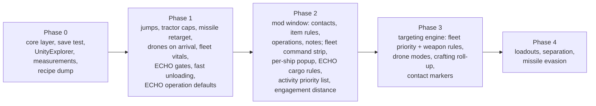

# Igi's QoL Modpack plan

One BepInEx plugin that bundles every quality-of-life change from `WISHLIST.txt` and the earlier designs in [`mod-plans.md`](mod-plans.md). Each feature can be switched off on its own in the plugin's `.cfg` file. Findings come from the decompiled code of game version 0.8.3.2; paths and line numbers are relative to `decompiled-0.8.3.2/`. For 0.8.3.4 (current `decompiled/`), read [`planning-brief.md`](planning-brief.md) first. Anything not read directly in code is marked [INFERENCE].

`mod-plans.md` keeps the deep designs for loadouts, combat movement, fleet targeting and the autopilot. This file is the master plan: what's in the pack, how each piece works, what you decided, and the build order.

## Ground rule from your answers

The pack adds control and fidelity. It doesn't change the game's own tuning: decision timers, damage, yields and prices stay as the developers set them. Where a feature brushes against that line, the section says so.

## Overview

| # | Feature | Verdict | Status |
|---|---|---|---|
| 1 | Jumps remaining on the travel HUD | Easy | Done (`JumpsRemaining`) |
| 2 | Contact list and markers after battles | Medium | Done (`Contacts`; edge markers 2026-10-31) |
| 3 | Item rules: tractor caps (loot filter) | Easy | Done (`TractorCaps`, `ItemRulesTab`) |
| 4 | Per-weapon targeting rules | Medium | Done (2026-10-30, `TargetPriority` weapon rules) |
| 5 | Fleet target priority | Medium | Done (2026-10-30, `TargetPriority`) |
| 6 | Missile auto-retarget | Easy | Done (`MissileRetarget`) |
| 7 | Preferred engagement distance | Easy to medium | Done (`EngagementDistance`) |
| 8 | Missile evasion | Medium to build, effect unknown | Measured 2026-10-31: a sidestep can't beat these missiles; not built (see §7-9) |
| 9 | Ship separation | Medium | Done (2026-10-30, `Separation`); enemy and allied ships too (`OtherShips`) and a measured big-fight A/B 2026-10-31 (see §7-9) |
| 10 | Drones deploy on arrival | Easy | Done (`DronesOnArrival`) |
| 11 | Drone behaviour modes | Medium | Done (2026-10-30, `DroneModes`; guard another fleet ship, mining/salvage/repair versions of the modes 2026-10-31); recall on damage dropped (see §10-11) |
| 12 | Fleet panel vitals | Easy | Done (`FleetVitals`) |
| 13 | Fleet row command strip | Medium | Done (`FleetStrip`, per-ship popup) |
| 14 | Ship loadouts | Medium to hard | Done (2026-10-31, `Loadouts`) |
| 15 | Item rules: ECHO cargo handling and selling | Medium | Done (`EchoCargo`); selling seen in play in a 2026-10-31 soak |
| 16 | ECHO activity priority list | Medium | Done (`EchoPriority`) |
| 17 | ECHO gates: faction, crew minimums, loot before leaving; fast unloading toggle | Easy | Done (`EchoGates`) |
| 18 | Crafting roll-up | Medium | Done (2026-10-31, `CraftRollup`; refinery jobs for missing canisters added later the same day) |
| 19 | Notes | Medium | Done (`Notes`) |
| 20 | Command tab for installation and boarding settings | Easy to medium | Done (`EchoOperations`, `Operations`) |
| 21 | Core layer | Medium, built first | Done |
| 22 | Text size and UI accessibility | Easy (text size); rest open | Text size done (`TextScale`); rest needs specifics |
| 23 | Combat log (battle parser; from the loop-mode idea list, not the wishlist) | Medium | Done (2026-10-31, `CombatLog`) |
| 24 | Combat guide: damage types, armour, ship stats (idea list) | Easy | Done (2026-10-31, `Guide`) |
| 25 | ECHO uses abilities and deployables (idea list) | Medium | Done (2026-10-31, `EchoKit`) |
| 26 | Station services: repair, restock, sell for the fleet from the airlock or on dock (idea list "fewer clicks") | Easy to medium | Done (2026-10-31, `StationServices`; warp fuel restock for the flown ship added later the same day) |
| 27 | Preferred ores for ECHO, your ships and their mining drones (idea list "better ECHO AFK mechanics") | Easy to medium | Done (2026-10-31, `OrePreference`) |
| 28 | Event log: notifications, HUD event lines, ECHO's activity, arrivals and pickups kept with times (idea list "better AFK mechanics") | Easy | Done (2026-10-31, `EventLog`) |
| 29 | Shared fleet holds: a full ship passes cargo to ships with room before ECHO turns home (idea list "cargo management") | Easy | Done (2026-10-31, `FleetHolds`) |
| 30 | ECHO retreats to a station for repairs when a ship's hull is low (idea list "better AFK mechanics") | Easy | Done (2026-10-31, `EchoRetreat`) |
| 31 | Performance in large fights (idea list "optimizations") | Measure first | Measured 2026-10-31 with `[Dev] ProfileSeconds`: the mod costs 0.08-0.27 ms per frame, nothing to fix (see §30-31) |
| 32 | Fleet crew and brigs: replace crew lost to hull hits on every ship, unload brigs to the station brig (idea list "better AFK mechanics", "fewer clicks") | Easy | Done (2026-10-31, `StationServices` Replace crew / Unload brigs, `CrewOnDock` / `BrigOnDock`) |
| 33 | Mission distance: jumps to a mission's location on the board, the missions window, the details and the HUD tracker (idea list "operation menus and instruction clarity") | Easy | Done (2026-10-31, `MissionDistance`) |
| 34 | ECHO takes several missions per trip and turns them in together (idea list "better AFK mechanics") | Easy | Done (2026-10-31, `EchoMissions` `MissionsAtOnce`) |
| 35 | Which mission kinds ECHO takes (idea list "better AFK mechanics") | Easy | Done (2026-10-31, `EchoMissions` kind switches) |
| 36 | ECHO gets through a station visit faster: the next step 2 s after docking or after a step that changed something (idea list "better AFK mechanics") | Easy | Done (2026-10-31, `EchoGates` `QuickStationSteps`) |
| 37 | "Never pick up" item rules (wishlist "Avoids automatically tractoring certain items") | Easy | Done (2026-10-31, `TractorCaps` pickup limit -1) |
| 38 | ECHO recruits willing prisoners before hiring crew (idea list "better AFK mechanics") | Easy | Done (2026-10-31, `EchoGates` `RecruitPrisoners`) |
| 39 | ECHO takes and pays for only the crew that fits aboard (vanilla bug found in a soak) | Easy | Done (2026-10-31, `EchoGates` `HireOnlyWhatFits`, on by default) |
| 40 | ECHO makes room for short crew types by moving crew above their share to the reserve (idea list "better AFK mechanics") | Easy | Done (2026-10-31, `EchoGates` `RebalanceCrew`) |

The session-by-session record of what changed is [`SESSION_LOG.md`](../SESSION_LOG.md).

## Core layer (#21)

Decided: internal for now, organised so another contributor can add a feature without learning the whole plugin.

### Pieces

- Feature registry. Each feature is a folder with one feature class (id, `Enabled` config entry, setup) and its own Harmony patch classes. At startup the plugin patches each class separately inside a try/catch (`harmony.CreateClassProcessor(type).Patch()`). If a patch target is missing after a game update, that feature switches itself off, logs which method failed, and shows a toast on the main menu (`NotificationManager.CreateNotification`). The rest of the pack keeps working.
- Version check. Log `Application.version` (wrapped by `GameVersion.GetVersion`, `Source.Util/GameVersion.cs:10-14`) next to the version the pack was tested on. A mismatch is a warning only; the per-feature patch results decide what runs.
- Game events. One class owns the lifecycle patches and re-raises them as plain C# events:

| Event | Hook |
|---|---|
| Save loaded | prefix on `GamePlayer.FromJsonStaged` (`Source.Player/GamePlayer.cs:1984`) to grab the JSON, fired once `SceneLoader.LoadScenesOnStartGame` (`Behaviour.Bootstrap/SceneLoader.cs:170`) finishes |
| Saving | postfix on `GamePlayer.ToJson` (`GamePlayer.cs:1705`) |
| Flown ship changed | postfix on `GamePlayer.SetSpaceShipData` (`GamePlayer.cs:3128`); runs on load and on every switch, before the ship object exists, and with `null` during a switch |
| Arrived at a POI | postfix on `SpaceShip.CompleteTravel` (`Behaviour.Unit/SpaceShip.cs:1217-1232`); `TravelManager.cs:689-713` calls it for your ship and each fleet ship |
| Docked / undocked | `SceneLoader.ToggleSpaceStationInterior` (`SceneLoader.cs:146`) |
| ECHO on / off | `GamePlayer.StartAutopilotSession` / `EndAutopilotSession` (`GamePlayer.cs:926`, `:908`) |
| Already in the game, no patch | `DamageData.OnDamageDealt`, `BoardableUnit.OnBoardingChanged`, `POIOperationLog.OnRegistered`/`OnCompleted`, `CrewData.onCrewChanged` |

  There's no combat start or end event in the game. Features that need "in combat" derive it from `OnDamageDealt` plus whether any auto target is set.
- Save data. One key, `igiQol`, on the player JSON, holding a schema version and one object per feature. Per-ship data is keyed by `SpaceShipData.guid`, the id the game itself uses for cross-references (`Source.SpaceShip/SpaceShipData.cs:267`, `:281`). Records for ships you no longer own are dropped on save. Data that isn't tied to a save (notes, item rules if you want them shared) lives in files under `BepInEx/config/IgiQoL/`.
- UI kit. Helpers that find the game's own toggle, dropdown, button, slider, text field and popup prefabs and clone them, plus the game's fleet icons (`PoiIconKeys.Fleet(name)`). When the developers restyle a prefab, the fix goes in one file.
- The mod window. Tabs: Contacts (#2), Item rules (#3, #15), ECHO (#16, #17), Operations (#20), Notes (#19), Settings. Opened by a hotkey and a HUD button. Settings tied to a game screen are injected into that screen instead: loadouts in the hangar, the craft button in the forge, the command strip on fleet rows, the per-ship popup from fleet rows.
- Per-ship settings popup. One popup, opened from a fleet row without selecting the ship, holds every per-ship setting that needs a dropdown or a number: target rule, turret rules, drone mode and radius, engagement distance, separation, evasion, missile retarget, drones on arrival.
- Targeting engine. One ranking function shared by fleet target priority (#5) and weapon rules (#4).
- Item rules engine. One rule table shared by the loot filter (#3) and ECHO's cargo handling and selling (#15).
- Contributor notes. A short `CONTRIBUTING.md`: how to add a feature folder, the save-data and config conventions, how to find hooks in `decompiled/`, and the update workflow below.
- Update workflow. A build step lists every patched method from the patch attributes. After a game update: re-decompile into a new folder, diff only those files, and start the game once to read the per-feature patch report.

## 1. Jumps remaining

The destination tooltip already shows `waypoints.Count - 1` under "@TravelJumps" (`Behaviour.UI.Travel/TravelDestinationInfo.cs:50-53`). The HUD travel readout (`TravelInfo.UpdateTravelInfo`, `TravelInfo.cs:121-131`) shows only distance, speed and ETA.

Plan: a postfix on `TravelInfo.UpdateTravelInfo` adds a "Jumps: N" label from `GamePlayer.current.waypoints` (`GamePlayer.cs:181`). The game removes waypoints as you pass them (`TravelManager.cs:711`, `:1104-1106`, `:1187-1189`), so the count goes down on its own.

To check in game: whether `Count - 1` matches the real number of gate and wormhole hops on a 2–3 jump route. If it doesn't, count only `JumpGate` and `Wormhole` entries.

## 2. Contacts after battles

Decided: the problem is seeing what's left after a large battle. Everything in a POI is already spawned and live (`Behaviour.Managers/BasePoiManager.cs:239-255`); the game just doesn't summarise it. There's nothing hidden to reveal, so this stays a visibility feature.

- Summary badge on the HUD while you're at a POI: "3 boardable · 2 salvage · 14 loot".
- Contacts tab in the mod window covering the whole POI, grouped by type and sorted by distance. Loot rows show item, rarity, amount and value. Clicking a row targets the object: tractor for loot, the boarding panel for boardable ships (`BoardableUnit.OnMouseUpAsButton` path, `BoardableUnit.cs:216-226`), salvage target for wrecks.
- Edge-of-screen markers per type, toggled from the tab. The game has an indicator system to copy (`Behaviour.UI.HUD/EnemyIndicatorManager.cs:25`, `EdgeIndicator`).

Sources:
- Boardable ships: `BoardableUnit.all` (`Behaviour.Unit/BoardableUnit.cs:33`), updated through `BoardableUnit.OnBoardingChanged`.
- Salvageable ships: `SalvageContainer` components, registered by a postfix on `SalvageData.AddToWorld` (`Source.Data.Persistable/SalvageData.cs:410-411`).
- Loot: `LootManager` keeps no list, so the mod tracks items from `CreateLootItem`/`SpawnLootItem` and `RemoveLootItem` (`LootManager.cs:197`, `:202`, `:245`).

To check in game: whether `BoardableUnit.all` still holds captured or destroyed ships.

## 3. Item rules: tractor caps

Decided: a per-item threshold. "Stop auto-tractoring this once my cargo holds N", with 0 meaning never. Your example: ammo you rarely use is heavy and cheap, so cap it low.

One gate decides what any ship auto-tractors: `TractorableItem.CanBeAutoTractoredBy` (`Behaviour.Tractoring/TractorableItem.cs:98-118`). The tractor module's auto-targeting (`TractorModule.cs:165-180`) and ECHO's loot-before-leaving pass (`IdleManager.cs:511-535`) both call it. A postfix rejects an item when the ship's cargo already holds the cap for it (`Inventory.GetCount`, which matches the way the game stacks items). The check covers your ship, fleet ships and ECHO. Clicking an item by hand still picks it up (`TractorModule.SetManualTarget`, `:200-206`).

Rejected loot keeps floating and stays clickable. Non-Exotic loot is marked for cleanup eventually (`TractorableItemData.ShouldCleanUp`, `:27-33`).

### The rule table (shared with #15)

A rule matches by, most specific first:

1. A specific item (identifier, plus level for leveled items).
2. Category and rarity, for example "Ammo, Common and below".
3. Category alone (`Source.Item/ItemCategory.cs:3-22`).
4. The global default.

Each rule has a tractor cap (#3) and a dock action with an optional keep amount (#15). The Item rules tab has a search box over every known item (`InventoryItemType.allItems`) to add specific-item rules, plus rows per category. Rules live in the save by default, so different playthroughs can differ.

## 4–5. Weapon targeting rules and fleet target priority

Decided: one rule per weapon per ship. Two medium hardpoints with different weapons can have different rules.

Today turrets don't choose targets. Every turret reads `currentTarget`, which returns its module's `priorityTarget`: the manual target, otherwise the module's one auto target (`Behaviour.Equipment.Turret/AbstractTurret.cs` ~230, `AbstractTargetingModule.cs` ~90). The auto target is the nearest valid enemy and stays until it becomes invalid (`AbstractTargetingModule.cs:195-236`). The same code runs on your ship and on fleet ships.

Two layers, one ranking engine:

- Ship rule (mod-plans §3): picks the ship's target, which also decides where the ship moves.
- Weapon rule, per hardpoint: overrides what that weapon shoots. Hardpoints without a rule follow the ship.

A rule has three parts:

- Filter: anything, ships only, fighters and drones only, within this weapon's range, below level N.
- Priority: ship's target (vanilla), nearest, lowest hull %, highest hull %, biggest threat to the fleet, attacking the flagship, by size class, lowest level.
- Switching: stick until the target dies (vanilla), re-evaluate every N seconds, switch only if the new pick is better by X%, never leave a target under Y% hull.

Your manual target and attack orders override everything.

Implementation: a postfix on the `AbstractTurret.currentTarget` getter returns the weapon's own pick when it has one. `Update`, aiming, projectile lead and missiles all read that getter. Picks refresh on the scanner's existing tick (postfix on `AbstractTargetingModule.UpdateAutoTarget`) from the module's `filteredTargets`. The getter runs every frame for every turret, so the lookup is an array indexed by `SpaceShipHardpoint.index`, without allocation.

Rules are saved per ship and hardpoint index (`Behaviour.Unit/SpaceShipHardpoint.cs:52`), with the weapon's name stored next to them. If you refit a hardpoint with a different weapon, the rule stays and the popup marks it so you can review it. Loadouts (#14) save and restore weapon rules with the weapons.

The ship still moves to range of the ship target, so the default filter for a weapon rule is "within this weapon's range". Turrets can't shoot missiles; the game has no point defence and adding one is a separate, larger project.

## 6. Missile auto-retarget

When a missile's target dies, `target` reads as null and the missile flies straight until its lifetime ends (`Behaviour.Equipment.Turret.Projectile/Missile.cs:67-141`). "Seeking" missiles already pick up the turret's current target (`SeekNewTarget`, `:161`); others don't.

Plan: a postfix on `Missile.FixedUpdate`. When `target` is null, set a new one per the ship's setting: off (vanilla), the weapon's current target, or the nearest valid enemy. Set in the per-ship popup.

To check in game: whether a destroyed ship's GameObject is destroyed or only deactivated. If deactivated, the patch also tests `activeInHierarchy`.

## 7–9. Engagement distance, missile evasion, separation

Designs are in `mod-plans.md` §2a–2c.

- Distance: a postfix on `AbstractTargetingModule.UpdateApproachDistance`, modes Auto, Max range and Fixed N. The game caps the distance at 30 (`AbstractTargetingModule.cs:140`); real railgun ranges decide whether that cap matters.
- Evasion covers missiles only. Bullets and beams hit too fast to react to.
- Decided: separation and evasion are per-ship toggles in the per-ship popup, off by default, so an untouched ship behaves as vanilla.

Missile measurements (2026-10-31, `[Dev] DumpMissiles`, `dumps/missiles.txt`): every launcher fires the same `Missile` prefab family, turning at 80°/s with a top speed of 6 (medium, large) to 8 (tiny, small, drone) units/s, 15 for Hailfire, so the tightest circle a missile flies has a radius of 4.3 to 10.7 units. Missiles re-aim every physics step at the target's predicted position (`Missile.UpdateTrackingTarget`). Your ships sidestep at 0.28 (Hurricane) to 0.35 (Eclipse) units/s² of side acceleration (`sideThrust / mass`) with hull radii around 5. From standing, a ship moves 0.5 × 0.35 × t² sideways: 0.6 units after 2 s, 1.6 after 3 s. A missile only needs to correct by that much over seconds, far inside its turn radius, so a dodge can't make it miss. Outrunning works on paper (top speeds 6-8 versus missile 6-8, lifetime 16 s) but means leaving the fight. The game already jinks a ship that is taking damage (`EngineThrustersModule.SideThrust`, `takingDamage`/`evadeLeft`). Evasion is not built.

Separation in big fights (2026-10-31, throwaway probe, since removed): 12 hostile hulls of sizes 1-4 and 4 allied ones spawned at the dev save's station next to Eclipse and Hurricane, hull overlaps counted twice a second with `Collider2D.Distance` on the surface colliders, and every active combat turret of a fighting ship counted as "in range" when it had a target inside its range. Most overlaps were bystanders (allies or enemies stacked on your fleet ships and on each other); a ship overlapping its own target was rare (0-16 of the 35-115 overlapping pair-samples in a round), so a hull-aware approach distance wasn't built. Per 33 s round, `Default` and `OtherShips` both on for every variant except vanilla:

| Variant | Rounds | Overlapping pairs per sample | Turrets with target in range |
|---|---|---|---|
| Vanilla | 13 over 5 launches | 1.03 | 79% |
| Push on bounding-circle overlap (first version) | 4 | 0.54 | 74% |
| Push turned sideways to the target | 4 | 0.43 | 75% |
| Sideways, kept at the same distance from the target | 5 | 0.68 | 77% |
| Push on hull-outline gap (shipped) | 7 | 0.52 | 73% |

Rounds are noisy (vanilla rounds ranged from 0.53 to 1.73). Every variant roughly halves the stacking and costs a few points of weapon uptime; in 6 of the 7 same-launch vanilla/shipped pairs the in-range share was lower with separation on. The outline gate stays because it stops the push for long hulls lying side by side without touching (`Separation/apart`). Defaults stay off.

## 10–11. Drones

Decided: all candidate modes, with the follow radius as the priority.

Two modes exist, `FreeRoam` and `FollowShip` (`Source.Drone/DroneBehaviorMode.cs:3-7`). FollowShip pulls a drone back once it's more than 10 units from its ship and has no target (`Behaviour.Unit/Drone.cs:64`, `:377-390`). Drones deploy on their own when the ship acquires an auto target or you set a manual one (`AbstractTargetingModule.cs:204-212`, `AbstractUnit.cs:957-962`), and they're recalled when a trip starts (`TravelManager.cs:595-596`, `:670-679`). Nothing deploys them on arrival.

- Deploy on arrival (#10): on the "arrived" event, call `droneBayModule.DeployDrones()` for each ship with the toggle on, unless you recalled them yourself (`playerRecalled`). It runs after `CompleteTravel`, because deploying is blocked while `travelling` is set (`DroneBayModule.cs:528-543`).
- Modes (#11): the saved vanilla field stays on FollowShip. Vanilla resets unknown names to FollowShip on load (`DroneBayModule.cs:1192-1200`), so a new value would be lost the moment the mod is gone. The mod keeps its own mode in the ship's record and replaces drone movement with a prefix on `Drone.ApplyBehaviorMode`. The game's drone toggle label shows the mod mode's name when one is set (`DroneControls.cs:63`).

Modes, in build order:

1. Follow with radius N (replaces the fixed 10 units).
2. Attack only the ship's target.
3. Guard a chosen fleet ship.
4. Assist mining or salvage on the ship's target (the target copy already exists, `Drone.cs:148-151`).
5. Recall below N% drone hull.

Status 2026-10-31: 1-4 are built. Guarding another ship is a per-ship anchor ("Drones stay with" in the popup) that every mode uses as "the ship". Mining and salvage drones join the anchor's asteroid or wreck through the pick (`FindClosestFilteredTarget` prefix), not by retargeting a working drone, so drillers and grinders aren't torn off; repair drones fix the anchor first. 5 is dropped: a docked drone keeps its damage (the bay has no repair, `HandleDroneReturn` only hides it), a destroyed drone is rebuilt at full hull for free after `rebuildTime`, and a docked drone is redeployed at once while the bay wants drones out (`HandlePostUnloadBehavior`). Recalling a damaged drone would trade a short rebuild for a drone that sits in the bay until the next station.

## 12–13. Fleet panel

Each row shows the hull icon, name, stance plus activity, a hull bar and a cargo gauge, refreshed every 0.25 s (`Behaviour.UI.HUD.Fleet/FleetPanelRow.cs:16`).

### Vitals (#12)

A postfix on `FleetPanelRow.Refresh` adds shield, current target and distance to the flagship. Still unknown: where live shield and armor values live, and whether ships outside your POI have live values at all (`TravelManager.cs:700-703` hints they don't) [INFERENCE].

Built as three solid bars (shield, hull, armor). Bar height became a setting on 2026-10-31 (`BarHeight`, 2-12 px, default 4, the game's own hull bar height) because you found the bars hard to see: changing it re-stacks every live row at once (`FleetVitals.Layout` keeps the hull bar's original top, grows the row and the merc contract's collapsed height by the difference, and moves FleetStrip's tiles with it). Check `FleetVitals/bar-height` (8 → 12 px: bars 12 px, row +12, strip moved 12).

### Command strip (#13)

Decided: everything visible on each row, usable without selecting the ship. Selecting a fleet ship today hijacks right-click (it becomes a fleet order and your ship stops responding to it, `Behaviour.UI.Movement/MovementHandler.cs` `TryIssueMoveOrder` ~87-96), and the command bar only appears while something is selected (`FleetPanel.cs:86`).

The command methods don't need a selection. Each takes an explicit ship list (`Behaviour.UI.Movement/FleetCommands.cs`):

| Button | Call |
|---|---|
| Stop | `FleetCommands.IssueStop([ship])` |
| Hold position | `FleetCommands.IssueHold([ship])` |
| Regroup | `FleetCommands.IssueRegroup([ship])` |
| Hold fire / Aggressive / Defend / Escort | `FleetCommands.SetStance([ship], stance)` |
| Tractor on/off | same as the cargo popup's toggle: `shipData.tractorOff`, `spaceShip.ApplyTractorToggle()` |
| Drones deploy / recall | `droneBayModule.DeployDrones()` / `ReturnDrones()` |
| Cargo | `FleetCargoPopup.ToggleOnHud(shipData)` |
| Settings | opens the per-ship popup |

The strip uses the game's own fleet command icons and highlights the active stance. It's added in a postfix on `FleetPanelRow.BindRowButtons`; rows are rebuilt when the roster changes (`FleetPanel.RebuildRows`, `:146-160`), so the strip is rebuilt with them. Eleven icons won't fit beside the name, so I expect a second line under each row; UnityExplorer decides the layout. Dismissing a ship stays out: it's destructive and the game only offers it from the debug console.

To check in game: that clicking a strip button doesn't also select the row. A uGUI button normally stops the click from reaching the row's own click handler [INFERENCE].

## 14. Ship loadouts

Design in `mod-plans.md` §1. Decided:

- Several loadouts per ship.
- Apply order: skill preset, officers, grunt crew, drones, modules and turrets, boosters, weapon rules, autopilot settings, then rebuild the ship if you're flying it. Skills go first because they set crew capacity (`SpaceShipData.cs:786`), unlocked drones (`GamePlayer.cs:3321-3330`) and the extra hangar bay slot (`HangarBayModule.cs:154`).
- Missing pieces: apply everything possible and list what's missing afterwards.
- Grunt crew is included. Grunts are counts per crew type with no individual identity or experience (`Source.Personnel/CrewData.cs:13`), so moving them loses nothing but money. Surplus goes to your crew reserve (`GamePlayer.unassignedCrew`, capped by `maxReserve`); shortfalls are filled from the reserve first, then hired at the station's personnel center if it has one, has stock (`PersonnelCenter.Available`, `TryPurchaseCrew`) and you can afford it (`CrewType.cost`, `GamePlayer.RemoveCreditsForCrew`). Whatever can't be filled goes on the "missing" list. The mod never sells crew; that refunds only 25% (`PersonnelCenter.GetSellPrice`, `:317-320`).
- Same-hull sharing is a nice-to-have: the loadout list also shows loadouts saved on other ships of the same hull, marked as such. Built last within loadouts.
- Switching ships applies the autopilot settings of that ship's last-applied loadout, without turning ECHO on. Hook: the "flown ship changed" event (`GamePlayer.SetSpaceShipData`).

Built 2026-10-31 (`Features/Loadouts/`) with these differences from the order above: equipment is applied right after the skill preset and before officers, crew and drones, because the fitted drone bay sets the drone slot count (`DroneBayModule.GetDroneAmount`); crew capacity only depends on hull and skills (`SpaceShipData.GetMaxGrunts`). Items are matched by type, rarity and rolled stats instead of the full item JSON: the JSON also holds state that changes while fitted (resonant booster unlock progress), and stats read back from the save must be compared as floats. The weapon rules travel inside the ship's QoL settings snapshot (`ShipSettings.Snapshot`/`Restore`), together with the other per-ship settings. UI: a Loadouts tab in the mod window plus an "L" button in the hangar.

## 15. Item rules: ECHO cargo handling and selling

Decided: selling covers everything below a chosen rarity, whole categories (trade goods, refined materials, …) and specific items, and stackable items can keep an amount and sell only the excess.

Each item rule from #3 also has a dock action used when ECHO unloads:

| Action | Meaning |
|---|---|
| Default | Vanilla routing |
| Keep | Stays in cargo |
| Stash | Armory or materials storage, wherever the game allows that category |
| Sell | Sold at the item's flat sell value, same as vanilla auto-sell |
| Sell above N | Stashed until the destination storage holds N, the excess is sold |

The rules plug into `TryDropCargoOf` before vanilla routing (`IdleManager.cs:313-361`). Protected as today: favourites, items needed for missions (`RequiredItemCountForMissions`), and the ammo the ship uses (`ShouldKeepInCargo`). Items flagged unsellable (`canSell`) are never sold. Selling calls `InventoryInteractionManager.SellAmount` (`Behaviour.UI/InventoryInteractionManager.cs:987-1008`) after moving to the station facility the way vanilla auto-sell does (`SpaceStationInterior.GoToLocation`, `IdleManager.cs:465`).

Unloading pace is covered in #17.

## 16. ECHO activity priority list

Decided: several activities in priority order instead of one preferred activity.

Today `TryPreferredActivity` (`IdleManager.cs:624-650`) reads one activity and one layer. If the fit can't do it, it shows "no suitable loadout" and returns true, which blocks every fallback and leaves the ship idle.

Plan: a prefix that replaces it with a loop over your list. Each entry is an activity (Mining, Salvage, Combat) with its own layer (Surface, Core, Both). For each entry: skip it if the fit can't do it (`HasLoadout`), otherwise try the matching search (`FindMiningActivity` `:1063`, `FindSalvageActivity` `:1122`, `FindCombatActivity` `:1142`). The first one that finds a target wins. "No suitable loadout" only shows if the whole list fails. Missions and dungeons keep their places before and after this step (`FindActivityForEquipment`, `:574-594`).

The list head stands in wherever the game reads the single preferred activity (guild mission offers, the ship label, `SpaceShip.cs:1715-1718`). ECHO picks activities while docked or in empty space; once at a POI it works whatever is in range (`IdleActivityInPoi`, `:1162-1170`), and that stays as it is.

The rotation rules from `mod-plans.md` §4a (switch after N drops or M minutes) become optional extras on the same list.

## 17. ECHO gates and fast unloading

Settings on the ECHO tab, each defaulting to the game's current value:

| Setting | Today | Hook |
|---|---|---|
| Loot before leaving | always on; costs at least one decision cycle per item (`IdleManager.cs:511-535`) | prefix on `TryLootBeforeLeaving` |
| Faction gate | ECHO only raids installations of factions you're already at −500 reputation or below with, because raiding anyone else costs reputation; the Umbral transponder skips the check (`:1676-1687`) | prefix on `WouldIncurFactionPenalty` with your threshold |
| Dungeon crew minimum | 3 crew (`:1717`) | prefix on `SelectAutonomousDungeonCrew` |
| Boarding crew minimum | half of max crew (`:1725`) | same prefix |
| Hire crew when below | 50% of max (`:681`) | prefix on `IsCrewBelowThreshold` |
| Fast unloading | off | prefix on `DropFoundItem` |

Raising the faction threshold lets ECHO raid factions you're on better terms with, and you take the reputation loss. That's your call per playthrough, so the default stays vanilla.

Fast unloading (decided: wanted, as a toggle, off by default). Today ECHO moves `1 + cargo/200` items per drop and waits `400 / cargo` seconds between drops (`IdleManager.cs:377-400`, `:459-461`). A 200 m³ hold takes about 200 s to empty, a 1000 m³ hold about 67 s. Nothing in the code depends on that pace; there's no animation, stat or event, only one message per drop. With the toggle on, each drop moves the whole stack and the timer stays as it is, so a hold with 4 stacks empties in 4 steps. Vanilla only checks that one item fits before a drop (`:342`), so the mod clamps each drop to the free space in materials storage or the armory, and the rest of the stack goes on the next step. Item rules (#15) still decide which stacks get dropped, kept or sold.

## 18. Crafting roll-up

Decided: the target case is a weapon or module recipe that needs 3+ refined items you don't have. Long forge times are fine. Moving items between storages is optional and left out.

How the forge works (`Source.Mining/Forge.cs`, `ForgeJob.cs`, `Behaviour.Crafting/CraftingRecipe.cs`):

- Crafting is a timed queue. `Forge.TryStartJob(recipe, amount, repeat, stockCap)` (`Forge.cs:85-99`) needs no UI and takes ingredients and credits when the job starts, not when it finishes (`CraftingRecipe.ConsumeIngredientsForCrafting`, `:444-459`).
- Queue slots: 2 plus skill points (`Forge.cs` ~50).
- The forge only uses the station's materials storage and your docked cargo (`SpaceStation.CountLocalItems`/`ConsumeLocalItems`, `:636-658`).
- Output goes to docked cargo when you're inside with the deposit toggle on, otherwise to the armory (armory categories) or materials storage (`ForgeJob.AddForgeItemToCargo`, `:176-189`). Refined products are a materials category (`InventoryItemType.CanGoInMaterials`, `:1002-1025`), so crafted refined items land where the forge can use them.
- Every owned station keeps crafting while you're away: `GameplayManager.DoAmbientUpdate` ticks all systems every 10 s (`GameplayManager.cs:205-216`, `SpaceStation.cs:406-431`) [INFERENCE: I didn't read the per-system forwarding].
- The game has no ingredient → recipe link. The "go to recipe" button matches by display name (`ForgeTabContents.NavigateToRecipeForItem`, `:274-290`).

Plan:

1. Build an index from `CraftingRecipe.all` including sub-recipes (one per rarity): result identifier and rarity → recipe. Only recipes available at this station count (`GetAvailable()`, `:485-500`; industry stations have their own list).
2. A "Craft missing parts" button on the weapon/module recipe, in the panel shown when you can't craft it (`ForgeTabContents.cs` ~115-117). It shows the plan before starting: what gets crafted and how many, total credits and time, and what nothing can craft (raw materials or refinery canisters you need to bring).
3. Queue the missing parts, then queue the weapon once they've all arrived. The mod watches `ForgeJob.AddForgeItemToCargo` (the bonus-craft path skips `DeliverCraftResult`, so that one isn't enough) and keeps the plan in the save so it survives a reload. If queue slots are full, the plan waits for one to free up.

Phase 0 needs a recipe dump first. Recipes are Unity assets, so the code can't tell us what the refined items on weapon recipes are, how deep chains go, or whether the missing pieces are forge items or refinery canisters (`Source.Mining/Refinery.cs`). A logging plugin that prints every recipe's ingredients, results, categories and levels answers that. If the gaps turn out to be refinery canisters, the roll-up queues refinery jobs the same way.

Matching risk: ingredients match by identifier and level (`InventoryItemType.CanStackWith`, `Behaviour.Item/InventoryItemType.cs:318-337`). Plain crafted results are the prefab itself, so they match. The dump confirms whether any refined item is a leveled builder product, which could come out at a different level.

Recipe dump results (2026-10-31, `[Dev] DumpRecipes`, 405 recipes including sub-recipes): every item ingredient a forge recipe can make is a plain `RefinedProduct` template that goes into materials storage (`CanGoInMaterials`), so it lands where the forge reads it. Weapon and module recipes need a few hundred of 3-4 refined products (e.g. Autocannon [Medium]: 269 Titanium Plate, 134 Tungsten Carbide, 67 Oxide Canister); the refined products themselves need only canisters. Deeper chains exist (Parity Fragment and Upgrade Frame need refined products). Crystal refinements, signal fragments, boss cores and the industrial components need drops no recipe makes. No item ingredient is a leveled builder product, so the level-matching risk above doesn't occur.

Built as planned with these differences: the plan shows in the "insufficient materials" strip itself (summary there, full job list in its tooltip) instead of a separate confirmation; the roll-up may start with canisters still missing and waits for them; parts made for a roll-up are routed to materials storage (prefix on `ForgeJob.AddForgeItemToCargo`) so leaving the dock with them in cargo can't stall it.

Refinery jobs (added 2026-10-31, fourth loop session): after the forge tree is expanded, each missing canister is covered from ore the station's refinery can reach (`Refinery.GetAvailableItems(includeRequiredForMissions: false, excludeFavourited: true)`, ore with `disableAutoRefine` skipped). Per canister the ore with the highest yield of that material is picked, units = `ceil((short - carried) / (yield × GetRefineryYieldMultiplier))`, capped at the ore there; by-products of every picked ore and `pendingYield` count before the remaining shortfall is settled. Critical refines (random double yield) aren't counted on. One refinery job per ore (`Refinery.StartJob(ore, n, excludeFavourited: true)`), started in `Advance` before the forge steps once the ore, fee, output room and a refinery slot are there. While a canister's refine job is unstarted or still in `refinery.jobs`, the forge step that needs it reports "in progress" instead of the canister as the blocker. Saved per plan as `refines` (ore identifier, amount, started) and relinked to refinery jobs by ore and initial amount. Canisters from a roll-up refine job go to materials storage even with "deposit in cargo" on (prefix/postfix on `RefineryJob.CompleteOneItem` marks the job, prefix on `Refinery.DepositOutputItem` routes canisters while storage has room).

## 19. Notes

Decided: one set of notes for all saves, user-defined tabs, light formatting, clickable links.

- Storage: `BepInEx/config/IgiQoL/notes.json`, one entry per tab (name, order, text).
- Tabs: add, rename, delete, reorder. One tab by default.
- Formatting: a small Markdown subset (`#` headings, `**bold**`, `*italic*`, `-` bullets) shown as TMP rich text when reading. Editing shows the raw text in a multi-line `TMP_InputField`. Game hotkeys are blocked while the field has focus, because the game checks whether a text field is selected (`Behaviour.UI/UIHelper.cs:51-61`).
- Links: bare URLs and `[text](url)` become TMP `<link>` tags. A click handler finds the link under the cursor (`TMP_TextUtilities.FindIntersectingLink`) and calls `Application.OpenURL`, which the game already uses for its Discord and Steam buttons (`DiscordLink.cs:12`). Under Proton that should open your Linux browser [INFERENCE: untested].
- The game keeps running while the notes are open.

## 20. Operations tab

Decided: pre-set everything that today can only be set at the installation, mainly so ECHO's runs use your settings while you're AFK.

What exists (`Source.Dungeon/DungeonOptions.cs:9-19`): stealth mode (Silent / Balanced / Aggressive), ammo type, auto move, auto buy-out, priority compartment, and assigned crew. The game remembers your last stealth, ammo and auto-move choice (`Source.Player/GameplayerPrefs.cs:435-440`) but not auto buy-out. ECHO's runs copy stealth and ammo from those and never turn on auto buy-out (`IdleManager.cs:1689-1697`).

The tab has two parts.

Defaults for new operations: stealth, ammo, auto move, auto buy-out, for ECHO and for you separately.
- ECHO: postfix on `IdleManager.BuildAutonomousDungeonOptions`, plus a postfix on the `DungeonOperation` constructors for ECHO's resumed operations (`DungeonOperation.cs:89`, `:99`, `:111`) that only fills fields on new operations.
- You: when the installation panel opens, its dropdowns and toggles are pre-set from your defaults (`DungeonPanel.cs:670-676`). You can still change them before pressing start.

Running operations: every operation keeps running while you're elsewhere (`DungeonManager.Update`, `:49-58`). The tab lists them with stealth, ammo, auto move, auto buy-out and priority, editable from anywhere. The simulation reads those fields live every tick, so edits take effect at once and are saved with the operation. Assigned crew isn't editable; the game only reads it at start.

Priority compartment isn't offered as a default. Installation layouts are random per installation (`DungeonOperation.cs:475-482`), so an index means a different room each time. Boarding layouts depend only on ship size (`DungeonSimulation.cs:5176-5179`), so a per-size boarding priority would work if you want it later.

No other context-only settings turned up in the dungeon code. The Phase 0 UnityExplorer pass also looks for others (docked-only or station-only controls) so they can join this tab.

## 22. Text size and UI accessibility

Done (2026-10-30): the `TextScale` feature, a font-size percentage separate from the game's Scale setting. The game's Scale is a single canvas scale factor, so it can only grow text and panels together, and it stops at window width / 1920 before the stacked layout takes over (`ScreenSettings.CalculateScale`). `TextScale` multiplies the size TextMeshPro lays text out at and leaves every size value the game reads or writes alone. It also scales the height the overflow check uses, so a label keeps the lines it shows at 100% and spills past its box instead of vanishing.

What larger text can't fix by itself: panels keep their size. Labels with "..." truncation lose more characters, and narrow wrapping labels (cargo stack counts, the credit readout) wrap at 130%. The mod window widens its tabs with the setting.

Open, needs specifics from you: "better UI responsiveness and accessibility across the board". Candidates that each need a screen and a concrete complaint first: wider or taller panels for particular screens when text is large, per-panel scale (for example only the fleet panel or tooltips), colour or contrast changes, and minimum hit sizes for small tiles.

## 30-31. ECHO retreat; performance

ECHO had no retreat. The flagship fights until 0 hull, where `SpaceShip.TryEmergencyJump` sets it to 0.1 hull, switches its weapons off and sends it to the nearest station, which then won't let it leave unrepaired. Fleet ships leave by themselves at 10% for 120 s of repairs (`WingmanActions.OnDamageTaken`). Every hull hit of 2% or more of max hull rolls a crew death (`SpaceShip.TryNotifyCrewKilled`, 2-12% per hit by crew resistance). Your save's `Register` counts 111 emergency jumps; the 10 autopilot sessions it keeps had 50 of them in 48 hours, 19 in the longest (18.5 h). `EchoRetreat` adds two thresholds and, while ECHO is on, flies the fleet to `TravelManager.TravelToClosestSpacestation` once one is crossed; docked, ECHO already waits for repairs (`HandleAtSpaceStation`, "@IdleWaitRepairs") and the hangar starts a free auto-repair (`PersonalHangar.CheckRepairs`, about 200 ticks of 1 s).

Performance, measured with `[Dev] ProfileSeconds = 60` on the dev save (RTX 3080, 3840x2049, the game's 120 fps cap) after spawning hostile size-2 hulls next to the fleet:

| Fight | Hostiles (mean) | Units (mean) | Mean frame | p95 | p99 | This mod per frame |
|---|---|---|---|---|---|---|
| 12 spawned, user config | 5.9 | 58 | 8.76 ms | 12.0 ms | 15.4 ms | 0.081 ms (0.9%) |
| 40 spawned, `Separation` `Default` and `OtherShips` on | 27.6 | 81 | 11.47 ms | 17.1 ms | 22.5 ms | 0.269 ms (2.3%) |

The mod's biggest items in the 40-ship fight: the `TargetPriority` postfix on `AbstractTurret.currentTarget` (471 calls per frame, 0.12 ms, nearly all of it the profiler's own timing; the body returns at once without weapon rules) and the `Separation` `ApplyThrust` prefix (18 calls, 0.10 ms). The game's own instrumented script sections (`Unit.Turret` 0.42 ms, `Unit.FixedUpdate` 0.34, `Unit.ApplyThrust` 0.21, `Unit.Scanner` 0.20, `Hud.HealthBar` 0.12) add up to about 2 ms, so most of the frame is rendering and physics outside what a script mod changes. The game ships its own benchmarks (`Behaviour.Benchmark.FleetBenchmark`, console `fleetbench` in the Test Arena), so its developers are working on this side themselves.

## 32. Fleet crew and brigs

Found in the 2026-10-31 soak and the save. Every hull hit of 2% or more rolls a crew death on the ship that took it (`SpaceShip.TakeDamage` → `TryNotifyCrewKilled` → `SpaceShipData.TryKillCrewFromHullDamage`, 2-12% per hit by crew resistance), fleet ships included. ECHO only hires for the flagship (`IdleManager.PurchaseCrewIfNeeded` uses `currentSpaceShip` and its `crewAutopilotSettings` ratios), and the personnel center only hires into the flown ship or the reserve, so a fleet ship's losses come back only through the Crew tab's reserve transfer, one type at a time. Fleet ships' own `crewAutopilotSettings` are never edited by the game's UI (the Hurricane in your save still has the default "50% Deckhand"), so ratios can't be the target.

Built as two more `StationServices` services:
- Replace crew: `CrewLosses` counts deaths per ship guid and crew type in the save (`features.StationServices.crewLost`), from a postfix on `TryKillCrewFromHullDamage`. A postfix on `CrewData.AddCrew` takes any later addition of that type to that ship off the count, so crew you, ECHO or a loadout put back is never replaced twice. Sources in order: reserve (free), willing prisoners in the ship's brig, then in the station brig (40% of `CrewType.cost`, `SpaceShipData.RecruitWillingByType`'s price), then the personnel center (`TryPurchaseCrew`, its stock, `PersonnelCenter.GetBuyPrice`). Losses in boarding operations aren't counted; ECHO covers the flagship's by its ratios.
- Unload brigs: ship brigs to `GamePlayer.stationPrisoners` up to `maxBrig`, willing counts carried as `CrewReserve.TransferShipBrigPrisoners` does. Your save had both brigs full (68 prisoners each, 134 of them willing) and the soak logged "Brig full" after a 30-prisoner boarding. Prisoners aboard only count toward ship bonuses with the Crew Slavery skill, which your save doesn't have.

The airlock row has no wrapping (`Airlock.LayoutButtonRow` places buttons left to right every frame); with five of ours it reached the Undock button, so `AirlockServices` switches to short labels once a button's right edge passes the Undock button's left edge.

## 33. Mission distance

The mission UI names a location ("Location: Breach P-34") but never its system or distance: `MissionListRow` shows name, difficulty and category; `MissionDetailPane.AddLocationLine` and `FocusedMissionDisplay.GetLocationLines` only the location's name. Finding out means "Locate" on each mission. The game has the number: `TravelManager.JumpDistanceToPoi` (its own route search, `GenerateShortestRoute`, counting jump gates; -1 without a route).

Built as `MissionDistance`: a tag on rows whose `Mission.GetActivePoi()` is in another system, a suffix on the details' location line (the same location vanilla picks there) and on each tracker location line. Distances are cached per location until you change system or 10 s pass, since the tracker redraws four times a second; a postfix on `MissionDetailPane.GetState` adds the location you're at so an open details pane redoes the suffix after a jump.

Board missions sat in the station's own system every time I looked: all 9 rows on Tower I's board in the dev save, and the board the check generated for a station in The Veiled Field. A "this system" tag on every row crowded the board's 250 px list ("Combat" and the tag got cut off), and a "38 jumps" tag in the missions window's 190 px list squeezed the progress bar to a stub. So rows only get a tag for other systems, and the tag is the game's jump gate icon plus the number (the system and "N jumps" in its tooltip); the progress bar keeps 44 of its 84 px. In the dev save, the missions window tags "Assignment: Forgemaster" (Zorix, 38 jumps) and "The Intertrade Challenge" (Tau Sarus, 30 jumps); after one jump out of Red Gate, the HUD tracker read "Location: Fractured Crossroads (Red Gate, 1 jump)".

## 34. Several missions per trip

A 30-minute ECHO soak on the dev save (Tower I, missions on, the game's settings) split its time into 42% travel, 20% docked, 28% operations and 10% combat, sampled every 15 s. Every mission was a round trip: take one mission, fly out, fly back, dock, turn it in (one ECHO decision, about 12 s), unload, hire, take the next. Idle missions come from `MissionBoard.GenerateIdleMission` and every generator puts its location in the station's own system (`ClearSalvageField.CreateSalvageFieldPoi` calls `poi.system.SetupPOI`), so a distance filter has nothing to filter; the trips home are what costs time.

Built as the `EchoMissions` feature (ECHO tab, section "ECHO missions") with `MissionsAtOnce` (1-5, default 1), file `Features/EchoMissions/MissionBatch.cs`:
- prefix on `IdleManager.DecideMissionActivity`: docked at a board, take missions (`GetMissionAvailableForAutopilot`, the same risk and loadout tests as `TryFindNewMission`) until ECHO holds the limit, all in one decision, and put the HUD tracker on the nearest open one;
- prefix on `IdleManager.IdleTravelToSpaceStation` (called when a mission is done and its turn-in is a station, and when a location has nothing left): fly to the nearest open mission in the system instead (`TryTravelToActiveMission`), after the usual loot pickup. Calls with a message or `overrideClosests` (ammo and crew trips) are left alone, and so is everything when the hold is full, ammo could be restocked, `IsCrewBelowThreshold`, or the flagship is under half hull or armour;
- postfix on `IdleManager.GetIdleMission`: docked, a finished mission that is turned in here comes first (the game prefers the tracked mission, which may be an open one);
- postfix on `IdleManager.TryClaimCompletedMission`: the other finished missions turned in here go in the same decision.

| Run (30 min, same dev save) | Missions finished | Trips out or home | Station visits | Travel samples | Docked samples | Credits |
|---|---|---|---|---|---|---|
| `MissionsAtOnce` 1 (the game) | 9 | 18 | 9 | 51 | 24 | +1.21M |
| `MissionsAtOnce` 3 | 9 (2 not yet turned in) | 15 | 4 | 39 | 19 | +1.86M |

The batched run spent more time in operations (48 samples against 33): it drew three installation explorations instead of two, plus one at a mission location that wasn't part of a mission, and that exploration's loot filled the hold twice, so two of its 15 trips were cargo runs home. A third run (15 min) with the turn-in postfix turned in three missions in one decision instead of three decisions 12 s apart.

Not covered: missions whose location is in another system (they're left to the game, which flies there from the station); a mission that can't be finished at its location (the soak had a "Reclaim Asteroid Belt" whose miners hadn't arrived: ECHO left and came back later, as the game does with one mission).

## 35. Mission kinds for ECHO

ECHO's missions come from `MissionGenerator.GenerateRandomMission(..., idle: true)`: a weighted draw among the station faction's generators that match the flagship's preferred activity and can be idled. The game lets you rule out only the two operation kinds (the Autopilot tab's operations setting, `IsDungeonModeAllowed`) and couriers (`allowCourierMissions`). Idle-able kinds by activity: combat `BountyHunt`, `ClearSalvageField`, `ClearAsteroidField`, `ClearDungeon`, `CaptureShip`; salvage `SalvageWreck`, `SalvageSamples`; mining `MineOre`, `OreSamples`, `HelpMiner`.

Built into `EchoMissions` (`Features/EchoMissions/EchoMissions.cs`): one config switch per kind, labelled with the game's mission name. A prefix/finalizer pair on `MissionBoard.GenerateIdleMission` marks ECHO's draws, and a prefix on the static `MissionGenerator.GenerateMission(gen, ...)` returns no mission for a kind that is off, before the generator creates its location; `GenerateIdleMission` then draws again (it tries 10 times per decision, as for missions too risky for ECHO). With every kind off, the `DecideMissionActivity` prefix answers "no mission" while ECHO holds none, so it goes on to its activities instead of waiting at the board. Checks: `EchoMissions/kinds` (only "Clear Pirate Base" on: six offers, all "Clear Pirate Base"), `kinds-none` (all off: no offer).

The draws are seeded per board, so the same dev save gives the same explorations in every run (the two in the first soak found 315,611 and 1,266,542 credits aboard each time). A third 30-minute run with only "Clear Pirate Base" on and `MissionsAtOnce` 3:

| Run (30 min, same dev save) | Explorations | Operation samples | Travel samples | Docked samples | Credits | Marines hired |
|---|---|---|---|---|---|---|
| Game settings | 2 | 33 | 51 | 24 | +1.21M | 44 |
| `MissionsAtOnce` 3, all kinds | 3 (+1 not a mission) | 48 | 39 | 19 | +1.86M | 53 |
| `MissionsAtOnce` 3, only Clear Pirate Base | 7 (the last still running at the end) | 80 | 27 | 11 | +2.98M | 42 |

Credits are the balance change over the run: credits found aboard during operations, mission rewards, minus the marines ECHO hires back (16,000 each here). Experience and reputation weren't compared.

## 36. Quick station steps

ECHO makes one decision every 12 s (10 or 8 s with the Prompt Engineering activity-delay skills, at least 2 s; `IdleManager.SetActivityDelay`), and a station visit is a chain of one-step decisions: docking request, turn in the mission, unload (already fast: the game sets 400 / cargo capacity seconds after each unload step), hire crew, take the next mission, leave. In a 20-minute soak with the game's settings the four visits took 49-68 s from arrival to departure (59 s on average), most of it waiting out the 12 s timer between steps.

Built as `EchoGates` `QuickStationSteps` (off): a prefix on `IdleManager.FindActivity` records, while docked, the missions held, the flagship's crew and cargo volume and the credits; the postfix sets `updateTimer` to 2 s (the game's own floor) when one of them changed and ECHO isn't travelling. A postfix on `SpaceStationInterior.Start` does the same once docking is done. A decision that changes nothing ("negotiating" when the board has no mission for ECHO) keeps the game's timer, so ECHO makes the same decisions per visit as before and gets no extra autopilot mastery experience per visit (`FindActivity` grants it per decision). Waiting for repairs (added later the same day): a docked decision that ends with the flagship's hull or armour short sets a flag, and a postfix on `IdleManager.Update` sets the timer to 2 s on the first frame both are full. Checks `EchoGates/quick-steps` (no change → 12 s, one crew member added → 2 s, option off → 12 s) and `EchoGates/repair-wait` (hull at 90% → 12 s, full → 2 s).

| Soak (20 min, same dev save, `MissionsAtOnce` 1) | Station visits | Arrival to departure | Docked samples (every 15 s) | Missions turned in | Credits |
|---|---|---|---|---|---|
| Game timing | 4 | 49, 68, 51, 68 s (mean 59) | 12 | 4 | +1.22M |
| `QuickStationSteps` | 6 | 28, 32, 25, 33, 19, 20 s (mean 26) | 5 | 6 | +1.20M |

Both runs ran two installation explorations; after the first visit the missions drawn differ (the board's draws follow the order of decisions), so the credits aren't comparable mission for mission. What's left of a visit is the docking itself (arrival to docked interior, about 20 s, a flight to the docking port) and unloading.

## 37. Never pick up

The wishlist's loot filter asked to avoid auto-tractoring certain items; the pickup limit only stopped after N, with 0 meaning no limit. A pickup limit of -1 (`ItemRule.Never`) now means the item is never auto-tractored, by your ships or ECHO's `TryLootBeforeLeaving` (which asks `TractorableItem.CanBeAutoTractoredBy` too). It works at every rule level (item, category + rarity, category, default). Items your missions need and ammo the ship fires stay exempt, as with the value-per-m3 filter, so a broad rule can't break a mission or starve the guns. Check `TractorCaps/never`.

## 38. Recruit willing prisoners before hiring

ECHO's crew top-up at a station (`IdleManager.PurchaseCrewIfNeeded` → `TryHireCrewType`, per crew type, by the flagship's crew ratios) takes the shortfall from the crew reserve (`TransferFromReserve`, free) and buys the rest at the personnel center at full price (`BuyCrewFromStation`). It never recruits prisoners, though boardings fill the brigs and prisoners turn willing over time (`PrisonerData`, a check every 300 s, 5-25% each by the crew type's resistance). Recruiting one costs 40% of `CrewType.cost` (`SpaceShipData.RecruitWillingByType`, `GamePlayer.RecruitWillingToReserve`). Your save had 134 willing prisoners aboard while ECHO paid for 42-53 Marines per 30-minute soak (most of which never came aboard, see §39).

Built as `EchoGates` `RecruitPrisoners` (off): the `TransferFromReserve` prefix (§39) recruits willing prisoners of the type for what the reserve didn't cover, from the flagship's brig, then the active fleet's brigs, then the station brig, capped by free crew space and credits, charged through `RemoveCreditsForCrew` (so the autopilot's credits-spent stat counts it), and adds them to the returned count, so `TryHireCrewType` hires only the remainder and its "hiring N" status covers both. It acts only when the flagship's crew settings allow purchases. Check `EchoGates/recruit-prisoners` (2 willing in the flagship's brig and 1 in the station brig fill a shortfall of 3 for 3 × 40%; 0 with the option off or purchases off). In the soaks below ECHO recruited 10 and 11 Marines (6,400 cr each instead of 16,000); the free crew space, not the willing count, limited it.

## 39. ECHO pays only for crew that fits

Found in the §38 soak. `TryHireCrewType` asks for the whole shortfall of a type against the flagship's crew ratios (`GetCrewShortfall`), but other types can fill the ship: the dev flagship Eclipse had 40 Gunners for a 25% share and 32 Marines for a 60% share, so the Marine shortfall was 14-22 with 3-8 places free. `TransferFromReserve` removes the whole shortfall from the reserve and `BuyCrewFromStation` charges `shortfall × price`, then both call `SpaceShipData.AddCrew`, which adds only what fits and returns the rest, which neither uses. The surplus reserve crew are gone and the credits spent. `PurchaseCrewIfNeeded` runs whenever one place is free (`HasCrewSpace`), so this repeats on every dock after a boarding costs a few Marines.

Built as `EchoGates` `HireOnlyWhatFits` (on; off is the game): prefixes replace both methods, capping the reserve transfer and the purchase at the free crew space; the purchase still returns what's missing, so a dock where nothing fits returns "nothing done" and ECHO goes on with its visit instead of reporting "hiring". Check `EchoGates/hire-fits` (10 places free, 13 asked: the reserve gives 10 and keeps 3, the station sells 10 for 70,000 cr; the game's own method on the same ship charged 91,000 cr for 13 and 10 came aboard).

| Soak (20 min, same dev save, `RecruitPrisoners` on) | Docks that hired | Recruited | Marines bought | Credits spent on crew |
|---|---|---|---|---|
| `HireOnlyWhatFits` off (the game's purchase) | 3 | 10 | 35, none of them came aboard (every free place was taken by recruits) | 624,000 |
| `HireOnlyWhatFits` on | 3 | 11 | 0 | 70,400 |

Missions diverge after the first visit, so total credits aren't comparable; the crew spending is. Without `RecruitPrisoners` the game pays 16,000 cr per Marine for the places that are free and the same again for each one that doesn't fit.

## 40. Make room for short crew types

ECHO's crew ratios (Autopilot tab, `CrewAutopilotSettings.minimumRatios`, normalised by `GetCrewRatioScale`) only ever add crew: `PurchaseCrewIfNeeded` returns at once when the ship is full (`HasCrewSpace`), and nothing moves a type that is above its share. The dev flagship stayed at 32 Marines against a 54-Marine share (60% of 90) because 40 Gunners (share 23) and 10 Deckhands (share 5) held the places, so its boardings ran with a third fewer Marines than you asked for.

Built as `EchoGates` `RebalanceCrew` (off): a prefix on `PurchaseCrewIfNeeded` (before the full-ship test) calls `EchoGates.Rebalance`: it adds up what the short types can get right away (reserve; willing prisoners with `RecruitPrisoners`, and the personnel center within your credits, both only when ECHO may buy crew), subtracts the free places and the reserve's free room, and moves that many crew to the reserve from the type furthest above its share, repeatedly. Types with no share set (the game's default is Deckhands only) are never moved, so the default settings move nothing. Check `EchoGates/rebalance` (10 Marines short, 6 in the reserve, 1 place free: 5 Gunners moved, the biggest surplus; a second call moves nothing; the default ratios move nothing).

In a 20-minute soak with `RecruitPrisoners` and `HireOnlyWhatFits` on, the first dock moved 17 Gunners and 5 Deckhands to the reserve, recruited 18 willing Marines (115,200 cr) and took 4 from the reserve ("Hiring 22 Marine"), then filled Prospectors and Salvagers to their shares; a later dock moved 1 Deckhand for 1 Marine, and Gunners lost in a fight came back from the reserve for free. Whether the fuller Marine complement changes boarding results wasn't measured.

## Build order

- Phase 0 answers what the code can't: the save-data test (add `igiQol`, save, reload, remove the plugin, reload); UnityExplorer on the travel HUD, fleet row, forge panel, Autopilot tab and installation panel; a logging pass for turret ranges, missile speed and turn rate, and a destroyed ship's GameObject state; the recipe dump.
- Phase 1 is single-patch features. Each one exercises part of the core.
- Phase 2 builds the mod window, the per-ship popup and the fleet strip, which later phases put their settings into.
- Phase 3 and 4 are the larger designs. Loadouts come last because they touch the most systems and include weapon rules and drone modes.

